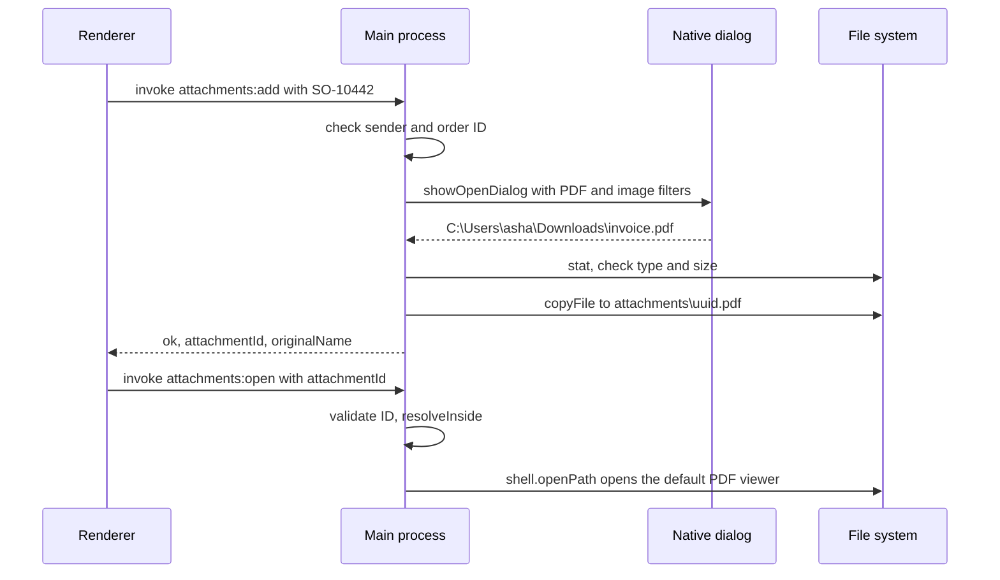
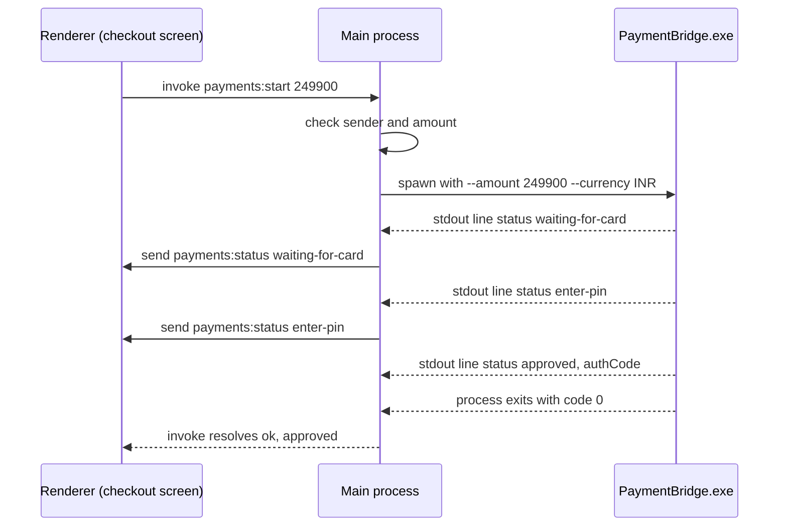
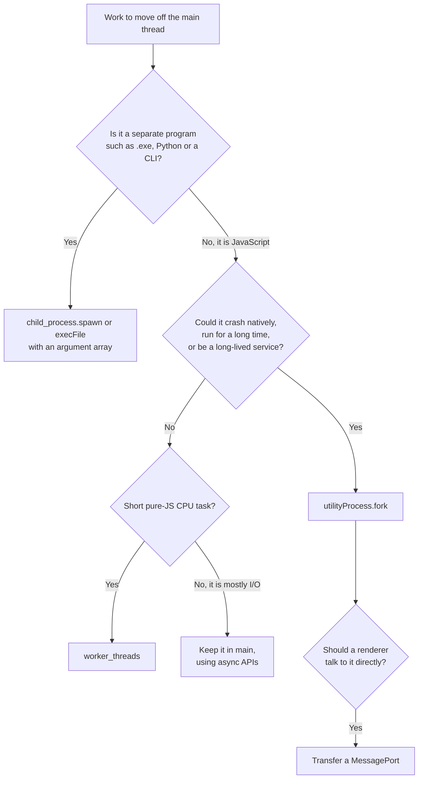

# Filesystem, Child Processes and Native Features

> In this document you will learn how an Electron app safely works with the computer it runs on: reading and writing files without path-traversal holes, native dialogs, where to store settings and databases, SQLite with native modules, running external programs and streaming their output to the UI, choosing between utility processes, child processes and worker threads, and native features such as notifications, the clipboard, power events, printing and multiple monitors. The examples focus on Windows desktop apps. These topics come up in interviews for desktop roles as practical "how would you build this?" questions.

**Before this:** [IPC and preload scripts](03-ipc-and-preload-scripts.md) · [Electron security](04-electron-security.md) · [Node.js core modules: fs, path, events, buffer](../07-nodejs-backend/04-core-modules-fs-path-events-buffer.md) · **Interview questions:** [jump to the interview section](#interview-questions)

## Table of contents

1. [Filesystem access lives in the main process](#filesystem-access-lives-in-the-main-process)
2. [Preventing path traversal](#preventing-path-traversal)
3. [Exposing specific file operations](#exposing-specific-file-operations)
4. [Native dialogs](#native-dialogs)
5. [Drag and drop and file inputs](#drag-and-drop-and-file-inputs)
6. [Where to store data](#where-to-store-data)
7. [Settings storage and atomic writes](#settings-storage-and-atomic-writes)
8. [Local databases: SQLite and IndexedDB](#local-databases-sqlite-and-indexeddb)
9. [Child processes](#child-processes)
10. [Choosing utilityProcess, child_process or worker_threads](#choosing-utilityprocess-child_process-or-worker_threads)
11. [Notifications](#notifications)
12. [The shell module](#the-shell-module)
13. [Clipboard](#clipboard)
14. [Power monitor: sleep, resume and lock](#power-monitor-sleep-resume-and-lock)
15. [Printing and PDF](#printing-and-pdf)
16. [Screens and multiple monitors](#screens-and-multiple-monitors)
17. [Native addons with Node-API](#native-addons-with-node-api)
18. [Windows-specific topics](#windows-specific-topics)
19. [Common mistakes](#common-mistakes)
20. [Best practices](#best-practices)
21. [How to explain native access in an interview](#how-to-explain-native-access-in-an-interview)
22. [Interview questions](#interview-questions)
23. [Summary](#summary)
24. [References](#references)

---

## Filesystem access lives in the main process

### The rule

With secure settings, the renderer has **no** `fs` module, and the sandboxed preload cannot `require('fs')` either. All file access happens in the **main process** (or in a utility process the main process controls). The renderer asks for **specific operations** through IPC, like "export this month's orders" or "attach a file to this order".

This is not a limitation to work around. It is the design: the renderer is untrusted, so it should never get a general "read any file / write any file" tool.

### Use the asynchronous API

The main process must stay responsive (see [the main process](01-electron-architecture-and-process-model.md#the-main-process)). Use **`node:fs/promises`** (or streams), not the `*Sync` functions, for anything that could be slow.

```js
// ❌ Wrong: blocks the main process; every window freezes while it reads
const data = fs.readFileSync(bigFilePath, 'utf8');

// ✅ Correct: the main process keeps handling events while the disk works
const fs = require('node:fs/promises');
const data = await fs.readFile(bigFilePath, 'utf8');
```

Small synchronous reads at startup (for example a 1 KB config file before the first window) are acceptable. Inside IPC handlers, timers and event handlers, use async.

For very large files, use **streams** so you never hold the whole file in memory (streams are covered in [Streams](../07-nodejs-backend/05-streams.md)):

```js
const { createReadStream } = require('node:fs');
const readline = require('node:readline');

async function countOrderLines(csvPath) {
  const lines = readline.createInterface({ input: createReadStream(csvPath), crlfDelay: Infinity });
  let count = 0;
  for await (const line of lines) {
    if (line.trim() !== '') count++;
  }
  return count - 1; // minus the header row
}
```

### Files inside `app.asar`

Your app code is packed into `resources\app.asar`. Electron patches `fs` in the main process so you can **read** files inside the archive as if it were a folder (`fs.readFile(path.join(__dirname, 'templates', 'invoice.html'))` works). But:

- The archive is **read-only**. Never try to write next to your code.
- **External programs cannot read inside `app.asar`.** If you ship an `.exe` helper, a native `.node` module or a file you pass to another program, it must be **unpacked** (electron-builder `asarUnpack`, Forge `asar.unpack`) and you must use the `app.asar.unpacked` path. Packaging details are in [Packaging, installers and code signing](06-packaging-installers-and-code-signing.md).

---

## Preventing path traversal

### What it is

**Path traversal** is an attack where input like `..\..\Windows\System32\config\SAM` or `C:\Users\asha\.ssh\id_rsa` makes your code read or write a file **outside** the folder you intended. If any part of a file path comes from the renderer (or a deep link, or a downloaded file), you must check it.

### The safe helper

The idea: resolve the requested path **against your base folder**, then compute the path **relative to the base folder**. If the relative path starts with `..`, or is absolute (another drive or a UNC path), the request escapes the folder.

```js
// main/safe-path.js
const path = require('node:path');

function resolveInside(baseDir, relativePath) {
  if (typeof relativePath !== 'string' || relativePath.length === 0) {
    throw new Error('Path must be a non-empty string');
  }
  if (relativePath.includes('\0')) {
    throw new Error('Invalid character in path');
  }
  const base = path.resolve(baseDir);
  const target = path.resolve(base, relativePath);
  const rel = path.relative(base, target);
  const inside = rel !== '' && !rel.startsWith('..') && !path.isAbsolute(rel);
  if (!inside) {
    throw new Error(`Path escapes the allowed folder: ${relativePath}`);
  }
  return target;
}

module.exports = { resolveInside };
```

Tested with Node.js on Windows, with the base folder `C:\Users\asha\AppData\Roaming\OrderDesk\exports`:

| Input | Result |
| --- | --- |
| `report.csv` | allowed → `...\exports\report.csv` |
| `2026\october\report.csv` | allowed |
| `2026/october/report.csv` | allowed (forward slashes work on Windows) |
| `..\..\..\Windows\System32\drivers\etc\hosts` | **blocked** |
| `../secrets.json` | **blocked** |
| `C:\Windows\win.ini` | **blocked** (absolute path) |
| `\\server\share\x.txt` | **blocked** (UNC path) |
| `D:report.csv` | **blocked** (another drive) |
| `sub\..\..\x` | **blocked** |
| `.` (the base folder itself) | **blocked** |
| `a\0b` | **blocked** (null byte) |
| `..\exports-old\a.txt` | **blocked** |

The last row matters. A **naive check** with `startsWith` is fooled by a sibling folder whose name begins the same way:

```js
// ❌ Wrong: 'C:\...\exports-old\a.txt'.startsWith('C:\...\exports') is true
const isInside = path.resolve(base, input).startsWith(path.resolve(base));
// Tested: returns true for '..\\exports-old\\a.txt' — the check is broken
```

### Validate file names too

When the user (or the renderer) provides only a **file name**, validate it with a strict pattern. Windows has extra traps:

- **Reserved device names**: `CON`, `PRN`, `AUX`, `NUL`, `COM1`–`COM9`, `LPT1`–`LPT9` (even with an extension like `nul.txt`).
- **Alternate data streams**: `report.csv:hidden` writes to a hidden stream of `report.csv`.
- **Trailing dots and spaces** are silently removed by Windows (`report.` becomes `report`).

```js
const RESERVED = /^(con|prn|aux|nul|com[0-9]|lpt[0-9])(\..*)?$/i;

function isSafeFileName(name) {
  return (
    typeof name === 'string' &&
    name.length >= 1 &&
    name.length <= 120 &&
    /^[A-Za-z0-9 ._()-]+$/.test(name) && // no slashes, colons, quotes, wildcards
    !/[. ]$/.test(name) &&               // no trailing dot or space
    !name.startsWith('.') &&
    !RESERVED.test(name)
  );
}

isSafeFileName('invoice-SO-10442.pdf'); // true
isSafeFileName('Report (October).csv'); // true
isSafeFileName('report.csv:hidden');    // false
isSafeFileName('nul.txt');              // false
isSafeFileName('report.');              // false
isSafeFileName('../x.csv');             // false
```

(Outputs verified with Node.js.) This pattern is strict: it also rejects non-ASCII names like `naïve.txt`. If your users need international file names, allow Unicode letters (`\p{L}` with the `u` flag) but keep the other rules.

### Symbolic links and junctions

If a folder inside your base directory is a **symbolic link** or a Windows **junction** pointing elsewhere, `resolveInside` cannot see that, because it only works with path strings. For folders that untrusted parties can modify (for example a shared network folder), also resolve the real path with `fs.promises.realpath()` and check that again. For folders under your own `userData`, this is usually not needed.

### The best protection: do not accept paths at all

| Situation | Safer design |
| --- | --- |
| User chooses where to save | Main shows `dialog.showSaveDialog`; the user picks the path |
| User opens a file | Main shows `dialog.showOpenDialog` |
| App stores attachments | Renderer sends an **ID**; main builds `path.join(attachmentsDir, `${id}.pdf`)` after validating the ID |
| App shows a file in Explorer | Renderer sends the ID; main looks up the path |

---

## Exposing specific file operations

Here is a realistic feature: **order attachments**. The user attaches a PDF or image to an order; the app copies it into its own storage and can open it later.

```js
// main/attachments.js
const { app, BrowserWindow, dialog, ipcMain, shell } = require('electron');
const fs = require('node:fs/promises');
const path = require('node:path');
const { randomUUID } = require('node:crypto');
const { isTrustedSender } = require('./ipc-security');
const { resolveInside } = require('./safe-path');

const ATTACHMENTS_DIR = path.join(app.getPath('userData'), 'attachments');
const ALLOWED_EXTENSIONS = new Set(['.pdf', '.png', '.jpg', '.jpeg']);
const MAX_SIZE_BYTES = 20 * 1024 * 1024; // 20 MB
const ID_PATTERN = /^[0-9a-f-]{36}\.(pdf|png|jpe?g)$/;

ipcMain.handle('attachments:add', async (event, orderId) => {
  if (!isTrustedSender(event.senderFrame)) throw new Error('Unauthorized sender');
  if (typeof orderId !== 'string' || !/^SO-\d{1,10}$/.test(orderId)) {
    return { ok: false, error: { code: 'INVALID_ORDER', message: 'Invalid order' } };
  }

  const win = BrowserWindow.fromWebContents(event.sender);
  const { canceled, filePaths } = await dialog.showOpenDialog(win, {
    title: 'Attach a file',
    properties: ['openFile'],
    filters: [{ name: 'Documents and images', extensions: ['pdf', 'png', 'jpg', 'jpeg'] }],
  });
  if (canceled || filePaths.length === 0) return { ok: false, error: { code: 'CANCELED', message: '' } };

  const source = filePaths[0];
  const ext = path.extname(source).toLowerCase();
  if (!ALLOWED_EXTENSIONS.has(ext)) {
    return { ok: false, error: { code: 'TYPE', message: 'Only PDF and images are allowed' } };
  }
  const { size } = await fs.stat(source);
  if (size > MAX_SIZE_BYTES) {
    return { ok: false, error: { code: 'TOO_LARGE', message: 'The file is larger than 20 MB' } };
  }

  await fs.mkdir(ATTACHMENTS_DIR, { recursive: true });
  const storedName = `${randomUUID()}${ext}`;   // never reuse the user's file name on disk
  await fs.copyFile(source, path.join(ATTACHMENTS_DIR, storedName));

  await attachmentRepository.add({ orderId, storedName, originalName: path.basename(source), size });
  return { ok: true, data: { attachmentId: storedName, originalName: path.basename(source) } };
});

ipcMain.handle('attachments:open', async (event, attachmentId) => {
  if (!isTrustedSender(event.senderFrame)) throw new Error('Unauthorized sender');
  if (typeof attachmentId !== 'string' || !ID_PATTERN.test(attachmentId)) return false;
  const filePath = resolveInside(ATTACHMENTS_DIR, attachmentId); // defense in depth
  const errorMessage = await shell.openPath(filePath);           // opens with the default app
  return errorMessage === '';
});
```

```js
// preload.js
contextBridge.exposeInMainWorld('orderDesk', {
  attachments: {
    add: (orderId) => ipcRenderer.invoke('attachments:add', orderId),
    open: (attachmentId) => ipcRenderer.invoke('attachments:open', attachmentId),
  },
});
```

Design points:

1. The **user picks the source file** in a native dialog. The renderer never sends a path.
2. The app **copies** the file into its own folder with a **random name**. User file names can contain anything; random names avoid collisions and path tricks. The original name is kept in the database for display.
3. **Type and size checks** happen in main.
4. Opening uses an **ID with a strict pattern**, plus `resolveInside` as a second layer.
5. `shell.openPath` returns a promise with an **error message string** (empty string on success).



---

## Native dialogs

The **`dialog`** module (main process) shows the operating system's own dialogs. They look native, are accessible, and the user trusts them.

### Open dialog

```js
const { canceled, filePaths } = await dialog.showOpenDialog(win, {
  title: 'Import orders',
  defaultPath: app.getPath('documents'),
  buttonLabel: 'Import',
  properties: ['openFile', 'multiSelections'],
  filters: [
    { name: 'Order files', extensions: ['csv', 'xlsx'] },
    { name: 'All files', extensions: ['*'] },
  ],
});
if (!canceled) {
  console.log(filePaths); // [ 'C:\\Users\\asha\\Documents\\orders-oct.csv', ... ]
}
```

- `properties` can include `openFile`, `openDirectory`, `multiSelections`, `showHiddenFiles`, `createDirectory`, `promptToCreate`, `dontAddToRecent` (some are platform-specific).
- Extensions in `filters` are written **without dots** (`'csv'`, not `'.csv'`).
- The result is `{ canceled, filePaths }`; `filePaths` is empty when canceled.

### Save dialog

```js
const { canceled, filePath } = await dialog.showSaveDialog(win, {
  title: 'Export orders',
  defaultPath: path.join(app.getPath('documents'), 'orders-2026-10.csv'),
  filters: [{ name: 'CSV', extensions: ['csv'] }],
});
if (!canceled && filePath) await fs.writeFile(filePath, csvText, 'utf8');
```

### Message box

```js
const { response, checkboxChecked } = await dialog.showMessageBox(win, {
  type: 'warning',
  title: 'Delete order',
  message: 'Delete order SO-10442?',
  detail: 'This cannot be undone.',
  buttons: ['Delete', 'Cancel'],
  defaultId: 1,          // Enter = Cancel (the safe choice)
  cancelId: 1,           // Esc = Cancel
  checkboxLabel: 'Also delete attachments',
  noLink: true,          // Windows: show normal buttons, not "command links"
});
if (response === 0) await deleteOrder('SO-10442', { withAttachments: checkboxChecked });
```

### Error box

```js
dialog.showErrorBox('OrderDesk cannot start', 'The local database is damaged. Please contact IT support.');
```

`showErrorBox` can be called safely **before** `ready`, which makes it useful for fatal startup errors.

### Tips

- **Pass the parent window** (`win`) as the first argument. The dialog becomes modal to that window and appears on top of it. Without it, the dialog may appear behind your window.
- Prefer the **async** versions (`showOpenDialog`). The `*Sync` versions block the main process while the dialog is open.
- If you omit `defaultPath` for open/save dialogs, current Electron (43+) defaults to the Downloads folder (or the home folder if Downloads does not exist), instead of letting the OS remember the last folder. Set `defaultPath` yourself (and remember the user's last folder in your settings) if that matters.

---

## Drag and drop and file inputs

Users expect to drag a file from Explorer onto your window. In the page you get a web `File` object. Since Electron 32, `File` objects no longer have a `path` property. To get the real path, the **preload** uses **`webUtils.getPathForFile(file)`**:

```js
// preload.js
const { contextBridge, ipcRenderer, webUtils } = require('electron');

contextBridge.exposeInMainWorld('orderDesk', {
  importDroppedFile: (file) => {
    const filePath = webUtils.getPathForFile(file); // '' for files created in JavaScript
    if (!filePath) throw new Error('Only files from disk can be imported');
    return ipcRenderer.invoke('orders:import-dropped', filePath);
  },
});
```

```js
// renderer
dropZone.addEventListener('dragover', (e) => e.preventDefault());
dropZone.addEventListener('drop', async (e) => {
  e.preventDefault();
  const [file] = e.dataTransfer.files;
  if (file) showSummary(await window.orderDesk.importDroppedFile(file));
});
```

The main handler must still validate the path (extension, size, that it is a regular file). The path came from the renderer, so treat it as untrusted. Electron's docs also suggest not exposing full file paths to the page unless needed; here, the path goes directly from the preload to main.

Also set `navigateOnDragDrop: false` (the default) so that dropping a file onto the window does not navigate the window to `file:///...`.

---

## Where to store data

Use **`app.getPath()`** for every location (the full table is in [Where to store files with app.getPath](02-app-and-window-lifecycle.md#where-to-store-files-with-appgetpath)).

| Data | Location | Why |
| --- | --- | --- |
| Settings, preferences | `userData\settings.json` | Per user, survives updates |
| Local database | `userData\orders.sqlite` | Per user, writable |
| Attachments, caches you manage | `userData\attachments\`, `userData\cache\` | You control cleanup |
| Logs | `app.getPath('logs')` | Standard location for support |
| Temporary files | `app.getPath('temp')` (in a subfolder you create) | The OS may clean it |
| User documents (exports) | Where the user chooses, default `documents` | The user owns them |
| Machine-wide data for all users | `%ProgramData%\Contoso\OrderDesk` (via `process.env.ProgramData`) | Shared terminals; needs permissions set by the installer |

### Never write to the install folder

On Windows, per-machine installs go to `C:\Program Files\OrderDesk\`. Normal users **cannot write** there. Even per-user installs (`%LOCALAPPDATA%\Programs\OrderDesk`) are replaced on every update. And `app.asar` is read-only. So:

```js
// ❌ Wrong: writes next to the executable / inside the archive
fs.writeFile(path.join(__dirname, 'settings.json'), json);
fs.writeFile(path.join(path.dirname(process.execPath), 'orders.db'), data);

// ✅ Correct
fs.writeFile(path.join(app.getPath('userData'), 'settings.json'), json);
```

### Roaming vs local

`userData` is under `AppData\Roaming`. In some companies, **roaming profiles** copy this folder to a server at log-off and back at log-on. Large or frequently changing data (big caches, a 2 GB database) can make log-on slow. For such data, consider `AppData\Local` instead: `path.join(process.env.LOCALAPPDATA, 'OrderDesk')` on Windows, or set `sessionData` to a local folder before `ready`. Settings and small files are fine in Roaming.

---

## Settings storage and atomic writes

### Option 1: electron-store

**electron-store** is a popular package that saves settings to a JSON file (`config.json` in `userData`) with defaults, schema validation and migrations.

```js
// main/settings.mjs (electron-store is ESM-only)
import Store from 'electron-store';

export const settings = new Store({
  schema: {
    theme: { type: 'string', enum: ['light', 'dark', 'system'], default: 'system' },
    receiptPrinter: { type: 'string', default: '' },
    autoPrintReceipts: { type: 'boolean', default: false },
    mainWindowState: { type: 'object' },
  },
});

settings.set('theme', 'dark');
console.log(settings.get('theme')); // dark
// settings.set('theme', 'purple');  // throws: schema violation
```

Current versions of electron-store are **ESM-only** and require a recent Electron (the README states Electron 35 or later at the time of writing). If your main process is CommonJS, either convert it to ESM or use an older major version of the package, or write your own small store (option 2).

Keep the store in the **main process** and expose specific settings through IPC. The README itself recommends that. Its `encryptionKey` option is **not** for security (the key is in your code); it only discourages users from editing the file by hand. For secrets, use `safeStorage` (see [Electron security](04-electron-security.md#asar-is-not-encryption-secrets-and-safestorage)).

### Option 2: your own JSON file with atomic writes

If the app crashes or the power fails **while** you are writing `settings.json`, the file can end up half-written, and the next start fails with a JSON parse error. An **atomic write** avoids this:

1. Write the new content to a **temporary file in the same folder**.
2. Flush it to disk (`fsync`).
3. **Rename** the temp file over the real file. A rename on the same volume replaces the file in one step: readers see either the old file or the new file, never half of one.

```js
// main/atomic-write.js
const fs = require('node:fs/promises');
const path = require('node:path');

async function writeJsonAtomic(filePath, data) {
  const dir = path.dirname(filePath);
  await fs.mkdir(dir, { recursive: true });
  const tempPath = path.join(dir, `.${path.basename(filePath)}.${process.pid}.${Date.now()}.tmp`);

  const handle = await fs.open(tempPath, 'w');
  try {
    await handle.writeFile(JSON.stringify(data, null, 2), 'utf8');
    await handle.sync(); // make sure the bytes are on disk before the rename
  } finally {
    await handle.close();
  }

  try {
    await fs.rename(tempPath, filePath); // replaces the old file
  } catch (error) {
    await fs.rm(tempPath, { force: true });
    throw error;
  }
}

async function readJsonOrDefault(filePath, defaults) {
  try {
    return { ...defaults, ...JSON.parse(await fs.readFile(filePath, 'utf8')) };
  } catch (error) {
    if (error.code !== 'ENOENT') log.warn('Settings file unreadable, using defaults', error);
    return { ...defaults };
  }
}

module.exports = { writeJsonAtomic, readJsonOrDefault };
```

This function was run with Node.js on Windows: writing a settings object twice to the same path replaced the file correctly, and reading it back returned the second version.

Windows notes:

- `fs.rename` over an existing file works on Windows, but it can fail with `EPERM` or `EBUSY` if another program (often **antivirus** or a backup/sync tool such as OneDrive) has the file open at that moment. A short retry (for example 3 tries, 100 ms apart) handles this.
- Serialize writes: if two saves run at the same time, chain them through a promise queue so the last write wins in order.

---

## Local databases: SQLite and IndexedDB

### SQLite with better-sqlite3

**SQLite** is a full SQL database in a single file. For offline-first desktop apps (a POS that keeps selling when the network is down), it is a very common choice. In Node.js, **better-sqlite3** is a popular, fast driver.

```js
// main/db.js
const Database = require('better-sqlite3');
const path = require('node:path');
const { app } = require('electron');

const db = new Database(path.join(app.getPath('userData'), 'orders.sqlite'));
db.pragma('journal_mode = WAL'); // better concurrency and crash safety for many workloads

db.exec(`
  CREATE TABLE IF NOT EXISTS orders (
    id TEXT PRIMARY KEY,
    customer_id TEXT NOT NULL,
    total_cents INTEGER NOT NULL,
    status TEXT NOT NULL,
    created_at TEXT NOT NULL
  )
`);

const insertOrder = db.prepare(
  'INSERT INTO orders (id, customer_id, total_cents, status, created_at) VALUES (@id, @customerId, @totalCents, @status, @createdAt)',
);
const findByStatus = db.prepare('SELECT * FROM orders WHERE status = ? ORDER BY created_at DESC LIMIT ?');

function saveOrder(order) {
  insertOrder.run(order); // parameters, never string concatenation (prevents SQL injection)
}

function listOrders(status, limit) {
  return findByStatus.all(status, limit);
}

module.exports = { db, saveOrder, listOrders };
```

Important points:

- **Always use prepared statements with parameters** (`?` or `@name`). Building SQL with string concatenation from renderer data is SQL injection.
- **better-sqlite3 is synchronous.** Each query blocks the thread it runs on. Small indexed queries take microseconds to a few milliseconds, which is fine. But a big report query or a migration of a large table in the **main process** would freeze all windows. For heavy database work, run the database in a **utility process** and talk to it with messages.
- **Store money as integer cents** (`total_cents`), not floating-point numbers.

### Native modules and `@electron/rebuild`

better-sqlite3 is a **native module**: it contains compiled C/C++ code (a `.node` file). Native modules are compiled for a specific Node.js ABI (binary interface). Electron has its own Node.js build, so a module compiled for your system's Node.js usually fails to load in Electron with an error like *"was compiled against a different Node.js version using NODE_MODULE_VERSION X. This version of Node.js requires NODE_MODULE_VERSION Y."*

The fix is to rebuild native modules for your Electron version:

```bash
npm install --save-dev @electron/rebuild
npx electron-rebuild          # or add "postinstall": "electron-rebuild" to package.json scripts
```

- **Electron Forge** rebuilds native modules automatically during `start` and `package`.
- **electron-builder** rebuilds them during packaging (its `install-app-deps` command can also do it).
- Packaging must keep `.node` files **outside** `app.asar` (`asarUnpack`), because the OS loads them as real files.
- Rebuild after every Electron upgrade.
- Building from source on Windows needs Visual Studio Build Tools with the C++ workload and Python. Many popular modules publish **prebuilt binaries** for Electron, which avoids that.

### IndexedDB in the renderer

The renderer has normal browser storage: **IndexedDB** (and `localStorage` for small values). Electron stores it under `sessionData` (by default `userData`).

| | SQLite in main/utility | IndexedDB in renderer |
| --- | --- | --- |
| Query power | Full SQL, joins, indexes, transactions | Key/index lookups; no SQL |
| Access from main and workers | Yes | No (renderer only) |
| Native module | Yes (rebuild needed) | No |
| Size and performance for large data | Very good | Good, but no complex queries |
| Easy to back up / inspect | Single file, standard tools | Chromium's internal format |
| Shared between windows | Yes (through main) | Yes, for the same origin and session |
| Survives "clear browsing data" | Yes | No — `session.clearStorageData()` deletes it |

Choose **IndexedDB** for UI caches and data that only the renderer needs (offline cache of product images, drafts). Choose **SQLite** for the app's real data, especially when main or background workers must read it, when you need SQL, or when the data must survive any storage clearing.

Note: Node.js 22.5+ has a built-in `node:sqlite` module (experimental in Node 22). Whether it is available depends on the Node.js version your Electron release includes and on its stability status there; check before relying on it instead of a native module.

---

## Child processes

### Why desktop apps run other programs

Many real desktop apps need code that is not JavaScript:

- A **.NET helper** that talks to a card payment terminal SDK or a fiscal printer.
- A **Python** script for data processing or a machine-learning model.
- A **command-line tool** (`ffmpeg`, `git`, a PDF printer tool, `robocopy`).
- A vendor **`.exe`** that must be launched with arguments.

Node's **`child_process`** module (available in the main process and in utility processes) runs other programs. (The Node.js side is covered in [Concurrency, worker threads and cluster](../07-nodejs-backend/12-concurrency-worker-threads-and-cluster.md).)

### Which function to use

| Function | Shell? | Output | Use for |
| --- | --- | --- | --- |
| `spawn(file, args, options)` | No (default) | **Streams** (`stdout`, `stderr`) | Long-running helpers, large output, progress |
| `execFile(file, args, options, callback)` | No | Buffered, whole output at the end | Short commands with small output |
| `exec(command, callback)` | **Yes** | Buffered | Avoid with any dynamic input (command injection) |
| `fork(modulePath)` | No | IPC channel | Node.js scripts — in Electron, prefer `utilityProcess.fork` |

The safe default: **`spawn` or `execFile` with an argument array and no shell**. Each argument is passed to the program as-is; nothing is interpreted by `cmd.exe`, so characters like `&`, `|` or `"` in a value cannot start another command.

```js
// ❌ Wrong: command injection if fileName comes from anywhere outside your code
exec(`PrinterBridge.exe --print "${fileName}"`);

// ✅ Correct: no shell, arguments as an array
spawn(helperPath, ['--print', filePath], { windowsHide: true });
```

### Finding a bundled helper

Ship helper executables as **extra resources** (outside `app.asar`, because Windows must be able to execute them). In a packaged app they live under `process.resourcesPath`:

```js
// main/helpers/paths.js
const { app } = require('electron');
const path = require('node:path');

function helperPath(fileName) {
  return app.isPackaged
    ? path.join(process.resourcesPath, 'bin', fileName)            // e.g. C:\...\OrderDesk\resources\bin\
    : path.join(__dirname, '..', '..', 'resources', 'bin', fileName); // project folder in development
}

module.exports = { helperPath };
```

With electron-builder you would add `"extraResources": [{ "from": "resources/bin", "to": "bin" }]`. See [Packaging, installers and code signing](06-packaging-installers-and-code-signing.md).

### Streaming a helper's output to the UI

A realistic case: a .NET helper `PaymentBridge.exe` talks to a card terminal. It writes **one JSON object per line** to `stdout` ("JSON Lines"), such as `{"status":"waiting-for-card"}`, `{"status":"approved","authCode":"A1B2C3"}`. The main process reads the lines, forwards status updates to the renderer, and resolves when the payment finishes.

The data from `stdout` arrives in **chunks**, and a chunk can end in the middle of a line. So you must buffer until a newline:

```js
// main/helpers/line-splitter.js
function createLineSplitter(onLine) {
  let buffer = '';
  return {
    push(chunk) {
      buffer += chunk;
      const lines = buffer.split(/\r?\n/);
      buffer = lines.pop(); // the last part may be incomplete; keep it for the next chunk
      for (const line of lines) if (line) onLine(line);
    },
    flush() {
      if (buffer) onLine(buffer);
      buffer = '';
    },
  };
}

module.exports = { createLineSplitter };
```

```js
// Tested with Node.js:
const lines = [];
const splitter = createLineSplitter((line) => lines.push(line));
splitter.push('{"progress":10}\r\n{"prog');   // a chunk ends mid-line
splitter.push('ress":55}\r\n{"progress":100}');
splitter.flush();
console.log(lines); // [ '{"progress":10}', '{"progress":55}', '{"progress":100}' ]
```

```js
// main/payments.js
const { spawn } = require('node:child_process');
const { helperPath } = require('./helpers/paths');
const { createLineSplitter } = require('./helpers/line-splitter');

function runPayment({ amountCents, currency, onStatus }) {
  return new Promise((resolve, reject) => {
    const child = spawn(
      helperPath('PaymentBridge.exe'),
      ['--amount', String(amountCents), '--currency', currency],
      {
        windowsHide: true,                 // no console window flashes on Windows
        stdio: ['ignore', 'pipe', 'pipe'], // we read stdout and stderr
        timeout: 120_000,                  // kill the helper if it hangs for 2 minutes
      },
    );

    let result = null;
    const stdout = createLineSplitter((line) => {
      let message;
      try {
        message = JSON.parse(line);
      } catch {
        log.warn('PaymentBridge sent a non-JSON line', line);
        return;
      }
      if (message.status === 'approved' || message.status === 'declined') result = message;
      else onStatus(message.status); // e.g. 'waiting-for-card', 'enter-pin', 'processing'
    });

    child.stdout.setEncoding('utf8');
    child.stdout.on('data', (chunk) => stdout.push(chunk));
    child.stderr.setEncoding('utf8');
    child.stderr.on('data', (chunk) => log.warn('[PaymentBridge]', chunk.trim()));

    child.on('error', (error) => reject(error)); // e.g. ENOENT: the exe is missing
    child.on('close', (code, signal) => {
      stdout.flush();
      if (result) resolve(result);
      else reject(new Error(`PaymentBridge exited without a result (code ${code}, signal ${signal})`));
    });
  });
}

module.exports = { runPayment };
```

```js
// main/ipc/payment-handlers.js
ipcMain.handle('payments:start', async (event, amountCents) => {
  if (!isTrustedSender(event.senderFrame)) throw new Error('Unauthorized sender');
  if (!Number.isInteger(amountCents) || amountCents <= 0 || amountCents > 10_000_000) {
    return { ok: false, error: { code: 'INVALID_AMOUNT', message: 'Invalid amount' } };
  }
  const contents = event.sender;
  try {
    const result = await runPayment({
      amountCents,
      currency: 'INR',
      onStatus: (status) => {
        if (!contents.isDestroyed()) contents.send('payments:status', { status });
      },
    });
    return { ok: true, data: { approved: result.status === 'approved', authCode: result.authCode ?? null } };
  } catch (error) {
    log.error('Payment failed', error);
    return { ok: false, error: { code: 'PAYMENT_ERROR', message: 'The payment terminal did not respond' } };
  }
});
```



Things to notice:

- `child.on('error')` fires if the program cannot be started (for example `ENOENT` when the exe is missing or blocked by antivirus). Without this listener, the error would be thrown as an uncaught exception in main.
- `stderr` goes to the **log file**, not to the user.
- The `timeout` option kills the child if it runs too long (the child receives `killSignal`, by default `SIGTERM`; on Windows the process is terminated).
- Status messages from the helper are **mapped** to a small set of known statuses before reaching the UI; never forward raw helper output into `innerHTML`.

### Talking to a long-running helper

Some helpers stay running and accept commands. Then you write requests to `stdin` and match responses by ID:

```js
const helper = spawn(helperPath('ScaleBridge.exe'), [], { windowsHide: true, stdio: ['pipe', 'pipe', 'pipe'] });
let nextId = 1;
const pending = new Map(); // id -> { resolve, reject }

const lines = createLineSplitter((line) => {
  const msg = JSON.parse(line); // { id, weightGrams } or { id, error }
  const request = pending.get(msg.id);
  if (!request) return;
  pending.delete(msg.id);
  msg.error ? request.reject(new Error(msg.error)) : request.resolve(msg);
});
helper.stdout.setEncoding('utf8');
helper.stdout.on('data', (chunk) => lines.push(chunk));

function readWeight() {
  const id = nextId++;
  return new Promise((resolve, reject) => {
    pending.set(id, { resolve, reject });
    helper.stdin.write(`${JSON.stringify({ id, command: 'read-weight' })}\n`);
  });
}
```

Also handle the helper exiting: reject all pending requests and restart it with a backoff delay (restart strategies are in [Logging, crash recovery and monitoring](08-logging-crash-recovery-and-monitoring.md)).

### Batch files (`.bat` and `.cmd`)

Since an April 2024 security fix in Node.js (CVE-2024-27980), spawning a `.bat` or `.cmd` file **without** `shell: true` throws an `EINVAL` error on Windows. This was verified with Node.js 22:

```js
spawn('C:\\tools\\hello.bat', ['x']); // throws: Error: spawn EINVAL
```

The reason: Windows always runs batch files through `cmd.exe`, which re-parses the arguments, so arguments could inject commands. Options:

- Best: call the real program directly instead of a batch wrapper.
- If you must run a batch file, run `cmd.exe` explicitly with **fixed, validated** arguments: `execFile('cmd.exe', ['/d', '/s', '/c', batPath, 'world'])` (verified to work). Never pass renderer-supplied strings to `cmd.exe`.

### Killing a process tree on Windows

On Windows, `child.kill()` terminates **only that process**, not the processes it started. This was verified with Node.js: after spawning `cmd.exe /c ping -n 20 127.0.0.1` and calling `child.kill()`, `cmd.exe` exited but `ping.exe` kept running.

Helpers often start their own children (a Python launcher starts `python.exe`, a `.cmd` wrapper starts the real tool). To stop everything, kill the **tree** with Windows' `taskkill`:

```js
const { execFile } = require('node:child_process');

function killProcessTree(pid) {
  return new Promise((resolve) => {
    if (process.platform !== 'win32') {
      try { process.kill(-pid, 'SIGTERM'); } catch { /* already gone */ } // needs detached: true on POSIX
      return resolve();
    }
    // /T = include child processes, /F = force
    execFile('taskkill', ['/PID', String(pid), '/T', '/F'], { windowsHide: true }, () => resolve());
  });
}
```

Verified with Node.js: `taskkill /PID <pid> /T /F` on the `cmd.exe` parent also ended its `ping.exe` child.

Kill helpers when the app quits (in `will-quit`), when the owning window closes, and when a job is cancelled. Orphaned helpers that keep a COM port or a file locked are a classic support problem ("the scanner does not work until I reboot").

### Detached processes

`spawn(file, args, { detached: true, stdio: 'ignore' })` followed by `child.unref()` starts a process that **keeps running after your app exits**. On Windows, a detached child gets its own console window unless you also pass `windowsHide: true`.

Use it rarely and on purpose, for example to launch another application the user asked to open (though `shell.openPath` is often simpler), or a separate updater/repair tool that must outlive the app. Do not use detached processes for normal background work: you lose control of their lifetime.

---

## Choosing utilityProcess, child_process or worker_threads

| | `utilityProcess.fork` | `child_process.spawn` / `execFile` | `child_process.fork` | `worker_threads` |
| --- | --- | --- | --- | --- |
| Runs | Your Node.js script | **Any program** (`.exe`, Python, CLI) | Your Node.js script | Your Node.js script |
| Separate process | Yes | Yes | Yes | No (thread inside main) |
| Native crash isolation | Yes | Yes | Yes | **No** — crashes main |
| Talk to renderer directly with `MessagePort` | **Yes** | No | No | No |
| Appears in `app.getAppMetrics()` | Yes | No | No | No |
| Works with the `RunAsNode` fuse disabled | **Yes** | Yes | **No** (throws) | Yes |
| Startup cost | Process start | Process start | Process start | Lower (thread) |
| Best for | Heavy or crash-prone JS work, services, native-addon wrappers | External programs | Avoid in Electron main | Short, pure-JS CPU tasks (hashing, parsing) |



Electron's documentation recommends `utilityProcess` over `child_process.fork` when forking from the main process. And if you disable the `RunAsNode` fuse (recommended, see [Electron fuses](04-electron-security.md#electron-fuses)), `child_process.fork` stops working entirely.

---

## Notifications

### From the main process

```js
const { Notification } = require('electron');

function notifyOrderReady(order) {
  if (!Notification.isSupported()) return;
  const notification = new Notification({
    title: 'Order ready for pickup',
    body: `${order.id} for ${order.customerName} is packed.`,
    silent: false,
  });
  notification.on('click', () => {
    showMainWindow();
    openOrderWindow(order.id);
  });
  notification.show(); // nothing appears until show() is called
}
```

### From the renderer

The standard web API also works (and goes through your permission handler, which must allow `notifications`):

```js
new Notification('Sync complete', { body: '42 orders uploaded' }).onclick = () => window.focus();
```

### Windows requirements

On Windows, toast notifications need an **AppUserModelID** and a **Start Menu shortcut** with that ID. Installers (Squirrel.Windows, NSIS from electron-builder) usually create the shortcut. In code, set the same ID early:

```js
app.setAppUserModelId('com.contoso.orderdesk'); // must match the installer's appId
```

In development, notifications may not appear because `electron.exe` has no matching shortcut. Electron's docs suggest pinning `node_modules\electron\dist\electron.exe` to the Start Menu and calling `app.setAppUserModelId(process.execPath)` while developing.

Also remember that users can turn off notifications in Windows Settings or with Focus/Do not disturb. Never put **critical** information only in a notification; show it in the app too.

---

## The shell module

**`shell`** integrates with the desktop environment. Use it from the **main process**; it does not work in sandboxed renderers.

```js
const { shell } = require('electron');

// Open a file with its default application (PDF viewer, Excel...)
const error = await shell.openPath('C:\\Users\\asha\\Documents\\orders-2026-10.csv');
if (error) log.warn('Could not open file:', error); // '' means success

// Show a file selected in Explorer ("Show in folder")
shell.showItemInFolder('C:\\Users\\asha\\Documents\\orders-2026-10.csv');

// Move to the Recycle Bin (reversible) instead of deleting permanently
await shell.trashItem(path.resolve(oldExportPath));

// Open a website in the default browser — ONLY after validation (see the security document)
await openExternalSafely('https://docs.contoso.com/orderdesk/exports');

// Windows: create a desktop shortcut
shell.writeShortcutLink(path.join(app.getPath('desktop'), 'OrderDesk.lnk'), {
  target: process.execPath,
  description: 'OrderDesk',
});
```

Safety rules:

- `openPath` launches files with their associated program. If the path points to an `.exe`, `.bat`, `.lnk` or `.js` file, it **runs** it. Only open files from your own folders or files the user just chose, and check the extension against an allowlist.
- `openExternal` with untrusted URLs can run programs; always validate ([details](04-electron-security.md#validate-urls-before-shellopenexternal)).
- Prefer `trashItem` over permanent deletion for user-visible files, so mistakes can be undone. (`trashItem` expects the platform's path separator; `path.resolve()` gives you that.)

---

## Clipboard

### In the renderer

For simple text, the standard web API works in the page:

```js
await navigator.clipboard.writeText('SO-10442'); // "Copy order ID" button
```

Your permission handler must allow what you use (for example `clipboard-sanitized-write` for writing; reading needs `clipboard-read`, which you should allow only for your own origin, because reading the clipboard can expose passwords the user copied elsewhere).

### In the main process

Electron's `clipboard` module is a **main-process** API in current Electron. Using it directly in renderers was deprecated in Electron 40 and **removed in Electron 44**. Electron 44 also redesigned the module around **promises** and `ClipboardItem`, closer to the web API:

```js
// main (Electron 44+): readText/writeText return promises
const { clipboard, ipcMain } = require('electron');

ipcMain.handle('clipboard:copy-order-summary', async (event, orderId) => {
  if (!isTrustedSender(event.senderFrame)) throw new Error('Unauthorized sender');
  if (typeof orderId !== 'string' || !/^SO-d{1,10}$/.test(orderId)) return false;
  const order = await orderRepository.findById(orderId);
  if (!order) return false;
  await clipboard.writeText(`${order.id} — ${order.customerName} — ₹${(order.totalCents / 100).toFixed(2)}`);
  return true;
});
```

In Electron 43 and earlier, `clipboard.writeText` and `clipboard.readText` are synchronous. Writing `await clipboard.writeText(...)` works in both old and new versions (awaiting a non-promise value is harmless), which makes upgrades easier. Electron 44 also removed older helpers such as `readHTML`, `writeHTML`, `readImage` and `writeImage` in favor of `read()`/`write()` with `ClipboardItem`; check the breaking-changes notes when upgrading.

---

## Power monitor: sleep, resume and lock

Laptops sleep, desktops lock, and Windows restarts for updates. A desktop app that keeps connections, timers or hardware ports open must react. The **`powerMonitor`** module (main process) emits events:

| Event | Platforms | Typical reaction |
| --- | --- | --- |
| `suspend` | all | Pause sync, close serial/USB connections, flush data |
| `resume` | all | Reconnect, refresh auth tokens, resync data, check the clock |
| `lock-screen` / `unlock-screen` | Windows, macOS | Hide sensitive data; POS: require PIN again |
| `on-ac` / `on-battery` | Windows, macOS | Reduce background work on battery |
| `shutdown` | Linux, macOS | Last chance to save (on Windows use window `session-end`) |

```js
// main/power.js
const { powerMonitor } = require('electron');

function watchPower({ syncService, hardware, windowManager }) {
  powerMonitor.on('suspend', async () => {
    log.info('System suspending');
    syncService.pause();
    await hardware.closePorts(); // serial ports often break across sleep
  });

  powerMonitor.on('resume', async () => {
    log.info('System resumed');
    await hardware.reopenPorts();
    syncService.resumeAndSyncNow(); // timers did not run while asleep; data may be stale
    windowManager.broadcast('app:resumed', { at: new Date().toISOString() });
  });

  powerMonitor.on('lock-screen', () => windowManager.broadcast('security:locked'));
}

// Auto-logout for shared terminals: check idle time every minute
setInterval(() => {
  if (powerMonitor.getSystemIdleTime() > 15 * 60) signOutCurrentUser(); // seconds
}, 60_000);
```

Why `resume` matters: while the machine sleeps, `setInterval` timers do not fire, network connections (WebSockets, database connections to a server) silently die, and access tokens may expire. Many "the app shows old data after lunch" bugs are missing `resume` handlers.

### Preventing sleep during important work

Use **`powerSaveBlocker`** to stop the system from sleeping while a long job runs, and release it afterwards:

```js
const { powerSaveBlocker } = require('electron');

async function runLongExport(job) {
  const blockerId = powerSaveBlocker.start('prevent-app-suspension'); // the display may still turn off
  try {
    await job.run();
  } finally {
    powerSaveBlocker.stop(blockerId);
  }
}
```

`'prevent-display-sleep'` also keeps the screen on, which is useful for kiosk or customer-display windows.

---

## Printing and PDF

### Printing a page

`webContents.print(options, callback)` prints the page shown in a `webContents`.

```js
win.webContents.print({ silent: false, printBackground: true }, (success, failureReason) => {
  if (!success) log.warn('Print failed:', failureReason); // e.g. 'Print job canceled'
});
```

### Silent receipt printing (POS)

A point-of-sale app prints receipts on a thermal printer **without** showing a print dialog. A common approach: render the receipt HTML in a **hidden window**, print it silently to a named printer, then destroy the window.

```js
// main/receipts.js
const { BrowserWindow } = require('electron');
const path = require('node:path');

async function findPrinter(webContents, preferredName) {
  const printers = await webContents.getPrintersAsync(); // [{ name, displayName, description, options }]
  return printers.find((p) => p.name === preferredName) ?? null;
}

async function printReceipt(receipt, printerName) {
  const win = new BrowserWindow({
    show: false,
    webPreferences: { sandbox: true, contextIsolation: true, nodeIntegration: false }, // no preload needed
  });
  try {
    await win.loadFile(path.join(__dirname, 'templates', 'receipt.html'), {
      query: { data: JSON.stringify(receipt) }, // the template reads and renders it with textContent
    });

    const printer = await findPrinter(win.webContents, printerName);
    if (!printer) throw new Error(`Printer not found: ${printerName}`);

    await new Promise((resolve, reject) => {
      win.webContents.print(
        { silent: true, deviceName: printer.name, printBackground: false, margins: { marginType: 'none' } },
        (success, failureReason) => (success ? resolve() : reject(new Error(failureReason))),
      );
    });
  } finally {
    win.destroy();
  }
}

module.exports = { printReceipt };
```

```html
<!-- templates/receipt.html (excerpt) -->
<style>
  @page { size: 80mm auto; margin: 0; }   /* 80 mm thermal paper */
  body { width: 72mm; font: 12px "Consolas", monospace; }
</style>
```

Notes:

- `deviceName` must be the printer's system name (`name` from `getPrintersAsync()`). Let the user choose it once in settings, and save it.
- Silent printing sends the job to the Windows print spooler. "Success" means the job was handed over, not that paper came out. Printer status (paper out, offline) often needs vendor tools.
- Many thermal printers also support raw **ESC/POS** commands over USB, serial or network, which is faster and supports features like opening the cash drawer. That usually needs a native module or a helper program.

### Creating a PDF

`webContents.printToPDF(options)` returns a promise with a **Buffer** containing the PDF:

```js
async function exportInvoicePdf(win, filePath) {
  const pdf = await win.webContents.printToPDF({
    printBackground: true,
    preferCSSPageSize: true, // use the @page size from CSS (e.g. A4)
    margins: { top: 0.4, bottom: 0.4, left: 0.4, right: 0.4 }, // inches
  });
  await fs.promises.writeFile(filePath, pdf);
}
```

With `preferCSSPageSize: true`, you control the paper size with `@page { size: A4; }` in the invoice's CSS, which is easier than passing sizes in code. The default `pageSize` is Letter, so set one of them when your users expect A4.

---

## Screens and multiple monitors

The **`screen`** module (main process, after `ready`) tells you about connected displays.

```js
const { screen } = require('electron');

const primary = screen.getPrimaryDisplay();
console.log(primary.workAreaSize);  // e.g. { width: 1920, height: 1040 } — excludes the taskbar
console.log(primary.scaleFactor);   // e.g. 1.25 on a 125% scaled laptop screen

const all = screen.getAllDisplays();
const nearest = screen.getDisplayNearestPoint(screen.getCursorScreenPoint());
```

Coordinates in Electron are **device-independent pixels (DIP)**. On a 4K screen at 150% scaling, a window `width: 1280` covers 1920 physical pixels. Use `scaleFactor` only when you need physical pixels (for example screenshots).

### Example: customer-facing display for a POS

Many shops have a second screen facing the customer that shows the cart and total.

```js
// main/customer-display.js
const { screen } = require('electron');
const { createSecureWindow } = require('./windows');

let customerWindow = null;

function openCustomerDisplay() {
  const secondary = screen.getAllDisplays().find((d) => d.id !== screen.getPrimaryDisplay().id);
  if (!secondary || customerWindow) return;

  customerWindow = createSecureWindow({
    x: secondary.bounds.x,
    y: secondary.bounds.y,
    width: secondary.bounds.width,
    height: secondary.bounds.height,
    frame: false,
    fullscreen: true,
    skipTaskbar: true,
    focusable: false, // the cashier's keyboard input stays on the main window
  });
  customerWindow.loadURL('app://bundle/index.html#/customer-display');
  customerWindow.on('closed', () => { customerWindow = null; });
}

screen.on('display-added', openCustomerDisplay);
screen.on('display-removed', () => {
  // The second monitor was unplugged: close the window instead of leaving it on the cashier's screen
  if (customerWindow && screen.getAllDisplays().length < 2) customerWindow.close();
});
```

The cart data reaches the customer display through main (`windowManager.broadcast('cart:changed', cart)`) or a MessagePort between the two windows.

---

## Native addons with Node-API

### What they are

A **native addon** is a compiled C/C++ (or Rust) library that Node.js loads as a `.node` file. **Node-API** (formerly N-API) is Node's stable C API for writing them. Because Node-API is **ABI-stable**, an addon built against Node-API keeps working across Node.js versions without recompiling.

### When you really need one

Most apps never write a native addon. Consider one only when:

- You must call a **vendor SDK** that is only available as a C/C++ DLL (payment terminal, fiscal printer, scanner).
- You need an **operating system API** that neither Electron nor Node.js exposes.
- You have **performance-critical** code that JavaScript (or WebAssembly) cannot handle.

### Alternatives (often better)

| Option | Pros | Cons |
| --- | --- | --- |
| Separate helper program (.NET, Go, Rust) over stdio | Crash isolation, any language, no rebuild per Electron version | Process management, message protocol |
| FFI library (for example `koffi`) to call DLL functions from JavaScript | No C++ code to write | A wrong signature crashes the process; still a native dependency |
| WebAssembly | Portable, sandboxed, no rebuild | No direct OS or DLL access |
| Existing npm native module (`serialport`, `better-sqlite3`, `usb`) | Maintained by others | Must match your Electron version |

### Rules if you use native modules

- **Rebuild for Electron** (`@electron/rebuild`, or let Forge/electron-builder do it). Electron's docs explain that native modules generally must be recompiled for Electron, because its ABI differs from a stock Node.js build (for example, Chromium uses BoringSSL instead of OpenSSL). Prebuilt Node-API binaries often load without rebuilding, but modules built with older APIs (NAN or V8 directly) must be rebuilt for every Electron upgrade. When unsure, rebuild.
- **Unpack `.node` files** from `app.asar` (`asarUnpack`).
- **Load risky native code in a utility process**, not in main. A segmentation fault in a native addon kills the process that loaded it. In main, that is the whole app; in a utility process, you log it and restart.
- **Build for every architecture you ship** (x64, arm64 for Windows on ARM laptops).
- **Sign** any DLLs and helper executables you ship (unsigned binaries trigger antivirus and SmartScreen warnings).

---

## Windows-specific topics

### File associations

To open `.ordx` files with your app by double-clicking them, the installer registers the association (for example electron-builder's `fileAssociations` setting). On Windows, the file path arrives exactly like a deep link: in `process.argv` on a cold start, and in the `second-instance` event's `commandLine` if the app is running (see [Single-instance lock](02-app-and-window-lifecycle.md#single-instance-lock)). On macOS, it arrives in the `open-file` event. Treat the path as untrusted: check the extension, size and content format before importing.

```js
function findOrderFileArg(argv) {
  return argv.find((arg) => arg.toLowerCase().endsWith('.ordx') && path.isAbsolute(arg)) ?? null;
}
```

### Long paths

Classic Windows APIs limit paths to about 260 characters (`MAX_PATH`). Node.js converts absolute paths to the `\\?\` long-path form internally for many `fs` operations, so your own file access usually works with long paths. But Explorer, other programs you launch, installers and some native modules can still fail on long paths. Keep your own folder structure shallow, use short generated file names (like UUIDs), and test with a user whose profile path is long.

### Antivirus false positives

Antivirus products sometimes flag Electron apps, installers or helper executables, especially when they are **unsigned**, **new** (no reputation yet), or behave like malware (writing an `.exe` to `%TEMP%` and running it, heavy obfuscation, self-modifying updates). Reduce false positives by:

- **Code signing** the app, installer, helpers and DLLs (see [Packaging, installers and code signing](06-packaging-installers-and-code-signing.md)).
- Not downloading and running executables at runtime.
- Avoiding JavaScript packers/obfuscators that make code look suspicious.
- Submitting false positives to the antivirus vendor (Microsoft Defender has a submission portal).

Antivirus can also **lock files** briefly while scanning, which causes `EBUSY`/`EPERM` errors on rename or delete. Retry such operations a few times.

### Do not require administrator rights

Running as administrator should be rare:

- Install **per user** when possible (for example to `%LOCALAPPDATA%\Programs`), so installs and updates need no UAC prompt.
- Write only to user-writable locations (`userData`, `temp`, `documents`) and to `HKEY_CURRENT_USER`, never to `Program Files` or `HKEY_LOCAL_MACHINE` at runtime.
- If one operation truly needs admin rights (installing a printer driver, a Windows service), do it **in the installer** or in a small **separate elevated helper** that the user approves through UAC. Do not run the whole app elevated.
- An elevated app also behaves differently: for example, **drag and drop from a normal (non-elevated) Explorer window into an elevated app is blocked** by Windows' User Interface Privilege Isolation.

### Registry access

Electron has no general registry API (it uses the registry internally for things like `setAsDefaultProtocolClient` and `setLoginItemSettings`). If you need to read registry values, for example enterprise policy settings that IT deploys with Group Policy:

- Use an npm package (some wrap the built-in `reg.exe` tool, others are native modules), or
- Call `reg.exe` yourself with `execFile` and **fixed** arguments:

```js
const { execFile } = require('node:child_process');

function readPolicy(valueName) {
  return new Promise((resolve) => {
    execFile(
      'reg',
      ['query', 'HKLM\\SOFTWARE\\Policies\\Contoso\\OrderDesk', '/v', valueName],
      { windowsHide: true },
      (error, stdout) => {
        if (error) return resolve(null); // key or value does not exist
        const match = stdout.match(new RegExp(`${valueName}\\s+REG_\\w+\\s+(.+)`));
        resolve(match ? match[1].trim() : null);
      },
    );
  });
}

// const apiBaseUrl = await readPolicy('ApiBaseUrl');
```

Here `valueName` is a constant from your own code (never from the renderer); if it could contain regex characters, escape it. Prefer a JSON configuration file under `%ProgramData%` when you control deployment; it is easier to test.

### Paths are case-insensitive

`C:\Users\Asha\file.txt` and `c:\users\asha\FILE.TXT` are the same file on Windows (NTFS is case-insensitive by default). When you compare paths, compare lowercased resolved paths on Windows (as in the sender check in [the minimal app](01-electron-architecture-and-process-model.md#a-complete-minimal-secure-app)).

---

## Common mistakes

1. **Giving the renderer a general file API** (`readFile(path)`, `writeFile(path, data)`). Expose specific operations and decide paths in main.
2. **`startsWith` path checks.** Fooled by sibling folders (`exports-old`). Use `path.relative`.
3. **Forgetting `decodeURIComponent` or Windows rules** (reserved names, alternate data streams, trailing dots) when validating names.
4. **Synchronous file I/O in IPC handlers.** Freezes every window.
5. **Writing to the install folder or inside `app.asar`.** Fails for normal users; lost on update.
6. **Non-atomic writes of settings.** A crash during the write corrupts the file.
7. **Heavy synchronous SQLite queries in main.** Move them to a utility process.
8. **Not rebuilding native modules** after an Electron upgrade; not unpacking them from ASAR.
9. **`exec` with string commands.** Command injection. Use `spawn`/`execFile` with arrays.
10. **No `error` listener on child processes.** A missing exe crashes main with an uncaught exception.
11. **`child.kill()` on Windows and assuming the helper's children died.** Use `taskkill /T /F`.
12. **Spawning `.bat` files without understanding the shell.** Throws `EINVAL` in current Node.js; re-parsing makes injection easy.
13. **Using `child_process.fork` in Electron main.** Breaks when the `RunAsNode` fuse is off; use `utilityProcess`.
14. **Missing Windows AppUserModelID**, so notifications do not appear.
15. **No `resume` handling.** Stale data, dead connections and broken serial ports after sleep.
16. **Relying on renderer `clipboard`.** Removed in Electron 44; use `navigator.clipboard` or main via IPC.
17. **Running the whole app as administrator.** Breaks drag and drop, worries IT, increases damage from bugs.

## Best practices

- **Main owns the file system; the renderer sends intent.** Reason: the renderer is untrusted.
- **Use native dialogs for paths, IDs for stored files, `resolveInside` for everything else.** Reason: no path traversal.
- **Async I/O and streams in main; heavy work in utility processes.** Reason: a responsive app.
- **Store data under `userData` (or `LOCALAPPDATA` for large data); write settings atomically.** Reason: permissions, roaming profiles, crash safety.
- **SQLite with prepared statements; money as integers.** Reason: correctness and no SQL injection.
- **`spawn`/`execFile` with argument arrays, `windowsHide`, timeouts, `error` listeners, logged `stderr`.** Reason: safe and debuggable helpers.
- **Track every child process and kill trees on quit.** Reason: no orphaned processes holding ports and files.
- **Prefer `utilityProcess` for Node.js workers; transfer `MessagePort`s for direct renderer communication.** Reason: isolation and fuse compatibility.
- **Handle `suspend`/`resume`/`lock-screen`.** Reason: desktop machines sleep and lock.
- **Silent printing only to a user-chosen printer; PDFs with `preferCSSPageSize`.** Reason: predictable output.
- **Avoid native addons unless needed; isolate them in a utility process; sign every binary.** Reason: stability and fewer antivirus problems.
- **Never require admin at runtime.** Reason: smooth installs, updates and enterprise approval.

---

## How to explain native access in an interview

1. **Define it:** "Native access means everything the app does with the computer itself: files, dialogs, settings, databases, external programs, printers, notifications and the clipboard. In Electron, all of it lives in the main process or in helper processes, never in the page."
2. **Why it exists:** "The renderer shows web content and is the most exposed process. If it could open any path or run any program, one XSS bug would give an attacker the whole machine. So the renderer only sends intent, like 'export this order', and main decides how and where."
3. **How it works:** "The preload exposes specific functions. Each one sends one IPC message. Main checks the sender and the arguments, picks the path itself with a dialog, an ID or a `resolveInside` check, and uses async `fs` or a stream. External programs run with `spawn` or `execFile` and argument arrays, and my own heavy JavaScript runs in a `utilityProcess`."
4. **Small example:** "To attach a PDF to an order, the page calls `attachments.add(orderId)`. Main validates the order ID, opens a native file dialog, checks the size, copies the file into `userData` under a random ID, and returns only that ID. Later the page asks to open the attachment by ID, never by path."
5. **Where it is useful:** "POS and line-of-business apps: exports, receipts, barcode scanners, .NET helpers for vendor SDKs, offline SQLite storage."
6. **Trade-offs / gotchas:** "Path checks with `startsWith` are not enough; use `path.relative`. Native modules must be rebuilt for Electron and unpacked from ASAR. On Windows, `child.kill()` does not kill a process tree, and batch files need special care. Data goes under `userData`, never next to the exe, and settings are written atomically."

---

## Interview questions

### Q1. How should an Electron renderer read or write files?

**What the interviewer is checking:** The main-owns-the-filesystem principle and safe API design.

**Short spoken answer (30–60 seconds):**
> It should not do it directly. With secure settings, the renderer has no `fs`, and that is on purpose, because the renderer is untrusted. Instead, the preload exposes specific operations — like `exportOrders(month)` or `attachments.add(orderId)` — and main does the file work with `fs/promises`. Main decides the paths: either the user chooses one in a native dialog, or main builds the path from a validated ID inside an app folder under `userData`. If a path or file name really must come from outside, main validates it with a `path.relative` check so it cannot escape the allowed folder.

**Follow-up questions:**
- **Why not expose `readFile(path)` with validation?** — It is still a general tool. Every new caller widens the attack surface, and one mistake in validation exposes the whole disk. Specific operations are easier to reason about.
- **Why async?** — Sync I/O in main freezes every window.

**Common mistakes:** "Enable `nodeIntegration` for the file screen."

**Where this is used in real projects:** Exports, imports, attachments, backups.

---

### Q2. How do you prevent path traversal? Why is `startsWith` not enough?

**What the interviewer is checking:** Correct implementation details.

**Short spoken answer (30–60 seconds):**
> I resolve the requested path against the base folder with `path.resolve`, then compute `path.relative(base, target)`. If that relative path is empty, starts with `..`, or is absolute — which happens for another drive or a UNC path on Windows — I reject it. A `startsWith` check on the resolved path fails for sibling folders: `C:\data\exports-old\x` starts with `C:\data\exports`, so it would be accepted. I also reject null bytes, decode URL-encoded input before checking, and on Windows validate file names against reserved names like `CON` and `NUL`, colons for alternate data streams, and trailing dots. Best of all, I avoid accepting paths by using dialogs or IDs.

**Code:** See [Preventing path traversal](#preventing-path-traversal).

**Follow-up questions:**
- **What about symbolic links or junctions?** — The string check cannot see them. For folders others can modify, resolve with `fs.realpath` and check again.

**Common mistakes:** Removing `../` with a regex (encodings and backslashes bypass it).

**Where this is used in real projects:** Custom protocol handlers, attachment stores, plugin folders.

---

### Q3. Where should an Electron app store its data on Windows, and how do you write settings safely?

**What the interviewer is checking:** Windows permissions, profiles and crash safety.

**Short spoken answer (30–60 seconds):**
> Per-user data goes under `app.getPath('userData')`, which is `AppData\Roaming\<AppName>`: settings, the local database, attachments. Very large or frequently changing data can go to `AppData\Local` so roaming profiles stay small. Logs go to `app.getPath('logs')`, temporary files to `temp`. Never the install folder: `Program Files` is not writable for normal users, and updates replace it. For settings I either use electron-store in main, or my own JSON file with an atomic write: write to a temp file in the same folder, `fsync`, then `rename` over the real file, so a crash leaves either the old or the new file, never a broken one. On Windows I retry the rename briefly because antivirus can lock the file.

**Follow-up questions:**
- **Is electron-store's `encryptionKey` secure?** — No; the key is in the app. It only discourages manual edits. Use `safeStorage` for secrets.
- **What about data shared by all users of a POS terminal?** — `%ProgramData%\Company\App`, with folder permissions set by the installer.

**Common mistakes:** `fs.writeFile` directly over the settings file.

**Where this is used in real projects:** Every app with settings.

---

### Q4. How do you use SQLite in an Electron app? What problems should you expect?

**What the interviewer is checking:** Native modules and main-thread blocking.

**Short spoken answer (30–60 seconds):**
> I usually use better-sqlite3 with the database file in `userData`, WAL mode, prepared statements with parameters to prevent SQL injection, and integer cents for money. Two problems to expect. First, it is a native module, so it must be compiled for Electron's ABI, not my system Node: I use `@electron/rebuild` or let Forge or electron-builder rebuild it, unpack the `.node` file from ASAR, and rebuild after every Electron upgrade. Second, better-sqlite3 is synchronous, so a heavy query in main freezes all windows. Small indexed queries are fine, but for reports, imports or migrations I run the database in a utility process and talk to it with messages.

**Follow-up questions:**
- **What error do you see without a rebuild?** — "was compiled against a different Node.js version using NODE_MODULE_VERSION X. This version of Node.js requires NODE_MODULE_VERSION Y."
- **Why not IndexedDB?** — Fine for renderer-only caches, but main and workers cannot access it, there is no SQL, and clearing storage data deletes it.

**Common mistakes:** String-concatenated SQL from renderer input.

**Where this is used in real projects:** Offline-first POS, field-service apps, local caches.

---

### Q5. How would you run an external program, like a .NET helper, and show its progress in the UI?

**What the interviewer is checking:** Safe spawning, streaming and IPC.

**Short spoken answer (30–60 seconds):**
> I ship the helper as an extra resource outside ASAR and find it with `process.resourcesPath` when packaged. In main I start it with `spawn`, an argument array, no shell, `windowsHide: true` and a timeout. The helper writes JSON lines to stdout. Because chunks can split lines, I buffer until newline, parse each line, map known statuses, and forward them to the renderer with `webContents.send`. Stderr goes to the log. I listen for `error` — for a missing exe — and `close` to resolve or reject the IPC promise. I keep track of the process so I can kill it, including its child processes, on cancel or quit.

**Code:** See [Streaming a helper's output to the UI](#streaming-a-helpers-output-to-the-ui).

**Follow-up questions:**
- **Why not `exec`?** — It uses a shell and buffers output; with any dynamic input it is a command-injection risk, and it cannot stream progress.
- **What if the helper's output is not UTF-8?** — Some Windows console tools use the OEM code page. Prefer helpers you control that write UTF-8 JSON.

**Common mistakes:** Parsing each `data` chunk as JSON.

**Where this is used in real projects:** Payment terminals, scales, label printers, media conversion.

---

### Q6. What does this print?

```js
const lines = [];
let buffer = '';
function push(chunk) {
  buffer += chunk;
  const parts = buffer.split('\n');
  buffer = parts.pop();
  lines.push(...parts);
}
push('{"a":1}\n{"b"');
push(':2}\n');
console.log(lines);
console.log(JSON.stringify(buffer));
```

**Answer:**

```text
[ '{"a":1}', '{"b":2}' ]
""
```

**Why:**
1. First chunk: buffer is `'{"a":1}\n{"b"'`. Splitting by `\n` gives `['{"a":1}', '{"b"']`. `pop()` keeps the incomplete `'{"b"'` in `buffer`; `'{"a":1}'` is pushed.
2. Second chunk: buffer becomes `'{"b":2}\n'`. Splitting gives `['{"b":2}', '']`. `pop()` keeps `''` (nothing after the last newline); `'{"b":2}'` is pushed.
3. `lines` has both complete lines, and the buffer is the empty string.

(Verified with Node.js.) This is why you must buffer partial lines when reading a child process's stdout.

---

### Q7. On Windows, you call `child.kill()` on a helper, but the hardware port stays locked. Why?

**What the interviewer is checking:** Windows process-tree behavior.

**Short spoken answer (30–60 seconds):**
> On Windows, `child.kill()` terminates only the process I spawned, not the processes it started. If my helper is a launcher — for example a `.cmd` wrapper or a Python launcher that starts `python.exe` — the real worker keeps running and keeps the COM port open. I verified this with Node: killing `cmd.exe` left its `ping.exe` child running. The fix is to kill the whole tree with `taskkill /PID <pid> /T /F` through `execFile`, and to do that on cancel, when the owning window closes and in `will-quit`. Even better, spawn the real program directly instead of a wrapper.

**Follow-up questions:**
- **How do you do it on macOS/Linux?** — Spawn with `detached: true` so the child leads a process group, then `process.kill(-pid, 'SIGTERM')`.

**Common mistakes:** Assuming POSIX signal semantics on Windows.

**Where this is used in real projects:** Hardware helpers, Python backends, media tools.

---

### Q8. Why does spawning a `.bat` file throw `EINVAL`, and what do you do?

**Short answer:** Since the April 2024 Node.js security release (CVE-2024-27980), spawning `.bat`/`.cmd` files on Windows without `shell: true` throws `EINVAL` (verified on Node.js 22). Windows runs batch files through `cmd.exe`, which re-parses arguments, so arguments could inject commands. Prefer calling the real program directly. If you must, run `cmd.exe` explicitly with fixed, validated arguments (`execFile('cmd.exe', ['/d', '/s', '/c', batPath, arg])`), and never pass renderer input.

---

### Q9. When do you use `utilityProcess`, `child_process` or `worker_threads`?

**What the interviewer is checking:** Process-choice reasoning.

**Short spoken answer (30–60 seconds):**
> If I need to run a separate program — an `.exe`, Python or a CLI — I use `child_process.spawn` or `execFile`. If it is my own JavaScript that is heavy, long-running, a service, or wraps a native addon that might crash, I use `utilityProcess.fork`: it is a separate Node process managed by Electron, it isolates crashes, shows up in app metrics, can receive MessagePorts so a renderer can talk to it directly, and it still works when I disable the `RunAsNode` fuse. For short, pure-JavaScript CPU tasks like hashing a file, `worker_threads` is lighter, but a native crash in a worker kills the main process. I avoid `child_process.fork` in Electron.

**Follow-up questions:**
- **Why does `child_process.fork` break with fuses?** — It relies on running the Electron binary as Node (`ELECTRON_RUN_AS_NODE`); with the `RunAsNode` fuse disabled, it throws.

**Common mistakes:** Doing heavy work in the renderer "because it is a separate process" — it freezes the UI.

**Where this is used in real projects:** Report generation, sync engines, search indexing.

---

### Q10. Notifications work in production but not during development on Windows. Why?

**Short answer:** Windows toast notifications need an AppUserModelID that matches a Start Menu shortcut. The installer creates the shortcut for your packaged app, and `app.setAppUserModelId('com.contoso.orderdesk')` matches it. During development you run `electron.exe`, which has no matching shortcut. Electron's docs suggest pinning `node_modules\electron\dist\electron.exe` to the Start Menu and calling `app.setAppUserModelId(process.execPath)` in development. Also check Focus/Do not disturb and the app's notification setting in Windows.

---

### Q11. How do you safely use `shell.openPath` and `shell.openExternal`?

**What the interviewer is checking:** Both can launch programs.

**Short spoken answer (30–60 seconds):**
> Both hand something to the operating system to open, so both can start programs. `openPath` opens a file with its associated app, which means an `.exe`, `.bat` or `.lnk` will run. So I only open files from my own folders or files the user just picked, identified by a validated ID, and I check the extension against an allowlist like PDF and images. `openExternal` opens URLs with registered handlers, including dangerous Windows schemes, so I require `https:` and an allowlisted host, or map keys to fixed URLs. I always call them in main, never from the renderer directly — `shell` does not work in sandboxed renderers anyway.

**Follow-up questions:**
- **What does `openPath` return?** — A promise with an error message, or an empty string on success.
- **How do you delete user files safely?** — `shell.trashItem` moves them to the Recycle Bin, so mistakes can be undone.

**Common mistakes:** Treating `openPath` as harmless.

**Where this is used in real projects:** "Open file", "Show in folder", help links.

---

### Q12. Your sync stops working after the laptop wakes from sleep. How do you fix it?

**What the interviewer is checking:** Desktop lifecycle awareness.

**Short spoken answer (30–60 seconds):**
> While a machine sleeps, timers do not fire, WebSocket and database connections die without a clean close, serial ports may break, and tokens can expire. If the app does not react, it shows stale data or silently fails. I listen to `powerMonitor` in main: on `suspend` I pause sync and close hardware ports; on `resume` I reopen ports, refresh the token if needed, reconnect, and run a sync immediately, then tell the windows to refresh. I would also make the sync robust in general — detect dead connections with heartbeats and reconnect with backoff — because networks drop for other reasons too.

**Follow-up questions:**
- **How do you prevent sleep during a long export?** — `powerSaveBlocker.start('prevent-app-suspension')`, and `stop(id)` in a `finally`.
- **How do you auto-logout on a shared terminal?** — Check `powerMonitor.getSystemIdleTime()` periodically and react to `lock-screen`.

**Common mistakes:** Only relying on `setInterval` sync.

**Where this is used in real projects:** Sync clients, chat apps, POS terminals.

---

### Q13. How do you print a receipt silently on a thermal printer in Electron?

**What the interviewer is checking:** Practical printing knowledge.

**Short spoken answer (30–60 seconds):**
> I render the receipt in a hidden, sandboxed `BrowserWindow` from a local HTML template with print CSS, like `@page { size: 80mm auto; margin: 0 }`. I get the printer list with `webContents.getPrintersAsync()` and use the system printer name that the user chose once in settings. Then I call `webContents.print` with `silent: true` and `deviceName`, wrap the callback in a promise, and destroy the window in a `finally`. I keep in mind that success only means the job reached the Windows spooler. For features like opening the cash drawer or fast raw printing, I would use ESC/POS commands through a native module or a helper program.

**Follow-up questions:**
- **How do you produce a PDF invoice?** — `webContents.printToPDF({ printBackground: true, preferCSSPageSize: true })` returns a Buffer; write it with `fs/promises`. Default page size is Letter, so set A4 via CSS or options.

**Common mistakes:** Printing the main window (prints the whole UI), or hard-coding a printer name.

**Where this is used in real projects:** POS, logistics labels, invoices.

---

### Q14. How do you show a window on a second monitor, and handle it being unplugged?

**Short answer:** After `ready`, use `screen.getAllDisplays()` and pick the display that is not `screen.getPrimaryDisplay()`. Create the window with `x`/`y`/`width`/`height` from that display's `bounds` (DIP coordinates), usually `fullscreen: true`, `frame: false`, `focusable: false` for a customer display. Listen to `display-added` and `display-removed`: open the window when a second screen appears, and close it when it disappears, so it does not jump onto the cashier's screen. Also verify saved window bounds against connected displays at startup.

---

### Q15. When would you write a native addon, and what are the risks?

**What the interviewer is checking:** Judgment about native code.

**Short spoken answer (30–60 seconds):**
> Only when I must call something JavaScript cannot reach: a vendor SDK that only exists as a C or C++ DLL, an OS API not exposed by Node or Electron, or truly performance-critical code. I would first consider alternatives: a separate helper program in .NET or Rust over stdio, which isolates crashes and avoids rebuilds; an FFI library like koffi; or WebAssembly for pure computation. If I do use a native addon, I write it with Node-API, rebuild for each Electron version and architecture, unpack it from ASAR, sign it, and load it in a utility process — because a crash in native code kills whichever process loaded it, and in main that is the entire app.

**Follow-up questions:**
- **What is Node-API?** — Node's ABI-stable C API for addons; an addon built against it works across Node versions without recompiling, unlike addons using V8 APIs directly.

**Common mistakes:** Loading crash-prone native code directly in main.

**Where this is used in real projects:** Hardware integrations in retail, healthcare and industrial apps.

---

### Q16. How do you get the file path when the user drops a file onto your window?

**Short answer:** In the page you get a web `File` object. Since Electron 32, `File.path` no longer exists. In the preload, call `webUtils.getPathForFile(file)` (it returns `''` for files created in JavaScript) and send the path to main with `invoke`. Main treats it as untrusted: checks that it is absolute, has an allowed extension and size, and is a regular file. Keep `navigateOnDragDrop: false` so a dropped file does not navigate the window.

---

### Q17. Why should your Electron app not require administrator rights? What if one feature needs them?

**What the interviewer is checking:** Windows deployment maturity.

**Short spoken answer (30–60 seconds):**
> Requiring admin means a UAC prompt for every start or update, many enterprise users are not allowed to approve it, and any bug in an elevated app can damage the whole system. An elevated app also loses some normal behavior, like drag and drop from a normal Explorer window. So I install per user, write only to `userData`, temp and `HKEY_CURRENT_USER`, and update without elevation. If one operation really needs admin — like installing a printer driver or a Windows service — I do it in the installer, or in a small separate helper that asks for elevation once, with a narrow, validated job.

**Common mistakes:** "Just set the manifest to `requireAdministrator`."

**Where this is used in real projects:** Enterprise deployments and IT security reviews.

---

### Q18. Code review: what is wrong with this handler?

```js
ipcMain.handle('logs:export', async (event, targetPath) => {
  const logs = fs.readFileSync(path.join(app.getPath('logs'), 'main.log'));
  fs.writeFileSync(targetPath, logs);
  exec(`explorer /select,${targetPath}`);
  return true;
});
```

**What the interviewer is checking:** Several file and process issues at once.

**Short spoken answer (30–60 seconds):**
> No sender check. The renderer chooses `targetPath`, so it could overwrite any file the user can write, like a startup script. It uses synchronous I/O, which blocks main. And it builds a shell command from the path with `exec`, so a crafted path injects commands. I would have main show a save dialog, check the sender, use `fs.promises.copyFile`, and replace the `exec` with `shell.showItemInFolder(filePath)`, which does the same thing without a shell. I would also consider whether the logs contain personal data and tell the user before exporting.

**Fixed version:**

```js
ipcMain.handle('logs:export', async (event) => {
  if (!isTrustedSender(event.senderFrame)) throw new Error('Unauthorized sender');
  const win = BrowserWindow.fromWebContents(event.sender);
  const { canceled, filePath } = await dialog.showSaveDialog(win, {
    defaultPath: path.join(app.getPath('desktop'), `orderdesk-logs-${Date.now()}.log`),
    filters: [{ name: 'Log files', extensions: ['log', 'txt'] }],
  });
  if (canceled || !filePath) return false;
  await fs.promises.copyFile(path.join(app.getPath('logs'), 'main.log'), filePath);
  shell.showItemInFolder(filePath);
  return true;
});
```

**Where this is used in real projects:** "Export logs for support" features. See [Logging, crash recovery and monitoring](08-logging-crash-recovery-and-monitoring.md).

---

### Q19. How do you use the clipboard in modern Electron?

**Short answer:** In the renderer, use the standard `navigator.clipboard` API (allow the needed permissions in your permission handler, and be strict about `clipboard-read`). In the main process, use Electron's `clipboard` module through specific IPC functions. Calling `clipboard` directly from renderers was deprecated in Electron 40 and removed in Electron 44, and Electron 44 made `readText`/`writeText` (and `read`/`write` with `ClipboardItem`) return promises. Writing `await clipboard.writeText(text)` works in both older and newer versions.

---

### Q20. Scenario: design the hardware layer of a Windows POS app built with Electron (barcode scanner, receipt printer, card terminal, customer display).

**What the interviewer is checking:** Putting the pieces together.

**Short spoken answer (30–60 seconds):**
> The renderer is the Angular UI and only calls a small preload API like `payments.start(amount)` or `receipts.print(id)`. Main hosts thin IPC handlers that validate input and call a hardware service. Each device gets the most isolated option that works: the card terminal through a vendor .NET helper spawned as a child process speaking JSON lines; the receipt printer through silent `webContents.print` to a configured printer, or ESC/POS via a native module running in a utility process; a USB HID barcode scanner usually just types like a keyboard, or I use WebHID with a strict device permission handler. The customer display is a second fullscreen window on the secondary monitor that gets cart updates from main. I handle `suspend`/`resume` to reopen ports, restart crashed helpers with backoff, kill process trees on quit, and log every device event for support.

**Follow-up questions:**
- **What happens if the card helper crashes mid-payment?** — The IPC call rejects with a clear error, the UI shows "check the terminal", and the app queries the terminal or the payment provider for the transaction status before retrying, to avoid double charges.

**Common mistakes:** Putting all device code in the main process with synchronous calls.

**Where this is used in real projects:** Retail POS, kiosks, pharmacy and restaurant systems. The full architecture is in [Performance, architecture and alternatives](09-performance-architecture-and-alternatives.md).

---

## Summary

- The **main process owns the file system**; the renderer sends intent through specific IPC functions. Use `fs/promises` and streams, not sync I/O.
- **Prevent path traversal** with `path.resolve` + `path.relative` (reject `..`, absolute paths, null bytes); `startsWith` is fooled by sibling folders. On Windows, also reject reserved names, `:` streams and trailing dots. Prefer **dialogs or IDs** over accepted paths.
- Store data under **`userData`** (large data in `LOCALAPPDATA`), never in the install folder or `app.asar`. Write settings **atomically** (temp file → `fsync` → `rename`, retry on Windows locks).
- **SQLite (better-sqlite3)**: prepared statements, WAL, integer money; it is a **native module** (rebuild for Electron, unpack from ASAR) and **synchronous** (heavy queries in a utility process). IndexedDB suits renderer-only caches.
- **Child processes**: `spawn`/`execFile` with argument arrays, no shell, `windowsHide`, timeouts, `error` listeners; buffer stdout into lines. `.bat` files need explicit `cmd.exe` (Node throws `EINVAL` otherwise). `child.kill()` does not kill grandchildren on Windows — use `taskkill /T /F`.
- **utilityProcess** for heavy/crash-prone JS and services; **child_process** for external programs; **worker_threads** for short pure-JS CPU work; avoid `child_process.fork` in Electron.
- **Notifications** on Windows need a matching **AppUserModelID**. **`shell.openPath`/`openExternal`** can launch programs — validate. **Clipboard** is main-only and promise-based from Electron 44.
- Handle **`powerMonitor`** `suspend`/`resume`/`lock-screen`; use `powerSaveBlocker` for long jobs.
- **Printing**: silent `webContents.print` with `deviceName` from `getPrintersAsync()`; PDFs with `printToPDF` and CSS `@page`.
- **Screens**: `screen` module after `ready`, DIP coordinates, handle `display-added`/`display-removed`.
- **Native addons** only when needed; prefer helper programs or FFI; rebuild, unpack, sign, and load in a utility process.
- **Windows**: file associations arrive like deep links, long paths can break other tools, sign binaries to avoid antivirus false positives, never require admin at runtime, read policy from the registry with fixed `reg` arguments.

## References

- Electron: `dialog` API — https://www.electronjs.org/docs/latest/api/dialog
- Electron: `app.getPath` (app API) — https://www.electronjs.org/docs/latest/api/app#appgetpathname
- Electron: `utilityProcess` API — https://www.electronjs.org/docs/latest/api/utility-process
- Electron: Process Model (utility process) — https://www.electronjs.org/docs/latest/tutorial/process-model
- Electron: Native Node Modules — https://www.electronjs.org/docs/latest/tutorial/using-native-node-modules
- Electron: ASAR Archives — https://www.electronjs.org/docs/latest/tutorial/asar-archives
- Electron: `webUtils` API — https://www.electronjs.org/docs/latest/api/web-utils
- Electron: Notifications — https://www.electronjs.org/docs/latest/tutorial/notifications
- Electron: `shell` API — https://www.electronjs.org/docs/latest/api/shell
- Electron: `clipboard` API — https://www.electronjs.org/docs/latest/api/clipboard
- Electron: `powerMonitor` API — https://www.electronjs.org/docs/latest/api/power-monitor
- Electron: `powerSaveBlocker` API — https://www.electronjs.org/docs/latest/api/power-save-blocker
- Electron: `webContents` API (print, printToPDF, getPrintersAsync) — https://www.electronjs.org/docs/latest/api/web-contents
- Electron: `screen` API — https://www.electronjs.org/docs/latest/api/screen
- Electron: Breaking Changes (clipboard, File.path, dialogs) — https://www.electronjs.org/docs/latest/breaking-changes
- Node.js: Child process — https://nodejs.org/api/child_process.html
- Node.js: Spawning `.bat` and `.cmd` files on Windows — https://nodejs.org/api/child_process.html#spawning-bat-and-cmd-files-on-windows
- Node.js: April 2024 security releases (CVE-2024-27980) — https://nodejs.org/en/blog/vulnerability/april-2024-security-releases-2
- Node.js: Node-API — https://nodejs.org/api/n-api.html
- Node.js: `path` module — https://nodejs.org/api/path.html
- electron-store (README) — https://github.com/sindresorhus/electron-store
- better-sqlite3 (README) — https://github.com/WiseLibs/better-sqlite3
- @electron/rebuild — https://github.com/electron/rebuild
- Microsoft: Naming files, paths, and namespaces — https://learn.microsoft.com/en-us/windows/win32/fileio/naming-a-file
- Microsoft: Maximum path length limitation — https://learn.microsoft.com/en-us/windows/win32/fileio/maximum-file-path-limitation
- Microsoft: taskkill — https://learn.microsoft.com/en-us/windows-server/administration/windows-commands/taskkill

