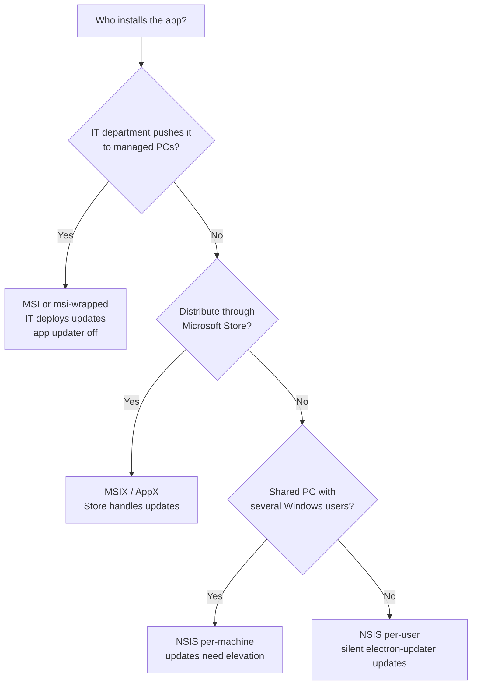
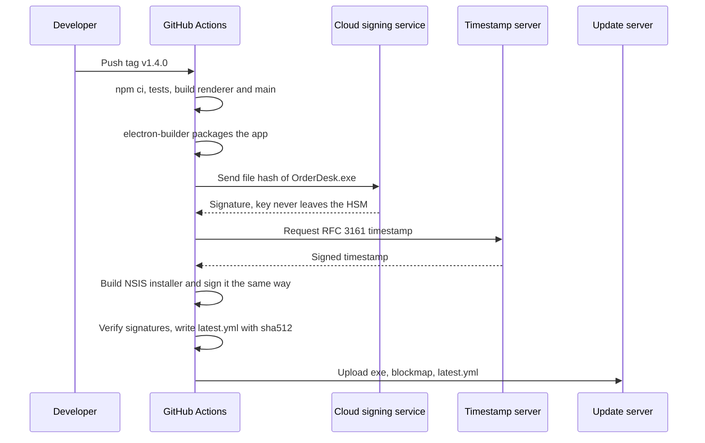

# Packaging, Installers and Code Signing

> In this document you will learn how an Electron project becomes a real Windows installer that users can trust: packaging tools, ASAR archives, electron-builder configuration, NSIS/MSI/MSIX installers, macOS notarization, Windows code signing and a CI pipeline that builds and signs everything. Interviews for desktop roles test this because shipping is where most Electron projects get into trouble: SmartScreen warnings, broken native modules, admin-rights problems and unsigned updates.

**Before this:** [Electron architecture and process model](01-electron-architecture-and-process-model.md) · [App and window lifecycle](02-app-and-window-lifecycle.md) · [Electron security](04-electron-security.md) · **Interview questions:** [jump to the interview section](#interview-questions)

## Table of contents

1. [Packaging, installers and distributables](#packaging-installers-and-distributables)
2. [Choosing a tool: electron-builder vs Electron Forge vs Electron Packager](#choosing-a-tool-electron-builder-vs-electron-forge-vs-electron-packager)
3. [ASAR archives](#asar-archives)
4. [Configuring electron-builder](#configuring-electron-builder)
5. [Windows installer targets](#windows-installer-targets)
6. [NSIS installers in depth](#nsis-installers-in-depth)
7. [MSI, MSIX and Squirrel.Windows](#msi-msix-and-squirrelwindows)
8. [macOS: DMG, PKG, signing and notarization](#macos-dmg-pkg-signing-and-notarization)
9. [Linux packages in brief](#linux-packages-in-brief)
10. [Windows code signing](#windows-code-signing)
11. [Signing with electron-builder and Forge](#signing-with-electron-builder-and-forge)
12. [Signing in CI](#signing-in-ci)
13. [Reducing app size](#reducing-app-size)
14. [Versioning](#versioning)
15. [A CI pipeline that builds installers](#a-ci-pipeline-that-builds-installers)
16. [Update metadata: latest.yml and checksums](#update-metadata-latestyml-and-checksums)
17. [Common mistakes](#common-mistakes)
18. [Best practices](#best-practices)
19. [How to explain packaging and signing in an interview](#how-to-explain-packaging-and-signing-in-an-interview)
20. [Interview questions](#interview-questions)
21. [Summary](#summary)
22. [References](#references)

Throughout this document we use the same example app as the rest of this section: **OrderDesk**, an Angular-based order and point-of-sale desktop app used in retail stores on Windows 10 and 11. It talks to a receipt printer, stores orders in SQLite and syncs them to a REST API.

Tool versions used here (October 2026): **electron-builder 26.x** with **electron-updater 6.x** (electron-builder 27 is in alpha and changes some signing keys; notes below mark those changes), **Electron Forge 8.x** and **@electron/packager 20.x**.

---

## Packaging, installers and distributables

When you run `npm start`, Electron runs from `node_modules/electron`. Your users do not have that folder, Node.js or npm. You must ship them something they can install. Three words describe the steps:

| Word | What it means | OrderDesk example |
| --- | --- | --- |
| **Packaging** | Copy the Electron runtime, rename it to your app name, and put your code inside it. The result is a folder that runs on its own. | `win-unpacked\OrderDesk.exe` plus `resources\app.asar` |
| **Installer** (also **maker** or **target**) | A program that copies the packaged folder onto the user's machine, creates shortcuts, registers an uninstaller and maybe file associations. | `OrderDesk-Setup-1.4.0.exe` (NSIS) or `OrderDesk-1.4.0.msi` |
| **Distributable / artifact** | Every file you publish: installers, update metadata, checksums, blockmaps. | `OrderDesk-Setup-1.4.0.exe`, `.blockmap`, `latest.yml` |

### Analogy

Think of a food company:

- **Packaging** is putting the soup in a can and printing the label. The can is complete and usable.
- **The installer** is the delivery truck and the shop shelf. It puts the can where the customer can find it.
- **Code signing** is the safety seal on the lid. It proves who made the soup and that nobody opened it on the way.

The analogy breaks in one place: a real safety seal is checked by the customer's eyes. A code signature is checked by Windows itself (SmartScreen, User Account Control and antivirus), automatically, every time.

### What a packaged Windows app looks like

```text
win-unpacked\                        <- the packaged app (what the installer copies)
  OrderDesk.exe                      <- electron.exe, renamed, with your icon and version info
  ffmpeg.dll, d3dcompiler_47.dll ... <- Chromium and Electron runtime files
  locales\                           <- Chromium UI translations (*.pak)
  resources\
    app.asar                         <- YOUR code: main, preload, renderer build, node_modules
    app.asar.unpacked\               <- files that must stay real files (native .node modules, .exe helpers)
    app-update.yml                   <- written by electron-builder for electron-updater
    printer-agent\                   <- extraResources you added (for example a helper program)
```

Two paths you will use in code:

- `process.resourcesPath` — the `resources` folder of the packaged app.
- `app.getAppPath()` — the app's code root. In a packaged app this is `...\resources\app.asar`.

### What happens on a user's machine

```mermaid
flowchart LR
    Dev["Your source code<br/>main, preload, Angular build"] --> Pack["Packaging<br/>copy Electron runtime<br/>+ create app.asar"]
    Pack --> Sign1["Sign OrderDesk.exe<br/>and helper binaries"]
    Sign1 --> Make["Build installer<br/>NSIS / MSI / MSIX"]
    Make --> Sign2["Sign the installer<br/>and uninstaller"]
    Sign2 --> Pub["Publish artifacts<br/>exe + blockmap + latest.yml"]
    Pub --> User["User downloads setup"]
    User --> Check["Windows checks the signature<br/>SmartScreen + UAC"]
    Check --> Run["App installed in<br/>AppData or Program Files"]
```



Notice that signing happens **twice**: first the files inside the app, then the installer that wraps them. Packaging tools do both for you when signing is configured.

---

## Choosing a tool: electron-builder vs Electron Forge vs Electron Packager

There are three main tools. They overlap, so it helps to know what each one really does.

- **@electron/packager** (formerly `electron-packager`) only does the **packaging** step. It creates the `OrderDesk-win32-x64` folder. It does not make installers. Forge uses it inside.
- **Electron Forge** is the official all-in-one tool from the Electron team. It scaffolds projects, runs the dev server (with Vite or webpack plugins), packages with `@electron/packager`, and creates installers through **makers** (`@electron-forge/maker-squirrel`, `maker-wix`, `maker-msix`, `maker-zip`, `maker-dmg`, `maker-pkg`, `maker-deb`, `maker-rpm`, `maker-flatpak`, `maker-snap`). It uploads through **publishers** (GitHub, S3 and others).
- **electron-builder** is a community tool (the `electron-userland` organization) focused on packaging, installers and publishing. It has its own packager, many targets (NSIS, MSI, MSIX/AppX, portable, DMG, PKG, AppImage, deb, rpm, snap) and its own auto-update library, **electron-updater**. It does not scaffold or run your dev server.

| | electron-builder | Electron Forge | @electron/packager |
| --- | --- | --- | --- |
| Maintained by | Community (electron-userland) | Electron team | Electron team |
| Scope | Package + installers + publish + update metadata | Scaffold + dev + package + make + publish | Package only |
| Default Windows installer | NSIS | Squirrel.Windows (MSI via WiX and MSIX makers also available) | None |
| Auto-update pairing | `electron-updater` (NSIS, DMG, AppImage, deb, rpm) | Built-in `autoUpdater` (Squirrel) + `update-electron-app` | — |
| Staged rollouts, channels, differential downloads | Yes (built in) | Depends on your update server | — |
| Config | `electron-builder.yml` or `build` in `package.json` | `forge.config.js` / `.ts` | Function options / CLI |
| Good for | Enterprise Windows apps that need flexible installers and self-hosted updates | New projects that want the official, integrated toolchain | Custom pipelines |

> **Forge 8 (September 2026):** all `@electron-forge/*` packages became ESM-only and need Node.js 22.17+. The Vite plugin is no longer experimental. `electron-forge publish` was renamed to `electron-forge release` (`publish` still works as a deprecated alias). Project scaffolding moved fully to `npx create-electron-app@latest`.

### Which one should you pick?

- Choose **electron-builder** when you need NSIS with per-user/per-machine choices, MSI for enterprise deployment, a self-hosted update server (S3 or plain HTTPS), staged rollouts and differential updates. Many Windows line-of-business apps use this.
- Choose **Electron Forge** when you start a new app and want one official tool for dev and build, or when you rely on Squirrel.Windows / `update.electronjs.org`.
- A common combination: **electron-vite** or **Forge's Vite plugin** for development, **electron-builder** for installers. This works because electron-builder only needs your built output.

Typical commands:

```bash
# electron-builder
npx electron-builder --win nsis --x64 --publish never   # build the NSIS installer locally
npx electron-builder --dir                               # package only (win-unpacked), fast for testing

# Electron Forge 8
npm run package        # electron-forge package -> out/OrderDesk-win32-x64
npm run make           # electron-forge make    -> out/make/squirrel.windows/x64/...
npm run release        # electron-forge release -> build and upload with publishers
```

---

## ASAR archives

### What it is

**ASAR** (Atom Shell Archive) is a simple archive format, similar to `tar`. It joins all your app files into one file, `app.asar`, without compression. Electron patches Node's `fs` module so your code can read files *inside* the archive as if it were a normal folder.

```js
// Works in a packaged app, even though receipt.html lives inside app.asar
const path = require('node:path');
const fs = require('node:fs/promises');

async function readTemplate() {
  return fs.readFile(path.join(__dirname, 'templates', 'receipt.html'), 'utf8');
}

console.log(__dirname); // C:\Users\asha\AppData\Local\Programs\OrderDesk\resources\app.asar\dist\main
```

### Why it exists

- **Fewer files to copy.** A typical `node_modules` has tens of thousands of small files. Installers and antivirus scanners are slow with many small files. One big file is much faster to install and scan.
- **Windows path length.** Deep `node_modules` paths can go over the classic 260-character `MAX_PATH` limit. Inside one archive this problem disappears.
- **Integrity checks.** With the ASAR integrity fuse, Electron can refuse to load an `app.asar` that was changed after build (see [Electron fuses](04-electron-security.md#electron-fuses)).

### What ASAR is not

**ASAR is not encryption and not protection.** Anyone can list and extract it:

```bash
npx @electron/asar list "C:\Program Files\OrderDesk\resources\app.asar"
npx @electron/asar extract app.asar extracted\
```

So never put API secrets, private keys or license-signing keys in your app. Secrets in a desktop app are not secret. Use a backend that holds the secret, or per-user tokens stored with `safeStorage`.

### Limitations and `asarUnpack`

The archive is **read-only**, and some things need a **real file on disk**:

| Thing | Why it must be unpacked |
| --- | --- |
| Native Node modules (`*.node`, for example `better-sqlite3`, `serialport`) | Windows loads DLLs with its own loader, which cannot read inside an archive. Electron can copy them to a temp folder, but that is slow and antivirus tools dislike it. |
| Executables you start with `child_process.spawn` (for example `printer-agent.exe`) | `spawn` cannot run a file inside an archive. (`execFile` gets temporary extraction, but `spawn` does not.) |
| Files another program must open (a `.dll` for a .NET helper, a font for a PDF tool) | The other program does not understand ASAR. |
| Files you need to write | The archive is read-only. Write to `app.getPath('userData')` instead. |

You tell the packager to keep some files outside the archive with **`asarUnpack`**. They go into `app.asar.unpacked`, next to `app.asar`:

```yaml
# electron-builder.yml
asar: true
asarUnpack:
  - "**/*.node"                       # native modules (electron-builder also auto-detects most)
  - "node_modules/sharp/**/*"         # a package that loads its own binaries
  - "dist/bin/**"                     # small helper executables shipped inside the app
```

electron-builder automatically detects most native modules and unpacks them, but listing them makes the intent clear.

### Finding the unpacked path in code

Code that runs from inside `app.asar` gets paths like `...\app.asar\dist\bin\tool.exe`. You must point to the unpacked copy:

```js
// ❌ Wrong: spawn cannot start a file inside app.asar
const toolPath = path.join(__dirname, 'bin', 'label-tool.exe');
spawn(toolPath); // Error: spawn ... ENOENT

// ✅ Correct: use the unpacked copy
const toolPath = path
  .join(__dirname, 'bin', 'label-tool.exe')
  .replace('app.asar', 'app.asar.unpacked');
spawn(toolPath, ['--port', 'COM3']);
```

### `extraResources` vs `asarUnpack`

Both put real files on disk. The difference is where they come from and where they go:

- **`asarUnpack`** takes files that are already part of your app (matched by `files`) and keeps them outside the archive, in `resources\app.asar.unpacked\...` with the same relative path.
- **`extraResources`** copies extra files from your project into `resources\` directly. Use it for things that are not part of your JavaScript app, such as a .NET printer agent, default config templates or a license file.
- **`extraFiles`** is the same as `extraResources`, but copies into the app's root folder (next to `OrderDesk.exe`). Use it rarely, for example for a DLL that must sit next to the exe.

A realistic helper resolver that works in development and in production:

```js
// main/paths.js
const path = require('node:path');
const { app } = require('electron');

function resourcePath(...segments) {
  // Packaged: C:\...\OrderDesk\resources\<segments>
  // Development: <project>\resources\<segments>
  const base = app.isPackaged
    ? process.resourcesPath
    : path.join(__dirname, '..', '..', 'resources');
  return path.join(base, ...segments);
}

module.exports = { resourcePath };

// usage
const agentExe = resourcePath('printer-agent', 'PrinterAgent.exe');
```

Why the `isPackaged` check? In development `process.resourcesPath` points into `node_modules\electron\dist\resources`, where your files are not.

### Common ASAR mistakes

- Writing log files or a database "next to the app". The archive is read-only, and Program Files is not writable for normal users. Use `app.getPath('userData')` (see [App and window lifecycle](02-app-and-window-lifecycle.md#where-to-store-files-with-appgetpath)).
- Forgetting to unpack a native module that loads extra DLLs from its own folder.
- Thinking ASAR hides your code. It does not. Minification makes reading harder, but never safe.
- Disabling ASAR completely (`asar: false`) "to fix a bug". You lose integrity checking, install speed suffers and `OnlyLoadAppFromAsar` cannot be used.

---

## Configuring electron-builder

electron-builder reads its configuration from `electron-builder.yml` (or `.json`, `.js`, `.ts`) or from the `build` key in `package.json`. A separate file is easier to review. Here is a realistic configuration for OrderDesk:

```yaml
# electron-builder.yml
appId: com.orderdesk.pos               # never change after the first release
productName: OrderDesk                 # name shown to users, exe name, userData folder name
copyright: Copyright © 2026 OrderDesk Ltd

directories:
  output: release/${version}           # where installers go (default: dist)
  buildResources: build                # icons, installer images, installer.nsh (default: build)

files:                                 # what goes into app.asar (relative to the app dir)
  - dist/**/*                          # compiled main, preload and Angular renderer
  - package.json
  - "!**/*.map"                        # no source maps in the shipped app
  - "!**/*.{ts,md}"

extraResources:                        # copied to resources\ as real files
  - from: resources/printer-agent
    to: printer-agent
    filter: ["**/*"]

asar: true
asarUnpack:
  - "**/*.node"

electronLanguages: [en-US, de, fr]     # keep only these Chromium locales (smaller app)

win:
  target:
    - target: nsis
      arch: [x64]
  icon: build/icon.ico
  artifactName: ${productName}-Setup-${version}.${ext}   # no spaces: nicer URLs on the update server
  # signing settings are added in the "Signing with electron-builder and Forge" section

nsis:
  oneClick: false                      # assisted installer with pages
  perMachine: false                    # default: per-user install
  allowElevation: true
  allowToChangeInstallationDirectory: true
  createDesktopShortcut: true
  createStartMenuShortcut: true
  shortcutName: OrderDesk
  runAfterFinish: true
  deleteAppDataOnUninstall: false      # keep the user's orders database if they reinstall

publish:
  - provider: generic
    url: https://updates.orderdesk.example.com/win
```

electron-builder validates this file against its schema. A misspelled or misplaced key fails the build with a clear error, which is good: you find mistakes before users do.

### The important keys explained

| Key | Default | What it does and why it matters |
| --- | --- | --- |
| `appId` | `com.electron.${name}` | The app's identity. On Windows it is used to generate the installer GUID (the registry key that NSIS uses to find and uninstall the app) and should be your AppUserModelID. **Changing it after release** makes Windows think it is a different app: updates and uninstall break, and users get two copies. |
| `productName` | `name` from `package.json` | The human name. It becomes the exe name, the shortcut name and the `userData` folder name (`%APPDATA%\OrderDesk`). Renaming it moves user data. |
| `directories.output` | `dist` | Where artifacts are written. Many projects already use `dist` for the renderer build, so choose something else, such as `release`. |
| `directories.buildResources` | `build` | Icons (`icon.ico`), installer images and `installer.nsh`. These files are **not** packed into the app. If you need an icon at runtime (tray), include it through `files` or `extraResources`. |
| `files` | Almost everything, minus known junk | Glob patterns for what goes into the app. Keep it tight: built output plus `package.json`. Production `dependencies` from `node_modules` are added automatically; `devDependencies` are not. |
| `extraResources` / `extraFiles` | none | Real files outside the archive, explained above. |
| `asar` / `asarUnpack` | `true` / auto-detected native modules | Explained above. |
| `electronLanguages` | all | Chromium locale files to keep. Removing unused ones saves some megabytes. |
| `compression` | `normal` | `store` makes test builds much faster; `maximum` rarely helps much. |
| `npmRebuild` | `true` | Rebuilds native dependencies for Electron's Node ABI before packaging. |
| `win.target` | `nsis` | Which Windows installers to build. |
| `win.requestedExecutionLevel` | `asInvoker` | Manifest level for the exe. Keep `asInvoker`. `requireAdministrator` makes every launch show a UAC prompt. |
| `electronFuses` | none | Flip Electron fuses at package time (for example disable `RunAsNode`). See [Electron fuses](04-electron-security.md#electron-fuses). |

### Hooks

electron-builder can call your code at steps of the build:

- `beforeBuild` — before native dependencies are installed or rebuilt.
- `afterPack` — after the app folder is created, before signing. Good for flipping fuses yourself or removing files.
- `afterSign` — after signing, before the installer is made. Older projects ran macOS notarization here; current electron-builder can notarize itself.
- `afterAllArtifactBuild` — after all installers are built. Good for uploading symbols or writing extra checksum files.

```js
// build/after-pack.js
exports.default = async function afterPack(context) {
  // context.appOutDir -> ...\release\1.4.0\win-unpacked
  // context.electronPlatformName -> 'win32'
  console.log(`Packed ${context.electronPlatformName} app at ${context.appOutDir}`);
};
```

```yaml
afterPack: build/after-pack.js
```

---

## Windows installer targets

electron-builder can produce several kinds of Windows artifacts. They are not equal: they differ in install location, admin rights, enterprise friendliness and auto-update support.

| Target | What it is | Admin needed? | Auto-update with electron-updater | Good for |
| --- | --- | --- | --- | --- |
| `nsis` (default) | Classic `Setup.exe` built with NSIS | No (per-user) or Yes (per-machine) | **Yes** (only Windows target it supports) | Most apps |
| `nsis-web` | Small stub that downloads the right package (x64/arm64) during install | Same as NSIS | Yes, with extra settings | Very large apps with several architectures |
| `portable` | One exe that runs without installing | No | No | USB sticks, quick trials, locked-down PCs |
| `msi` | Windows Installer package built with WiX | Usually yes | No | Enterprise deployment with Intune, SCCM/ConfigMgr, Group Policy |
| `msi-wrapped` | An MSI that wraps the NSIS installer | Usually yes | Through the wrapped NSIS app | Enterprises that require MSI but you want NSIS behavior |
| `appx` (AppX/MSIX) | Modern Windows package | No | Through the Store or App Installer, not electron-updater | Microsoft Store, clean install and uninstall |
| `squirrel` | Squirrel.Windows (deprecated in electron-builder; use Forge if you want it) | No | No (use Electron's built-in `autoUpdater`) | Legacy projects |
| `zip`, `7z` | Plain archive of the app folder | No | No | Manual distribution, CI test artifacts |

One more Windows fact: Electron 44 stopped publishing 32-bit (ia32) Windows builds. If you still support 32-bit Windows, you are limited to Electron 43 or older, which loses security support when 43 reaches end of life.

---

## NSIS installers in depth

**NSIS** (Nullsoft Scriptable Install System) is an open-source installer system. electron-builder generates an NSIS script for you, so most teams never write NSIS code.

### One-click vs assisted installer

- **One-click (`oneClick: true`, the default):** the user double-clicks `Setup.exe`, sees a progress bar, and the app starts. No pages, no questions.
- **Assisted (`oneClick: false`):** a classic wizard with pages: license, install mode (just me / all users), folder choice, finish.

```yaml
# Simple consumer-style install
nsis:
  oneClick: true
  perMachine: false
  runAfterFinish: true

# Enterprise-style wizard
nsis:
  oneClick: false
  perMachine: false
  allowToChangeInstallationDirectory: true
  license: build/license.txt
```

### Per-user vs per-machine installs

This is the most important installer decision on Windows.

| | Per-user | Per-machine |
| --- | --- | --- |
| Install folder | `%LOCALAPPDATA%\Programs\OrderDesk` | `C:\Program Files\OrderDesk` |
| Registry (uninstall entry) | `HKEY_CURRENT_USER` | `HKEY_LOCAL_MACHINE` |
| Admin rights (UAC prompt) | Not needed | Needed to install **and to update** |
| Visible to | Only that user | Every user on the PC |
| Auto-update | Silent, no prompts | Each update needs elevation (UAC), unless an admin tool deploys it |
| Typical use | Consumer apps, developer tools, most Electron apps | Shared PCs (shop tills, kiosks), IT-managed machines |

How the NSIS options combine:

| `oneClick` | `perMachine` | Result |
| --- | --- | --- |
| `true` | `false` | Silent per-user install (default). No UAC. |
| `true` | `true` | Silent per-machine install. Shows UAC right away. |
| `false` | `false` | Wizard shows an "install for me / for all users" page. Per-user is pre-selected. |
| `false` | `true` | Wizard always installs per-machine. |

More options you should know:

- `allowElevation` (default `true`, assisted only): lets the installer ask for admin rights when the user chooses "all users". If `false`, the user must restart the installer as admin.
- `selectPerMachineByDefault` (default `false`): pre-selects "all users" on the install-mode page.
- `packElevateHelper` (default `true`): ships `elevate.exe`, which electron-updater uses to update per-machine installs.
- `deleteAppDataOnUninstall` (default `false`, one-click only): deletes `%APPDATA%\OrderDesk` on uninstall. Keep it `false` for apps with local business data.
- `differentialPackage`: builds the installer so electron-updater can do differential (blockmap) downloads. It is on unless you set it to `false`.

Silent installs from the command line (used by IT departments):

```bash
OrderDesk-Setup-1.4.0.exe /S                      # silent install with the default mode
OrderDesk-Setup-1.4.0.exe /S /allusers            # assisted installer: per-machine, silent
OrderDesk-Setup-1.4.0.exe /S /currentuser         # assisted installer: per-user, silent
OrderDesk-Setup-1.4.0.exe /S /D=D:\Apps\OrderDesk # custom folder (/D must be the LAST argument)
```

`/S` and `/D=` are standard NSIS switches. `/allusers` and `/currentuser` are handled by electron-builder's assisted installer.

### Why per-user is the usual default

Per-user installs avoid admin rights. That means:

- Normal employees can install and update the app themselves.
- electron-updater can update silently in the background.
- There are no "Do you want to allow this app to make changes?" prompts that train users to click "Yes" on everything.

Per-machine makes sense when many Windows users share one PC (a shop till with several cashier accounts) or when IT wants the app in Program Files where normal users cannot change it.

### Customizing the NSIS script

You rarely need to, but electron-builder supports an include file. Put `build/installer.nsh` in your project and define macros:

```nsis
; build/installer.nsh
!macro customInstall
  ; Register a URL protocol for deep links (Electron can also do this at runtime)
  WriteRegStr SHCTX "Software\Classes\orderdesk" "URL Protocol" ""
  WriteRegStr SHCTX "Software\Classes\orderdesk\shell\open\command" "" '"$INSTDIR\OrderDesk.exe" "%1"'
!macroend

!macro customUnInstall
  DeleteRegKey SHCTX "Software\Classes\orderdesk"
!macroend
```

`SHCTX` means "current user or local machine, depending on the install mode". Prefer `include` over replacing the whole script with `script`, because a custom full script turns off some of electron-builder's built-in safeguards.

Useful facts about the NSIS uninstaller:

- During an update, the **old version's uninstaller** runs. So a change to `customUnInstall` only takes effect one version later.
- Use `${isUpdated}` in custom macros to skip work that should run only on a real install, not on an update.

### AppUserModelID

Windows uses the **Application User Model ID (AUMID)** to group taskbar buttons, pin the app and show notifications with the right name and icon. Set it to your `appId` early in the main process:

```js
// main.js, before creating windows
const { app } = require('electron');
app.setAppUserModelId('com.orderdesk.pos');
```

If the AUMID does not match the shortcut, notifications can show "electron.app.OrderDesk" or no icon, and pinned taskbar icons can open a second, separate button.

---

## MSI, MSIX and Squirrel.Windows

### MSI (WiX)

**MSI** is the Windows Installer format. IT departments like it because deployment tools understand it well: **Microsoft Intune**, **Configuration Manager (SCCM)** and **Group Policy** can install, repair and remove MSI packages on thousands of PCs, with standard switches like `msiexec /i OrderDesk.msi /qn`.

electron-builder's `msi` target builds MSI with the WiX Toolset. Forge has `@electron-forge/maker-wix`.

```yaml
win:
  target: [nsis, msi]
msi:
  oneClick: true
  perMachine: true          # typical for managed deployment
  upgradeCode: 6f8d3d1e-1c1e-4f0f-9d8a-3a9a2b7e5c11   # keep stable forever, like appId
```

Trade-offs:

- MSI is great for **deployment by IT**, but electron-updater does not update MSI installs. In managed environments, IT pushes the new MSI, and the app's own updater is usually turned off. This is covered in [Auto-updates](07-auto-updates.md).
- The **upgrade code** identifies the product across versions. If it changes, Windows installs a second copy instead of upgrading.

### MSIX and AppX

**MSIX** is the modern Windows package format (AppX is its older name and format). An MSIX app is installed in a protected location, with a clean uninstall that leaves no files behind in system folders. It is required for the Microsoft Store path and supports updates through the Store or App Installer.

- electron-builder: the `appx` target. Forge: `@electron-forge/maker-msix` (Forge 8 deprecated `maker-appx` in favor of MSIX).
- MSIX packages **must be signed**, even for sideloading.
- Inside an MSIX package, `process.windowsStore` is `true`. Some file system and registry writes are virtualized, so test features like "launch at login" and file associations carefully.
- Since Electron 41 (backported to 39.5.0 and 40.2.0), Electron's built-in `autoUpdater` can update MSIX packages (created with `electron-windows-msix`) from a direct `.msix` link or a JSON feed.

### Squirrel.Windows

**Squirrel.Windows** is the installer and update framework behind Electron's built-in `autoUpdater` on Windows. Forge uses it by default (`@electron-forge/maker-squirrel`).

How it works:

- It always installs **per-user** into `%LOCALAPPDATA%\OrderDesk`, with no install wizard (only an animation).
- Inside that folder there is `Update.exe` and one folder per version: `app-1.3.0`, `app-1.4.0`. The shortcut points at `Update.exe`, which starts the newest version.
- Updates are `.nupkg` packages listed in a `RELEASES` file. Squirrel can create **delta** packages between versions.
- During install, update and uninstall, Squirrel starts your app with special arguments such as `--squirrel-install`, `--squirrel-updated`, `--squirrel-uninstall` and `--squirrel-firstrun`. Your app must handle them (create or remove shortcuts) and quit quickly.

```js
// main.js (Forge template pattern)
const { app } = require('electron');

// Handles Squirrel's install/update/uninstall events: creates or removes shortcuts, then exits.
if (require('electron-squirrel-startup')) {
  app.quit();
}
```

Gotchas:

- On first run (`--squirrel-firstrun`), Squirrel holds a file lock for a few seconds, so an immediate update check fails. Delay the first check.
- The AUMID created by Squirrel's shortcut looks like `com.squirrel.orderdesk.OrderDesk`. Call `app.setAppUserModelId()` with that exact value, or pinning and notifications break.
- No per-machine install and no MSI-style management. electron-builder marks its own Squirrel target as deprecated and recommends NSIS.

### Which Windows format should OrderDesk use?



Many companies ship **two** artifacts from the same build: NSIS per-user for normal users, and MSI for IT-managed fleets.

---

## macOS: DMG, PKG, signing and notarization

Even if your main market is Windows, interviews often ask "how is macOS different?". Here are the essentials.

### Formats

- **DMG** — a disk image. The user opens it and drags the app into `Applications`. The most common way to ship Mac apps outside the App Store.
- **ZIP** — needed for auto-updates. Squirrel.Mac (used by both Electron's `autoUpdater` and electron-updater on macOS) updates from a ZIP. electron-builder's default macOS targets are `dmg` + `zip` for this reason.
- **PKG** — a classic installer package. Useful when you must install extra components or deploy through Mac management tools.
- **MAS** — the Mac App Store build. It has extra sandbox rules and its own signing identities.

### Code signing on macOS

macOS checks apps with **Gatekeeper**. To pass it outside the App Store you need:

1. An **Apple Developer Program** membership (yearly fee).
2. A **Developer ID Application** certificate (and **Developer ID Installer** for PKG).
3. **Hardened Runtime** turned on, with entitlements that allow what Electron needs (for example JIT for V8).
4. **Notarization**: you upload the signed app to Apple. Apple scans it automatically and returns a ticket.
5. **Stapling**: you attach the ticket to the app, so Gatekeeper can verify it offline.

Apple's current notarization tool is **`notarytool`** (part of Xcode). The older `altool` stopped working for notarization in November 2023. Electron's tools use `notarytool` through `@electron/notarize`, and electron-builder can notarize directly:

```yaml
mac:
  target: [dmg, zip]
  hardenedRuntime: true
  notarize: true            # credentials come from environment variables
```

```bash
# Option A: Apple ID + app-specific password
APPLE_ID=release@orderdesk.example.com
APPLE_APP_SPECIFIC_PASSWORD=xxxx-xxxx-xxxx-xxxx
APPLE_TEAM_ID=ABCDE12345

# Option B (better for CI): App Store Connect API key
APPLE_API_KEY=/path/to/AuthKey_ABC123.p8
APPLE_API_KEY_ID=ABC123
APPLE_API_ISSUER=00000000-0000-0000-0000-000000000000
```

Signing matters more on macOS than on Windows for some Electron features: `autoUpdater` (Squirrel.Mac) refuses to update an unsigned app, and `safeStorage`, `app.setLoginItemSettings()` and the cookie encryption fuse depend on a stable signing identity.

| | Windows | macOS |
| --- | --- | --- |
| Signature technology | Authenticode (`signtool`) | `codesign` |
| Extra step | None (reputation builds over time) | Notarization + stapling |
| Unsigned app | Runs after a SmartScreen warning | Blocked by Gatekeeper by default |
| Updates without signing | electron-updater can be configured to skip verification (not recommended) | Squirrel.Mac refuses |

---

## Linux packages in brief

- **AppImage** — one self-contained file. Users mark it executable and run it. electron-updater can update it.
- **deb** (Debian/Ubuntu) and **rpm** (Fedora/RHEL) — native packages installed with the system package manager. electron-updater can update them; it uses the system's tools and asks for authentication.
- **snap** and **Flatpak** — sandboxed formats distributed through their stores, which also handle updates.

For most Windows-focused teams, Linux is a "nice to have": build an AppImage and a deb in the same CI matrix.

---

## Windows code signing

### What it is

**Code signing** attaches a digital signature to an executable. Windows uses a technology called **Authenticode**. The signature contains:

- a hash of the file's contents,
- that hash signed with your **private key**,
- your **certificate**, which says "this public key belongs to OrderDesk Ltd", signed by a **certificate authority (CA)** such as DigiCert, Sectigo or SSL.com,
- usually a **timestamp** from a trusted timestamp server.

When Windows opens the file, it recomputes the hash and checks the signature with the public key from the certificate. If even one byte changed, the check fails.

### Why it exists

Without a signature, Windows cannot tell your installer apart from malware with the same name. In practice an unsigned Electron app causes:

- **SmartScreen** shows "Windows protected your PC" with **"Unknown publisher"**. Many users stop here.
- **User Account Control** shows "Publisher: Unknown" when the installer asks for admin rights.
- **Antivirus** products flag unsigned, newly seen binaries more often.
- **Enterprise policies** (AppLocker, App Control for Business / WDAC) can block apps that are not signed by an allowed publisher.
- **Auto-updates** are less safe. electron-updater checks that a downloaded update is signed by the same publisher before installing it. Without signing, an attacker who controls your update server could push any program.

### Analogy

A signature works like a sealed envelope with a company stamp. The stamp says who sent it (the certificate). The seal shows nobody opened it (the hash). A notary's date stamp (the timestamp) proves it was sealed while the company's stamp was still valid.

### What to sign

Sign every executable file you ship, not only the installer:

- `OrderDesk.exe` (the renamed Electron binary)
- the installer (`OrderDesk-Setup-1.4.0.exe`) and the uninstaller
- your own helper executables (`PrinterAgent.exe`) and DLLs
- native Node modules (`*.node`) — they are DLLs

The Electron binary is renamed and its resources (icon, version info, publisher) are edited during packaging, so it must be signed again with your certificate. electron-builder and `@electron/windows-sign` find the signable files and sign them automatically.

### OV vs EV certificates

| | OV (Organization Validation) | EV (Extended Validation) |
| --- | --- | --- |
| Identity checks by the CA | Company exists and is registered | Stricter checks of the company and the requester |
| Key storage | Hardware (since June 2023, see below) | Hardware |
| SmartScreen | Reputation builds over time | **Since 2024, also builds over time.** EV no longer gives instant SmartScreen trust. |
| Typical need | Normal Windows apps | Some customer policies and special Microsoft programs |

The SmartScreen change is important because many old articles say "buy EV to remove SmartScreen warnings". Microsoft changed its Trusted Root Program requirements in 2024: SmartScreen reputation now builds from the **file hash** and the **publisher certificate** over time, and no certificate type gives an immediate bypass. Signing every release with the **same identity** lets the publisher's reputation carry forward to new versions.

### The hardware key rule (June 2023)

Since **June 1, 2023**, the CA/Browser Forum Code Signing Baseline Requirements apply a strict rule to **every** publicly trusted code signing certificate, both **OV and EV**. The private key must be generated and stored in hardware. That means a USB token or a hardware security module (HSM) certified to **FIPS 140-2 Level 2** or **Common Criteria EAL 4+** (or equivalent). You can no longer download a `.pfx` file with an exportable private key from a public CA.

What this means for a team:

- The old CI recipe "base64-encode the `.pfx`, put it in a secret, sign in CI" only works for **certificates issued before the rule** (until they expire) or for internal, private CAs.
- For CI you now use **cloud signing**: the key stays in the provider's HSM, and your build sends only the file hash to be signed.
- A USB token on a build machine works, but it is hard to scale and to secure.

One more recent change: since **March 1, 2026**, newly issued public code signing certificates are valid for at most **460 days** (CA/B Forum ballot CSC-31; before it was up to 39 months). Plan for renewals more often, and keep the same organization identity so reputation continues.

### Cloud signing options

| Option | What it is | Notes |
| --- | --- | --- |
| **Azure Artifact Signing** (renamed from **Azure Trusted Signing** in early 2026) | Microsoft's managed signing service. Microsoft validates your identity and manages short-lived certificates in its HSMs. | Described by the Electron docs as the cheapest option on Windows. Available only in certain countries; check Microsoft's prerequisites. Signs through `signtool` with a `/dlib` plugin. Supported by electron-builder (`azureSignOptions` in 26.x). |
| **DigiCert KeyLocker** | DigiCert's cloud HSM for its certificates | Used by the Electron project for its own apps. Signs through `signtool` with DigiCert's key storage provider and tools. |
| **SSL.com eSigner** | SSL.com's cloud signing service | Has a CLI and CI integrations. |
| **Your own cloud HSM** (Azure Key Vault Premium HSM, AWS CloudHSM, Google Cloud KMS HSM) | You keep the key in your cloud account; the CA issues a certificate for it | Signs through a vendor provider with `signtool`, or community tools like AzureSignTool or jsign. Most control, most setup. |

### signtool and timestamping

`signtool.exe` comes with the Windows SDK. A typical command:

```bash
signtool sign /fd SHA256 /tr http://timestamp.digicert.com /td SHA256 /a OrderDesk-Setup-1.4.0.exe
```

- `/fd SHA256` — the file digest algorithm.
- `/tr <url>` — an **RFC 3161 timestamp server**. `/td SHA256` — the timestamp digest algorithm.
- `/a` — pick the best matching certificate from the Windows certificate store (with a USB token or a key storage provider, the certificate appears there).

Signing with Azure Artifact Signing uses the same tool with a plugin:

```bash
signtool sign /v /fd SHA256 /tr http://timestamp.acs.microsoft.com /td SHA256 ^
  /dlib "Azure.CodeSigning.Dlib.dll" /dmdf "metadata.json" OrderDesk-Setup-1.4.0.exe
```

`metadata.json` contains the endpoint, the account name and the certificate profile name. Authentication comes from Azure environment variables (`AZURE_TENANT_ID`, `AZURE_CLIENT_ID`, `AZURE_CLIENT_SECRET`, or federated credentials).

**Why timestamping matters:** a certificate expires (now after at most 460 days). Without a timestamp, the signature stops being valid when the certificate expires, and old installers suddenly show warnings. With a timestamp, Windows knows the file was signed **while the certificate was valid**, so the signature stays valid after expiry (unless the certificate is revoked). Always timestamp.

### Checking a signature

```bash
signtool verify /pa /v OrderDesk-Setup-1.4.0.exe
```

```powershell
Get-AuthenticodeSignature .\OrderDesk-Setup-1.4.0.exe | Format-List Status, SignerCertificate, TimeStamperCertificate
# Status                 : Valid
# SignerCertificate      : [Subject] CN=OrderDesk Ltd, O=OrderDesk Ltd, L=Leeds, C=GB ...
# TimeStamperCertificate : [Subject] CN=... Timestamp ...
```

In Explorer: right-click the file → **Properties** → **Digital Signatures** tab.

---

## Signing with electron-builder and Forge

### electron-builder 26.x

electron-builder signs automatically when it finds signing settings. There are three main ways.

**1. Certificate from a file or the certificate store (`signtoolOptions`):**

```yaml
win:
  signtoolOptions:
    publisherName: "OrderDesk Ltd"         # must match the certificate's subject (CN)
    signingHashAlgorithms: [sha256]        # default is [sha1, sha256] (dual signing)
    rfc3161TimeStampServer: http://timestamp.digicert.com   # the default
    # certificateSubjectName: "OrderDesk Ltd"   # choose a cert from the store (token / KSP)
    # certificateSha1: "1A2B..."                # or choose it by thumbprint
```

For an older exportable `.pfx` (or a private CA), give the file through environment variables instead of the config file: `WIN_CSC_LINK` (path or base64 content) and `WIN_CSC_KEY_PASSWORD`. Never commit the certificate or its password.

**2. Azure Artifact Signing (`azureSignOptions`):**

```yaml
win:
  azureSignOptions:
    publisherName: "OrderDesk Ltd"
    endpoint: https://weu.codesigning.azure.net/
    codeSigningAccountName: orderdesk-signing
    certificateProfileName: orderdesk-public-trust
```

```bash
# environment of the build job
AZURE_TENANT_ID=...
AZURE_CLIENT_ID=...
AZURE_CLIENT_SECRET=...
```

`signtoolOptions` and `azureSignOptions` cannot be used together.

**3. A custom sign function** (for DigiCert KeyLocker, SSL.com eSigner or any other tool):

```yaml
win:
  signtoolOptions:
    publisherName: "OrderDesk Ltd"
    sign: ./build/sign-windows.js
```

```js
// build/sign-windows.js
const { execFileSync } = require('node:child_process');

exports.default = async function sign(configuration) {
  // configuration.path is the file electron-builder wants signed
  execFileSync('signtool', [
    'sign', '/fd', 'SHA256',
    '/tr', 'http://timestamp.digicert.com', '/td', 'SHA256',
    '/sha1', process.env.SIGNING_CERT_THUMBPRINT,   // certificate exposed by the cloud provider
    configuration.path,
  ], { stdio: 'inherit' });
};
```

**`publisherName` and update verification:** electron-builder writes `publisherName` into `resources/app-update.yml`. Before installing an update, electron-updater checks that the new installer's Authenticode signer matches that name (`win.verifyUpdateCodeSignature`, default `true`). If the name on your certificate changes (company rename, new CA), list **both** names in `publisherName` in a transition release first, or existing installs will refuse the update.

> **electron-builder 27 (alpha in October 2026):** all Windows signing settings move under one key, `win.sign`, with a `type` field (`signtool`, `hsm`, `pkcs11` or `azure`). Version 27 also checks at build time that the signed installer's publisher matches `publisherName`, and it adds signed update manifests. Read the migration guide when you upgrade.

### Electron Forge

Forge signs through **`@electron/windows-sign`**, configured with a `windowsSign` object in `packagerConfig` (for the app files) and in Windows makers (for the installer):

```js
// forge.config.js (Forge 8, ESM)
const windowsSign = {
  // Option 1: certificate file (older exportable certs or a private CA)
  // certificateFile: process.env.WINDOWS_CERTIFICATE_FILE,
  // certificatePassword: process.env.WINDOWS_CERTIFICATE_PASSWORD,

  // Option 2: your own signtool parameters (token, KSP, cloud HSM)
  signWithParams: `/sha1 ${process.env.SIGNING_CERT_THUMBPRINT} /tr http://timestamp.digicert.com /td SHA256 /fd SHA256`,

  // Option 3: a completely custom hook called for every file
  // hookModulePath: './build/sign-hook.js',
};

export default {
  packagerConfig: { asar: true, windowsSign },
  makers: [
    { name: '@electron-forge/maker-squirrel', config: { windowsSign } },
  ],
};
```

---

## Signing in CI

Signing belongs in CI, not on a developer laptop. Every release is signed the same way, the key is never on personal machines, and you have an audit trail.

Rules for a safe signing pipeline:

1. **Sign only release builds.** Pull-request builds run tests and package unsigned. This also keeps pull requests from forks away from your signing secrets.
2. **Keep credentials in the CI secret store**, scoped to a protected environment (for example a GitHub Actions *environment* named `release` that requires approval).
3. **Prefer short-lived credentials.** Use OpenID Connect (OIDC) federation from GitHub Actions to your cloud provider instead of long-lived client secrets where possible.
4. **Sign, then verify.** Run `signtool verify /pa` or `Get-AuthenticodeSignature` on the artifacts and fail the job if any file is unsigned.
5. **Timestamp every signature**, and handle timestamp server outages (retry, or a second server).
6. **Restrict who can trigger a release:** protected `v*` tags and required reviews on the release workflow.



---

## Reducing app size

An Electron app always includes Chromium and Node.js, so even a hello-world installer is tens of megabytes. You cannot remove the runtime, but you can stop adding waste on top of it.

Where the size comes from:

1. **The Electron runtime** (Chromium, V8, Node.js, ffmpeg, ICU data, locales). Fixed per Electron version.
2. **Your `node_modules`** — often the biggest part you control.
3. **Your renderer build** — Angular bundles, assets, fonts, images.
4. **Several architectures in one installer** — x64 + arm64 is roughly twice as large.

Techniques, from most to least effective:

| Technique | How | Why it helps |
| --- | --- | --- |
| Keep build tools in `devDependencies` | Angular CLI, TypeScript, Vite, webpack, test tools | Only `dependencies` are packed |
| Bundle the main and preload code | esbuild, Vite or webpack for main and preload; bundled libraries no longer need to be in `dependencies` | Thousands of files become a few bundles |
| Tight `files` patterns | Include `dist/**` and `package.json`; exclude `**/*.map`, docs, tests | Removes files that slipped in |
| Remove unused Chromium locales | `electronLanguages: [en-US, de]` | Each locale `.pak` file is a few hundred KB |
| Look inside | `npx @electron/asar list resources/app.asar`, or check `win-unpacked` sizes | You cannot fix what you do not measure |
| Replace heavy dependencies | For example `moment` → `Intl` or `date-fns`; a full icon pack → only the icons you use | Smaller bundles and faster startup |
| One architecture per installer, or `nsis-web` | Separate x64 and arm64 installers, or a web installer that downloads the right package | Users download only what they need |
| Differential updates | electron-updater blockmaps (on by default for NSIS) | Updates download only changed blocks |

A quick size audit in PowerShell:

```powershell
# the 10 largest folders inside the packaged app
Get-ChildItem .\release\1.4.0\win-unpacked -Recurse -File |
  Group-Object { $_.DirectoryName } |
  Sort-Object { ($_.Group | Measure-Object Length -Sum).Sum } -Descending |
  Select-Object -First 10 Name, @{ n = 'MB'; e = { [math]::Round((($_.Group | Measure-Object Length -Sum).Sum) / 1MB, 1) } }
```

---

## Versioning

The `version` field in `package.json` is the single source of truth. Packaging tools copy it into the Windows file properties, the installer name, the update metadata and `app.getVersion()`.

Rules:

- **Use semantic versioning** (`MAJOR.MINOR.PATCH`). electron-updater installs an update only if the server version is **greater** than the installed one (unless downgrades are allowed).
- **Never reuse a version number.** If `1.4.0` is broken, ship `1.4.1`. Users who installed `1.4.0` will never "update" to a different `1.4.0`.
- **Prerelease tags define channels.** With electron-builder, `1.5.0-beta.1` goes to the `beta` channel (`beta.yml`); stable versions go to `latest.yml`. See [Auto-updates](07-auto-updates.md).
- **Build numbers:** electron-builder's `buildVersion` maps to the Windows `FileVersion` (it defaults to `version`). CI can set it to include a build number for support.
- **Show the version** in the About dialog, in every log file and in every crash report. Support needs it first.

```js
// main.js
const { app } = require('electron');
console.log(app.getVersion()); // 1.4.0 (from package.json)
```

Let CI drive version changes (for example `npm version 1.4.0` creates the commit and the `v1.4.0` tag), so the tag, the package version and the installer always agree.

---

## A CI pipeline that builds installers

Here is a realistic GitHub Actions workflow for OrderDesk. It runs tests on every push. On a version tag it builds signed installers on Windows, macOS and Linux and publishes them.

```yaml
# .github/workflows/release.yml
name: Build and release

on:
  push:
    branches: [main]
    tags: ['v*']
  pull_request:

jobs:
  test:
    runs-on: windows-latest
    steps:
      - uses: actions/checkout@v4
      - uses: actions/setup-node@v4
        with:
          node-version: 22
          cache: npm
      - run: npm ci
      - run: npm run lint
      - run: npm test
      - run: npm run build            # Angular renderer + main/preload bundles
      - run: npx electron-builder --win --dir --publish never   # packaging smoke test, unsigned

  release:
    if: startsWith(github.ref, 'refs/tags/v')
    needs: test
    environment: release              # protected environment that holds signing secrets
    strategy:
      fail-fast: false
      matrix:
        include:
          - os: windows-latest
            args: --win nsis msi --x64
          - os: macos-latest
            args: --mac dmg zip --universal
          - os: ubuntu-latest
            args: --linux AppImage deb
    runs-on: ${{ matrix.os }}
    steps:
      - uses: actions/checkout@v4
      - uses: actions/setup-node@v4
        with:
          node-version: 22
          cache: npm
      - run: npm ci
      - run: npm run build
      - name: Build, sign and publish
        run: npx electron-builder ${{ matrix.args }} --publish always
        env:
          GH_TOKEN: ${{ secrets.GITHUB_TOKEN }}
          # Windows: Azure Artifact Signing (read by win.azureSignOptions)
          AZURE_TENANT_ID: ${{ secrets.AZURE_TENANT_ID }}
          AZURE_CLIENT_ID: ${{ secrets.AZURE_CLIENT_ID }}
          AZURE_CLIENT_SECRET: ${{ secrets.AZURE_CLIENT_SECRET }}
          # macOS: signing certificate + notarization
          CSC_LINK: ${{ secrets.MAC_CSC_LINK }}
          CSC_KEY_PASSWORD: ${{ secrets.MAC_CSC_KEY_PASSWORD }}
          APPLE_API_KEY: ${{ secrets.APPLE_API_KEY_PATH }}
          APPLE_API_KEY_ID: ${{ secrets.APPLE_API_KEY_ID }}
          APPLE_API_ISSUER: ${{ secrets.APPLE_API_ISSUER }}
      - name: Verify Windows signatures
        if: runner.os == 'Windows'
        shell: pwsh
        run: |
          $bad = Get-ChildItem release -Recurse -Include *.exe, *.msi |
            Where-Object { (Get-AuthenticodeSignature $_.FullName).Status -ne 'Valid' }
          if ($bad) { $bad | ForEach-Object { Write-Error "Unsigned: $($_.FullName)" }; exit 1 }
      - uses: actions/upload-artifact@v4
        with:
          name: installers-${{ matrix.os }}
          path: |
            release/**/*.exe
            release/**/*.msi
            release/**/*.dmg
            release/**/*.zip
            release/**/*.AppImage
            release/**/*.deb
            release/**/*.yml
            release/**/*.blockmap
```

Why it is built like this:

- **Each OS builds its own installers.** Cross-building works in some cases, but signing, notarization and native modules are most reliable on the real OS.
- **`--publish always` only in the tag job.** Other builds use `--publish never`. Be explicit: electron-builder 26 warns that guessing "publish or not" from the CI environment is deprecated and will be removed in 27.
- **The `release` environment** protects secrets. Only tag builds, optionally after a manual approval, can read them.
- **`fail-fast: false`** lets the other platforms finish when one fails, which makes debugging easier.
- With the GitHub provider, electron-builder uploads to a **draft** release by default (`releaseType: draft`). You review it and click "Publish". Users get the update only after that.

---

## Update metadata: latest.yml and checksums

When electron-builder builds an NSIS installer with publishing configured, it also writes **update metadata**. electron-updater downloads this small file first to decide whether to update.

```yaml
# latest.yml (Windows, stable channel)
version: 1.4.0
files:
  - url: OrderDesk-Setup-1.4.0.exe
    sha512: kX1oQ0r7T3Uq5c0n8l8pS2m1Wb2Hd4m3D3m5n8D1cXbT1bFz2R9rG4kq8bH1sQ9kV5aL3yU7mN2pE6wC0fJ4dA==
    size: 94371842
path: OrderDesk-Setup-1.4.0.exe
sha512: kX1oQ0r7T3Uq5c0n8l8pS2m1Wb2Hd4m3D3m5n8D1cXbT1bFz2R9rG4kq8bH1sQ9kV5aL3yU7mN2pE6wC0fJ4dA==
releaseDate: '2026-10-20T09:12:44.512Z'
```

| Field | Meaning |
| --- | --- |
| `version` | The version on the server. Compared with `app.getVersion()` using semver. |
| `files[].url` | The installer file, relative to the feed URL (or absolute). |
| `files[].sha512` | **Base64** of the SHA-512 hash of the installer. electron-updater recomputes it after download and rejects a mismatch. |
| `files[].size` | Size in bytes. Used for progress and as a sanity check. |
| `path`, `sha512` (top level) | Older duplicate fields for very old electron-updater versions. electron-builder 27 stops writing them by default. |
| `releaseDate` | When the release was built. |
| `stagingPercentage` (optional) | Added by hand for staged rollouts. See [Auto-updates](07-auto-updates.md). |

Next to the installer there is also `OrderDesk-Setup-1.4.0.exe.blockmap`. A **blockmap** lists checksums of small blocks of the installer. electron-updater compares the old and new blockmaps and downloads only the blocks that changed (a **differential download**). If anything goes wrong, it falls back to a full download.

Other platforms use `latest-mac.yml` and `latest-linux.yml`. Beta builds use `beta.yml`, `beta-mac.yml` and so on.

### Computing the checksum yourself

The checksum is easy to reproduce. This is useful for a custom update server or a release audit script:

```js
// verify-installer.js
const { createHash } = require('node:crypto');
const { createReadStream } = require('node:fs');
const { stat, writeFile } = require('node:fs/promises');

function sha512Base64(filePath) {
  return new Promise((resolve, reject) => {
    const hash = createHash('sha512');
    createReadStream(filePath)
      .on('data', (chunk) => hash.update(chunk))
      .on('error', reject)
      .on('end', () => resolve(hash.digest('base64')));
  });
}

async function verify(filePath, expected) {
  const actualSize = (await stat(filePath)).size;
  if (actualSize !== expected.size) {
    return { ok: false, reason: `size ${actualSize} !== ${expected.size}` };
  }
  const actualHash = await sha512Base64(filePath);
  if (actualHash !== expected.sha512) {
    return { ok: false, reason: 'sha512 mismatch' };
  }
  return { ok: true };
}

async function main() {
  await writeFile('fake-setup.exe', 'pretend this is an installer');
  const expected = { size: 28, sha512: await sha512Base64('fake-setup.exe') };
  console.log(expected.sha512.length);                    // 88
  console.log(await verify('fake-setup.exe', expected));  // { ok: true }

  await writeFile('fake-setup.exe', 'pretend this is an installeR'); // one byte changed
  console.log(await verify('fake-setup.exe', expected));  // { ok: false, reason: 'sha512 mismatch' }
}

main();
```

Step by step:

1. `sha512Base64` streams the file in chunks, so a 100 MB installer does not have to fit in memory at once.
2. SHA-512 produces 64 bytes. Base64 turns 64 bytes into 88 characters (ending with `==`). That is why every `sha512` in `latest.yml` is 88 characters long.
3. The size check is cheap, so it runs first. Here the size is the same (28 bytes), so the hash is checked.
4. Changing a single byte produces a completely different hash, so the second check fails.

**Checksum vs signature:** a checksum proves the file matches the metadata. It does **not** prove who made it. An attacker who can change the installer on your server can usually change `latest.yml` too. That is why electron-updater **also** checks the Authenticode signature against `publisherName` on Windows, and why the update server must use HTTPS.

---

## Common mistakes

1. **Changing `appId` (or the MSI upgrade code) after release.** Windows sees a new app: two installs, broken updates, lost shortcuts.
2. **Shipping unsigned builds "for now".** SmartScreen and antivirus warnings hurt trust, and updates cannot be verified.
3. **Not timestamping.** Every installer becomes "invalid" when the certificate expires.
4. **Planning to export a `.pfx` for CI.** New public certificates have hardware-bound keys. Plan cloud signing.
5. **Buying EV to "skip SmartScreen".** Since 2024, EV no longer gives instant reputation.
6. **Writing to the install folder.** Program Files is read-only for normal users; `app.asar` is read-only for everyone.
7. **A native module works in dev but crashes when packaged.** It was not rebuilt for Electron's ABI (`npmRebuild`, `@electron/rebuild`) or was not unpacked from ASAR.
8. **Spawning a helper exe from inside `app.asar`.** Use `extraResources` or `asarUnpack` and the real path.
9. **Per-machine install without an update plan.** Every update needs elevation; users without admin rights get stuck on old versions.
10. **Reusing a version number** to "fix" a bad release.
11. **Putting secrets in the app** because "it is inside ASAR".
12. **Leaving source maps and test files in the package.** A bigger app, and readable source for anyone.

## Best practices

- **Decide per-user vs per-machine early.** Reason: changing the install mode later needs a migration for existing users.
- **Freeze `appId`, `productName` and the MSI upgrade code on day one.** Reason: they are the app's identity in Windows and the name of the `userData` folder.
- **Sign everything in CI with a cloud HSM, and always timestamp.** Reason: consistent, auditable signing that keeps working after certificate renewal.
- **Verify signatures in the pipeline.** Reason: an unsigned file found by a customer costs much more than a failed build.
- **Keep the same signing identity across releases.** Reason: SmartScreen reputation follows the publisher.
- **Bundle main and preload code, and keep `files` tight.** Reason: smaller app, faster install, faster startup.
- **Ship helper programs with `extraResources` and resolve paths with `process.resourcesPath`.** Reason: real files and predictable paths.
- **Build installers on their real OS in a matrix.** Reason: signing, notarization and native modules work reliably.
- **Publish explicitly (`--publish always` only for tags) and review draft releases.** Reason: no accidental releases from branch builds.
- **Ship an MSI next to NSIS if you sell to enterprises.** Reason: IT departments deploy MSI with Intune or ConfigMgr.

---

## How to explain packaging and signing in an interview

1. **Define it:** "Packaging turns the project into a self-contained app folder: the Electron binary renamed to our product, with our code in an ASAR archive. Then a tool like electron-builder wraps it in an installer, usually NSIS on Windows, and we code-sign both the app and the installer."
2. **Why it exists:** "Users have no Node or Electron installed, and Windows does not trust unknown executables. The installer puts the app in the right place. The Authenticode signature proves who published it and that nobody changed it."
3. **How it works:** "electron-builder copies the production code into `app.asar`, keeps native modules and helper executables unpacked, signs the binaries, builds the NSIS installer, signs that too, and writes `latest.yml` with a SHA-512 checksum for the auto-updater. Since 2023 signing keys must live in hardware, so in CI we use a cloud signing service like Azure Artifact Signing, and we always timestamp."
4. **Small example:** "For our POS app we ship a per-user NSIS installer, so cashiers can update without admin rights, plus an MSI for IT-managed stores. The printer agent ships as `extraResources`, and better-sqlite3 is unpacked from ASAR."
5. **Where it is useful:** "This makes the app installable, updatable and trusted at scale: no 'unknown publisher' warnings, fewer antivirus false positives, and updates that are verified before they install."
6. **Trade-offs / gotchas:** "Per-machine installs need elevation for every update. EV certificates no longer skip SmartScreen. ASAR is not encryption, so no secrets in the app. And `appId` must never change, or Windows treats the next version as a different product."

---

## Interview questions

### Q1. What is the difference between packaging an Electron app and creating an installer?

**What the interviewer is checking:** Whether you understand the build steps and do not mix up the tools.

**Short spoken answer (30–60 seconds):**
> Packaging creates a folder that runs on its own: the Electron binary renamed to our app name, the Chromium and Node runtime files, and our code inside `resources/app.asar`. An installer is a separate step. It copies that folder onto the user's PC, creates shortcuts, registers an uninstaller and maybe file associations. With Forge, `package` uses Electron Packager and `make` runs makers like Squirrel or WiX. With electron-builder, `--dir` only packages, and a normal build also produces NSIS or MSI installers. Both levels get code-signed: the exe inside the package and the installer itself.

**Detailed explanation:** Packaging is about *content*: which files go into the app, ASAR, native module rebuilds, icons and version resources. Installing is about *placement and Windows integration*: install folder, registry entries, shortcuts, uninstall, per-user or per-machine. Distribution adds update metadata and publishing.

**Follow-up questions:**
- **Can you ship the packaged folder as a ZIP?** — Yes, for internal tools or testing. But you lose shortcuts, uninstall and auto-update support, and users may run it from the Downloads folder.
- **Which tool does what?** — `@electron/packager`: packaging only. Forge: dev workflow plus packaging and makers. electron-builder: packaging, installers, publishing and update metadata.

**Common mistakes:** Saying "electron-builder compiles the app". It does not compile TypeScript or Angular; your build does that first.

**Where this is used in real projects:** Every release pipeline: build → package → make installers → sign → publish.

---

### Q2. Compare electron-builder and Electron Forge. Which would you choose for a Windows enterprise app?

**What the interviewer is checking:** Tool knowledge with real trade-offs, not a favorite.

**Short spoken answer (30–60 seconds):**
> Forge is the official Electron tool. It covers the whole workflow: scaffolding, a dev server with Vite or webpack, packaging, and makers like Squirrel.Windows, WiX MSI and MSIX. electron-builder is a community tool focused on distribution. Its default Windows target is NSIS, with per-user or per-machine options, and it comes with electron-updater, which supports generic HTTPS or S3 servers, staged rollouts, channels and differential downloads. For a Windows enterprise app that self-hosts updates and also needs an MSI for IT, I would pick electron-builder for installers, and keep Vite or Forge's Vite plugin for development.

**Detailed explanation:** Forge's default Squirrel.Windows installer is per-user only, has no install UI, and updates through Electron's built-in `autoUpdater`. That is simple and works well with `update.electronjs.org` for open-source apps. electron-builder's NSIS gives more installer control, and electron-updater has richer update features. Forge 8 (2026) modernized Forge (ESM, stable Vite plugin, `release` command), so it is a strong default for new projects that fit its model.

**Follow-up questions:**
- **Can you use both?** — Yes. Many teams build code with electron-vite or Forge plugins and use electron-builder only for installers.
- **Does Forge support MSI?** — Yes, with `@electron-forge/maker-wix`.

**Common mistakes:** Claiming one of them is deprecated. Neither is.

**Where this is used in real projects:** Choosing the toolchain at project start; moving from Squirrel to NSIS when per-machine installs or staged rollouts are needed.

---

### Q3. What is ASAR, why is it used, and when must you unpack files from it?

**What the interviewer is checking:** Runtime file-system knowledge and a common production bug.

**Short spoken answer (30–60 seconds):**
> ASAR is a simple tar-like archive that Electron can read as if it were a folder, because Electron patches `fs`. We use it because installing and scanning one big file is much faster than tens of thousands of small `node_modules` files, it avoids long-path problems on Windows, and it allows integrity checks. But it is read-only and not encrypted. Files that the operating system or another program must open directly have to be unpacked: native `.node` modules, executables we `spawn`, DLLs for helpers. electron-builder puts them in `app.asar.unpacked` with `asarUnpack`, and our code must use that path.

**Code:**

```js
const exe = path.join(__dirname, 'bin', 'label-tool.exe').replace('app.asar', 'app.asar.unpacked');
```

**Follow-up questions:**
- **Does ASAR protect my source code?** — No. `npx @electron/asar extract` unpacks it. Minify if you like, but treat the code as public.
- **What is ASAR integrity?** — With the `EnableEmbeddedAsarIntegrityValidation` and `OnlyLoadAppFromAsar` fuses, Electron checks a hash of `app.asar` stored in the binary and refuses to start if the archive was modified. See [Electron fuses](04-electron-security.md#electron-fuses).
- **Can my app write into `app.asar`?** — No. Write to `userData`.

**Common mistakes:** "ASAR compresses the app" (it does not). "ASAR encrypts the code" (it does not).

**Where this is used in real projects:** SQLite with better-sqlite3, serial ports, image libraries such as sharp, bundled CLI helpers.

---

### Q4. Explain per-user vs per-machine installs on Windows. Which would you choose for a POS app on shared store PCs?

**What the interviewer is checking:** Windows deployment knowledge and its link to updates.

**Short spoken answer (30–60 seconds):**
> A per-user install goes into `%LOCALAPPDATA%\Programs`, writes to `HKEY_CURRENT_USER`, needs no admin rights and can update silently. A per-machine install goes into Program Files, writes to `HKEY_LOCAL_MACHINE`, is available to every Windows user, but needs elevation to install and to update. For a POS where several cashiers log into the same PC with their own Windows accounts, I would choose per-machine, so there is one copy for everyone, and have IT deploy updates with an MSI or let electron-updater elevate during a maintenance window. If each till uses one shared kiosk account, per-user is simpler and updates stay silent.

**Detailed explanation:** In electron-builder this is `nsis.perMachine`, and with `oneClick: false` the user can choose. Per-machine updates through electron-updater use `elevate.exe` (`packElevateHelper`). User data still lives per user in `%APPDATA%\OrderDesk`, even for a per-machine install. A shared local database must live in a place like `C:\ProgramData\OrderDesk` with correct permissions, or on a server.

**Follow-up questions:**
- **What if a per-user and a per-machine install both exist?** — They are two separate apps with separate shortcuts and update states. Pick one mode and migrate deliberately.
- **How do IT admins install silently?** — `Setup.exe /S /allusers` with an assisted NSIS installer, or `msiexec /i OrderDesk.msi /qn` for MSI.

**Common mistakes:** Choosing per-machine "because it looks professional", then finding that users cannot update.

**Where this is used in real projects:** Retail tills, hospital workstations, shared lab PCs.

---

### Q5. Why do Windows apps need to be code-signed? What happens if you ship unsigned?

**What the interviewer is checking:** Understanding of trust, SmartScreen and update security.

**Short spoken answer (30–60 seconds):**
> Code signing attaches an Authenticode signature: a hash of the file signed with our private key, plus a certificate from a CA saying the key belongs to our company. Windows can then show our name and detect any change to the file. Unsigned apps get the SmartScreen "Windows protected your PC, unknown publisher" screen, UAC shows "Publisher: Unknown", antivirus is more suspicious, and enterprise policies like AppLocker may block them. It also matters for updates: electron-updater checks that a downloaded installer is signed by the same publisher before running it, which protects users if the update server is compromised.

**Follow-up questions:**
- **Does signing make the app safe?** — No. It proves *who* published it and that it was not changed. Malware can be signed too; then the certificate gets revoked.
- **Does a brand-new signed app avoid SmartScreen?** — Not always. Reputation builds over time from the file and the publisher identity.
- **What exactly should be signed?** — The app exe, installer, uninstaller, helper exes, DLLs and `.node` files.

**Common mistakes:** Signing only the installer and not the app exe.

**Where this is used in real projects:** Every commercial Windows release. Enterprise security questionnaires often ask for it.

---

### Q6. OV vs EV code signing certificates — what is the difference today?

**What the interviewer is checking:** Up-to-date knowledge. This area changed in 2023, 2024 and 2026.

**Short spoken answer (30–60 seconds):**
> Both are publicly trusted code signing certificates. EV has stricter identity checks by the CA. In the past EV gave instant SmartScreen reputation, so people bought it to remove warnings. Since 2024 Microsoft no longer gives EV that bypass; reputation builds over time for both, based on the file and the publisher. And since June 2023 both OV and EV private keys must be in hardware, a token or an HSM. So today the practical question is less "OV or EV" and more "where does the key live": a USB token, or a cloud signing service that works in CI.

**Follow-up questions:**
- **When would you still need EV?** — When a customer policy or a special Microsoft program requires it. For a normal Electron app, OV or Azure Artifact Signing is usually enough.
- **What changed in 2026?** — From March 1, 2026, new public code signing certificates are valid for at most 460 days, so renewals come more often.

**Common mistakes:** Repeating "EV removes SmartScreen warnings immediately".

**Where this is used in real projects:** Budgeting and choosing a signing provider.

---

### Q7. Since 2023 you cannot export the private key of a public code signing certificate. How do you sign in CI?

**What the interviewer is checking:** Practical, modern pipeline design.

**Short spoken answer (30–60 seconds):**
> We use a cloud signing service where the key stays in an HSM. The build sends only the file's hash, and the service returns the signature. On Windows this plugs into signtool: Azure Artifact Signing uses a `/dlib` plugin, and DigiCert KeyLocker and others use a key storage provider, so the certificate looks like a local one. In electron-builder 26 I configure `win.azureSignOptions`, or a custom `sign` function for other providers. Credentials live in a protected CI environment, only tag builds can use them, we always timestamp, and the pipeline verifies all signatures before publishing.

**Follow-up questions:**
- **Why not a USB token on a build server?** — It works but does not scale: one physical machine, manual PIN handling, hard to secure and to make highly available.
- **How do you keep pull requests from forks away from signing secrets?** — Sign only in tag-triggered jobs in a protected environment. PR jobs build unsigned.

**Common mistakes:** Committing a `.pfx` or its password to the repository.

**Where this is used in real projects:** GitHub Actions or Azure DevOps release pipelines for desktop apps.

---

### Q8. What is timestamping in code signing, and what happens without it?

**What the interviewer is checking:** A small detail that causes real incidents.

**Short spoken answer (30–60 seconds):**
> When we sign, we also ask a trusted timestamp server, using RFC 3161, to sign the current time. That proves the file was signed while our certificate was valid. Without a timestamp, the signature is only valid until the certificate expires. After that, Windows treats our old installers as invalid, and users see warnings when they reinstall an older version. With a timestamp, old releases stay valid after the certificate expires, unless it is revoked. With certificates now limited to 460 days, timestamping is essential.

**Code:** `signtool sign /fd SHA256 /tr http://timestamp.digicert.com /td SHA256 /a OrderDesk.exe`

**Follow-up questions:**
- **What if the timestamp server is down during a release?** — Signing fails or produces an untimestamped signature. Retry with backoff or use a second server; never ship untimestamped files.

**Common mistakes:** Confusing the signing timestamp with the file's "modified" date.

**Where this is used in real projects:** Every signing configuration (`rfc3161TimeStampServer` in electron-builder).

---

### Q9. Debugging: the app works with `npm start`, but the installed version crashes at startup with "The specified module could not be found" or "was compiled against a different Node.js version". What do you check?

**What the interviewer is checking:** Native module packaging knowledge.

**Short spoken answer (30–60 seconds):**
> That is almost always a native module, like better-sqlite3 or serialport. First, it must be rebuilt for Electron's Node ABI, not my system Node. electron-builder does that with `npmRebuild`, or I run `@electron/rebuild`. Second, it must be outside ASAR, in `app.asar.unpacked`, because Windows loads DLLs itself. Third, the architecture must match: an x64 app needs x64 binaries. Fourth, any extra DLLs the module needs must be shipped next to it. I check the main-process log, then look inside `win-unpacked/resources/app.asar.unpacked` to confirm the `.node` file is there.

**Follow-up questions:**
- **Why does it work in development?** — In dev, Electron loads modules from `node_modules` on disk, and you probably rebuilt them locally.
- **How do you prevent it?** — A CI smoke test that launches the packaged app (for example with Playwright) and opens the database.

**Common mistakes:** Setting `asar: false` as "the fix".

**Where this is used in real projects:** Any app with SQLite, USB or serial hardware, or image processing.

---

### Q10. What is `latest.yml`, and how does electron-updater use the `sha512` in it?

**What the interviewer is checking:** How the build connects to auto-updates.

**Short spoken answer (30–60 seconds):**
> electron-builder writes `latest.yml` next to the installer. It contains the new version, the installer file name, its size, a base64 SHA-512 hash and the release date. The app downloads this small file first and compares the version with its own using semver. If the server version is newer, it downloads the installer, often differentially with the blockmap, recomputes SHA-512 and rejects the file if it does not match. On Windows it also checks the Authenticode signature against our `publisherName`. The checksum catches corruption; the signature proves the publisher.

**Follow-up questions:**
- **Why is the hash 88 characters long?** — SHA-512 is 64 bytes; base64 encodes 64 bytes as 88 characters.
- **Can you edit `latest.yml` by hand?** — Yes, for example to add `stagingPercentage`. Keep the hashes exactly as generated.

**Common mistakes:** Thinking the checksum alone protects against a malicious server.

**Where this is used in real projects:** Self-hosted update servers on S3, Azure Blob Storage or a plain HTTPS server.

---

### Q11. Your installer triggers antivirus false positives at some customers. What can you do?

**What the interviewer is checking:** Real-world Windows experience.

**Short spoken answer (30–60 seconds):**
> First, sign everything with a consistent publisher and timestamp it, including helper executables and native modules, because unsigned, newly seen binaries are the most common trigger. Second, avoid behavior that looks suspicious: do not extract executables to temp folders at runtime, so unpack them properly at install time, and do not require admin rights unless needed. Third, submit the files to the antivirus vendors as false positives; Microsoft has a submission portal for Defender. Fourth, keep a stable release process so reputation can build. For enterprise customers, give IT the publisher name and file hashes so they can allow-list them.

**Follow-up questions:**
- **Why can `execFile` from inside ASAR look suspicious?** — Electron copies the binary to a temporary folder before running it. An executable appearing in a temp folder and then running is a pattern malware uses.

**Common mistakes:** Telling customers to turn off their antivirus.

**Where this is used in real projects:** Retail and healthcare customers with strict endpoint protection.

---

### Q12. How would you reduce the size of an Electron installer?

**What the interviewer is checking:** Practical optimization and honest limits.

**Short spoken answer (30–60 seconds):**
> The Chromium and Node runtime is a fixed cost, so I focus on what we add. I bundle the main and preload code, keep build tools in devDependencies, and keep the `files` patterns tight, so no source maps, tests or docs. I remove unused Chromium locales with `electronLanguages`, replace heavy libraries, and inspect the ASAR with `asar list` to find surprises. For multiple architectures I ship separate installers or a web installer. For updates, differential downloads with blockmaps mean users download only what changed.

**Follow-up questions:**
- **Would you switch to Tauri for size?** — Only if size is a real business problem. Tauri apps are much smaller because they use the OS WebView, but you give up Chromium consistency and the Node.js ecosystem in the backend. See [Performance, architecture and alternatives](09-performance-architecture-and-alternatives.md).

**Common mistakes:** Promising to make an Electron app "a few megabytes".

**Where this is used in real projects:** Apps distributed in low-bandwidth regions or through strict corporate proxies.

---

### Q13. What is Squirrel.Windows, and what must your app do to support it?

**Short answer:** Squirrel.Windows is the installer and update framework used by Electron's built-in `autoUpdater` on Windows and by Forge's default maker. It installs per-user into `%LOCALAPPDATA%\<App>` with an `Update.exe` and one `app-<version>` folder per version, and updates with full or delta `.nupkg` packages listed in a `RELEASES` file. Your app must handle the arguments Squirrel passes during install, update and uninstall (`--squirrel-install`, `--squirrel-updated`, `--squirrel-uninstall`), usually with `electron-squirrel-startup`, and quit quickly. Also skip update checks during `--squirrel-firstrun` (Squirrel holds a file lock for a few seconds), and set the AUMID to `com.squirrel.<id>.<exe>` so taskbar pinning and notifications work.

---

### Q14. An enterprise customer wants to deploy your app to 5,000 PCs with Intune. What do you give them?

**What the interviewer is checking:** Enterprise deployment awareness.

**Short spoken answer (30–60 seconds):**
> I would give them a signed MSI, built with WiX through electron-builder's `msi` target or Forge's WiX maker, with a stable upgrade code, a per-machine install and silent install support. I would also give them a way to turn off the app's own auto-updater, through a policy such as a registry value or a machine-wide config file, because in managed fleets IT wants to control versions. And I would document the publisher name and the network endpoints the app calls, so they can allow-list them in their proxy and endpoint protection.

**Follow-up questions:**
- **Why turn off auto-update?** — Normal users usually cannot elevate for a per-machine update anyway, and IT wants tested, staged rollouts with their own tools. See [Auto-updates](07-auto-updates.md).
- **Can they use the NSIS installer instead?** — Yes, with `/S /allusers`, or electron-builder's `msi-wrapped` target. Many IT teams still prefer a native MSI.

**Where this is used in real projects:** B2B desktop products sold to large organizations.

---

### Q15. Code review: what is wrong with this configuration?

```yaml
appId: com.electron.orderdesk-v2
productName: OrderDesk 2
asar: false
files:
  - "**/*"
win:
  requestedExecutionLevel: requireAdministrator
  signtoolOptions:
    certificateFile: certs/orderdesk.pfx
    certificatePassword: S3cret!
    timeStampServer: ""
    rfc3161TimeStampServer: ""
```

**Answer:**

1. **`appId` and `productName` changed** (`-v2`, `OrderDesk 2`). Existing users get a second app and a new `userData` folder (their data seems lost), and there is no update path.
2. **`asar: false`** — slower install, no ASAR integrity checks, every `node_modules` file shipped loose.
3. **`files: "**/*"`** — packs source, tests, source maps, `.env` files and perhaps the `certs` folder itself into the app.
4. **`requireAdministrator`** — every launch shows a UAC prompt; silent updates become impossible.
5. **Certificate file and password in the config** — secrets in Git. Use environment variables or, better, cloud signing (new public certificates cannot be exported anyway).
6. **Empty timestamp servers** — signatures break when the certificate expires.

---

### Q16. Why must `appId` never change after release?

**Short answer:** On Windows, electron-builder derives the NSIS installer GUID (the uninstall registry key) from `appId`, and the app should use it as its AppUserModelID. If `appId` changes, the new installer does not recognize the old installation: users end up with two apps, the old one is never removed, pinned taskbar icons and notifications break, and the update path is gone. The display name and description can change safely. Changing `productName` is also risky, because it renames the `userData` folder.

---

### Q17. How does macOS notarization differ from Windows code signing?

**Short answer:** On Windows you sign with Authenticode, and SmartScreen reputation builds over time; an unsigned app can still run after a warning. On macOS you sign with a Developer ID certificate and Hardened Runtime, then upload the app to Apple's notary service with `notarytool`. Apple scans it and returns a ticket that you staple to the app. Without notarization, Gatekeeper blocks the app by default, and Squirrel.Mac auto-updates refuse unsigned apps. electron-builder does this with `mac.notarize: true` and Apple credentials in environment variables.

---

### Q18. Walk me through a CI pipeline that releases a signed Windows installer.

**What the interviewer is checking:** End-to-end ownership of shipping.

**Short spoken answer (30–60 seconds):**
> On every push and pull request we run lint, unit tests and an unsigned packaging smoke build. When someone pushes a protected `v1.4.0` tag, a release job runs in a protected environment on a Windows runner: `npm ci`, build the Angular renderer and the main and preload bundles, then electron-builder packages the app, signs the exe and helpers through Azure Artifact Signing with timestamps, builds the NSIS installer and the MSI, signs them, and writes `latest.yml` with SHA-512 hashes and the blockmap. A PowerShell step verifies every signature. Then it uploads to a draft GitHub release or our update bucket, and we promote it, often with a staged rollout percentage.

**Follow-up questions:**
- **Why build on a Windows runner instead of cross-building from Linux?** — Native modules, signing tools and installer tools are most reliable on the target OS.
- **How do you test the installer itself?** — Install it silently on a clean Windows VM, launch the app with Playwright, and check a few flows and the version number.

**Common mistakes:** Publishing from a developer's laptop.

**Where this is used in real projects:** Any team that ships desktop releases regularly.

---

## Summary

- **Packaging** creates a self-contained app folder (renamed Electron exe + `resources/app.asar`). An **installer** puts it on the PC. Sign both.
- **electron-builder** focuses on distribution (NSIS default, MSI, MSIX/AppX, portable, electron-updater). **Electron Forge** is the official full workflow (Squirrel default, WiX and MSIX makers). **@electron/packager** only packages.
- **ASAR** is a read-only, uncompressed, unencrypted archive. Unpack native modules and spawned executables with `asarUnpack`. Ship helpers with `extraResources` and `process.resourcesPath`. Never put secrets in the app.
- **Per-user** NSIS installs need no admin rights and update silently. **Per-machine** installs suit shared PCs but need elevation for every update. Enterprises want **MSI** for Intune or ConfigMgr.
- Never change **`appId`**, `productName` or the MSI **upgrade code** after release.
- **Code signing** (Authenticode) proves the publisher and integrity. Unsigned apps hit SmartScreen, "Unknown publisher" UAC prompts, antivirus and policy blocks.
- Since **June 2023**, OV and EV keys must be in **hardware**. Since **2024**, EV gives **no instant SmartScreen bypass**. Since **March 2026**, certificates last at most **460 days**. Use **cloud signing** in CI and **always timestamp**.
- macOS needs Developer ID signing, Hardened Runtime, **notarization with `notarytool`** and stapling.
- `latest.yml` carries the version, size and **base64 SHA-512**. The blockmap enables differential downloads. electron-updater also verifies the **publisher signature** on Windows.
- Build each OS in a CI **matrix**, sign only tag builds in a protected environment, verify signatures, and publish explicitly.

## References

- Electron: ASAR Archives — https://www.electronjs.org/docs/latest/tutorial/asar-archives
- Electron: Application Packaging — https://www.electronjs.org/docs/latest/tutorial/application-distribution
- Electron: Code Signing — https://www.electronjs.org/docs/latest/tutorial/code-signing
- Electron: Electron Fuses — https://www.electronjs.org/docs/latest/tutorial/fuses
- Electron: autoUpdater (Squirrel.Windows and MSIX notes) — https://www.electronjs.org/docs/latest/api/auto-updater
- electron-builder documentation — https://www.electron.build/
- electron-builder: NSIS — https://www.electron.build/nsis
- electron-builder: Code signing for Windows — https://www.electron.build/features/code-signing/code-signing-win
- electron-builder: Publish — https://www.electron.build/publish
- electron-builder docs source for v26 (NSIS, Windows signing, publish, notarization) — https://github.com/electron-userland/electron-builder/tree/electron-builder%4026.15.3/website/docs
- electron-builder configuration schema (v26) — https://github.com/electron-userland/electron-builder/blob/electron-builder%4026.15.3/packages/app-builder-lib/scheme.json
- Electron Forge: Makers — https://www.electronforge.io/config/makers
- Electron Forge 8 release notes — https://github.com/electron/forge/releases/tag/v8.0.1
- @electron/windows-sign — https://github.com/electron/windows-sign
- Microsoft Learn: What is Artifact Signing? — https://learn.microsoft.com/en-us/azure/artifact-signing/overview
- Microsoft Learn: Current status of Windows app distribution features (SmartScreen and EV) — https://learn.microsoft.com/en-us/windows/apps/package-and-deploy/distribution-feature-status
- Microsoft Learn: SignTool — https://learn.microsoft.com/en-us/windows/win32/seccrypto/signtool
- CA/Browser Forum: Code Signing Baseline Requirements — https://cabforum.org/working-groups/code-signing/requirements/
- DigiCert: New private key storage requirement for code signing (June 2023) — https://knowledge.digicert.com/alerts/code-signings-new-private-key-storage-requirement
- DigiCert: Code signing certificate validity change (460 days) — https://www.digicert.com/blog/understanding-the-new-code-signing-certificate-validity-change
- Apple: Notarizing macOS software before distribution — https://developer.apple.com/documentation/security/notarizing-macos-software-before-distribution
