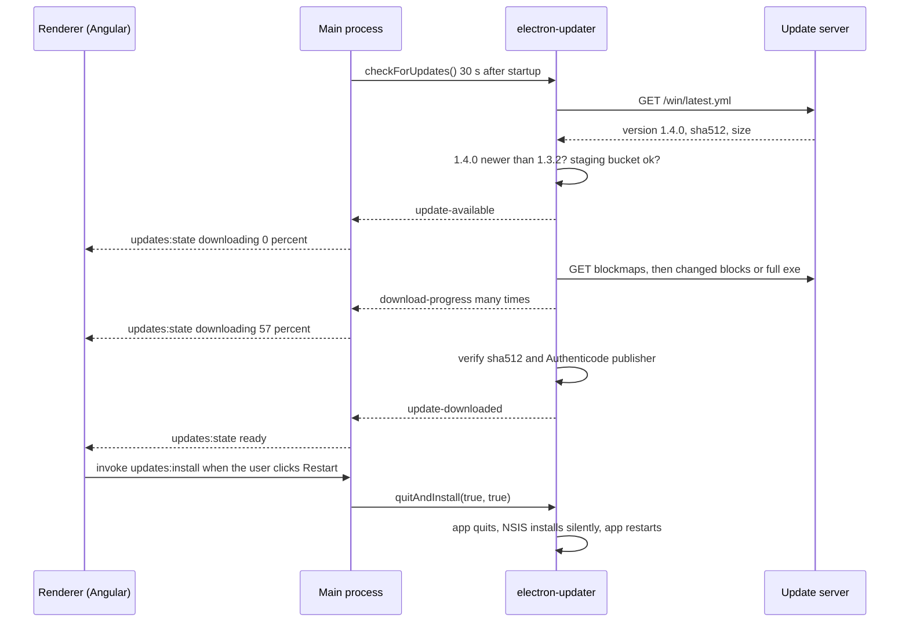
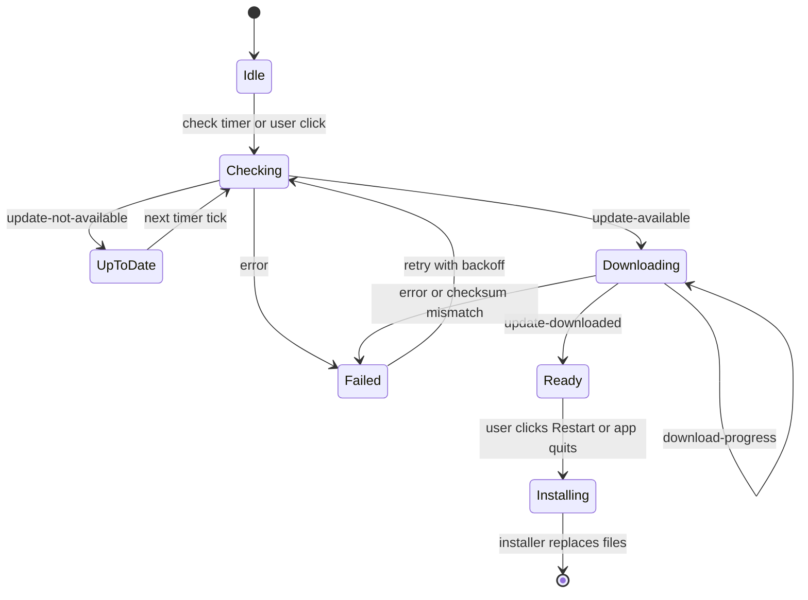

# Auto-Updates

> In this document you will learn how an Electron app updates itself safely: Electron's built-in `autoUpdater` (Squirrel), electron-updater from electron-builder, the full update flow, staged rollouts, channels, signature checks, rollbacks, failure handling, enterprise environments and how to test updates. Interviewers ask about updates because they are where desktop apps differ most from web apps: you cannot just redeploy a server, and a bad update can break thousands of machines at once.

**Before this:** [Packaging, installers and code signing](06-packaging-installers-and-code-signing.md) · [IPC and preload scripts](03-ipc-and-preload-scripts.md) · **Interview questions:** [jump to the interview section](#interview-questions)

## Table of contents

1. [Why desktop apps need auto-updates](#why-desktop-apps-need-auto-updates)
2. [The approaches at a glance](#the-approaches-at-a-glance)
3. [Electron's built-in autoUpdater](#electrons-built-in-autoupdater)
4. [electron-updater](#electron-updater)
5. [The update flow step by step](#the-update-flow-step-by-step)
6. [Full example: electron-updater with progress in an Angular renderer](#full-example-electron-updater-with-progress-in-an-angular-renderer)
7. [Update UX choices](#update-ux-choices)
8. [Differential downloads](#differential-downloads)
9. [Staged rollouts](#staged-rollouts)
10. [Channels: beta and stable](#channels-beta-and-stable)
11. [Signature verification](#signature-verification)
12. [Rollback and downgrade](#rollback-and-downgrade)
13. [Failure handling](#failure-handling)
14. [Enterprise environments](#enterprise-environments)
15. [Update server security](#update-server-security)
16. [Testing updates](#testing-updates)
17. [Common mistakes](#common-mistakes)
18. [Best practices](#best-practices)
19. [How to explain auto-updates in an interview](#how-to-explain-auto-updates-in-an-interview)
20. [Interview questions](#interview-questions)
21. [Summary](#summary)
22. [References](#references)

Our example app is again **OrderDesk**, an Angular-based point-of-sale app for Windows stores. It is built with electron-builder 26 (NSIS installer) and updates with **electron-updater 6.x**.

---

## Why desktop apps need auto-updates

A web app updates when you deploy the server. A desktop app updates only when **each user's machine** installs a new version. Without auto-updates:

- **Security fixes never arrive.** Every Electron app ships its own Chromium. A Chromium security bug fixed upstream reaches your users only when you ship a new Electron version **and** they install it. Electron supports only the latest three major versions, so an app that never updates runs an unsupported browser engine within months.
- **Your backend must support every old client forever.** If store #42 still runs OrderDesk 1.0 from two years ago, your API cannot remove the old endpoint.
- **Bug fixes depend on users.** Most users never download a new installer by themselves.

So auto-update is not a nice extra. It is part of the security and support model of the app.

### Analogy

Think of a phone's app store. The phone checks for new versions, downloads them in the background, and installs them when you are not using the app. An Electron auto-updater does the same job, but **you** run the "store": you host the files, decide who gets the update, and make sure it is genuine.

---

## The approaches at a glance

| Approach | Windows mechanism | Server | Good for |
| --- | --- | --- | --- |
| Built-in `autoUpdater` + **update.electronjs.org** (`update-electron-app`) | Squirrel.Windows | Free service run by the Electron team; reads public GitHub Releases | Open-source apps on GitHub |
| Built-in `autoUpdater` + **static storage** (`update-electron-app` with `StaticStorage`) | Squirrel.Windows | S3 / GCS bucket with `RELEASES` and `.nupkg` files (Forge publishers write them) | Forge apps, simple self-hosting |
| Built-in `autoUpdater` + **your own update server** (Hazel, Nuts, electron-release-server, Nucleus) | Squirrel.Windows | A server that speaks the Squirrel protocol | Private apps with Squirrel |
| Built-in `autoUpdater` for **MSIX** (Electron 41, backported to 39.5 and 40.2) | MSIX update | Direct `.msix` link or JSON feed | MSIX-packaged apps outside the Store |
| **electron-updater** (electron-builder) | NSIS installer | GitHub Releases, S3, DigitalOcean Spaces, generic HTTPS server, Keygen and others | Most apps built with electron-builder |
| **Microsoft Store** | Store | Microsoft | Store-distributed MSIX apps |
| **IT-managed** (Intune, ConfigMgr) | MSI | Company's deployment system | Enterprise fleets; the app's updater is turned off |

The two you must know for interviews are the **built-in `autoUpdater`** and **electron-updater**.

---

## Electron's built-in autoUpdater

### What it is

`autoUpdater` is a module in Electron's main process. It does not implement updating itself. It is a thin JavaScript API over native frameworks:

- **macOS:** Squirrel.Mac. Updates from a ZIP. The app **must be code-signed**.
- **Windows:** Squirrel.Windows, for apps installed with Squirrel installers (Forge's default `maker-squirrel`, or `electron-winstaller`). Since Electron 41 (backported to 39.5.0 and 40.2.0) it also supports apps packaged as **MSIX**; Electron detects the packaging format automatically.
- **Linux:** not supported. Use the distribution's package manager.

### Events and methods

| Member | What it does |
| --- | --- |
| `setFeedURL({ url, headers, serverType })` | Sets the update server URL. Must be called before checking. |
| `checkForUpdates()` | Asks the server. If there is an update, it is **downloaded automatically**. Calling it twice downloads twice. |
| `quitAndInstall()` | Closes all windows, quits and installs the downloaded update, then restarts the app. Call it only after `update-downloaded`. |
| `checking-for-update` | Check started. |
| `update-available` | An update exists; the download starts automatically. |
| `update-not-available` | Already up to date. |
| `update-downloaded` | `(event, releaseNotes, releaseName, releaseDate, updateURL)`. With Squirrel.Windows only `releaseName` is filled. |
| `before-quit-for-update` | Emitted after `quitAndInstall()`. `before-quit` is **not** emitted first in this case, so put shutdown logic in both. |
| `error` | Something failed. |

Note: the built-in module has **no download-progress event**. That is one reason teams choose electron-updater.

### The simplest setup: update-electron-app

For an open-source app on GitHub (public repository, builds in GitHub Releases), the Electron team runs **update.electronjs.org** for free. The `update-electron-app` package configures everything:

```js
// main.js
const { updateElectronApp, UpdateSourceType } = require('update-electron-app');
const log = require('electron-log/main');

updateElectronApp({
  updateSource: {
    type: UpdateSourceType.ElectronPublicUpdateService,
    repo: 'orderdesk/orderdesk-community',
  },
  updateInterval: '1 hour',   // default 10 minutes, minimum 5 minutes
  logger: log,
  notifyUser: true,           // show "Restart now / Later" when an update is downloaded
});
```

Default behavior: check at startup and then every ten minutes, download in the background, and show a native dialog to restart when ready.

For private apps, the same package supports static storage:

```js
updateElectronApp({
  updateSource: {
    type: UpdateSourceType.StaticStorage,
    baseUrl: `https://updates.orderdesk.example.com/${process.platform}/${process.arch}`,
  },
});
```

The bucket must contain, per platform and architecture, the files Squirrel needs: `RELEASES`, `*-full.nupkg` (and optionally `*-delta.nupkg`) for Windows, and the ZIP plus `RELEASES.json` for macOS. Forge's S3 publisher can write them.

### Using autoUpdater directly

```js
// main/squirrel-updater.js
const { app, autoUpdater, dialog } = require('electron');

function startSquirrelUpdates() {
  if (!app.isPackaged) return;                                  // never in development
  if (process.argv.includes('--squirrel-firstrun')) return;     // Squirrel holds a lock for a few seconds

  const feed = `https://updates.orderdesk.example.com/update/${process.platform}/${app.getVersion()}`;
  autoUpdater.setFeedURL({ url: feed });

  autoUpdater.on('error', (err) => console.error('Update error:', err.message));
  autoUpdater.on('update-downloaded', async (_event, releaseNotes, releaseName) => {
    const { response } = await dialog.showMessageBox({
      type: 'info',
      buttons: ['Restart now', 'Later'],
      defaultId: 0,
      message: `OrderDesk ${releaseName} is ready to install.`,
      detail: 'Restart to finish the update. Your open orders are saved.',
    });
    if (response === 0) autoUpdater.quitAndInstall();
  });

  autoUpdater.checkForUpdates();
  setInterval(() => autoUpdater.checkForUpdates(), 4 * 60 * 60 * 1000); // every 4 hours
}

module.exports = { startSquirrelUpdates };
```

You do not have to call `quitAndInstall()`. A downloaded update is applied the next time the app starts anyway. `quitAndInstall()` only makes it happen now.

---

## electron-updater

### What it is

**electron-updater** is the update library of the electron-builder project. You install it as a normal dependency (`npm install electron-updater`) and use its `autoUpdater` **instead of** Electron's. It reads the update metadata (`latest.yml`) that electron-builder publishes, downloads the new installer and runs it.

### Why teams choose it

Compared with the built-in module:

- It supports **Linux** (AppImage, deb, rpm, pacman) as well as Windows (NSIS) and macOS (DMG/ZIP through Squirrel.Mac).
- It verifies the **code signature on Windows** before installing (Squirrel.Windows does not).
- It has **download progress**, **staged rollouts**, **channels** and **differential downloads**.
- It works with many **providers** out of the box: GitHub Releases, Amazon S3, DigitalOcean Spaces, a **generic HTTPS server**, Keygen and others.
- electron-builder generates and uploads all metadata files for you.

Important limitation: on Windows, electron-updater updates **NSIS** installs only. Squirrel.Windows, MSI, portable and AppX installs are not updated by it.

### How it knows where to look

At build time, electron-builder writes `resources/app-update.yml` into the app. It contains the first `publish` provider from your config and, on Windows, the `publisherName` for signature checks:

```yaml
# resources/app-update.yml (generated, inside the installed app)
provider: generic
url: https://updates.orderdesk.example.com/win
updaterCacheDirName: orderdesk-updater
publisherName:
  - OrderDesk Ltd
```

So you **do not call `setFeedURL`** in normal use. You only configure `publish` in `electron-builder.yml`:

```yaml
publish:
  - provider: generic                       # any HTTPS static file server, S3 behind a CDN, IIS, nginx
    url: https://updates.orderdesk.example.com/win
# or
# - provider: github
#   owner: orderdesk
#   repo: orderdesk-desktop
# or
# - provider: s3
#   bucket: orderdesk-updates
#   region: eu-west-2
```

When the app checks for updates it downloads `<url>/latest.yml` (or `beta.yml` on the beta channel), compares versions, and then downloads the installer named in that file.

### The main settings

| Property | Default | Meaning |
| --- | --- | --- |
| `autoDownload` | `true` | Start downloading as soon as an update is found. Set `false` to ask the user first, then call `downloadUpdate()`. |
| `autoInstallOnAppQuit` | `true` | If an update was downloaded and you did not call `quitAndInstall()`, install it when the app quits. |
| `autoRunAppAfterInstall` | `true` | Restart the app after a non-silent install. |
| `allowPrerelease` | `false` | GitHub provider only: allow prerelease versions. |
| `allowDowngrade` | `false` | Allow installing a **lower** version (for example when moving from beta back to stable). Setting `channel` turns this on automatically. |
| `channel` | from `app-update.yml` (`latest`) | Which channel file to read: `latest`, `beta`, `alpha`. |
| `disableDifferentialDownload` | `false` | NSIS only: always download the full installer. |
| `forceDevUpdateConfig` | `false` | Use `dev-app-update.yml` even when not packaged (for testing). |
| `logger` | `console` | Any object with `info`, `warn`, `error`. Use electron-log. |
| `requestHeaders` | `null` | Extra headers, for example `Authorization` for a private feed. |

Methods:

| Method | What it does |
| --- | --- |
| `checkForUpdates()` | Fetches the metadata. Returns a promise with `{ updateInfo, ... }` or `null` if the updater is not active (for example in development). Parallel calls share one request. |
| `checkForUpdatesAndNotify()` | Check, download, and show a system notification when ready. Two-line setup for simple apps. |
| `downloadUpdate(cancellationToken?)` | Start the download manually (when `autoDownload` is `false`). |
| `quitAndInstall(isSilent = false, isForceRunAfter = false)` | Quit and run the installer. With NSIS, `isSilent: true` runs it without UI; `isForceRunAfter: true` restarts the app after a silent install. |
| `setFeedURL(options)` | Override the provider at runtime. Rarely needed. |
| `isUpdaterActive()` | `false` in development (unless forced) and in unsupported install types. |

Events (on `autoUpdater` from `electron-updater`):

| Event | Arguments | Meaning |
| --- | --- | --- |
| `checking-for-update` | — | Check started |
| `update-available` | `info` (`version`, `releaseDate`, `releaseNotes`, `files`, ...) | A newer version exists |
| `update-not-available` | `info` | You are up to date |
| `download-progress` | `progress` (`percent`, `bytesPerSecond`, `transferred`, `total`) | Fired many times during download |
| `update-downloaded` | `info` (plus the downloaded file path) | Ready to install |
| `update-cancelled` | `info` | Download was cancelled |
| `error` | `error` | Something failed (network, checksum, signature, disk) |

electron-updater also emits `login` when a proxy needs credentials (see [Enterprise environments](#enterprise-environments)).

### The smallest working setup

```js
// main.js
const { app } = require('electron');
const { autoUpdater } = require('electron-updater');
const log = require('electron-log/main');

app.whenReady().then(() => {
  autoUpdater.logger = log;
  autoUpdater.checkForUpdatesAndNotify(); // check + download + system notification
});
```

This is enough for a simple tool. Real apps want progress in the UI, control over the restart moment and good error handling. The full example follows after the flow.

### Built-in autoUpdater vs electron-updater

| | Built-in `autoUpdater` | electron-updater |
| --- | --- | --- |
| Windows installer | Squirrel.Windows (or MSIX) | NSIS |
| Linux | No | Yes |
| Windows signature check before install | No (Squirrel) | Yes (`publisherName`) |
| Download progress event | No | Yes |
| Staged rollouts | Only if your server does it | Yes (`stagingPercentage`) |
| Channels | Only if your server does it | Yes (`latest`, `beta`, `alpha`) |
| Differential downloads | Squirrel delta packages | Blockmaps |
| Server | update.electronjs.org, Hazel, Nuts, static storage | Any static HTTPS host, S3, GitHub Releases |
| Typical build tool | Electron Forge | electron-builder |

---

## The update flow step by step

### Sequence



Walkthrough:

1. **Check.** Thirty seconds after startup (so startup stays fast), main calls `checkForUpdates()`. electron-updater downloads `latest.yml` from the URL in `app-update.yml`.
2. **Decide.** It parses the version with semver. If the server version is not greater than `app.getVersion()`, it emits `update-not-available`. If `stagingPercentage` is set and this user is outside the rollout, it also treats the update as not available.
3. **Download.** With `autoDownload: true`, it downloads into a cache folder, `%LOCALAPPDATA%\orderdesk-updater\pending`. If an older blockmap is available, it downloads only changed blocks.
4. **Verify.** It checks the SHA-512 from `latest.yml` and, on Windows, the Authenticode signer against `publisherName`. Any mismatch → `error`, and nothing is installed.
5. **Ready.** It emits `update-downloaded`. The update is now waiting.
6. **Install.** Either the user clicks "Restart now" (you call `quitAndInstall`), or the app installs it on the next normal quit (`autoInstallOnAppQuit`).
7. **Restart.** The NSIS installer runs with `--updated` (and `/S` when silent), replaces the files and, if requested, starts the new version.

### States

The UI should show the update state clearly. A state machine keeps the code honest:



Two rules come from the diagram:

- **Ready is a waiting state.** Nothing forces a restart. The user decides, or the app quits normally.
- **Failed is not the end.** A failed check or download retries later. One bad network minute should not stop updates for a week.

---

## Full example: electron-updater with progress in an Angular renderer

This is a complete, realistic setup for OrderDesk. It has four parts:

1. `main/updater-service.js` — owns electron-updater, keeps the current state, schedules checks, sends progress to windows.
2. `preload.js` — exposes a small `updates` API (no raw `ipcRenderer`).
3. `update-state.ts` — a shared TypeScript type for the state.
4. An Angular 16 service and banner component.

IPC patterns used here (invoke/handle, main → renderer events, unsubscribe functions) are explained in [IPC and preload scripts](03-ipc-and-preload-scripts.md).

### 1. The main-process update service

```js
// main/updater-service.js
const { app, ipcMain, BrowserWindow, powerMonitor } = require('electron');
const { autoUpdater } = require('electron-updater');
const log = require('electron-log/main');

const FIRST_CHECK_DELAY_MS = 30 * 1000;          // keep startup fast
const CHECK_INTERVAL_MS = 4 * 60 * 60 * 1000;    // every 4 hours
const TRUSTED_ORIGINS = new Set(['app://bundle']);
if (!app.isPackaged) TRUSTED_ORIGINS.add('http://localhost:4200'); // dev server only

let state = { status: 'idle' };
let lastSentPercent = -1;
let timer = null;

function broadcast() {
  for (const win of BrowserWindow.getAllWindows()) {
    if (!win.isDestroyed()) win.webContents.send('updates:state', state);
  }
}

function setState(next) {
  state = next;
  broadcast();
}

// Same check as isTrustedSender in the IPC document. Use senderFrame.origin, not
// new URL(...).origin: Node's URL returns 'null' as the origin of app:// URLs.
function assertTrustedSender(event) {
  const frame = event.senderFrame;                 // can be null if the frame is gone
  if (!frame || !TRUSTED_ORIGINS.has(frame.origin)) {
    throw new Error(`Blocked update IPC from ${frame?.origin}`);
  }
}

function friendlyMessage(err) {
  const text = String(err && err.message);
  if (text.includes('ERR_INTERNET_DISCONNECTED') || text.includes('ENOTFOUND')) {
    return 'No connection to the update server. OrderDesk will try again later.';
  }
  if (text.includes('sha512 checksum mismatch')) {
    return 'The update download was damaged. It will be downloaded again.';
  }
  if (text.includes('not signed by the application owner')) {
    return 'The update could not be verified and was not installed.';
  }
  return 'The update failed. OrderDesk will try again later.';
}

async function checkNow(reason) {
  if (state.status === 'downloading' || state.status === 'ready') return state;
  log.info(`Update check (${reason})`);
  try {
    await autoUpdater.checkForUpdates();
  } catch (err) {
    // the 'error' event also fires; this catch only prevents an unhandled rejection
    log.warn('checkForUpdates failed', err);
  }
  return state;
}

function registerIpc() {
  ipcMain.handle('updates:get-state', (event) => {
    assertTrustedSender(event);
    return state;
  });

  ipcMain.handle('updates:check', (event) => {
    assertTrustedSender(event);
    return checkNow('user');
  });

  ipcMain.handle('updates:install', (event) => {
    assertTrustedSender(event);
    if (state.status !== 'ready') return false;
    log.info(`Installing ${state.version} now (user request)`);
    // give the renderer its reply first, then quit
    setImmediate(() => autoUpdater.quitAndInstall(true, true)); // silent NSIS, restart after
    return true;
  });
}

function initUpdater({ managedByIt = false } = {}) {
  registerIpc();

  if (!app.isPackaged) {
    setState({ status: 'disabled', reason: 'development' });
    return;
  }
  if (managedByIt) {
    setState({ status: 'disabled', reason: 'managed' });
    return;
  }

  autoUpdater.logger = log;
  autoUpdater.autoDownload = true;
  autoUpdater.autoInstallOnAppQuit = true;   // a ready update installs on the next normal quit
  autoUpdater.allowDowngrade = false;

  autoUpdater.on('checking-for-update', () => setState({ status: 'checking' }));

  autoUpdater.on('update-not-available', () =>
    setState({ status: 'up-to-date', checkedAt: Date.now() }));

  autoUpdater.on('update-available', (info) => {
    lastSentPercent = -1;
    setState({ status: 'downloading', version: info.version, percent: 0 });
  });

  autoUpdater.on('download-progress', (progress) => {
    const percent = Math.floor(progress.percent);
    if (percent === lastSentPercent) return;   // throttle: at most ~100 messages per download
    lastSentPercent = percent;
    setState({ status: 'downloading', version: state.version, percent });
  });

  autoUpdater.on('update-downloaded', (info) => {
    log.info(`Update ${info.version} downloaded and verified`);
    setState({ status: 'ready', version: info.version });
  });

  autoUpdater.on('error', (err) => {
    log.error('Updater error', err);
    setState({ status: 'error', message: friendlyMessage(err) });
  });

  setTimeout(() => checkNow('startup'), FIRST_CHECK_DELAY_MS);
  timer = setInterval(() => checkNow('timer'), CHECK_INTERVAL_MS);
  powerMonitor.on('resume', () => checkNow('resume'));   // laptops wake up after days
}

function stopUpdater() {
  if (timer) clearInterval(timer);
}

module.exports = { initUpdater, stopUpdater };
```

```js
// main/main.js (excerpt)
const { app } = require('electron');
const { initUpdater } = require('./updater-service');
const { readMachinePolicy } = require('./policy');

app.whenReady().then(async () => {
  createMainWindow();
  const policy = await readMachinePolicy();          // shown in "Enterprise environments"
  initUpdater({ managedByIt: policy.disableAutoUpdate === true });
});
```

Things to notice:

- The **state lives in main**. A window that opens later asks `updates:get-state` and immediately shows the right banner.
- **Progress is throttled** to whole percentages. `download-progress` can fire very often; sending each one over IPC to every window wastes CPU.
- **IPC handlers check the sender**, like every handler should. A random page loaded in some window must not be able to restart the app.
- `quitAndInstall` runs in `setImmediate`, so the renderer receives the reply before the app quits.
- **Development is disabled** with `app.isPackaged`. In development there is no `app-update.yml`, and you do not want your dev build to "update" itself to the production version.

### 2. The preload API

```js
// preload.js (excerpt: the updates section of window.orderDesk)
const { contextBridge, ipcRenderer } = require('electron');

contextBridge.exposeInMainWorld('orderDesk', {
  // ...other API sections (orders, printing, ...)
  updates: {
    getState: () => ipcRenderer.invoke('updates:get-state'),
    check: () => ipcRenderer.invoke('updates:check'),
    install: () => ipcRenderer.invoke('updates:install'),
    onState: (callback) => {
      const listener = (_event, state) => callback(state);
      ipcRenderer.on('updates:state', listener);
      return () => ipcRenderer.removeListener('updates:state', listener); // unsubscribe
    },
  },
});
```

### 3. Shared types

```ts
// src/app/core/updates/update-state.ts
export type UpdateState =
  | { status: 'idle' | 'checking' }
  | { status: 'up-to-date'; checkedAt: number }
  | { status: 'downloading'; version: string; percent: number }
  | { status: 'ready'; version: string }
  | { status: 'error'; message: string }
  | { status: 'disabled'; reason: 'development' | 'managed' | 'browser' };

export interface UpdatesApi {
  getState(): Promise<UpdateState>;
  check(): Promise<UpdateState>;
  install(): Promise<boolean>;
  onState(callback: (state: UpdateState) => void): () => void;
}

declare global {
  interface Window {
    orderDesk?: { updates: UpdatesApi };
  }
}
```

### 4. The Angular service and banner

IPC callbacks arrive outside Angular's zone, so Angular 16 (with Zone.js) would not run change detection by itself. The service re-enters the zone with `NgZone.run` (the zone problem is explained in [IPC and preload scripts](03-ipc-and-preload-scripts.md#angular-service-that-wraps-the-preload-api)).

```ts
// src/app/core/updates/update.service.ts
import { Injectable, NgZone, OnDestroy } from '@angular/core';
import { BehaviorSubject } from 'rxjs';
import { UpdateState } from './update-state';

@Injectable({ providedIn: 'root' })
export class UpdateService implements OnDestroy {
  private readonly api = window.orderDesk?.updates;
  private readonly stateSubject = new BehaviorSubject<UpdateState>({ status: 'idle' });
  private readonly unsubscribe?: () => void;

  readonly state$ = this.stateSubject.asObservable();

  constructor(private readonly zone: NgZone) {
    if (!this.api) {
      this.stateSubject.next({ status: 'disabled', reason: 'browser' }); // running in a normal browser
      return;
    }
    this.api.getState().then((s) => this.zone.run(() => this.stateSubject.next(s)));
    this.unsubscribe = this.api.onState((s) => this.zone.run(() => this.stateSubject.next(s)));
  }

  async checkNow(): Promise<void> {
    if (!this.api) return;
    const s = await this.api.check();
    this.zone.run(() => this.stateSubject.next(s));
  }

  async restartAndInstall(): Promise<void> {
    await this.api?.install();
  }

  ngOnDestroy(): void {
    this.unsubscribe?.();
  }
}
```

```ts
// src/app/core/updates/update-banner.component.ts (Angular 16, NgModule-friendly)
import { Component } from '@angular/core';
import { UpdateService } from './update.service';

@Component({
  selector: 'od-update-banner',
  template: `
    <ng-container *ngIf="updates.state$ | async as s">
      <div class="banner" *ngIf="s.status === 'downloading'" role="status">
        Downloading OrderDesk {{ s.version }}: {{ s.percent }}%
      </div>
      <div class="banner ready" *ngIf="s.status === 'ready'" role="status">
        OrderDesk {{ s.version }} is ready.
        <button type="button" (click)="updates.restartAndInstall()">Restart now</button>
        <span class="hint">Or it installs when you close the app.</span>
      </div>
      <div class="banner error" *ngIf="s.status === 'error'" role="alert">{{ s.message }}</div>
    </ng-container>
  `,
})
export class UpdateBannerComponent {
  constructor(readonly updates: UpdateService) {}
}
```

> **Newer Angular (17+):** you would usually write the template with `@if (s.status === 'ready') { ... }` control flow, and in signal-based code convert the observable with `toSignal()`. In zoneless Angular apps (experimental since Angular 18, stable in later versions) the `NgZone.run` call is not needed; instead, the view refreshes because you update a signal (or the async pipe marks it for check).

Step by step, from startup to restart:

1. `app.whenReady()` creates the window, then `initUpdater()` registers the IPC handlers and sets a 30-second timer.
2. The Angular `UpdateService` is created, calls `getState()` and gets `{ status: 'idle' }`. It also subscribes to `updates:state`.
3. After 30 s, main calls `checkForUpdates()`. electron-updater emits `checking-for-update`; main sends `{ status: 'checking' }`; the zone-wrapped callback updates the BehaviorSubject; the banner shows nothing for this state.
4. `latest.yml` says `1.4.0`. `update-available` → `{ status: 'downloading', version: '1.4.0', percent: 0 }`. The banner shows "Downloading OrderDesk 1.4.0: 0%".
5. `download-progress` events arrive. Main forwards only whole-number changes. The banner counts up to 100%.
6. The file passes the SHA-512 and signature checks. `update-downloaded` → `{ status: 'ready', version: '1.4.0' }`. The banner shows the Restart button.
7. The cashier finishes the sale and clicks **Restart now**. The renderer invokes `updates:install`. Main replies `true`, then calls `quitAndInstall(true, true)`.
8. The app quits, the NSIS installer runs silently, and OrderDesk 1.4.0 starts.

---

## Update UX choices

There is no single right UX. Choose based on who uses the app and what an unexpected restart costs.

| Strategy | How | Good for | Risk |
| --- | --- | --- | --- |
| **Install on quit (silent)** | `autoDownload: true`, `autoInstallOnAppQuit: true`, no prompt | Apps that are closed daily (office tools) | Users who never close the app never update |
| **Prompt to restart** | Show "Restart now / Later" after `update-downloaded` | Most apps | Users click "Later" forever |
| **Ask before downloading** | `autoDownload: false`, show release notes, call `downloadUpdate()` | Metered or slow connections | Many users never update |
| **Restart at a quiet time** | Install automatically when idle (no open order, outside store hours) | POS, kiosks, unattended machines | Must detect "safe moments" correctly |
| **Forced (mandatory) update** | The backend reports a minimum version; older clients block risky features until updated | Security fixes, breaking API changes | Annoys users if used too often |

### Never restart in the middle of work

For OrderDesk, a restart during a card payment is a real business problem. So the renderer tells main whether it is busy, and main installs automatically only when it is safe:

```js
// main/updater-service.js (additions)
let rendererBusy = false;

ipcMain.on('app:busy-changed', (event, busy) => {
  assertTrustedSender(event);
  rendererBusy = busy === true;
});

function isQuietHour(date = new Date()) {
  const hour = date.getHours();
  return hour >= 2 && hour < 5;                   // stores are closed
}

setInterval(() => {
  if (state.status === 'ready' && !rendererBusy && isQuietHour()) {
    log.info(`Auto-installing ${state.version} during quiet hours`);
    autoUpdater.quitAndInstall(true, true);
  }
}, 10 * 60 * 1000);
```

### Mandatory updates with a minimum version

electron-updater has no "mandatory" flag. A common, simple design: your **backend** returns the minimum supported client version, and the app compares:

```js
// min-version.js — compare plain MAJOR.MINOR.PATCH versions (no prerelease tags)
function compareVersions(a, b) {
  const pa = a.split('.').map(Number);
  const pb = b.split('.').map(Number);
  for (let i = 0; i < 3; i++) {
    if (pa[i] !== pb[i]) return pa[i] > pb[i] ? 1 : -1;
  }
  return 0;
}

function mustUpdate(currentVersion, policy) {
  return compareVersions(currentVersion, policy.minimumVersion) < 0;
}

const policy = { minimumVersion: '1.3.2' }; // from GET /api/client-policy
console.log(mustUpdate('1.3.0', policy));   // true  -> block checkout, show "Update required"
console.log(mustUpdate('1.3.2', policy));   // false
console.log(mustUpdate('1.10.0', policy));  // false (numeric compare, not string compare)
console.log('1.10.0' < '1.3.2');            // true  <- why string comparison is wrong
```

For real code with prerelease tags (`1.4.0-beta.2`), use the `semver` package instead of this small function.

The server can also **enforce** it: the API rejects requests with an old `X-Client-Version` header with a clear error code, and the app shows "Please restart to update". This protects the backend even if the client's check is bypassed.

---

## Differential downloads

A full OrderDesk installer is large, but most releases change only a small part of it (your JavaScript), not Chromium. **Differential downloads** download only what changed.

How electron-updater does it for NSIS:

1. At build time, electron-builder writes a **blockmap** next to each installer (`OrderDesk-Setup-1.4.0.exe.blockmap`). It splits the file into blocks and stores the checksum of each block. The installer package is built so that unchanged content produces identical blocks in the next version.
2. On the user's PC, the updater keeps the blockmap of the installed version in its cache.
3. When `1.4.0` is available, it downloads the **new blockmap**, compares it with the old one, and requests only the changed blocks with **HTTP range requests**. Unchanged blocks are copied from the cached old installer.
4. It assembles the new installer and verifies the full SHA-512. If anything fails (missing old file, server without range support, mismatch), it falls back to a **full download**.

Requirements for your server: support `Range` requests (S3, CDNs, nginx and IIS do), and keep old blockmaps available. If differential downloads cause trouble behind a strange proxy, set `disableDifferentialDownload = true`.

Squirrel.Windows has a similar idea with **delta `.nupkg`** packages.

---

## Staged rollouts

### What it is

A **staged rollout** gives a new version to only a percentage of users first. If crash reports and support tickets look fine, you increase the percentage. If something is wrong, only a few users are affected.

### How to use it with electron-updater

Edit `latest.yml` on the server and add `stagingPercentage`:

```yaml
version: 1.4.0
files:
  - url: OrderDesk-Setup-1.4.0.exe
    sha512: kX1oQ0r7T3Uq5c0n8l8pS2m1Wb2Hd4m3D3m5n8D1cXbT1bFz2R9rG4kq8bH1sQ9kV5aL3yU7mN2pE6wC0fJ4dA==
    size: 94371842
releaseDate: '2026-10-20T09:12:44.512Z'
stagingPercentage: 10
```

A typical plan: 5% on day one → 25% → 50% → remove the field (100%). Watch crash rates (see [Logging, crash recovery and monitoring](08-logging-crash-recovery-and-monitoring.md)) between steps.

Make sure `latest.yml` is **not cached** for long by your CDN, or the change takes hours to reach users. Use a short `Cache-Control: max-age` (or `no-cache`) for `*.yml` and long caching for the versioned installer files.

### How it works inside

electron-updater creates a random UUID for each installation the first time it needs one, and stores it in `userData\.updaterId`. It turns 4 bytes of that UUID into a number between 0 and 1. If the number is below `stagingPercentage / 100`, this machine is inside the rollout. The same machine always gets the same number, so raising the percentage only **adds** machines.

You can simulate it:

```js
// staging-simulation.js
const { randomUUID } = require('node:crypto');

// Same idea as electron-updater: read 4 bytes of the machine's UUID as a number 0..1
function userBucket(uuid) {
  const bytes = Buffer.from(uuid.replace(/-/g, ''), 'hex'); // 16 bytes
  return bytes.readUInt32BE(12) / 0xffffffff;
}

function isUserWithinRollout(uuid, stagingPercentage) {
  if (stagingPercentage == null) return true;          // no field = everyone
  return userBucket(uuid) < stagingPercentage / 100;
}

// 1. The same machine always gets the same answer
const asha = '6f1c2a9e-3b4d-4e5f-8a7b-1c2d3e4f5a6b';
console.log(userBucket(asha).toFixed(4));                // 0.2434
console.log(isUserWithinRollout(asha, 10));              // false
console.log(isUserWithinRollout(asha, 50));              // true

// 2. Across many machines, about 10% are inside a 10% rollout
const users = Array.from({ length: 100000 }, () => randomUUID());
const inside = users.filter((id) => isUserWithinRollout(id, 10)).length;
console.log(Math.round(inside / 1000));                  // 10  (about 10%)

// 3. Raising the percentage only ADDS machines; nobody inside 10% drops out at 25%
const inAt10 = users.filter((id) => isUserWithinRollout(id, 10));
console.log(inAt10.every((id) => isUserWithinRollout(id, 25))); // true
```

### Pulling a bad release

If `1.4.0` is bad, setting `stagingPercentage: 0` stops **new** machines from getting it. But machines that already installed `1.4.0` stay on it. To fix them you must publish a **higher** version, for example `1.4.1` (which may simply be the `1.3.2` code with a new version number). Never re-publish `1.4.0` with different content: machines that have `1.4.0` will not "update" to the same version.

### Custom rollout rules

If you need rollout by store, region or customer tier, electron-updater lets you replace the rule with `autoUpdater.isUserWithinRollout = async (updateInfo) => ...` (electron-updater 6.x). A simpler alternative many teams use: separate feed URLs per ring (`/win/ring-pilot`, `/win/ring-all`), chosen from configuration.

---

## Channels: beta and stable

A **channel** is a separate stream of releases. electron-builder supports `latest` (stable, default), `beta` and `alpha`.

How it works:

- The **version string decides the channel**. `1.5.0-beta.1` is published as `beta.yml`, `1.4.0` as `latest.yml` (`detectUpdateChannel`, default `true`).
- With `generateUpdatesFilesForAllChannels: true`, a stable build also updates `beta.yml` and `alpha.yml`, so beta users receive stable releases too. Beta users get `beta` and `latest` versions; alpha users get all three.
- In the app, set `autoUpdater.channel = 'beta'` for users who opted in. Setting `channel` also sets `allowDowngrade = true`, so a user who leaves the beta can go back to the stable version, which may be lower than their current beta.
- With the GitHub provider, set the `channel` explicitly in the publish options; GitHub does not follow the version tag automatically. `allowPrerelease` controls whether GitHub prereleases are considered.

```yaml
# electron-builder.yml
generateUpdatesFilesForAllChannels: true
publish:
  - provider: generic
    url: https://updates.orderdesk.example.com/win
```

```js
// main: the user enabled "Join the pilot program" in settings
const { autoUpdater } = require('electron-updater');

function applyUpdateChannel(settings) {
  autoUpdater.channel = settings.pilotProgram ? 'beta' : 'latest';
}
```

Real use: pilot stores get `beta` a week before everyone else. That is a second safety net in addition to staged rollouts.

---

## Signature verification

An updater is a program that downloads and runs code from the internet with the user's rights (or admin rights for per-machine installs). If an attacker can make it run *their* installer, they own every machine. So updates must be verified.

What electron-updater checks on Windows (NSIS):

1. **Transport:** HTTPS to the update server.
2. **Integrity:** the SHA-512 from `latest.yml` must match the downloaded file.
3. **Publisher:** the installer's Authenticode signature must be valid **and** its signer must match `publisherName` in `app-update.yml` (written at build time). This is `verifyUpdateCodeSignature`, on by default. If it fails, you get an error like "New version ... is not signed by the application owner" and nothing is installed.

Why step 3 matters: steps 1 and 2 do not help if the attacker controls the server, because they can change the installer **and** `latest.yml`. They cannot produce a valid signature with your certificate.

On macOS, Squirrel.Mac checks that the update is signed with the **same code signing identity** as the running app. That is why macOS apps must be signed for updates at all.

Rules:

- Never set `verifyUpdateCodeSignature` to `false` in production.
- When your certificate's subject changes, ship a transition release whose `publisherName` lists **both** old and new names, then switch signing.
- electron-builder 27 (alpha) adds **signed update manifests**: `latest.yml` itself is signed with an Ed25519 key and verified before download. Plan to adopt it when you upgrade.

---

## Rollback and downgrade

Desktop updates do not have a simple "rollback button". Think about it before you need it.

- **Roll forward, not back.** The standard fix for a bad `1.4.0` is to ship `1.4.1` quickly. With staged rollouts, few users have the bad version.
- **`allowDowngrade`** (default `false`) lets the updater install a **lower** version than the current one. It is used for leaving a beta channel. You could publish `1.3.2` as `latest` with `allowDowngrade: true` in the app, but only apps that **already** had that setting would downgrade. Usually it is easier to ship `1.4.1`.
- **Data migrations are the real danger.** If `1.4.0` migrated the SQLite schema, an older version may not be able to read the database. Rules:
  - Make migrations **backward compatible** for at least one version (add columns, do not rename or delete them in the same release).
  - **Back up** the database file before migrating (`orders.sqlite.bak-1.3.2`).
  - Store the schema version and refuse to run on a newer schema with a clear message, instead of corrupting data.
- **Keep old installers** on the server. Support may need to reinstall a known-good version on one machine.

---

## Failure handling

Updates run on thousands of different machines. Everything that can fail will fail somewhere.

| Failure | What you see | What to do |
| --- | --- | --- |
| No network, DNS failure, captive portal | `error` with `net::ERR_...` or `ENOTFOUND` | Do not show scary dialogs. Log it, show a quiet message only if the user clicked "Check now", retry later with backoff |
| Proxy blocks the update host or needs authentication | HTTP 407, `login` event, timeouts | Use the system proxy (electron-updater uses Chromium's network stack); handle `login`; document the hosts for IT |
| Download interrupted (sleep, Wi-Fi drop) | `error` during download | Retry; electron-updater keeps a cache and the differential logic reuses data |
| Corrupt download or wrong file on server | `sha512 checksum mismatch` | The file is discarded. Alert yourself through monitoring: this may also mean someone changed files on the server |
| Signature check fails | "not signed by the application owner" | Never bypass. Investigate certificate or `publisherName` changes, or a compromised server |
| Disk full | Write errors | Check free space before downloading large updates; show a clear message |
| Per-machine install, user without admin | UAC prompt the user cannot approve | Do not nag. Show "Your IT department will install this update", or use per-user installs |
| Antivirus locks or quarantines files | Installer fails, app broken | Sign everything; install at quit/next start; keep the old version working until the new one is fully installed |
| App still running during install | Files in use | `quitAndInstall` closes windows first; make sure child processes (helpers, utility processes) exit on quit |
| Server publishes `latest.yml` before the installer is uploaded | 404 on download | Upload installers first, metadata last |

### Retry with backoff

Retrying immediately in a tight loop hammers your server when it is down, and thousands of clients retrying at the same moment make it worse. Use **exponential backoff with jitter**:

```js
// retry-with-backoff.js
function backoffDelay(attempt, { baseMs = 1000, maxMs = 60000, random = Math.random } = {}) {
  const exponential = Math.min(maxMs, baseMs * 2 ** attempt); // 1s, 2s, 4s, 8s ... capped
  return Math.round(exponential / 2 + random() * (exponential / 2)); // "equal jitter"
}

async function retry(task, { retries = 4, sleep, ...opts } = {}) {
  for (let attempt = 0; ; attempt++) {
    try {
      return await task(attempt);
    } catch (err) {
      if (attempt >= retries || err.permanent) throw err;
      const delay = backoffDelay(attempt, opts);
      console.log(`attempt ${attempt + 1} failed (${err.message}), retrying in ${delay} ms`);
      await sleep(delay);
    }
  }
}

// Deterministic demo: random() always 0.5, sleep does not really wait
const fakeSleep = () => Promise.resolve();
let calls = 0;
async function checkForUpdates() {
  calls++;
  if (calls < 3) throw new Error('net::ERR_INTERNET_DISCONNECTED');
  return { version: '1.4.0' };
}

retry(checkForUpdates, { sleep: fakeSleep, random: () => 0.5 })
  .then((result) => console.log('result:', result.version, 'after', calls, 'calls'));
// attempt 1 failed (net::ERR_INTERNET_DISCONNECTED), retrying in 750 ms
// attempt 2 failed (net::ERR_INTERNET_DISCONNECTED), retrying in 1500 ms
// result: 1.4.0 after 3 calls
```

Walkthrough:

1. Attempt 0 fails. The exponential delay is `1000 * 2^0 = 1000` ms. With jitter, the delay is between 500 and 1000 ms; with `random() = 0.5` it is 750 ms.
2. Attempt 1 fails. Exponential delay `2000` ms → between 1000 and 2000 ms → 1500 ms.
3. Attempt 2 succeeds. The result is returned after 3 calls.
4. Errors marked `permanent` (for example a signature failure) are not retried, because retrying cannot fix them.

In the updater, the periodic timer already gives a slow retry. Backoff is useful for the first check after startup, for user-triggered checks, and for anything your own code downloads.

### Make failures visible to you

- Log every update event with electron-log (`autoUpdater.logger = log`). The log file is the first thing support asks for.
- Send update errors (without personal data) to your monitoring, with the app version, target version and error code. A spike of `sha512 checksum mismatch` after a release is an incident.

---

## Enterprise environments

Large companies often control software centrally. Your updater must work with them, not against them.

### Proxies

electron-updater makes its requests through Electron's `net` module (Chromium's network stack, in its own session named `electron-updater`). So it uses the **system proxy settings** and PAC scripts like the browser does. If the proxy asks for credentials, electron-updater emits a `login` event, and Chromium can often answer Windows-integrated authentication (NTLM/Kerberos) by itself.

Give IT a list of hosts the app needs, for example `updates.orderdesk.example.com` and `api.orderdesk.example.com`, so they can allow them in the proxy and firewall. TLS-inspecting proxies replace certificates; the company's root certificate is in the Windows store, which Chromium trusts.

### No admin rights

Most employees have no admin rights. A **per-user** NSIS install updates silently without admin. A **per-machine** install needs elevation for every update, which normal users cannot give. So either install per-user, or let IT deploy updates.

### Managed deployment: MSI with Intune or ConfigMgr

In managed fleets, IT installs an **MSI** with Microsoft Intune, Configuration Manager (SCCM) or Group Policy, tests new versions on a pilot group and rolls them out on their schedule. In this setup the app's own updater must be **off**:

- electron-updater does not update MSI installs anyway.
- IT does not want the app to change versions on its own.

Provide a machine-wide switch that IT can set. A simple, robust option is a policy file in `C:\ProgramData`, which only admins can write:

```js
// main/policy.js
const fs = require('node:fs/promises');
const path = require('node:path');

const POLICY_FILE = path.join(process.env.ProgramData || 'C:\\ProgramData', 'OrderDesk', 'policy.json');

async function readMachinePolicy() {
  try {
    const policy = JSON.parse(await fs.readFile(POLICY_FILE, 'utf8'));
    return { disableAutoUpdate: policy.disableAutoUpdate === true };
  } catch (err) {
    if (err.code !== 'ENOENT') console.warn('Invalid policy file, using defaults', err.message);
    return { disableAutoUpdate: false };
  }
}

module.exports = { readMachinePolicy };
```

```json
{ "disableAutoUpdate": true }
```

Many enterprise apps use a registry value under `HKLM\Software\Policies\<Company>\<App>` instead, because Group Policy and Intune can set registry values easily. Electron has no registry API; you read it with `reg.exe query` through `child_process` or with a small npm package. Whichever you choose, document it.

Also show managed status in the UI ("Updates are managed by your organization") so users do not report "the app never updates" as a bug.

---

## Update server security

The update server is one of the most valuable targets in your whole system: whoever controls it can run code on every installation.

- **HTTPS only.** Never `http://` feeds.
- **Separate permissions.** The CI job can upload; nothing else can. Developers do not have write access to the production bucket. Use short-lived CI credentials.
- **Immutable, versioned files.** Never overwrite `OrderDesk-Setup-1.4.0.exe`. Upload the installer and blockmap first, `latest.yml` last.
- **Caching:** long cache for versioned files, short or no cache for `latest.yml` (so rollout changes and emergency stops take effect quickly).
- **Signed installers + `publisherName` checks**, so a compromised server still cannot install a foreign program.
- **Private feeds:** if updates must be private, use an authorization header (`autoUpdater.addAuthHeader('Bearer ...')` or `requestHeaders`). Do not bake a long-lived master token into the app, because anyone can extract it. Prefer per-user tokens from your login flow, or short-lived signed URLs from your backend.
- **Monitor** downloads and errors, and alert on unexpected changes to update files.
- Keep a **kill switch**: the ability to stop a rollout within minutes (`stagingPercentage: 0`, or replace `latest.yml` with the previous version's metadata).

---

## Testing updates

Auto-update code is hard to test, because it involves two versions, a server and an installer. Do it anyway: a broken updater is the one bug you cannot fix with an update.

### Test the UI flow in development

Create `dev-app-update.yml` in the project root (same format as `app-update.yml`), and force the updater to use it:

```yaml
# dev-app-update.yml
provider: generic
url: http://localhost:8080/win
```

```js
// main (development only)
if (!app.isPackaged && process.env.ORDERDESK_TEST_UPDATES === '1') {
  autoUpdater.forceDevUpdateConfig = true;
}
```

Serve a folder with a fake `latest.yml` and an installer using any static server (for example `npx http-server ./update-test -p 8080`). This is good for building the UI states. It is **not** a real test of installation: the electron-builder docs recommend testing updates with an installed app, especially on Windows. A local S3-compatible server such as MinIO works well for testing the S3 provider.

Note that the updater code shown earlier disables updates when `!app.isPackaged`; for this test, make that check respect the same environment variable.

### Test real updates before every release

A small but complete test matrix:

1. Install the **previous** release (N-1) on a clean Windows VM. Update to the release candidate. Check the version, data and settings.
2. Repeat from **N-2** (users skip versions).
3. Test **per-user** and, if you support it, **per-machine** installs (with and without admin rights).
4. Test **interrupted downloads** (disconnect the network at 50%) and a **corrupt file** (wrong `sha512` in `latest.yml`) — the app must refuse and recover.
5. Test **staged rollout** values (0 and 100) and the **beta channel** switch.
6. Test **behind a proxy** if enterprise customers use one.

Automate as much as possible: a CI job can install N-1 silently (`Setup.exe /S`), point it at a staging feed, start it with Playwright's Electron support, wait for the "ready" state, trigger the install and check the new version. See [Performance, architecture and alternatives](09-performance-architecture-and-alternatives.md) for Playwright with Electron.

### Separate staging and production feeds

Use a staging feed URL for release candidates (`/win-staging`), with the same files and process as production. Promote by copying the exact files (not rebuilding) to the production feed.

---

## Common mistakes

1. **No auto-update at all**, or an updater that silently stopped working months ago. Monitor update success.
2. **Checking for updates during startup on the critical path.** Startup becomes slow or fails when offline. Delay the first check.
3. **Re-publishing the same version number** with different content.
4. **Uploading `latest.yml` before the installer**, or caching `latest.yml` for a day on the CDN.
5. **Disabling signature verification** "because it failed once".
6. **Forcing a restart** during user work.
7. **Using electron-updater with a Squirrel, MSI or portable install** and expecting it to update.
8. **Per-machine installs for users without admin rights**, so updates can never install.
9. **No plan for bad releases** (no staged rollout, no kill switch, schema migrations that cannot be read by the previous version).
10. **Long-lived secrets in the app** for a private update feed.
11. **Sending every `download-progress` event to every window** without throttling.
12. **Child processes that keep running** and lock files, so the installer fails.

## Best practices

- **Ship auto-update from the very first release.** Reason: you cannot add an updater to machines that have no updater.
- **Check after startup, then periodically and on resume.** Reason: fast startup, and laptops that sleep for days still update.
- **Download in the background; install on quit or at a safe moment.** Reason: users are not interrupted.
- **Use staged rollouts and a beta channel.** Reason: problems hit a few machines, not all.
- **Keep signature verification on and sign every release with the same identity.** Reason: a compromised server cannot push foreign code.
- **Upload installers first and metadata last; do not cache metadata for long.** Reason: no broken downloads, and quick emergency stops.
- **Make database migrations backward compatible and back up before migrating.** Reason: you can roll forward or reinstall an older version without data loss.
- **Provide an IT switch to disable the updater, and an MSI.** Reason: managed enterprises deploy software themselves.
- **Log and monitor updater events.** Reason: you find a broken update path before users tell you.
- **Test updates from N-1 and N-2 on clean VMs before every release.** Reason: the updater is the one thing you cannot fix later.

---

## How to explain auto-updates in an interview

1. **Define it:** "Auto-update means the installed app checks a server for a newer version, downloads it in the background, verifies it and installs it, usually on restart. In Electron we use either the built-in `autoUpdater`, which wraps Squirrel, or electron-updater from electron-builder."
2. **Why it exists:** "Each Electron app ships its own Chromium, so security fixes only reach users through our updates. And without updates, the backend has to support every old client."
3. **How it works:** "With electron-updater, the build publishes the installer plus `latest.yml` with the version and a SHA-512. The app reads `app-update.yml` to find the feed, compares versions with semver, downloads, possibly differentially with blockmaps, checks the hash and the Authenticode publisher, then emits `update-downloaded`. We call `quitAndInstall` or let it install on quit."
4. **Small example:** "In our POS app the main process owns the updater and sends progress over IPC to an Angular banner. The cashier clicks 'Restart now' when the sale is done, or we install automatically at night when no order is open."
5. **Where it is useful:** "It lets us ship fixes weekly, roll out to 10% of stores first with `stagingPercentage`, run a pilot group on the beta channel, and stop a bad release within minutes."
6. **Trade-offs / gotchas:** "Per-machine installs need admin rights for updates, managed enterprises want MSI and the updater off, you can only roll forward to a higher version, and the update server is a high-value target, so everything must be signed and verified."

---

## Interview questions

### Q1. How does auto-update work in an Electron app?

**What the interviewer is checking:** The whole flow, the two main libraries, and security awareness.

**Short spoken answer (30–60 seconds):**
> There are two common ways. Electron's built-in `autoUpdater` wraps Squirrel: Squirrel.Mac on macOS and Squirrel.Windows on Windows, and it pairs with Forge and services like update.electronjs.org. The other is electron-updater from electron-builder, which updates NSIS installs. With electron-updater, the build publishes the installer and a `latest.yml` with the version, size and SHA-512. The app finds the feed in `app-update.yml`, checks the version with semver, downloads in the background, possibly only changed blocks, verifies the hash and the code-signing publisher, and emits `update-downloaded`. Then we call `quitAndInstall` or it installs when the app quits.

**Detailed explanation:** The update logic lives in the main process. The renderer only shows state through IPC. The important design points are: when to check (not on the startup critical path), when to install (not in the middle of work), how to verify (hash plus signature), and how to limit risk (staged rollouts, channels).

**Code or diagram:** See [the update flow](#the-update-flow-step-by-step).

**Follow-up questions:**
- **Why not just tell users to download the new installer?** — Most never do. Security fixes for the bundled Chromium would never arrive, and the backend would have to support every old version.
- **Where does the update run — main or renderer?** — Main. It needs Node and file system access, and the renderer is untrusted.

**Common mistakes:** Forgetting verification; describing only "download and run the installer".

**Where this is used in real projects:** Every Electron app that ships outside a store.

---

### Q2. What is the difference between Electron's built-in autoUpdater and electron-updater?

**What the interviewer is checking:** Tool trade-offs.

**Short spoken answer (30–60 seconds):**
> The built-in `autoUpdater` is a thin API over Squirrel. On Windows it needs a Squirrel installer, usually from Forge, or an MSIX package (supported since Electron 41, and backported to 39.5 and 40.2). It has no progress event and no Linux support, and Squirrel.Windows does not verify the code signature. You pair it with update.electronjs.org for open-source apps, or a server like Hazel or static storage. electron-updater is a separate npm package from the electron-builder project. It updates NSIS installs on Windows, supports Linux, verifies the Windows signature against the publisher name, has download progress, staged rollouts, channels and differential downloads, and works with any static HTTPS server, S3 or GitHub Releases.

**Follow-up questions:**
- **Can electron-updater update a Squirrel install?** — No. On Windows it supports NSIS only.
- **Which one would you use with Forge?** — Usually the built-in one with `update-electron-app`, since Forge's default maker is Squirrel.

**Common mistakes:** Mixing both in one app, or importing `autoUpdater` from `electron` when you meant `electron-updater`.

**Where this is used in real projects:** Choosing the update stack together with the packaging tool.

---

### Q3. List the electron-updater events and what you do in each.

**Short answer:**
- `checking-for-update` — show "Checking…" only if the user clicked "Check now".
- `update-available` (`info.version`) — start showing download state (with `autoDownload: false`, ask the user first).
- `update-not-available` — record the check time; show "You are up to date" for manual checks.
- `download-progress` (`percent`, `bytesPerSecond`, `transferred`, `total`) — update a progress bar, throttled.
- `update-downloaded` — show "Restart to update" and/or install on quit.
- `update-cancelled` — clear the download state.
- `error` — log it, show a quiet friendly message, retry later.

---

### Q4. Where should the update code live, and how does the renderer show progress?

**What the interviewer is checking:** Electron architecture applied to a real feature.

**Short spoken answer (30–60 seconds):**
> The updater lives in the main process, because it downloads files, runs the installer and quits the app. The main process keeps the current update state in one place. It sends state changes to windows with `webContents.send`, throttled for progress. The preload exposes a tiny API: get state, check, install, and an `onState` subscription that returns an unsubscribe function. In Angular, a service wraps that API in a BehaviorSubject and re-enters the zone with `NgZone.run`, so the banner updates. The install handler validates the sender and only works when the state is `ready`.

**Code:** See [the full example](#full-example-electron-updater-with-progress-in-an-angular-renderer).

**Follow-up questions:**
- **Why keep state in main instead of the renderer?** — A window opened later, or a reloaded renderer, can ask for the current state. There is one source of truth.
- **Why throttle progress?** — `download-progress` can fire many times per second; each IPC message costs serialization and change detection in every window.

**Common mistakes:** Exposing `ipcRenderer` or the whole `autoUpdater` to the renderer.

**Where this is used in real projects:** Update banners, "About" dialogs with a "Check for updates" button.

---

### Q5. When should the app check for updates and when should it install them?

**What the interviewer is checking:** UX judgment and reliability.

**Short spoken answer (30–60 seconds):**
> Check after startup, not during it, for example after 30 seconds, then every few hours, and when the machine resumes from sleep. That keeps startup fast and works offline. Download in the background. For installing, it depends on the cost of a restart. For an office tool I would install on quit and offer "Restart now". For our POS app, a restart during a payment is unacceptable, so the renderer reports when it is busy, and we install automatically only at night when no order is open. For security-critical fixes, the backend can enforce a minimum version.

**Follow-up questions:**
- **What if users never close the app?** — Use a quiet-hours auto-install, or prompt after some days, or enforce a minimum version from the server.
- **Is checking every 10 minutes a problem?** — For many clients it is unnecessary load; hours are enough. `latest.yml` is tiny, but thousands of clients add up.

**Common mistakes:** Calling `quitAndInstall` right after `update-downloaded` without asking.

**Where this is used in real projects:** POS, kiosks, trading desks, call-center apps.

---

### Q6. How do staged rollouts work in electron-updater?

**What the interviewer is checking:** Risk management and internal working.

**Short spoken answer (30–60 seconds):**
> You add `stagingPercentage` to `latest.yml` on the server, for example 10. Each installation has a random ID stored in `userData\.updaterId`. electron-updater turns part of that ID into a number between 0 and 1, and the update is offered only if that number is below 10%. The same machine always gets the same answer, so when you raise the percentage to 25 or 50, you only add machines. We watch crash rates and support tickets between steps. If something is wrong, we set it to 0 to stop new installs, and ship a higher version to fix the machines that already updated.

**Code:** See the [staging simulation](#how-it-works-inside).

**Follow-up questions:**
- **Can you roll out by customer instead of randomly?** — Yes: override `autoUpdater.isUserWithinRollout`, or use separate feed URLs per ring chosen by configuration.
- **Why might a change to the percentage not take effect?** — The CDN caches `latest.yml`. Use a short cache time for metadata.
- **What happens on reinstall?** — If `userData` is deleted, a new ID is generated and the machine may land in a different bucket.

**Common mistakes:** Thinking setting the percentage back to 0 "uninstalls" the release.

**Where this is used in real projects:** Any app with more than a few hundred installations.

---

### Q7. Version 1.4.0 has a critical bug and 20% of users already have it. What do you do?

**What the interviewer is checking:** Incident handling for desktop releases.

**Short spoken answer (30–60 seconds):**
> First, stop the bleeding: set `stagingPercentage` to 0 or restore the previous `latest.yml`, so no new machines install 1.4.0. Then fix forward: build 1.4.1, which can be the previous good code with a new version number if the fix is not ready, and release it to everyone, or staged quickly. I would not re-publish 1.4.0, because machines that have it will not update to the same version. If 1.4.0 migrated the database, 1.4.1 must handle that new schema. Finally, check crash monitoring to confirm recovery and write a post-mortem.

**Follow-up questions:**
- **Why not use `allowDowngrade` to go back to 1.3.2?** — Only clients that already shipped with `allowDowngrade: true` would downgrade, and the old version may not read the migrated data. Rolling forward is simpler and safer.
- **What if the bug crashes the app on startup, so it never checks for updates?** — That is why crash-loop protection and an early update check in a safe mode matter; see [Logging, crash recovery and monitoring](08-logging-crash-recovery-and-monitoring.md). As a last resort, support reinstalls with a known-good installer.

**Common mistakes:** "We just delete 1.4.0 from the server."

**Where this is used in real projects:** Release incident runbooks.

---

### Q8. How does electron-updater make sure an update is genuine?

**What the interviewer is checking:** Supply-chain security.

**Short spoken answer (30–60 seconds):**
> Three layers. The feed and files are downloaded over HTTPS. The downloaded file's SHA-512 must match `latest.yml`, which catches corruption. And on Windows, the installer's Authenticode signature must be valid and the signer must match the `publisherName` that electron-builder wrote into `app-update.yml` at build time. The third check is the important one, because an attacker who controls the server could change both the installer and `latest.yml`, but they cannot sign with our certificate. On macOS, Squirrel.Mac requires the same signing identity. Newer electron-builder versions also add signed update manifests.

**Follow-up questions:**
- **What happens if we change certificate vendors and the subject name changes?** — Updates would fail verification. Ship a transition release with both names in `publisherName` first.
- **Is `verifyUpdateCodeSignature: false` ever okay?** — Only for internal test builds that are not signed. Never in production.

**Common mistakes:** "HTTPS is enough."

**Where this is used in real projects:** Security reviews of the release pipeline.

---

### Q9. What are differential downloads, and when do they fall back to full downloads?

**Short answer:** electron-builder writes a blockmap with checksums of blocks of each installer. electron-updater compares the old (cached) blockmap with the new one and downloads only changed blocks using HTTP range requests, copying unchanged blocks from the old installer, then verifies the full SHA-512. It falls back to a full download if the old installer or blockmap is missing, the server does not support range requests, the hash does not match, or `disableDifferentialDownload` is `true`. Squirrel.Windows uses delta `.nupkg` packages for the same purpose.

---

### Q10. How do channels work? How would you run a beta program?

**What the interviewer is checking:** Release engineering.

**Short spoken answer (30–60 seconds):**
> In electron-builder the prerelease part of the version decides the channel: `1.5.0-beta.1` is published as `beta.yml`, and stable versions as `latest.yml`. With `generateUpdatesFilesForAllChannels`, stable releases also update the beta file, so beta users get stable releases too. In the app, users who join the pilot program get `autoUpdater.channel = 'beta'`. Setting the channel also allows downgrades, so a user who leaves the beta can return to the stable version even if it is lower. For a POS company, a few pilot stores run beta a week before the staged stable rollout.

**Follow-up questions:**
- **Difference between a channel and a staged rollout?** — A channel is a separate stream of versions users opt into. A staged rollout is a percentage of the same stream.
- **GitHub provider gotcha?** — Set `channel` explicitly in the publish options, and `allowPrerelease` controls GitHub prereleases.

**Where this is used in real projects:** Pilot groups, internal dogfooding.

---

### Q11. Your app is installed per-machine in Program Files, and users report updates never install. Why?

**What the interviewer is checking:** Windows permissions and updates.

**Short spoken answer (30–60 seconds):**
> Writing to Program Files needs admin rights. electron-updater can start the per-machine installer through `elevate.exe`, which shows a UAC prompt, but normal employees cannot approve it, and silent elevation is impossible. So the update downloads and then fails or waits forever. Options: switch to per-user installs, where updates need no admin; let IT deploy updates with an MSI and turn the in-app updater off by policy; or install during a maintenance window by an admin account or management agent. The app should detect this case and say "Updates are managed by your IT department" instead of failing repeatedly.

**Follow-up questions:**
- **How do you migrate existing per-machine users to per-user?** — Carefully: install the per-user version, migrate data and shortcuts, then uninstall the per-machine copy, which itself needs admin once. Often IT does it.

**Common mistakes:** Asking users to "run as administrator" every time.

**Where this is used in real projects:** Corporate laptops, shop tills.

---

### Q12. How do you handle auto-updates in an enterprise that deploys software with Intune or SCCM?

**What the interviewer is checking:** Real enterprise experience.

**Short spoken answer (30–60 seconds):**
> In managed fleets, IT wants control: they test new versions on a pilot group and push them with their own tools. So we ship a signed MSI with a stable upgrade code, and we give IT a machine-wide switch, a registry policy or a file in ProgramData, that turns our updater off. The app shows that updates are managed by the organization. We publish release notes and the MSI on a stable URL, document the network endpoints and proxy needs, and make sure the app works behind authenticating, TLS-inspecting proxies, which it does because electron-updater uses Chromium's network stack and system proxy settings.

**Follow-up questions:**
- **Why not let the app update itself anyway?** — It may fight with the deployment tool, need admin rights it does not have, and break IT's tested-version policy.
- **Where do you store the switch?** — Somewhere only admins can write: `HKLM\Software\Policies\...` or `C:\ProgramData\<App>\policy.json`.

**Where this is used in real projects:** B2B desktop software sold to large companies.

---

### Q13. What is `dev-app-update.yml` and how do you test updates?

**Short answer:** In development there is no `app-update.yml` inside a packaged app, so electron-updater does nothing. `dev-app-update.yml` in the project root has the same format (provider and URL), and setting `autoUpdater.forceDevUpdateConfig = true` makes the updater use it, which is good for developing the UI states against a local static server. But real testing must use installed builds: install N-1 and N-2 on clean VMs, update to the candidate from a staging feed, test per-user and per-machine, interrupted downloads, a deliberately wrong `sha512`, staged rollout values, channels, and proxies. Automate it in CI with silent installs and Playwright where possible.

---

### Q14. Debugging: users report "the update downloads every time but never installs". What do you check?

**What the interviewer is checking:** Systematic debugging.

**Short spoken answer (30–60 seconds):**
> I start with the updater log, because electron-updater logs every step if the logger is set to electron-log. Common causes: signature verification fails because `publisherName` no longer matches the certificate; the install needs admin rights in a per-machine install; antivirus blocks or quarantines the installer; a helper process like our printer agent keeps files locked so the installer fails; or the app never really quits because it hides to the tray, so install-on-quit never runs. I would also check that `latest.yml` and the uploaded installer match, and that the version is really higher than the installed one.

**Follow-up questions:**
- **Where is the downloaded update?** — In the updater cache, `%LOCALAPPDATA%\<name>-updater\pending` on Windows.
- **How does the tray case break install-on-quit?** — Closing the window only hides it; `before-quit` never happens. Offer "Restart to update" explicitly, or quit really at night.

**Common mistakes:** Guessing without reading the log.

**Where this is used in real projects:** Support escalations after a release.

---

### Q15. Code review: what is wrong with this updater code?

```js
const { app, autoUpdater } = require('electron-updater'); // (1)

app.on('ready', async () => {
  autoUpdater.verifyUpdateCodeSignature = false;            // (2)
  await autoUpdater.checkForUpdates();                       // (3)
  createWindow();
  autoUpdater.on('update-downloaded', () => {
    autoUpdater.quitAndInstall();                            // (4)
  });
  autoUpdater.on('download-progress', (p) => {
    mainWindow.webContents.send('progress', p);              // (5)
  });
});

ipcMain.on('install-update', () => autoUpdater.quitAndInstall()); // (6)
```

**Answer:**

1. `app` comes from `electron`, not `electron-updater`. Only `autoUpdater` is imported from `electron-updater`.
2. The intent, turning off signature verification, removes the main protection against a compromised update server. It also does not do what the author thinks: in electron-updater 6.x, `verifyUpdateCodeSignature` on the updater is a custom *verification function*, and assigning `false` is silently ignored. The real switch is the build-time `win.verifyUpdateCodeSignature` setting, which must stay `true`.
3. Awaiting the check **before** creating the window makes startup slow and, offline, the `await` rejects and no window opens at all. Create the window first; check later; catch errors.
4. Restarting immediately after download interrupts the user, possibly in the middle of a payment.
5. Every progress event goes to the window without throttling; `mainWindow` may also be destroyed. No `error` handler exists at all.
6. The IPC handler does not validate the sender, uses `on` for an action that should be `handle`, and installs even if nothing was downloaded.

---

### Q16. Why must you never reuse a version number, and what does `allowDowngrade` do?

**Short answer:** Updaters compare versions with semver and only install a **higher** version. If you republish `1.4.0` with new content, machines already on `1.4.0` never receive it, and you now have two different builds with the same version in the field, which makes support and crash analysis unreliable. `allowDowngrade` (default `false`) lets electron-updater install a lower version; it is mainly for switching from a beta channel back to stable (setting `channel` enables it automatically). It only helps clients that already have it enabled, so it is not a general rollback tool.

---

### Q17. Should a private enterprise app use the GitHub provider with a token embedded in the app?

**What the interviewer is checking:** Secrets in desktop apps.

**Short spoken answer (30–60 seconds):**
> No. Anything inside the app can be extracted, because ASAR is not encryption, so an embedded token gives everyone access to the repository or bucket, and it is hard to rotate. The electron-builder docs also say the private GitHub provider is only for special cases and is subject to API rate limits. A better design is a generic HTTPS feed: public if the installers are not secret, or protected by short-lived signed URLs or per-user tokens from our normal login, sent with `addAuthHeader`. The code signature, not secrecy, is what protects users.

**Follow-up questions:**
- **What protects the update if the feed is public?** — HTTPS, the SHA-512 check and the Authenticode publisher check.

**Common mistakes:** Treating the update URL or token as a security boundary.

**Where this is used in real projects:** Private B2B apps.

---

### Q18. How do you design the update server for 50,000 installations?

**What the interviewer is checking:** System design applied to desktop distribution.

**Short spoken answer (30–60 seconds):**
> Keep it static and boring: an object store like S3 or Azure Blob Storage behind a CDN, with the generic provider. Versioned installers and blockmaps are immutable and cached for a long time; `latest.yml` and `beta.yml` have a short cache time so rollout changes and emergency stops work within minutes. CI is the only writer, it uploads installers first and metadata last, and every file is signed. Clients check every few hours with jitter, use differential downloads, and support range requests. We monitor download counts, versions in the field and update errors, and we keep a runbook for stopping a rollout.

**Follow-up questions:**
- **Why not a dynamic update API?** — You can add one later for per-customer rings or analytics, but static files are cheaper, scale easily and have fewer failure modes.
- **How do you know how many machines updated?** — Clients report their version in API requests or telemetry (with consent); the CDN logs show downloads.

**Where this is used in real projects:** Any product with a large installed base. See also [scalability building blocks](../09-system-design/02-scalability-and-core-building-blocks.md).

---

## Summary

- Auto-update is part of the **security model**: each app ships its own Chromium, so fixes reach users only through your updates.
- **Built-in `autoUpdater`** = Squirrel (Mac and Windows) or MSIX (Electron 41+, backported to 39.5 and 40.2); pairs with Forge, `update-electron-app`, update.electronjs.org or static storage; no progress event.
- **electron-updater** = NSIS on Windows, plus macOS and Linux; reads `app-update.yml`, downloads `latest.yml`, supports progress, **staged rollouts**, **channels**, **differential downloads** and **Windows signature checks**.
- Flow: check → available → download (progress) → verify SHA-512 + publisher → downloaded → `quitAndInstall` or install on quit.
- Keep the updater in **main**, keep one state object, send **throttled** progress over IPC, validate senders, and re-enter `NgZone` in Angular.
- Check **after** startup, periodically and on resume; install at a **safe moment**; enforce a **minimum version** from the backend for critical fixes.
- **Staged rollout:** `stagingPercentage` in `latest.yml`, based on a stable per-install ID. A bad release is fixed by a **higher version**, never by reusing a number.
- **Enterprise:** per-machine installs need admin for updates; managed fleets use **MSI** and a policy switch that disables the updater; electron-updater uses the **system proxy**.
- **Secure the update server:** HTTPS, CI-only writes, immutable files, short cache on metadata, signed installers, no secrets in the app.
- **Test updates** from N-1 and N-2 on clean VMs, including failures; use `dev-app-update.yml` only for UI work.

## References

- Electron: Updating Applications — https://www.electronjs.org/docs/latest/tutorial/updates
- Electron: autoUpdater API — https://www.electronjs.org/docs/latest/api/auto-updater
- Electron: Publishing and Updating tutorial — https://www.electronjs.org/docs/latest/tutorial/tutorial-publishing-updating
- update-electron-app — https://github.com/electron/update-electron-app
- update.electronjs.org — https://github.com/electron/update.electronjs.org
- electron-builder: Auto Update — https://www.electron.build/features/auto-update
- electron-builder: Publish — https://www.electron.build/publish
- electron-builder: Release using channels — https://www.electron.build/tutorials/release-using-channels
- electron-updater 6.x source (AppUpdater: defaults, staging, channels) — https://github.com/electron-userland/electron-builder/blob/electron-builder%4026.15.3/packages/electron-updater/src/AppUpdater.ts
- electron-updater 6.x source (NsisUpdater: signature verification) — https://github.com/electron-userland/electron-builder/blob/electron-builder%4026.15.3/packages/electron-updater/src/NsisUpdater.ts
- Squirrel.Windows — https://github.com/Squirrel/Squirrel.Windows
- Squirrel.Mac — https://github.com/Squirrel/Squirrel.Mac
- Microsoft Learn: Deploy Windows apps with Intune (line-of-business apps) — https://learn.microsoft.com/en-us/intune/intune-service/apps/lob-apps-windows
