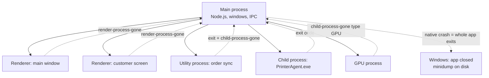
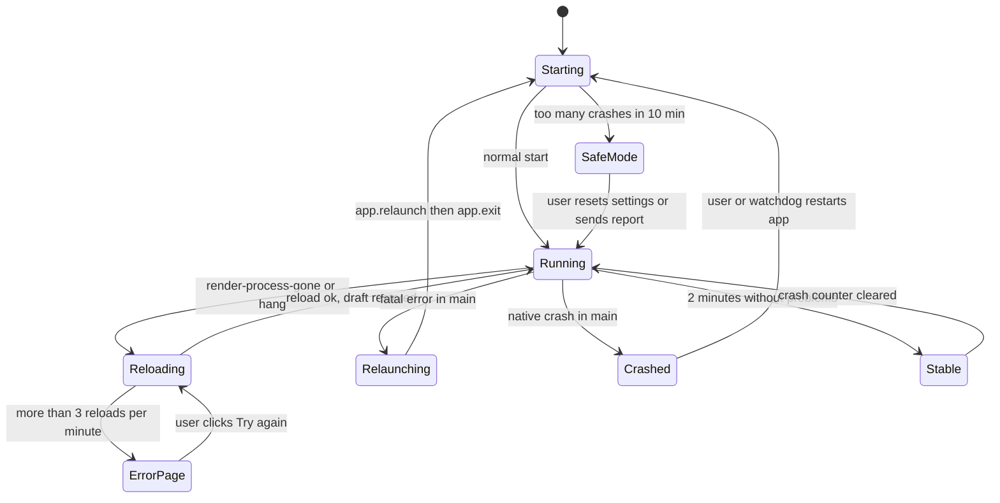
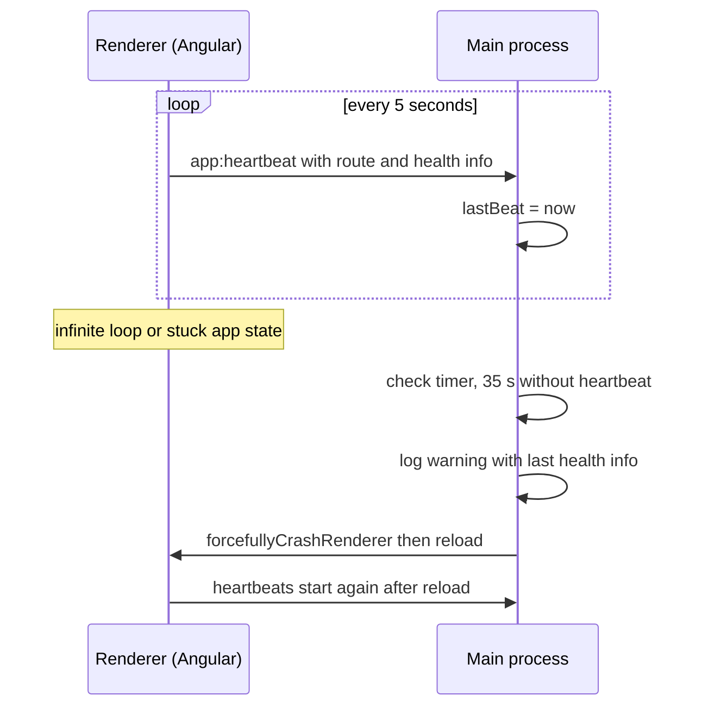

# Logging, Crash Recovery and Monitoring

> In this document you will learn how to see what happens inside an Electron app running on a customer's machine: logging in every process with electron-log, the kinds of crashes Electron can have, crash reports with Crashpad and Sentry, and recovery strategies such as reloading a renderer, relaunching the app, autosave, crash-loop protection, heartbeats and supervised helper processes. Desktop interviews test this because you cannot SSH into a user's PC: if you did not log it, you will never know what happened.

**Before this:** [Electron architecture and process model](01-electron-architecture-and-process-model.md) · [App and window lifecycle](02-app-and-window-lifecycle.md) · [Filesystem, child processes and native features](05-filesystem-child-processes-and-native-features.md) · **Interview questions:** [jump to the interview section](#interview-questions)

## Table of contents

1. [Why desktop observability is different](#why-desktop-observability-is-different)
2. [What and how to log](#what-and-how-to-log)
3. [electron-log](#electron-log)
4. [Logging from renderers, preloads and helper processes](#logging-from-renderers-preloads-and-helper-processes)
5. [The kinds of crashes in Electron](#the-kinds-of-crashes-in-electron)
6. [Uncaught exceptions in the main process](#uncaught-exceptions-in-the-main-process)
7. [Renderer crashes and hangs](#renderer-crashes-and-hangs)
8. [GPU, utility and other child processes](#gpu-utility-and-other-child-processes)
9. [Native crash reports with crashReporter](#native-crash-reports-with-crashreporter)
10. [Recovery strategies](#recovery-strategies)
11. [Crash-loop protection and safe mode](#crash-loop-protection-and-safe-mode)
12. [A heartbeat watchdog between main and renderer](#a-heartbeat-watchdog-between-main-and-renderer)
13. [Supervising helper processes](#supervising-helper-processes)
14. [Process metrics with app.getAppMetrics](#process-metrics-with-appgetappmetrics)
15. [Sentry for Electron](#sentry-for-electron)
16. [Telemetry and privacy](#telemetry-and-privacy)
17. [Diagnosing problems on user machines](#diagnosing-problems-on-user-machines)
18. [Common mistakes](#common-mistakes)
19. [Best practices](#best-practices)
20. [How to explain crash recovery in an interview](#how-to-explain-crash-recovery-in-an-interview)
21. [Interview questions](#interview-questions)
22. [Summary](#summary)
23. [References](#references)

The example app is **OrderDesk**, an Angular point-of-sale app on Windows store PCs. It has a main window, a customer-facing second screen, a `PrinterAgent.exe` helper for the receipt printer, and a utility process that syncs orders to the backend. Stores are often unattended at night, so the app must recover from failures without a technician.

General observability concepts (structured logs, metrics, traces, alerting) are covered in [Logging, monitoring and observability](../10-testing-security-production/08-logging-monitoring-and-observability.md), and resilience patterns in [Reliability and resilience](../10-testing-security-production/09-reliability-and-resilience.md). This document focuses on what is specific to Electron.

---

## Why desktop observability is different

On a server you control the machine. You can read logs, attach a debugger, restart the service and deploy a fix in minutes. On a desktop:

- The app runs on **thousands of machines you cannot access**, with different Windows versions, drivers, antivirus products and proxies.
- Many problems are **local**: a broken GPU driver, a full disk, a printer driver that hangs, a corrupted settings file.
- The user is often **not technical**. "It does not work" is the whole bug report.
- The app may be **offline** when the problem happens.
- A fix needs a **new release** and an update, which takes days to reach everyone.

So a desktop app must:

1. **Write good logs locally**, all the time, with rotation.
2. **Capture crashes** (JavaScript errors and native crashes) and send reports when possible.
3. **Recover by itself** where it can.
4. **Make it easy for users and support to collect diagnostics.**
5. **Respect privacy**: logs and crash dumps can contain personal data.

### Analogy

A desktop app is like a car you sold to a customer. You cannot follow every car, so you build in a **dashboard** (the UI tells the user something is wrong), a **flight recorder** (logs and crash dumps) and **safety systems** (recovery). When the car comes to the garage, the mechanic reads the recorder. Without it, they can only guess.

---

## What and how to log

### Log levels

| Level | Use it for | OrderDesk example |
| --- | --- | --- |
| `error` | Something failed and the user or data is affected | "Failed to save order 1042: SQLITE_BUSY" |
| `warn` | Something unexpected but handled | "Printer offline, receipt queued" |
| `info` | Important business and lifecycle events | "App started 1.4.0", "Update 1.4.1 downloaded", "Shift closed" |
| `verbose` / `debug` | Details for developers | "IPC orders:list took 12 ms" |
| `silly` | Extremely noisy traces | Every serial port byte |

In production, write `info` and above to the file by default, and let support raise the level temporarily (from a hidden settings switch or a command-line flag) when investigating a problem.

### What to log

- **Startup**: app version, Electron/Chromium/Node versions, OS version, architecture, install type (per-user, per-machine), locale, whether it started after a crash.
- **Lifecycle**: windows created and closed, quit reason, update events, sleep and resume.
- **Failures**: every caught error with a stack trace and context (which operation, which order ID).
- **Process events**: renderer gone, child process gone, unresponsive/responsive.
- **External systems**: API calls (method, URL path without query secrets, status, duration), printer and hardware status changes.
- **Timing** for slow operations (startup duration, large exports).

### What never to log

- Passwords, tokens, API keys, session cookies.
- Full card numbers or other payment data.
- Personal data you do not need (customer names, e-mail addresses, full addresses).
- Full file paths without thinking: `C:\Users\asha.k\...` contains the Windows user name.

A small redaction helper protects you from accidental leaks in messages:

```js
// redact.js
function redact(text) {
  return String(text)
    .replace(/([A-Za-z]:\\Users\\)[^\\\s]+/g, '$1<user>')          // C:\Users\asha\... -> C:\Users\<user>\...
    .replace(/[\w.+-]+@[\w-]+\.[\w.-]+/g, '<email>')                // e-mail addresses
    .replace(/(Bearer\s+)[\w.~+/-]+=*/gi, '$1<token>')              // Authorization headers
    .replace(/\b(\d{4})\d{8,11}(\d{4})\b/g, '$1********$2');        // long card-like numbers
}

console.log(redact('Failed to open C:\\Users\\asha.k\\AppData\\Roaming\\OrderDesk\\orders.sqlite'));
// Failed to open C:\Users\<user>\AppData\Roaming\OrderDesk\orders.sqlite
console.log(redact('Login failed for asha@store42.example.com'));
// Login failed for <email>
console.log(redact('GET /api/orders Authorization: Bearer eyJhbGciOi.abc.def'));
// GET /api/orders Authorization: Bearer <token>
console.log(redact('Card 4111111111111111 declined'));
// Card 4111********1111 declined
```

Redaction is a safety net, not a strategy. The real rule is: **do not pass sensitive values to the logger in the first place**.

---

## electron-log

### What it is

**electron-log** is the most widely used logging library for Electron apps. It has no dependencies. It writes to the console and to a log file, and it can collect logs from renderer processes through IPC. Version 5 (current) needs Electron 13 or newer.

### Where the files go

| OS | Default file |
| --- | --- |
| Windows | `%USERPROFILE%\AppData\Roaming\{app name}\logs\main.log` (for OrderDesk: `C:\Users\asha\AppData\Roaming\OrderDesk\logs\main.log`) |
| macOS | `~/Library/Logs/{app name}/main.log` |
| Linux | `~/.config/{app name}/logs/main.log` |

### Basic setup in main

```js
// main/logger.js
const log = require('electron-log/main');
const { app } = require('electron');

log.initialize();                                  // lets renderers log through IPC (injects a small preload)

log.transports.file.level = app.isPackaged ? 'info' : 'debug';
log.transports.console.level = app.isPackaged ? false : 'debug';  // no console spam in production
log.transports.file.maxSize = 5 * 1024 * 1024;     // 5 MB, default is 1 MB
log.transports.file.format = '[{y}-{m}-{d} {h}:{i}:{s}.{ms}] [{level}] [{scope}] {text}';

module.exports = log;
```

```js
// main/main.js
const log = require('./logger');
const { app } = require('electron');
const os = require('node:os');

log.info('Starting OrderDesk', {
  version: app.getVersion(),
  electron: process.versions.electron,
  chrome: process.versions.chrome,
  node: process.versions.node,
  os: `${os.type()} ${os.release()} ${process.arch}`,
});

const dbLog = log.scope('db');           // [db] prefix in every line
dbLog.warn('Database busy, retrying');   // [2026-10-22 09:14:03.120] [warn] [db] Database busy, retrying
```

### Levels, transports and rotation

- **Levels:** `error`, `warn`, `info`, `verbose`, `debug`, `silly`. Each transport has its own `level`; set it to `false` to turn the transport off.
- **Transports:** `console`, `file`, `ipc` (shows main logs in the renderer DevTools in development) and `remote` (POST to a URL, off by default). You can add your own: a transport is just a function that receives a message object.
- **Rotation:** when `main.log` grows beyond `maxSize` (default **1 MB**), electron-log renames it to `main.old.log` and starts a new file. Only one old file is kept by default. If you need more history, provide `archiveLogFn` to rename files with a date and delete the oldest.
- **Sync writes:** the file transport writes synchronously by default (`sync: true`), so log lines are not lost if the process crashes right after. The cost is small for normal logging, but **do not log in hot loops** in the main process; that blocks every window.

```js
// keep 5 rotated files: main.1.log (newest) ... main.5.log (oldest)
const fs = require('node:fs');
const path = require('node:path');

log.transports.file.archiveLogFn = (oldFile) => {
  const file = oldFile.toString();
  const { dir, name, ext } = path.parse(file);
  for (let i = 4; i >= 1; i--) {
    const from = path.join(dir, `${name}.${i}${ext}`);
    const to = path.join(dir, `${name}.${i + 1}${ext}`);
    if (fs.existsSync(from)) fs.renameSync(from, to);   // must be synchronous here
  }
  fs.renameSync(file, path.join(dir, `${name}.1${ext}`));
};
```

### Catching errors and Electron events

electron-log can also record unhandled errors and important Electron events:

```js
log.errorHandler.startCatching({
  showDialog: false,                     // we show our own UI
  onError({ error, processType }) {
    // processType is 'browser' (main) or 'renderer'
    // return false to stop electron-log from processing this error
  },
});

// writes render-process-gone, child-process-gone, did-fail-load, preload-error, unresponsive ...
log.eventLogger.startLogging();
```

These are good defaults, but for crash **recovery** you still add your own handlers (shown later), because logging an event does not fix anything.

---

## Logging from renderers, preloads and helper processes

Logs from all processes should end up in **one file**, in time order. Otherwise support has to merge several files.

### Renderer with a bundler (Angular)

After `log.initialize()` in main, the renderer can import the renderer entry point. It sends messages to main over IPC, and main writes them:

```ts
// src/app/core/logging/logger.service.ts (Angular 16)
import { ErrorHandler, Injectable } from '@angular/core';
import log from 'electron-log/renderer';

@Injectable({ providedIn: 'root' })
export class AppErrorHandler implements ErrorHandler {
  handleError(error: unknown): void {
    log.error('Unhandled Angular error', error);   // ends up in main.log with [renderer] info
    console.error(error);
  }
}

// app.module.ts: providers: [{ provide: ErrorHandler, useClass: AppErrorHandler }]
```

`log.initialize()` works with `contextIsolation` and `sandbox` enabled because it injects electron-log's own preload script into the sessions. If you use a custom session, initialize the logger before creating it, or pass it with `log.initialize({ getSessions: () => [mySession] })`.

### Renderer without electron-log (your own preload API)

If you prefer full control, expose a tiny, validated logging API from your own preload:

```js
// preload.js (excerpt)
const { contextBridge, ipcRenderer } = require('electron');

contextBridge.exposeInMainWorld('orderDesk', {
  log: {
    info: (message) => ipcRenderer.send('log:write', 'info', String(message)),
    warn: (message) => ipcRenderer.send('log:write', 'warn', String(message)),
    error: (message) => ipcRenderer.send('log:write', 'error', String(message)),
  },
});
```

```js
// main/ipc-log.js
const { ipcMain } = require('electron');
const log = require('./logger');

const ALLOWED = new Set(['info', 'warn', 'error']);
const rendererLog = log.scope('renderer');
let windowStart = Date.now();
let countInWindow = 0;

ipcMain.on('log:write', (event, level, message) => {
  if (!ALLOWED.has(level) || typeof message !== 'string') return;
  // simple rate limit: at most 200 messages per 10 s from renderers
  if (Date.now() - windowStart > 10000) { windowStart = Date.now(); countInWindow = 0; }
  if (++countInWindow > 200) return;
  rendererLog[level](message.slice(0, 4000));          // cap the size of one message
});
```

Why the checks? The renderer is untrusted. A bug (or an attacker) could send megabytes of text in a loop and fill the disk or freeze the main process.

### Capturing `console.*` from a page

For third-party pages or quick debugging, main can listen to console messages of any `webContents`:

```js
mainWindow.webContents.on('console-message', (details) => {
  // Electron 35+: one details object with message, level ('info' | 'warning' | 'error' | 'debug'),
  // lineNumber and sourceId. The old positional arguments are deprecated.
  if (details.level === 'error') {
    log.scope('page').error(`${details.message} (${details.sourceId}:${details.lineNumber})`);
  }
});
```

### Utility processes and child processes

- A **utility process** (`utilityProcess.fork`) does not send electron-log output to main automatically. Send log messages to main over its `MessagePort` / `process.parentPort`, or let the utility process write to its own file (for example `sync.log` next to `main.log`).
- A **child process** like `PrinterAgent.exe` writes to `stdout`/`stderr`. Pipe those lines into the main log with a scope:

```js
const { spawn } = require('node:child_process');
const readline = require('node:readline');

const agent = spawn(agentExePath, ['--port', 'COM3'], { windowsHide: true });
const agentLog = log.scope('printer-agent');
readline.createInterface({ input: agent.stdout }).on('line', (line) => agentLog.info(line));
readline.createInterface({ input: agent.stderr }).on('line', (line) => agentLog.warn(line));
```

---

## The kinds of crashes in Electron

Electron is several processes, so "the app crashed" can mean very different things. Know them all, and know what you can do about each.

| What failed | How you notice | Effect | Typical recovery |
| --- | --- | --- | --- |
| **JavaScript error in main** (uncaught exception) | `process.on('uncaughtException')` | Main keeps running, but its state may be broken. Without a handler Electron shows an error dialog | Log, then relaunch the app (state cannot be trusted) |
| **Native crash of main** (bad native module, Chromium bug) | Nothing in JavaScript; a minidump from `crashReporter` | **Whole app exits** | Report the dump; an external watchdog or the user restarts the app; crash-loop protection on next start |
| **Renderer crash** (out of memory, native crash, killed) | `webContents` `render-process-gone` with a `reason` | That window shows a blank or "sad" page; other windows are fine | Reload or recreate the window; restore autosaved state |
| **Renderer hang** (infinite loop, huge synchronous work) | `BrowserWindow`/`webContents` `unresponsive`, later `responsive` | Window frozen; Windows may show "Not responding" | Wait a bit, then offer "Reload"; force-crash and reload |
| **JavaScript error in renderer** | `window.onerror`, `unhandledrejection`, Angular `ErrorHandler` | Usually only one feature breaks | Log; show an error message; maybe reload the route |
| **GPU process crash** | `app` `child-process-gone` with `type: 'GPU'` | Chromium restarts the GPU process; repeated crashes fall back to software rendering | Log; if it repeats, use `app.disableHardwareAcceleration()` on the next start |
| **Utility process crash** | `child-process-gone` with `type: 'Utility'`, and the utility process `exit` event | Its work stops (for example order sync) | Restart with backoff |
| **External helper exits** (`child_process`) | `exit` event with a code or signal | Its feature stops (for example printing) | Supervise and restart with backoff |
| **Page failed to load** | `did-fail-load` | Blank window | Show a local error page with "Retry" |
| **Preload script threw** | `preload-error` | `window.orderDesk` is missing; the UI cannot talk to main | Log; this is a bug in your build, fix it |

### How the processes fail independently



The main process is the parent of everything. It can watch and restart every other process. Nobody inside the app can restart main, which is why main must stay small, simple and free of risky native code (see [utility processes](01-electron-architecture-and-process-model.md#utility-processes)).

---

## Uncaught exceptions in the main process

### Default behavior

If JavaScript in main throws and nothing catches it, Electron shows a modal error box: "A JavaScript error occurred in the main process", with the stack trace. The process usually keeps running, but in an unknown state: maybe a window was half created, maybe a database transaction is open.

For a POS in a store, an error dialog with a stack trace is bad UX, and a half-broken main process is dangerous.

### Handle it explicitly

```js
// main/fatal-errors.js
const { app, dialog } = require('electron');
const log = require('./logger');

let handlingFatal = false;

function handleFatal(kind, error) {
  log.error(`FATAL ${kind}`, error);
  if (handlingFatal) return;               // an error inside the handler must not loop
  handlingFatal = true;

  if (!app.isReady()) {                    // too early for windows: just exit with an error code
    app.exit(1);
    return;
  }

  dialog.showErrorBox(
    'OrderDesk needs to restart',
    'An unexpected problem occurred. OrderDesk will restart and recover your open order.',
  );
  app.relaunch({ args: process.argv.slice(1).concat(['--after-crash']) });
  app.exit(1);                             // exit now; relaunch starts a fresh process after this one ends
}

process.on('uncaughtException', (error) => handleFatal('uncaughtException', error));
process.on('unhandledRejection', (reason) => handleFatal('unhandledRejection', reason));

module.exports = { handleFatal };
```

Notes:

- `app.relaunch()` does **not** quit. It schedules a new instance to start when this one exits. So call `app.exit()` (or `app.quit()`) right after.
- `app.exit()` skips `before-quit` and `will-quit` and does not ask windows. That is what you want here, because cleanup code may depend on the broken state. Data should already be safe through autosave (see below).
- `--after-crash` lets the next start log the event, count it for crash-loop protection and show "We recovered your work".
- Do not handle `unhandledRejection` as fatal in every app. Some teams log it as an `error` and continue. Decide deliberately; the important thing is that it is **never silent**.
- Not everything should restart the app. An expected failure, like "printer offline", is handled where it happens and never reaches these handlers.

---

## Renderer crashes and hangs

### `render-process-gone`

```js
// main/window-recovery.js
const { app } = require('electron');
const log = require('./logger');

function watchRenderer(win, { name }) {
  win.webContents.on('render-process-gone', (_event, details) => {
    // details.reason: 'clean-exit' | 'abnormal-exit' | 'killed' | 'crashed' | 'oom'
    //                 | 'launch-failed' | 'integrity-failure' | 'memory-eviction'
    log.error(`Renderer of ${name} gone`, details);

    if (details.reason === 'clean-exit' || win.isDestroyed()) return;

    if (details.reason === 'oom' || details.reason === 'memory-eviction') {
      log.warn(`${name} ran out of memory; reloading with a fresh process`);
    }
    // a reload creates a new renderer process
    win.webContents.reload();
  });

  win.webContents.on('preload-error', (_event, preloadPath, error) => {
    log.error(`Preload failed in ${name}: ${preloadPath}`, error);
  });

  win.webContents.on('did-fail-load', (_event, code, description, url, isMainFrame) => {
    if (isMainFrame) log.error(`${name} failed to load ${url}: ${code} ${description}`);
  });
}

module.exports = { watchRenderer };
```

The meaning of each `reason`:

| Reason | Meaning |
| --- | --- |
| `clean-exit` | Exited with code 0 (for example, the window is closing). Do nothing. |
| `abnormal-exit` | Exited with a non-zero code. |
| `killed` | Killed from outside (Task Manager, `forcefullyCrashRenderer()`, or the OS). |
| `crashed` | A native crash inside the renderer. |
| `oom` | Out of memory. Often a memory leak in your renderer code. |
| `launch-failed` | The process never started (`exitCode` is a platform error code). |
| `integrity-failure` | Windows code integrity checks failed (security software or a corrupted install). |
| `memory-eviction` | Terminated in advance to avoid running out of memory. |

A blind `reload()` is fine for one crash. If it crashes again and again, you get a reload loop. Count reloads (the same idea as [crash-loop protection](#crash-loop-protection-and-safe-mode)) and show a local error page after, say, three reloads in a minute:

```js
const reloads = [];

function reloadOrGiveUp(win) {
  const now = Date.now();
  while (reloads.length && now - reloads[0] > 60000) reloads.shift();
  reloads.push(now);
  if (reloads.length > 3) {
    win.loadURL('app://bundle/crash.html');   // static page: "Something went wrong" + "Send report" + "Restart"
  } else {
    win.webContents.reload();
  }
}
```

### `unresponsive` and `responsive`

`unresponsive` fires when the page has not responded to input for several seconds, for example because of a long synchronous loop. It is not a crash: the page might recover.

```js
const { dialog } = require('electron');

win.on('unresponsive', async () => {
  log.warn('Main window unresponsive');
  const { response } = await dialog.showMessageBox(win, {
    type: 'warning',
    buttons: ['Wait', 'Reload'],
    defaultId: 0,
    cancelId: 0,
    message: 'OrderDesk is not responding',
    detail: 'You can wait, or reload the window. Your open order is saved.',
  });
  if (response === 1 && !win.isDestroyed()) {
    win.webContents.forcefullyCrashRenderer(); // end the stuck process...
    win.webContents.reload();                  // ...so the reload happens in a new one
  }
});

win.on('responsive', () => log.info('Main window responsive again'));
```

Calling `forcefullyCrashRenderer()` before `reload()` matters: a normal reload would wait for the stuck process. Be careful: several `webContents` can share one renderer process, and force-crashing it affects all of them.

For an unattended kiosk, skip the dialog: wait a fixed time (for example 30 seconds), then force-reload automatically and log it.

---

## GPU, utility and other child processes

Chromium starts helper processes (GPU, network service, audio and others). Your own utility processes appear here too. When one dies, the `app` emits `child-process-gone`:

```js
// main/child-process-monitor.js
const { app } = require('electron');
const log = require('./logger');
const settings = require('./settings');   // your settings store

let gpuCrashes = 0;

app.on('child-process-gone', (_event, details) => {
  // details.type: 'Utility' | 'Zygote' | 'Sandbox helper' | 'GPU' | 'Pepper Plugin' | 'Pepper Plugin Broker' | 'Unknown'
  log.error('Child process gone', details);   // includes reason, exitCode, serviceName, name

  if (details.type === 'GPU' && details.reason !== 'clean-exit') {
    gpuCrashes++;
    if (gpuCrashes >= 3) {
      // a broken GPU driver: switch to software rendering on the next start
      settings.set('disableHardwareAcceleration', true);
      log.warn('Repeated GPU crashes; hardware acceleration will be disabled after restart');
    }
  }
});
```

```js
// main/main.js — must run BEFORE app is ready
if (settings.get('disableHardwareAcceleration')) {
  app.disableHardwareAcceleration();
}
```

Old shop PCs with outdated graphics drivers are a common real-world cause of GPU crashes, black windows and flickering. A settings switch (or a `--disable-gpu`-style support option) saves many support calls.

For your **own utility process**, also listen to its `exit` event, which gives the exit code directly:

```js
const { utilityProcess } = require('electron');

const sync = utilityProcess.fork(syncWorkerPath, [], { serviceName: 'OrderDesk Sync' });
sync.on('exit', (code) => log.warn(`Sync worker exited with code ${code}`));
```

Restarting it safely is shown in [Supervising helper processes](#supervising-helper-processes).

---

## Native crash reports with crashReporter

### What it is

JavaScript handlers cannot see **native crashes**: a segmentation fault in a native module, a Chromium bug, a crash in a GPU driver. For those, Electron includes **Crashpad**, the crash reporting system from Chromium. When any process crashes, Crashpad (running in its own handler process) writes a **minidump**: a small file with the threads, stack memory and loaded modules at the moment of the crash.

The `crashReporter` module controls it:

```js
// main/main.js — call as early as possible, before app 'ready'
const { app, crashReporter } = require('electron');

crashReporter.start({
  submitURL: 'https://crash.orderdesk.example.com/api/minidump', // Breakpad-compatible endpoint
  uploadToServer: true,      // default true; false = only store dumps locally
  compress: true,            // default true (gzip upload)
  rateLimit: true,           // at most 1 upload per hour; the rest stay on disk
  globalExtra: {             // attached to reports from every process
    channel: 'stable',
    storeId: 'store-042',    // not personal data; helps support find the machine
  },
});

console.log(app.getPath('crashDumps')); // where dumps are stored (inside userData by default)
```

Facts to remember:

- Call `start()` **early**, before `ready` if possible. Processes created before `start()` are not monitored.
- Once started, it cannot be stopped.
- By default reports include the product name, app version and Electron version. Use `crashReporter.addExtraParameter(key, value)` for values that change later (for example the current screen). Keys can be up to 39 bytes, values up to 20,320 bytes.
- With `uploadToServer: false`, dumps are only kept locally. You can upload them later after asking the user, or include them in a "Report a problem" bundle. `crashReporter.getUploadedReports()` lists past uploads.
- Change the dump folder with `app.setPath('crashDumps', ...)` **before** calling `start()`.
- You can test it with `process.crash()` in main, or by crashing a renderer.

### Where reports go

Crashpad uploads in the **Breakpad/Crashpad minidump format**, so any compatible server works:

- **Sentry** (its Electron SDK handles minidumps automatically; see below), **Backtrace**, and other crash services.
- A **self-hosted** collector that accepts multipart minidump uploads.

### Symbols

A minidump contains memory addresses, not function names. To turn them into readable stack traces, the server needs **symbol files** for the exact binaries. For Electron's own binaries, the Electron project publishes symbol archives with every release on GitHub (`electron-vXX.Y.Z-win32-x64-symbols.zip` and similar). Services like Sentry can fetch Electron symbols from a symbol server. For your own native modules, upload their PDB files (or Breakpad symbols) from your build.

### Privacy

A minidump contains raw memory of the crashed thread. That memory may include personal data that was being processed (a customer name, part of an order). Treat dumps as sensitive: ask for consent, send them over HTTPS only, restrict who can read them and delete them after a retention period.

---

## Recovery strategies

Logging tells you what happened. Recovery keeps the user working. Choose the smallest action that fixes the problem:

| Problem | Smallest useful action | Next step if it repeats |
| --- | --- | --- |
| Renderer JavaScript error | Show an error message; reload the current Angular route | Reload the window |
| Renderer crash or OOM | `webContents.reload()` (new process) | Recreate the window; then show an error page |
| Renderer hang | Wait; then `forcefullyCrashRenderer()` + `reload()` | Error page with "Send report" |
| Utility/helper process exit | Restart with backoff | Stop, show "service stopped", keep the rest working |
| GPU crashes | Chromium restarts the GPU process | Disable hardware acceleration on the next start |
| Main JavaScript fatal error | `app.relaunch()` + `app.exit(1)` | Safe mode after several crashes |
| Main native crash | (app is gone) Crash dump; next start detects it | Safe mode; external watchdog for kiosks |

### Recreate the window instead of reloading

Sometimes the `webContents` itself is in a bad state (for example after repeated crashes). Closing the window and creating a new one through your normal window factory gives a completely fresh start:

```js
// main/window-manager.js (excerpt)
function recreateMainWindow() {
  const old = windows.get('main');
  const bounds = old && !old.isDestroyed() ? old.getBounds() : undefined;
  if (old && !old.isDestroyed()) old.destroy();   // destroy: skip the 'close' confirmation
  const win = createMainWindow({ bounds });       // the same secure factory used at startup
  watchRenderer(win, { name: 'main' });
  return win;
}
```

### Autosave and restore

Recovery is only good if the user's work survives. For OrderDesk, the open order (the "basket") is the most valuable data. The renderer sends a snapshot to main after every change (debounced), and main writes it **atomically**:

```js
// main/drafts.js
const { app, ipcMain } = require('electron');
const fs = require('node:fs/promises');
const path = require('node:path');

// assertTrustedSender(event) throws unless event.senderFrame is our own page.
// It wraps isTrustedSender from the IPC document (03, 'Validating the sender').
const { assertTrustedSender } = require('./ipc-security');

const DRAFT_FILE = path.join(app.getPath('userData'), 'open-order.json');

async function writeAtomic(file, data) {
  const tmp = `${file}.${process.pid}.tmp`;
  await fs.writeFile(tmp, data, 'utf8');
  await fs.rename(tmp, file);        // replace in one step: never a half-written file
}

ipcMain.handle('drafts:save', async (event, draft) => {
  assertTrustedSender(event);
  if (typeof draft !== 'object' || draft === null || !Array.isArray(draft.lines)) {
    throw new Error('Invalid draft');
  }
  await writeAtomic(DRAFT_FILE, JSON.stringify({ savedAt: Date.now(), draft }));
});

ipcMain.handle('drafts:load', async (event) => {
  assertTrustedSender(event);
  try {
    return JSON.parse(await fs.readFile(DRAFT_FILE, 'utf8'));
  } catch {
    return null;                      // no draft, or unreadable: start empty
  }
});

ipcMain.handle('drafts:clear', async (event) => {
  assertTrustedSender(event);
  await fs.rm(DRAFT_FILE, { force: true });
});
```

```ts
// Angular: save the basket 1 second after the last change
this.basket.changes$
  .pipe(debounceTime(1000))
  .subscribe((basket) => window.orderDesk?.drafts.save(basket));
```

On startup (or after a reload), the app calls `drafts:load`. If there is a draft, it shows "We restored your unfinished order from 10:42", and the cashier continues. When the order is paid, the draft is cleared. More about atomic writes is in [Filesystem, child processes and native features](05-filesystem-child-processes-and-native-features.md).

### The recovery lifecycle



How to read it:

1. Every start goes through **Starting**, where crash-loop protection decides between a normal start and **SafeMode**.
2. Renderer problems stay **inside the app**: reload, and after too many reloads an error page. The rest of the app (sync, printing) keeps running.
3. Main-process problems **leave the app**: a relaunch, or a crash and an external restart. Both come back through Starting, so they are counted.
4. After a period without problems, the counter is cleared, so occasional crashes over weeks never trigger safe mode.

---

## Crash-loop protection and safe mode

### The problem

Imagine version 1.4.0 crashes at startup when it reads a corrupted settings file. Your fatal-error handler relaunches the app. It crashes again. And again. The PC is now stuck in a restart loop, burning CPU, filling logs, maybe showing dialogs every few seconds. Worse, the app never stays alive long enough to download the fixed update.

### The solution

Count unstable starts **on disk** (the process restarts, so memory is not enough). If there are too many in a time window, start in **safe mode**: a minimal mode that skips the risky parts and helps the user recover.

```js
// crash-loop-guard.js
class CrashLoopGuard {
  constructor({ storage, now = Date.now, maxStarts = 3, windowMs = 10 * 60 * 1000 }) {
    this.storage = storage;   // { read(): object | null, write(object): void }
    this.now = now;
    this.maxStarts = maxStarts;
    this.windowMs = windowMs;
  }

  // Call once, very early at startup. Returns 'normal' or 'safe-mode'.
  recordStart() {
    const t = this.now();
    const data = this.storage.read() ?? { unstableStarts: [] };
    const recent = data.unstableStarts.filter((ts) => t - ts < this.windowMs);
    recent.push(t);
    this.storage.write({ unstableStarts: recent });
    return recent.length > this.maxStarts ? 'safe-mode' : 'normal';
  }

  // Call when the app has run fine for a while (for example 2 minutes).
  markStable() {
    this.storage.write({ unstableStarts: [] });
  }
}

// --- demo with in-memory storage and a fake clock ---
let saved = null;
const storage = { read: () => saved, write: (d) => { saved = d; } };
let clock = 0;
const guard = new CrashLoopGuard({ storage, now: () => clock });

const minute = 60 * 1000;
console.log(guard.recordStart());  // normal     (1st start)
clock += 1 * minute;
console.log(guard.recordStart());  // normal     (crashed, 2nd start)
clock += 1 * minute;
console.log(guard.recordStart());  // normal     (crashed, 3rd start)
clock += 1 * minute;
console.log(guard.recordStart());  // safe-mode  (4 starts in 3 minutes)

guard.markStable();                // user fixed the problem; app ran 2 minutes
clock += 1 * minute;
console.log(guard.recordStart());  // normal

clock += 30 * minute;              // much later: old starts fall out of the window
console.log(guard.recordStart());  // normal
console.log(saved.unstableStarts.length); // 1
```

Walkthrough:

1. Each start adds a timestamp. Old timestamps (older than 10 minutes) are dropped.
2. The 4th start within the window returns `safe-mode`, because 4 > `maxStarts` (3).
3. `markStable()` is called by a timer two minutes after a successful start. It clears the list, so the next start is `normal`.
4. Thirty minutes later the earlier entry is outside the window, so only the current start is counted (length 1).

Why "unstable starts" and not "crashes"? A native crash gives you no chance to write "I crashed". So you record every start, and clear the record only when the app has proven it is stable. A start that never reaches `markStable()` counts as unstable.

In the real app, the storage writes a small JSON file in `userData` with synchronous `fs` calls (this runs once at startup, so blocking for a millisecond is fine):

```js
const fs = require('node:fs');
const path = require('node:path');
const { app } = require('electron');

const file = path.join(app.getPath('userData'), 'start-history.json');
const storage = {
  read: () => { try { return JSON.parse(fs.readFileSync(file, 'utf8')); } catch { return null; } },
  write: (data) => fs.writeFileSync(file, JSON.stringify(data)),
};

const guard = new CrashLoopGuard({ storage });
const mode = guard.recordStart();
setTimeout(() => guard.markStable(), 2 * 60 * 1000);
```

### What safe mode does

Safe mode is a special, minimal start. For OrderDesk:

- Load a simple **local recovery page** instead of the full Angular app.
- Skip risky features: hardware integrations, plugins, GPU acceleration, background sync.
- **Still check for updates.** The fix is often a new version.
- Offer actions: **"Send diagnostic report"**, **"Reset settings"** (rename `settings.json` to `settings.broken.json`), **"Restart normally"**.
- Log clearly that safe mode was entered and why.

For an unattended kiosk, safe mode can also wait (for example 5 minutes with backoff) and then try a normal start again, instead of waiting for a human.

---

## A heartbeat watchdog between main and renderer

### Why

`unresponsive` tells you when Chromium thinks a page is not processing input. But there are hangs it does not catch, or that matter differently in your app:

- The page is hidden or has no user input (a customer-facing display), so nobody notices the freeze.
- The app logic is stuck (for example waiting forever on a promise), while the event loop still runs.
- You want a **custom timeout and a custom action** (auto-reload in a kiosk).

A **heartbeat** is a small message the renderer sends regularly to say "I am alive and healthy". Main checks the time of the last heartbeat and acts when it is too old.



### The watchdog logic

```js
// heartbeat-watchdog.js
class HeartbeatWatchdog {
  constructor({ timeoutMs, now = Date.now, onMissed }) {
    this.timeoutMs = timeoutMs;
    this.now = now;
    this.onMissed = onMissed;
    this.lastBeat = now();
    this.missedReported = false;
  }

  beat() {                       // called when the renderer sends 'app:heartbeat'
    this.lastBeat = this.now();
    this.missedReported = false;
  }

  check() {                      // called by a timer in main, for example every 5 s
    const silentFor = this.now() - this.lastBeat;
    if (silentFor > this.timeoutMs && !this.missedReported) {
      this.missedReported = true;   // report once per hang, not every tick
      this.onMissed(silentFor);
    }
  }
}

// --- demo with a fake clock ---
let clock = 0;
const dog = new HeartbeatWatchdog({
  timeoutMs: 30000,
  now: () => clock,
  onMissed: (ms) => console.log(`renderer silent for ${ms / 1000}s -> reload`),
});

clock = 10000; dog.beat(); dog.check();   // fine
clock = 35000; dog.check();               // 25 s silent: still fine
clock = 45000; dog.check();               // renderer silent for 35s -> reload
clock = 50000; dog.check();               // (no second report)
clock = 52000; dog.beat();                // renderer is back
clock = 90000; dog.check();               // renderer silent for 38s -> reload
```

### Wiring it into the app

```js
// main: one watchdog per important window
const watchdog = new HeartbeatWatchdog({
  timeoutMs: 30000,
  onMissed: (ms) => {
    log.warn(`Customer display silent for ${ms} ms, reloading`);
    if (!displayWin.isDestroyed()) {
      displayWin.webContents.forcefullyCrashRenderer();
      displayWin.webContents.reload();
    }
  },
});

ipcMain.on('app:heartbeat', (event) => {
  if (event.sender === displayWin.webContents) watchdog.beat();
});
setInterval(() => watchdog.check(), 5000);
// after a reload, call watchdog.beat() in 'did-finish-load' to give the page time to start
displayWin.webContents.on('did-finish-load', () => watchdog.beat());
```

```ts
// renderer (Angular): send the heartbeat from the app itself, outside the zone
// so the interval does not trigger change detection every 5 seconds
this.zone.runOutsideAngular(() => {
  setInterval(() => window.orderDesk?.health.beat(), 5000);
});
```

Design notes:

- Send the heartbeat from **app code**, not from the preload alone. Then a stuck app (not only a stuck thread) can stop it, for example by sending beats only while the app's health checks pass.
- The timeout must be longer than any normal long operation (a large report), or you reload healthy windows.
- Report the hang only once per incident (`missedReported`), or your log fills with the same warning.
- Main must not be blocked itself. If main is blocked, the timer does not run either. For that case you need an **external** watchdog (next section).

### Watching the main process from outside

Nothing inside the app can restart a crashed or frozen main process. For unattended machines (kiosks, self-checkout), use something outside:

- **Windows Task Scheduler** task "at log on" plus "restart on failure", or a small **Windows service** that checks the app process and restarts it.
- **Windows kiosk features** (Assigned Access, Shell Launcher) can restart the kiosk app when it exits.
- The crash-loop guard still protects against infinite restarts, because every restart goes through `recordStart()`.

---

## Supervising helper processes

OrderDesk starts `PrinterAgent.exe` (a .NET helper for the receipt printer). If the helper crashes, printing stops, but the rest of the app must keep working, and the helper should come back automatically. That is the job of a **supervisor**:

- Restart the process when it exits unexpectedly.
- Wait longer after each crash (**exponential backoff**), so a helper that crashes instantly does not restart 100 times per second.
- **Forgive** old crashes once the process has run fine for a while.
- **Give up** after too many quick crashes, and tell the user ("Printer service stopped. Click to retry.").
- Do **not** restart a process you stopped on purpose (app quitting).

```js
// process-supervisor.js
const { EventEmitter } = require('node:events');

class ProcessSupervisor extends EventEmitter {
  constructor({ start, schedule = setTimeout, now = Date.now,
                baseDelayMs = 1000, maxDelayMs = 60000,
                maxRestarts = 5, stableAfterMs = 60000 }) {
    super();
    Object.assign(this, { start, schedule, now, baseDelayMs, maxDelayMs, maxRestarts, stableAfterMs });
    this.restarts = 0;
    this.stopped = false;
    this.child = null;
  }

  run() {
    if (this.stopped) return;
    const startedAt = this.now();
    this.child = this.start();
    this.emit('started', this.restarts);

    this.child.once('exit', (code, signal) => {
      this.child = null;
      if (this.stopped) return;                       // we stopped it on purpose
      if (this.now() - startedAt >= this.stableAfterMs) {
        this.restarts = 0;                            // it ran fine for a while: forgive old crashes
      }
      if (this.restarts >= this.maxRestarts) {
        this.emit('gave-up', { code, signal });
        return;
      }
      const delay = Math.min(this.maxDelayMs, this.baseDelayMs * 2 ** this.restarts);
      this.restarts++;
      this.emit('restarting', { code, signal, delay });
      this.schedule(() => this.run(), delay);
    });
  }

  stop() {
    this.stopped = true;
    if (this.child) this.child.kill();
  }
}

module.exports = { ProcessSupervisor };

// --- demo: a fake helper that always crashes after 2 seconds ---
let clock = 0;
const pending = [];
const fakeSchedule = (fn, ms) => pending.push({ fn, at: clock + ms });

function startFakeHelper() {
  const child = new EventEmitter();
  child.kill = () => child.emit('exit', null, 'SIGTERM');
  pending.push({ fn: () => child.emit('exit', 3, null), at: clock + 2000 }); // crash after 2 s
  return child;
}

const sup = new ProcessSupervisor({
  start: startFakeHelper, schedule: fakeSchedule, now: () => clock, maxRestarts: 3,
});
sup.on('restarting', ({ code, delay }) => console.log(`exit code ${code}, restart in ${delay} ms`));
sup.on('gave-up', ({ code }) => console.log(`gave up after exit code ${code}; show "Printer service stopped"`));
sup.run();

// run the fake event loop
while (pending.length) {
  pending.sort((a, b) => a.at - b.at);
  const next = pending.shift();
  clock = next.at;
  next.fn();
}
// exit code 3, restart in 1000 ms
// exit code 3, restart in 2000 ms
// exit code 3, restart in 4000 ms
// gave up after exit code 3; show "Printer service stopped"
```

Walkthrough of the demo:

1. `run()` starts the fake helper at time 0. It "crashes" with exit code 3 at 2,000 ms.
2. It ran only 2 seconds (less than `stableAfterMs`), so the restart counter is not reset. `restarts` is 0, so the delay is `1000 * 2^0 = 1000` ms.
3. The second run crashes again; the delay doubles to 2,000 ms, then 4,000 ms.
4. After 3 restarts (`maxRestarts: 3`) the supervisor emits `gave-up`, and the app shows a message instead of restarting forever.

Using it with the real helper:

```js
const { spawn } = require('node:child_process');
const { app } = require('electron');

const printerAgent = new ProcessSupervisor({
  start: () => spawn(agentExePath, ['--port', 'COM3'], { windowsHide: true }),
  maxRestarts: 5,
});

printerAgent.on('restarting', ({ code, delay }) =>
  log.warn(`PrinterAgent exited with ${code}; restarting in ${delay} ms`));
printerAgent.on('gave-up', () => {
  log.error('PrinterAgent keeps crashing; giving up');
  broadcastToWindows('printer:status', { status: 'stopped' });
});

printerAgent.run();
app.on('before-quit', () => printerAgent.stop());   // otherwise it may lock files during updates
```

Interpreting **exit codes** helps: `0` usually means a clean exit, non-zero values are app-specific errors (document them in the helper), and on Windows a large value like `3221225477` (`0xC0000005`) is an access violation, which means a native crash. Killing a helper on Windows with `child.kill()` ends only that process; if the helper starts its own children, end the whole tree (for example with `taskkill /PID <pid> /T /F`), as described in [Filesystem, child processes and native features](05-filesystem-child-processes-and-native-features.md).

The same supervisor works for a `utilityProcess` (it also emits `exit` with a code), which is the preferred way to run your own Node.js background work.

---

## Process metrics with app.getAppMetrics

### What it is

`app.getAppMetrics()` returns one entry per process of your app (main, renderers, GPU, utility processes and Chromium helpers) with CPU and memory numbers. It is how you find out which part of the app is heavy on a user's machine.

Each `ProcessMetric` contains:

- `pid`, `type` (`Browser` = main, `Tab` = renderer, `GPU`, `Utility`, ...), `serviceName` / `name` (for utility processes, for example `OrderDesk Sync` or `Network Service`), `creationTime`
- `cpu.percentCPUUsage` — average since the **previous** call (the first call returns 0)
- `memory.workingSetSize`, `memory.peakWorkingSetSize`, and on Windows `memory.privateBytes` — all in **kilobytes**
- `sandboxed`, and on Windows `integrityLevel`

### Logging metrics periodically

```js
// main/metrics.js
const { app, BrowserWindow } = require('electron');
const log = require('./logger');

function windowNameForPid(pid) {
  for (const win of BrowserWindow.getAllWindows()) {
    if (!win.isDestroyed() && win.webContents.getOSProcessId() === pid) return win.getTitle();
  }
  return '';
}

function snapshotMetrics() {
  return app.getAppMetrics().map((m) => ({
    pid: m.pid,
    type: m.type,
    name: m.serviceName || m.name || windowNameForPid(m.pid),
    cpu: Number(m.cpu.percentCPUUsage.toFixed(1)),
    workingSetMB: Math.round(m.memory.workingSetSize / 1024),
    privateMB: m.memory.privateBytes ? Math.round(m.memory.privateBytes / 1024) : undefined,
  }));
}

function startMetricsLogging(intervalMs = 5 * 60 * 1000) {
  snapshotMetrics();                                  // first call: CPU baseline (always 0)
  setInterval(() => {
    const rows = snapshotMetrics();
    const totalMB = rows.reduce((sum, r) => sum + r.workingSetMB, 0);
    log.info(`metrics total=${totalMB}MB`, rows);
    const bigRenderer = rows.find((r) => r.type === 'Tab' && (r.privateMB ?? r.workingSetMB) > 1500);
    if (bigRenderer) log.warn('Renderer memory above 1.5 GB, possible leak', bigRenderer);
  }, intervalMs);
}

module.exports = { snapshotMetrics, startMetricsLogging };
```

A log line might look like this (illustrative numbers):

```text
[2026-10-22 14:05:00.012] [info] [main] metrics total=612MB [
  { pid: 8124, type: 'Browser', name: '', cpu: 0.4, workingSetMB: 96 },
  { pid: 9310, type: 'GPU', name: '', cpu: 1.2, workingSetMB: 118 },
  { pid: 7712, type: 'Utility', name: 'Network Service', cpu: 0.1, workingSetMB: 31 },
  { pid: 6408, type: 'Utility', name: 'OrderDesk Sync', cpu: 0.0, workingSetMB: 42 },
  { pid: 5532, type: 'Tab', name: 'OrderDesk', cpu: 2.3, workingSetMB: 241, privateMB: 198 },
  { pid: 9944, type: 'Tab', name: 'Customer Display', cpu: 0.6, workingSetMB: 84, privateMB: 61 }
]
```

### Using metrics well

- **Trends matter more than one value.** A renderer that grows from 200 MB to 1.5 GB over a shift has a leak (often listeners or subscriptions that are never removed; see [memory management](../02-javascript/19-memory-management-and-garbage-collection.md)).
- Include a metrics snapshot in every **diagnostic bundle** and in crash reports' extra data.
- For a long-running kiosk, you can plan a **nightly reload** of the renderer as a safety valve. It is not a fix for a leak, but it limits the damage while you find it.
- Other APIs: `process.getProcessMemoryInfo()` (current process, after ready), `process.memoryUsage()` (Node heap in main), `webContents.getOSProcessId()` (map a window to a PID), and `app.getGPUFeatureStatus()` (is hardware acceleration really on?).

---

## Sentry for Electron

### What it is

**Sentry** is a widely used error and crash monitoring service. Its **Electron SDK** (`@sentry/electron`) collects JavaScript errors from main and renderers, native crashes (minidumps) from every process, and breadcrumbs (what happened before the error), and groups them into issues per release.

### Setup

```js
// main/main.js — as early as possible
const { app } = require('electron');
const Sentry = require('@sentry/electron/main');
const { getTelemetryConsent } = require('./consent');

// if you change userData, do it BEFORE Sentry.init (Sentry caches events there)
Sentry.init({
  dsn: 'https://publicKey@o0.ingest.sentry.io/0',
  release: `orderdesk@${app.getVersion()}`,
  environment: app.isPackaged ? 'production' : 'development',
  beforeSend(event) {
    if (!getTelemetryConsent()) return null;     // user said no: drop the event
    delete event.user;                            // no personal data
    return event;
  },
});
```

```ts
// renderer entry (for example src/main.ts in the Angular app)
import * as Sentry from '@sentry/electron/renderer';

Sentry.init({}); // no DSN needed: renderer events are sent through the main process
```

Key facts:

- The **main** and **renderer** entry points are separate imports (`@sentry/electron/main`, `@sentry/electron/renderer`). Renderer events go through main, so the DSN and release are configured once in main.
- With context isolation, errors **in the preload script itself** are not captured unless you also call `Sentry.init()` from `@sentry/electron/renderer` in the preload.
- **Native crashes** are handled by the SDK's default minidump integration: it collects Crashpad minidumps and uploads them with the same context as JavaScript events. Do not configure a second minidump upload of your own (`crashReporter.start` with another `submitURL`) at the same time.
- Events are **cached in `userData`** and sent later, so crashes that happen offline are not lost.
- **Upload source maps** for your main, preload and Angular bundles (for example with `npx @sentry/wizard@latest -i sourcemaps`), or stack traces point into minified code.
- The renderer SDK can be combined with framework SDKs such as `@sentry/angular`; see Sentry's documentation for the exact setup.

Alternatives: Backtrace (strong on native crash analysis), Bugsnag, Datadog RUM, Azure Application Insights for JavaScript errors, or a self-hosted Crashpad/Breakpad collector plus your own log upload. The Electron-specific parts (Crashpad minidumps, process events) are the same.

---

## Telemetry and privacy

**Telemetry** is data the app sends about how it is used and how it behaves: errors, crashes, performance, feature usage. It is extremely useful, and it is also personal data in many cases. Desktop apps run on people's own computers, so users and regulators (for example under the EU GDPR) expect transparency.

Rules that work in practice:

1. **Ask for consent** when the law or your company policy requires it, for example on first start, with a clear explanation. Make it easy to change later in Settings.
2. **Separate categories**: crash reports, error logs, and usage analytics can have separate switches. Many users accept crash reports but not analytics.
3. **Collect the minimum.** App version, OS version, error type, stack trace, anonymous install ID. Not names, e-mails, file contents or full file paths.
4. **Use a random install ID**, generated and stored in `userData`, not a hardware ID or the Windows user name.
5. **Redact** before sending (`beforeSend`, custom transports).
6. **Let enterprises turn it off** centrally (the same policy file or registry value as for updates).
7. **Document it**: what you collect, why, how long you keep it, and how to delete it.
8. **Respect offline and metered networks**: queue events with a size limit, send in batches, drop old ones.

```js
// main/consent.js
const settings = require('./settings');
const policy = require('./policy');

function getTelemetryConsent() {
  if (policy.current().disableTelemetry) return false;   // enterprise policy always wins
  return settings.get('telemetryConsent') === true;      // explicit opt-in from the user
}

module.exports = { getTelemetryConsent };
```

---

## Diagnosing problems on user machines

When a store calls support, the fastest path is a **"Report a problem"** button that collects everything in one place.

### A diagnostic bundle

```js
// main/diagnostics.js
const { app, shell, ipcMain } = require('electron');
const fs = require('node:fs/promises');
const path = require('node:path');
const os = require('node:os');
const log = require('./logger');
const { snapshotMetrics } = require('./metrics');

async function createDiagnosticBundle() {
  const stamp = new Date().toISOString().replace(/[:.]/g, '-');
  const dir = path.join(app.getPath('temp'), `OrderDesk-diagnostics-${stamp}`);
  await fs.mkdir(dir, { recursive: true });

  // 1. logs (current and rotated)
  const logFile = log.transports.file.getFile().path;
  const logDir = path.dirname(logFile);
  for (const name of await fs.readdir(logDir)) {
    if (name.endsWith('.log')) await fs.copyFile(path.join(logDir, name), path.join(dir, name));
  }

  // 2. system and app information
  const info = {
    app: app.getVersion(),
    electron: process.versions.electron,
    chrome: process.versions.chrome,
    os: `${os.type()} ${os.release()} ${os.arch()}`,
    memoryGB: Math.round(os.totalmem() / 1024 ** 3),
    gpu: app.getGPUFeatureStatus(),
    metrics: snapshotMetrics(),
    createdAt: new Date().toISOString(),
  };
  await fs.writeFile(path.join(dir, 'system-info.json'), JSON.stringify(info, null, 2));

  // 3. list of crash dumps (names and dates only; the files are sent only with consent)
  const dumpsDir = app.getPath('crashDumps');
  const dumps = await listFilesRecursive(dumpsDir).catch(() => []);
  await fs.writeFile(path.join(dir, 'crash-dumps.txt'), dumps.join('\n') || 'none');

  shell.showItemInFolder(path.join(dir, 'system-info.json')); // open Explorer with the file selected
  return dir;
}

async function listFilesRecursive(dir) {
  const entries = await fs.readdir(dir, { withFileTypes: true });
  const files = [];
  for (const e of entries) {
    const full = path.join(dir, e.name);
    if (e.isDirectory()) files.push(...(await listFilesRecursive(full)));
    else files.push(`${(await fs.stat(full)).mtime.toISOString()}  ${e.name}`);
  }
  return files;
}

ipcMain.handle('diagnostics:create', async (event) => {
  assertTrustedSender(event);
  return createDiagnosticBundle();
});

module.exports = { createDiagnosticBundle };
```

From here, either the user sends the folder to support (zipped with Explorer's "Send to → Compressed folder"), or, with consent, the app zips it (with a zip library) and uploads it to your support endpoint with a ticket number.

### More tools for hard cases

- **Higher log level on demand:** a hidden setting or a command-line flag (`OrderDesk.exe --log-level=debug`) that support can tell the user to use.
- **Chromium's own logging:** the `--enable-logging` command-line switch prints Chromium's internal logs, useful for GPU and network problems.
- **Network log:** `session.defaultSession.netLog.startLogging(filePath)` and `stopLogging()` record a Chromium net-log that you can open in Chrome's NetLog viewer. Very useful behind enterprise proxies.
- **Performance traces:** the `contentTracing` module records Chromium traces that you open in a trace viewer.
- **DevTools in production:** keep them disabled by default, but allow support to open them for a session with a protected switch, if your security policy allows it.
- **Windows tools:** Event Viewer (Application log) for crashes of the exe, Reliability Monitor, Process Explorer to see child processes and handles, ProcMon to see file access denied errors from antivirus.

---

## Common mistakes

1. **Only `console.log`** in main. In a packaged app nobody sees the console; you need a log file.
2. **Separate log files per process** with no common timestamps or scopes. Support cannot follow the story.
3. **Logging secrets or personal data** (tokens, card numbers, customer names, full user paths).
4. **No log rotation**, or rotation with only 1 MB of history for a chatty app.
5. **Starting `crashReporter` late**, so early crashes and early renderers are not covered.
6. **Reloading a crashed renderer forever** without a limit.
7. **Relaunching on every main error without crash-loop protection**, creating endless restart loops.
8. **Recovery without autosave**: the app comes back, the user's work does not.
9. **Restarting helper processes immediately and forever**, with no backoff and no "give up".
10. **Forgetting to stop helpers on quit**, so they keep running, lock files and break updates.
11. **Sending telemetry without consent** or without an enterprise off-switch.
12. **Minified stack traces** because source maps or symbols were never uploaded.
13. **Heavy synchronous logging in hot paths of main**, which slows every window.

## Best practices

- **One log file, all processes, with scopes.** Reason: support reads one timeline.
- **Log startup context (versions, OS, install type, after-crash flag).** Reason: the first question in every investigation.
- **Start `crashReporter` (or Sentry) as early as possible.** Reason: crashes during startup are the most damaging.
- **Treat the renderer as recoverable and main as precious.** Reason: renderers can be reloaded; a main crash ends the app, so keep risky native code in utility processes.
- **Use the smallest recovery action, with limits.** Reason: reload loops and restart loops are worse than an error page.
- **Persist work continuously with atomic writes.** Reason: recovery is only useful if the data survives.
- **Add crash-loop protection with a safe mode that can still update.** Reason: a bad release must not brick machines.
- **Supervise helpers with backoff and a give-up point.** Reason: one broken printer driver should not take the CPU or the app down.
- **Log metrics periodically and include them in reports.** Reason: memory leaks show up as trends.
- **Ask for consent, minimize data, redact, and let IT disable telemetry.** Reason: trust and legal compliance.
- **Give users a one-click diagnostic bundle.** Reason: it turns "it does not work" into actionable data.

---

## How to explain crash recovery in an interview

1. **Define it:** "Crash recovery in Electron means detecting when one of the app's processes fails, recording what happened, and bringing the user back to a working state without losing their work."
2. **Why it exists:** "Electron apps are several processes, and each can fail differently: a renderer can crash or hang, helper processes can exit, and main can throw or crash natively. On a customer's PC nobody is there to restart things, and we cannot inspect the machine."
3. **How it works:** "We log everything with electron-log into one file, start Crashpad through `crashReporter` or Sentry for native crashes, and listen to `render-process-gone`, `unresponsive` and `child-process-gone`. A renderer is reloaded or recreated; a helper is supervised with exponential backoff; a fatal main error leads to `app.relaunch()` plus `app.exit()`. Every start is counted on disk, so repeated crashes switch to a safe mode."
4. **Small example:** "In our POS, if the main window's renderer runs out of memory, main logs the reason, reloads it, and the Angular app restores the open basket from an autosave file. If the printer agent crashes, we restart it after 1, 2, 4 seconds, and after five quick failures we show 'Printer service stopped'."
5. **Where it is useful:** "Unattended kiosks and tills, long-running apps that stay open all day, and any app with native modules or hardware."
6. **Trade-offs / gotchas:** "Blind reloads and relaunches can loop forever, so everything needs limits. A crashed main process cannot restart itself, so kiosks need an external watchdog. And logs and minidumps can contain personal data, so we need consent, redaction and retention rules."

---

## Interview questions

### Q1. How do you implement logging in an Electron app?

**What the interviewer is checking:** Practical setup across processes, not only "use console.log".

**Short spoken answer (30–60 seconds):**
> I use electron-log in the main process. It writes to a file in the user's AppData folder, rotates it by size, and has levels and scopes. I call `log.initialize()` so renderers can log through IPC even with context isolation and the sandbox, and in Angular I route the global `ErrorHandler` to it. Helper processes' stdout and stderr are piped into the same log with a scope, so support reads one timeline. In production the file level is `info`, with a hidden switch to raise it. I log startup context like versions and OS, lifecycle and process events, and errors with context, but never tokens or personal data.

**Detailed explanation:** Main-process `console.log` is invisible in a packaged app, so a file transport is required. One file with scopes beats one file per process. The renderer is untrusted, so a custom log IPC channel must validate and rate-limit input.

**Follow-up questions:**
- **Where is the log file on Windows?** — `%APPDATA%\<app name>\logs\main.log` by default (electron-log); the rotated file is `main.old.log`.
- **Why not log everything at debug level?** — File size, performance (file writes are synchronous by default) and privacy.

**Common mistakes:** Separate, unsynchronized log files; logging inside tight loops in main.

**Where this is used in real projects:** Every support case starts with "send us the log".

---

### Q2. What kinds of crashes can happen in an Electron app, and how do you detect each?

**What the interviewer is checking:** Understanding of the multi-process model applied to failures.

**Short spoken answer (30–60 seconds):**
> Because Electron is multi-process, there are several kinds. A JavaScript exception in main is caught with `process.on('uncaughtException')`. A native crash of main ends the whole app, and only a Crashpad minidump tells you about it. A renderer can crash or run out of memory, which you see with `render-process-gone` and its reason, or hang, which you see with `unresponsive`. GPU and utility processes report through `app`'s `child-process-gone` with a type and reason. Child processes you spawned report through their `exit` event. And there are softer failures: `did-fail-load` and `preload-error`.

**Follow-up questions:**
- **Which one is the worst?** — A main-process crash, because nothing inside the app can recover from it. That is why risky native code goes into utility processes.
- **Does a renderer crash close the window?** — No. The window stays, showing a blank or crashed page, until you reload it.

**Common mistakes:** Treating "crash" as one thing; not knowing `render-process-gone` (the old `crashed` event is gone).

**Where this is used in real projects:** Designing the recovery and alerting strategy.

---

### Q3. Your renderer crashes with reason `oom` every afternoon. How do you investigate and what do you do short-term?

**What the interviewer is checking:** Debugging memory issues in long-running apps.

**Short spoken answer (30–60 seconds):**
> `oom` means the renderer ran out of memory, and "every afternoon" suggests a leak that grows over the day. First I would check the periodic `app.getAppMetrics()` logs to confirm the renderer's private memory grows steadily. Then I reproduce it with a long-running test and compare DevTools heap snapshots to find what accumulates: usually event listeners, RxJS subscriptions or IPC listeners that are never removed, or a cache without limits. Short-term, the recovery handler reloads the renderer and restores the open order from autosave, and for a store app we could schedule a reload at night. But that only limits the damage; the real fix is removing the leak.

**Follow-up questions:**
- **What is a typical Electron-specific leak?** — `ipcRenderer.on` listeners added on every component init and never removed. The preload should return an unsubscribe function.
- **How do you find the leak on a customer machine you cannot access?** — Metrics trends in logs and telemetry; a debug switch that writes heap snapshots for support cases.

**Common mistakes:** Raising V8's memory limit and calling it fixed.

**Where this is used in real projects:** Dashboards, POS and monitoring apps open for 10+ hours.

---

### Q4. How do you recover from a renderer crash without losing the user's work?

**What the interviewer is checking:** End-to-end recovery thinking.

**Short spoken answer (30–60 seconds):**
> Two parts: keep the work safe before the crash, and restore it after. The renderer sends the important state, like the open basket, to main after every change, debounced, and main writes it atomically to `userData`: write a temp file, then rename. When `render-process-gone` fires with a reason other than `clean-exit`, main logs it and reloads the page, which starts a new renderer process. On load, the Angular app asks main for the draft and shows "We restored your unfinished order". If it crashes more than three times in a minute, we stop reloading and show a local error page with "Send report" and "Try again".

**Follow-up questions:**
- **Why write the draft in main and not in `localStorage`?** — Both can work. Main with atomic writes gives you control over the location, format and backups, and the data survives even if Chromium's storage is damaged. `localStorage` is synchronous and lives in the renderer's profile.
- **Why rename instead of writing directly?** — A crash in the middle of writing leaves a half-written file. A rename replaces the file in one step.

**Common mistakes:** Reloading without a limit; restoring state silently without telling the user.

**Where this is used in real projects:** Editors, forms with long input, POS baskets.

---

### Q5. What do you do when the main process throws an uncaught exception?

**What the interviewer is checking:** Knowledge of the default behavior and a safe strategy.

**Short spoken answer (30–60 seconds):**
> By default Electron shows a dialog, "A JavaScript error occurred in the main process", and the process continues in an unknown state. I register `process.on('uncaughtException')` and `unhandledRejection` handlers. They log the error with the stack, show a short friendly message, call `app.relaunch()` with a flag like `--after-crash`, and then `app.exit(1)`. Relaunch only schedules the new instance, so the exit is needed. I use `exit` instead of `quit` because cleanup code may depend on the broken state; the user's data is already safe through autosave. The next start reads the flag, counts the start for crash-loop protection, and tells the user that their work was recovered.

**Code:** See [Uncaught exceptions in the main process](#uncaught-exceptions-in-the-main-process).

**Follow-up questions:**
- **Why not just keep running?** — You do not know which state is now inconsistent: a half-created window, an open transaction, a missing IPC handler. A clean restart is safer.
- **What if the error happens before `ready`?** — Do not show windows or dialogs; log and `app.exit(1)`.

**Common mistakes:** Swallowing the error with an empty handler; relaunching without crash-loop protection.

**Where this is used in real projects:** Every production Electron app.

---

### Q6. What is `crashReporter`, and what is a minidump?

**What the interviewer is checking:** Native crash reporting knowledge.

**Short spoken answer (30–60 seconds):**
> `crashReporter` is Electron's API for Crashpad, Chromium's crash reporting system. When any process crashes natively, for example in a native module or a GPU driver, Crashpad writes a minidump: a small file with the threads, stack memory and loaded modules at the moment of the crash. You start it as early as possible, before ready, with a `submitURL` for a Breakpad-compatible server such as Sentry or Backtrace, or with `uploadToServer: false` to keep dumps locally. The dumps are in `app.getPath('crashDumps')`. To read them you need symbol files for Electron's binaries, which Electron publishes per release, and for your own native modules.

**Follow-up questions:**
- **Can JavaScript `try/catch` catch a native crash?** — No. The process dies; only the out-of-process Crashpad handler can record it.
- **Privacy concerns?** — Minidumps include raw memory, which may contain personal data. Use consent, HTTPS, restricted access and retention limits.
- **How do you test it?** — `process.crash()` in main, or crash a renderer on purpose.

**Common mistakes:** Starting it after creating windows; forgetting symbols, so reports are useless.

**Where this is used in real projects:** Apps with native modules, hardware SDKs or many different GPU drivers.

---

### Q7. How do you prevent an infinite crash-restart loop?

**What the interviewer is checking:** Resilience design.

**Short spoken answer (30–60 seconds):**
> I count unstable starts on disk, because the process restarts and memory is lost. At every start I add a timestamp to a small file in userData and drop entries older than, say, ten minutes. Two minutes after a successful start, I clear the list, because the app proved it is stable. If there are more than three starts in the window, the app starts in safe mode: a simple local page without the risky features, but it still checks for updates, and it offers "Reset settings" and "Send report". I record starts instead of crashes because a native crash gives no chance to write "I crashed".

**Code:** See [Crash-loop protection and safe mode](#crash-loop-protection-and-safe-mode).

**Follow-up questions:**
- **Why must safe mode still check for updates?** — The fix is often a new version; without updates, the machine stays broken until a technician comes.
- **What about renderer reload loops?** — Same idea inside the app: count reloads per minute and show an error page after a limit.

**Common mistakes:** Counting crashes only from JavaScript handlers; never clearing the counter.

**Where this is used in real projects:** Kiosks, POS, digital signage.

---

### Q8. How would you detect that a renderer is frozen, and what is the difference between `unresponsive` and a heartbeat?

**What the interviewer is checking:** Depth beyond the obvious API.

**Short spoken answer (30–60 seconds):**
> Electron emits `unresponsive` on the window when the page has not handled input for several seconds, and `responsive` when it recovers. That covers classic hangs like long synchronous loops. A heartbeat is my own check: the Angular app sends a small IPC message every five seconds, and main checks the time of the last one. If nothing arrives for 30 seconds, main logs it, force-crashes the renderer and reloads it. The heartbeat also works for windows nobody interacts with, like a customer display, and it can include health information, so the app can stop beating when its own logic is stuck even if the thread is free. I would use both.

**Follow-up questions:**
- **Why `forcefullyCrashRenderer()` before `reload()`?** — A normal reload would wait for the stuck process. Force-crashing makes the reload happen in a new process. Note that several webContents can share one renderer process.
- **What if main itself is frozen?** — Then its timers do not run. You need an external watchdog: a Windows service, a scheduled task or the kiosk shell.

**Common mistakes:** A heartbeat timeout shorter than normal long operations; reporting the same hang on every timer tick.

**Where this is used in real projects:** Unattended displays and kiosks.

---

### Q9. A helper process (for example a printer agent) keeps crashing. How should the main process handle it?

**What the interviewer is checking:** Supervision patterns.

**Short spoken answer (30–60 seconds):**
> Main supervises it. When the process exits unexpectedly, main logs the exit code and restarts it with exponential backoff: 1 second, 2, 4, up to a maximum. If the process ran fine for a while, say a minute, the counter resets, so an occasional crash is always retried quickly. After too many quick failures, main gives up and tells the UI "Printer service stopped", with a retry button, while the rest of the app keeps working. When the app quits, main stops the supervisor first so it does not restart the helper, and ends the whole process tree so no files stay locked during updates.

**Code:** See [Supervising helper processes](#supervising-helper-processes).

**Follow-up questions:**
- **What does exit code 3221225477 mean on Windows?** — `0xC0000005`, an access violation: a native crash in the helper.
- **Would you use `utilityProcess` instead?** — For Node.js code, yes: it integrates with Electron (MessagePorts, `child-process-gone`, metrics). An external `.exe` still needs `child_process`.

**Common mistakes:** Restarting immediately in a loop; no give-up point; not stopping the helper on quit.

**Where this is used in real projects:** Printing, payment terminals, scanners, sync engines.

---

### Q10. What does `app.getAppMetrics()` give you, and how would you use it?

**Short answer:** It returns one entry per process of the app (main = `Browser`, renderers = `Tab`, `GPU`, `Utility` and others) with `pid`, `type`, `serviceName`/`name`, CPU usage (`percentCPUUsage`, averaged since the previous call, so the first call returns 0) and memory (`workingSetSize`, `peakWorkingSetSize`, and `privateBytes` on Windows, all in kilobytes). I log a snapshot every few minutes, map renderer PIDs to windows with `webContents.getOSProcessId()`, warn when a renderer grows beyond a threshold, and include a snapshot in crash reports and diagnostic bundles. Trends over hours reveal leaks; a single number rarely does.

---

### Q11. How would you integrate Sentry into an Electron + Angular app?

**What the interviewer is checking:** Real tooling knowledge.

**Short spoken answer (30–60 seconds):**
> I install `@sentry/electron`. In main I import `@sentry/electron/main` and call `init` as early as possible with the DSN, the release name with the app version, and the environment. In the Angular renderer I import `@sentry/electron/renderer` and call `init` there too; renderer events go through main, so the DSN is only in main. If I want errors from the preload itself, I also init in the preload. The SDK collects native crash minidumps by default, so I do not configure a second crash upload. I upload source maps from CI for main, preload and the Angular build, and I use `beforeSend` to drop events without consent and to remove personal data.

**Follow-up questions:**
- **What happens to errors while offline?** — The SDK caches events in `userData` and sends them later.
- **Why tie the release name to the app version?** — So you can see which version introduced a crash and whether a fix worked, especially during staged rollouts.

**Common mistakes:** Shipping without source maps; collecting user data without consent.

**Where this is used in real projects:** Most commercial Electron apps use Sentry or a similar service.

---

### Q12. What privacy rules do you follow for telemetry and crash reports?

**What the interviewer is checking:** Responsibility and awareness of regulation.

**Short spoken answer (30–60 seconds):**
> I ask for consent where required, with separate switches for crash reports and usage analytics, and an enterprise policy that can turn everything off. I collect the minimum: app and OS versions, error types and stack traces, and a random install ID, never the Windows user name, e-mails or customer data. I redact paths, tokens and card-like numbers before sending, and I avoid logging them in the first place. Minidumps contain memory, so they get stricter handling. Data goes over HTTPS, has a retention limit, and the privacy policy explains what we collect and why.

**Follow-up questions:**
- **Why a random ID and not a hardware ID?** — A hardware ID identifies the machine forever and across apps; a random ID can be reset and is enough for counting.
- **Is a file path personal data?** — It can be: `C:\Users\firstname.lastname\...` contains a name.

**Common mistakes:** "We only collect technical data" while sending full paths and user names.

**Where this is used in real projects:** GDPR reviews, enterprise security questionnaires.

---

### Q13. Debugging: a customer says "the app is slow and sometimes shows a black window". What do you collect and check?

**What the interviewer is checking:** Systematic field debugging.

**Short spoken answer (30–60 seconds):**
> I ask them to click "Report a problem", which collects the logs, system info, metrics and the list of crash dumps. A black window often points to the GPU: I check `child-process-gone` entries with type GPU in the log and `app.getGPUFeatureStatus()` in the bundle. Old graphics drivers are a common cause, so I would ask them to update the driver, or switch on our setting that calls `app.disableHardwareAcceleration()` at the next start. For "slow", I look at the metrics: which process uses CPU or memory, and whether memory grows over time. If it is a network problem behind a proxy, I would ask for a net-log recorded with `session.netLog`.

**Follow-up questions:**
- **Why must `disableHardwareAcceleration()` be called before ready?** — Chromium decides on GPU usage during startup; after that the call has no effect, so the app stores the choice and applies it at the next start.

**Common mistakes:** Asking the user to "send a screenshot" and guessing from there.

**Where this is used in real projects:** Support for apps on old or varied hardware.

---

### Q14. Code review: what is wrong with this crash handling?

```js
process.on('uncaughtException', () => {});              // (1)

win.webContents.on('render-process-gone', () => {
  win.reload();                                          // (2)
});

const agent = spawn(agentExe);
agent.on('exit', () => {
  spawn(agentExe);                                       // (3)
});

app.whenReady().then(() => {
  createWindow();
  crashReporter.start({ submitURL: 'http://crash.example.com/upload' }); // (4)
});

log.info(`Login ok for ${user.email} with token ${token}`); // (5)
```

**Answer:**

1. The empty handler **swallows** every main-process error: no log, no restart, and the app continues in a broken state.
2. Reloads on **every** reason, including `clean-exit` when the window closes, with **no limit** (crash loop), and without logging the reason.
3. Restarts the helper **immediately and forever**, and only once (the new process has no `exit` handler). No backoff, no give-up, no stop on quit.
4. `crashReporter` starts **after** the window, so early crashes and the first renderer are not monitored. The URL uses **HTTP**, so dumps (which may contain personal data) travel unencrypted.
5. Logs **personal data and a secret token**.

---

### Q15. When would you call `app.relaunch()`, and what is the common mistake with it?

**Short answer:** Use it to restart the app after a fatal main-process error, after a "Reset settings" action, or after changing settings that only apply at startup (like disabling hardware acceleration). The common mistake is thinking it restarts the app by itself: `app.relaunch()` only schedules a new instance to start when the current one exits, so you must call `app.exit()` or `app.quit()` afterwards. Calling `relaunch()` several times starts several instances. You can pass `{ args }` to add flags such as `--after-crash`, which the new instance uses for logging and crash-loop counting.

---

### Q16. Why should risky native code not run in the main process?

**What the interviewer is checking:** Fault isolation as an architecture decision.

**Short spoken answer (30–60 seconds):**
> The main process owns every window and the app lifecycle, so a native crash there ends the whole app, and nothing inside the app can restart it. Native modules, hardware SDKs, and code that processes untrusted files are the most common sources of native crashes. If I put them in a utility process or a separate helper executable, a crash only stops that feature. Main sees `child-process-gone` or an `exit` event, logs it, restarts the process with backoff, and the user keeps working. It also keeps main responsive, because heavy work there would freeze every window.

**Follow-up questions:**
- **What is the cost?** — Communication over IPC or MessagePorts, serialization of data, and more code for supervision.

**Where this is used in real projects:** Printer and payment SDKs, PDF rendering, image processing, database engines with native bindings. See [Performance, architecture and alternatives](09-performance-architecture-and-alternatives.md).

---

### Q17. How do you make problems on user machines diagnosable?

**Short answer:** Build diagnostics into the product: a rotated log file with startup context and scopes for every process; crash reports through Crashpad or Sentry with release names and symbols; periodic metrics; and a "Report a problem" action that bundles logs, system information (versions, OS, GPU status, metrics) and the list of crash dumps, opens it in Explorer or uploads it with consent. Add a support-only switch for a higher log level and tools like `session.netLog` for network problems. The goal is that support never has to ask the user for technical steps they cannot do.

---

### Q18. A kiosk app must run 24/7 without staff. Describe your monitoring and recovery design.

**What the interviewer is checking:** Senior-level design that combines everything.

**Short spoken answer (30–60 seconds):**
> Inside the app: electron-log with rotation, Crashpad or Sentry from the first line, metrics every few minutes, and handlers for `render-process-gone`, `unresponsive` and `child-process-gone`. Renderers reload automatically with a limit, plus a heartbeat watchdog for the display window and an optional nightly reload. Hardware helpers run in supervised processes with backoff. Fatal main errors relaunch the app, and every start goes through crash-loop protection with a safe mode that still updates. Outside the app: Windows kiosk features or a small service restart the app if it disappears, because main cannot restart itself. And centrally: crash and heartbeat telemetry with alerts, so we know a kiosk is unhealthy before the store calls.

**Follow-up questions:**
- **How do you know a kiosk is offline entirely?** — The backend expects a periodic "I am alive" call from each kiosk and alerts when it stops.
- **How do updates fit in?** — Install at quiet hours, staged rollouts, and safe mode keeps checking for updates. See [Auto-updates](07-auto-updates.md).

**Where this is used in real projects:** Self-checkout, ticket machines, information displays, factory terminals.

---

## Summary

- On desktops you **cannot access the machine**, so logs, crash reports and self-recovery must be built into the app.
- Use **electron-log**: one rotated file (`%APPDATA%\<app>\logs\main.log` on Windows, 1 MB default rotation to `main.old.log`), levels, scopes, `log.initialize()` for renderers, helper output piped in. Never log secrets or personal data.
- Know the **crash types**: main JS error (`uncaughtException`), main native crash (whole app exits), renderer crash (`render-process-gone` + `reason`), renderer hang (`unresponsive`), GPU/utility (`child-process-gone`), helper `exit`, `did-fail-load`, `preload-error`.
- **crashReporter** (Crashpad) writes minidumps for native crashes. Start it early; upload to a Breakpad-compatible server; keep symbols; treat dumps as sensitive.
- Recovery ladder: reload → recreate window → error page; restart helpers with **backoff and a give-up point**; fatal main errors → `app.relaunch()` + `app.exit(1)`.
- **Autosave with atomic writes** makes recovery useful.
- **Crash-loop protection**: count starts on disk, clear after a stable period, enter **safe mode** (which still updates) after too many.
- A **heartbeat watchdog** catches hangs `unresponsive` misses; a frozen or crashed main needs an **external** watchdog.
- **`app.getAppMetrics()`** shows CPU and memory per process; watch trends for leaks.
- **Sentry** (`@sentry/electron/main` and `/renderer`) collects JS errors and minidumps; upload source maps; filter with `beforeSend`.
- **Privacy**: consent, minimal data, random install ID, redaction, enterprise off-switch, retention.
- Provide a **"Report a problem"** diagnostic bundle.

## References

- Electron: crashReporter — https://www.electronjs.org/docs/latest/api/crash-reporter
- Electron: app (child-process-gone, getAppMetrics, relaunch, exit) — https://www.electronjs.org/docs/latest/api/app
- Electron: webContents (render-process-gone, unresponsive, forcefullyCrashRenderer, console-message) — https://www.electronjs.org/docs/latest/api/web-contents
- Electron: BrowserWindow events — https://www.electronjs.org/docs/latest/api/browser-window
- Electron: RenderProcessGoneDetails — https://www.electronjs.org/docs/latest/api/structures/render-process-gone-details
- Electron: ProcessMetric — https://www.electronjs.org/docs/latest/api/structures/process-metric
- Electron: utilityProcess — https://www.electronjs.org/docs/latest/api/utility-process
- Electron: netLog — https://www.electronjs.org/docs/latest/api/net-log
- Electron: contentTracing — https://www.electronjs.org/docs/latest/api/content-tracing
- electron-log — https://github.com/megahertz/electron-log
- electron-log: file transport — https://github.com/megahertz/electron-log/blob/master/docs/transports/file.md
- electron-log: initializing the renderer — https://github.com/megahertz/electron-log/blob/master/docs/initialize.md
- Sentry: Electron SDK — https://docs.sentry.io/platforms/javascript/guides/electron/
- Sentry: Electron integrations — https://docs.sentry.io/platforms/javascript/guides/electron/configuration/integrations/
- Chromium: Crashpad — https://chromium.googlesource.com/crashpad/crashpad/+/refs/heads/main/README.md
- European Commission: data protection rules (GDPR) — https://commission.europa.eu/law/law-topic/data-protection_en
