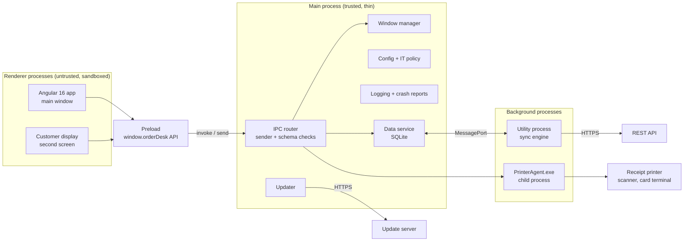
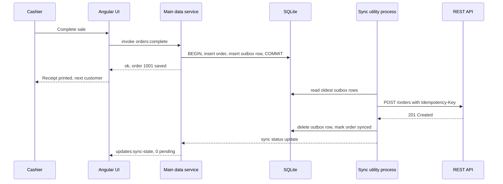
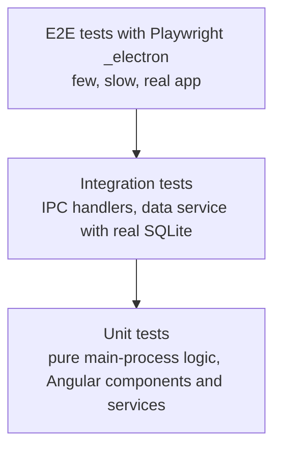
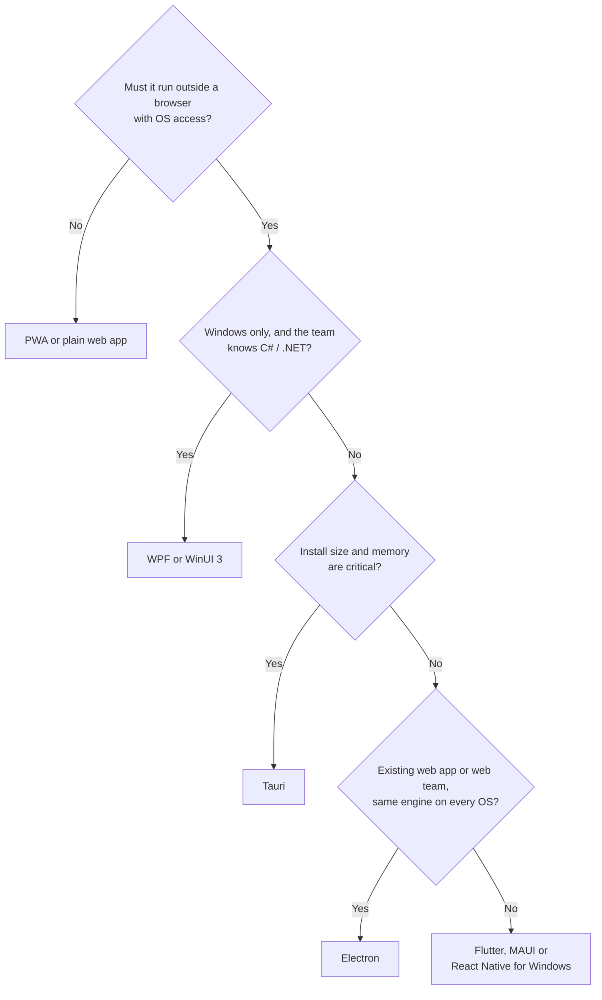

# Performance, Architecture and Alternatives

> In this document you will learn how to make an Electron app start fast and stay responsive, how to keep memory under control, how a real Windows desktop app is structured from the Angular UI down to hardware helpers and SQLite, how to build offline-first sync, kiosk mode and multi-window apps, how to test Electron apps, and when you should not use Electron at all. Senior desktop interviews often end with "design this app" and "why Electron and not X?", and this document prepares you for both.

**Before this:** [Electron architecture and process model](01-electron-architecture-and-process-model.md) · [IPC and preload scripts](03-ipc-and-preload-scripts.md) · [Filesystem, child processes and native features](05-filesystem-child-processes-and-native-features.md) · **Interview questions:** [jump to the interview section](#interview-questions)

## Table of contents

1. [Measure first](#measure-first)
2. [Startup performance](#startup-performance)
3. [Never block the main process](#never-block-the-main-process)
4. [Renderer performance](#renderer-performance)
5. [Memory: every window is a process](#memory-every-window-is-a-process)
6. [Bundling main, preload and renderer](#bundling-main-preload-and-renderer)
7. [Architecture of a real Windows desktop app](#architecture-of-a-real-windows-desktop-app)
8. [Offline-first sync](#offline-first-sync)
9. [Hardware integration](#hardware-integration)
10. [Kiosk mode](#kiosk-mode)
11. [Multi-window communication](#multi-window-communication)
12. [Configuration](#configuration)
13. [Testing Electron apps](#testing-electron-apps)
14. [Alternatives to Electron](#alternatives-to-electron)
15. [When not to choose Electron](#when-not-to-choose-electron)
16. [Common mistakes](#common-mistakes)
17. [Best practices](#best-practices)
18. [How to explain Electron architecture in an interview](#how-to-explain-electron-architecture-in-an-interview)
19. [Interview questions](#interview-questions)
20. [Summary](#summary)
21. [References](#references)

The running example is **OrderDesk**, a Windows point-of-sale (POS) app with an Angular 16 renderer, a receipt printer, a barcode scanner, a customer-facing second screen, a local SQLite database and a REST backend. The same structure fits most internal line-of-business desktop tools.

---

## Measure first

The official Electron performance guide starts with one rule: **measure, measure, measure**. Guessing is how teams spend a week optimizing the wrong thing. Profile the real app, find the most expensive part, fix it, and measure again.

### What to measure

| Question | Tool |
| --- | --- |
| How long from double-click to a usable window? | Your own startup timeline (below), on a **slow** Windows PC with antivirus |
| What does the main process do during startup? | Start a development build with `--inspect` (or `--inspect-brk`), open `chrome://inspect` in Chrome, record a CPU profile (production builds usually disable this with the `nodeCliInspect` fuse) |
| What does the renderer do? | Chromium DevTools: Performance panel, Coverage, Network, Memory |
| Which process uses CPU or memory? | `app.getAppMetrics()` (see [Logging, crash recovery and monitoring](08-logging-crash-recovery-and-monitoring.md#process-metrics-with-appgetappmetrics)), Windows Task Manager, Process Explorer |
| What happens across all processes at once? | The `contentTracing` module or Chromium tracing, opened in a trace viewer |
| Did a change make it slower? | The same timeline logged in CI or on a test machine for every release |

### A startup timeline

Node's `performance.now()` in the main process counts milliseconds since the process started. Mark the important moments and log them:

```js
// main/startup-timeline.js
const { performance } = require('node:perf_hooks');
const log = require('./logger');

const marks = [];

function mark(name) {
  marks.push({ name, ms: Math.round(performance.now()) });
}

function report() {
  const lines = marks.map((m, i) => {
    const delta = i === 0 ? m.ms : m.ms - marks[i - 1].ms;
    return `${m.name.padEnd(24)} ${String(m.ms).padStart(6)} ms  (+${delta})`;
  });
  log.info(`Startup timeline\n${lines.join('\n')}`);
}

module.exports = { mark, report };
```

```js
// main/main.js
const timeline = require('./startup-timeline');
timeline.mark('main.js loaded');

app.whenReady().then(() => {
  timeline.mark('app ready');
  const win = createMainWindow();
  win.once('ready-to-show', () => { timeline.mark('ready-to-show'); win.show(); });
  ipcMain.once('app:first-render', () => { timeline.mark('first render (Angular)'); timeline.report(); });
});
```

A log might show (illustrative numbers from a slow store PC):

```text
Startup timeline
main.js loaded              612 ms  (+612)
app ready                   980 ms  (+368)
ready-to-show              2140 ms  (+1160)
first render (Angular)     2890 ms  (+750)
```

Now you know where to look: 612 ms before your main file even ran (loading modules from disk), and 1,160 ms to the first paint (renderer bundle too big, or main busy). The rest of this document explains what to do about each part.

---

## Startup performance

### What happens when the user starts the app

1. Windows starts `OrderDesk.exe`. Antivirus may scan it.
2. Electron initializes Chromium and Node.js in the main process.
3. Your main script runs: every `require` reads files (from `app.asar`) and compiles JavaScript.
4. `ready` fires. You create the first `BrowserWindow`, which starts a renderer process.
5. The renderer loads HTML, CSS and the Angular bundles, runs the preload, bootstraps Angular and paints.

Each step can be made shorter.

### 1. Load less code in main, and load it later

`require` is surprisingly expensive, especially on Windows with antivirus scanning, because each module means file system lookups and compilation. Load big modules only when you need them:

```js
// ❌ Wrong: everything is loaded at startup, even if the user never exports
const ExcelJS = require('exceljs');          // large library
const { PDFDocument } = require('pdf-lib');  // large library

ipcMain.handle('reports:export-xlsx', async (event, month) => {
  const workbook = new ExcelJS.Workbook();
  // ...
});
```

```js
// ✅ Correct: load the library the first time the feature is used
ipcMain.handle('reports:export-xlsx', async (event, month) => {
  const ExcelJS = require('exceljs');        // cached by require after the first call
  const workbook = new ExcelJS.Workbook();
  // ...
});
```

Also **bundle the main process** (esbuild, Vite or webpack). One bundled file instead of hundreds of small files in `node_modules` removes most module-resolution work.

### 2. Do not do work before the window is visible

Typical things that teams put "at startup" without thinking: checking for updates, starting sync, scanning folders, opening the database, migrating data, loading all settings, contacting the license server. Ask for each: **does the first screen need it?**

```js
app.whenReady().then(async () => {
  const win = createMainWindow();             // 1. window first

  win.webContents.once('did-finish-load', () => {
    // 2. then work the first screen does not need
    setTimeout(() => {
      startSyncWorker();
      initUpdater();
    }, 3000);
  });
});
```

The Electron guide gives VS Code as an example: when you open a file, it shows the text first and adds syntax highlighting afterwards. Prioritize what the user sees and touches first.

### 3. Show something immediately

A window that appears after 3 seconds feels broken. Two common techniques:

- **`show: false` + `ready-to-show`** with a `backgroundColor` that matches your app, so there is no white flash. (Explained in [App and window lifecycle](02-app-and-window-lifecycle.md).)
- **A skeleton screen**: make `index.html` contain a static, CSS-only skeleton of the app layout (header, sidebar, grey placeholders). Chromium paints it before Angular boots. Angular replaces it when ready.

```html
<!-- src/index.html (Angular) -->
<body>
  <od-root>
    <!-- shown until Angular bootstraps; costs almost nothing -->
    <div class="skeleton">
      <header class="skeleton-bar"></header>
      <main class="skeleton-grid"><div></div><div></div><div></div></main>
    </div>
  </od-root>
</body>
```

Splash windows (a separate small window with a logo) are another option, but they cost an extra renderer process. A skeleton in the main window is usually better.

### 4. Create other windows lazily

OrderDesk has a settings window, a reports window and a customer display. Only the main window is needed at startup. Create the others when first opened (or, for a window opened very often, create it once in the background after startup and reuse it).

### 5. Make the renderer bundle small

The renderer is a web app, so all web performance techniques apply (see [Web performance and Core Web Vitals](../05-frontend-engineering/05-web-performance-and-core-web-vitals.md)):

- **Lazy-load Angular routes** (`loadChildren`) so the first screen loads only its own code.
- **Remove unnecessary polyfills.** The renderer always runs one known Chromium version. You do not need to support old browsers; set your build targets to that Chromium version.
- **Ship fonts and images locally** instead of loading them from the internet at startup.
- **Avoid blocking network requests** before the first paint. Show cached data first, then refresh.

### 6. Let V8 cache compiled code

Compiling JavaScript takes time. V8 can store compiled code in a **code cache** and reuse it on the next start.

- In renderers, Chromium does this automatically for scripts it loads over `http(s)` (`webPreferences.v8CacheOptions` defaults to `'code'`, a heuristic policy).
- If you serve the app from a **custom protocol** (recommended for security, see [Electron security](04-electron-security.md)), enable the scheme's `codeCache` privilege. It works only together with `standard: true`:

```js
// main: before app 'ready'
const { protocol } = require('electron');

protocol.registerSchemesAsPrivileged([
  {
    scheme: 'app',
    privileges: {
      standard: true,
      secure: true,
      supportFetchAPI: true,
      codeCache: true,   // let V8 cache compiled scripts loaded from app://
    },
  },
]);
```

- For the **main process**, Node.js 22.1+ has `module.enableCompileCache()`. Electron bundles Node 22/24, but does not document this API for the main process, so test it with your Electron version and measure before relying on it.
- **V8 snapshots** are the advanced option: you pre-run code and store the resulting heap, so startup skips that work. Electron supports custom snapshots through `electron-mksnapshot` and the `LoadBrowserProcessSpecificV8Snapshot` fuse. This is complex (snapshot code has restrictions) and only worth it for very large apps after simpler fixes.

### 7. Small things that add up

- Call `Menu.setApplicationMenu(null)` before creating windows if you do not use the default menu (the Electron guide recommends it; building the default menu costs time).
- Do not read large files synchronously at startup (`fs.readFileSync` of a 50 MB JSON).
- Keep the preload small. It runs before the page in every window.
- Check startup on the **slowest supported machine**, with antivirus, from a **cold** start (after reboot). Developer laptops hide problems.

---

## Never block the main process

### Why it matters

The main process handles all windows, input routing, IPC and many Chromium tasks. Its JavaScript runs on one thread. While your code runs a long synchronous operation, nothing else in main can run: IPC messages wait, windows cannot be moved or closed, and the whole app looks frozen, even though each renderer is a separate process.

You can see the effect in plain Node.js:

```js
const start = Date.now();
setTimeout(() => console.log(`timer fired after ${Date.now() - start} ms`), 10);
Promise.resolve().then(() => console.log('microtask'));
const end = Date.now() + 200;
while (Date.now() < end) {} // simulates a 200 ms synchronous JSON.parse / fs.readFileSync
console.log('sync work done');
// sync work done
// microtask
// timer fired after ~200 ms (not 10)
```

The 10 ms timer fires after about 200 ms, because the event loop could not run it while the loop was busy. In Electron's main process, IPC replies and window events wait in the same way. (Event loop details: [Node.js event loop](../07-nodejs-backend/02-node-event-loop.md).)

### What blocks main, and the fix

| Blocking thing | Example | Fix |
| --- | --- | --- |
| Synchronous file I/O | `fs.readFileSync`, `fs.writeFileSync` of big files | `fs/promises`, streams |
| Synchronous child processes | `execSync`, `spawnSync` | `spawn` / `execFile` with callbacks or promises |
| CPU-heavy JavaScript | Building a 50,000-row report, parsing huge JSON, image processing, encryption of large files | `utilityProcess` or `worker_threads` |
| Synchronous IPC | `ipcRenderer.sendSync` from the renderer blocks the **renderer**, and a slow handler blocks **main** | `invoke` / `handle` (see [IPC and preload scripts](03-ipc-and-preload-scripts.md#why-you-should-avoid-sendsync)) |
| Large synchronous DB queries | A heavy `better-sqlite3` query (it is synchronous by design) | Keep queries small and indexed, or move the database into a utility process |
| Too much logging | Logging every serial byte with synchronous file writes | Lower log level, sample, or batch |
| `@electron/remote` | Every property access is a synchronous IPC round trip | Do not use it; design explicit IPC APIs |

### Example: moving a report to a utility process

```js
// main/reports.js
const { utilityProcess, ipcMain } = require('electron');
const path = require('node:path');
const { assertTrustedSender } = require('./ipc-security'); // throws unless event.senderFrame is our page (see the IPC document)

ipcMain.handle('reports:build-monthly', (event, month) => {
  assertTrustedSender(event);
  if (!/^\d{4}-\d{2}$/.test(month)) throw new Error('Invalid month');

  return new Promise((resolve, reject) => {
    const worker = utilityProcess.fork(path.join(__dirname, 'report-worker.js'), [], {
      serviceName: 'OrderDesk Report Worker',
    });
    worker.once('message', (result) => { resolve(result); worker.kill(); });
    worker.once('exit', (code) => { if (code !== 0) reject(new Error(`Report worker exited ${code}`)); });
    worker.postMessage({ month });
  });
});
```

```js
// main/report-worker.js (runs in its own Node.js process)
process.parentPort.once('message', async ({ data }) => {
  const rows = await loadOrdersForMonth(data.month);   // heavy work happens here
  const summary = buildSummary(rows);                   // CPU-bound, but main stays free
  process.parentPort.postMessage({ month: data.month, summary });
});
```

The main process only starts the worker and forwards the result. The UI stays smooth, and if the worker crashes, only the report fails. Which background option to use (`utilityProcess`, `child_process`, `worker_threads`) is compared in [Filesystem, child processes and native features](05-filesystem-child-processes-and-native-features.md#choosing-utilityprocess-child_process-or-worker_threads).

---

## Renderer performance

The renderer is Chromium, so frontend performance rules apply directly. The details are in [Web performance and Core Web Vitals](../05-frontend-engineering/05-web-performance-and-core-web-vitals.md) and [Angular performance](../06-angular-16/12-performance.md). The Electron-specific points:

- **Long tasks freeze the window.** Move heavy work to a **Web Worker** in the renderer (for data processing that does not need Node.js) or to main/utility processes through IPC.
- **Use `requestIdleCallback`** for small, low-priority work (prefetching, cache warming).
- **Angular:** `ChangeDetectionStrategy.OnPush`, `trackBy` in `*ngFor`, virtual scrolling (`@angular/cdk/scrolling`) for long lists like order history, and running high-frequency IPC listeners **outside** the Angular zone when they do not change the UI.
- **IPC payloads:** do not send 20 MB objects to the renderer and back. Structured cloning costs CPU in both processes. Page the data, or send only what the screen shows (see [large payloads](03-ipc-and-preload-scripts.md#large-payloads)).
- **Throttle event streams** (download progress, sensor data, serial input) before they reach the renderer.

---

## Memory: every window is a process

### Why Electron apps use a lot of memory

- Each `BrowserWindow` (more exactly, each `webContents`) normally has its **own renderer process**, with its own V8 heap and Blink memory.
- The main process, GPU process, network service and other helpers also use memory.
- So an app with five open windows has at least eight processes. Task Manager groups them under the app name.

### Techniques

| Technique | How | Trade-off |
| --- | --- | --- |
| **Fewer windows** | Use routes, tabs or panels inside one window instead of many windows | Less "native" feel for some workflows |
| **Reuse windows** | Hide a frequently used window (`win.hide()`) instead of closing and recreating it | A hidden window still uses memory |
| **Destroy unused windows** | Close rarely used windows completely | Slower to open again |
| **Keep `backgroundThrottling` on** | `webPreferences.backgroundThrottling` defaults to `true`: timers and animations slow down when a window is hidden or in the background | Set it to `false` **only** for windows that must keep running at full speed when not visible, such as a customer display or audio playback |
| **Fix leaks** | Remove IPC listeners, RxJS subscriptions, DOM references when components are destroyed | Needs heap snapshots and discipline |
| **Limit caches** | Use an LRU cache with a size limit instead of an ever-growing `Map` | Some recomputation |
| **Avoid many `<webview>`/`WebContentsView`s** | Each one is another renderer | — |

```js
// customer-facing display: must update even when it is not the focused window
const display = new BrowserWindow({
  show: false,
  webPreferences: {
    preload: path.join(__dirname, 'preload.js'),
    contextIsolation: true,
    nodeIntegration: false,
    sandbox: true,
    backgroundThrottling: false,   // deliberate: this window must never slow down
  },
});
```

Memory leaks and garbage collection in general are covered in [Memory management and garbage collection](../02-javascript/19-memory-management-and-garbage-collection.md).

---

## Bundling main, preload and renderer

An Electron project has three build targets, and each has different rules:

| Target | Runs in | Build with | Notes |
| --- | --- | --- | --- |
| **Main** | Node.js (main process) | esbuild, Vite (electron-vite / Forge Vite plugin), webpack, or `tsc` | Mark `electron` and native modules as external |
| **Preload** | Sandboxed renderer (limited `require`) | Must be **bundled into one file** if it imports your own modules | A sandboxed preload can only `require` a few Electron and Node modules |
| **Renderer** | Chromium page | Angular CLI, Vite, webpack | Target the Electron version's Chromium; no Node.js APIs |

Common setups:

- **electron-vite** or **Electron Forge's Vite plugin** (stable since Forge 8) build all three with Vite and give hot reload.
- **Angular + Electron:** the Angular CLI builds the renderer (`ng build`), and esbuild or tsc builds main and preload. electron-builder then packages the output (see [Packaging, installers and code signing](06-packaging-installers-and-code-signing.md)).

```js
// build/build-main.mjs — bundle main and preload with esbuild
import { build } from 'esbuild';

const common = {
  bundle: true,
  platform: 'node',
  target: 'node22',
  sourcemap: true,                    // keep maps for crash reports; do not ship them in app.asar
  external: ['electron', 'better-sqlite3', 'serialport'],  // runtime-provided / native modules
};

await build({ ...common, entryPoints: ['electron/main.ts'], outfile: 'dist/main/main.js' });
await build({ ...common, entryPoints: ['electron/preload.ts'], outfile: 'dist/main/preload.js' });
```

Build tools in general are covered in [Build tools and bundlers](../05-frontend-engineering/10-build-tools-and-bundlers.md).

---

## Architecture of a real Windows desktop app

Small demo apps put everything in `main.js`. Real apps need clear layers, like a backend service. Here is the architecture of OrderDesk.

### The layers



### Responsibilities

| Layer | Does | Does not |
| --- | --- | --- |
| **Renderer (Angular)** | All UI, screens, forms, client-side validation, view state | Touch files, hardware or secrets; call Node APIs |
| **Preload** | Expose a small, typed `window.orderDesk` API; turn calls into IPC | Contain business logic; expose `ipcRenderer` |
| **IPC router (main)** | Validate sender and arguments; call the right service; return results or typed errors | Do slow work itself |
| **Window manager** | Create windows from one secure factory, track them, restore bounds, place the customer display on the second monitor | Know about orders |
| **Data service** | Own the local database: queries, transactions, migrations, the outbox | Talk to the network |
| **Sync engine (utility process)** | Push the outbox to the API, pull changes, retry with backoff, report status | Touch the UI |
| **PrinterAgent (child process)** | Talk to the printer driver through a vendor .NET SDK | Run inside main (a native crash there would kill the app) |
| **Updater, logging, config** | Cross-cutting services, started at the right time | Block startup |

Why this shape:

- **Main is thin and trusted.** It routes and validates. Heavy or crash-prone work runs elsewhere, so main stays responsive and alive (see [Logging, crash recovery and monitoring](08-logging-crash-recovery-and-monitoring.md#the-kinds-of-crashes-in-electron)).
- **Renderers are untrusted.** Every request is validated in main as if it came from the internet (see [Electron security](04-electron-security.md)).
- **Local data is the source of truth for the UI.** The app works offline; the network is used for synchronization, not for every click.
- **Hardware is isolated.** A printer driver crash stops printing, not selling.

### Where to put the database

`better-sqlite3` is fast and synchronous. Small, indexed queries take well under a millisecond, so running them in main is common and fine. But a slow query blocks main, and a native crash in the driver would kill the app. Rules:

- Small app, small queries: data service in main is acceptable. Keep queries indexed and paged.
- Large data, heavy reports, or background sync that writes a lot: run the database in a **utility process**, or use a worker thread. The "data service" then becomes a separate process. Main and the sync engine talk to it with `MessagePort`s.
- Only one process should **write** to the SQLite file, or use WAL mode and handle `SQLITE_BUSY` carefully.

Native module setup for SQLite is covered in [Filesystem, child processes and native features](05-filesystem-child-processes-and-native-features.md).

### Calling remote APIs: renderer or main?

| From the renderer (`fetch`) | From main or a utility process (`net.fetch`, Node `fetch`) |
| --- | --- |
| Normal Angular `HttpClient` code and interceptors | Works when no window is open (sync, background jobs) |
| Needs CSP `connect-src` and CORS on the server | No CORS; Electron's `net` module uses Chromium's network stack and the system proxy |
| Tokens live in the renderer, which is the most exposed place | Tokens can stay in main, stored with `safeStorage` |

OrderDesk uses both: the UI calls read-only endpoints directly for fresh data, while writes go through the local database and the sync engine.

### A folder structure that matches the layers

```text
orderdesk/
  electron/
    main/
      main.ts                  app lifecycle, startup order
      window-manager.ts
      ipc/                     one file per feature: orders.ipc.ts, printing.ipc.ts, updates.ipc.ts
      services/                data.service.ts, config.service.ts, updater.service.ts
      security/                sender-check.ts, app-protocol.ts
    preload/
      preload.ts               builds window.orderDesk from feature modules (bundled)
    workers/
      sync.worker.ts           utilityProcess entry
    shared/
      ipc-contract.ts          channel names + types shared by main, preload and renderer
  src/                         Angular 16 app (renderer)
  resources/printer-agent/     .NET helper shipped with extraResources
  electron-builder.yml
```

The shared IPC contract is explained in [IPC and preload scripts](03-ipc-and-preload-scripts.md#a-typed-ipc-contract-in-typescript).

---

## Offline-first sync

### What it is

An **offline-first** app treats the local database as the primary place where data lives. The UI reads and writes locally, so it is fast and works without a network. A background **sync engine** sends local changes to the server and brings server changes down when a connection exists.

A store cannot stop selling because the internet is down, so OrderDesk must be offline-first.

### The outbox pattern

When the cashier completes a sale, the app writes **two things in one local transaction**: the order itself, and an **outbox** entry describing the change. The sync engine later sends outbox entries to the API, oldest first, and deletes each one only after the server confirms it.



The cashier never waits for the network. The UI can show "3 orders waiting to sync" when offline.

### Idempotency: why retries must not duplicate orders

Networks fail in the worst way: the server saves the order, but the response is lost. The client cannot know whether the request worked, so it retries. Without protection, the server creates the order **twice**.

The fix is an **idempotency key**: a unique ID created once, when the change happens locally, and sent with every attempt. The server remembers keys it has already applied and returns the earlier result instead of applying the change again. (REST idempotency in depth: [REST API design](../07-nodejs-backend/07-rest-api-design.md).)

```js
// outbox-sync.js — the core of an offline-first sync loop
const { randomUUID } = require('node:crypto');

class Outbox {
  constructor() { this.items = []; }
  add(type, payload) {
    // the idempotency key is created ONCE, when the change happens locally
    this.items.push({ id: randomUUID(), type, payload, attempts: 0 });
  }
  pending() { return this.items; }
  remove(id) { this.items = this.items.filter((i) => i.id !== id); }
}

// Fake backend: remembers idempotency keys, so a repeated request is not applied twice
function createFakeApi({ failFirstResponses = 0 } = {}) {
  const seen = new Map();
  const orders = [];
  let responsesToLose = failFirstResponses;
  return {
    orders,
    async post(item) {
      if (!seen.has(item.id)) {               // apply only once per key
        orders.push(item.payload);
        seen.set(item.id, { status: 201 });
      }
      if (responsesToLose > 0) {              // the server saved it, but the response is lost
        responsesToLose--;
        throw new Error('ETIMEDOUT');
      }
      return seen.get(item.id);
    },
  };
}

async function syncOnce(outbox, api) {
  for (const item of [...outbox.pending()]) {
    try {
      await api.post(item);
      outbox.remove(item.id);                 // confirmed: delete from the outbox
    } catch (err) {
      item.attempts++;                        // keep it; try again on the next run
      console.log(`sync failed for ${item.payload.number}: ${err.message}`);
    }
  }
}

async function main() {
  const outbox = new Outbox();
  const api = createFakeApi({ failFirstResponses: 1 });

  outbox.add('order.created', { number: 1001, total: 12.5 });   // saved locally while offline
  outbox.add('order.created', { number: 1002, total: 8.0 });

  await syncOnce(outbox, api);   // sync failed for 1001: ETIMEDOUT
  console.log(outbox.pending().length, api.orders.length);       // 1 2

  await syncOnce(outbox, api);   // retry of 1001 uses the SAME key
  console.log(outbox.pending().length, api.orders.length);       // 0 2  (no duplicate order)
}

main();
```

Step by step:

1. Two orders are created offline. Each outbox item gets its own key at creation time.
2. First sync: order 1001 reaches the server and is saved, but the response is "lost" (`ETIMEDOUT`). The client keeps the item. Order 1002 succeeds and is removed.
3. Now the server has 2 orders and the outbox still has 1 item.
4. Second sync: 1001 is sent again **with the same key**. The server recognizes the key and does not insert it again. The client removes the item.
5. Final state: 0 pending, 2 orders on the server. No duplicates.

In the real app, the outbox is a SQLite table, and the same transaction that saves the order also inserts the outbox row, so a crash can never save one without the other.

### More rules for a reliable sync engine

- **Order matters.** Send changes in the order they happened, per entity (a refund must not arrive before its sale).
- **Pull with a cursor.** Ask the server for "changes since cursor X" and store the new cursor after applying them, so nothing is missed or applied twice.
- **Conflicts:** decide per data type. Server-wins for prices and products, append-only for sales (no conflicts possible), and explicit merge or user choice for editable shared records.
- **Connectivity:** `net.isOnline()` only says the OS has a network. Treat a successful API call as the real signal, and retry with backoff (see [Auto-updates](07-auto-updates.md#retry-with-backoff) for a backoff helper).
- **Resume after sleep:** restart the sync loop on `powerMonitor` `resume`.
- **Visibility:** show pending counts and the last successful sync time. A store manager should see "Last sync: 3 hours ago" before it becomes a problem.

---

## Hardware integration

POS and kiosk apps talk to hardware. Electron gives several options; choose per device.

| Option | How | Good for | Watch out for |
| --- | --- | --- | --- |
| **Keyboard-wedge devices** | Many barcode scanners act as a keyboard and "type" the code plus Enter | Simplest scanners | Distinguish fast scanner input from human typing (timing, prefix/suffix) |
| **Web Serial / WebHID / WebUSB** in the renderer | Chromium web APIs; main approves devices with session handlers | Web-compatible code, simple serial devices | You must implement device selection in main (no browser picker); renderer code is less trusted |
| **`serialport` npm package** in main or a utility process | Native Node module | Full control of serial devices, works without a window | Native module: rebuild for Electron, unpack from ASAR; run it outside main if possible |
| **Vendor SDK in a helper process** | A .NET or C++ helper (`PrinterAgent.exe`) talking over stdin/stdout, named pipes or localhost | Printers, card terminals, scales with vendor SDKs | Supervise and restart; sign the helper; avoid listening on network ports others can reach |
| **Chromium printing** | `webContents.print({ silent: true, deviceName })` | Receipts rendered as HTML | Printer driver differences; test paper width |

Printing, multi-monitor customer displays and native addons are covered in [Filesystem, child processes and native features](05-filesystem-child-processes-and-native-features.md#printing-and-pdf).

### Web Serial in Electron

In Chrome, `navigator.serial.requestPort()` shows a picker. Electron has no built-in picker, so main must handle the `select-serial-port` event on the session and choose the port (or show your own UI). It also controls permissions:

```js
// main: allow only our scanner model on our own origin
const SCANNER = { vendorId: '1504', productId: '4608' };   // example USB IDs, as strings

function setupSerial(win) {
  const ses = win.webContents.session;

  ses.setPermissionCheckHandler((_wc, permission, requestingOrigin) =>
    permission === 'serial' && requestingOrigin === 'app://bundle');

  ses.setDevicePermissionHandler((details) =>
    details.deviceType === 'serial' &&
    details.origin === 'app://bundle' &&
    String(details.device.vendorId) === SCANNER.vendorId);

  ses.on('select-serial-port', (event, portList, _webContents, callback) => {
    event.preventDefault();                                  // we choose, not Chromium
    const port = portList.find((p) => p.vendorId === SCANNER.vendorId && p.productId === SCANNER.productId);
    callback(port ? port.portId : '');                       // '' cancels the request
  });
}
```

```ts
// renderer (inside an Angular service)
async connectScanner(): Promise<void> {
  const port = await navigator.serial.requestPort();         // main picks the scanner
  await port.open({ baudRate: 9600 });
  const reader = port.readable!.getReader();
  const { value } = await reader.read();                     // first chunk of bytes (Uint8Array)
  console.log(new TextDecoder().decode(value));              // for example "4006381333931
"
}
```

Main handles `select-hid-device` for WebHID and `select-usb-device` for WebUSB in the same way. Keep the permission handlers strict: only your origin, only your devices.

---

## Kiosk mode

A **kiosk** app fills the screen and the user cannot leave it: self-checkout, ticket machines, info terminals. Electron has a `kiosk` window option, but a real kiosk needs several layers:

```js
// main/kiosk-window.js
const { app, BrowserWindow, Menu, powerSaveBlocker } = require('electron');

function createKioskWindow() {
  Menu.setApplicationMenu(null);                 // no menu and no default shortcuts (reload, DevTools)

  const win = new BrowserWindow({
    kiosk: true,                                 // full screen, no window frame
    backgroundColor: '#101820',
    webPreferences: {
      preload: path.join(__dirname, 'preload.js'),
      contextIsolation: true,
      nodeIntegration: false,
      sandbox: true,
      devTools: !app.isPackaged,                 // no DevTools in production
    },
  });

  // block keyboard shortcuts that reload or close the page
  win.webContents.on('before-input-event', (event, input) => {
    const key = input.key.toLowerCase();
    if (key === 'f5' || (input.control && (key === 'r' || key === 'w'))) event.preventDefault();
  });

  // only our own pages; no navigation to other sites, no new windows
  win.webContents.on('will-navigate', (event, url) => {
    if (!url.startsWith('app://bundle/')) event.preventDefault();
  });
  win.webContents.setWindowOpenHandler(() => ({ action: 'deny' }));

  // the window may only close when the app really quits (for example for an update)
  let quitting = false;
  app.on('before-quit', () => { quitting = true; });
  win.on('close', (event) => { if (!quitting) event.preventDefault(); });

  powerSaveBlocker.start('prevent-display-sleep'); // keep the screen on
  win.loadURL('app://bundle/index.html');
  return win;
}
```

Outside the app:

- **Lock down Windows**: use Windows kiosk features (Assigned Access or Shell Launcher, depending on the Windows edition) so the PC starts directly into the app, has no desktop and restarts the app when it exits. Normal Electron code cannot block every system shortcut (for example Ctrl+Alt+Del), and it should not try.
- **Auto-start** with launch-at-login or the kiosk shell (see [App and window lifecycle](02-app-and-window-lifecycle.md#launch-at-login)).
- **Recovery without staff**: crash-loop protection, renderer watchdogs and nightly maintenance (see [Logging, crash recovery and monitoring](08-logging-crash-recovery-and-monitoring.md)).
- **Remote support**: logs and health pings to the backend, because nobody is there to read an error dialog.

---

## Multi-window communication

OrderDesk's main window and the customer display must show the same basket. Options:

| Option | How | When |
| --- | --- | --- |
| **Main as the hub** | Renderer sends changes to main; main stores the state and broadcasts to every window with `webContents.send` | Default choice: one source of truth, easy to validate and log |
| **Direct `MessagePort`** | Main creates a `MessageChannelMain` and gives one port to each window | High-volume or low-latency streams between two windows |
| **`BroadcastChannel`** | Web API between same-origin pages in the same session | Simple UI notifications; no validation in main, so keep it to non-critical data |
| **Shared storage** | Both windows read IndexedDB or the database | Large data; still needs a change notification |

The hub pattern in a few lines:

```js
// main/basket-hub.js
const { ipcMain, BrowserWindow } = require('electron');
const { assertTrustedSender, isTrustedSender } = require('./ipc-security');

let basket = { lines: [], total: 0 };

ipcMain.handle('basket:get', (event) => { assertTrustedSender(event); return basket; });

ipcMain.on('basket:changed', (event, next) => {
  if (!isTrustedSender(event.senderFrame)) return;  // ipcMain.on has no reply: ignore, do not throw
  if (!isValidBasket(next)) return;             // validate like any other IPC input
  basket = next;
  for (const win of BrowserWindow.getAllWindows()) {
    if (!win.isDestroyed() && win.webContents !== event.sender) {
      win.webContents.send('basket:state', basket);   // everyone except the sender
    }
  }
});
```

A window that opens later calls `basket:get` to receive the current state. The details of state subscriptions and broadcasting are in [IPC and preload scripts](03-ipc-and-preload-scripts.md#pattern-broadcast-state-changes-to-all-windows).

---

## Configuration

A desktop app gets configuration from several places. Define the **precedence** clearly, or support cannot tell why the app behaves as it does.

| Layer (low → high priority) | Where | Example |
| --- | --- | --- |
| Built-in defaults | Code | API URL, timeouts, feature flags off |
| User settings | `userData\settings.json` | Printer port, theme, language |
| Command-line / environment | Shortcut arguments, `--log-level=debug` | Support switches |
| Machine policy (IT) | `C:\ProgramData\OrderDesk\policy.json` or `HKLM\Software\Policies\...` | Disable auto-update, fixed API URL, disable telemetry |

The policy comes last so that a user cannot override what IT decided.

```js
// config.js — layered configuration with clear precedence
const DEFAULTS = {
  apiBaseUrl: 'https://api.orderdesk.example.com',
  printer: { port: 'COM3', paperWidthMm: 80 },
  autoUpdate: true,
  logLevel: 'info',
};

function isPlainObject(v) {
  return v !== null && typeof v === 'object' && !Array.isArray(v);
}

function merge(base, override) {
  const out = { ...base };
  for (const [key, value] of Object.entries(override ?? {})) {
    if (!(key in base)) continue;                        // ignore unknown keys
    out[key] = isPlainObject(base[key]) && isPlainObject(value)
      ? merge(base[key], value)
      : value;
  }
  return out;
}

// lowest -> highest priority; the machine policy is applied LAST so users cannot override IT
function resolveConfig({ user, cli, policy }) {
  return [user, cli, policy].reduce((cfg, layer) => merge(cfg, layer), DEFAULTS);
}

const config = resolveConfig({
  user: { printer: { port: 'COM5' }, logLevel: 'debug', theme: 'dark' }, // settings.json (userData)
  cli: { logLevel: 'silly' },                                            // --log-level=silly from support
  policy: { autoUpdate: false, apiBaseUrl: 'https://orderdesk.corp.example' }, // ProgramData policy.json
});

console.log(config.printer);     // { port: 'COM5', paperWidthMm: 80 }
console.log(config.logLevel);    // silly
console.log(config.autoUpdate);  // false
console.log(config.apiBaseUrl);  // https://orderdesk.corp.example
console.log('theme' in config);  // false (unknown key ignored)
```

Walkthrough:

1. Start from `DEFAULTS`.
2. User settings change the printer port (nested merge keeps `paperWidthMm`) and the log level. `theme` is unknown and ignored, which protects you from typos and old keys.
3. The command line raises the log level to `silly` for a support session.
4. The IT policy turns off auto-update and forces the company API URL.

More rules:

- **Validate every layer** with a schema (types, ranges, allowed values). A broken `settings.json` must not crash the app at startup; fall back to defaults and log a warning.
- **Never store secrets in config files.** Use `safeStorage` for local secrets (see [Electron security](04-electron-security.md#asar-is-not-encryption-secrets-and-safestorage)).
- **Log the effective configuration** at startup (without secrets), so support sees what the app really used.
- Settings files and atomic writes are covered in [Filesystem, child processes and native features](05-filesystem-child-processes-and-native-features.md#settings-storage-and-atomic-writes).

---

## Testing Electron apps

### The test pyramid for a desktop app



1. **Unit tests (many):** pure logic from main (validation, config merge, crash-loop guard, sync engine) and Angular components and services with a fake `window.orderDesk`. Run with Jest or Vitest (main) and the Angular test runner (renderer). See [Unit testing with Jest and Vitest](../10-testing-security-production/02-unit-testing-jest-and-vitest.md) and [Angular testing](../06-angular-16/14-testing.md).
2. **Integration tests (some):** call IPC handler functions directly with a fake `event`, against a real temporary SQLite file.
3. **End-to-end tests (few):** start the real Electron app and click through key flows.

### Make main-process code testable

Keep Electron APIs at the edges. Business logic receives what it needs as parameters:

```js
// electron/main/ipc/orders.ipc.js
function createOrderHandlers({ db, isTrustedSender }) {
  return {
    async complete(event, order) {
      if (!isTrustedSender(event.senderFrame)) throw new Error('Untrusted sender');
      if (!Array.isArray(order?.lines) || order.lines.length === 0) {
        return { ok: false, error: 'EMPTY_ORDER' };
      }
      const id = db.completeOrder(order);      // insert order + outbox row in one transaction
      return { ok: true, id };
    },
  };
}

module.exports = { createOrderHandlers };

// registration in main.js (the only place that touches ipcMain):
// const h = createOrderHandlers({ db, isTrustedSender });
// ipcMain.handle('orders:complete', h.complete);
```

```js
// orders.ipc.test.js (Vitest)
import { describe, it, expect } from 'vitest';
import { createOrderHandlers } from './orders.ipc.js';

describe('orders:complete', () => {
  const fakeDb = { completeOrder: () => 1001 };
  const event = { senderFrame: { origin: 'app://bundle', url: 'app://bundle/index.html' } };

  it('rejects an empty order', async () => {
    const h = createOrderHandlers({ db: fakeDb, isTrustedSender: () => true });
    expect(await h.complete(event, { lines: [] })).toEqual({ ok: false, error: 'EMPTY_ORDER' });
  });

  it('refuses untrusted senders', async () => {
    const h = createOrderHandlers({ db: fakeDb, isTrustedSender: () => false });
    await expect(h.complete(event, { lines: [{ sku: 'A1', qty: 1 }] })).rejects.toThrow('Untrusted sender');
  });
});
```

### End-to-end tests with Playwright

Playwright has **experimental** Electron support through `_electron`. It starts your app, gives you the first window as a normal Playwright `Page`, and can run code in the main process:

```ts
// e2e/checkout.spec.ts
import { test, expect, _electron as electron } from '@playwright/test';

test('cashier can complete a sale offline', async () => {
  const app = await electron.launch({
    args: ['dist/main/main.js'],
    env: { ...process.env, ORDERDESK_E2E: '1' },   // use fake printer and an empty temp database
  });

  const isPackaged = await app.evaluate(({ app }) => app.isPackaged); // runs in the main process
  expect(isPackaged).toBe(false);

  const window = await app.firstWindow();
  await window.getByRole('button', { name: 'New sale' }).click();
  await window.getByLabel('Barcode').fill('4006381333931');
  await window.keyboard.press('Enter');
  await window.getByRole('button', { name: 'Pay cash' }).click();

  await expect(window.getByText('Sale completed')).toBeVisible();
  await expect(window.getByText('1 order waiting to sync')).toBeVisible();

  await app.close();
});
```

Practical notes:

- Use a **test mode** (`ORDERDESK_E2E=1`) that swaps hardware for fakes and uses a temporary `userData` folder (`app.setPath('userData', ...)` before ready), so tests are repeatable.
- You can also test the **packaged** app by passing `executablePath` (for example `release/1.4.0/win-unpacked/OrderDesk.exe`). Playwright connects through Node's inspector and Chromium's remote debugging, so a build with the `nodeCliInspect` fuse disabled cannot be driven this way; use a separate test build, or test the production fuses in a separate check.
- Run E2E tests on **Windows CI runners** if Windows is your main platform.
- **Spectron**, the old Electron testing framework, was **deprecated in 2022** and does not work with modern Electron. Use Playwright or WebdriverIO (with its Electron service) instead.

End-to-end testing in general is covered in [Component and E2E testing with Playwright](../10-testing-security-production/04-component-and-e2e-testing-playwright.md).

---

## Alternatives to Electron

### The main options

| Framework | UI technology | Rendering / runtime | Backend language | Platforms | App size | Strengths | Weaknesses |
| --- | --- | --- | --- | --- | --- | --- | --- |
| **Electron** | HTML/CSS/JS (any web framework) | Bundled Chromium + Node.js | JavaScript/TypeScript | Windows, macOS, Linux | Large (ships a browser) | Same engine everywhere, huge ecosystem, reuse web code and skills, mature tooling (updates, crash reports) | Memory and disk use, startup cost, you must update Chromium regularly |
| **Tauri** (2.x, stable since Oct 2024) | HTML/CSS/JS | **System WebView** (WebView2 on Windows, WKWebView on macOS, WebKitGTK on Linux) | Rust (plus plugins) | Windows, macOS, Linux, iOS, Android | Small | Small installers, lower memory, strong permission model | WebView differs per OS (test on each); Rust for native parts; smaller ecosystem |
| **NW.js** | HTML/CSS/JS | Bundled Chromium + Node.js | JavaScript | Windows, macOS, Linux | Large | Node and DOM in the same context, simple for small tools | Smaller community; mixing Node and DOM is a security risk |
| **WPF** (.NET) | XAML | Native Windows (DirectX) | C# | Windows only | Small-medium | Very mature, great for complex Windows line-of-business apps, deep OS integration | Windows only; older UI model |
| **WinUI 3** (Windows App SDK) | XAML | Native Windows | C# / C++ | Windows only | Medium | Modern Fluent design, latest Windows features | Windows only; younger than WPF |
| **.NET MAUI** | XAML / C# | Native controls per platform (WinUI 3 on Windows) | C# | Windows, macOS (Mac Catalyst), iOS, Android | Medium | One .NET code base for desktop and mobile | No Linux; desktop is not its strongest area |
| **Flutter desktop** | Dart widgets | Own rendering engine | Dart | Windows, macOS, Linux (plus mobile, web) | Medium | Consistent UI everywhere, good performance | Dart skills; non-native look unless styled; desktop plugins less mature than mobile |
| **React Native for Windows / macOS** | React | Native controls | JavaScript/TypeScript (+ C++/C# modules) | Windows, macOS (plus mobile) | Medium | React skills with native controls, maintained by Microsoft | Smaller desktop ecosystem; native modules often needed |
| **PWA** (installed web app) | HTML/CSS/JS | The user's browser (Edge/Chrome) | None locally (server-side) | Anywhere with a modern browser | Tiny (no install package) | Instant updates, no installer, no code signing | Limited OS access: no child processes, no tray, limited file system; Web Serial/HID/USB only in Chromium browsers |

Other options exist too, such as **Wails** (Go with the system WebView) and **Qt** (C++/QML).

### Choosing



For OrderDesk the answer was Electron, for four reasons:

- The team already had the Angular web app and Angular developers.
- The app needs deep OS access: printers, serial devices, the file system and child processes.
- One Chromium version makes testing predictable across thousands of store PCs.
- electron-builder plus electron-updater solved installers and updates.

The cost — memory and installer size — was acceptable on store PCs with 8 GB of RAM.

---

## When not to choose Electron

Electron is a great tool, but not always the right one. Be ready to say when you would **not** use it:

- **The web is enough.** If the app needs no OS integration, a web app or PWA is cheaper to build, deploy and update.
- **Very limited hardware.** Old thin clients with little RAM, or embedded devices, may struggle with several Chromium processes.
- **Download size matters a lot**, for example a small utility distributed to millions of users on slow connections. Tauri or a native app is much smaller.
- **Many small background utilities** (tray tools, helpers) that should use almost no memory. A native app or a Tauri app fits better.
- **Deep, Windows-only integration** (shell extensions, drivers, complex COM/WinRT APIs everywhere) and a team of .NET developers. WPF or WinUI 3 will be more natural.
- **Highest-performance graphics or real-time processing** (games, video editing engines, CAD kernels). Native code is the norm; Electron can only host the UI around a native engine.
- **The team cannot commit to regular updates.** An Electron app must follow Chromium security releases; a team that ships once a year will run unsupported Chromium.

A good interview answer names the trade-off honestly: "Electron trades memory and size for development speed, one engine everywhere, and the web ecosystem."

---

## Common mistakes

1. **Optimizing without measuring.** Hours spent on the wrong part of startup.
2. **Doing everything at startup**: update check, sync, migrations, scans before the window shows.
3. **Synchronous work in main**: `readFileSync` of big files, `execSync`, heavy loops, `sendSync`.
4. **One giant `main.js`** with windows, IPC, database, printing and updates mixed together.
5. **Native modules and vendor SDKs in main**, so a driver crash kills the app.
6. **The renderer talks to hardware and the network directly** with secrets in the renderer.
7. **Online-only design** for an app used where the network is unreliable.
8. **Retries without idempotency keys**, creating duplicate orders.
9. **Many windows "because it is easy"**, each costing a renderer process.
10. **Turning off `backgroundThrottling` everywhere** instead of only for windows that need it.
11. **Kiosk mode = `kiosk: true` only**, with DevTools, reload shortcuts and navigation still open.
12. **No E2E tests of the packaged app**, so packaging-only bugs (ASAR paths, native modules) reach users.
13. **Choosing Electron (or rejecting it) without stating the trade-offs.**

## Best practices

- **Measure startup on a slow, cold Windows machine and log a startup timeline.** Reason: real users have slower PCs and antivirus.
- **Bundle main and preload; lazy-load heavy modules and Angular routes.** Reason: less code to load and compile at startup.
- **Show a window with a skeleton quickly; start background services after the first paint.** Reason: perceived speed matters most.
- **Keep main thin: route, validate, delegate.** Reason: a responsive, crash-free main process keeps every window alive.
- **Move CPU-heavy and crash-prone work to utility processes or helpers.** Reason: isolation of performance and failures.
- **Make the local database the UI's source of truth, with an outbox and idempotency keys.** Reason: offline operation and no duplicates.
- **Isolate hardware behind supervised processes or strict session permission handlers.** Reason: reliability and security.
- **Use main as the state hub for multi-window apps.** Reason: one validated source of truth.
- **Layer configuration with IT policy on top and validate every layer.** Reason: predictable behavior and enterprise control.
- **Test pure logic with unit tests and key flows with Playwright, including the packaged app.** Reason: confidence where it matters, at a reasonable cost.
- **Choose the framework by requirements and team skills, and state the trade-offs.** Reason: there is no best framework, only a best fit.

---

## How to explain Electron architecture in an interview

1. **Define it:** "A production Electron app is layered like a small distributed system: untrusted renderers for the UI, a preload bridge with a narrow API, a thin trusted main process that routes and validates, and background processes for heavy or risky work, plus a local database and remote services."
2. **Why it exists:** "Main runs every window's coordination on one JavaScript thread and its crash ends the app, and renderers can be compromised by XSS. So we keep main small, treat renderers as untrusted, and isolate everything slow or crash-prone."
3. **How it works:** "The Angular UI calls `window.orderDesk.orders.complete()`. The preload turns it into `ipcRenderer.invoke`. Main checks the sender and the schema, writes the order and an outbox row in one SQLite transaction, and returns. A utility process syncs the outbox to the API with idempotency keys, and a supervised .NET helper prints the receipt."
4. **Small example:** "When the internet is down, the store keeps selling; the UI shows '12 orders waiting'. When the printer driver crashes, the helper restarts with backoff while sales continue."
5. **Where it is useful:** "POS systems, internal tools, field-service apps, anything that needs offline operation, hardware and a web-based UI."
6. **Trade-offs / gotchas:** "Memory per window, startup cost that needs measuring, regular Electron upgrades, and IPC serialization costs for large data. If size or memory were critical, I would consider Tauri; for a Windows-only .NET team, WPF or WinUI."

---

## Interview questions

### Q1. Our Electron app takes 6 seconds to start on store PCs. How do you make it faster?

**What the interviewer is checking:** A measurement-driven approach and knowledge of Electron-specific startup costs.

**Short spoken answer (30–60 seconds):**
> First I measure on the real, slow machine from a cold start, with a startup timeline: when main.js loads, when `ready` fires, when the window is ready to show, and when Angular renders. Then I fix the biggest part. Usually: bundle the main process and lazy-require heavy modules, because `require` is expensive on Windows with antivirus; move everything the first screen does not need, like update checks, sync and migrations, to after the first paint; show the window early with `ready-to-show` and a skeleton in `index.html`; shrink the Angular initial bundle with lazy routes and no unneeded polyfills; and enable V8 code caching for our custom protocol. I would re-measure after each change.

**Detailed explanation:** Startup has three parts: process start and main-script loading, renderer creation and loading, and app bootstrapping. A timeline tells you which one dominates. Main-process CPU profiles (`--inspect` in a dev build) and the renderer Performance panel show the details.

**Follow-up questions:**
- **Would a splash screen help?** — It helps perceived speed, but it costs an extra renderer process. A skeleton inside the main window usually gives the same effect for less.
- **What are V8 snapshots?** — A pre-built heap image so startup can skip running initialization code. Electron supports custom snapshots (`electron-mksnapshot`), but it is complex and worth it only after simpler fixes.

**Common mistakes:** Optimizing on a fast developer laptop; starting with micro-optimizations.

**Where this is used in real projects:** Apps used on older office or store hardware.

---

### Q2. What does this print, and what does it tell you about Electron's main process?

```js
const start = Date.now();
setTimeout(() => console.log(`timer fired after ${Date.now() - start} ms`), 10);
Promise.resolve().then(() => console.log('microtask'));
const end = Date.now() + 200;
while (Date.now() < end) {}
console.log('sync work done');
```

**Answer:**

```text
sync work done
microtask
timer fired after ~200 ms
```

(The exact number is about 200, for example `203`.)

**Why, step by step:**

1. `setTimeout` schedules a timer for 10 ms. `Promise.resolve().then` queues a microtask.
2. The `while` loop runs synchronously for 200 ms. Nothing else can run on this thread.
3. `sync work done` prints when the loop ends.
4. The current script finishes, so the microtask queue runs: `microtask`.
5. The event loop reaches the timers phase. The 10 ms timer is long overdue and fires at about 200 ms.

**What it means for Electron:** the main process works the same way. While main runs synchronous work, IPC replies, window events and timers all wait, and every window looks frozen. Long work belongs in a utility process or worker thread.

---

### Q3. What blocks the main process, and how do you fix each case?

**What the interviewer is checking:** Practical knowledge of the most common Electron performance bug.

**Short spoken answer (30–60 seconds):**
> Anything synchronous and slow: `readFileSync` or `writeFileSync` on big files, `execSync` and `spawnSync`, CPU-heavy JavaScript like big reports or parsing huge JSON, slow synchronous database queries, very chatty synchronous logging, and synchronous IPC from renderers or the old remote module. The fixes are async APIs like `fs/promises` and streams, `spawn` instead of `execSync`, moving CPU work to a utility process or worker thread, keeping queries small or moving the database out of main, lowering log volume, and using `invoke`/`handle` instead of `sendSync`. Main should route and validate, not compute.

**Follow-up questions:**
- **How do you find what blocks main?** — Record a CPU profile of main with `--inspect`, and log slow IPC handlers with timing.
- **`better-sqlite3` is synchronous. Is it wrong to use it in main?** — Not for small, indexed queries that take microseconds. For heavy queries, run it in a utility process or worker.

**Common mistakes:** Thinking renderers are unaffected because they are separate processes. They are, until they wait for an IPC reply from a blocked main.

**Where this is used in real projects:** Report exports, imports, image processing, encryption.

---

### Q4. Why do Electron apps use so much memory, and how do you reduce it?

**What the interviewer is checking:** Process model applied to resources.

**Short spoken answer (30–60 seconds):**
> Every window usually has its own renderer process with its own V8 heap and Blink memory, and the app also runs a main process, a GPU process and other helpers, all including Chromium. So memory grows with each window. To reduce it, I use fewer windows, with routes or panels instead of extra windows; reuse frequently opened windows or destroy rarely used ones; keep `backgroundThrottling` on so hidden windows sleep; fix leaks like IPC listeners and subscriptions that are never removed; and limit caches. I watch per-process memory with `app.getAppMetrics()` over time to find leaks.

**Follow-up questions:**
- **When would you disable `backgroundThrottling`?** — Only for a window that must keep running at full speed when hidden, like a customer display or audio playback.
- **Is hiding a window the same as closing it for memory?** — No. A hidden window keeps its renderer process and memory; it only saves the time to recreate it.

**Common mistakes:** Comparing Electron's total memory with one browser tab.

**Where this is used in real projects:** Apps that stay open all day on machines with limited RAM.

---

### Q5. Describe the architecture of a production Windows desktop app built with Electron and Angular.

**What the interviewer is checking:** Senior-level design: layers, boundaries, failure isolation.

**Short spoken answer (30–60 seconds):**
> I think of it as layers. The Angular renderer is untrusted and only does UI. The preload exposes a small typed `window.orderDesk` API that turns calls into IPC. The main process is thin and trusted: an IPC router that validates sender and arguments, a window manager with one secure window factory, config with IT policy, logging, crash reporting and the updater. Heavy or risky work runs outside main: a utility process for sync and reports, and supervised helper processes for hardware such as a .NET printer agent. The local SQLite database is the UI's source of truth, and an outbox syncs changes to the REST API with idempotency keys.

**Code or diagram:** See [the architecture diagram](#the-layers).

**Follow-up questions:**
- **Why not put the printer SDK in main?** — A native crash there would end the whole app. In a helper, it only stops printing, and we can restart it.
- **How do the UI and sync engine stay consistent?** — The UI reads from the local database; the sync engine reports status to main, which broadcasts it to windows.

**Common mistakes:** One huge `main.js`; the renderer calling hardware and APIs with secrets.

**Where this is used in real projects:** POS, field-service apps, internal admin tools, trading front-ends.

---

### Q6. How would you design offline-first sync for a POS app?

**What the interviewer is checking:** Distributed systems thinking on the client.

**Short spoken answer (30–60 seconds):**
> The local database is the source of truth for the UI, so sales never wait for the network. When a sale completes, I write the order and an outbox row in one local transaction. A sync engine in a utility process sends outbox rows in order to the API, each with an idempotency key created when the change happened, and deletes a row only after the server confirms. If the response is lost, the retry uses the same key, so the server does not create a duplicate. For server changes, I pull with a cursor. Conflicts are decided per data type, for example server-wins for prices and append-only for sales. The UI shows pending counts and the last sync time.

**Code:** See [Offline-first sync](#offline-first-sync).

**Follow-up questions:**
- **Why a transaction for order + outbox?** — If the app crashes between the two writes, you either lose the sync record or sync something that was never saved.
- **How do you detect "online"?** — `net.isOnline()` only reflects the OS network state. A successful API call is the real signal; retry with backoff.

**Common mistakes:** Retrying without idempotency; calling the API directly from the "Pay" button.

**Where this is used in real projects:** Retail, restaurants, field service, warehouses. See also [real-time and offline sync case studies](../09-system-design/10-case-study-real-time-chat-and-notifications.md).

---

### Q7. How would you integrate a barcode scanner and a receipt printer?

**What the interviewer is checking:** Hardware options and their trade-offs.

**Short spoken answer (30–60 seconds):**
> It depends on the device. Many scanners work as a keyboard, so the renderer only needs to detect fast input ending with Enter. For serial scanners I can use Web Serial in the renderer, with main handling `select-serial-port` and strict permission handlers, or the `serialport` native module in a utility process for more control. For the receipt printer, either Chromium printing with `webContents.print({ silent: true })` of an HTML receipt, or the vendor SDK in a supervised helper process, which I prefer for card terminals and printers with special features. Hardware code stays out of main, gets restarted with backoff, and reports status to the UI.

**Follow-up questions:**
- **Why does Web Serial need code in main?** — Electron has no built-in device picker. Main must choose the port in `select-serial-port` and grant permission with `setPermissionCheckHandler` and `setDevicePermissionHandler`.
- **What breaks with native modules?** — They must be rebuilt for Electron's ABI and unpacked from ASAR. See [Packaging, installers and code signing](06-packaging-installers-and-code-signing.md#asar-archives).

**Where this is used in real projects:** POS, labs, warehouses, ticketing.

---

### Q8. How do you build a kiosk app with Electron?

**Short answer:** Inside the app: a window with `kiosk: true`, `Menu.setApplicationMenu(null)` (removes default reload/DevTools shortcuts), DevTools disabled in production, a `before-input-event` handler that blocks reload/close shortcuts, strict `will-navigate` and `setWindowOpenHandler` rules, a `close` handler that only allows closing when the app really quits, and `powerSaveBlocker.start('prevent-display-sleep')`. Outside the app: Windows kiosk features (Assigned Access or Shell Launcher, depending on edition) so the PC boots into the app and restarts it, plus crash-loop protection, a renderer watchdog and remote health monitoring, because no one is there to click a dialog. Do not try to block system shortcuts like Ctrl+Alt+Del in app code.

---

### Q9. How do two windows share state, like a cashier screen and a customer display?

**What the interviewer is checking:** Multi-window design.

**Short spoken answer (30–60 seconds):**
> My default is main as the hub. The cashier window sends basket changes to main, main validates them, stores the current basket and broadcasts it to all other windows with `webContents.send`. A window that opens later asks main for the current state with `invoke`. That gives one source of truth and one place to validate and log. For high-volume, low-latency data between two windows, main can create a `MessageChannelMain` and give each window a port, so they talk directly. `BroadcastChannel` also works between same-origin pages in the same session, but then main cannot validate the data, so I only use it for non-critical UI notifications.

**Follow-up questions:**
- **How do you put the customer display on the second monitor?** — Use the `screen` module to find the external display and create the window with its bounds; handle `display-removed`. See [Filesystem, child processes and native features](05-filesystem-child-processes-and-native-features.md#screens-and-multiple-monitors).

**Common mistakes:** Letting windows hold separate copies of the state that drift apart.

**Where this is used in real projects:** POS customer displays, multi-monitor trading and control-room apps.

---

### Q10. How do you test an Electron app?

**What the interviewer is checking:** A realistic testing strategy.

**Short spoken answer (30–60 seconds):**
> I follow a pyramid. Most tests are unit tests of pure logic: validation, config, the sync engine, crash-loop logic in main, plus Angular components and services with a fake `window.orderDesk`. To make main testable, handlers get their dependencies as parameters and only one file touches `ipcMain`. Integration tests call the handler functions with a fake event against a temporary SQLite file. A few end-to-end tests use Playwright's experimental `_electron` API: launch the app in a test mode with fake hardware, use the first window as a normal page, and run code in main with `evaluate`. I also run a smoke test against the packaged app, because ASAR and native module bugs only appear there. Spectron is deprecated, so I would not use it.

**Code:** See [Testing Electron apps](#testing-electron-apps).

**Follow-up questions:**
- **Why can E2E tests fail on a production build?** — Playwright connects through the Node inspector and Chromium remote debugging; if the build disables the `nodeCliInspect` fuse, Playwright cannot attach. Use a test build or check fuses separately.
- **How do you test hardware flows?** — Fakes behind the same interface in test mode, plus a small manual or lab test with real devices before release.

**Common mistakes:** Only manual testing; E2E tests for everything (slow, flaky).

**Where this is used in real projects:** CI pipelines for desktop products.

---

### Q11. Electron vs Tauri: how do you choose?

**What the interviewer is checking:** Honest, current comparison.

**Short spoken answer (30–60 seconds):**
> Both use web technology for the UI. Electron bundles its own Chromium and Node.js, so every user runs the same engine, and the backend is JavaScript with the whole npm ecosystem. The cost is size and memory. Tauri uses the operating system's WebView, which is WebView2 on Windows, WKWebView on macOS and WebKitGTK on Linux, with a Rust backend, so installers are much smaller and memory is lower, and since Tauri 2 it also targets mobile. The cost is that the web engine differs between platforms, so you test more, and native work is in Rust. If a web team needs Node libraries, predictable rendering and mature update and crash tooling, I choose Electron; if size and memory are top priorities and the team can work in Rust, Tauri.

**Follow-up questions:**
- **Is WebView2 always present on Windows?** — It is part of Windows 11 and widely deployed on Windows 10, and it updates itself like Edge; installers can still bundle a bootstrapper for machines without it.
- **Security differences?** — Tauri has a permissions/capabilities model for its commands; in Electron you build the equivalent with context isolation, a narrow preload API and validated IPC.

**Common mistakes:** "Tauri is always better because it is smaller."

**Where this is used in real projects:** Framework decisions for new desktop products.

---

### Q12. When would you not choose Electron?

**Short answer:** When a web app or PWA is enough (no OS integration needed); when the target hardware has very little memory; when download size is critical for a small utility; for many lightweight background tools that must use almost no RAM; for deep Windows-only integration with a .NET team (WPF or WinUI 3 fit better); for high-performance graphics or real-time engines (native code); and when the team cannot commit to regular Electron upgrades, because the bundled Chromium needs security updates. The honest summary: Electron trades memory and size for development speed, one engine everywhere and the web ecosystem.

---

### Q13. Electron vs a PWA for an internal tool: what are the trade-offs?

**What the interviewer is checking:** Avoiding over-engineering.

**Short spoken answer (30–60 seconds):**
> A PWA has no installer, no code signing, no update mechanism to build, and updates instantly like a website. Modern Chromium browsers even give it Web Serial, WebHID, WebUSB and the File System Access API with user permission. But it cannot spawn processes, run background services when closed, put an icon in the tray reliably, print silently, access arbitrary files or run offline as robustly as an app with a local database. So for a dashboard or a form-based internal tool, a PWA is often the better choice. For a POS with printers, card terminals and offline sales, Electron is justified.

**Follow-up questions:**
- **Can you start with a PWA and move to Electron later?** — Yes, if the UI is a normal web app and OS-specific calls are behind one service interface; Electron then provides that interface through the preload.

**Where this is used in real projects:** Architecture reviews for internal tools.

---

### Q14. Your app's customer display stops updating when the cashier window is focused. Why?

**Short answer:** The customer display window is in the background, and Chromium **throttles** background windows by default (`backgroundThrottling: true`): timers and animations slow down, and `requestAnimationFrame` may stop. Set `backgroundThrottling: false` in that window's `webPreferences` (or call `webContents.setBackgroundThrottling(false)`), but only for that window, because throttling saves CPU and battery for the others. Also check that updates arrive (IPC broadcast to that window) and that the display is not on a disconnected monitor.

---

### Q15. How do you handle configuration in a desktop app deployed to enterprises?

**What the interviewer is checking:** Real-world deployment experience.

**Short spoken answer (30–60 seconds):**
> I define clear layers: defaults in code, user settings in userData, command-line switches for support, and on top a machine policy that IT controls, either a file in ProgramData or registry values under HKLM Policies, which normal users cannot change. Every layer is validated with a schema; unknown keys are ignored and invalid files fall back to defaults with a warning instead of crashing. Secrets never go into config files; they are stored with `safeStorage`. At startup I log the effective configuration without secrets, so support knows exactly what the app used.

**Code:** See [Configuration](#configuration).

**Follow-up questions:**
- **Why is the policy applied last?** — So a user cannot override IT decisions, such as disabling auto-update or forcing the company API URL.

**Common mistakes:** Config in the installation folder, which users cannot write and which is overwritten on update.

**Where this is used in real projects:** B2B desktop products.

---

### Q16. Where should the app call the REST API from: the renderer or main?

**Short answer:** Both are valid, with different trade-offs. From the renderer you reuse normal Angular `HttpClient` code and interceptors, but you need CSP `connect-src` and CORS, and tokens live in the most exposed process. From main or a utility process (Electron's `net.fetch` or Node's `fetch`) there is no CORS, requests use Chromium's network stack and system proxy with `net`, they work without any open window, and tokens can stay in main protected with `safeStorage`. A common split: the renderer reads fresh data directly; writes go through the local database and a background sync engine.

---

### Q17. Code review: what is wrong with this startup code?

```js
const XLSX = require('xlsx');
const sharp = require('sharp');
const db = require('better-sqlite3')('orders.sqlite');               // (1)

app.whenReady().then(() => {
  const data = JSON.parse(fs.readFileSync('C:/OrderDesk/cache.json')); // (2)
  runMigrations(db);                                                  // (3)
  autoUpdater.checkForUpdates();
  startSync();
  const win = new BrowserWindow({ show: true });                      // (4)
  win.loadURL('app://bundle/index.html');
  setInterval(() => win.webContents.send('stats', computeStats(db)), 100); // (5)
});
```

**Answer:**

1. Heavy modules are loaded at startup even if never used (`xlsx`, `sharp`), and the database path is relative to the current working directory, which is unpredictable for an installed app. Use `app.getPath('userData')`.
2. Synchronous read and parse of a big file before any window exists, from a hard-coded path outside `userData`.
3. Migrations, update check and sync all run **before** the window is created. Startup waits for all of them, and a failing migration means no window at all.
4. `show: true` without `ready-to-show` causes a white flash; the secure `webPreferences` are missing (they should be explicit).
5. `computeStats` runs on main every 100 ms (blocking work) and floods the renderer with IPC; the interval never stops and will throw when the window is destroyed.

---

### Q18. Your manager asks: "Should we rewrite our Electron POS in .NET to save memory?" How do you answer?

**What the interviewer is checking:** Senior judgment and communication.

**Short spoken answer (30–60 seconds):**
> I would first measure whether memory is really the problem: per-process metrics on the real store PCs, and whether it causes slowness or crashes. Often the biggest wins are inside Electron: fewer windows, fixing leaks, moving heavy work out of renderers, throttling background windows. A rewrite has a large cost: we would lose the shared Angular code base with our web app, retrain or hire, and rebuild installers, updates, hardware integration and tests. If the stores really have very constrained hardware, a WPF or WinUI rewrite, or Tauri, could be justified, but I would present it as a business decision with numbers: memory saved, development time, risk and the timeline, not as a technology preference.

**Follow-up questions:**
- **What numbers would you collect?** — Memory per process over a full shift, startup time on the slowest PC, crash rates, and the RAM specifications of the store fleet.

**Where this is used in real projects:** Technology roadmap discussions.

---

## Summary

- **Measure first**: a startup timeline in main, CPU profiles (`--inspect` in dev builds), DevTools for renderers, `app.getAppMetrics()` for processes, on a slow cold machine.
- **Startup**: bundle main, lazy-require heavy modules, do nothing before the window that the first screen does not need, show early with `ready-to-show` and a skeleton, lazy windows, small Angular bundles, `codeCache` for the custom protocol; V8 snapshots only for advanced cases.
- **Never block main**: no sync I/O, `execSync`, heavy CPU work, `sendSync` or chatty sync logging; use async APIs, utility processes and workers.
- **Memory**: every window is a renderer process; use fewer windows, reuse or destroy them, keep `backgroundThrottling` on except where needed, fix leaks.
- **Architecture**: untrusted renderer → narrow preload API → thin, validating main (router, window manager, config, logging, updater) → utility/helper processes for sync, reports and hardware → local SQLite → remote APIs.
- **Offline-first**: local DB as source of truth, an **outbox** written in the same transaction, **idempotency keys** for retries, cursor-based pulls, visible sync status.
- **Hardware**: keyboard-wedge, Web Serial/HID/USB with strict session handlers, `serialport` outside main, vendor SDKs in supervised helpers.
- **Kiosk**: `kiosk: true` plus menu removal, shortcut blocking, navigation limits, no DevTools, Windows kiosk features and self-recovery.
- **Multi-window**: main as the state hub; `MessagePort`s for direct high-volume links.
- **Configuration**: defaults < user < command line < IT policy, all validated; no secrets in files.
- **Testing**: unit tests for main logic and Angular, integration tests for IPC handlers, a few Playwright `_electron` E2E tests (experimental), a packaged-app smoke test; Spectron is deprecated.
- **Alternatives**: Tauri (system WebView, small), NW.js, WPF/WinUI 3 (Windows-only .NET), .NET MAUI, Flutter, React Native for Windows, PWA. Choose by requirements and team skills, and state the trade-offs.

## References

- Electron: Performance — https://www.electronjs.org/docs/latest/tutorial/performance
- Electron: Automated Testing — https://www.electronjs.org/docs/latest/tutorial/automated-testing
- Electron: Device Access (Web Serial, WebHID, WebUSB) — https://www.electronjs.org/docs/latest/tutorial/devices
- Electron: session (select-serial-port, permission handlers) — https://www.electronjs.org/docs/latest/api/session
- Electron: protocol and CustomScheme privileges (codeCache) — https://www.electronjs.org/docs/latest/api/structures/custom-scheme
- Electron: WebPreferences (backgroundThrottling, v8CacheOptions) — https://www.electronjs.org/docs/latest/api/structures/web-preferences
- Electron: utilityProcess — https://www.electronjs.org/docs/latest/api/utility-process
- Electron: Multithreading — https://www.electronjs.org/docs/latest/tutorial/multithreading
- Electron: MessagePorts in Electron — https://www.electronjs.org/docs/latest/tutorial/message-ports
- Electron: Electron Fuses (LoadBrowserProcessSpecificV8Snapshot, nodeCliInspect) — https://www.electronjs.org/docs/latest/tutorial/fuses
- Electron: Spectron deprecation notice — https://www.electronjs.org/blog/spectron-deprecation-notice
- Playwright: Electron — https://playwright.dev/docs/api/class-electron
- Node.js: Module compile cache — https://nodejs.org/api/module.html#module-compile-cache
- Tauri 2.0 — https://v2.tauri.app/
- Microsoft: WebView2 — https://learn.microsoft.com/en-us/microsoft-edge/webview2/
- Microsoft: WPF — https://learn.microsoft.com/en-us/dotnet/desktop/wpf/
- Microsoft: Windows App SDK and WinUI 3 — https://learn.microsoft.com/en-us/windows/apps/winui/winui3/
- Microsoft: .NET MAUI — https://learn.microsoft.com/en-us/dotnet/maui/
- Flutter: Desktop support — https://docs.flutter.dev/platform-integration/desktop
- React Native for Windows + macOS — https://microsoft.github.io/react-native-windows/
- NW.js — https://nwjs.io/
- Microsoft: Windows kiosk configuration (Assigned Access) — https://learn.microsoft.com/en-us/windows/configuration/assigned-access/
