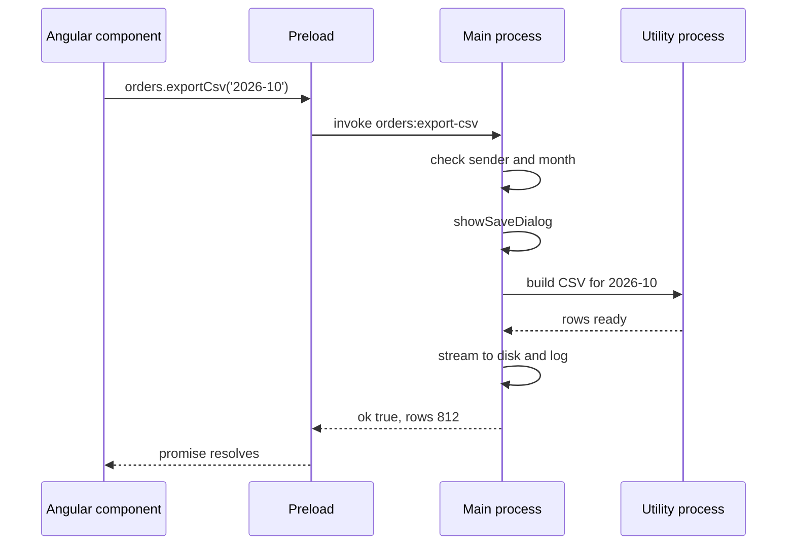
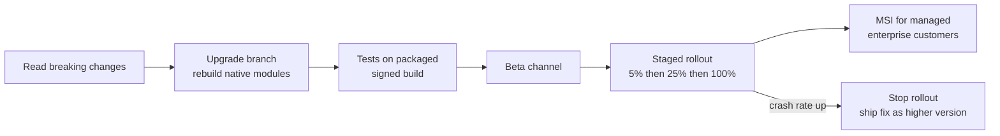
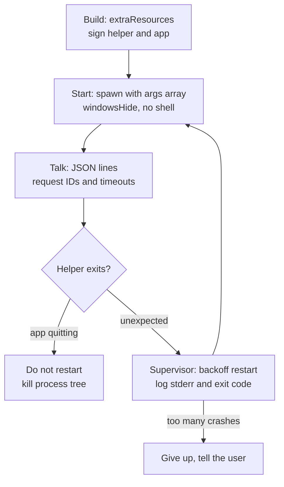
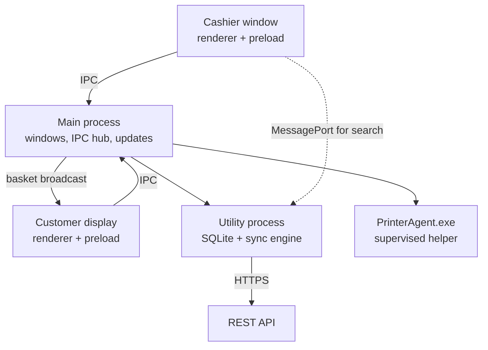
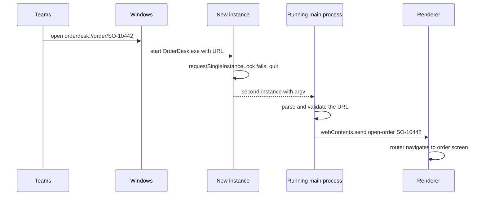

# Electron Desktop — Mixed Interview Questions

> This file is mixed, cross-topic interview practice for the whole Electron desktop subject. Each topic document already has its own interview questions. Use this file after you have studied the topics, and again right before an interview.

## Table of contents

1. [All topic questions at a glance](#all-topic-questions-at-a-glance)
2. [Mixed and cross-topic questions](#mixed-and-cross-topic-questions)
3. [Rapid revision round](#rapid-revision-round)
4. [Summary](#summary)

## All topic questions at a glance

Every question from the 9 topic documents, in order. Use this list to find a question quickly, or to check that you can answer each one out loud.

### [Electron Architecture and Process Model](01-electron-architecture-and-process-model.md)

- [Q1. What is Electron, and how does it work?](01-electron-architecture-and-process-model.md#q1-what-is-electron-and-how-does-it-work)
- [Q2. Explain Electron's process model.](01-electron-architecture-and-process-model.md#q2-explain-electrons-process-model)
- [Q3. What is the difference between the main process and a renderer process?](01-electron-architecture-and-process-model.md#q3-what-is-the-difference-between-the-main-process-and-a-renderer-process)
- [Q4. What is a preload script, and why do we need it?](01-electron-architecture-and-process-model.md#q4-what-is-a-preload-script-and-why-do-we-need-it)
- [Q5. What is `webContents`, and how is it different from `BrowserWindow`?](01-electron-architecture-and-process-model.md#q5-what-is-webcontents-and-how-is-it-different-from-browserwindow)
- [Q6. Why can't the renderer just `require('fs')`? Wouldn't `nodeIntegration: true` be simpler?](01-electron-architecture-and-process-model.md#q6-why-cant-the-renderer-just-requirefs-wouldnt-nodeintegration-true-be-simpler)
- [Q7. What is a utility process, and when would you use one?](01-electron-architecture-and-process-model.md#q7-what-is-a-utility-process-and-when-would-you-use-one)
- [Q8. How does Electron's process model compare with Chrome's?](01-electron-architecture-and-process-model.md#q8-how-does-electrons-process-model-compare-with-chromes)
- [Q9. Why does my Electron app show many processes in Task Manager?](01-electron-architecture-and-process-model.md#q9-why-does-my-electron-app-show-many-processes-in-task-manager)
- [Q10. Which Node.js version does an Electron app use? Does the user need Node.js installed?](01-electron-architecture-and-process-model.md#q10-which-nodejs-version-does-an-electron-app-use-does-the-user-need-nodejs-installed)
- [Q11. How often does Electron release, and what does that mean for your team?](01-electron-architecture-and-process-model.md#q11-how-often-does-electron-release-and-what-does-that-mean-for-your-team)
- [Q12. What happens when the main process crashes? What about a renderer?](01-electron-architecture-and-process-model.md#q12-what-happens-when-the-main-process-crashes-what-about-a-renderer)
- [Q13. Scenario: the whole app freezes for 10 seconds when a user exports a big report. What is happening and how do you fix it?](01-electron-architecture-and-process-model.md#q13-scenario-the-whole-app-freezes-for-10-seconds-when-a-user-exports-a-big-report-what-is-happening-and-how-do-you-fix-it)
- [Q14. Why would you choose Electron for a desktop app, and when would you not?](01-electron-architecture-and-process-model.md#q14-why-would-you-choose-electron-for-a-desktop-app-and-when-would-you-not)
- [Q15. How would you set up an Angular application inside Electron?](01-electron-architecture-and-process-model.md#q15-how-would-you-set-up-an-angular-application-inside-electron)
- [Q16. Code review: what is wrong with this window configuration?](01-electron-architecture-and-process-model.md#q16-code-review-what-is-wrong-with-this-window-configuration)
- [Q17. Can two renderer processes talk to each other directly?](01-electron-architecture-and-process-model.md#q17-can-two-renderer-processes-talk-to-each-other-directly)
- [Q18. What are `electron/main`, `electron/renderer` and `electron/common`?](01-electron-architecture-and-process-model.md#q18-what-are-electronmain-electronrenderer-and-electroncommon)

### [App and Window Lifecycle](02-app-and-window-lifecycle.md)

- [Q1. Walk me through the lifecycle of an Electron app.](02-app-and-window-lifecycle.md#q1-walk-me-through-the-lifecycle-of-an-electron-app)
- [Q2. What happens if you listen to `window-all-closed` but do nothing in the handler?](02-app-and-window-lifecycle.md#q2-what-happens-if-you-listen-to-window-all-closed-but-do-nothing-in-the-handler)
- [Q3. How do you prevent a window from closing when there are unsaved changes?](02-app-and-window-lifecycle.md#q3-how-do-you-prevent-a-window-from-closing-when-there-are-unsaved-changes)
- [Q4. On Windows, the app loses data when the user shuts down the PC. Your cleanup is in `before-quit`. Why?](02-app-and-window-lifecycle.md#q4-on-windows-the-app-loses-data-when-the-user-shuts-down-the-pc-your-cleanup-is-in-before-quit-why)
- [Q5. How do you make sure only one instance of your app runs?](02-app-and-window-lifecycle.md#q5-how-do-you-make-sure-only-one-instance-of-your-app-runs)
- [Q6. How do deep links work on Windows in Electron, and what security issues do they have?](02-app-and-window-lifecycle.md#q6-how-do-deep-links-work-on-windows-in-electron-and-what-security-issues-do-they-have)
- [Q7. What is the difference between `app.quit()`, `app.exit()` and `app.relaunch()`?](02-app-and-window-lifecycle.md#q7-what-is-the-difference-between-appquit-appexit-and-apprelaunch)
- [Q8. Why create windows with `show: false` and show them on `ready-to-show`?](02-app-and-window-lifecycle.md#q8-why-create-windows-with-show-false-and-show-them-on-ready-to-show)
- [Q9. How would you manage many windows, for example one window per order?](02-app-and-window-lifecycle.md#q9-how-would-you-manage-many-windows-for-example-one-window-per-order)
- [Q10. Explain parent and modal windows. When would you use a modal window instead of `dialog.showMessageBox`?](02-app-and-window-lifecycle.md#q10-explain-parent-and-modal-windows-when-would-you-use-a-modal-window-instead-of-dialogshowmessagebox)
- [Q11. How do you build a minimize-to-tray app, and what bug must you avoid?](02-app-and-window-lifecycle.md#q11-how-do-you-build-a-minimize-to-tray-app-and-what-bug-must-you-avoid)
- [Q12. What is the difference between a menu accelerator and `globalShortcut`?](02-app-and-window-lifecycle.md#q12-what-is-the-difference-between-a-menu-accelerator-and-globalshortcut)
- [Q13. How do you save and restore window size and position correctly?](02-app-and-window-lifecycle.md#q13-how-do-you-save-and-restore-window-size-and-position-correctly)
- [Q14. Where should an Electron app store its settings and database on Windows? Why not next to the exe?](02-app-and-window-lifecycle.md#q14-where-should-an-electron-app-store-its-settings-and-database-on-windows-why-not-next-to-the-exe)
- [Q15. How do you implement "launch at login" on Windows?](02-app-and-window-lifecycle.md#q15-how-do-you-implement-launch-at-login-on-windows)
- [Q16. Debugging: users report the app "does not open" when they click the icon, but Task Manager shows it running. What do you check?](02-app-and-window-lifecycle.md#q16-debugging-users-report-the-app-does-not-open-when-they-click-the-icon-but-task-manager-shows-it-running-what-do-you-check)
- [Q17. How do you do async cleanup, like closing a database, before the app quits?](02-app-and-window-lifecycle.md#q17-how-do-you-do-async-cleanup-like-closing-a-database-before-the-app-quits)
- [Q18. What should you do before `ready`, and what must wait until after?](02-app-and-window-lifecycle.md#q18-what-should-you-do-before-ready-and-what-must-wait-until-after)

### [IPC and Preload Scripts](03-ipc-and-preload-scripts.md)

- [Q1. How do the main and renderer processes communicate in Electron?](03-ipc-and-preload-scripts.md#q1-how-do-the-main-and-renderer-processes-communicate-in-electron)
- [Q2. What is the difference between `ipcRenderer.invoke` and `ipcRenderer.send`?](03-ipc-and-preload-scripts.md#q2-what-is-the-difference-between-ipcrendererinvoke-and-ipcrenderersend)
- [Q3. What is `contextBridge`, and why must you not expose `ipcRenderer` directly?](03-ipc-and-preload-scripts.md#q3-what-is-contextbridge-and-why-must-you-not-expose-ipcrenderer-directly)
- [Q4. How do you validate IPC messages in the main process?](03-ipc-and-preload-scripts.md#q4-how-do-you-validate-ipc-messages-in-the-main-process)
- [Q5. What can and cannot be sent over IPC?](03-ipc-and-preload-scripts.md#q5-what-can-and-cannot-be-sent-over-ipc)
- [Q6. What does this print in the renderer?](03-ipc-and-preload-scripts.md#q6-what-does-this-print-in-the-renderer)
- [Q7. What does the renderer see here?](03-ipc-and-preload-scripts.md#q7-what-does-the-renderer-see-here)
- [Q8. How do you handle errors across IPC?](03-ipc-and-preload-scripts.md#q8-how-do-you-handle-errors-across-ipc)
- [Q9. How do you send events from main to a renderer safely, and how do you clean them up?](03-ipc-and-preload-scripts.md#q9-how-do-you-send-events-from-main-to-a-renderer-safely-and-how-do-you-clean-them-up)
- [Q10. Why is `sendSync` discouraged?](03-ipc-and-preload-scripts.md#q10-why-is-sendsync-discouraged)
- [Q11. What are MessagePorts in Electron, and when would you use them?](03-ipc-and-preload-scripts.md#q11-what-are-messageports-in-electron-and-when-would-you-use-them)
- [Q12. Design a typed IPC layer in TypeScript. How do you keep main, preload and renderer in sync?](03-ipc-and-preload-scripts.md#q12-design-a-typed-ipc-layer-in-typescript-how-do-you-keep-main-preload-and-renderer-in-sync)
- [Q13. Your Angular component receives data from Electron, but the screen does not update until you click somewhere. Why?](03-ipc-and-preload-scripts.md#q13-your-angular-component-receives-data-from-electron-but-the-screen-does-not-update-until-you-click-somewhere-why)
- [Q14. Code review: find the problems.](03-ipc-and-preload-scripts.md#q14-code-review-find-the-problems)
- [Q15. A user reports that a toast appears three times for one event. What is the likely cause?](03-ipc-and-preload-scripts.md#q15-a-user-reports-that-a-toast-appears-three-times-for-one-event-what-is-the-likely-cause)
- [Q16. How would you implement a long-running export with progress and cancel over IPC?](03-ipc-and-preload-scripts.md#q16-how-would-you-implement-a-long-running-export-with-progress-and-cancel-over-ipc)
- [Q17. How do you send a large file (for example a 200 MB video) from main to the renderer?](03-ipc-and-preload-scripts.md#q17-how-do-you-send-a-large-file-for-example-a-200-mb-video-from-main-to-the-renderer)
- [Q18. What is `event.sender` vs `event.senderFrame`?](03-ipc-and-preload-scripts.md#q18-what-is-eventsender-vs-eventsenderframe)
- [Q19. Why can a handler registered with `ipcMain.handle` throw "Attempted to register a second handler"?](03-ipc-and-preload-scripts.md#q19-why-can-a-handler-registered-with-ipcmainhandle-throw-attempted-to-register-a-second-handler)
- [Q20. Scenario: your Electron app embeds a third-party help widget in an iframe. What IPC risks does that create, and how do you handle them?](03-ipc-and-preload-scripts.md#q20-scenario-your-electron-app-embeds-a-third-party-help-widget-in-an-iframe-what-ipc-risks-does-that-create-and-how-do-you-handle-them)
- [Q21. Explain `additionalArguments`. When is it better than IPC?](03-ipc-and-preload-scripts.md#q21-explain-additionalarguments-when-is-it-better-than-ipc)
- [Q22. How would you test IPC handlers?](03-ipc-and-preload-scripts.md#q22-how-would-you-test-ipc-handlers)
- [Q23. What is the difference between the context bridge and IPC? Both "copy data".](03-ipc-and-preload-scripts.md#q23-what-is-the-difference-between-the-context-bridge-and-ipc-both-copy-data)
- [Q24. Should business logic live in the preload, the renderer or main?](03-ipc-and-preload-scripts.md#q24-should-business-logic-live-in-the-preload-the-renderer-or-main)

### [Electron Security](04-electron-security.md)

- [Q1. Why is security in Electron more critical than in a normal web app?](04-electron-security.md#q1-why-is-security-in-electron-more-critical-than-in-a-normal-web-app)
- [Q2. Explain `nodeIntegration`, `contextIsolation` and `sandbox`. What are the defaults?](04-electron-security.md#q2-explain-nodeintegration-contextisolation-and-sandbox-what-are-the-defaults)
- [Q3. Walk me through the Electron security checklist.](04-electron-security.md#q3-walk-me-through-the-electron-security-checklist)
- [Q4. How do you prevent navigation to malicious sites inside your app?](04-electron-security.md#q4-how-do-you-prevent-navigation-to-malicious-sites-inside-your-app)
- [Q5. Why is `shell.openExternal` dangerous, and how do you use it safely?](04-electron-security.md#q5-why-is-shellopenexternal-dangerous-and-how-do-you-use-it-safely)
- [Q6. Why prefer a custom protocol over `file://`? How do you implement it?](04-electron-security.md#q6-why-prefer-a-custom-protocol-over-file-how-do-you-implement-it)
- [Q7. What are Electron fuses? Which ones would you flip?](04-electron-security.md#q7-what-are-electron-fuses-which-ones-would-you-flip)
- [Q8. Is it safe to store an API key in your Electron app? How do you store secrets?](04-electron-security.md#q8-is-it-safe-to-store-an-api-key-in-your-electron-app-how-do-you-store-secrets)
- [Q9. Electron approves permission requests by default. What does that mean and what do you do?](04-electron-security.md#q9-electron-approves-permission-requests-by-default-what-does-that-mean-and-what-do-you-do)
- [Q10. A developer set `webSecurity: false` to fix a CORS error. What do you tell them?](04-electron-security.md#q10-a-developer-set-websecurity-false-to-fix-a-cors-error-what-do-you-tell-them)
- [Q11. What is the difference between `will-navigate` and `setWindowOpenHandler`?](04-electron-security.md#q11-what-is-the-difference-between-will-navigate-and-setwindowopenhandler)
- [Q12. Should you use the `webview` tag? What are the alternatives?](04-electron-security.md#q12-should-you-use-the-webview-tag-what-are-the-alternatives)
- [Q13. Review this IPC handler.](04-electron-security.md#q13-review-this-ipc-handler)
- [Q14. How do you safely show user-generated HTML (for example rich-text notes) in an Electron renderer?](04-electron-security.md#q14-how-do-you-safely-show-user-generated-html-for-example-rich-text-notes-in-an-electron-renderer)
- [Q15. What was the `remote` module and why was it removed?](04-electron-security.md#q15-what-was-the-remote-module-and-why-was-it-removed)
- [Q16. Your app must display an existing web portal from a remote server. How do you make it as safe as possible?](04-electron-security.md#q16-your-app-must-display-an-existing-web-portal-from-a-remote-server-how-do-you-make-it-as-safe-as-possible)
- [Q17. What is ASAR integrity, and does it make the app tamper-proof?](04-electron-security.md#q17-what-is-asar-integrity-and-does-it-make-the-app-tamper-proof)
- [Q18. How would you handle authentication tokens in an Electron app?](04-electron-security.md#q18-how-would-you-handle-authentication-tokens-in-an-electron-app)
- [Q19. Scenario: a penetration test found that pressing Ctrl+Shift+I opens DevTools in production and they could call `window.orderDesk.orders.save` with a negative quantity. How serious is this and what do you fix?](04-electron-security.md#q19-scenario-a-penetration-test-found-that-pressing-ctrlshifti-opens-devtools-in-production-and-they-could-call-windoworderdeskorderssave-with-a-negative-quantity-how-serious-is-this-and-what-do-you-fix)
- [Q20. What CSP would you use for an Angular app in Electron?](04-electron-security.md#q20-what-csp-would-you-use-for-an-angular-app-in-electron)
- [Q21. How do you make sure every window, popup and view gets your security rules?](04-electron-security.md#q21-how-do-you-make-sure-every-window-popup-and-view-gets-your-security-rules)
- [Q22. Name some things that should never come from the renderer in an IPC call.](04-electron-security.md#q22-name-some-things-that-should-never-come-from-the-renderer-in-an-ipc-call)

### [Filesystem, Child Processes and Native Features](05-filesystem-child-processes-and-native-features.md)

- [Q1. How should an Electron renderer read or write files?](05-filesystem-child-processes-and-native-features.md#q1-how-should-an-electron-renderer-read-or-write-files)
- [Q2. How do you prevent path traversal? Why is `startsWith` not enough?](05-filesystem-child-processes-and-native-features.md#q2-how-do-you-prevent-path-traversal-why-is-startswith-not-enough)
- [Q3. Where should an Electron app store its data on Windows, and how do you write settings safely?](05-filesystem-child-processes-and-native-features.md#q3-where-should-an-electron-app-store-its-data-on-windows-and-how-do-you-write-settings-safely)
- [Q4. How do you use SQLite in an Electron app? What problems should you expect?](05-filesystem-child-processes-and-native-features.md#q4-how-do-you-use-sqlite-in-an-electron-app-what-problems-should-you-expect)
- [Q5. How would you run an external program, like a .NET helper, and show its progress in the UI?](05-filesystem-child-processes-and-native-features.md#q5-how-would-you-run-an-external-program-like-a-net-helper-and-show-its-progress-in-the-ui)
- [Q6. What does this print?](05-filesystem-child-processes-and-native-features.md#q6-what-does-this-print)
- [Q7. On Windows, you call `child.kill()` on a helper, but the hardware port stays locked. Why?](05-filesystem-child-processes-and-native-features.md#q7-on-windows-you-call-childkill-on-a-helper-but-the-hardware-port-stays-locked-why)
- [Q8. Why does spawning a `.bat` file throw `EINVAL`, and what do you do?](05-filesystem-child-processes-and-native-features.md#q8-why-does-spawning-a-bat-file-throw-einval-and-what-do-you-do)
- [Q9. When do you use `utilityProcess`, `child_process` or `worker_threads`?](05-filesystem-child-processes-and-native-features.md#q9-when-do-you-use-utilityprocess-child_process-or-worker_threads)
- [Q10. Notifications work in production but not during development on Windows. Why?](05-filesystem-child-processes-and-native-features.md#q10-notifications-work-in-production-but-not-during-development-on-windows-why)
- [Q11. How do you safely use `shell.openPath` and `shell.openExternal`?](05-filesystem-child-processes-and-native-features.md#q11-how-do-you-safely-use-shellopenpath-and-shellopenexternal)
- [Q12. Your sync stops working after the laptop wakes from sleep. How do you fix it?](05-filesystem-child-processes-and-native-features.md#q12-your-sync-stops-working-after-the-laptop-wakes-from-sleep-how-do-you-fix-it)
- [Q13. How do you print a receipt silently on a thermal printer in Electron?](05-filesystem-child-processes-and-native-features.md#q13-how-do-you-print-a-receipt-silently-on-a-thermal-printer-in-electron)
- [Q14. How do you show a window on a second monitor, and handle it being unplugged?](05-filesystem-child-processes-and-native-features.md#q14-how-do-you-show-a-window-on-a-second-monitor-and-handle-it-being-unplugged)
- [Q15. When would you write a native addon, and what are the risks?](05-filesystem-child-processes-and-native-features.md#q15-when-would-you-write-a-native-addon-and-what-are-the-risks)
- [Q16. How do you get the file path when the user drops a file onto your window?](05-filesystem-child-processes-and-native-features.md#q16-how-do-you-get-the-file-path-when-the-user-drops-a-file-onto-your-window)
- [Q17. Why should your Electron app not require administrator rights? What if one feature needs them?](05-filesystem-child-processes-and-native-features.md#q17-why-should-your-electron-app-not-require-administrator-rights-what-if-one-feature-needs-them)
- [Q18. Code review: what is wrong with this handler?](05-filesystem-child-processes-and-native-features.md#q18-code-review-what-is-wrong-with-this-handler)
- [Q19. How do you use the clipboard in modern Electron?](05-filesystem-child-processes-and-native-features.md#q19-how-do-you-use-the-clipboard-in-modern-electron)
- [Q20. Scenario: design the hardware layer of a Windows POS app built with Electron (barcode scanner, receipt printer, card terminal, customer display).](05-filesystem-child-processes-and-native-features.md#q20-scenario-design-the-hardware-layer-of-a-windows-pos-app-built-with-electron-barcode-scanner-receipt-printer-card-terminal-customer-display)

### [Packaging, Installers and Code Signing](06-packaging-installers-and-code-signing.md)

- [Q1. What is the difference between packaging an Electron app and creating an installer?](06-packaging-installers-and-code-signing.md#q1-what-is-the-difference-between-packaging-an-electron-app-and-creating-an-installer)
- [Q2. Compare electron-builder and Electron Forge. Which would you choose for a Windows enterprise app?](06-packaging-installers-and-code-signing.md#q2-compare-electron-builder-and-electron-forge-which-would-you-choose-for-a-windows-enterprise-app)
- [Q3. What is ASAR, why is it used, and when must you unpack files from it?](06-packaging-installers-and-code-signing.md#q3-what-is-asar-why-is-it-used-and-when-must-you-unpack-files-from-it)
- [Q4. Explain per-user vs per-machine installs on Windows. Which would you choose for a POS app on shared store PCs?](06-packaging-installers-and-code-signing.md#q4-explain-per-user-vs-per-machine-installs-on-windows-which-would-you-choose-for-a-pos-app-on-shared-store-pcs)
- [Q5. Why do Windows apps need to be code-signed? What happens if you ship unsigned?](06-packaging-installers-and-code-signing.md#q5-why-do-windows-apps-need-to-be-code-signed-what-happens-if-you-ship-unsigned)
- [Q6. OV vs EV code signing certificates — what is the difference today?](06-packaging-installers-and-code-signing.md#q6-ov-vs-ev-code-signing-certificates--what-is-the-difference-today)
- [Q7. Since 2023 you cannot export the private key of a public code signing certificate. How do you sign in CI?](06-packaging-installers-and-code-signing.md#q7-since-2023-you-cannot-export-the-private-key-of-a-public-code-signing-certificate-how-do-you-sign-in-ci)
- [Q8. What is timestamping in code signing, and what happens without it?](06-packaging-installers-and-code-signing.md#q8-what-is-timestamping-in-code-signing-and-what-happens-without-it)
- [Q9. Debugging: the app works with `npm start`, but the installed version crashes at startup with "The specified module could not be found" or "was compiled against a different Node.js version". What do you check?](06-packaging-installers-and-code-signing.md#q9-debugging-the-app-works-with-npm-start-but-the-installed-version-crashes-at-startup-with-the-specified-module-could-not-be-found-or-was-compiled-against-a-different-nodejs-version-what-do-you-check)
- [Q10. What is `latest.yml`, and how does electron-updater use the `sha512` in it?](06-packaging-installers-and-code-signing.md#q10-what-is-latestyml-and-how-does-electron-updater-use-the-sha512-in-it)
- [Q11. Your installer triggers antivirus false positives at some customers. What can you do?](06-packaging-installers-and-code-signing.md#q11-your-installer-triggers-antivirus-false-positives-at-some-customers-what-can-you-do)
- [Q12. How would you reduce the size of an Electron installer?](06-packaging-installers-and-code-signing.md#q12-how-would-you-reduce-the-size-of-an-electron-installer)
- [Q13. What is Squirrel.Windows, and what must your app do to support it?](06-packaging-installers-and-code-signing.md#q13-what-is-squirrelwindows-and-what-must-your-app-do-to-support-it)
- [Q14. An enterprise customer wants to deploy your app to 5,000 PCs with Intune. What do you give them?](06-packaging-installers-and-code-signing.md#q14-an-enterprise-customer-wants-to-deploy-your-app-to-5000-pcs-with-intune-what-do-you-give-them)
- [Q15. Code review: what is wrong with this configuration?](06-packaging-installers-and-code-signing.md#q15-code-review-what-is-wrong-with-this-configuration)
- [Q16. Why must `appId` never change after release?](06-packaging-installers-and-code-signing.md#q16-why-must-appid-never-change-after-release)
- [Q17. How does macOS notarization differ from Windows code signing?](06-packaging-installers-and-code-signing.md#q17-how-does-macos-notarization-differ-from-windows-code-signing)
- [Q18. Walk me through a CI pipeline that releases a signed Windows installer.](06-packaging-installers-and-code-signing.md#q18-walk-me-through-a-ci-pipeline-that-releases-a-signed-windows-installer)

### [Auto-Updates](07-auto-updates.md)

- [Q1. How does auto-update work in an Electron app?](07-auto-updates.md#q1-how-does-auto-update-work-in-an-electron-app)
- [Q2. What is the difference between Electron's built-in autoUpdater and electron-updater?](07-auto-updates.md#q2-what-is-the-difference-between-electrons-built-in-autoupdater-and-electron-updater)
- [Q3. List the electron-updater events and what you do in each.](07-auto-updates.md#q3-list-the-electron-updater-events-and-what-you-do-in-each)
- [Q4. Where should the update code live, and how does the renderer show progress?](07-auto-updates.md#q4-where-should-the-update-code-live-and-how-does-the-renderer-show-progress)
- [Q5. When should the app check for updates and when should it install them?](07-auto-updates.md#q5-when-should-the-app-check-for-updates-and-when-should-it-install-them)
- [Q6. How do staged rollouts work in electron-updater?](07-auto-updates.md#q6-how-do-staged-rollouts-work-in-electron-updater)
- [Q7. Version 1.4.0 has a critical bug and 20% of users already have it. What do you do?](07-auto-updates.md#q7-version-140-has-a-critical-bug-and-20-of-users-already-have-it-what-do-you-do)
- [Q8. How does electron-updater make sure an update is genuine?](07-auto-updates.md#q8-how-does-electron-updater-make-sure-an-update-is-genuine)
- [Q9. What are differential downloads, and when do they fall back to full downloads?](07-auto-updates.md#q9-what-are-differential-downloads-and-when-do-they-fall-back-to-full-downloads)
- [Q10. How do channels work? How would you run a beta program?](07-auto-updates.md#q10-how-do-channels-work-how-would-you-run-a-beta-program)
- [Q11. Your app is installed per-machine in Program Files, and users report updates never install. Why?](07-auto-updates.md#q11-your-app-is-installed-per-machine-in-program-files-and-users-report-updates-never-install-why)
- [Q12. How do you handle auto-updates in an enterprise that deploys software with Intune or SCCM?](07-auto-updates.md#q12-how-do-you-handle-auto-updates-in-an-enterprise-that-deploys-software-with-intune-or-sccm)
- [Q13. What is `dev-app-update.yml` and how do you test updates?](07-auto-updates.md#q13-what-is-dev-app-updateyml-and-how-do-you-test-updates)
- [Q14. Debugging: users report "the update downloads every time but never installs". What do you check?](07-auto-updates.md#q14-debugging-users-report-the-update-downloads-every-time-but-never-installs-what-do-you-check)
- [Q15. Code review: what is wrong with this updater code?](07-auto-updates.md#q15-code-review-what-is-wrong-with-this-updater-code)
- [Q16. Why must you never reuse a version number, and what does `allowDowngrade` do?](07-auto-updates.md#q16-why-must-you-never-reuse-a-version-number-and-what-does-allowdowngrade-do)
- [Q17. Should a private enterprise app use the GitHub provider with a token embedded in the app?](07-auto-updates.md#q17-should-a-private-enterprise-app-use-the-github-provider-with-a-token-embedded-in-the-app)
- [Q18. How do you design the update server for 50,000 installations?](07-auto-updates.md#q18-how-do-you-design-the-update-server-for-50000-installations)

### [Logging, Crash Recovery and Monitoring](08-logging-crash-recovery-and-monitoring.md)

- [Q1. How do you implement logging in an Electron app?](08-logging-crash-recovery-and-monitoring.md#q1-how-do-you-implement-logging-in-an-electron-app)
- [Q2. What kinds of crashes can happen in an Electron app, and how do you detect each?](08-logging-crash-recovery-and-monitoring.md#q2-what-kinds-of-crashes-can-happen-in-an-electron-app-and-how-do-you-detect-each)
- [Q3. Your renderer crashes with reason `oom` every afternoon. How do you investigate and what do you do short-term?](08-logging-crash-recovery-and-monitoring.md#q3-your-renderer-crashes-with-reason-oom-every-afternoon-how-do-you-investigate-and-what-do-you-do-short-term)
- [Q4. How do you recover from a renderer crash without losing the user's work?](08-logging-crash-recovery-and-monitoring.md#q4-how-do-you-recover-from-a-renderer-crash-without-losing-the-users-work)
- [Q5. What do you do when the main process throws an uncaught exception?](08-logging-crash-recovery-and-monitoring.md#q5-what-do-you-do-when-the-main-process-throws-an-uncaught-exception)
- [Q6. What is `crashReporter`, and what is a minidump?](08-logging-crash-recovery-and-monitoring.md#q6-what-is-crashreporter-and-what-is-a-minidump)
- [Q7. How do you prevent an infinite crash-restart loop?](08-logging-crash-recovery-and-monitoring.md#q7-how-do-you-prevent-an-infinite-crash-restart-loop)
- [Q8. How would you detect that a renderer is frozen, and what is the difference between `unresponsive` and a heartbeat?](08-logging-crash-recovery-and-monitoring.md#q8-how-would-you-detect-that-a-renderer-is-frozen-and-what-is-the-difference-between-unresponsive-and-a-heartbeat)
- [Q9. A helper process (for example a printer agent) keeps crashing. How should the main process handle it?](08-logging-crash-recovery-and-monitoring.md#q9-a-helper-process-for-example-a-printer-agent-keeps-crashing-how-should-the-main-process-handle-it)
- [Q10. What does `app.getAppMetrics()` give you, and how would you use it?](08-logging-crash-recovery-and-monitoring.md#q10-what-does-appgetappmetrics-give-you-and-how-would-you-use-it)
- [Q11. How would you integrate Sentry into an Electron + Angular app?](08-logging-crash-recovery-and-monitoring.md#q11-how-would-you-integrate-sentry-into-an-electron--angular-app)
- [Q12. What privacy rules do you follow for telemetry and crash reports?](08-logging-crash-recovery-and-monitoring.md#q12-what-privacy-rules-do-you-follow-for-telemetry-and-crash-reports)
- [Q13. Debugging: a customer says "the app is slow and sometimes shows a black window". What do you collect and check?](08-logging-crash-recovery-and-monitoring.md#q13-debugging-a-customer-says-the-app-is-slow-and-sometimes-shows-a-black-window-what-do-you-collect-and-check)
- [Q14. Code review: what is wrong with this crash handling?](08-logging-crash-recovery-and-monitoring.md#q14-code-review-what-is-wrong-with-this-crash-handling)
- [Q15. When would you call `app.relaunch()`, and what is the common mistake with it?](08-logging-crash-recovery-and-monitoring.md#q15-when-would-you-call-apprelaunch-and-what-is-the-common-mistake-with-it)
- [Q16. Why should risky native code not run in the main process?](08-logging-crash-recovery-and-monitoring.md#q16-why-should-risky-native-code-not-run-in-the-main-process)
- [Q17. How do you make problems on user machines diagnosable?](08-logging-crash-recovery-and-monitoring.md#q17-how-do-you-make-problems-on-user-machines-diagnosable)
- [Q18. A kiosk app must run 24/7 without staff. Describe your monitoring and recovery design.](08-logging-crash-recovery-and-monitoring.md#q18-a-kiosk-app-must-run-247-without-staff-describe-your-monitoring-and-recovery-design)

### [Performance, Architecture and Alternatives](09-performance-architecture-and-alternatives.md)

- [Q1. Our Electron app takes 6 seconds to start on store PCs. How do you make it faster?](09-performance-architecture-and-alternatives.md#q1-our-electron-app-takes-6-seconds-to-start-on-store-pcs-how-do-you-make-it-faster)
- [Q2. What does this print, and what does it tell you about Electron's main process?](09-performance-architecture-and-alternatives.md#q2-what-does-this-print-and-what-does-it-tell-you-about-electrons-main-process)
- [Q3. What blocks the main process, and how do you fix each case?](09-performance-architecture-and-alternatives.md#q3-what-blocks-the-main-process-and-how-do-you-fix-each-case)
- [Q4. Why do Electron apps use so much memory, and how do you reduce it?](09-performance-architecture-and-alternatives.md#q4-why-do-electron-apps-use-so-much-memory-and-how-do-you-reduce-it)
- [Q5. Describe the architecture of a production Windows desktop app built with Electron and Angular.](09-performance-architecture-and-alternatives.md#q5-describe-the-architecture-of-a-production-windows-desktop-app-built-with-electron-and-angular)
- [Q6. How would you design offline-first sync for a POS app?](09-performance-architecture-and-alternatives.md#q6-how-would-you-design-offline-first-sync-for-a-pos-app)
- [Q7. How would you integrate a barcode scanner and a receipt printer?](09-performance-architecture-and-alternatives.md#q7-how-would-you-integrate-a-barcode-scanner-and-a-receipt-printer)
- [Q8. How do you build a kiosk app with Electron?](09-performance-architecture-and-alternatives.md#q8-how-do-you-build-a-kiosk-app-with-electron)
- [Q9. How do two windows share state, like a cashier screen and a customer display?](09-performance-architecture-and-alternatives.md#q9-how-do-two-windows-share-state-like-a-cashier-screen-and-a-customer-display)
- [Q10. How do you test an Electron app?](09-performance-architecture-and-alternatives.md#q10-how-do-you-test-an-electron-app)
- [Q11. Electron vs Tauri: how do you choose?](09-performance-architecture-and-alternatives.md#q11-electron-vs-tauri-how-do-you-choose)
- [Q12. When would you not choose Electron?](09-performance-architecture-and-alternatives.md#q12-when-would-you-not-choose-electron)
- [Q13. Electron vs a PWA for an internal tool: what are the trade-offs?](09-performance-architecture-and-alternatives.md#q13-electron-vs-a-pwa-for-an-internal-tool-what-are-the-trade-offs)
- [Q14. Your app's customer display stops updating when the cashier window is focused. Why?](09-performance-architecture-and-alternatives.md#q14-your-apps-customer-display-stops-updating-when-the-cashier-window-is-focused-why)
- [Q15. How do you handle configuration in a desktop app deployed to enterprises?](09-performance-architecture-and-alternatives.md#q15-how-do-you-handle-configuration-in-a-desktop-app-deployed-to-enterprises)
- [Q16. Where should the app call the REST API from: the renderer or main?](09-performance-architecture-and-alternatives.md#q16-where-should-the-app-call-the-rest-api-from-the-renderer-or-main)
- [Q17. Code review: what is wrong with this startup code?](09-performance-architecture-and-alternatives.md#q17-code-review-what-is-wrong-with-this-startup-code)
- [Q18. Your manager asks: "Should we rewrite our Electron POS in .NET to save memory?" How do you answer?](09-performance-architecture-and-alternatives.md#q18-your-manager-asks-should-we-rewrite-our-electron-pos-in-net-to-save-memory-how-do-you-answer)

## Mixed and cross-topic questions

These questions combine two or more topics, the way real desktop interviews do. One scenario can test the process model, IPC, security, packaging and crash recovery at the same time. The examples use the same app as the topic documents: **OrderDesk**, an Angular point-of-sale app for Windows store PCs. Every "what does this print?" answer in this section was run with Node.js 22 to confirm the output.

### Q1. Follow one click through the whole app: the user clicks "Export orders to CSV". What happens, process by process?

**What the interviewer is checking:** Whether you can connect the process model, the preload, IPC, security checks, file system work and logging into one clear story, instead of knowing each piece alone.

**Short spoken answer (30–60 seconds):**
> The Angular component calls a service method, and the service calls `window.orderDesk.orders.exportCsv(month)`. That function lives in the preload, which exposed it with `contextBridge`. The preload sends one message with `ipcRenderer.invoke('orders:export-csv', month)`. In the main process, `ipcMain.handle` receives it. The handler first checks the sender frame's origin, then validates the month string. Then main opens a native save dialog, so the user chooses the path, not the page. The CSV is built in a utility process if it is large, and main streams it to disk with async `fs`. Main logs the result with a scope and returns a small plain object like `{ ok: true, rows: 812 }`. The promise in Angular resolves, and the service updates a signal or an observable inside the Angular zone so the screen updates.

**Detailed explanation:**

| Step | Process | What happens | Where it is explained |
| --- | --- | --- | --- |
| 1 | Renderer | Angular service calls the narrow preload function | [Angular service](03-ipc-and-preload-scripts.md#angular-service-that-wraps-the-preload-api) |
| 2 | Renderer (isolated world) | Preload turns the call into `ipcRenderer.invoke` | [Preload API design](03-ipc-and-preload-scripts.md#designing-the-preload-api-with-contextbridge) |
| 3 | Main | Sender check on `event.senderFrame.origin` | [Validating the sender](03-ipc-and-preload-scripts.md#validating-the-sender) |
| 4 | Main | Argument check (`/^\d{4}-\d{2}$/`) | [Validating the arguments](03-ipc-and-preload-scripts.md#validating-the-arguments) |
| 5 | Main | `dialog.showSaveDialog` picks the path | [Native dialogs](05-filesystem-child-processes-and-native-features.md#native-dialogs) |
| 6 | Utility process | Heavy CSV building off the main thread | [Never block the main process](09-performance-architecture-and-alternatives.md#never-block-the-main-process) |
| 7 | Main | Stream the file to disk, log the result | [What and how to log](08-logging-crash-recovery-and-monitoring.md#what-and-how-to-log) |
| 8 | Renderer | Promise resolves with plain data, UI updates | [Serialization rules](03-ipc-and-preload-scripts.md#serialization-rules) |



**Follow-up questions:**
- **Why does main choose the path and not the page?** — The page is untrusted. If it could send any path, one XSS bug could overwrite any file the user can write. A native dialog means the user chose the path.
- **What if the user closes the window during the export?** — The `invoke` promise is gone, but main keeps working. Check `event.sender.isDestroyed()` before sending progress events, and cancel the job with an `AbortController` when the window closes.
- **Where do errors go?** — Main logs the full error with a stack. It returns a safe `{ ok: false, error: { code, message } }` to the page, because thrown errors lose their custom properties across IPC.

**Common mistakes:** Saying the renderer writes the file. Forgetting the sender check. Building a large CSV synchronously in main, which freezes every window.

**Where this is used in real projects:** Every "save", "export", "print" and "import" feature in a desktop app follows this same path.

Topics: [Process model](01-electron-architecture-and-process-model.md#the-process-model-at-a-glance) · [IPC](03-ipc-and-preload-scripts.md#pattern-1-request-and-response-with-invoke-and-handle) · [Security](04-electron-security.md#validate-ipc-senders-and-do-not-expose-electron-apis) · [File system](05-filesystem-child-processes-and-native-features.md#exposing-specific-file-operations)

---

### Q2. Production issue: after upgrading from Electron 44 to Electron 45, `window.orderDesk` is `undefined` in the page and the console shows "Buffer is not defined". What happened and how do you fix it?

**What the interviewer is checking:** Knowledge of a real, recent breaking change, how a sandboxed preload works, and a calm debugging approach.

**Short spoken answer (30–60 seconds):**
> The preload script threw an error before it reached `contextBridge.exposeInMainWorld`, so the page never got the API. Electron 45 removed the small Node.js shims from sandboxed preloads: no `Buffer`, no `setImmediate`, and `require` can no longer load `events`, `timers` or `url`. Our preload used `Buffer.from` to encode a file before sending it. I fix it by using web APIs instead: `Uint8Array`, `TextEncoder` and `TextDecoder`, `setTimeout`, `EventTarget`. I also add a test that loads the preload in the packaged app and checks that `window.orderDesk` exists, so this kind of error fails CI and not the store PCs.

**Detailed explanation:**
- A preload error is shown in the **renderer's DevTools console**, not in the main process terminal. Many developers look in the wrong place.
- When the preload throws, the code after the error does not run. So `exposeInMainWorld` is never called, and the page sees `undefined`.
- Typical replacements:

```js
// ❌ Wrong in Electron 45 sandboxed preloads
const bytes = Buffer.from(text, 'utf8');
setImmediate(flushQueue);

// ✅ Correct: web APIs that exist in every renderer
const bytes = new TextEncoder().encode(text); // Uint8Array
setTimeout(flushQueue, 0);
```

- If a library in the preload bundle needs `Buffer`, either remove it from the preload (move the work to main) or bundle a small polyfill. The best fix is usually to keep the preload tiny: it should only forward calls.

**Follow-up questions:**
- **What else changed in Electron 45 that you would check?** — The synchronous `safeStorage` methods were deprecated (use `encryptStringAsync`/`decryptStringAsync`), and popups opened from unsandboxed windows are now sandboxed in their own process. Read the whole breaking-changes page before every upgrade.
- **How do you avoid this surprise next time?** — Run the end-to-end tests against the next Electron beta in CI, a few weeks before it becomes stable.
- **Is it OK to set `sandbox: false` to get `Buffer` back?** — No. That trades a small code change for a big security loss. Fix the code.

**Common mistakes:** Turning off the sandbox to make the error go away. Looking only at main-process logs. Not knowing that preload errors stop the bridge.

**Where this is used in real projects:** Every Electron upgrade. Teams that stay on supported versions upgrade about every eight weeks to six months.

Topics: [What a sandboxed preload can use](01-electron-architecture-and-process-model.md#preload-scripts) · [Release cadence](01-electron-architecture-and-process-model.md#release-cadence-and-support-policy) · [Sandbox](04-electron-security.md#node-integration-context-isolation-and-the-sandbox) · [Testing](09-performance-architecture-and-alternatives.md#testing-electron-apps)

---

### Q3. Plan an Electron major upgrade for an enterprise app with 20,000 installs. What are the steps from "new version is out" to "everyone has it"?

**What the interviewer is checking:** Senior ownership: support policy, breaking changes, native modules, signing, staged rollout and enterprise customers, all in one plan.

**Short spoken answer (30–60 seconds):**
> Electron supports only the latest three majors, so I plan an upgrade every one or two releases. First I read the breaking-changes page and search our code for each removed API. I upgrade on a branch, rebuild native modules like `better-sqlite3` for the new Electron, and run unit, IPC and Playwright end-to-end tests against the packaged, signed build. Then I release to an internal beta channel, then a staged rollout: maybe 5% of stable users, watching crash rates and logs, then 25%, then 100%. Enterprise customers who deploy with Intune get the new MSI with release notes. If crash rates go up, I stop the rollout and ship a fix as a higher version, because updates only roll forward.

**Detailed explanation:**



Checks that are easy to forget:
- **Native modules** must match Electron's Node ABI. A module built for the old Electron fails with "was compiled against a different Node.js version".
- **Platform support** changes too. Electron 44 stopped publishing 32-bit Windows builds, so a customer with 32-bit PCs is stuck on 43 until it reaches end of life.
- **Fuses and signing**: the new binary must be fused and signed again in CI. Test with the real signed installer, not with `npm start`.
- **Crash reports** must be grouped by Electron version so you can compare before and after.

**Follow-up questions:**
- **How long is one major supported?** — About six months: a new major arrives every eight weeks, and the latest three are supported.
- **Which numbers do you watch during the rollout?** — Crash-free sessions, renderer `oom` and `crashed` reasons, startup time, update success rate, and support tickets.
- **What if a customer refuses to upgrade?** — Explain the security risk in writing. Offer a longer-tested build on a slower channel. Do not keep shipping an unsupported Electron for everyone.

**Common mistakes:** Upgrading once a year. Testing only in development mode. Rolling out to 100% on day one. Promising a "rollback" that the updater cannot do.

**Where this is used in real projects:** Release planning, security audits, and enterprise contracts that ask for a patch policy.

Topics: [Release cadence](01-electron-architecture-and-process-model.md#release-cadence-and-support-policy) · [Native modules](06-packaging-installers-and-code-signing.md#asar-archives) · [Staged rollouts](07-auto-updates.md#staged-rollouts) · [Crash reports](08-logging-crash-recovery-and-monitoring.md#native-crash-reports-with-crashreporter)

---

### Q4. Find the bug: what does this sender check print, and what is wrong with it?

```js
// main/ipc-security.js (a teammate's version)
const TRUSTED = ['app://bundle', 'http://localhost:4200'];

function isTrusted(url) {
  const origin = new URL(url).origin;
  console.log('origin =', origin);
  return TRUSTED.includes(origin);
}

console.log(isTrusted('app://bundle/index.html'));
console.log(isTrusted('http://localhost:4200/orders'));
console.log(isTrusted('https://evil.example/app://bundle'));
```

**Answer:**

```text
origin = null
false
origin = http://localhost:4200
true
origin = https://evil.example
false
```

**Why, step by step:**
1. In the main process, `URL` is **Node's** URL parser. For a non-special scheme like `app:`, Node returns the string `'null'` as the origin.
2. So the production page (`app://bundle`) is **rejected**. Every IPC call from the real app fails in production.
3. The dev server origin `http://localhost:4200` is **trusted**, and it is trusted in production too. If anything on the user's PC listens on port 4200, it could call your IPC handlers through a window that navigated there.
4. The third URL is correctly rejected, because its origin is `https://evil.example`.

**The fix:**

```js
// ✅ Correct
const { app } = require('electron');

const TRUSTED_ORIGINS = new Set(['app://bundle']);
if (!app.isPackaged) TRUSTED_ORIGINS.add('http://localhost:4200'); // dev only

function isTrustedSender(frame) {
  if (!frame) return false;               // the frame can be gone (null)
  return TRUSTED_ORIGINS.has(frame.origin); // Electron computes the origin for you
}
```

**What the interviewer is checking:** That you know `event.senderFrame.origin`, that Node's `URL` behaves differently for custom schemes, and that dev-only trust must not leak into production.

**Follow-up questions:**
- **Why not `url.startsWith('http://localhost:4200')`?** — `'http://localhost:4200.evil.example/x'.startsWith('http://localhost:4200')` is `true`. Prefix checks on URLs are a classic bypass.
- **Why can `senderFrame` be `null`?** — The frame navigated away or was destroyed before the handler read it. Treat `null` as untrusted.
- **Why check the frame and not just the window?** — A trusted window can contain an untrusted iframe. The frame is the real sender.

**Common mistakes:** Testing the check only in development, where it "works". Checking `event.sender.getURL()`, which is the top frame, not the frame that sent the message.

**Where this is used in real projects:** The shared `ipc-security` module that every handler calls.

Topics: [Validating the sender](03-ipc-and-preload-scripts.md#validating-the-sender) · [Validate IPC senders](04-electron-security.md#validate-ipc-senders-and-do-not-expose-electron-apis) · [Custom protocol](04-electron-security.md#prefer-a-custom-protocol-over-file)

---

### Q5. What does this print? (What survives the trip from main to the renderer)

Main sends this object through `webContents.send`. Electron uses structured clone, so `structuredClone` in Node.js shows the same result.

```js
class Money {
  constructor(cents) { this.cents = cents; }
  toString() { return `Rs ${this.cents / 100}`; }
}

const msg = {
  total: new Money(1250),
  lines: [undefined, 1],
  at: new Date(0),
  err: Object.assign(new RangeError('bad qty'), { field: 'qty' }),
};
const c = structuredClone(msg);

console.log(String(msg.total), String(c.total));
console.log(c.lines.length, 0 in c.lines, c.lines[0]);
console.log(c.at.getTime());
console.log(c.err instanceof RangeError, c.err.message, c.err.field);
```

**Answer:**

```text
Rs 12.5 [object Object]
2 true undefined
0
true bad qty undefined
```

**Why, step by step:**
1. `msg.total` is a real `Money`, so `String()` calls its `toString`: `Rs 12.5`. The copy is a plain object. Its prototype is `Object.prototype`, so `String()` gives `[object Object]`.
2. Structured clone keeps the array length and the `undefined` entry. (`JSON.stringify` would turn it into `null`.)
3. `Date` survives as a real `Date`, so `getTime()` works.
4. Built-in error types like `RangeError` survive with their `message`. Custom properties like `field` are dropped.

**What the interviewer is checking:** That you design the IPC contract with plain data, not classes, and that you know how errors cross process boundaries.

**Follow-up questions:**
- **How do you send money safely?** — As an integer number of cents (`totalCents: 1250`) in a plain object. Format it in the UI.
- **How do you send error details?** — Return `{ ok: false, error: { code: 'BAD_QTY', field: 'qty', message } }` instead of throwing.
- **Is this the same for `ipcRenderer.invoke` errors?** — Thrown errors from `ipcMain.handle` are worse: the renderer only gets a new error whose message contains the original message. The type and all custom properties are lost.

**Common mistakes:** Expecting methods to work on the other side. Expecting `instanceof Money` to be `true`.

**Where this is used in real projects:** Typed IPC contracts with DTOs (plain data objects) shared between main, preload and Angular.

Topics: [Serialization rules](03-ipc-and-preload-scripts.md#serialization-rules) · [Error handling across IPC](03-ipc-and-preload-scripts.md#error-handling-across-ipc) · [Typed IPC contract](03-ipc-and-preload-scripts.md#a-typed-ipc-contract-in-typescript)

---

### Q6. The app works with `npm start`, but the installed app shows a blank white window. How do you find the cause?

**What the interviewer is checking:** A systematic way to debug the gap between development and the packaged app. It combines the dev workflow, the custom protocol, CSP, ASAR and logging.

**Short spoken answer (30–60 seconds):**
> A blank window usually means the page did not load or the JavaScript failed. First I read the log file in `userData\logs`, because I log `did-fail-load`, `render-process-gone` and preload errors in production. Then I open DevTools in a debug build and look at the console and network tab. Common causes: the protocol handler serves the wrong folder, for example Angular 17+ puts files in `dist/<app>/browser` but main still serves `dist/<app>`; files are missing from the ASAR because the build config excluded them; the CSP blocks the scripts; the Angular `base href` is wrong; or a native module failed to load in main before the window loaded. Each of these shows a clear message once you look in the right log.

**Detailed explanation:**

| Symptom in logs | Likely cause | Fix |
| --- | --- | --- |
| `did-fail-load` with `ERR_FILE_NOT_FOUND` for `index.html` | Wrong output path or file not packaged | Fix the served folder; check the `files` list in the builder config |
| 404 for `main.js` but `index.html` loads | Wrong `base href` or protocol path mapping | Use `<base href="/">` with `app://bundle/` and the SPA fallback |
| CSP violation in the console | CSP too strict for the build (for example inline styles) | Adjust CSP carefully; do not remove it |
| Main crashes with "module was compiled against a different Node.js version" | Native module not rebuilt for Electron | Rebuild with `@electron/rebuild`; unpack `.node` files from ASAR |
| Window never appears at all | `show: false` and `ready-to-show` never fired | Show the window on `did-fail-load` too, with an error page |

```js
// main: log every load failure, even in production
win.webContents.on('did-fail-load', (_e, code, description, url) => {
  log.error('did-fail-load', { code, description, url });
});
```

**Follow-up questions:**
- **How do you inspect the packaged files?** — Run `npx @electron/asar list resources/app.asar` and check that `dist/.../index.html` is there.
- **Should production allow DevTools?** — Not by default. Use a hidden support flag or a separate debug build, and log enough that you rarely need DevTools.
- **Why do routes work in dev but not in prod?** — `ng serve` rewrites unknown paths to `index.html`. Your protocol handler must do the same SPA fallback.

**Common mistakes:** Switching to `file://` and `webSecurity: false` "to make it load". Debugging only by guessing, with no log file.

**Where this is used in real projects:** The first packaged build of every new project, and after Angular or builder upgrades.

Topics: [Angular + Electron](01-electron-architecture-and-process-model.md#development-workflow-options) · [Custom protocol](04-electron-security.md#prefer-a-custom-protocol-over-file) · [ASAR archives](06-packaging-installers-and-code-signing.md#asar-archives) · [Diagnosing problems](08-logging-crash-recovery-and-monitoring.md#diagnosing-problems-on-user-machines)

---

### Q7. Security review: a new feature lets the server send a link to an invoice PDF, and the app should open it. How do you build it safely?

**What the interviewer is checking:** Whether you can combine `shell` safety, path traversal, downloads, IPC validation and the threat model in one design.

**Short spoken answer (30–60 seconds):**
> I never pass the server's URL or a file path from the page straight to `shell.openExternal` or `shell.openPath`. The page sends only an invoice ID. Main validates the ID, builds the download URL itself from a known HTTPS API base, and downloads the file with the user's session. Main checks the content type and the first bytes, so it really is a PDF. It saves the file under a random name in our own folder inside `userData`, using `resolveInside` as a second check. Then it opens it with `shell.openPath`. That way, a compromised page or a bad server response cannot make the app launch an `.exe` or open a `file://` or `smb://` link.

**Detailed explanation:**
- `shell.openExternal(url)` hands the URL to the operating system. With schemes like `file:`, `smb:` or other registered protocol handlers, it can **start programs**. Allow only `https:` (and maybe `mailto:`) and only known hosts.
- `shell.openPath(path)` opens a file with its default program. If the path ends in `.exe`, `.bat` or `.lnk`, Windows runs it. So control the extension yourself.
- The page is untrusted, and so is the server response. Treat both as input.

```js
// main/ipc/invoices.js
ipcMain.handle('invoices:open', async (event, invoiceId) => {
  if (!isTrustedSender(event.senderFrame)) throw new Error('Unauthorized sender');
  if (typeof invoiceId !== 'string' || !/^INV-\d{1,10}$/.test(invoiceId)) return { ok: false };

  const res = await net.fetch(`${API_BASE}/invoices/${invoiceId}/pdf`); // URL built in main
  const bytes = new Uint8Array(await res.arrayBuffer());
  const isPdf = res.headers.get('content-type') === 'application/pdf'
    && bytes[0] === 0x25 && bytes[1] === 0x50 && bytes[2] === 0x44 && bytes[3] === 0x46; // %PDF
  if (!res.ok || !isPdf) return { ok: false };

  const filePath = resolveInside(INVOICE_DIR, `${randomUUID()}.pdf`);
  await fs.writeFile(filePath, bytes);
  const error = await shell.openPath(filePath);
  return { ok: error === '' };
});
```

**Follow-up questions:**
- **Why not show the PDF inside an Electron window instead?** — That is fine too: Chromium's PDF viewer can display it, and you avoid starting external programs. Use a window without a preload.
- **What about very large files?** — Stream the response to disk instead of buffering it.
- **Where else does this pattern apply?** — "Open folder", "open log file", help links. Every `shell` call should take IDs or allowlisted URLs, never raw input.

**Common mistakes:** `shell.openExternal(urlFromServer)`. Trusting the file name from the server's `Content-Disposition` header. Writing into the Downloads folder with a name the server chose.

**Where this is used in real projects:** Invoices, receipts, exported reports, attachments.

Topics: [shell.openExternal](04-electron-security.md#validate-urls-before-shellopenexternal) · [The shell module](05-filesystem-child-processes-and-native-features.md#the-shell-module) · [Path traversal](05-filesystem-child-processes-and-native-features.md#preventing-path-traversal) · [Threat model](04-electron-security.md#the-threat-model-from-xss-to-remote-code-execution)

---

### Q8. Production issue: you renewed your code signing certificate, and now existing installs download the update but refuse to install it. Why?

**What the interviewer is checking:** How code signing and electron-updater work together, and how to plan certificate changes.

**Short spoken answer (30–60 seconds):**
> On Windows, electron-updater checks that the new installer's Authenticode signature matches the `publisherName` written into the installed app's `app-update.yml`. If the new certificate has a different subject name, for example after a company rename or a different legal entity, the check fails and the update is rejected. The installed apps only know the old name. The fix is a transition: ship one release, signed with the old certificate if it is still valid, that lists both the old and the new name in `publisherName`. After users have that version, releases signed with the new certificate install fine. If the old certificate is already expired and the name changed, users need a manual reinstall, so this must be planned before the old certificate expires.

**Detailed explanation:**
- The checksum in `latest.yml` proves the file was not corrupted. The **signature** proves who made it. electron-updater checks both.
- A renewal with the **same** subject name is usually fine. The problem is a changed name.
- Timestamping matters here too: files signed with a timestamp stay valid after the certificate expires.

```yaml
# electron-builder.yml — transition release
win:
  publisherName:
    - "OrderDesk Ltd"            # old certificate subject
    - "OrderDesk Retail Ltd"     # new certificate subject
```

**Follow-up questions:**
- **Where is the private key in 2026?** — In hardware or a cloud signing service, because public CAs no longer allow exportable keys. CI signs through the HSM or cloud service.
- **Does the built-in Squirrel.Windows updater check the signature?** — No. That is one reason teams pick electron-updater for Windows.
- **How do you detect this before customers do?** — Test the update from the previous production version to the new one, using the real signed artifacts, before every release.

**Common mistakes:** Testing only fresh installs, never updates. Letting a certificate expire without a plan. Turning off `verifyUpdateCodeSignature` to "fix" it.

**Where this is used in real projects:** Every certificate renewal, company rename or move to a new signing provider.

Topics: [Signing with electron-builder](06-packaging-installers-and-code-signing.md#signing-with-electron-builder-and-forge) · [Update metadata](06-packaging-installers-and-code-signing.md#update-metadata-latestyml-and-checksums) · [Signature verification](07-auto-updates.md#signature-verification)

---

### Q9. Design the full life of a .NET helper (`PrinterAgent.exe`) in an Electron app: packaging, starting, talking to it, crashes and updates.

**What the interviewer is checking:** End-to-end ownership of a native helper. It joins packaging, child processes, supervision, logging and updates.

**Short spoken answer (30–60 seconds):**
> I ship the helper with `extraResources`, so it sits next to `app.asar` as a real file, and I sign it in CI like the main exe. At runtime main finds it with `process.resourcesPath` and starts it with `spawn` and an argument array, `windowsHide: true`, and no shell. We talk with JSON lines over stdin and stdout, with a request ID per message and a timeout. A small supervisor restarts it with exponential backoff, forgives old crashes after a stable minute, and gives up after a few quick crashes and shows "Printer service stopped". Its stderr goes into our log file with a `printer-agent` scope. On quit, main kills the whole process tree. Updates are simple: the helper is part of the installer, so it updates with the app, and its protocol has a version number so main can detect a mismatch.

**Detailed explanation:**



**Follow-up questions:**
- **Why not `asarUnpack` for the helper?** — `asarUnpack` is for files that belong to your Node modules, like `.node` addons. A separate program fits `extraResources` better, and its path is simpler.
- **Why does the printer port stay locked after `child.kill()`?** — On Windows, killing the parent does not kill its children. Use `taskkill /pid <pid> /T /F` or a job object to kill the tree.
- **Should the helper listen on a localhost port instead?** — Possible, but any local process can connect to it. If you do, bind to `127.0.0.1`, use a random port and a secret token. stdin/stdout or a named pipe is simpler.

**Common mistakes:** Unsigned helpers (antivirus and SmartScreen problems). `exec` with a command string. Restarting in a tight loop. Losing the helper's stderr.

**Where this is used in real projects:** POS apps with vendor SDKs for printers, card terminals and scales.

Topics: [extraResources vs asarUnpack](06-packaging-installers-and-code-signing.md#asar-archives) · [Child processes](05-filesystem-child-processes-and-native-features.md#child-processes) · [Supervising helper processes](08-logging-crash-recovery-and-monitoring.md#supervising-helper-processes) · [Hardware integration](09-performance-architecture-and-alternatives.md#hardware-integration)

---

### Q10. Version 1.6.0 crashes at startup on some PCs, and those PCs cannot reach the update screen. How do your crash handling and update design help?

**What the interviewer is checking:** Whether crash recovery and the update system were designed together, so a bad release can still be fixed remotely.

**Short spoken answer (30–60 seconds):**
> Three things protect us. First, the staged rollout: only a small percentage got 1.6.0, so I stop the rollout at once. Second, crash-loop protection: the app counts quick restarts, and after three crashes in a few minutes it starts in safe mode, with no plugins, hardware disabled and the default window layout. Third, safe mode still runs the update check early in the main process, before the risky code. So I publish 1.6.1 with the fix, a higher version, and the crashed PCs pick it up from safe mode. Crash reports and logs, grouped by version, tell me what to fix.

**Detailed explanation:**
- **Roll forward, not back.** electron-updater installs newer versions. A "rollback" is a new, higher version that contains the old code.
- **Order of startup matters.** If the updater starts only after the Angular app has loaded, a renderer crash at startup prevents updates. Start the update check from main, and make it independent of the UI.
- **Safe mode** should turn off the riskiest features: GPU acceleration if GPU crashes were seen, hardware helpers, and custom settings.

**Follow-up questions:**
- **How do you stop a staged rollout with electron-updater?** — Edit `stagingPercentage` in `latest.yml` (set it to 0) or replace the metadata with the previous version's metadata, so no new users get 1.6.0.
- **What if the crash is in main before any of your code runs?** — Then only a new installer helps. That is rare; keep main's startup path small and well tested.
- **How do you know it is 1.6.0 and not the PCs?** — Crash reports grouped by app version, Electron version, OS build and GPU driver.

**Common mistakes:** Restarting forever. Putting the update check behind the UI. Promising a downgrade without `allowDowngrade` and a plan.

**Where this is used in real projects:** Kiosks and POS systems in stores with no IT staff on site.

Topics: [Crash-loop protection](08-logging-crash-recovery-and-monitoring.md#crash-loop-protection-and-safe-mode) · [Staged rollouts](07-auto-updates.md#staged-rollouts) · [Rollback and downgrade](07-auto-updates.md#rollback-and-downgrade) · [Startup performance](09-performance-architecture-and-alternatives.md#startup-performance)

---

### Q11. Users say "closing the app takes 20 seconds" and sometimes Task Manager shows OrderDesk still running after it closed. What do you check?

**What the interviewer is checking:** Lifecycle knowledge together with child processes, async cleanup and the updater.

**Short spoken answer (30–60 seconds):**
> I look at the quit sequence in the logs. Common causes: async cleanup in `before-quit` without a timeout, for example waiting for a sync to finish while offline; helper processes that are not killed, so the app's process tree stays alive; a hidden window or a tray icon that keeps the app running; or a renderer that blocks `beforeunload`. I fix it with a clear shutdown function: call `event.preventDefault()` once, run cleanup with a hard timeout of a few seconds, kill every tracked child process tree, flush the logs, then call `app.quit()` again with a flag so the handler does not run twice.

**Detailed explanation:**

```js
let isQuitting = false;

app.on('before-quit', (event) => {
  if (isQuitting) return;            // second call: let it quit
  event.preventDefault();
  isQuitting = true;
  const cleanup = Promise.allSettled([db.close(), syncEngine.stop(), helpers.killAll()]);
  const timeout = new Promise((resolve) => setTimeout(resolve, 3000));
  Promise.race([cleanup, timeout]).finally(() => {
    log.info('Shutdown finished');
    app.quit();
  });
});
```

- On Windows shutdown or logoff, `before-quit` may not fire. Save important data continuously (autosave), not only on quit.
- `autoUpdater.quitAndInstall()` also goes through quit. A slow cleanup delays the installer.

**Follow-up questions:**
- **Why `Promise.allSettled` and not `Promise.all`?** — One failing cleanup step should not stop the others.
- **How do you find which step is slow?** — Log the start and end time of each cleanup step with a scope.
- **What about the tray app pattern?** — When the user closes the window, hide it; when they choose "Quit" in the tray menu, set the quitting flag and really quit.

**Common mistakes:** No timeout on cleanup. Calling `app.exit()` everywhere (skips cleanup). Forgetting child process trees on Windows.

**Where this is used in real projects:** Apps with databases, sync engines, helpers and tray icons — almost every real desktop app.

Topics: [Quitting the app correctly](02-app-and-window-lifecycle.md#quitting-the-app-correctly) · [Killing a process tree](05-filesystem-child-processes-and-native-features.md#child-processes) · [The update flow](07-auto-updates.md#the-update-flow-step-by-step)

---

### Q12. A POS app's memory grows from 300 MB to 2 GB over a working day, and the renderer finally crashes with reason `oom`. How do you investigate?

**What the interviewer is checking:** Memory debugging across processes: metrics, IPC listener leaks, multiple windows, and recovery.

**Short spoken answer (30–60 seconds):**
> First I find which process grows. I log `app.getAppMetrics()` every few minutes, so I can see whether it is the main renderer, a second window, a utility process or main. If it is the renderer, I take heap snapshots in DevTools before and after a repeated action, like completing ten orders, and compare them. A classic Electron leak is IPC listeners: the preload adds an `ipcRenderer.on` listener every time a component is created, and nothing removes it, so old components stay in memory. Other causes are growing caches, big arrays in services, and image or PDF previews never released. Short-term, I autosave and recreate the window when memory passes a limit at a quiet moment. Long-term, I fix the leak and add a test that checks listener counts.

**Detailed explanation:**
- The preload API for events should **return an unsubscribe function**, and the Angular service should call it in `ngOnDestroy` or with `takeUntilDestroyed`.
- Renderer memory is limited per process. Many windows means many renderers; each costs memory even when idle.

```js
// preload: subscriptions must be removable
onOrderUpdated: (callback) => {
  const listener = (_event, order) => callback(order);
  ipcRenderer.on('orders:updated', listener);
  return () => ipcRenderer.removeListener('orders:updated', listener);
},
```

**Follow-up questions:**
- **How do you see listener leaks quickly?** — Log `ipcRenderer.listenerCount('orders:updated')` in a debug build after navigating back and forth.
- **What does `oom` mean for the user?** — The page dies and the window shows nothing. Your `render-process-gone` handler must log it, restore the autosaved basket and recreate the window.
- **Could main be the leak?** — Yes. Main can hold references to closed windows (for example in a `Map` by ID). Delete entries in the `closed` event.

**Common mistakes:** Blaming "Electron is heavy" without measuring. Reloading the page every hour and never finding the leak.

**Where this is used in real projects:** Long-running apps: POS, kiosks, dashboards, chat clients.

Topics: [Listener cleanup](03-ipc-and-preload-scripts.md#listener-cleanup) · [Process metrics](08-logging-crash-recovery-and-monitoring.md#process-metrics-with-appgetappmetrics) · [Renderer crashes](08-logging-crash-recovery-and-monitoring.md#renderer-crashes-and-hangs) · [Memory](09-performance-architecture-and-alternatives.md#memory-every-window-is-a-process)

---
### Q13. Code review: find every problem in this preload and main code.

```js
// preload.js
const { contextBridge, ipcRenderer } = require('electron');
contextBridge.exposeInMainWorld('api', {
  call: (channel, ...args) => ipcRenderer.invoke(channel, ...args),
  readConfigSync: () => ipcRenderer.sendSync('config:read'),
});

// main.js
ipcMain.handle('reports:save', async (_event, filePath, csv) => {
  fs.writeFileSync(filePath, csv);
  return true;
});

ipcMain.handle('tools:run', async (_event, toolName, args) => {
  return new Promise((resolve) => {
    exec(`${toolName} ${args}`, (err, stdout) => resolve(stdout));
  });
});
```

**What the interviewer is checking:** Whether you can review Electron code with security, performance and reliability in mind at the same time.

**Short spoken answer (30–60 seconds):**
> There are problems in every layer. The preload exposes a generic `call(channel, ...)`, so any script in the page can call any handler: that is as bad as exposing `ipcRenderer`. `sendSync` blocks the renderer until main answers. In main, no handler checks the sender. `reports:save` takes a file path from the page, so an XSS can overwrite any file, and it uses `writeFileSync`, which blocks main. `tools:run` is remote code execution by design: `exec` with a string built from page input runs any command through the shell. And errors are ignored, so failures are silent.

**Detailed explanation:**

| # | Problem | Risk | Fix |
| --- | --- | --- | --- |
| 1 | Generic `call(channel)` in preload | Page can reach every channel | One named function per action; preload picks the channel |
| 2 | `sendSync` | Renderer freezes while main works | Use `invoke` |
| 3 | No sender checks | Any frame, any iframe can call | `isTrustedSender(event.senderFrame)` in every handler |
| 4 | Path from the renderer | Arbitrary file write | Native save dialog in main, or an ID |
| 5 | `writeFileSync` in main | Freezes every window on big files | `fs/promises` or a stream; atomic write for settings |
| 6 | `exec` with a string from the page | Command injection, full RCE | Remove the feature, or allowlist one tool and use `execFile` with an argument array |
| 7 | `err` ignored | Silent failures, no logs | Log, return `{ ok: false, error }` |

**Follow-up questions:**
- **The team says "only our own Angular code calls `api.call`". Is that enough?** — No. The defense must assume an XSS bug or a malicious dependency in the page. That code can call `window.api` too.
- **Is `execFile` always safe?** — Safer, because there is no shell. But you still must allowlist the program and validate each argument. On Windows, `.bat` and `.cmd` files run through `cmd.exe` anyway.
- **How would you test the fixed handlers?** — Make handlers plain functions that take dependencies (database, dialog, sender check) and unit test them with fake events.

**Common mistakes:** Finding only the `exec` bug. Saying "context isolation protects us" (it does not protect bad handlers).

**Where this is used in real projects:** Security reviews and pull request reviews of IPC code.

Topics: [Preload API design](03-ipc-and-preload-scripts.md#designing-the-preload-api-with-contextbridge) · [sendSync](03-ipc-and-preload-scripts.md#why-you-should-avoid-sendsync) · [Code-review exercise](04-electron-security.md#code-review-exercise-find-and-fix-the-vulnerabilities) · [Child processes](05-filesystem-child-processes-and-native-features.md#child-processes)

---

### Q14. Design the process architecture of a POS app with a cashier window, a customer display, SQLite, a sync engine and a receipt printer. Which process owns what?

**What the interviewer is checking:** Architecture thinking with Electron's process model: isolation, responsiveness, single source of truth and direct channels.

**Short spoken answer (30–60 seconds):**
> Main stays thin: it owns windows, lifecycle, IPC routing, the tray, updates and permissions. The cashier window and the customer display are two sandboxed renderers with their own small preload APIs. The database and the sync engine run in a utility process I call the data service, so heavy queries and network retries never block main. The printer SDK runs in a separate .NET helper, supervised by main. Main is the hub for shared state like the current basket: the cashier sends changes, main validates them and broadcasts to the customer display. For high-volume data, like live search results, main can hand a `MessagePort` to the cashier window so it talks to the data service directly.

**Detailed explanation:**



| Concern | Owner | Why |
| --- | --- | --- |
| Windows, menus, tray, updates | Main | Only main has these APIs |
| Basket state shared by two windows | Main (hub) | One source of truth, validated |
| SQLite and sync | Utility process | Synchronous DB calls and retries off main |
| Printer SDK | .NET helper | Crash isolation, vendor SDK in its language |
| UI | Renderers | Sandboxed, no Node.js |

**Follow-up questions:**
- **Is a `MessagePort` to the data service a security risk?** — It skips main's checks, so the data service must validate every message itself, and main must give the port only to a trusted frame.
- **Why not run SQLite in main?** — `better-sqlite3` is synchronous. A slow query in main freezes both windows.
- **What happens if the data service crashes?** — Main restarts it with backoff; the outbox in SQLite means no order is lost.

**Common mistakes:** Putting everything in main. Letting two windows each keep their own copy of the basket. Giving the customer display the same powerful preload as the cashier window.

**Where this is used in real projects:** Retail POS, restaurant ordering, kiosks with a second screen.

Topics: [Process model](01-electron-architecture-and-process-model.md#the-process-model-at-a-glance) · [MessagePorts](03-ipc-and-preload-scripts.md#messageports-for-direct-and-high-volume-channels) · [Multi-window communication](09-performance-architecture-and-alternatives.md#multi-window-communication) · [Architecture of a real app](09-performance-architecture-and-alternatives.md#architecture-of-a-real-windows-desktop-app)

---

### Q15. A user clicks `orderdesk://order/SO-10442` in Teams. Walk through what happens on Windows, and where security checks belong.

**What the interviewer is checking:** How lifecycle (single instance, `second-instance`), IPC to the renderer and security (untrusted input, navigation) fit together.

**Short spoken answer (30–60 seconds):**
> Windows starts `OrderDesk.exe` with the URL as a command-line argument. If the app is already running, the new instance fails `requestSingleInstanceLock` and quits, and the running instance gets the `second-instance` event with the command line. Main finds the `orderdesk://` argument and treats it as untrusted input: it parses it, allows only known actions like `order`, and checks the ID with a strict pattern. Then it focuses the main window and sends a small, validated event to the renderer, like `{ type: 'open-order', id: 'SO-10442' }`. Angular routes to the order screen. The deep link never becomes a URL that the window loads, and it never reaches `shell` or the file system directly.

**Detailed explanation:**



```js
function handleDeepLink(rawUrl) {
  let url;
  try { url = new URL(rawUrl); } catch { return; }
  if (url.protocol !== 'orderdesk:' || url.hostname !== 'order') return;
  const id = url.pathname.slice(1);
  if (!/^SO-\d{1,10}$/.test(id)) return;
  mainWindow.webContents.send('deeplink:open-order', { id });
}
```

**Follow-up questions:**
- **What if the app was not running?** — The URL is in `process.argv` of the first instance. Handle it after the window has loaded, or queue it until the renderer says it is ready.
- **Why not `mainWindow.loadURL(deepLink)`?** — A deep link can come from any website or email. Loading it would let an attacker choose what your privileged window shows.
- **Can a deep link carry a token?** — Avoid it. Links leak into browser history and logs. If you must (for example an OAuth redirect), use a one-time code with a short lifetime and PKCE.

**Common mistakes:** Forgetting the single-instance lock, so two apps fight over the database. Trusting the parameters. Reading `argv[1]` blindly (Windows may add other flags).

**Where this is used in real projects:** "Open in desktop app" links, OAuth login redirects, links from email notifications.

Topics: [Single-instance lock](02-app-and-window-lifecycle.md#single-instance-lock) · [Deep links](02-app-and-window-lifecycle.md#deep-links-and-protocol-handlers) · [Main to renderer events](03-ipc-and-preload-scripts.md#pattern-3-main-to-renderer-with-webcontentssend) · [Limit navigation](04-electron-security.md#limit-navigation)

---

### Q16. An enterprise customer deploys your app per-machine with Intune, behind a TLS-inspecting proxy, with auto-update turned off. What do you change in packaging, updates, configuration and security?

**What the interviewer is checking:** Enterprise reality: installers, update policy, proxy certificates, machine policy and fuses. Senior candidates are expected to see the conflicts.

**Short spoken answer (30–60 seconds):**
> I give them a signed MSI or a per-machine NSIS installer with silent install switches, and a documented way to turn the updater off with a machine policy, for example a registry value under HKLM Policies that normal users cannot change. Their IT team pushes new versions through Intune, so the app must not try to self-update and fail without admin rights. For the proxy, Chromium's network stack uses the Windows certificate store, so renderer requests and `net.fetch` in main trust their corporate root certificate. Node's own `https` module does not use that store by default, so I make sure our main-process calls go through Electron's `net` module. I keep the `EnableNodeOptionsEnvironmentVariable` fuse disabled instead of asking them to set `NODE_EXTRA_CA_CERTS`. Logs go to a known per-user folder that their support can collect.

**Detailed explanation:**

| Area | Consumer default | Enterprise change |
| --- | --- | --- |
| Installer | Per-user NSIS, one click | MSI or per-machine NSIS, silent switches |
| Updates | electron-updater, automatic | Off by policy; IT deploys each version |
| Config | User settings in `userData` | Machine policy in HKLM or ProgramData wins |
| TLS | Public CAs | Corporate root CA in the Windows store; use Chromium's network stack |
| Fuses | `NODE_OPTIONS` fuse disabled | Keep it disabled; do not depend on `NODE_EXTRA_CA_CERTS` |

**Follow-up questions:**
- **Why do per-machine installs break auto-update?** — Program Files needs admin rights to write. A normal user's app cannot replace its own files there without an elevation prompt.
- **How do you still get security fixes to them?** — Publish release notes and a security advisory process. Agree on a maximum delay in the contract.
- **Does `net.fetch` use the system proxy settings?** — Yes. It uses Chromium's network stack, which follows the system proxy configuration, like the renderer.

**Common mistakes:** Shipping only a per-user installer. Leaving the updater on in managed environments, which fills their logs with failures. Re-enabling `NODE_OPTIONS` (an attack surface) just for certificates.

**Where this is used in real projects:** Selling desktop software to banks, hospitals, retailers and government customers.

Topics: [MSI, MSIX and Squirrel](06-packaging-installers-and-code-signing.md#msi-msix-and-squirrelwindows) · [Enterprise environments](07-auto-updates.md#enterprise-environments) · [Configuration](09-performance-architecture-and-alternatives.md#configuration) · [Electron fuses](04-electron-security.md#electron-fuses)

---

### Q17. Which Electron fuses would you flip, and what can each one break in your app or your build?

**What the interviewer is checking:** That you understand fuses as a trade-off, not just a checklist, and that you connect them to child processes, debugging and packaging.

**Short spoken answer (30–60 seconds):**
> I disable `RunAsNode`, `EnableNodeOptionsEnvironmentVariable` and `EnableNodeCliInspectArguments`, and I enable ASAR integrity and `OnlyLoadAppFromAsar`. Each has a cost. Without `RunAsNode`, `child_process.fork` from main stops working, so we use `utilityProcess.fork` instead, and some tools that run the Electron binary as Node break. Without the `NODE_OPTIONS` fuse, nobody can inject flags or extra CA certificates through environment variables. Without inspect arguments, you cannot attach a debugger to the production binary, so we debug with development builds and good logs. ASAR integrity means any change to `app.asar` after build stops the app, so all patching must happen before signing. I flip fuses in the packaging step, before code signing, and I have a CI test that starts the packaged app and checks the fuse values.

**Detailed explanation:**

| Fuse change | Benefit | What it can break |
| --- | --- | --- |
| `RunAsNode` off | Signed exe cannot be used as `node.exe` by malware | `child_process.fork` from main; tools that use `ELECTRON_RUN_AS_NODE` |
| `EnableNodeOptionsEnvironmentVariable` off | No code injection through `NODE_OPTIONS` | `NODE_EXTRA_CA_CERTS` workarounds |
| `EnableNodeCliInspectArguments` off | No `--inspect` attach on user machines | Debugging the production binary |
| ASAR integrity + `OnlyLoadAppFromAsar` on | Stops swapping your JavaScript after install | Post-build patching, loading from an `app` folder |

```bash
# Read the fuses of a packaged app (from @electron/fuses)
npx @electron/fuses read --app "dist/win-unpacked/OrderDesk.exe"
```

**Follow-up questions:**
- **Do fuses stop a determined attacker with admin rights?** — No. They raise the bar and protect the reputation of your signed binary. An admin can replace the whole app.
- **Why flip fuses before signing?** — Flipping changes the binary. Doing it after signing breaks the signature.
- **Does ASAR integrity encrypt the code?** — No. It only detects changes. Anyone can still read `app.asar`.

**Common mistakes:** Flipping `RunAsNode` and then wondering why a `fork` call throws. Treating fuses as secret protection.

**Where this is used in real projects:** Security hardening before a pen test; enterprise security questionnaires.

Topics: [Electron fuses](04-electron-security.md#electron-fuses) · [utilityProcess vs child_process](05-filesystem-child-processes-and-native-features.md#choosing-utilityprocess-child_process-or-worker_threads) · [ASAR archives](06-packaging-installers-and-code-signing.md#asar-archives)

---

### Q18. What does this print? (Why the updater code replies first and quits later)

This is the pattern behind `ipcMain.handle('updates:install', ...)`: return the answer to the renderer, then call `quitAndInstall` a moment later.

```js
async function handleInstall() {
  setImmediate(() => console.log('quitAndInstall'));
  console.log('return true');
  return true;
}

handleInstall().then((v) => console.log('reply sent', v));
console.log('after call');
```

**Answer:**

```text
return true
after call
reply sent true
quitAndInstall
```

**Why, step by step:**
1. `handleInstall()` starts running synchronously. It schedules a `setImmediate` callback (macrotask, check phase) and prints `return true`.
2. `return true` resolves the async function's promise. The `.then` callback is queued as a microtask.
3. The caller continues and prints `after call`.
4. The synchronous script ends. Microtasks run before the event loop moves on: `reply sent true`.
5. The event loop reaches the check phase: `quitAndInstall`.

**What the interviewer is checking:** Event-loop order (sync, microtasks, then `setImmediate`) and why it matters in Electron: if you quit synchronously inside the handler, the reply may never reach the renderer, and the UI can show an error just before the app closes.

**Follow-up questions:**
- **Does this exact order also hold in Electron's main process?** — Yes for these three kinds of work. Electron's main process runs Node's event loop integrated with Chromium's message loop; sync code and microtasks still come before `setImmediate` callbacks.
- **Why not `setTimeout(fn, 0)`?** — It also works. `setImmediate` simply runs right after the current poll phase, which is a clear way to say "after this reply".
- **What should the UI do before calling install?** — Save drafts and tell the user the app will restart.

**Common mistakes:** Thinking the `.then` runs after `setImmediate`. Thinking `return` inside an async function makes the caller wait.

**Where this is used in real projects:** Any IPC handler that must reply and then quit, relaunch or close a window.

Topics: [Full electron-updater example](07-auto-updates.md#full-example-electron-updater-with-progress-in-an-angular-renderer) · [Node event loop](../07-nodejs-backend/02-node-event-loop.md) · [Never block the main process](09-performance-architecture-and-alternatives.md#never-block-the-main-process)

---

### Q19. Find the bug: settings are saved like this. What can go wrong on a real Windows PC?

```js
// main/settings.js
const file = path.join(__dirname, 'settings.json');

ipcMain.on('settings:changed', (event, settings) => {
  fs.writeFileSync(file, JSON.stringify(settings));
});
```

```ts
// Angular: called on every keystroke in the settings form
this.form.valueChanges.subscribe((value) => window.orderDesk.settings.changed(value));
```

**What the interviewer is checking:** Storage location, atomic writes, main-process blocking, validation and IPC traffic, all in one small snippet.

**Short spoken answer (30–60 seconds):**
> There are five problems. The file is next to the code: in a packaged app `__dirname` is inside `app.asar` in Program Files, which is read-only, so saving fails or gets lost on update. It writes synchronously in main on every keystroke, which blocks every window. The write is not atomic, so a power cut in the middle leaves a half-written, broken JSON file and the app may not start. There is no sender check and no validation, so any frame can write any settings. And the renderer sends a message for each keystroke. I store settings in `app.getPath('userData')`, validate them with a schema, debounce in Angular, and write atomically in main: write to a temp file, then rename it over the old one.

**Detailed explanation:**

```js
// ✅ Correct
const file = path.join(app.getPath('userData'), 'settings.json');

async function writeAtomic(target, data) {
  const tmp = `${target}.${process.pid}.tmp`;
  await fs.promises.writeFile(tmp, data, 'utf8');
  await fs.promises.rename(tmp, target); // replaces the file in one step
}

ipcMain.handle('settings:save', async (event, input) => {
  if (!isTrustedSender(event.senderFrame)) throw new Error('Unauthorized sender');
  const settings = parseSettings(input); // schema check, throws on bad input
  await writeAtomic(file, JSON.stringify(settings));
  return true;
});
```

```ts
// Angular: wait until the user stops typing
this.form.valueChanges.pipe(debounceTime(500)).subscribe((value) => this.desktop.saveSettings(value));
```

**Follow-up questions:**
- **Why `invoke` instead of `send` here?** — The UI can show "saved" or an error. With `send`, failures are invisible.
- **What does the app do if the file is still broken?** — Catch the parse error, log it, rename the broken file for support, and start with defaults.
- **Roaming or local?** — Small user settings can live in `userData` (Roaming). Big caches and databases go to Local AppData.

**Common mistakes:** Writing next to the exe. Using `writeFileSync` in main. Trusting the renderer's object.

**Where this is used in real projects:** Every settings screen, window-bounds saving and draft autosave.

Topics: [Where to store files](02-app-and-window-lifecycle.md#where-to-store-files-with-appgetpath) · [Atomic writes](05-filesystem-child-processes-and-native-features.md#settings-storage-and-atomic-writes) · [Validating the arguments](03-ipc-and-preload-scripts.md#validating-the-arguments) · [Never block main](09-performance-architecture-and-alternatives.md#never-block-the-main-process)

---

### Q20. A store PC loses power in the middle of an update install while a sale is open. What protects the user's data and the app?

**What the interviewer is checking:** Failure thinking across update installation, local data, autosave and recovery.

**Short spoken answer (30–60 seconds):**
> Several layers. The update is downloaded and its SHA-512 and signature are checked before installing, so a half-downloaded file is never run. The installer replaces the app files, not the user's data, because our data lives in `userData`, not in the install folder. If the power goes during installing, the next start may use the old version or the installer runs again; electron-updater re-checks and downloads again. The open sale is safe because the basket was autosaved atomically after each change, and SQLite with WAL mode is designed to survive power loss. On the next start, the app finds the draft, and crash recovery offers to restore it. The outbox makes sure the sale is synced exactly once, using idempotency keys.

**Detailed explanation:**

| Risk | Protection | Where |
| --- | --- | --- |
| Corrupt download | SHA-512 check, signature check | [Signature verification](07-auto-updates.md#signature-verification) |
| Half-installed app | Installer runs again; data is outside the install folder | [Failure handling](07-auto-updates.md#failure-handling) |
| Broken settings file | Atomic write (temp file + rename) | [Atomic writes](05-filesystem-child-processes-and-native-features.md#settings-storage-and-atomic-writes) |
| Lost open sale | Debounced autosave of the basket | [Autosave and restore](08-logging-crash-recovery-and-monitoring.md#recovery-strategies) |
| Duplicate sale on sync | Outbox with idempotency key | [Offline-first sync](09-performance-architecture-and-alternatives.md#offline-first-sync) |

**Follow-up questions:**
- **When should the app install updates in a store?** — When no sale is open: at quit, at night, or after the user agrees. Never in the middle of checkout.
- **What is WAL mode?** — SQLite's write-ahead log. Changes go to a separate log file first, so a crash does not corrupt the main database file.
- **How do you know this works?** — Test it: kill the process during writes in a test loop and check that the data is still valid.

**Common mistakes:** Storing data in the install folder. Forcing updates during working hours. Assuming "the update tool handles it".

**Where this is used in real projects:** Retail, healthcare and field-service apps where power and network are unreliable.

Topics: [Update UX choices](07-auto-updates.md#update-ux-choices) · [Local databases](05-filesystem-child-processes-and-native-features.md#local-databases-sqlite-and-indexeddb) · [Recovery strategies](08-logging-crash-recovery-and-monitoring.md#recovery-strategies)

---

### Q21. A critical Chromium security bug is announced, and the fix is in a new Electron patch release. How do you get it to 50,000 PCs within 48 hours?

**What the interviewer is checking:** Whether your release pipeline is ready for emergencies: support policy, CI signing, staged rollout speed and enterprise communication.

**Short spoken answer (30–60 seconds):**
> This only works if the normal pipeline is already automated. Because we stay on a supported Electron major, the fix is a patch release, not a major upgrade. I bump Electron, rebuild native modules, and CI builds, fuses, signs and tests the installer automatically. I release to the internal channel for a few hours and run the smoke tests, then do a fast staged rollout, for example 10% for a few hours, then 100%, while watching crash rates. The app checks for updates every few hours, not only at startup, so long-running POS PCs get it the same day. For enterprise customers who deploy themselves, I send a security advisory with the new MSI. If we were on an unsupported major, there would be no patch at all, and we would face a rushed major upgrade.

**Detailed explanation:**
- **Being on a supported version is the real preparation.** The Electron team ships security fixes only for the latest three majors.
- **Signing in CI** (HSM or cloud signing) means no one has to find a USB token at night.
- **Update checks must be periodic.** An app that checks only at startup and runs for weeks never gets the fix.
- **Communicate**: release notes, a short advisory, and a list of affected versions.

**Follow-up questions:**
- **Can you make the update mandatory?** — Yes. Ship a minimum-version policy from your server; old versions block risky actions and show "Update required".
- **What if the bug is in your own code, not Chromium?** — Same pipeline. Also consider a server-side mitigation (for example, stop sending the dangerous content) while the update rolls out.
- **How fast can you go from commit to signed installer?** — Know this number. If it is days, fix the pipeline before the emergency.

**Common mistakes:** Manual signing. Checking for updates only at launch. No contact list for enterprise customers.

**Where this is used in real projects:** Security incident response for any widely installed desktop app.

Topics: [Release cadence and support](01-electron-architecture-and-process-model.md#release-cadence-and-support-policy) · [Keep Electron updated](04-electron-security.md#keep-electron-updated) · [Signing in CI](06-packaging-installers-and-code-signing.md#signing-in-ci) · [The update flow](07-auto-updates.md#the-update-flow-step-by-step)

---

### Q22. Explain to a web developer what changes when their Angular app becomes an Electron app. What new responsibilities do they get?

**What the interviewer is checking:** Big-picture understanding and the ability to explain clearly. This is common at the start of desktop interviews and in project discussions.

**Short spoken answer (30–60 seconds):**
> The Angular code mostly stays the same: it still runs in Chromium, so components, routing and RxJS work as before. What changes is everything around it. You now own a small "browser" — the main process — so you are responsible for security settings, IPC and validating every request from the page. You ship a binary, so you need installers, code signing and auto-updates, and you cannot redeploy a server to fix a bug. You run on customer PCs you cannot access, so you need logging, crash reports and recovery. And you must keep Electron itself updated, because it carries its own Chromium. The upside is that you get the file system, printers, offline storage and OS integration that a website cannot have.

**Detailed explanation:**

| Web app | Electron app |
| --- | --- |
| Browser vendor ships security fixes | You ship Chromium fixes by upgrading Electron |
| Deploy to a server, everyone has it | Build, sign, publish; users update over days |
| Server logs, APM | Local log files, crash reports, opt-in telemetry |
| Same-origin sandbox protects the OS | Your IPC handlers decide what the page can do |
| No file system or hardware | Main process and helpers give full OS access |

**Follow-up questions:**
- **What does Angular need specifically?** — Load through a custom protocol with an SPA fallback, wrap the preload API in an injectable service, and re-enter the zone (or use signals) for events from main.
- **Can the same Angular app still run on the web?** — Yes, if the desktop service has a web implementation (or a "not available" fallback) behind the same interface.
- **What is the most common first mistake?** — Turning on `nodeIntegration` so Angular can call `fs` directly.

**Common mistakes:** Saying "it is just a website in a window". Forgetting updates and signing in the explanation.

**Where this is used in real projects:** Project kick-offs, design reviews and "tell me about your project" interview answers.

Topics: [What Electron is](01-electron-architecture-and-process-model.md#what-electron-is) · [Angular service](03-ipc-and-preload-scripts.md#angular-service-that-wraps-the-preload-api) · [Why desktop apps need updates](07-auto-updates.md#why-desktop-apps-need-auto-updates) · [Why desktop observability is different](08-logging-crash-recovery-and-monitoring.md#why-desktop-observability-is-different)

---

### Q23. Senior trade-off: your product needs offline mode, a receipt printer and a 4-hour battery life on cheap laptops. Electron, Tauri, a PWA or native .NET?

**What the interviewer is checking:** A balanced, requirement-driven decision, not a favorite tool. It joins performance, hardware integration, packaging and team skills.

**Short spoken answer (30–60 seconds):**
> I start from the hard requirements. Offline mode works in all four. The receipt printer is where a PWA struggles: Web Serial and WebUSB work for some devices, but vendor SDKs need native code, which Electron, Tauri and .NET can run. Battery and memory favor Tauri and .NET, because Electron ships its own Chromium and uses more memory per window. Team skills favor Electron or a PWA if the team is Angular-heavy. Then I check distribution: all three desktop options need signing and an update story. If the team is web-only and the printer has a .NET SDK, I would pick Electron with a .NET helper and work on memory and startup. If battery life is the top business requirement and the team can learn some Rust, Tauri is a strong option. I would build a small prototype that prints a receipt and measure memory before deciding.

**Detailed explanation:**

| Requirement | Electron | Tauri | PWA | Native .NET |
| --- | --- | --- | --- | --- |
| Offline | Yes | Yes | Yes (service worker) | Yes |
| Vendor printer SDK | Yes (helper process) | Yes (Rust or sidecar) | Limited | Yes |
| Memory and battery | Highest | Lower (system WebView) | Low | Lowest |
| Same rendering everywhere | Yes (bundled Chromium) | No (WebView2 on Windows, WebKit elsewhere) | Depends on browser | Yes |
| Reuse the Angular team | Fully | UI yes, backend in Rust | Fully | No |

**Follow-up questions:**
- **How would you reduce Electron's battery use?** — Fewer windows, no busy timers or polling, pause work when hidden or on battery (`powerMonitor`), and lazy-load features.
- **When is a PWA enough?** — When hardware is a keyboard-wedge scanner and a network printer, and IT can install a browser app.
- **What do you measure in the prototype?** — Idle memory, memory after an hour, startup time, installer size and printing reliability.

**Common mistakes:** Choosing by popularity. Ignoring the update and signing work for every desktop option. Claiming exact memory numbers without measuring.

**Where this is used in real projects:** Technology selection for new desktop products and rewrites.

Topics: [Alternatives to Electron](09-performance-architecture-and-alternatives.md#alternatives-to-electron) · [When not to choose Electron](09-performance-architecture-and-alternatives.md#when-not-to-choose-electron) · [Hardware integration](09-performance-architecture-and-alternatives.md#hardware-integration) · [Power monitor](05-filesystem-child-processes-and-native-features.md#power-monitor-sleep-resume-and-lock)

---

### Q24. Your app embeds a third-party payment page that must run inside the app. Design the window so that the third party cannot touch your IPC, files or user data.

**What the interviewer is checking:** Applying isolation tools together: separate sessions, no preload, navigation limits, permissions and IPC sender checks.

**Short spoken answer (30–60 seconds):**
> I show the payment page in its own `WebContentsView` or window, created from main, with no preload at all, so it has no bridge into our app. It uses a separate session partition, so it does not share our cookies, storage or permission decisions. It is sandboxed with context isolation, like every renderer. I limit navigation to the payment provider's HTTPS origins and deny new windows, or open them in the system browser. Its session gets a permission handler that denies everything except what the provider really needs. And because every IPC handler already checks `senderFrame.origin`, even if that page sends IPC messages, main rejects them. The result comes back through the provider's normal redirect or our server, not through IPC from the third-party page.

**Detailed explanation:**

```js
const paymentView = new WebContentsView({
  webPreferences: {
    partition: 'persist:payments',  // its own cookies and storage
    sandbox: true,
    contextIsolation: true,
    nodeIntegration: false,
    // no preload: the page gets no bridge
  },
});

const allowed = new Set(['https://pay.provider.example']);
paymentView.webContents.on('will-navigate', (event, url) => {
  if (!allowed.has(new URL(url).origin)) event.preventDefault();
});
paymentView.webContents.setWindowOpenHandler(() => ({ action: 'deny' }));
paymentView.webContents.session.setPermissionRequestHandler((_wc, _permission, callback) => callback(false));
```

Here `new URL(url).origin` is fine, because the provider's URL uses `https:`, a normal web scheme. (Only custom schemes like `app:` give `'null'` in Node's `URL`.)

**Follow-up questions:**
- **Why not an `<iframe>` inside our Angular page?** — It can work with `sandbox` attributes and CSP `frame-src`, but the frame lives inside our page's process and our preload rules must handle subframes. A separate view is a cleaner boundary.
- **How do we learn that payment succeeded?** — From our server (the provider calls our backend), or by watching for a navigation to a known return URL in main. Never trust a message from the embedded page alone.
- **What about `<webview>`?** — Electron recommends avoiding it; it has a less stable architecture. Prefer `WebContentsView`.

**Common mistakes:** Reusing the main window's session and preload. Allowing all navigation "because the provider redirects a lot". Trusting the page's JavaScript to report success.

**Where this is used in real projects:** Payment pages, SSO login pages, embedded help portals and partner dashboards.

Topics: [The webview tag and alternatives](04-electron-security.md#the-webview-tag-and-modern-alternatives) · [Permission request handlers](04-electron-security.md#permission-request-handlers) · [Limit navigation](04-electron-security.md#limit-navigation) · [webContents and BrowserWindow](01-electron-architecture-and-process-model.md#webcontents-and-browserwindow)

---
## Rapid revision round

Short questions for the last hour before an interview. Each answer links to the document that explains it in full.

### R1. What two engines does Electron combine?
Chromium for rendering web pages and Node.js for system access, plus Electron's own native APIs (windows, menus, tray, dialogs). → [Architecture](01-electron-architecture-and-process-model.md#what-electron-is)

### R2. How many main processes does an app have?
Exactly one. It owns the lifecycle, all windows and native APIs. → [The main process](01-electron-architecture-and-process-model.md#the-main-process)

### R3. Does each window get its own renderer process?
Usually yes. Each page (`webContents`) runs in its own renderer process, like a browser tab. → [Renderer processes](01-electron-architecture-and-process-model.md#renderer-processes)

### R4. What are the secure defaults for `nodeIntegration`, `contextIsolation` and `sandbox`?
`nodeIntegration: false` (since Electron 5), `contextIsolation: true` (since 12), `sandbox: true` (since 20). Still set them explicitly in your window factory. → [Security](04-electron-security.md#node-integration-context-isolation-and-the-sandbox)

### R5. What can a sandboxed preload `require` in Electron 45?
Only `electron` (and `electron/renderer`, `electron/common`). The `events`, `timers` and `url` shims and the `Buffer` and `setImmediate` globals were removed in Electron 45. → [Preload scripts](01-electron-architecture-and-process-model.md#preload-scripts)

### R6. Which Electron versions are supported in late October 2026?
Electron 43, 44 and 45. Electron 45 became stable on October 20, 2026, and 42 reached end of life the same day. → [Release cadence](01-electron-architecture-and-process-model.md#release-cadence-and-support-policy)

### R7. How often does a new Electron major arrive?
About every eight weeks, following every second Chromium release. The latest three majors are supported. → [Release cadence](01-electron-architecture-and-process-model.md#release-cadence-and-support-policy)

### R8. What changed in Electron Forge 8?
ESM-only packages, Node.js 22.17+ required, a stable Vite plugin, `publish` renamed to `release`, and `--template vite --typescript` instead of separate TypeScript templates. → [Development workflow](01-electron-architecture-and-process-model.md#development-workflow-options)

### R9. What replaced `BrowserView`?
`WebContentsView` (Electron 30), added to a `BaseWindow` or `BrowserWindow` with `contentView.addChildView`. → [webContents and BrowserWindow](01-electron-architecture-and-process-model.md#webcontents-and-browserwindow)

### R10. Can you create a `BrowserWindow` before `ready`?
No. Wait for `app.whenReady()`. Some things must happen before `ready`, such as `requestSingleInstanceLock` and `protocol.registerSchemesAsPrivileged`. → [App lifecycle](02-app-and-window-lifecycle.md#the-app-lifecycle)

### R11. Why create windows with `show: false`?
To avoid a white flash. Show the window on `ready-to-show`, when the first paint is ready. → [Creating windows](02-app-and-window-lifecycle.md#creating-windows-with-browserwindow)

### R12. How do you stop a second copy of the app from starting?
Call `app.requestSingleInstanceLock()`. If it returns `false`, quit; the first instance gets `second-instance` and focuses its window. → [Single-instance lock](02-app-and-window-lifecycle.md#single-instance-lock)

### R13. `app.quit()` vs `app.exit()`?
`quit()` closes windows and fires `before-quit` and `will-quit`, so cleanup can run. `exit()` ends immediately without those events. → [Quitting](02-app-and-window-lifecycle.md#quitting-the-app-correctly)

### R14. Menu accelerator vs `globalShortcut`?
An accelerator works only when your app is focused. `globalShortcut` works system-wide, even when another app is focused, so use it rarely. → [Accelerators](02-app-and-window-lifecycle.md#accelerators-vs-globalshortcut)

### R15. Where should settings live on Windows?
In `app.getPath('userData')` (usually `%APPDATA%\<AppName>`), never next to the exe. → [app.getPath](02-app-and-window-lifecycle.md#where-to-store-files-with-appgetpath)

### R16. `invoke`/`handle` vs `send`/`on`?
`invoke` returns a promise with the handler's result (request and response). `send` is one-way with no reply. → [IPC patterns](03-ipc-and-preload-scripts.md#pattern-1-request-and-response-with-invoke-and-handle)

### R17. Why avoid `sendSync`?
It blocks the renderer until main answers. If main is busy, the page freezes. → [sendSync](03-ipc-and-preload-scripts.md#why-you-should-avoid-sendsync)

### R18. What algorithm does IPC use to copy data?
The structured clone algorithm. Functions, promises and symbols throw; class instances arrive as plain objects. → [Serialization rules](03-ipc-and-preload-scripts.md#serialization-rules)

### R19. What happens to a custom `error.code` thrown in `ipcMain.handle`?
It is lost. The renderer gets an error whose message contains the original message. Return `{ ok: false, error: { code } }` instead. → [Error handling](03-ipc-and-preload-scripts.md#error-handling-across-ipc)

### R20. How do you check the IPC sender?
Check `event.senderFrame` (not `null`) and compare `senderFrame.origin` with an allowlist such as `app://bundle`. → [Validating the sender](03-ipc-and-preload-scripts.md#validating-the-sender)

### R21. Why must the preload never expose `ipcRenderer` or a generic `send(channel)`?
Any script in the page, including an XSS payload, could then call every channel. Expose one specific function per action. → [Preload API](03-ipc-and-preload-scripts.md#designing-the-preload-api-with-contextbridge)

### R22. What is a MessagePort used for in Electron?
A direct, two-way channel, for example between a renderer and a utility process, or for high-volume messages, without routing everything through main. → [MessagePorts](03-ipc-and-preload-scripts.md#messageports-for-direct-and-high-volume-channels)

### R23. Why do IPC events sometimes not update an Angular 16 view?
The callback runs outside Angular's zone. Wrap it in `NgZone.run` or set a signal. → [Angular service](03-ipc-and-preload-scripts.md#angular-service-that-wraps-the-preload-api)

### R24. How does XSS become remote code execution in Electron?
When the page has Node access, weak isolation, or an over-powered preload or IPC handler. The attacker's script then calls those powers. → [Threat model](04-electron-security.md#the-threat-model-from-xss-to-remote-code-execution)

### R25. Two handlers you need to control navigation?
`will-navigate` (the page replaces itself) and `setWindowOpenHandler` (the page opens a new window). → [Limit navigation](04-electron-security.md#limit-navigation)

### R26. Why prefer a custom protocol over `file://`?
`file://` pages get extra privileges and can reach local files. `protocol.handle` serves only your bundle, with a real origin. → [Custom protocol](04-electron-security.md#prefer-a-custom-protocol-over-file)

### R27. Is ASAR encryption?
No. It is an archive format. Anyone can extract it. Never put secrets in the app. → [ASAR is not encryption](04-electron-security.md#asar-is-not-encryption-secrets-and-safestorage)

### R28. Which `safeStorage` methods should new code use?
`isAsyncEncryptionAvailable`, `encryptStringAsync` and `decryptStringAsync`. The sync methods are deprecated since Electron 45. → [safeStorage](04-electron-security.md#asar-is-not-encryption-secrets-and-safestorage)

### R29. What do permission requests do if you set no handler?
Electron approves them by default. Set `setPermissionRequestHandler` (and the check handler) on every session. → [Permissions](04-electron-security.md#permission-request-handlers)

### R30. What does disabling the `RunAsNode` fuse break?
`child_process.fork` from main, which depends on running the Electron binary as Node. Use `utilityProcess.fork`. → [Fuses](04-electron-security.md#electron-fuses)

### R31. Why is `startsWith` not enough to stop path traversal?
`C:\data\exports-old\x` starts with `C:\data\exports`. Use `path.relative` and reject `..`, empty and absolute results. → [Path traversal](05-filesystem-child-processes-and-native-features.md#preventing-path-traversal)

### R32. How do you get a dropped file's path in modern Electron?
`webUtils.getPathForFile(file)` in the preload. `File.path` was removed in Electron 32. → [Drag and drop](05-filesystem-child-processes-and-native-features.md#drag-and-drop-and-file-inputs)

### R33. `spawn` vs `exec`?
`spawn` (and `execFile`) take an argument array and no shell, and stream output. `exec` runs a command string through a shell, so it risks injection and buffers output. → [Child processes](05-filesystem-child-processes-and-native-features.md#child-processes)

### R34. How do you use the clipboard in Electron 44+?
`navigator.clipboard` in the renderer, or Electron's `clipboard` in main through specific IPC. The main-process methods now return promises. → [Clipboard](05-filesystem-child-processes-and-native-features.md#clipboard)

### R35. Which events tell you the PC slept or locked?
`powerMonitor` events `suspend`, `resume`, `lock-screen` and `unlock-screen`. → [Power monitor](05-filesystem-child-processes-and-native-features.md#power-monitor-sleep-resume-and-lock)

### R36. Packaging vs making an installer?
Packaging creates the app folder (exe, resources, `app.asar`). An installer (NSIS, MSI, MSIX) puts that folder on a user's PC with shortcuts and uninstall. → [Packaging](06-packaging-installers-and-code-signing.md#packaging-installers-and-distributables)

### R37. When must files be unpacked from ASAR?
Native `.node` modules and files that external programs must open directly. Use `asarUnpack`, or `extraResources` for separate programs. → [ASAR archives](06-packaging-installers-and-code-signing.md#asar-archives)

### R38. Why does Windows show SmartScreen warnings for new apps?
The installer is unsigned or the certificate has no reputation yet. Sign every exe and installer, with a timestamp. → [Windows code signing](06-packaging-installers-and-code-signing.md#windows-code-signing)

### R39. Can you still get a `.pfx` with an exportable private key from a public CA?
No. Since June 2023 the key must live in hardware (token or HSM) or a cloud signing service. → [Windows code signing](06-packaging-installers-and-code-signing.md#windows-code-signing)

### R40. Does Electron still publish 32-bit Windows builds?
No. Electron 44 dropped ia32 Windows builds. → [Windows installer targets](06-packaging-installers-and-code-signing.md#windows-installer-targets)

### R41. What is in `latest.yml`?
The new version, file name, size, SHA-512 hash and release date, plus optional `stagingPercentage`. → [Update metadata](06-packaging-installers-and-code-signing.md#update-metadata-latestyml-and-checksums)

### R42. Built-in `autoUpdater` vs electron-updater in one sentence?
The built-in one wraps Squirrel (and MSIX on Windows since Electron 41, backported to 39.5 and 40.2) with no progress event; electron-updater works with NSIS installers and adds progress, channels, staged rollouts and signature checks. → [Auto-updates](07-auto-updates.md#the-approaches-at-a-glance)

### R43. Can electron-updater roll back automatically?
No. You roll forward with a new, higher version. `allowDowngrade` exists but needs a deliberate plan. → [Rollback](07-auto-updates.md#rollback-and-downgrade)

### R44. How does a staged rollout choose users?
Each install has a random ID. It is turned into a number between 0 and 1. If it is below `stagingPercentage / 100`, that PC gets the update. → [Staged rollouts](07-auto-updates.md#staged-rollouts)

### R45. Why do per-machine installs often fail to self-update?
Program Files needs admin rights. Use per-user installs for self-updating apps, or let IT deploy updates. → [Enterprise environments](07-auto-updates.md#enterprise-environments)

### R46. Which event tells you a renderer crashed, and with what reasons?
`render-process-gone` on `webContents`, with reasons such as `crashed`, `oom`, `killed` and `clean-exit`. → [Renderer crashes](08-logging-crash-recovery-and-monitoring.md#renderer-crashes-and-hangs)

### R47. Which event tells you a GPU or utility process died?
`app.on('child-process-gone')`, with `type`, `reason` and `serviceName`. → [Child processes](08-logging-crash-recovery-and-monitoring.md#gpu-utility-and-other-child-processes)

### R48. What is a minidump?
A small file with the crashed process's stack and state, written by Crashpad through `crashReporter`. You need symbols to read it. → [crashReporter](08-logging-crash-recovery-and-monitoring.md#native-crash-reports-with-crashreporter)

### R49. How do you stop an endless crash-restart loop?
Count quick restarts. After a limit, start in safe mode or show an error screen. Forgive crashes after a stable period. → [Crash-loop protection](08-logging-crash-recovery-and-monitoring.md#crash-loop-protection-and-safe-mode)

### R50. What does `app.getAppMetrics()` return?
One entry per process with `pid`, `type`, CPU and memory, so you can see which process uses resources. → [Process metrics](08-logging-crash-recovery-and-monitoring.md#process-metrics-with-appgetappmetrics)

### R51. What is the first rule of Electron performance?
Measure first, then never block the main process: no sync I/O, big JSON parsing or CPU loops in main. → [Measure first](09-performance-architecture-and-alternatives.md#measure-first)

### R52. Two quick wins for startup time?
Lazy-load big modules in main (require them when first used) and bundle main, preload and renderer. → [Startup performance](09-performance-architecture-and-alternatives.md#startup-performance)

### R53. How do two windows share live state?
Main acts as the hub: one window sends a validated change, main broadcasts to the others. Or use a MessagePort for a direct channel. → [Multi-window](09-performance-architecture-and-alternatives.md#multi-window-communication)

### R54. How do you run end-to-end tests on an Electron app?
Playwright's `_electron` API (experimental) launches the app and gives you the windows. Spectron is deprecated. → [Testing](09-performance-architecture-and-alternatives.md#testing-electron-apps)

### R55. Electron vs Tauri in one line?
Electron bundles Chromium and Node.js (consistent, heavier); Tauri uses the system WebView and a Rust backend (lighter, but rendering differs by OS). → [Alternatives](09-performance-architecture-and-alternatives.md#alternatives-to-electron)

## Summary

- **The process model is the base of every answer.** Main is trusted and owns windows and native APIs. Renderers are untrusted, sandboxed browser tabs. The preload is a narrow bridge. Heavy or risky work goes to utility processes or helpers.
- **Treat the renderer as hostile.** Every IPC handler checks `event.senderFrame.origin` and validates every argument. Main chooses paths, URLs and commands. The page sends only intent and IDs.
- **Security is layers, not one setting.** Secure `webPreferences`, CSP, navigation and new-window limits, permission handlers, safe `shell` calls, a custom protocol, fuses and a current Electron all work together.
- **Know the current versions.** Electron 45 is the newest stable major (43, 44 and 45 are supported in late October 2026). Electron 44 changed the clipboard and dropped 32-bit Windows. Electron 45 removed the Node.js shims from sandboxed preloads and deprecated sync `safeStorage`. Forge 8 is ESM-only and has a stable Vite plugin.
- **Shipping is part of the job.** Installers, code signing with hardware-protected keys, `publisherName`, ASAR and native modules are where many projects fail. Test the real signed installer, and test updates from the previous version.
- **Updates roll forward.** Staged rollouts, channels, periodic checks and a fast signed pipeline are how you fix bad releases and ship Chromium security fixes.
- **You cannot SSH into a user's PC.** Log every process to one file, collect crash reports, autosave user work, protect against crash loops and supervise helpers.
- **Never block main.** Sync I/O, big JSON parsing and synchronous databases freeze every window. Measure with metrics and traces before you optimize.
- **For scenario questions, use the same shape:** what the user sees, which process is involved, what the logs say, the fix, and how you stop it from happening again.
- **For trade-off questions, start from requirements** (hardware, offline, memory, team skills, distribution). Compare Electron with Tauri, a PWA and native code honestly, and propose a small prototype to measure.
