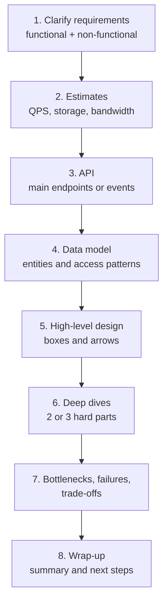
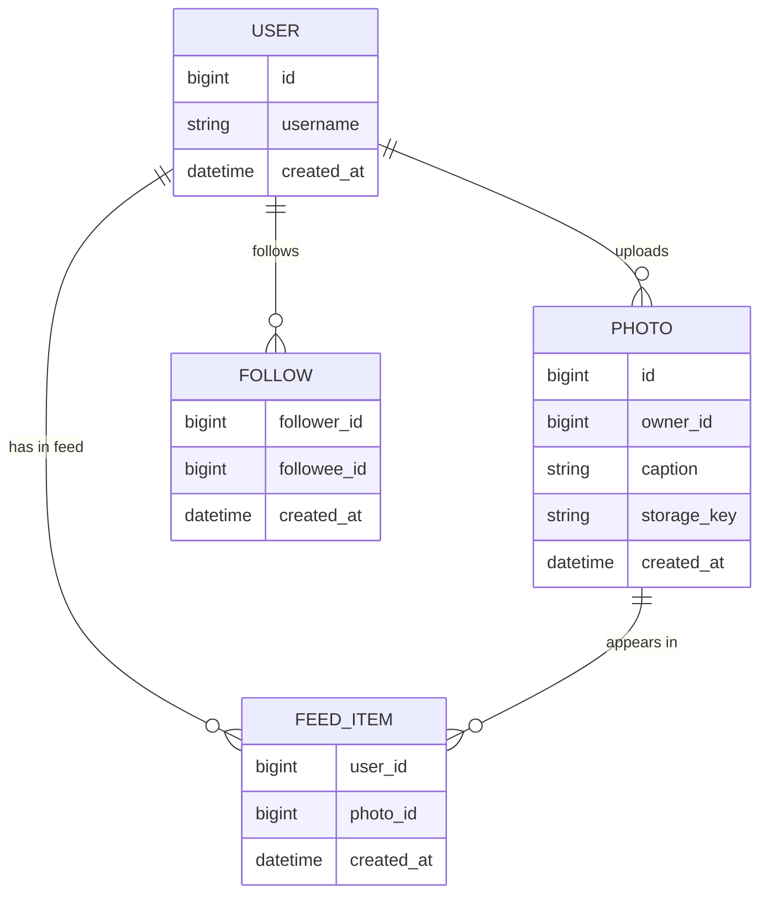
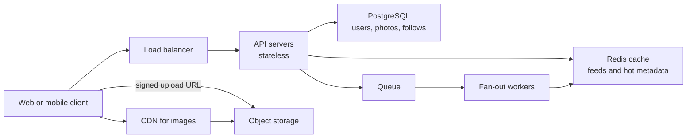
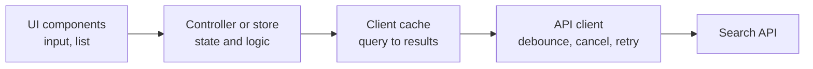

# How to Approach System Design Interviews

> In this document you will learn a repeatable, step-by-step way to run a system design interview: how to clarify requirements, make quick estimates, design the API and data model, draw the architecture, go deep and talk about trade-offs. You will also learn the RADIO framework for frontend system design and the exact sentences you can use to explain your decisions out loud.

**Before this:** [HTTP, HTTPS and TLS](../01-cs-and-web-fundamentals/05-http-https-and-tls.md) · [What happens when you type a URL](../01-cs-and-web-fundamentals/06-what-happens-when-you-type-a-url.md) · [REST API design](../07-nodejs-backend/07-rest-api-design.md) · **Interview questions:** [jump to the interview section](#interview-questions)

## Table of contents

1. [What a system design interview is](#what-a-system-design-interview-is)
2. [What interviewers look for](#what-interviewers-look-for)
3. [The step-by-step framework](#the-step-by-step-framework)
4. [Step 1: Clarify requirements](#step-1-clarify-requirements)
5. [Step 2: Back-of-the-envelope estimates](#step-2-back-of-the-envelope-estimates)
6. [Step 3: Define the API](#step-3-define-the-api)
7. [Step 4: Define the data model](#step-4-define-the-data-model)
8. [Step 5: High-level design](#step-5-high-level-design)
9. [Step 6: Deep dives](#step-6-deep-dives)
10. [Step 7: Bottlenecks, failures and trade-offs](#step-7-bottlenecks-failures-and-trade-offs)
11. [Step 8: Wrap-up](#step-8-wrap-up)
12. [Frontend system design with RADIO](#frontend-system-design-with-radio)
13. [Time management in 45 minutes](#time-management-in-45-minutes)
14. [How to communicate](#how-to-communicate)
15. [A worked mini example: design a link-in-bio page builder](#a-worked-mini-example-design-a-link-in-bio-page-builder)
16. [Latency numbers every engineer should know](#latency-numbers-every-engineer-should-know)
17. [Sentence templates for explaining trade-offs](#sentence-templates-for-explaining-trade-offs)
18. [Common mistakes](#common-mistakes)
19. [How to explain this in an interview](#how-to-explain-this-in-an-interview)
20. [Interview questions](#interview-questions)
21. [Summary](#summary)
22. [References](#references)

---

## What a system design interview is

### What it is

In a **system design interview**, the interviewer gives you a big, vague problem. For example: "Design a URL shortener", "Design a chat app" or "Design the frontend of an admin dashboard". You have about 45 to 60 minutes. You talk, ask questions and draw boxes and arrows on a whiteboard (or a shared drawing tool). At the end you should have a reasonable design and you should be able to defend it.

There is **no single correct answer**. Two strong candidates can draw two different designs and both pass. What matters is *how* you got there and *why* you made each choice.

### Why it exists

Coding interviews test if you can write a function. Real work is bigger than that. In a real job you must:

- understand what the business really needs,
- choose between several reasonable options,
- think about what happens when traffic grows or a server dies,
- explain your plan to other people and change it when they push back.

A system design interview is a small simulation of that work.

### Analogy

Think of an architect who meets a family that wants a house. A bad architect starts drawing a 10-room villa immediately. A good architect first asks: "How many people live here? What is the budget? Do you work from home? Is there a lot of snow in winter?" Only then does the drawing start. And every choice ("Why is the kitchen here?") has a reason.

Where the analogy breaks: a house is built once. Software systems grow and change all the time. So in system design you also talk about how the design *evolves* when the numbers change.

### Kinds of system design interviews

| Kind | Typical question | Focus |
| --- | --- | --- |
| Backend / distributed | "Design a URL shortener", "Design a news feed" | Services, databases, caching, scaling, consistency |
| Frontend | "Design an autocomplete component", "Design the frontend of Google Docs" | Components, state, data fetching, performance, accessibility |
| Full-stack | "Design an e-commerce checkout end to end" | Both sides, with the API between them as the key contract |
| Product / API design | "Design the API for a payments product" | Resources, contracts, versioning, errors |

For frontend and full-stack roles, you will often get a mix. This repository's case studies ([07](07-case-study-enterprise-admin-portal.md) to [14](14-case-study-file-upload-service.md)) cover both sides.

---

## What interviewers look for

Interviewers usually score you on a few dimensions. The names differ between companies, but the ideas are the same.

| Dimension | What it means in practice | A sign you are doing well |
| --- | --- | --- |
| Problem exploration | You ask good questions before designing | You write down requirements and assumptions |
| Structure | You follow a clear plan | The interviewer always knows which step you are on |
| Technical depth | You know how the parts really work | You can explain *why* a cache or an index helps |
| Trade-offs | You compare options honestly | You say what you lose, not only what you gain |
| Scale and reliability | You think about growth and failure | You ask "What happens when this server dies?" yourself |
| Communication | You think aloud and listen | You react well to hints and change direction |
| Pragmatism | You choose the simplest design that works | You do not add microservices "because Netflix does" |

The level of the role changes the expectation:

- **Mid-level:** a working design, correct basics, some trade-offs.
- **Senior:** you drive the whole interview, go deep in two or three areas, and discuss failure modes and operations without being asked.
- **Staff and above:** you also talk about team ownership, migration plans, cost, and how the design changes over years.

---

## The step-by-step framework

Use the same steps every time. A fixed plan reduces stress, and it shows the interviewer that you have a method.



The order is not a prison. Sometimes you skip estimates (a frontend component question rarely needs them). Sometimes the interviewer jumps to a deep dive early. That is fine. But always come back to the plan.

Below, each step has: what to do, what to say, and an example. The running example is **"Design a photo-sharing app"** (a small Instagram).

---

## Step 1: Clarify requirements

### What it is

You turn the vague question into a clear list of what the system must do and how well it must do it.

### Why it matters

The question is vague *on purpose*. The interviewer wants to see if you jump into a solution or first understand the problem. If you design the wrong thing, a perfect design still fails.

### Functional requirements

**Functional requirements** are the features. "The user can do X."

For the photo app:

- Users can upload a photo with a caption.
- Users can follow other users.
- Users see a feed of photos from people they follow, newest first.
- Users can like and comment on photos.

Then **limit the scope**. Say it out loud:

> "There are many features here. To fit in 45 minutes I will focus on upload and the feed. I will treat likes, comments, search and direct messages as out of scope unless you want me to include them. Is that OK?"

### Non-functional requirements

**Non-functional requirements** describe *quality*: how fast, how big, how reliable, how secure.

| Question to ask | Why it changes the design | Example answer |
| --- | --- | --- |
| How many users? Daily active users (DAU)? | Drives every number | 10 million DAU |
| Read-heavy or write-heavy? | Decides caching, replicas | About 300 feed views per upload |
| Latency target? | Decides caching, CDN, precomputation | Feed loads in under 500 ms at p95 |
| Availability target? | Decides redundancy | 99.9% is fine; feed can be slightly stale |
| Consistency needs? | Strong vs eventual | A new photo may appear in followers' feeds after a few seconds |
| Data size and retention? | Storage and archiving | Keep photos forever, average 500 KB |
| Which clients? | Mobile, web, desktop, offline | Web and mobile apps |
| Regions? | Multi-region, data residency | Global users, most in Europe and India |
| Security and compliance? | Auth, encryption, GDPR, audit | Private accounts must be respected |

**p95 latency** means: 95% of requests are faster than this number. It is better than an average, because averages hide slow requests.

**Availability** is often written as "nines". Here is what each level allows per year:

| Availability | Downtime per year (approx.) |
| --- | --- |
| 99% | 3.65 days |
| 99.9% | 8.8 hours |
| 99.99% | 53 minutes |
| 99.999% | 5.3 minutes |

### Write it down

Write the requirements in a corner of the board. Later, when you make a choice, point at them: "Because we said the feed can be a few seconds stale, I can use asynchronous fan-out."

### Common mistakes in this step

- Asking 20 questions without a goal. Ask the questions that **change the design**.
- Not asking at all and assuming a huge scale ("Let's use Kafka and 50 microservices").
- Forgetting non-functional requirements. They are often where the interesting design is.
- Not stating assumptions when the interviewer says "You decide". Then you decide, and say it clearly: "I will assume 10 million DAU."

---

## Step 2: Back-of-the-envelope estimates

### What it is

A **back-of-the-envelope estimate** is a quick, rough calculation. You use round numbers to find the order of magnitude: is it 10 requests per second or 10,000? Is it 1 GB or 1 PB?

### Why it matters

Numbers decide the design:

- 50 requests per second: one server and one database are enough.
- 50,000 requests per second: you need caching, many servers and probably replicas.
- 1 PB of photos: you need object storage (like Amazon S3), not a database column.

Some interviewers care a lot about estimates. Others say "skip it". Ask: "Do you want me to do some quick estimates?"

### The tools: numbers to remember

| Fact | Value | Round value for estimates |
| --- | --- | --- |
| Seconds in a day | 86,400 | about 100,000 (10^5) |
| Seconds in a month | about 2.6 million | about 2.5 × 10^6 |
| 1 KB, 1 MB, 1 GB, 1 TB, 1 PB | 10^3, 10^6, 10^9, 10^12, 10^15 bytes | use powers of 10 |
| Peak traffic vs average | depends on the product | assume 2× to 5× the average |
| 1 Gbps | 125 MB per second | about 100 MB/s |

Using 100,000 seconds per day makes mental math easy. It gives a number about 15% lower than the exact one. That is fine for an estimate. Say "roughly".

### Worked example: the photo app

Assumptions (say them out loud and write them down):

- 10 million DAU.
- Each user views 30 photos per day.
- Each user uploads 1 photo every 10 days (0.1 per day).
- An original photo is 500 KB after compression. The feed shows a smaller version of 200 KB.
- Each photo has 1 KB of metadata (owner, caption, time, etc.).
- Keep data for 5 years for the storage estimate.
- Peak traffic is 3 × average.

**1. Requests per second (QPS)**

QPS means "queries per second", or requests per second.

```text
Read QPS  = 10,000,000 users × 30 views / 86,400 s
          = 300,000,000 / 86,400
          ≈ 3,472 per second        (≈ 3,000 with the 10^5 shortcut)
Peak read ≈ 3 × 3,472 ≈ 10,400 per second

Write QPS = 10,000,000 × 0.1 / 86,400
          = 1,000,000 / 86,400
          ≈ 11.6 per second         (≈ 10 with the shortcut)
Peak write ≈ 35 per second
```

What this tells you: the system is **very read-heavy** (about 300 reads for every write). So caching and precomputing the feed will matter much more than write speed.

**2. Storage**

```text
Photos per day     = 1,000,000
Photo storage/day  = 1,000,000 × 500 KB = 500 GB per day
Per year           = 500 GB × 365 ≈ 182.5 TB
5 years            ≈ 912 TB ≈ 0.9 PB  (before replication)

Metadata/day       = 1,000,000 × 1 KB = 1 GB per day
5 years            ≈ 1.8 TB
```

What this tells you: photos are almost 1 PB, so they go to **object storage** (blob storage). Metadata is under 2 TB. That fits in a normal relational database, maybe with a few replicas. You also store smaller resized versions, so the real number is a bit higher. If the storage keeps 3 copies for durability, multiply by 3. Managed object stores handle this for you.

**3. Bandwidth**

```text
Egress (out)  = 3,472 views/s × 200 KB ≈ 694 MB/s ≈ 5.6 Gbps on average
Peak egress   ≈ 3 × 5.6 ≈ 17 Gbps
Ingress (in)  = 11.6 uploads/s × 500 KB ≈ 5.8 MB/s
```

What this tells you: about 17 Gbps of images at peak is a lot for your own servers. A **CDN** (content delivery network — servers around the world that keep copies of your files) should serve the images.

**4. A quick cache estimate (optional)**

A common rule of thumb: a small part of the data gets most of the traffic. If you cache the metadata for the 20% hottest photos from the last day: `0.2 × 1 GB = 200 MB`. That fits easily in memory. Even caching a week of metadata fits in one Redis node.

### How to present estimates

- Write each line. Do not do all the math in your head silently.
- Round aggressively. 3,472 becomes "about 3.5 thousand".
- After each number, say **what it means for the design**. A number without a conclusion is wasted time.
- Keep it to about 5 minutes.

### Common mistakes in estimates

- Spending 15 minutes on precise math.
- Mixing bits and bytes. Network speeds are in **bits** per second (Gbps). File sizes are in **bytes**. 1 byte = 8 bits.
- Forgetting peak traffic.
- Calculating but never using the result.

---

## Step 3: Define the API

### What it is

You list the main operations the clients call. This is the **contract** between the client and the server. For a REST API, you list methods, paths, the main request fields and the response shape.

### Why it matters

The API forces you to be precise about what the system does. It also connects the frontend and the backend. In frontend interviews the API is often the most important part.

### Example: photo app API

```text
POST /v1/photos/upload-url              → { uploadUrl, photoId }
POST /v1/photos                         { photoId, caption } → 201 { id, caption, createdAt }
GET  /v1/feed?cursor=abc&limit=20       → { items: [...], nextCursor: "def" }
POST /v1/users/{userId}/followers       → 204   (follow)
DELETE /v1/users/{userId}/followers/me  → 204   (unfollow)
```

Points to say out loud:

- **Cursor pagination** for the feed, because new photos arrive all the time and offset pagination would show duplicates. (Details: [REST API design — Pagination](../07-nodejs-backend/07-rest-api-design.md#pagination).)
- The client uploads the photo **directly to object storage** with a short-lived signed URL. The API server does not carry 500 KB bodies.
- Authentication with a session cookie or token. The user ID comes from the token, never from the request body.
- Idempotency key on `POST /v1/photos` so a retry after a timeout does not create two posts.

Keep it short. You do not need every field. You need the important decisions.

---

## Step 4: Define the data model

### What it is

You list the main **entities** (things you store) and their relationships. Then — more important — you list the **access patterns**: which queries run most often.

### Why it matters

The access patterns decide the database choice, the indexes and the partition key. "Get the last 20 photos of the users I follow" is a very different query from "get photo by ID".

### Example



Access patterns:

1. Get a user's feed, newest first, 20 at a time → read `FEED_ITEM` by `user_id` ordered by `created_at`. Index `(user_id, created_at DESC)`.
2. Get a photo by ID → primary key.
3. Get followers of a user (for fan-out) → index on `followee_id`.

Then say which database and why. For example: "Users, photos and follows are relational and small, so PostgreSQL is fine. The feed items table is large and only read by `user_id`, so it could live in a key-value or wide-column store (or Redis lists) if it grows too big."

More about database choices: [Databases](../07-nodejs-backend/10-databases.md) and [SQL vs NoSQL at scale](02-scalability-and-core-building-blocks.md#sql-vs-nosql-at-scale).

---

## Step 5: High-level design

### What it is

You draw the main components and how data flows between them. Start simple. One box per responsibility.

### How to do it

1. Draw the client.
2. Draw the entry point (load balancer, API gateway or CDN).
3. Draw the services.
4. Draw the data stores.
5. Walk through **one request end to end** using the drawing.



Walkthrough of an upload:

1. The client asks the API for an upload URL. The API checks auth and returns a signed URL.
2. The client uploads the file directly to object storage.
3. The client calls `POST /v1/photos` with the caption. The API saves the metadata in PostgreSQL.
4. The API puts a "photo created" message on a queue and responds `201`.
5. Fan-out workers read the message, find the followers and add the photo ID to each follower's feed list in Redis.

Walkthrough of a feed read:

1. The client calls `GET /v1/feed`.
2. The API reads the feed list from Redis (a list of photo IDs).
3. It loads the photo metadata (cache first, then database).
4. It returns metadata with image URLs that point to the CDN.

Explain each arrow briefly. Do not draw boxes you cannot explain.

---

## Step 6: Deep dives

### What it is

You pick the 2 or 3 hardest or most interesting parts and go deep. Often the interviewer picks one. If not, you choose and say why.

### How to choose

Choose the parts that:

- are directly connected to the non-functional requirements (the 500 ms feed, the huge read volume),
- have a real trade-off,
- show your strongest knowledge.

For the photo app, good deep dives:

1. **Fan-out on write vs fan-out on read.** Fan-out on write pushes each new photo into every follower's feed (fast reads, expensive for users with millions of followers). Fan-out on read builds the feed when the user opens it (cheap writes, slow reads). A hybrid is common: push for normal users, pull for celebrities. (Full case study: [News feed with infinite scroll](12-case-study-news-feed-infinite-scroll.md).)
2. **Image pipeline.** Resize into several sizes in a background job, serve modern formats (WebP/AVIF) from the CDN, use content-hashed URLs so CDN caches can live forever.
3. **Caching the feed.** What happens on a cache miss? How long do lists live? How do you handle a deleted photo?

### How to go deep

For each deep dive:

1. State the problem in one sentence.
2. Give 2 options.
3. Compare them against the requirements.
4. Choose one and say what you give up.

---

## Step 7: Bottlenecks, failures and trade-offs

### What it is

You look at your own design like an attacker would. Where does it break? What is slow? What happens if a component dies?

### A checklist you can run through out loud

| Question | Example answer for the photo app |
| --- | --- |
| Single point of failure? | One database primary. Add a standby replica with automatic failover. |
| What if the cache dies? | Reads fall back to the database. Protect it with request coalescing and rate limits. |
| What if a worker dies mid-job? | The queue redelivers the message. The worker must be idempotent. |
| Hot spots? | A celebrity post. Use the hybrid fan-out and cache that post heavily. |
| Slow dependency? | Timeouts on every network call, circuit breaker for the image service. |
| Growth 10×? | Shard feed storage by `user_id`, add read replicas, more workers. |
| Security? | Signed URLs expire, private accounts checked on read, rate limit uploads. |
| Observability? | Metrics: p95 feed latency, queue lag, cache hit ratio. Alerts on lag. |

Building blocks such as replication, sharding and queues are explained in [Scalability and core building blocks](02-scalability-and-core-building-blocks.md).

---

## Step 8: Wrap-up

In the last 2 to 3 minutes, summarize. This leaves a strong last impression.

> "To summarize: the system is read-heavy, so I precompute feeds with asynchronous fan-out into Redis, and serve images from a CDN backed by object storage. Metadata lives in PostgreSQL with replicas. The main trade-off is that a new photo can take a few seconds to appear in feeds. If I had more time, I would look at ranking the feed, multi-region deployment and how to handle deleting photos from millions of feeds."

---

## Frontend system design with RADIO

### What it is

**RADIO** is a framework for frontend system design interviews. It was popularized by the GreatFrontEnd interview guides. The letters are:

| Letter | Step | What you do |
| --- | --- | --- |
| R | Requirements | Features, users, devices, scale, performance, accessibility, offline, i18n |
| A | Architecture | The main parts of the client and how they talk to the server |
| D | Data model | Client state: what data exists, who owns it, where it lives |
| I | Interface (API) | The server API and the APIs between components (props, events) |
| O | Optimizations | Performance, accessibility, security, error handling, testing |

### Why a separate framework

A frontend design question ("Design a news feed UI", "Design an image carousel", "Design an autocomplete") usually does not need QPS and sharding. The hard parts are different: rendering performance, state ownership, network handling, accessibility, and the component API.

### How to apply each step

**R — Requirements**

- Functional: "Users type and see up to 10 suggestions. They can select with keyboard or mouse."
- Non-functional: devices (mobile, slow 3G?), performance targets (suggestions in under 200 ms after typing stops), accessibility (WCAG AA, screen readers), internationalization, offline needs, browser support.

**A — Architecture**

Draw the client parts: view components, a controller or state layer, a data/cache layer and the server.



**D — Data model**

List the client state and its owner:

| State | Kind | Owner |
| --- | --- | --- |
| `query` text | UI state | Input component or store |
| `results` per query | Server state (cached) | Cache layer |
| `highlightedIndex` | UI state | List component |
| `status: idle/loading/error` | Request state | Controller |

(Kinds of state are explained in [Components and state management — Kinds of state](../05-frontend-engineering/06-components-and-state-management.md#kinds-of-state).)

**I — Interface**

- Server API: `GET /search?q=jav&limit=10` → `{ results: [{ id, label, type }] }`.
- Component API: `<app-autocomplete [fetchSuggestions]="fn" (selected)="onSelect($event)" [minChars]="2">`.

**O — Optimizations**

- Debounce input, cancel old requests (latest request wins), cache results per query.
- Keyboard navigation and ARIA combobox pattern.
- Virtualize if the list can be long.
- Handle errors and empty states.
- Security: escape suggestion text (no `innerHTML`), avoid putting secrets in URLs.

(These are covered in depth in [Autocomplete search](11-case-study-autocomplete-search.md).)

### RADIO vs the backend framework

| Backend framework step | RADIO equivalent |
| --- | --- |
| Requirements | R |
| Estimates | Usually small; maybe "how many items in the list?" |
| API | I |
| Data model | D (client state, not database tables) |
| High-level design | A |
| Deep dives, bottlenecks | O |

For full-stack questions, combine both: RADIO for the client, the backend framework for the server, and the API as the bridge.

---

## Time management in 45 minutes

Interviews often have 45 minutes of design time after introductions. A plan helps you not to run out of time in the middle of the drawing.

| Minutes | Step | Notes |
| --- | --- | --- |
| 0–5 | Clarify requirements | Functional, non-functional, scope |
| 5–10 | Estimates | Only if useful; ask first |
| 10–15 | API and data model | Main endpoints, main entities, access patterns |
| 15–25 | High-level design | Draw and walk through one or two flows |
| 25–38 | Deep dives | Two or three hard parts |
| 38–43 | Bottlenecks, failures, trade-offs | Checklist |
| 43–45 | Wrap-up | Summary and future work |

Rules:

- **Check the clock** at 15 and 30 minutes. If you are behind, say: "I want to leave time for the deep dives, so I will move on."
- If the interviewer wants to go deep early, follow them. Their interest is a signal.
- Reaching a complete simple design is better than a perfect half design.

For a 60-minute interview, give the extra time to deep dives.

---

## How to communicate

### Drive the interview

You are the lead engineer in this meeting. Do not wait for the interviewer to tell you each step. Say what you will do next:

> "Now that we have the requirements, I'll do quick estimates, then sketch the API."

### State assumptions

When information is missing, assume and say it:

> "I'll assume most users are on mobile and the network can be slow."

### Think aloud

The interviewer cannot score what they cannot hear. Say what you are considering, even the options you reject:

> "I'm thinking about polling versus WebSockets here. Polling is simpler but wastes requests, and we need updates within a second, so I'll go with WebSockets."

### Draw as you talk

- Use clear labels. "API servers (stateless)" is better than "Server".
- Number the steps of a flow on the arrows.
- Keep the requirements and estimates visible in a corner.

### Listen to hints

If the interviewer asks "What happens if this database goes down?", it usually means: "This is a weak point. Please address it." Do not defend your design. Improve it.

### Handle "I don't know"

Be honest and reason from fundamentals:

> "I haven't used Cassandra in production. From what I know, it's a wide-column store that partitions by key and is good for heavy writes. If that's correct, it would fit the feed table. I'd verify the read pattern with a prototype."

---

## A worked mini example: design a link-in-bio page builder

Here is a short example of the whole flow, to show how the steps connect. The product: users create a public page with a list of links (like Linktree). Visitors open `site.com/username`.

**1. Requirements (spoken)**

> "Functional: a creator signs in, edits a list of links, and sees click counts. Visitors open the public page and click links. Non-functional: public pages must load fast worldwide, under 1 second on mobile. Editing can be slower. Click counts can be a few minutes late. Let's say 1 million creators and 50 million page views per day."

**2. Estimates**

```text
Page views  = 50,000,000 / 86,400 ≈ 580 per second, peak ≈ 1,700
Clicks      = assume 20% of views click once ≈ 10,000,000 per day ≈ 116 per second
Page data   = 1,000,000 pages × 5 KB ≈ 5 GB  → fits in one database, even fully in cache
```

Conclusion: the public page is read-heavy and small. It is perfect for **CDN caching**.

**3. API**

```text
GET  /api/me/page                  → page for the editor
PUT  /api/me/page   { links: [...] }  (with If-Match version)
GET  /{username}                   → public HTML (server-rendered or static)
POST /api/clicks    { pageId, linkId }  → 202
GET  /api/me/stats?from=&to=       → click counts per link
```

**4. Data model**

`users`, `pages (id, user_id, username, version, links JSON)`, `click_events (page_id, link_id, ts)` and a pre-aggregated `daily_clicks (page_id, link_id, day, count)`.

**5. High-level design**

- The public page is rendered to HTML and cached at the CDN with a key per username.
- When the creator saves, the API updates the database and **purges** that page from the CDN.
- Clicks go to a small ingestion endpoint, which writes to a queue. A worker aggregates counts per minute into `daily_clicks`.

**6. Deep dives**

- Cache invalidation: purge by URL on save; also a short TTL (for example 5 minutes) as a safety net. (See [Caching strategies and invalidation](03-caching-strategies-and-invalidation.md).)
- Click counting: write to a queue, aggregate in batches, accept a few minutes of delay. Use `navigator.sendBeacon` on the client so the click event is sent even when the page navigates away.

**7. Trade-offs**

> "The CDN gives fast, cheap page loads, but after an edit a visitor in another region might see the old version until the purge finishes, usually seconds. That is acceptable for this product."

**8. Wrap-up**

> "Static, CDN-cached public pages, a small API for editing with optimistic concurrency, and asynchronous click counting. Next steps would be custom domains and abuse detection for malicious links."

---

## Latency numbers every engineer should know

These numbers come from a famous list by Jeff Dean and Peter Norvig, later updated by others. They are **approximate**. Real values depend on hardware and change over the years. What matters is the **order of magnitude** — how many times slower one thing is than another.

| Operation | Approximate time | In plain words |
| --- | --- | --- |
| L1 CPU cache reference | 1 ns | Instant |
| Main memory (RAM) reference | 100 ns | 100× slower than L1 cache |
| Compress 1 KB with a fast algorithm | a few µs | |
| Read 1 MB sequentially from memory | about 10–250 µs (modern hardware is at the fast end) | |
| Random read from an SSD | about 16–150 µs | |
| Round trip inside one data center | about 500 µs | Half a millisecond |
| Read 1 MB sequentially from an SSD | about 1 ms | |
| Hard disk seek | about 10 ms | 100,000× slower than RAM |
| Read 1 MB sequentially from a hard disk | about 20 ms | |
| Round trip between continents (e.g. US to Europe and back) | about 150 ms | Limited by the speed of light in fiber |

Units: 1 ms (millisecond) = 1,000 µs (microseconds) = 1,000,000 ns (nanoseconds).

### What to learn from them

- **Memory is much faster than disk and network.** That is why caching in memory helps so much.
- **Network round trips inside a data center are cheap but not free.** 100 sequential calls of 0.5 ms each are already 50 ms. Avoid chatty designs (N+1 calls).
- **Cross-continent round trips are expensive.** A TLS connection setup needs extra round trips. That is why CDNs and edge servers sit close to users.
- **Sequential reads are much faster than random reads**, especially on hard disks. This is why logs and append-only designs are fast.

### Useful related numbers for the frontend

| Fact | Value |
| --- | --- |
| Frame budget at 60 frames per second | about 16.7 ms per frame |
| A "long task" in the browser | longer than 50 ms on the main thread |
| Good INP (Interaction to Next Paint) | 200 ms or less |
| Good LCP (Largest Contentful Paint) | 2.5 s or less |

(These are explained in [Web performance and Core Web Vitals](../05-frontend-engineering/05-web-performance-and-core-web-vitals.md).)

---

## Sentence templates for explaining trade-offs

The reader of this repository said that explaining is often harder than knowing. These templates help. Fill in the blanks with your design.

**Choosing between options**

> "I see two options here: A and B. A gives us ___, but costs ___. B gives us ___, but costs ___. Because our main requirement is ___, I'll choose A."

**Accepting a downside**

> "The downside of this choice is ___. I think it's acceptable because ___. If that changes, for example if ___, I would switch to ___."

**Starting simple**

> "I'll start with the simplest design that meets the requirements: ___. When we reach about ___ requests per second, the bottleneck will be ___, and then I'd add ___."

**Using numbers**

> "We estimated about ___ reads per second against ___ writes. That ratio tells me ___."

**Handling failure**

> "If ___ fails, the user would see ___. To avoid that, I'd add ___. The cost is ___."

**Responding to a challenge**

> "Good point. With that constraint, my current design breaks at ___. I'd change it to ___."

**Saying what you would do with more time**

> "I've kept ___ simple for now. In a real project, I'd measure ___ first, and only then decide between ___ and ___."

Example with real content:

> "I see two options for real-time updates: polling every few seconds, or WebSockets. Polling is simple and works through every proxy, but it wastes requests and adds delay. WebSockets give instant updates but need sticky connections and more infrastructure. Because the requirement is updates within one second for chat, I'll choose WebSockets. For the notification badge, where 30 seconds of delay is fine, I'd keep polling."

---

## Common mistakes

| Mistake | Why it hurts | What to do instead |
| --- | --- | --- |
| Jumping straight into drawing | You may design the wrong thing | Spend the first 5 minutes on requirements |
| Over-engineering | Shows poor judgment | Start simple; scale when the numbers require it |
| Name-dropping technologies | "Kafka" is not a design | Say what the component does and why, then name a product |
| No numbers at all | Choices look random | Do quick estimates or at least state scale assumptions |
| Silent thinking | Interviewer cannot score you | Think aloud |
| Ignoring failures | Real systems fail all the time | Run the failure checklist |
| One-sided arguments | Every choice has a cost | Always name the downside |
| Going too deep too early | No time for the full picture | Breadth first, then depth |
| Ignoring the frontend in a full-stack question | Half the system is missing | Cover client state, caching and UX of errors |
| Arguing with the interviewer | Looks defensive | Treat challenges as new requirements |
| Not checking the time | Unfinished design | Check at 15 and 30 minutes |

---

## How to explain this in an interview

Sometimes the interviewer asks directly: "How do you approach a design problem?" Use this structure.

1. **Define it:** "System design is choosing the components, data flow and trade-offs for a system that meets functional and non-functional requirements."
2. **Why it exists:** "Because the same features can be built in very different ways, and the right way depends on scale, latency, consistency and cost."
3. **How it works:** "I clarify requirements, estimate the scale, define the API and data model, draw a simple high-level design, then go deep on the hardest parts and check for bottlenecks and failures."
4. **Small example:** "For a photo app, the estimate showed about 300 reads per write, so I focused on precomputed feeds and a CDN rather than write throughput."
5. **Where it is useful:** "Design reviews, writing architecture decision records, planning features that touch several teams."
6. **Trade-offs / gotchas:** "The biggest risk is over-engineering. I start with the simplest design and say exactly which number would make me add complexity."

---

## Interview questions

### Q1. How do you start a system design interview?

**What the interviewer is checking:** Whether you clarify the problem before designing, and whether you have a method.

**Short spoken answer (30–60 seconds):**
> I don't start drawing right away. First I clarify the functional requirements — what users must be able to do — and I cut the scope to the two or three core features. Then I ask about non-functional requirements: number of users, read/write ratio, latency and availability targets, consistency needs and data size. I write these on the board, and I state my assumptions when something is not given. Only then do I estimate scale and sketch the API. This protects me from designing the wrong system, and later I can justify each choice by pointing back to a requirement.

**Detailed explanation:**
The question is vague on purpose. The interviewer wants to see whether you can turn ambiguity into a plan. The questions you ask should change the design. "How many users?" changes everything. "What color is the button?" changes nothing. A good pattern is: ask about users and scale, about reads vs writes, about latency, about consistency, and about any special constraint (offline, compliance, regions).

**Follow-up questions:**
- **What if the interviewer says "You decide"?** — Decide, say it clearly, and write it down: "I'll assume 10 million DAU and global users." This shows ownership.
- **How many questions should you ask?** — Enough to remove the big unknowns, usually 4 to 8 questions in about 5 minutes. Too many questions without direction wastes time.
- **What if a requirement appears later?** — Accept it and adjust: "With that new requirement, this part changes like this." Interviewers sometimes add requirements on purpose.

**Common mistakes:** Asking no questions; asking only feature questions and no non-functional ones; asking questions and then ignoring the answers.

**Where this is used in real projects:** Kickoff meetings and design reviews. Real projects fail more often from wrong requirements than from wrong technology.

### Q2. What is the difference between functional and non-functional requirements? Give examples.

**What the interviewer is checking:** That you know both kinds and that non-functional requirements drive architecture.

**Short spoken answer (30–60 seconds):**
> Functional requirements describe what the system does — features like "a user can upload a photo" or "an admin can export a report". Non-functional requirements describe how well it does it — latency, throughput, availability, consistency, security, cost, accessibility. Functional requirements decide the API and the data model. Non-functional requirements decide the architecture: if the feed must load in 200 milliseconds for 10 million users, I need caching and precomputation; if it's an internal tool for 50 people, one server is enough. Two systems with the same features can look completely different because of non-functional requirements.

**Follow-up questions:**
- **Name non-functional requirements that matter for frontend systems.** — Load performance (LCP), interaction speed (INP), bundle size, accessibility, offline support, supported browsers and devices, i18n, security (XSS, CSP).
- **How do you make a non-functional requirement testable?** — Put a number on it: "p95 under 300 ms", "99.9% monthly availability", "WCAG 2.2 AA".

**Common mistakes:** Listing "fast" and "scalable" without numbers.

**Where this is used in real projects:** SLOs (service level objectives), performance budgets, acceptance criteria in tickets.

### Q3. Estimate the QPS and storage for a service with 50 million DAU, where each user sends 20 messages per day and a message is 200 bytes. Keep data for 3 years.

**What the interviewer is checking:** Quick, structured math with round numbers, and conclusions from the numbers.

**Short spoken answer (30–60 seconds):**
> 50 million users times 20 messages is 1 billion messages a day. A day is about 86,400 seconds, call it 100,000, so that's roughly 10,000 writes per second on average — exactly about 11,600. With a peak factor of 3, I plan for around 35,000 writes per second. Storage: 1 billion times 200 bytes is 200 GB per day. Times 365 is about 73 TB per year, so about 220 TB for 3 years, before replication and indexes. So this is a write-heavy system that needs a horizontally scalable store partitioned by conversation, not one relational database.

**Detailed explanation:**

```text
Messages/day = 50,000,000 × 20 = 1,000,000,000
Write QPS    = 1e9 / 86,400 ≈ 11,574 (≈ 10,000 with 10^5)
Peak (×3)    ≈ 34,700
Storage/day  = 1e9 × 200 B = 200 GB
Per year     = 200 GB × 365 = 73 TB
3 years      ≈ 219 TB  (× replication factor, + index overhead)
```

**Follow-up questions:**
- **What about reads?** — Ask. If each message is read by about 2 people on average, reads are about 2× writes. Mostly recent messages are read, so a cache of the last few days helps.
- **What does 200 TB tell you?** — It is too much for a single node. You need sharding (for example by conversation ID) or a distributed store like Cassandra, ScyllaDB or DynamoDB, plus a plan to move old data to cheaper storage.
- **Why use 100,000 instead of 86,400?** — It makes mental math easy and the error is about 15%, which does not change the design.

**Common mistakes:** Forgetting peak traffic; confusing GB and Gb; not drawing a conclusion.

**Where this is used in real projects:** Capacity planning, choosing database tiers, cost estimates for cloud budgets.

### Q4. Why do we do back-of-the-envelope estimates if they are so rough?

**What the interviewer is checking:** That you understand estimates are for decisions, not precision.

**Short spoken answer (30–60 seconds):**
> Because design decisions depend on the order of magnitude, not the exact number. 100 requests per second and 300 requests per second need the same design. 100 and 100,000 need very different designs. A rough estimate tells me whether something fits in one machine's memory, whether I need a CDN, or whether writes or reads are the bottleneck. It takes five minutes and prevents both over-engineering and under-engineering.

**Follow-up questions:**
- **What numbers do you estimate most often?** — Requests per second (average and peak), storage growth per year, bandwidth, and memory needed for a cache.
- **When do you skip estimates?** — In frontend component questions, or when the interviewer says scale is not the focus.

**Common mistakes:** Treating estimates as a math exam; spending too long; ignoring the result.

**Where this is used in real projects:** Deciding if a new feature needs new infrastructure; sizing a Redis cluster; cloud cost forecasts.

### Q5. What is the RADIO framework? How is frontend system design different from backend system design?

**What the interviewer is checking:** That you can structure a frontend design and know what matters on the client.

**Short spoken answer (30–60 seconds):**
> RADIO stands for Requirements, Architecture, Data model, Interface and Optimizations. I clarify requirements, including devices, performance and accessibility. Then I draw the client architecture: views, a state or controller layer, a cache and the API client. The data model is the client state: what data exists and who owns it. The interface is both the server API and the component APIs, like props and events. Optimizations cover performance, accessibility, error handling and security. Compared to backend design, I rarely talk about sharding. I talk about rendering cost, network handling like debounce and cancellation, state ownership and accessibility.

**Follow-up questions:**
- **What client-side "optimizations" do you usually discuss?** — Code splitting, caching and deduplication of requests, virtualization for long lists, image optimization, optimistic updates, prefetching, debounce/throttle, error and loading states.
- **Where do you put accessibility?** — In Requirements (as a requirement with a standard like WCAG 2.2 AA) and in Optimizations (keyboard support, focus management, ARIA). It is not an afterthought.

**Common mistakes:** Treating a frontend question like a backend one and drawing databases for 30 minutes; ignoring the component API.

**Where this is used in real projects:** Designing a shared component library, a dashboard, or any complex feature before building it.

### Q6. How do you manage time in a 45-minute design interview?

**What the interviewer is checking:** That you can deliver a complete design under time pressure.

**Short spoken answer (30–60 seconds):**
> I use a rough budget: about 5 minutes for requirements, 5 for estimates, 5 for API and data model, 10 for the high-level design, about 13 for deep dives, 5 for bottlenecks and failures, and 2 for a summary. I check the clock around minute 15 and 30. If I'm behind, I say so and move on. I go breadth-first: a complete simple design first, then depth. If the interviewer wants to dive into something earlier, I follow them, because that's what they want to score.

**Follow-up questions:**
- **What do you cut first when you are late?** — Detailed estimates and secondary features. Never cut the high-level design or trade-offs.

**Common mistakes:** Spending 20 minutes on requirements or on one deep dive; no summary.

**Where this is used in real projects:** Time-boxed design reviews and architecture meetings.

### Q7. The interviewer asks: "Why did you choose PostgreSQL and not MongoDB?" How do you answer?

**What the interviewer is checking:** Whether your choices are based on requirements and access patterns, not habit.

**Short spoken answer (30–60 seconds):**
> I chose PostgreSQL because the data is relational — users, photos and follows have clear relationships — and I want transactions and constraints for things like unique usernames. The metadata is only a couple of terabytes over five years, which PostgreSQL handles well with replicas. MongoDB would also work, especially if the documents were very flexible or I needed easy horizontal sharding from day one. The trade-off is that with Postgres I'll need to plan sharding myself if we grow 100×. For the feed table, which is huge and accessed by one key, I'd consider a key-value or wide-column store.

**Follow-up questions:**
- **When would you change your answer?** — If the data had no relations, had a very flexible schema, or if write volume needed automatic sharding across many nodes.

**Common mistakes:** "NoSQL is faster" or "SQL doesn't scale" — both are oversimplified.

**Where this is used in real projects:** Every new service needs this decision; record it in an ADR (architecture decision record).

### Q8. What do you do when you don't know a technology the interviewer mentions?

**What the interviewer is checking:** Honesty and reasoning from fundamentals.

**Short spoken answer (30–60 seconds):**
> I say honestly that I haven't used it, and then I reason about what it probably does from the category it belongs to. For example: "I haven't used ClickHouse, but I know it's a columnar analytics database. Columnar stores are fast for aggregations over a few columns of many rows, so it fits our dashboard queries better than a row store." Then I ask if my understanding is right. Interviewers value correct reasoning more than product names, and bluffing is easy to detect.

**Common mistakes:** Pretending to know; or freezing and giving up.

**Where this is used in real projects:** Evaluating new tools; you never know every product.

### Q9. How do you decide which parts to deep dive into?

**What the interviewer is checking:** Prioritization and understanding of what is hard in a given system.

**Short spoken answer (30–60 seconds):**
> I pick the parts that are most connected to the hardest requirement, have a real trade-off, and would hurt most if they failed. For a chat app that's message delivery and ordering across many WebSocket servers. For a feed, it's fan-out. For an upload service, it's resumable uploads and scanning. I say why I picked them, and I ask the interviewer if they prefer something else. For each one I present two options, compare them against the requirements, choose, and name what I give up.

**Follow-up questions:**
- **What if the interviewer picks a part you are weak in?** — Go back to fundamentals: state the problem, list what must be true, and reason about options. Ask clarifying questions.

**Common mistakes:** Deep diving into easy parts like "the login page"; going deep before the full picture exists.

**Where this is used in real projects:** Spike tasks and proofs of concept focus on the riskiest parts first.

### Q10. What are the common reasons candidates fail system design interviews?

**What the interviewer is checking:** Self-awareness about the format.

**Short spoken answer (30–60 seconds):**
> The most common reasons are: designing before understanding the problem, over-engineering with many services and buzzwords without reasons, not talking about trade-offs, ignoring failures, staying silent while thinking, and running out of time without a complete design. Another one is being defensive when the interviewer challenges a choice. I avoid these by following a fixed framework, keeping the design simple, saying the downside of every choice, and treating challenges as new requirements.

**Common mistakes:** This is a reflective question; a weak answer lists only technical gaps.

**Where this is used in real projects:** The same habits make design reviews go well.

### Q11. What are p50, p95 and p99 latency, and why not use the average?

**What the interviewer is checking:** That you measure performance correctly.

**Short spoken answer (30–60 seconds):**
> They are percentiles. p50 is the median: half of requests are faster. p95 means 95% of requests are faster than that value, and p99 means 99%. The average hides slow requests: if 99 requests take 10 ms and one takes 5 seconds, the average is about 60 ms, which describes nobody. Users notice the slow tail, and a page that makes 20 backend calls will very often hit at least one slow one. So I set targets on p95 or p99.

**Detailed explanation:**
If one page needs 20 independent calls and each call has a 1% chance of being slow, the chance that at least one is slow is `1 − 0.99^20 ≈ 18%`. So tail latency matters more as systems call more services.

**Follow-up questions:**
- **How do you reduce tail latency?** — Timeouts, caching, fewer sequential calls, parallel calls, hedged requests (send a second request if the first is slow), and fixing the slow outliers you find in traces.

**Common mistakes:** Reporting only averages.

**Where this is used in real projects:** SLOs and dashboards in Grafana, Datadog and similar tools.

### Q12. How would you explain the latency numbers table, and why does it matter for design?

**What the interviewer is checking:** That you understand relative costs of memory, disk and network.

**Short spoken answer (30–60 seconds):**
> The table shows that reading from memory takes around 100 nanoseconds, a random SSD read tens to a hundred microseconds, a round trip inside a data center about half a millisecond, and a round trip between continents about 150 milliseconds. The exact numbers change with hardware, but the ratios matter. They explain why we cache in memory, why we avoid many sequential network calls, and why we put CDNs close to users — you can't make light go faster, but you can shorten the distance.

**Follow-up questions:**
- **How many sequential calls fit in a 200 ms budget for users on another continent?** — About one cross-continent round trip, if each is about 150 ms. That's why you serve from the nearest region or edge and avoid chains of calls from the browser.

**Common mistakes:** Memorizing numbers without the lesson; claiming exact values.

**Where this is used in real projects:** Deciding whether to call a service per item or in batch; placing caches and regions.

### Q13. How do you present a trade-off? Give an example.

**What the interviewer is checking:** Structured, honest comparison.

**Short spoken answer (30–60 seconds):**
> I name the options, say what each gains and costs, connect it to a requirement, decide, and say when I'd change my mind. For example: "Fan-out on write gives very fast feed reads but is expensive for users with millions of followers. Fan-out on read makes posting cheap but reading slow. Because reads are 300 times more frequent, I'll fan out on write for normal users and pull celebrity posts at read time. If most of our users followed celebrities, I'd revisit this."

**Common mistakes:** Only listing advantages; never deciding.

**Where this is used in real projects:** ADRs and RFC documents.

### Q14. In a frontend system design interview, how much backend should you discuss?

**What the interviewer is checking:** Correct scope for the role.

**Short spoken answer (30–60 seconds):**
> Enough to define a good contract. I describe the API the frontend needs — endpoints, pagination style, error format, real-time channel — and what the frontend expects about consistency and latency. I may suggest a BFF if the frontend needs aggregated data. But I spend most time on the client: component structure, state, caching, rendering performance, accessibility and failure handling. I ask the interviewer early: "Do you want me to cover the backend, or treat it as a given API?"

**Common mistakes:** Ignoring the API entirely, or spending 30 minutes on databases in a frontend interview.

**Where this is used in real projects:** Frontend engineers often co-design the API with backend teams.

### Q15. How do you end the interview?

**Short answer:** Give a 1-minute summary: the main requirements, the core design, the two biggest trade-offs, and what you would do next with more time (for example: monitoring, multi-region, security review, cost). This shows you can step back and see the whole system.

---

## Summary

- A system design interview tests how you think: clarifying, choosing, explaining and adapting — not one correct answer.
- Use a fixed plan: requirements → estimates → API → data model → high-level design → deep dives → bottlenecks and failures → wrap-up.
- Non-functional requirements (scale, latency, availability, consistency) drive the architecture. Put numbers on them.
- Estimates use round numbers (a day ≈ 100,000 seconds) and must end with a conclusion for the design.
- For frontend questions use RADIO: Requirements, Architecture, Data model, Interface, Optimizations.
- Budget your 45 minutes and go breadth-first, then depth.
- Drive the conversation, state assumptions, think aloud and treat challenges as new requirements.
- Know the latency ratios: memory is far faster than disk and network; cross-continent round trips cost about 150 ms.
- Every choice has a cost. Say the downside and when you would change your mind.
- Start with the simplest design and say which number would justify more complexity.

## References

- Jeff Dean, "Designs, Lessons and Advice from Building Large Distributed Systems" (latency numbers origin) — https://research.google/people/jeff/
- Peter Norvig, "Teach Yourself Programming in Ten Years" (approximate timing table) — https://norvig.com/21-days.html#answers
- GreatFrontEnd, "Front End System Design Playbook" (RADIO framework) — https://www.greatfrontend.com/front-end-system-design-playbook
- Google SRE Book, "Service Level Objectives" — https://sre.google/sre-book/service-level-objectives/
- web.dev, "Web Vitals" — https://web.dev/articles/vitals
- Martin Kleppmann, *Designing Data-Intensive Applications* (O'Reilly) — https://dataintensive.net/
