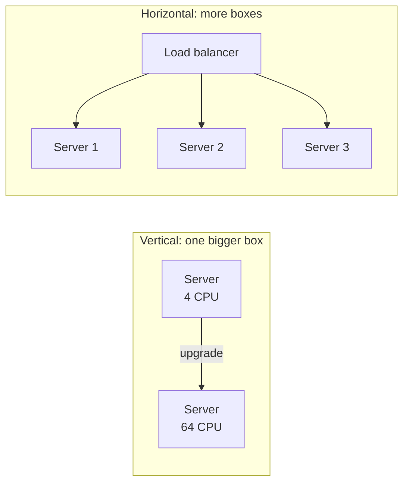
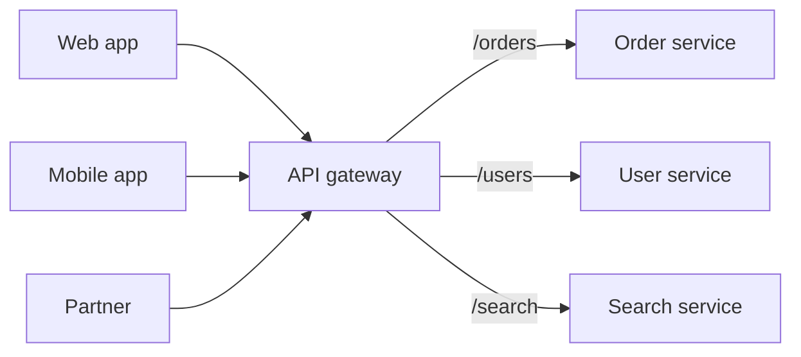
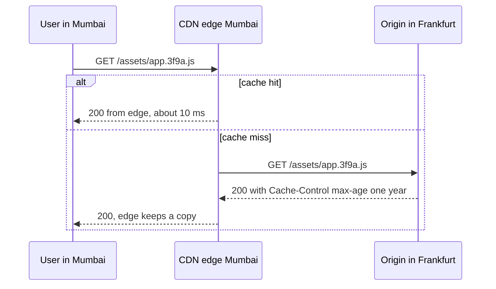
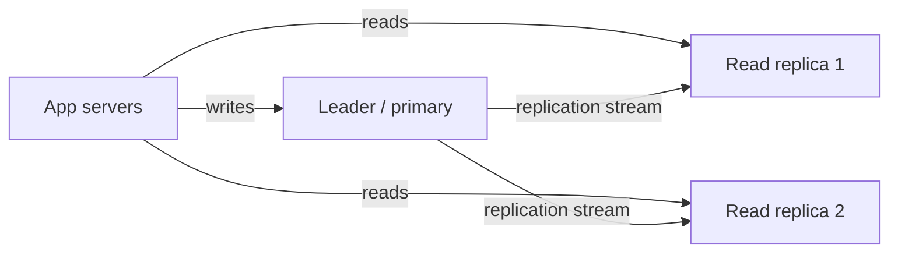
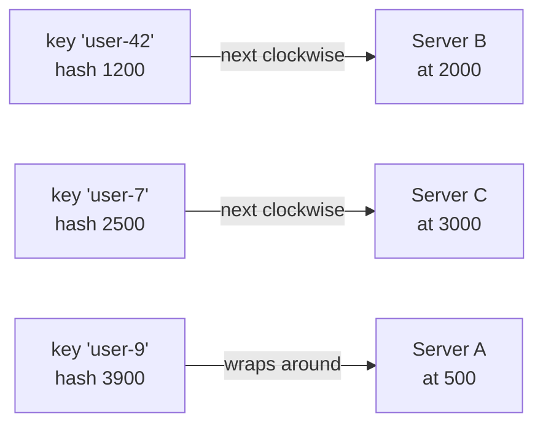
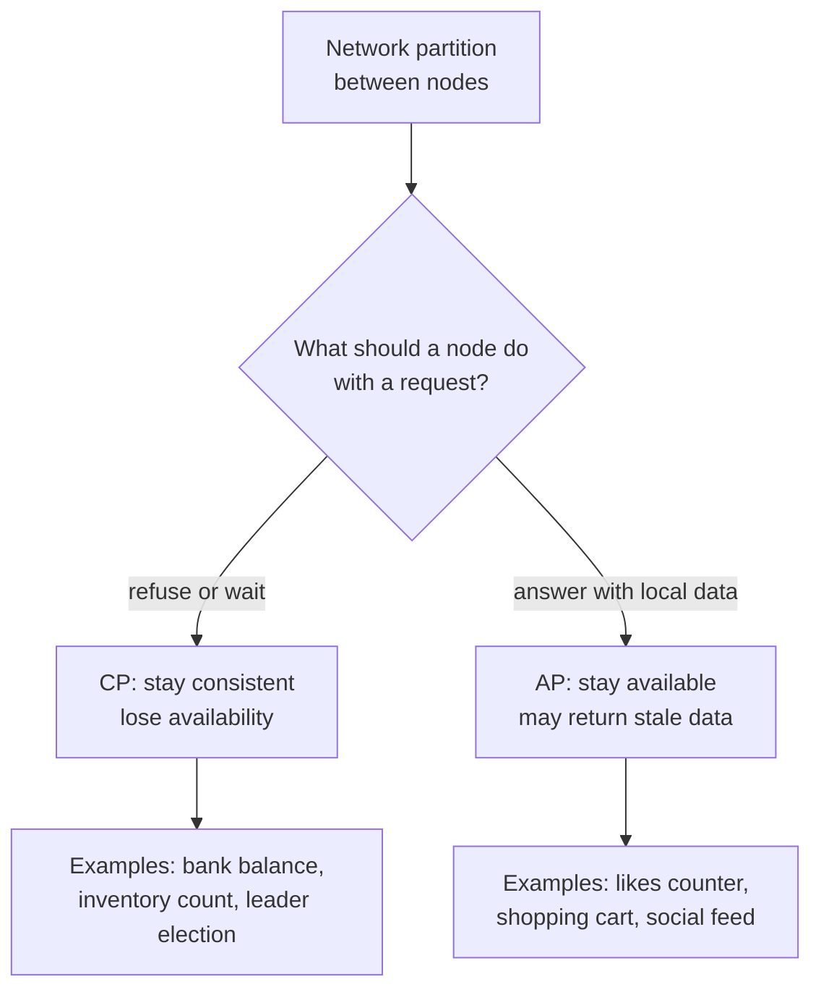
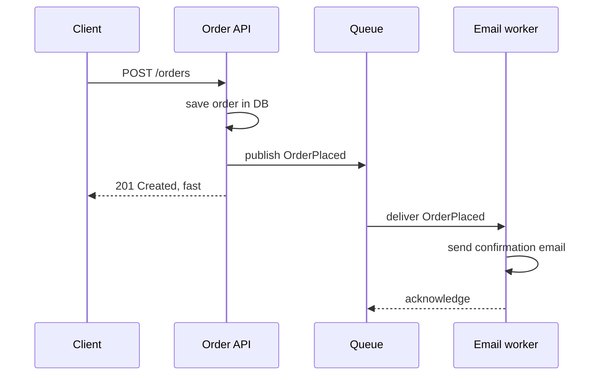
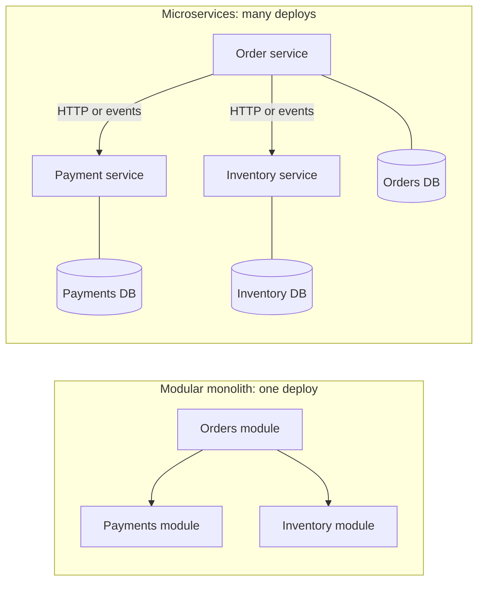
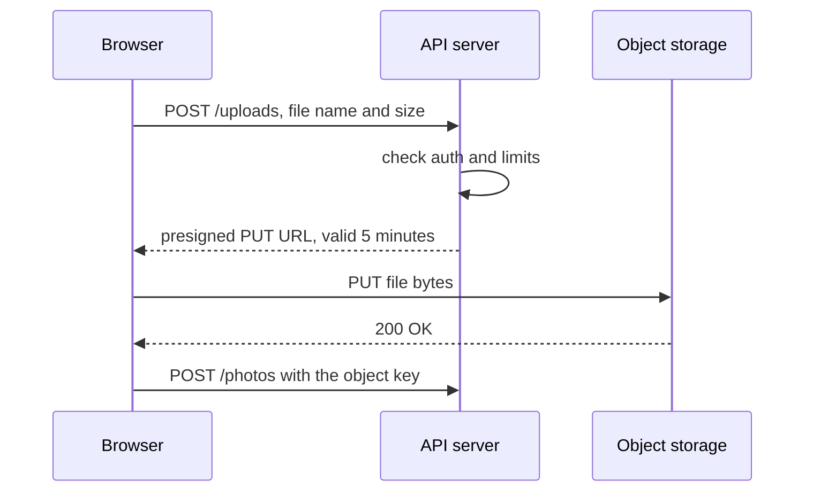
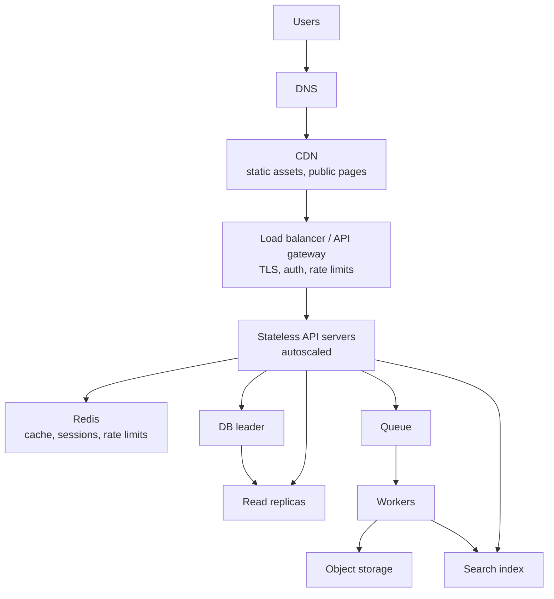

# Scalability and Core Building Blocks

> In this document you will learn the building blocks that almost every large system uses: scaling up and out, stateless services, load balancers, CDNs, replication, sharding, consistent hashing, CAP and consistency models, queues, microservices, rate limiting, idempotency and high availability. System design interviews are mostly about combining these blocks and explaining their trade-offs.

**Before this:** [How to approach system design interviews](01-system-design-interview-approach.md) · [Networking, TCP/IP and DNS](../01-cs-and-web-fundamentals/04-networking-tcp-ip-and-dns.md) · [Databases](../07-nodejs-backend/10-databases.md) · **Interview questions:** [jump to the interview section](#interview-questions)

## Table of contents

1. [What scalability means](#what-scalability-means)
2. [Vertical vs horizontal scaling](#vertical-vs-horizontal-scaling)
3. [Stateless services](#stateless-services)
4. [Load balancers](#load-balancers)
5. [Reverse proxy and API gateway](#reverse-proxy-and-api-gateway)
6. [CDN](#cdn)
7. [Caching in one paragraph](#caching-in-one-paragraph)
8. [Replication](#replication)
9. [Sharding and partitioning](#sharding-and-partitioning)
10. [Consistent hashing](#consistent-hashing)
11. [SQL vs NoSQL at scale](#sql-vs-nosql-at-scale)
12. [CAP and PACELC](#cap-and-pacelc)
13. [Consistency models](#consistency-models)
14. [Queues and asynchronous processing](#queues-and-asynchronous-processing)
15. [Monolith, modular monolith and microservices](#monolith-modular-monolith-and-microservices)
16. [Service discovery](#service-discovery)
17. [Rate limiting at scale](#rate-limiting-at-scale)
18. [Idempotency](#idempotency)
19. [Availability, redundancy and failover](#availability-redundancy-and-failover)
20. [Backpressure](#backpressure)
21. [Blob storage](#blob-storage)
22. [Search engines](#search-engines)
23. [Putting it together](#putting-it-together)
24. [How to explain this in an interview](#how-to-explain-this-in-an-interview)
25. [Interview questions](#interview-questions)
26. [Summary](#summary)
27. [References](#references)

---

## What scalability means

**Scalability** is the ability of a system to handle more load by adding resources, without a full redesign. "Load" can mean more requests per second, more data, more users, more connections or more complex queries.

A system is **not** scalable when adding servers does not help, for example because every request must go through one database that is already at 100% CPU.

Two related words you will use a lot:

- **Throughput:** how much work per second (requests per second, messages per second).
- **Latency:** how long one piece of work takes (milliseconds per request).

They are connected but different. A highway with more lanes has more throughput, but each car still needs the same time to drive the distance.

**Analogy:** A restaurant. Throughput is how many meals per hour it serves. Latency is how long one customer waits. Hiring more cooks increases throughput. A faster oven decreases latency.

---

## Vertical vs horizontal scaling

### What it is

- **Vertical scaling (scale up):** make one machine bigger — more CPU, more RAM, faster disk.
- **Horizontal scaling (scale out):** add more machines and split the work between them.



### Comparison

| | Vertical | Horizontal |
| --- | --- | --- |
| How | Bigger machine | More machines |
| Code changes | Usually none | Service must be stateless or state must be shared |
| Limit | The biggest machine you can buy | Very high, but coordination gets harder |
| Failure | One machine = single point of failure | One machine dies, others continue |
| Cost | Big machines get expensive fast | Many small machines, plus coordination cost |
| Downtime to scale | Often a restart | Add nodes with no downtime |

### When to use each

- **Start vertical** for databases. A single well-tuned PostgreSQL server on a large machine can serve a lot of traffic. Sharding is much harder than buying a bigger server.
- **Go horizontal** for stateless application servers from day one. It is cheap and also gives redundancy.

### Example: Node.js

A Node.js process runs your JavaScript on one main thread. On a 16-core machine, one process uses about one core for JavaScript. So even "vertical" scaling of Node needs *several processes* — with the `cluster` module, a process manager, or containers. See [Concurrency, worker threads and cluster](../07-nodejs-backend/12-concurrency-worker-threads-and-cluster.md).

---

## Stateless services

### What it is

A service is **stateless** when it does not keep any user-specific data in its own memory between requests. Every request carries everything needed (for example a token or session ID), and any shared state lives in an external store (database, Redis, object storage).

### Why it matters

If server A keeps a user's session in memory, the next request must go to server A. If A dies, the session is lost. If the service is stateless, *any* server can handle *any* request. Then you can:

- add or remove servers at any time (autoscaling),
- route around a dead server,
- deploy a new version server by server.

### Example

```js
// ❌ Wrong: state in process memory. Breaks with 2+ servers.
const carts = new Map(); // userId -> items

app.post('/cart/items', (req, res) => {
  const items = carts.get(req.user.id) ?? [];
  items.push(req.body);
  carts.set(req.user.id, items);
  res.status(201).json(items);
});

// ✅ Correct: state in an external store shared by all servers.
app.post('/cart/items', async (req, res) => {
  const key = `cart:${req.user.id}`;
  await redis.rPush(key, JSON.stringify(req.body));
  await redis.expire(key, 60 * 60 * 24 * 7); // keep 7 days
  const items = (await redis.lRange(key, 0, -1)).map((s) => JSON.parse(s));
  res.status(201).json(items);
});
```

With the first version, a user adds an item on server 1, the next request goes to server 2, and the cart looks empty.

### What can stay in memory

Not all memory is "state". These are fine in a stateless service:

- caches that can be rebuilt (configuration, reference data),
- connection pools,
- data for the current request.

### Stateful exceptions

Some services are stateful by nature: databases, WebSocket servers (each connection lives on one server), game servers. For these you use other techniques: replication for databases, sticky sessions plus pub/sub for WebSockets (see [API styles and real-time communication](04-api-styles-and-real-time-communication.md)).

---

## Load balancers

### What it is

A **load balancer** sits in front of a group of servers. It receives requests and sends each one to a healthy server in the group.

### Why it exists

- **Spread load** across servers.
- **Hide failures:** health checks remove dead servers from the group.
- **One address** for clients, even when servers change.
- **Zero-downtime deploys:** drain a server, update it, add it back.

### Analogy

The host at a restaurant door. Customers do not choose a table themselves. The host looks at which waiters are free and seats them. If a waiter goes home sick, the host stops sending people to their tables.

### Layer 4 vs Layer 7

The "layer" comes from the OSI network model (see [Networking](../01-cs-and-web-fundamentals/04-networking-tcp-ip-and-dns.md)).

| | Layer 4 (transport) | Layer 7 (application) |
| --- | --- | --- |
| Sees | IP addresses and ports (TCP/UDP) | Full HTTP: path, headers, cookies |
| Can route by | Connection | URL path, host, header, cookie |
| TLS | Usually passes it through | Usually terminates TLS (decrypts) |
| Speed | Very fast, less work | More work per request |
| Features | Simple balancing | Path routing, retries, header changes, compression, auth checks |
| Examples | AWS Network Load Balancer, HAProxy in TCP mode | AWS Application Load Balancer, NGINX, Envoy, HAProxy in HTTP mode |

Example of Layer 7 routing:

```text
/api/*      → API servers
/static/*   → static file servers (or the CDN origin)
/ws         → WebSocket servers (sticky)
```

### Balancing algorithms

| Algorithm | How it chooses | Good for | Weakness |
| --- | --- | --- | --- |
| Round robin | Next server in order | Equal servers, similar requests | Ignores current load |
| Weighted round robin | More requests to bigger servers | Mixed server sizes | Still ignores load |
| Least connections | Server with fewest open connections | Long or uneven requests, WebSockets | Needs connection tracking |
| Least response time | Fastest recent responses | Mixed latency | More complex |
| IP hash | Hash of client IP | Simple stickiness | Uneven when many users share an IP (NAT) |
| Consistent hashing | Hash of a key (user ID, cache key) | Caches, stateful routing | Needs virtual nodes for balance |
| Random of two choices | Pick 2 random servers, choose the less loaded | Large clusters | Slightly more work |

A small simulation of round robin and least connections:

```js
const servers = [
  { name: 'A', active: 0 },
  { name: 'B', active: 0 },
  { name: 'C', active: 0 },
];

let next = 0;
function roundRobin() {
  const server = servers[next];
  next = (next + 1) % servers.length;
  return server;
}

function leastConnections() {
  return servers.reduce((best, s) => (s.active < best.active ? s : best));
}

console.log([1, 2, 3, 4].map(() => roundRobin().name).join(',')); // A,B,C,A

servers[0].active = 5; // A is busy with long requests
servers[1].active = 1;
servers[2].active = 3;
console.log(leastConnections().name); // B
```

### Health checks

The load balancer calls something like `GET /health/ready` every few seconds. If a server fails several times in a row, it stops getting traffic. Readiness vs liveness checks are explained in [Production Node.js — Health checks](../07-nodejs-backend/14-production-nodejs.md#health-checks-liveness-and-readiness).

### Sticky sessions

**Sticky sessions** (session affinity) send the same client to the same server, usually with a cookie set by the load balancer. They are needed for WebSockets and for old stateful apps. Avoid them for normal HTTP APIs: they make load uneven and a server failure still loses the session.

### Is the load balancer a single point of failure?

It can be. In practice you run load balancers in pairs (active–passive with a shared virtual IP) or use a managed cloud load balancer that is redundant inside. DNS can also point to several load balancer addresses.

---

## Reverse proxy and API gateway

### Reverse proxy

A **reverse proxy** is a server that receives requests on behalf of your servers. Clients talk to the proxy and never see the servers behind it. NGINX, HAProxy, Envoy, Caddy and Traefik are common.

Common jobs:

- TLS termination (handle HTTPS certificates in one place),
- compression (gzip, Brotli),
- serving static files,
- caching responses,
- buffering slow clients so app servers are not blocked,
- request size limits and simple rate limits.

A load balancer is a reverse proxy that focuses on spreading load. In practice one product often does both.

### API gateway

An **API gateway** is a reverse proxy with API-specific features. It is the single entry point for many backend services.



Typical responsibilities:

| Responsibility | Example |
| --- | --- |
| Routing | `/orders/*` goes to the order service |
| Authentication | Verify the JWT once, pass user info to services |
| Rate limiting and quotas | 100 requests per minute per API key |
| Request/response transformation | Add headers, rename fields for old clients |
| Observability | Logs, metrics and a trace ID for every request |
| TLS, CORS, request size limits | Common edge concerns in one place |
| API keys and developer plans | For public APIs |

Products: AWS API Gateway, Kong, Apigee, Azure API Management, Envoy-based gateways, Tyk.

**Gateway vs BFF:** a gateway is generic and shared. A **BFF** (backend for frontend) is built for one client and contains client-specific aggregation logic. See [API styles — BFF](04-api-styles-and-real-time-communication.md#backend-for-frontend-bff).

**Warning:** do not put business logic in the gateway. It becomes a hidden monolith that every team must change.

---

## CDN

### What it is

A **CDN** (content delivery network) is a large network of servers in many cities ("edge locations" or PoPs — points of presence). They keep copies of your content close to users.

### Why it exists

Light in fiber needs time. A round trip from India to a server in the US takes over 200 ms. A connection with TLS needs several round trips before the first byte. A CDN edge in Mumbai cuts that to a few milliseconds.

CDNs also:

- take load off your origin servers (a 95% hit ratio means only 5% of requests reach you),
- absorb traffic spikes and many DDoS attacks,
- terminate TLS close to users,
- compress and optimize images,
- run small code at the edge (Cloudflare Workers, Lambda@Edge, Fastly Compute).



### What to put on a CDN

- Static assets: JS, CSS, fonts, images, video.
- Public HTML that is the same for everyone (marketing pages, product pages for anonymous users).
- Public API responses that are the same for many users (product catalog, config).

Not: personalized, private data — unless the cache key includes the user and you are very careful. Details in [Caching strategies and invalidation](03-caching-strategies-and-invalidation.md#cdn-caching-and-invalidation).

### Push vs pull CDN

- **Pull CDN:** the edge fetches from your origin on the first miss. Most common. Easy.
- **Push CDN:** you upload content to the CDN storage ahead of time. Good for large files you know in advance (video).

---

## Caching in one paragraph

A **cache** keeps a copy of data in a faster place so you do not compute or fetch it again. Caches exist at every layer: browser, CDN, gateway, application memory, Redis, and inside the database. Caching is the cheapest way to scale reads, but it brings stale data and invalidation problems. This topic has its own documents: system-level strategy in [Caching strategies and invalidation](03-caching-strategies-and-invalidation.md) and Node.js/Redis implementation in [Caching in Node.js](../07-nodejs-backend/11-caching.md).

---

## Replication

### What it is

**Replication** means keeping copies of the same data on several database servers.

### Why it exists

1. **High availability:** if one server dies, another has the data.
2. **Read scaling:** spread read queries across copies.
3. **Lower latency:** a copy in each region, close to users.
4. **Backups and analytics:** run heavy reports on a copy, not the main server.

### Leader–follower (primary–replica)

The most common model. One server is the **leader** (primary). All writes go to it. It sends its changes to **followers** (replicas). Followers serve reads.



### Synchronous vs asynchronous replication

| | Synchronous | Asynchronous |
| --- | --- | --- |
| How | Leader waits until a follower confirms before saying "committed" | Leader commits, sends changes later |
| Data loss on leader crash | None for confirmed writes | Recent writes can be lost |
| Write latency | Higher | Lower |
| If a follower is down | Writes may block | No effect on writes |

Many setups use **semi-synchronous**: wait for one follower, the rest asynchronous. PostgreSQL supports both modes with `synchronous_commit` and `synchronous_standby_names`.

### Replication lag

With asynchronous replication, followers are a little behind the leader. Usually milliseconds, sometimes seconds or more under load. This is **replication lag**.

The classic bug:

```text
1. User updates their profile name → write goes to the leader.
2. Page reloads → read goes to a replica that has not received the change.
3. User sees the OLD name and thinks the save failed.
```

Fixes (this is the "read-your-writes" problem, see [Consistency models](#consistency-models)):

- Read from the leader for a short time after the user writes (for example 10 seconds, tracked in the session).
- Read from the leader for the user's own data, replicas for other data.
- Track the write position (for example the PostgreSQL WAL LSN) and only read from a replica that has caught up.
- On the frontend, update the UI from the write response instead of refetching.

### Failover

If the leader dies, a follower must become the new leader. This is **failover**. Problems:

- Choosing the new leader (the most up-to-date follower).
- Lost writes with async replication.
- **Split brain:** two servers both think they are leader and both accept writes. Prevented with consensus (Raft, used by etcd; Patroni for PostgreSQL uses a store like etcd) or fencing (shutting down the old leader).

### Multi-leader and leaderless

- **Multi-leader:** several servers accept writes (for example one per region). Writes can conflict and need resolution (last-write-wins, merge, CRDTs). Used for multi-region and offline-first apps.
- **Leaderless:** clients write to several replicas and read from several (quorums: with `N` replicas, write to `W` and read from `R`, and `W + R > N` means a read set overlaps the latest write set). Used by Cassandra and DynamoDB-style systems.

---

## Sharding and partitioning

### What it is

**Partitioning** splits data into parts. **Sharding** usually means horizontal partitioning across *different servers*: each server (shard) holds a subset of the rows.

- **Vertical partitioning:** split by columns or tables (user profiles in one DB, orders in another).
- **Horizontal partitioning (sharding):** split rows (users 1–1M on shard 1, 1M–2M on shard 2).

### Why it exists

Replication copies *all* data to every node. It scales reads but not writes or storage — every write still goes to one leader and every node holds everything. When the data or write volume is too big for one leader, you shard.

### Choosing a shard key

The **shard key** (partition key) decides which shard a row lives on. It is the most important decision.

A good shard key:

- spreads data and traffic evenly,
- keeps data that is queried together on the same shard,
- is present in most queries (so you know which shard to ask).

Examples:

| System | Good shard key | Why |
| --- | --- | --- |
| Chat messages | `conversation_id` | Messages in one chat are read together |
| Multi-tenant SaaS | `tenant_id` | Tenant data stays together, easy isolation |
| User feed | `user_id` | Each feed is read by one user |
| Orders | `customer_id` or `order_id` | Depends on whether you list by customer |

### Strategies

**Range-based:** each shard owns a range of keys (A–F, G–M...; or dates).

- Good: range queries are efficient ("all orders in March").
- Bad: **hot spots**. If the key is time, all new writes go to the latest shard.

**Hash-based:** `shard = hash(key) % numberOfShards`.

- Good: even spread.
- Bad: range queries must ask every shard. And when you change the number of shards, almost all keys move (see next section).

**Directory-based (lookup):** a lookup table says which shard has which key (for example tenant → shard).

- Good: flexible; you can move a big tenant to its own shard.
- Bad: the lookup service must be fast and highly available.

```js
// Hash sharding with modulo. Watch what happens when we add a shard.
import { createHash } from 'node:crypto';

function shardFor(key, shardCount) {
  const hash = createHash('md5').update(key).digest().readUInt32BE(0);
  return hash % shardCount;
}

const keys = Array.from({ length: 10000 }, (_, i) => `user-${i}`);
let moved = 0;
for (const k of keys) {
  if (shardFor(k, 4) !== shardFor(k, 5)) moved++;
}
console.log(`${((moved / keys.length) * 100).toFixed(0)}% of keys moved`); // about 80% of keys moved
```

Going from 4 to 5 shards moves about 80% of keys. That means a huge data migration. Consistent hashing reduces that.

### Hot partitions

A **hot partition** gets much more traffic than others. Examples: a celebrity's posts, one huge tenant, today's date in a time-sharded table.

Fixes:

- Add a random suffix to hot keys (`postId#0` ... `postId#9`) and merge on read ("key salting").
- Cache the hot items heavily.
- Give big tenants dedicated shards.
- Split ranges dynamically (many databases do this automatically).

### Costs of sharding

- **Cross-shard queries** are slow (scatter–gather to every shard).
- **Cross-shard transactions** are hard (need two-phase commit or sagas).
- **Joins** across shards are not possible in the database; you join in the app.
- **Unique constraints** across shards need a global mechanism.
- **Rebalancing** moves data while the system runs.
- **Operations** become much more complex.

**Rule:** shard only when you must. First try: query optimization, indexes, vertical scaling, read replicas, caching, archiving old data, and splitting by service.

---

## Consistent hashing

### What it is

**Consistent hashing** is a way to map keys to servers so that when you add or remove a server, only a small part of the keys move (about `1/N` of them), not almost all.

### How it works

1. Imagine a ring of hash values, from 0 to 2^32 − 1, where the end connects to the start.
2. Hash each **server** to a position on the ring.
3. Hash each **key** to a position on the ring.
4. A key belongs to the **first server clockwise** from its position.
5. When a server is added, it takes only the keys between it and the previous server. When a server is removed, only its keys move to the next server.



### Virtual nodes

With only a few servers, the ring positions are uneven, so some servers get more keys. The fix: put each server on the ring many times (for example 100–200 **virtual nodes**). This spreads keys evenly, and lets bigger servers have more virtual nodes.

### A small implementation

```js
import { createHash } from 'node:crypto';

function hash(value) {
  return createHash('md5').update(value).digest().readUInt32BE(0);
}

class HashRing {
  constructor(virtualNodes = 100) {
    this.virtualNodes = virtualNodes;
    this.ring = []; // sorted [{ point, server }]
  }
  addServer(server) {
    for (let i = 0; i < this.virtualNodes; i++) {
      this.ring.push({ point: hash(`${server}#${i}`), server });
    }
    this.ring.sort((a, b) => a.point - b.point);
  }
  removeServer(server) {
    this.ring = this.ring.filter((n) => n.server !== server);
  }
  getServer(key) {
    const h = hash(key);
    // binary search for the first point >= h
    let lo = 0, hi = this.ring.length;
    while (lo < hi) {
      const mid = (lo + hi) >> 1;
      if (this.ring[mid].point < h) lo = mid + 1; else hi = mid;
    }
    return this.ring[lo % this.ring.length].server; // wrap around
  }
}

const ring = new HashRing();
['A', 'B', 'C', 'D'].forEach((s) => ring.addServer(s));
const keys = Array.from({ length: 10000 }, (_, i) => `user-${i}`);
const before = keys.map((k) => ring.getServer(k));
ring.addServer('E');
const moved = keys.filter((k, i) => ring.getServer(k) !== before[i]).length;
console.log(`${((moved / keys.length) * 100).toFixed(0)}% of keys moved`); // about 20% of keys moved
```

Adding a fifth server moves about 20% of keys (`1/5`) — only the keys the new server takes over. Compare with about 80% for modulo hashing.

### Where it is used

- Distributed caches (client-side sharding of Memcached keys).
- Amazon Dynamo-style databases, Cassandra and ScyllaDB (token rings).
- Load balancers routing by key (Envoy and NGINX support hash-based balancing).
- Routing WebSocket users or chat rooms to servers.

Note: **Redis Cluster** does not use a ring. It uses 16,384 fixed **hash slots** (`CRC16(key) mod 16384`), and each node owns some slots. Moving slots between nodes has a similar effect: only part of the data moves.

---

## SQL vs NoSQL at scale

The basics of SQL vs NoSQL are in [Databases — SQL vs NoSQL](../07-nodejs-backend/10-databases.md#sql-vs-nosql). Here is the scaling view.

| | Relational (PostgreSQL, MySQL) | Document (MongoDB) | Wide-column / key-value (Cassandra, DynamoDB) |
| --- | --- | --- | --- |
| Data model | Tables, relations, joins | JSON documents | Rows by partition key, sorted by clustering key |
| Transactions | Strong, multi-row ACID | Multi-document transactions supported, often avoided | Limited (single partition, or with a cost) |
| Query flexibility | Very high (SQL, ad-hoc) | High within a collection | Low: design tables per query |
| Scaling writes | Vertical first; sharding is extra work (Citus, Vitess, app-level) | Built-in sharding | Built-in, designed for horizontal scale |
| Typical use | Business data, money, anything relational | Catalogs, content, flexible schemas | Huge write volume, time series, feeds, messages |

**Distributed SQL** ("NewSQL") databases such as Google Spanner, CockroachDB, YugabyteDB and TiDB offer SQL and transactions with automatic sharding. The cost is higher write latency (consensus between replicas) and operational complexity.

How to choose in an interview:

1. Start with the **access patterns** and the **consistency needs**.
2. If data is relational and fits on one big server with replicas, choose a relational DB. This covers most products.
3. If you need huge write throughput with simple key-based access, choose wide-column or key-value.
4. Use several databases when needed (**polyglot persistence**): PostgreSQL for orders, Redis for sessions, Elasticsearch for search, object storage for files.

---

## CAP and PACELC

### CAP in simple words

The **CAP theorem** (Eric Brewer, 2000; proven by Gilbert and Lynch, 2002) talks about a distributed data system that keeps copies on several nodes. It names three properties:

- **C — Consistency:** every read sees the latest write (here this means *linearizability*, which is stronger than the "C" in ACID).
- **A — Availability:** every request to a working node gets a non-error response.
- **P — Partition tolerance:** the system keeps working when the network between nodes breaks (messages are lost or delayed).

The theorem says: **when a network partition happens, you must choose between consistency and availability.** You cannot have both at that moment.

Network partitions *will* happen in real distributed systems, so P is not optional. The real choice is: **during a partition, C or A?**

### Example

Two data centers, Europe and US, each with a copy of a bank balance. The link between them breaks. A user in the US tries to withdraw money.

- **CP choice:** the US node refuses (error or wait), because it cannot confirm the latest balance with Europe. Correct, but unavailable.
- **AP choice:** the US node accepts the withdrawal using its local copy. Available, but the user might withdraw money that was already spent in Europe. The systems must reconcile later.



### Common misunderstandings

- "Pick any two of three" is misleading. You do not choose to drop P. You choose C or A *during a partition*. Without a partition, you can have both.
- CAP's "consistency" is not ACID's "consistency".
- Most real systems are not purely CP or AP. They let you tune per operation (for example DynamoDB's strongly consistent reads vs eventually consistent reads; Cassandra's consistency levels like `ONE` or `QUORUM`).

### PACELC

**PACELC** (Daniel Abadi, 2010–2012) adds the normal case:

> If there is a **P**artition, choose **A** or **C**. **E**lse (normal operation), choose **L**atency or **C**onsistency.

Even with no failures, keeping replicas strongly consistent costs time: a write must wait for other replicas to confirm. So you trade **latency vs consistency** all the time, not only during failures.

| System (default config) | During partition | Normal operation |
| --- | --- | --- |
| Cassandra, DynamoDB (default reads) | A | L (low latency, eventual) |
| Spanner, CockroachDB | C | C (pay latency for consistency) |
| PostgreSQL with async replicas | Reads from replicas can be stale (L); the leader stays the source of truth | |

How to use it in an interview:

> "For the shopping cart I prefer availability and low latency — an occasional duplicate item is fixable. For payment and inventory decrements I prefer consistency, even if it adds latency or a request fails during a partition."

---

## Consistency models

A **consistency model** is a promise about what a read can return after writes.

| Model | Promise in plain words | Example |
| --- | --- | --- |
| Strong (linearizable) | Every read sees the latest completed write, as if there was one copy | Bank balance, unique username check |
| Sequential | Everyone sees writes in the same order, maybe delayed | |
| Causal | If write B depends on write A, everyone sees A before B | A reply never appears before the comment it answers |
| Read-your-writes | You always see your own writes; others may see them later | Profile update shows immediately for you |
| Monotonic reads | You never see data go "back in time" after seeing newer data | Refresh does not show an older version |
| Eventual | If writes stop, all copies become equal eventually | Like counts, view counts, search index |

### Read-your-writes example

```text
Without it:
  t0  You post a comment         → leader
  t1  Your page reloads          → replica (100 ms behind)
  t2  Your comment is missing     ✗

With it:
  t1  The app sees you wrote in the last 5 s → reads from the leader
  t2  Your comment is there       ✓
```

### Monotonic reads example

You refresh a page twice. The first request goes to replica 1 (up to date). The second goes to replica 2 (behind). The comment you just saw disappears. Fix: route a user's reads to the same replica (for example by hashing the user ID).

### Frontend view

Many consistency problems are visible in the UI. The frontend can help:

- Use the server's response to update the UI after a write.
- Show "Saving..." and "Saved" states.
- Use versions or ETags to avoid lost updates ([REST API design — Concurrency control with ETags](../07-nodejs-backend/07-rest-api-design.md#concurrency-control-with-etags)).
- With optimistic updates, roll back on failure ([API integration — Optimistic updates](../05-frontend-engineering/07-api-integration-and-data-fetching.md#optimistic-updates-with-rollback)).

---

## Queues and asynchronous processing

### What it is

A **message queue** is a buffer between two parts of a system. A **producer** puts messages in. A **consumer** (worker) takes them out and processes them later. Examples: RabbitMQ, Amazon SQS, Kafka (a log, not exactly a queue), Redis-based queues like BullMQ.

### Why it exists

- **Fast responses:** the request does the minimum and returns. Slow work (emails, image resizing, reports) runs later.
- **Absorb spikes:** a sale sends 10× traffic; the queue grows, workers process at a steady speed.
- **Decouple services:** the order service does not need the email service to be up right now.
- **Retries:** failed jobs retry with backoff instead of failing the user request.

### Analogy

A restaurant order ticket rail. The waiter puts the ticket on the rail and goes back to customers. Cooks take tickets when they are ready. If 20 orders arrive at once, the rail gets longer, but the waiter is not blocked.



### Queue vs pub/sub vs log

| Model | Who gets a message | Example |
| --- | --- | --- |
| Work queue | One consumer out of many workers | Resize this image |
| Pub/sub | Every subscriber gets a copy | OrderPlaced → email, analytics, inventory |
| Log (Kafka, Kinesis) | Consumers read at their own position; messages are kept for days | Event streaming, replay, analytics |

### Things you must handle

- **At-least-once delivery:** most queues may deliver a message twice. Consumers must be idempotent (see [Idempotency](#idempotency)).
- **Ordering:** usually only guaranteed per partition or per message group.
- **Dead-letter queue:** messages that fail many times go to a separate queue for inspection.
- **Dual-write problem:** saving to the DB and publishing to the queue are two operations. If the second fails, you lose the event. The **outbox pattern** fixes this.

These are covered in depth (with BullMQ code) in [Background jobs and queues](../07-nodejs-backend/13-background-jobs-and-queues.md).

### When the client needs the result

Return `202 Accepted` with a job ID, then:

- the client polls `GET /jobs/{id}`, or
- the server pushes the result over WebSocket or SSE, or
- the user gets an email or notification.

---

## Monolith, modular monolith and microservices

### What they are

- **Monolith:** one deployable application that contains all features. One codebase, usually one database.
- **Modular monolith:** still one deployable, but the code is split into strict modules with clear boundaries (each module owns its tables, other modules call it only through its public interface).
- **Microservices:** many small services. Each is deployed independently, owns its own data, and talks to others over the network (HTTP, gRPC, events).



### Comparison

| | Monolith | Modular monolith | Microservices |
| --- | --- | --- | --- |
| Deploy | One unit | One unit | Each service separately |
| Team scaling | Hard with many teams | Better | Best for many independent teams |
| Calls between parts | Function calls (fast, reliable) | Function calls | Network calls (slow, can fail) |
| Transactions | Simple database transactions | Simple | Distributed: sagas, outbox, eventual consistency |
| Scaling | Scale the whole app | Scale the whole app | Scale each service separately |
| Operations | Simple | Simple | Complex: many pipelines, service discovery, tracing |
| Debugging | One log, one stack trace | Same | Distributed tracing needed |
| Technology choice | One stack | One stack | Each service can differ |

### When to choose what

- **Start with a monolith or modular monolith** for a new product or a small team. It is faster to build and change.
- **Move to microservices** when you have real reasons: many teams blocking each other on releases, parts with very different scaling needs, or parts that need strong isolation (for example payments for compliance).
- Microservices solve **organizational** problems more than technical ones. Conway's law: systems tend to copy the communication structure of the organization that builds them.

### The distributed monolith anti-pattern

If every service must be deployed together, shares one database, or calls five others synchronously for every request, you have the costs of microservices and the coupling of a monolith. Avoid it.

### Distributed transactions: the saga pattern

In microservices you cannot use one database transaction across services. A **saga** is a sequence of local transactions. If a step fails, earlier steps run **compensating actions** (undo).

```text
Checkout saga:
  1. Order service:     create order (PENDING)
  2. Payment service:   charge card
  3. Inventory service: reserve items        ← fails?
  4. Order service:     mark CONFIRMED

If step 3 fails: refund the payment (compensation), mark order CANCELLED.
```

Two styles: **choreography** (services react to each other's events) and **orchestration** (a central coordinator tells each service what to do). Orchestration is easier to follow for long flows.

---

## Service discovery

### What it is

In a dynamic system, service instances start and stop all the time and their IP addresses change. **Service discovery** is how a service finds the current addresses of another service.

### How it works

- **DNS-based:** the service name resolves to current instances. Kubernetes gives each Service a stable DNS name (`orders.default.svc.cluster.local`) and a virtual IP that forwards to healthy pods.
- **Registry-based:** instances register themselves in a registry (Consul, etcd, Eureka) and send heartbeats. Clients ask the registry.
- **Client-side vs server-side discovery:** the client picks an instance itself (client-side), or a load balancer/proxy picks for it (server-side).
- **Service mesh** (Istio, Linkerd): a sidecar proxy next to every service handles discovery, retries, mTLS and metrics.

In an interview it is usually enough to say: "In Kubernetes, services find each other by DNS name; the platform load-balances to healthy pods."

---

## Rate limiting at scale

### What it is

**Rate limiting** caps how many requests a client can make in a time window, for example 100 requests per minute per user.

### Why it exists

- Protect the system from overload and abuse (bots, scrapers, brute-force login).
- Fair use between customers.
- Control cost of expensive operations.

### Algorithms in one table

The algorithms are explained with code in [Production Node.js — Rate limiting](../07-nodejs-backend/14-production-nodejs.md#rate-limiting).

| Algorithm | Idea | Allows bursts? | Memory |
| --- | --- | --- | --- |
| Fixed window | Count per minute bucket | Yes, up to 2× at window edges | Very low |
| Sliding window log | Store each request time | No | High |
| Sliding window counter | Weighted mix of current and previous window | Small | Low |
| Token bucket | Tokens refill at a rate; each request takes one | Yes, up to bucket size | Low |
| Leaky bucket | Requests leave at a constant rate | No (smooths traffic) | Low |

### At scale: where and how

- **Where:** at the edge (CDN/WAF for IP-based abuse), at the API gateway (per API key or user), and inside services (per expensive operation).
- **Shared counters:** with many API servers, an in-memory counter per server does not work (each server sees only part of the traffic). Use a shared store like Redis with atomic operations (`INCR` + `EXPIRE`, or a Lua script for token bucket).
- **Trade-off:** a Redis call on every request adds latency and Redis becomes critical. Options: local approximate limits plus periodic sync, or fail open (allow traffic) if Redis is down for non-critical limits, and fail closed for login protection.

### Response

Return `429 Too Many Requests` with a `Retry-After` header. Many APIs also send `RateLimit-*` headers (an IETF draft) so clients can slow down. The frontend should show a clear message and back off.

---

## Idempotency

### What it is

An operation is **idempotent** if doing it many times has the same effect as doing it once. `PUT /users/1 {name: "Ana"}` is idempotent. `POST /payments {amount: 100}` is not: two calls create two payments.

### Why it matters at scale

In distributed systems, retries are everywhere: the client retries after a timeout, the load balancer retries, the queue redelivers a message. A **timeout does not mean failure**. The first request may have succeeded. Without idempotency, retries create duplicate orders, duplicate charges and duplicate emails.

### How to make operations idempotent

1. **Idempotency key:** the client sends a unique key (`Idempotency-Key: 7f3a...`). The server stores the result for that key. A repeated key returns the stored result instead of doing the work again. Full design in [REST API design — Idempotency keys](../07-nodejs-backend/07-rest-api-design.md#idempotency-keys-for-safe-retries).
2. **Natural keys and unique constraints:** `UNIQUE(order_id)` on the payments table. A second insert fails safely.
3. **Upserts and "set" operations** instead of "add": `SET status = 'PAID'` instead of `balance = balance + 100`.
4. **Deduplication table for consumers:** store processed message IDs; skip if already seen (in the same transaction as the work).

```js
// Idempotent consumer: the unique constraint is the safety net.
async function handlePaymentCaptured(message, db) {
  try {
    await db.query('BEGIN');
    await db.query(
      'INSERT INTO processed_messages (message_id) VALUES ($1)',
      [message.id], // fails with a unique violation if already processed
    );
    await db.query('UPDATE orders SET status = $1 WHERE id = $2', ['PAID', message.orderId]);
    await db.query('COMMIT');
  } catch (err) {
    await db.query('ROLLBACK');
    if (err.code === '23505') return; // PostgreSQL unique_violation: duplicate, ignore safely
    throw err; // real error: let the queue retry
  }
}
```

(In real code with a `pg` pool, take one client with `pool.connect()` and run all these queries on that client, because a transaction belongs to one connection.)

---

## Availability, redundancy and failover

### Single point of failure

A **single point of failure (SPOF)** is a component whose failure stops the whole system. Examples: one database server, one load balancer, one region, one DNS provider, one engineer who knows the deploy process.

How to find SPOFs in an interview: point at each box in your diagram and ask "What if this dies?"

### Redundancy

Run more than one of everything important:

- Several app servers behind a load balancer.
- Database leader plus standby replica with automatic failover.
- Several availability zones (separate data centers in one region).
- Optionally several regions.

### Active–passive vs active–active

| | Active–passive | Active–active |
| --- | --- | --- |
| How | Standby waits and takes over on failure | All copies serve traffic |
| Failover time | Seconds to minutes | Near zero (traffic moves) |
| Cost | Standby is mostly idle | All resources used |
| Complexity | Lower | Higher (data sync, conflicts) |

### Availability math

When components are **in series** (all must work), availabilities multiply:

```text
Load balancer 99.99% × App 99.9% × Database 99.9%
= 0.9999 × 0.999 × 0.999 ≈ 0.9979 → about 99.8%
```

When components are **redundant in parallel** (one is enough), the system fails only if all fail:

```text
Two app servers, each 99% available:
1 − (0.01 × 0.01) = 0.9999 → 99.99%
```

This assumes failures are independent. In real life they often are not (same bad deploy, same region outage), so real numbers are worse.

### Multi-region

Running in several regions protects against a full region outage and gives lower latency worldwide. Costs:

- data replication across regions (latency, conflicts, cost),
- deciding where writes go (one write region, or multi-leader),
- data residency rules (for example EU data must stay in the EU),
- much more complex operations and testing.

Common steps: start single-region multi-AZ; add a passive disaster-recovery region; go active–active only if the business really needs it.

Two key numbers for disaster recovery:

- **RPO (Recovery Point Objective):** how much data you can afford to lose (for example 5 minutes).
- **RTO (Recovery Time Objective):** how long you can be down (for example 1 hour).

### Graceful degradation

When a non-critical part fails, keep the core working. If the recommendations service is down, show the product page without recommendations. If search is slow, show cached popular items. Patterns: timeouts, fallbacks, circuit breakers and bulkheads — see [Production Node.js](../07-nodejs-backend/14-production-nodejs.md).

---

## Backpressure

### What it is

**Backpressure** is a way for a slow consumer to tell a fast producer: "Slow down, I can't keep up." Without it, work piles up in memory or queues until something crashes.

### Examples

- Node.js streams: `writable.write()` returns `false` when the buffer is full; the producer should wait for the `'drain'` event. `pipeline()` handles this for you. See [Streams](../07-nodejs-backend/05-streams.md).
- A queue with a maximum length: producers get an error or must wait when it is full.
- A server that returns `503 Service Unavailable` or `429` when overloaded, instead of accepting work it cannot finish (**load shedding**).
- TCP flow control: the receiver advertises how much it can accept.
- In the UI: throttle scroll events; `switchMap` in RxJS drops old requests.

### Why it matters

A system without backpressure under heavy load gets slower and slower, uses more memory, and finally fails completely. With backpressure it rejects some work quickly and keeps serving the rest. Fast, clear failure is better than slow total failure.

```js
// Simple load shedding in Express: limit work in progress.
let inFlight = 0;
const MAX_IN_FLIGHT = 200;

app.use((req, res, next) => {
  if (inFlight >= MAX_IN_FLIGHT) {
    res.set('Retry-After', '1');
    return res.status(503).json({ error: 'Server busy, retry shortly' });
  }
  inFlight++;
  res.on('close', () => { inFlight--; }); // 'close' fires when the response ends or the client disconnects
  next();
});
```

---

## Blob storage

### What it is

**Blob storage** (object storage) stores files ("objects") such as images, videos, PDFs, backups and logs. Examples: Amazon S3, Google Cloud Storage, Azure Blob Storage, Cloudflare R2, MinIO (self-hosted, S3-compatible).

Each object has a key (like `photos/2026/10/abc.jpg`), the bytes, and metadata.

### Why not store files in the database?

- Files are big. They make the database huge, slow to back up and expensive.
- Object storage is cheap per GB and very durable (S3 is designed for 99.999999999% — "eleven nines" — durability by keeping copies across devices and facilities).
- It scales almost without limit and integrates with CDNs.

Store the file in object storage and keep only the **key and metadata** in the database.

### Presigned URLs

A **presigned URL** is a temporary URL signed with your credentials. It lets the browser upload or download one specific object directly, without your server carrying the bytes and without giving the browser your keys.



The full upload design (chunked, resumable, virus scanning) is in [File upload service](14-case-study-file-upload-service.md).

### Good to know

- Objects are usually written whole (no partial in-place edits). Large uploads use multipart upload.
- Storage classes: hot (frequent access), infrequent access, archive (cheap, slow to restore). Lifecycle rules move old objects automatically.
- Keep buckets private; serve public content through the CDN.

---

## Search engines

### What it is

A **search engine** like Elasticsearch, OpenSearch, Apache Solr, Meilisearch or Typesense is a specialized database for full-text search. It uses an **inverted index**: a map from each word to the list of documents that contain it.

```text
Documents:
  1: "red running shoes"
  2: "blue running jacket"
  3: "red jacket"

Inverted index:
  red     → [1, 3]
  running → [1, 2]
  shoes   → [1]
  blue    → [2]
  jacket  → [2, 3]

Query "red jacket" → documents with both words: [3]. Ranked results: 3 first, then 1 and 2 (one word each).
```

A tiny inverted index in JavaScript:

```js
const docs = { 1: 'red running shoes', 2: 'blue running jacket', 3: 'red jacket' };
const index = new Map();
for (const [id, text] of Object.entries(docs)) {
  for (const word of text.split(' ')) {
    if (!index.has(word)) index.set(word, new Set());
    index.get(word).add(Number(id));
  }
}

function search(query) {
  const scores = new Map(); // docId -> number of matching words
  for (const word of query.split(' ')) {
    for (const id of index.get(word) ?? []) scores.set(id, (scores.get(id) ?? 0) + 1);
  }
  return [...scores].sort((a, b) => b[1] - a[1] || a[0] - b[0]).map(([id]) => id);
}

console.log(search('red jacket')); // [ 3, 1, 2 ]
```

Real engines also do tokenizing, lowercasing, stemming ("running" → "run"), synonyms, typo tolerance and relevance scoring (BM25).

### Why not `LIKE '%shoe%'` in SQL?

- `LIKE '%term%'` cannot use a normal B-tree index, so it scans every row.
- No relevance ranking, no typo tolerance, no stemming, no synonyms, no facets.

(PostgreSQL has good built-in full-text search with `tsvector` and GIN indexes, and the `pg_trgm` extension for fuzzy matching. For many apps, that is enough before you add a separate search engine.)

### How it fits in the architecture

The primary database stays the source of truth. The search index is a **copy** for querying, updated asynchronously:

```text
App writes to PostgreSQL → change event (outbox or CDC) → indexer worker → Elasticsearch
```

So search results are **eventually consistent**: a new product may appear in search a second or two later. Plan for that in the UI.

---

## Putting it together

A typical scalable web application, combining the blocks above:



How it grows:

1. **Day 1:** one app server, one database, a CDN for assets.
2. **More traffic:** several stateless app servers behind a load balancer; Redis cache.
3. **Read-heavy growth:** read replicas, more caching, CDN for public API responses.
4. **Slow tasks:** queues and workers.
5. **Search and files:** search engine, object storage.
6. **Write-heavy growth:** shard the largest tables, or move them to a horizontally scalable store.
7. **Many teams:** split into services along domain boundaries.
8. **Global users or strict uptime:** multi-region.

Each step adds cost and complexity. Take a step only when a measured bottleneck requires it.

---

## How to explain this in an interview

Use this for "How would you scale this system?"

1. **Define it:** "Scaling means handling more load — requests, data, users — by adding resources, without redesigning the system."
2. **Why it exists:** "One machine has limits in CPU, memory and connections, and it is a single point of failure."
3. **How it works:** "I make the app tier stateless and scale it horizontally behind a load balancer. I scale reads with caching, a CDN and read replicas. I move slow work to queues. I shard data only when one database leader can't handle the writes or the size."
4. **Small example:** "For a read-heavy catalog, a CDN and Redis can absorb most reads, so the database only sees cache misses and writes."
5. **Where it is useful:** "Any product with growth: e-commerce sales, social feeds, SaaS dashboards."
6. **Trade-offs / gotchas:** "Every layer adds complexity: caches go stale, replicas lag, shards make queries and transactions harder. I start simple, measure, and add a layer only when a bottleneck appears."

---

## Interview questions

### Q1. What is the difference between vertical and horizontal scaling? Which do you choose?

**What the interviewer is checking:** That you know both, their limits, and the role of statelessness.

**Short spoken answer (30–60 seconds):**
> Vertical scaling means a bigger machine: more CPU and RAM. It's simple — usually no code changes — but it has a ceiling, gets expensive, and the machine is still a single point of failure. Horizontal scaling means adding more machines behind a load balancer. It scales much further and gives redundancy, but the service must be stateless or share its state in an external store. In practice I scale stateless app servers horizontally from the start, and I scale the database vertically for as long as possible, adding read replicas and caching before I consider sharding, because sharding is expensive to run.

**Follow-up questions:**
- **Why is a database harder to scale horizontally than an app server?** — The database holds state. Copies must stay in sync (replication), and splitting data (sharding) breaks joins, transactions and unique constraints across shards.
- **Does a Node.js server benefit from a bigger machine?** — Only if you run several processes (cluster, PM2, or several containers), because each process runs JavaScript on one main thread.

**Common mistakes:** Saying horizontal is always better; forgetting the statelessness requirement.

**Where this is used in real projects:** Autoscaling groups and Kubernetes deployments for app servers; large managed database instances.

### Q2. What does "stateless service" mean, and why is it important?

**What the interviewer is checking:** That you understand the foundation of horizontal scaling.

**Short spoken answer (30–60 seconds):**
> A stateless service keeps no client-specific data in its own memory between requests. Sessions, carts and uploads live in external stores like Redis, a database or object storage, and each request carries an identifier like a cookie or token. Because any instance can serve any request, I can add and remove instances freely, the load balancer can route around failures, and rolling deploys don't log users out. Caches and connection pools are fine in memory, because losing them only costs performance, not correctness.

**Follow-up questions:**
- **What about WebSocket servers?** — They are stateful by nature, because each connection lives on one server. You use sticky routing and a pub/sub layer (like Redis) so a message for a user reaches whichever server holds their connection.
- **Is a JWT-based API automatically stateless?** — The server does not need a session store to authenticate, yes. But revocation usually needs some shared state (a deny list) or short token lifetimes.

**Common mistakes:** Storing sessions in memory and then "fixing" it with sticky sessions.

**Where this is used in real projects:** Every containerized web service; express-session with a Redis store.

### Q3. Explain Layer 4 vs Layer 7 load balancing.

**What the interviewer is checking:** Networking basics and practical routing knowledge.

**Short spoken answer (30–60 seconds):**
> A Layer 4 load balancer works at the TCP or UDP level. It sees IP addresses and ports and forwards connections without reading the HTTP content. It's very fast and protocol-agnostic. A Layer 7 load balancer understands HTTP. It usually terminates TLS and can route by path, host name, headers or cookies, add headers, retry, compress and do auth checks. I'd use Layer 7 for web APIs — for example `/api` to API servers and `/ws` to WebSocket servers — and Layer 4 for raw TCP traffic or when I need maximum throughput.

**Follow-up questions:**
- **Which algorithm for long-lived WebSocket connections?** — Least connections, because round robin ignores that some servers already hold many long connections.
- **What is TLS termination?** — The load balancer decrypts HTTPS, so backends receive plain HTTP (or re-encrypted traffic). Certificates are managed in one place.

**Common mistakes:** Thinking Layer 4 can route by URL.

**Where this is used in real projects:** AWS ALB (L7) vs NLB (L4); NGINX and Envoy in Kubernetes ingress.

### Q4. What is replication lag, and how can it hurt users? How do you fix it?

**What the interviewer is checking:** Understanding of asynchronous replication and read-your-writes.

**Short spoken answer (30–60 seconds):**
> With leader–follower replication, writes go to the leader and are copied to read replicas asynchronously, so replicas are slightly behind — that delay is replication lag. The classic bug: a user saves their profile, the next page load reads from a replica that hasn't received the change, and they see the old data and think the save failed. Fixes: read from the leader for the user's own data or for a few seconds after they write, route a user's reads to a replica that has caught up to their write position, or update the UI from the write response instead of refetching. For data where a little staleness is fine — like other users' posts — replicas are perfect.

**Follow-up questions:**
- **Why not use synchronous replication everywhere?** — Every write would wait for replicas, increasing latency, and a slow or dead replica could block writes.
- **What can increase replication lag?** — Heavy write bursts, long-running queries on replicas, network issues, under-powered replicas.

**Common mistakes:** Not knowing lag exists; suggesting "just read from replicas" for everything.

**Where this is used in real projects:** Read/write splitting in ORMs and drivers, managed replicas like Amazon RDS and Aurora.

### Q5. What is sharding, how do you choose a shard key, and what are the costs?

**What the interviewer is checking:** Depth on data partitioning and its trade-offs.

**Short spoken answer (30–60 seconds):**
> Sharding splits rows of a table across several database servers, so each holds a part of the data and takes part of the writes. The shard key decides where a row goes. A good key spreads load evenly, keeps data that's queried together on one shard, and appears in most queries — like conversation ID for chat messages or tenant ID for SaaS. Range-based sharding is good for range queries but can create hot spots; hash-based spreads load but makes range queries scatter to all shards. The costs are big: cross-shard queries, joins and transactions become hard, unique constraints need a global mechanism, and rebalancing is operationally heavy. So I shard only after indexes, vertical scaling, replicas, caching and archiving are not enough.

**Follow-up questions:**
- **What is a hot partition and how do you fix it?** — One shard gets most of the traffic, like a celebrity's posts. Fix with key salting, caching, splitting that range, or a dedicated shard.
- **Why is `hash % N` a problem?** — Changing N moves most keys. Going from 4 to 5 shards moved about 80% of keys in our example. Consistent hashing or fixed hash slots reduce this.
- **How do you get globally unique IDs across shards?** — UUIDs (version 7 is time-ordered, which is friendlier to indexes), Snowflake-style IDs (time + machine + sequence), or ID ranges per shard.

**Common mistakes:** Choosing a key that is not in the main queries; sharding too early.

**Where this is used in real projects:** Vitess for MySQL, Citus for PostgreSQL, MongoDB sharded clusters, DynamoDB partition keys.

### Q6. Explain consistent hashing and virtual nodes.

**What the interviewer is checking:** A classic distributed-systems technique, explained simply.

**Short spoken answer (30–60 seconds):**
> Consistent hashing maps both servers and keys onto a ring of hash values. A key belongs to the first server clockwise from its position. When I add a server, it only takes the keys between itself and the previous server; when one is removed, only its keys move to the next one. So about 1/N of keys move instead of almost all, which is what happens with hash mod N. With few servers the ring is uneven, so each server is placed many times as virtual nodes — maybe a hundred — which evens out the load and lets bigger servers take more. It's used in distributed caches, Dynamo-style databases like Cassandra, and hash-based load balancing.

**Code or diagram:** See the `HashRing` example in [Consistent hashing](#consistent-hashing). Adding a fifth server moved about 20% of 10,000 keys; modulo hashing moved about 80%.

**Follow-up questions:**
- **How does Redis Cluster distribute keys?** — It uses 16,384 hash slots: `CRC16(key) mod 16384`. Each node owns a set of slots, and slots can be moved between nodes.
- **How do you keep related keys on the same Redis Cluster node?** — Use hash tags: only the part inside `{}` is hashed, so `{user:42}:cart` and `{user:42}:profile` go to the same slot.

**Common mistakes:** Forgetting virtual nodes; not explaining why modulo fails.

**Where this is used in real projects:** Cassandra token rings, Memcached clients, Envoy ring hash load balancing.

### Q7. Explain the CAP theorem with an example. Is it "pick two of three"?

**What the interviewer is checking:** Correct, non-simplistic understanding.

**Short spoken answer (30–60 seconds):**
> CAP says that in a distributed system with replicated data, when a network partition happens, you must choose between consistency — every read sees the latest write — and availability — every request gets a non-error answer. "Pick two of three" is misleading, because partitions happen whether you like it or not; the real choice is what to do during a partition. Example: two data centers lose their link. For a bank balance, I'd rather reject withdrawals than allow double spending — that's choosing consistency. For a shopping cart or like counter, I'd rather keep accepting requests and reconcile later — that's availability. And many databases let you choose per operation.

**Follow-up questions:**
- **What is PACELC?** — It extends CAP: if there is a Partition, choose Availability or Consistency; Else, choose Latency or Consistency. Even without failures, strong consistency costs latency because writes wait for replicas.
- **Is the C in CAP the same as the C in ACID?** — No. CAP's C is linearizability (behaving like one up-to-date copy). ACID's C means a transaction keeps the database's rules and constraints valid.
- **Is PostgreSQL CP or AP?** — A single PostgreSQL node is not a distributed system in the CAP sense. With async replicas, reads from replicas can be stale while the leader stays authoritative, and on failover recent writes can be lost. Describing the actual behavior is more useful than the label.

**Common mistakes:** "I'll pick CA" — not a real option across a network; claiming a product is purely CP or AP.

**Where this is used in real projects:** Choosing consistency levels in Cassandra/DynamoDB; deciding what the UI shows during outages.

### Q8. What consistency models do you know? When is eventual consistency acceptable?

**What the interviewer is checking:** Practical judgment about consistency per feature.

**Short spoken answer (30–60 seconds):**
> Strong consistency means every read sees the latest write, like one copy. Eventual consistency means copies become equal if writes stop, so reads may be stale for a while. In between are useful guarantees: read-your-writes, where you always see your own changes; monotonic reads, where you never see data go back in time; and causal consistency, where a reply never appears before its comment. Eventual consistency is fine for likes, view counts, feeds, search indexes and analytics. I need strong consistency for money, inventory decrements, unique usernames and permission changes. A good design mixes them per feature.

**Follow-up questions:**
- **How do you give read-your-writes on top of eventually consistent replicas?** — Read the user's own data from the leader, or from a replica that has caught up to the user's last write position, or keep the written value on the client.
- **Should a permission revocation be eventually consistent?** — Ideally not. If it must be (for example cached tokens), keep the delay short and bounded, such as with short-lived access tokens.

**Common mistakes:** Treating "eventual" as "maybe never"; using strong consistency everywhere.

**Where this is used in real projects:** DynamoDB `ConsistentRead`, MongoDB read concerns, CDN caching of API responses.

### Q9. When would you introduce a message queue? What problems does it bring?

**What the interviewer is checking:** Async design and its failure modes.

**Short spoken answer (30–60 seconds):**
> I add a queue when work doesn't need to finish before responding — emails, thumbnails, exports — when I need to absorb spikes, or when I want to decouple services so one being down doesn't break the other. The request saves the essential data, publishes a message and returns quickly; workers process at their own pace with retries. The problems: most queues deliver at least once, so consumers must be idempotent; ordering is usually only per partition; failed messages need a dead-letter queue and alerts; and saving to the database plus publishing is a dual write, so I use the outbox pattern. Also the result is eventually consistent, so the UI needs a pending state.

**Follow-up questions:**
- **Kafka or RabbitMQ?** — RabbitMQ for task queues and routing with per-message acknowledgment; Kafka for high-throughput event streams that several consumers read and replay. Details in [Background jobs and queues](../07-nodejs-backend/13-background-jobs-and-queues.md).
- **What do you monitor?** — Queue depth, age of the oldest message, processing rate, error rate, DLQ size.

**Common mistakes:** Assuming exactly-once delivery; no plan for poison messages.

**Where this is used in real projects:** Order processing, notification pipelines, video transcoding.

### Q10. Monolith or microservices for a new product with a team of six engineers?

**What the interviewer is checking:** Pragmatism and understanding of what microservices really cost.

**Short spoken answer (30–60 seconds):**
> For six engineers I'd start with a modular monolith. One deployable, one database, but strict module boundaries — each module owns its tables and exposes a clear interface. That keeps development fast: function calls instead of network calls, simple transactions, one pipeline, easy debugging. Microservices mainly solve organizational problems: many teams that need to deploy independently. They bring network failures, distributed transactions, eventual consistency, service discovery and distributed tracing. If later a module needs independent scaling or a separate team, the clean boundaries make it easy to extract as a service.

**Follow-up questions:**
- **What is a distributed monolith?** — Services that must be deployed together, share a database or call each other synchronously in long chains. You pay the costs of both styles.
- **How do you do a transaction across services?** — A saga: a sequence of local transactions with compensating actions, usually with the outbox pattern for reliable events.

**Common mistakes:** "Microservices because they scale better"; ignoring team size.

**Where this is used in real projects:** Many successful products run large modular monoliths; services are extracted when a team or scaling need justifies it.

### Q11. How do you implement rate limiting across many API servers?

**What the interviewer is checking:** Distributed state and algorithm choice.

**Short spoken answer (30–60 seconds):**
> Local in-memory counters don't work, because each server only sees part of a client's traffic. I'd keep counters in a shared store like Redis, using atomic operations — `INCR` with `EXPIRE` for a fixed window, or a Lua script for a token bucket or sliding window. The key is the client identity: API key or user ID, and IP for anonymous traffic. I'd apply coarse IP limits at the edge or WAF, per-user limits at the gateway, and specific limits for expensive operations like login or exports. The response is 429 with Retry-After. I also decide what happens if Redis is down: usually fail open for normal limits and fail closed for security limits like login attempts.

**Follow-up questions:**
- **Token bucket vs fixed window?** — Fixed window is simple but allows bursts of up to twice the limit around the window boundary. Token bucket allows controlled bursts and smooth refill.
- **How does the frontend react to 429?** — Read `Retry-After`, back off, show a clear message, and avoid automatic retry storms.

**Common mistakes:** Rate limiting only by IP (many users share IPs behind NAT); no plan for the limiter store failing.

**Where this is used in real projects:** API gateways (Kong, AWS API Gateway usage plans), `express-rate-limit` with a Redis store.

### Q12. A client times out while creating a payment and retries. How do you prevent a double charge?

**What the interviewer is checking:** Idempotency in practice.

**Short spoken answer (30–60 seconds):**
> A timeout doesn't mean the first request failed — it may have succeeded. So the payment endpoint must be idempotent. The client generates an idempotency key, like a UUID, once per checkout attempt and sends it in a header, reusing the same key on every retry. The server stores the key with a fingerprint of the request and the result. If the same key comes again, it returns the stored result instead of charging again; if the first request is still running, it returns a conflict. I'd also back it with a unique constraint, such as one payment per order. The same idea applies to queue consumers: store processed message IDs.

**Follow-up questions:**
- **How long do you keep idempotency keys?** — Long enough to cover all retries. Stripe, for example, documents that keys can be pruned after at least 24 hours.
- **What if the same key comes with a different body?** — Reject it with an error (for example 422), because it is probably a client bug.

**Common mistakes:** Generating a new key per retry; relying only on "check then insert" without a unique constraint (race condition).

**Where this is used in real projects:** Stripe's `Idempotency-Key` header, checkout flows, webhook handlers.

### Q13. How do you find and remove single points of failure in a design?

**What the interviewer is checking:** Reliability thinking.

**Short spoken answer (30–60 seconds):**
> I go box by box in the diagram and ask "what happens if this dies?" App servers: run several behind a load balancer in at least two availability zones. Load balancer: use a managed, redundant one or a pair. Database: a standby with automatic failover, plus backups I have actually tested restoring. Cache: the app must survive a cache outage, maybe with degraded performance. Queues and workers: replicated broker, several workers. Also the less obvious ones: DNS, expiring certificates, a single region, third-party APIs, and configuration or deploy mistakes. For each I choose redundancy, a fallback, or accept the risk based on RPO and RTO.

**Follow-up questions:**
- **What availability do you get from two independent 99% servers?** — `1 − 0.01 × 0.01 = 99.99%`, if failures are independent. In series, availabilities multiply and the total goes down.
- **What are RPO and RTO?** — RPO is how much data loss is acceptable; RTO is how long recovery may take.

**Common mistakes:** Forgetting the database or the load balancer; assuming failures are independent.

**Where this is used in real projects:** Architecture reviews, chaos engineering, disaster-recovery drills.

### Q14. What is backpressure? Give examples from frontend and backend.

**What the interviewer is checking:** Understanding of overload behavior.

**Short spoken answer (30–60 seconds):**
> Backpressure is a signal from a slow consumer to a fast producer to slow down, so work doesn't pile up until memory or queues explode. In Node.js streams, `write` returns false when the buffer is full and the producer waits for `drain`; `pipeline` handles it automatically. In services, it's load shedding: when in-flight requests pass a limit, return 503 or 429 quickly instead of accepting work you can't finish. In queues, it's a maximum length or a consumer prefetch limit. On the frontend, throttling scroll handlers or using `switchMap` to drop outdated requests are similar ideas. Rejecting some work fast is much better than everything getting slow and then failing.

**Common mistakes:** Unlimited in-memory queues; retrying immediately when a service is overloaded, which makes it worse.

**Where this is used in real projects:** Stream processing, API servers under spikes, Kafka consumer lag management.

### Q15. Why store images in object storage instead of the database? How does the browser upload them?

**What the interviewer is checking:** Correct storage choice and secure direct uploads.

**Short spoken answer (30–60 seconds):**
> Images are large binary objects. In a database they bloat storage, backups and replication, and the database is an expensive place for bytes. Object storage like S3 is cheap, extremely durable, scales without limits and plugs into a CDN. The database keeps only the object key and metadata. For uploads, the API checks auth and limits and returns a short-lived presigned URL; the browser uploads directly to storage, so my servers don't carry the bytes and the browser never sees my credentials. Then a background job validates, scans and resizes the file.

**Follow-up questions:**
- **How do you serve private files?** — Keep the bucket private and return short-lived presigned GET URLs, or serve through a CDN with signed URLs or signed cookies.
- **How do you upload a 5 GB file?** — Multipart upload in parts, with retry per part and resume support. See [File upload service](14-case-study-file-upload-service.md).

**Common mistakes:** Public buckets; proxying all bytes through Node servers without need.

**Where this is used in real projects:** Profile photos, document management, video platforms.

### Q16. Your product search uses `WHERE name LIKE '%term%'` and it is slow. What do you do?

**What the interviewer is checking:** Knowing when and how to use a search engine.

**Short spoken answer (30–60 seconds):**
> A leading wildcard can't use a normal B-tree index, so it scans the whole table, and it can't rank results or handle typos. First I'd check if PostgreSQL's built-in tools are enough: full-text search with a `tsvector` column and a GIN index, or the `pg_trgm` extension for fuzzy matching. If I need relevance tuning, typo tolerance, facets and high query volume, I'd add a search engine like Elasticsearch or OpenSearch. It builds an inverted index from words to documents. The database stays the source of truth, and changes flow to the index asynchronously through an outbox or change data capture, so search is eventually consistent by a second or so.

**Common mistakes:** Making the search engine the source of truth; forgetting to re-index after schema changes.

**Where this is used in real projects:** E-commerce search, log search, documentation search.

### Q17. Walk me through how you would scale a system from 1,000 to 10 million users.

**What the interviewer is checking:** Incremental, measured evolution instead of over-engineering.

**Short spoken answer (30–60 seconds):**
> At the start: one app server, one managed database, a CDN for static assets, with good indexes and monitoring. As traffic grows, I make the app stateless and run several instances behind a load balancer across availability zones. For read-heavy load, I add Redis caching and read replicas, and cache public responses at the CDN. Slow work moves to queues and workers. Files go to object storage, search to a search engine. If writes or data size outgrow one leader, I shard the biggest tables or move them to a horizontally scalable store. When many teams step on each other, I split services along domain boundaries. Multi-region comes last, when uptime or global latency requires it. At each step I add complexity only after metrics show the bottleneck.

**Common mistakes:** Starting with microservices and Kafka for 1,000 users; not mentioning measurement.

**Where this is used in real projects:** This is the growth path most web products follow.

---

## Summary

- Scale stateless app servers horizontally; scale databases vertically first, then with replicas and caching, and shard only when needed.
- A stateless service keeps user state in external stores, so any instance can handle any request.
- Load balancers spread traffic and hide failures. Layer 7 routes by HTTP details; Layer 4 by connections.
- CDNs serve content near users; API gateways centralize auth, routing and rate limits — keep business logic out of them.
- Replication gives availability and read scale but brings replication lag; handle read-your-writes.
- Sharding scales writes and storage at a high cost; the shard key is the key decision. Consistent hashing moves only about 1/N of keys when servers change.
- CAP: during a partition choose consistency or availability. PACELC: otherwise choose latency or consistency. Choose per feature.
- Queues decouple and absorb spikes, but deliver at least once: make consumers idempotent and use the outbox pattern.
- Start with a (modular) monolith; microservices solve team scaling and bring distributed-systems costs.
- Remove single points of failure with redundancy, and protect the system with rate limits, backpressure and graceful degradation.
- Store files in object storage with presigned URLs; use a search engine (or Postgres full-text search) as an eventually consistent copy for search.

## References

- Martin Kleppmann, *Designing Data-Intensive Applications* (replication, partitioning, consistency) — https://dataintensive.net/
- Eric Brewer, "CAP Twelve Years Later: How the 'Rules' Have Changed" — https://www.infoq.com/articles/cap-twelve-years-later-how-the-rules-have-changed/
- Daniel Abadi, "Consistency Tradeoffs in Modern Distributed Database System Design" (PACELC) — https://www.cs.umd.edu/~abadi/papers/abadi-pacelc.pdf
- PostgreSQL documentation, "High Availability, Load Balancing, and Replication" — https://www.postgresql.org/docs/current/high-availability.html
- PostgreSQL documentation, "Full Text Search" — https://www.postgresql.org/docs/current/textsearch.html
- Redis documentation, "Redis cluster specification" (hash slots) — https://redis.io/docs/latest/operate/oss_and_stack/reference/cluster-spec/
- Amazon S3 documentation, "Data protection in Amazon S3" — https://docs.aws.amazon.com/AmazonS3/latest/userguide/DataDurability.html
- Amazon S3 documentation, "Sharing objects with presigned URLs" — https://docs.aws.amazon.com/AmazonS3/latest/userguide/ShareObjectPreSignedURL.html
- Kubernetes documentation, "DNS for Services and Pods" — https://kubernetes.io/docs/concepts/services-networking/dns-pod-service/
- Microsoft Azure Architecture Center, "Saga distributed transactions pattern" — https://learn.microsoft.com/en-us/azure/architecture/patterns/saga
- Stripe API reference, "Idempotent requests" — https://docs.stripe.com/api/idempotent_requests
- RFC 6585, "Additional HTTP Status Codes" (429 Too Many Requests) — https://www.rfc-editor.org/rfc/rfc6585
