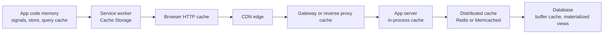
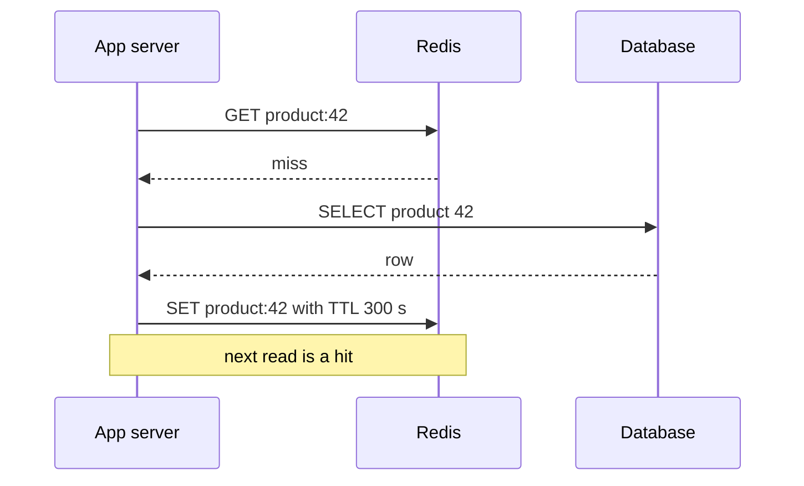
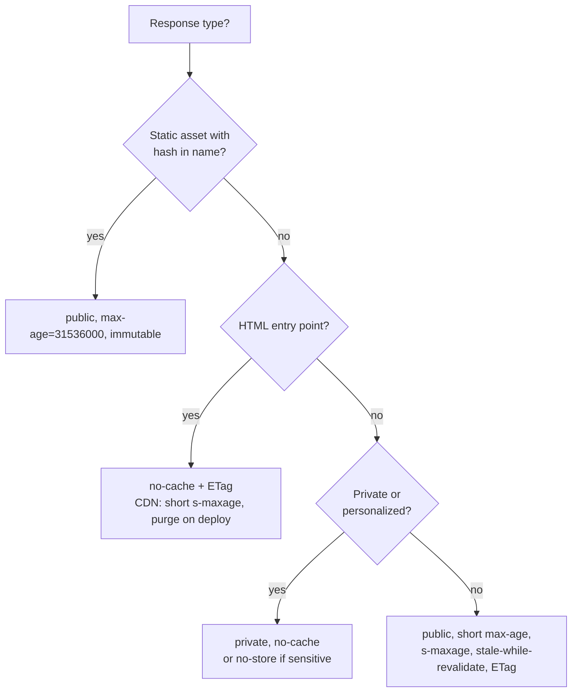
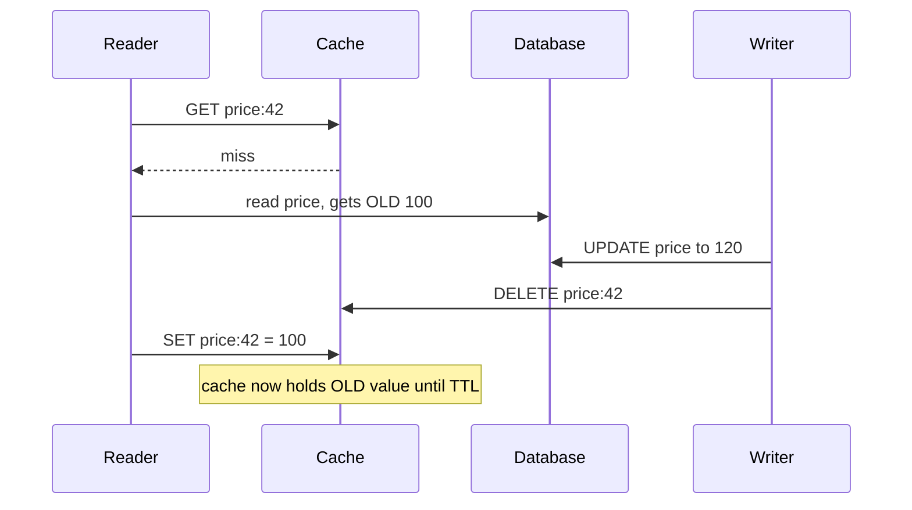

# Caching Strategies and Invalidation

> In this document you will learn caching as a whole-system design tool: every cache layer from the browser to the database, what to cache where, the main caching strategies, how to design HTTP and CDN caching for a real app, client-side data caching, and the hard part — keeping caches correct. Caching appears in almost every system design interview, because it is the cheapest way to scale reads and the easiest way to show wrong data.

**Before this:** [HTTP, HTTPS and TLS — HTTP caching](../01-cs-and-web-fundamentals/05-http-https-and-tls.md#http-caching) · [Caching in Node.js](../07-nodejs-backend/11-caching.md) · [Scalability and core building blocks](02-scalability-and-core-building-blocks.md) · **Interview questions:** [jump to the interview section](#interview-questions)

## Table of contents

1. [Caching at the system level](#caching-at-the-system-level)
2. [Cache layers end to end](#cache-layers-end-to-end)
3. [What to cache where](#what-to-cache-where)
4. [Caching strategies](#caching-strategies)
5. [HTTP caching design for a real app](#http-caching-design-for-a-real-app)
6. [CDN caching and invalidation](#cdn-caching-and-invalidation)
7. [Service worker caching](#service-worker-caching)
8. [Client data caching](#client-data-caching)
9. [Invalidation strategies and why invalidation is hard](#invalidation-strategies-and-why-invalidation-is-hard)
10. [Stampede, penetration and avalanche](#stampede-penetration-and-avalanche)
11. [Staleness trade-offs](#staleness-trade-offs)
12. [Multi-tenant and personalized cache keys](#multi-tenant-and-personalized-cache-keys)
13. [Measuring a cache](#measuring-a-cache)
14. [Common mistakes](#common-mistakes)
15. [Best practices](#best-practices)
16. [How to explain this in an interview](#how-to-explain-this-in-an-interview)
17. [Interview questions](#interview-questions)
18. [Summary](#summary)
19. [References](#references)

This document is the **system-level** view. Code for in-process caches, Redis, LRU, cache patterns and Express headers lives in [Caching in Node.js](../07-nodejs-backend/11-caching.md). The HTTP caching rules (`Cache-Control`, `ETag`, `304`) are explained in [HTTP, HTTPS and TLS](../01-cs-and-web-fundamentals/05-http-https-and-tls.md#http-caching). Here we connect all of them.

---

## Caching at the system level

### What it is

A **cache** is a place that keeps a copy of data so the next request can get it faster or cheaper than from the original source. The original source is often called the **origin** or the **source of truth**.

### Why it exists

- **Speed:** reading from memory near the user is much faster than a database query on another continent.
- **Cost and capacity:** each cache hit is work that the database or service does not do.
- **Resilience:** a cache can keep serving (stale) content when the origin is down.

### Analogy

A kitchen. The fridge is a cache for the supermarket. You keep the things you use most at home. It saves you a trip. But the milk in the fridge can go bad (stale data), the fridge has limited space (eviction), and if the shop changes its recipe, your copy at home is still the old one (invalidation).

### The core trade-off

Every cache trades **freshness** for **speed**. The design question is always: "How stale can this data be, for whom, and what happens if it is wrong?"

### The two hard questions

1. **Where** do I cache? (Which layer.)
2. **When** does the copy become wrong, and how do I fix it? (Invalidation.)

---

## Cache layers end to end

A single page view in a large app can pass through many caches.



Each layer, from closest to the user to farthest:

| Layer | What it holds | Who controls it | Typical lifetime | Shared between users? |
| --- | --- | --- | --- | --- |
| **App memory** (JS variables, NgRx store, TanStack Query cache, signals) | Parsed API data, UI state | Frontend code | Until reload or eviction | No |
| **Service worker** (Cache Storage API) | Responses you choose: app shell, assets, some API data | Your service worker code | Until you delete it | No |
| **Browser HTTP cache** (memory and disk) | Responses allowed by `Cache-Control` | Server headers | `max-age`, then revalidation | No |
| **CDN edge** | Public responses: assets, public HTML, public API data | Headers plus CDN config | Seconds to a year | Yes |
| **Gateway / reverse proxy** (NGINX, Varnish, API gateway cache) | Responses near the origin | Ops config | Seconds to minutes | Yes |
| **In-process cache** (a `Map` or `lru-cache` in Node) | Hot objects, config | Backend code | Seconds to minutes | Yes, but per server instance |
| **Distributed cache** (Redis, Memcached, Valkey) | Objects, query results, sessions, counters | Backend code | Seconds to hours | Yes, for all servers |
| **Database** (buffer pool, query plan cache, materialized views) | Pages of tables and indexes, precomputed results | Database and DBA | Managed by the DB | Yes |

Key idea: **the closer to the user, the faster and the harder to invalidate.** You can delete a Redis key instantly. You cannot delete a file from a million browsers' HTTP caches. That is why browser caching uses versioned URLs instead of invalidation.

---

## What to cache where

| Data | Best layer(s) | Why |
| --- | --- | --- |
| JS/CSS bundles with hashed names | Browser HTTP cache + CDN, for one year, `immutable` | The name changes when the content changes, so the cache is never wrong |
| `index.html` of a single-page app | CDN with short TTL or revalidation; browser `no-cache` | It points to the newest bundles; must update quickly after a deploy |
| Images, fonts, videos | CDN + browser, long TTL with versioned URLs | Large, rarely change |
| Public product catalog (anonymous) | CDN with short TTL (for example 60 s) + Redis | Many users read the same data |
| Product price and stock at checkout | No cache, or very short with a check at write | Wrong data costs money |
| User profile, user dashboard | Client query cache; Redis keyed by user | Private; per user |
| Session data | Redis | Shared by all app servers; fast |
| Feature flags, config | In-process cache with short TTL; client memory | Read on every request |
| Expensive aggregates (reports, counts) | Redis or materialized views, refreshed on a schedule | Costly to compute, can be minutes old |
| Search results for popular queries | CDN or Redis, short TTL | The same queries repeat |
| Auth decisions (permissions) | In-process or Redis, short TTL, invalidate on change | Read often, but must not stay wrong long |
| Secrets, tokens, personal data in shared caches | Never in shared caches | Data leaks |

---

## Caching strategies

These are the common patterns for how the cache and the database work together. Code for each is in [Caching in Node.js — Caching patterns](../07-nodejs-backend/11-caching.md#caching-patterns). Here is the system view.

### Cache-aside (lazy loading)

The application checks the cache. On a miss, it reads the database and puts the result in the cache.



- Good: simple; only requested data is cached; if the cache is down, the app still works (slower).
- Bad: the first request after a miss is slow; the cache can be stale until TTL or invalidation.
- The **default choice** for most systems.

### Read-through

Like cache-aside, but the cache itself loads from the database on a miss (a library or the cache product does it). The app only talks to the cache. Same trade-offs; cleaner app code.

### Write-through

Every write goes to the cache and the database together (synchronously). The cache is always up to date for written keys.

- Good: reads after writes are fresh.
- Bad: every write is slower; you cache data that may never be read.

### Write-back (write-behind)

Writes go to the cache only; the cache writes to the database later, in batches.

- Good: very fast writes; batches reduce database load.
- Bad: if the cache crashes before flushing, **data is lost**. Use only when some loss is acceptable (view counters, metrics) or the cache is durable.

### Write-around

Writes go directly to the database and skip the cache. The cache fills only on read. Often combined with "delete the cache key on write".

### Refresh-ahead

The cache refreshes popular keys **before** they expire, in the background. Users almost never see a miss.

- Good: stable low latency for hot keys.
- Bad: wasted work if the key is not read again; needs a way to know which keys are hot.

A related idea at the HTTP level is `stale-while-revalidate`: serve the stale copy immediately and refresh in the background.

### Comparison

| Strategy | Read latency | Write latency | Freshness | Data loss risk | Typical use |
| --- | --- | --- | --- | --- | --- |
| Cache-aside | Miss is slow, hit is fast | Normal | Stale until TTL/invalidation | None | Default for most reads |
| Read-through | Same | Normal | Same | None | When the cache library supports loaders |
| Write-through | Fast | Slower | Fresh for written keys | None | Read-after-write heavy data |
| Write-back | Fast | Very fast | Fresh in cache | Yes | Counters, metrics, buffers |
| Write-around | Miss after write | Normal | Fresh after miss | None | Write-heavy data rarely read soon |
| Refresh-ahead | Fast for hot keys | Normal | Mostly fresh | None | Hot keys with predictable reads |

---

## HTTP caching design for a real app

The HTTP header rules are in [HTTP caching](../01-cs-and-web-fundamentals/05-http-https-and-tls.md#http-caching). Here is how you design the headers for a typical single-page app (Angular, React, Vue) with an API.

### The three kinds of responses

**1. Hashed static assets** — `main.3f9a1c.js`, `styles.81bd.css`, `logo.4c2e.svg`

The build tool puts a **content hash** in the file name (see [Build tools — Content hashing](../05-frontend-engineering/10-build-tools-and-bundlers.md#minification-and-content-hashing)). When the content changes, the name changes. So the old URL can be cached forever.

```text
Cache-Control: public, max-age=31536000, immutable
```

- `max-age=31536000` = one year.
- `immutable` tells the browser not to revalidate even when the user reloads the page.

**2. The HTML entry point** — `index.html`

It contains `<script src="main.3f9a1c.js">`. After a deploy, it must point to the new files quickly.

```text
Cache-Control: no-cache
ETag: "v2026-10-22-1"
```

- `no-cache` does **not** mean "do not store". It means "store, but check with the server before using it". The check is cheap: with an `ETag`, the server answers `304 Not Modified` with no body if nothing changed.
- At the CDN you can allow a short shared TTL, for example `s-maxage=60`, and purge on deploy.

**3. API responses** — depends on the data:

| API data | Header | Why |
| --- | --- | --- |
| Private user data (`/api/me`, `/api/orders`) | `Cache-Control: private, no-cache` (or `no-store` for sensitive data) | Never stored in shared caches; revalidated before use |
| Very sensitive (banking details, health data) | `Cache-Control: no-store` | Not stored anywhere |
| Public, changes slowly (`/api/categories`) | `Cache-Control: public, max-age=60, s-maxage=300, stale-while-revalidate=600` | Browser keeps 1 minute, CDN 5 minutes, then serves stale up to 10 more minutes while refreshing |
| Public, must be fresh-ish (`/api/products/42` price) | `public, max-age=0, s-maxage=30` + `ETag` | Browser always asks; CDN absorbs repeated requests for 30 s |

`s-maxage` applies only to shared caches (CDN, proxies). `max-age` applies to the browser (and to shared caches when there is no `s-maxage`).

### ETag and conditional requests

An **ETag** is a version identifier for a response (often a hash of the body or a row version). The browser sends it back in `If-None-Match`. If the server's current ETag is the same, it answers `304 Not Modified` without the body.

```text
First request:
  GET /api/categories
  ← 200 OK, ETag: "c-17", body 40 KB

Later:
  GET /api/categories
  If-None-Match: "c-17"
  ← 304 Not Modified, no body
```

This saves bandwidth, and if the server can check the version without building the full response (for example from a `version` column), it also saves server work.

### Vary

**`Vary`** tells caches which request headers change the response. A cache keeps a separate copy for each combination.

```text
Vary: Accept-Encoding        ✅ separate gzip/brotli/plain copies — normal
Vary: Accept-Language        ✅ separate copies per language
Vary: Cookie                 ⚠️ almost every user has a different cookie → cache hit ratio near zero
Vary: Authorization          ⚠️ same problem; for private data use "private" instead
```

### Putting it together



### Example: Express setup

```js
import express from 'express';
const app = express();

// 1. Hashed assets: cache for a year
app.use('/assets', express.static('dist/assets', {
  immutable: true,
  maxAge: '1y',
}));

// 2. Public API data: short shared caching
app.get('/api/categories', async (req, res) => {
  res.set('Cache-Control', 'public, max-age=60, s-maxage=300, stale-while-revalidate=600');
  res.json(await categoryService.list()); // Express adds a weak ETag for res.json by default
});

// 3. Private API data
app.get('/api/me', requireAuth, async (req, res) => {
  res.set('Cache-Control', 'private, no-cache');
  res.json(await userService.get(req.user.id));
});

// 4. SPA fallback: index.html must revalidate
app.get('*', (req, res) => {
  res.set('Cache-Control', 'no-cache');
  res.sendFile('dist/index.html', { root: process.cwd() });
});
```

(In Express 5 the catch-all route syntax changed: use `app.get('/{*splat}', ...)` instead of `'*'`. See [HTTP servers and Express](../07-nodejs-backend/06-http-servers-and-express.md).)

---

## CDN caching and invalidation

### The CDN cache key

The **cache key** decides when two requests share one cached copy. By default it is usually the URL (host + path + query string), plus headers listed in `Vary`.

Problems and fixes:

| Problem | Example | Fix |
| --- | --- | --- |
| Tracking parameters split the cache | `?utm_source=mail` vs `?utm_source=ad` | Remove or ignore these parameters in the cache key |
| Parameter order splits the cache | `?a=1&b=2` vs `?b=2&a=1` | Normalize (sort) query strings |
| Cookies make every request unique | Analytics cookies forwarded to the origin | Do not include cookies in the key for public content |
| Private data cached publicly | Origin forgot `private` on `/api/me` | Default to "do not cache" for API paths; allow-list cacheable paths |

### Ways to get new content to users

There are three main ways. Good systems use them together.

**1. Versioned URLs (cache busting)**

Put a version or content hash in the URL. A new version is a new URL, so no old copy exists to be wrong.

```html
<!-- Old deploy -->
<script src="/assets/main.3f9a1c.js"></script>
<!-- New deploy: new URL, nothing to invalidate -->
<script src="/assets/main.b72e04.js"></script>
```

Also for user content: `/avatars/42.jpg?v=7` or `/avatars/42-7.jpg` after the user changes their photo.

**2. Purge (explicit invalidation)**

Tell the CDN to delete cached copies:

- **By URL:** purge `/products/42`.
- **By tag / surrogate key:** the origin labels responses, for example `Surrogate-Key: product-42 category-7` (Fastly) or `Cache-Tag: product-42` (Cloudflare). Later you purge everything with the tag `product-42`: the product page, the category pages that list it, and the API response. This is very useful when one change affects many URLs.
- **Everything:** a full purge. Avoid it in production — every edge then misses at once and the origin gets a traffic spike (see [avalanche](#stampede-penetration-and-avalanche)).

Purges take time to reach all edge locations (usually seconds, depending on the provider). Purge also only affects the CDN; browsers may still have their own copy until `max-age` ends. That is why browser `max-age` for changeable content should be short.

**3. TTL expiry**

Let copies expire. Simple and always works. Use a TTL as a safety net even when you also purge.

### Deploy order for an SPA

A common bug: a user gets the new `index.html`, but the new JS files are not on the CDN or origin yet → 404, white screen. Or old cached HTML references old bundles that were deleted.

Safe order:

1. Upload new hashed assets (do not delete the old ones yet).
2. Upload the new `index.html`.
3. Purge `index.html` at the CDN.
4. Delete old assets only after some days (users with an open tab may still lazy-load old chunks).

### Stale content on purpose

- `stale-while-revalidate=N` (RFC 5861): after the copy becomes stale, serve it for up to N more seconds while fetching a fresh one in the background.
- `stale-if-error=N` (RFC 5861): if the origin is failing, serve the stale copy for up to N seconds. CDN support varies; check your provider.

These turn short origin outages into "slightly old data" instead of errors.

---

## Service worker caching

### What it is

A **service worker** is a script that the browser runs in the background, separate from the page. It can intercept network requests from the page and answer them from the **Cache Storage API** — a cache that *you* control completely in code.

### Why it exists

- Offline support (Progressive Web Apps).
- Instant loads of the app shell.
- Custom caching strategies per request type.

### Common strategies

| Strategy | How | Good for |
| --- | --- | --- |
| Cache first | Answer from cache; go to network only on miss | Hashed assets, fonts |
| Network first | Try network; use cache if offline or slow | HTML, API data that should be fresh |
| Stale-while-revalidate | Answer from cache immediately, update cache from network in background | Avatars, non-critical API data |
| Network only | Never cache | Payments, auth |
| Cache only | Precached at install | App shell in offline apps |

```js
// sw.js — stale-while-revalidate for API GET requests (simplified)
self.addEventListener('fetch', (event) => {
  const url = new URL(event.request.url);
  if (event.request.method !== 'GET' || !url.pathname.startsWith('/api/catalog')) return;

  event.respondWith((async () => {
    const cache = await caches.open('catalog-v1');
    const cached = await cache.match(event.request);
    const network = fetch(event.request).then((response) => {
      if (response.ok) cache.put(event.request, response.clone());
      return response;
    });
    if (cached) {
      event.waitUntil(network.catch(() => {})); // keep the worker alive for the refresh
      return cached;
    }
    return network;
  })());
});
```

This is browser-only code (service workers do not run in Node.js).

### Angular

Angular has `@angular/service-worker` (`ng add @angular/pwa`). You configure caching in `ngsw-config.json`: `assetGroups` for files (prefetch or lazy) and `dataGroups` for API URLs with a `performance` (cache first) or `freshness` (network first) strategy, `maxAge` and `maxSize`.

### Danger

A buggy service worker can keep serving an old app for a long time. Always:

- version your caches (`catalog-v2`) and delete old ones in the `activate` event,
- have a "kill switch" plan (deploy a service worker that unregisters itself),
- never cache private API data in a shared device context without thinking about logout (clear caches on logout).

---

## Client data caching

### What it is

**Client data caching** means keeping server data (server state) in the app's memory, keyed by the request, so components can show it immediately and refetch only when needed. The concept of server state is explained in [Components and state management — Server state](../05-frontend-engineering/06-components-and-state-management.md#server-state-and-server-state-libraries). Fetch-level patterns (deduplication, cancellation) are in [API integration and data fetching](../05-frontend-engineering/07-api-integration-and-data-fetching.md#client-side-caching-and-stale-while-revalidate).

### The stale-while-revalidate idea in the client

1. Show cached data immediately (if any).
2. If it is older than the "stale time", refetch in the background.
3. Replace the data when the new response arrives.

A tiny version you can run in Node.js (an injected clock makes it testable):

```js
function createSwrCache({ staleAfterMs, fetcher, now = () => Date.now() }) {
  const entries = new Map(); // key -> { data, storedAt, refreshing }

  return async function get(key) {
    const entry = entries.get(key);
    if (entry && now() - entry.storedAt < staleAfterMs) {
      return { data: entry.data, from: 'fresh cache' };
    }
    if (entry) {
      if (!entry.refreshing) {
        entry.refreshing = fetcher(key)
          .then((data) => { entries.set(key, { data, storedAt: now() }); })
          .catch(() => { entry.refreshing = null; }); // keep stale data on error
      }
      return { data: entry.data, from: 'stale cache, refreshing' };
    }
    const data = await fetcher(key);
    entries.set(key, { data, storedAt: now() });
    return { data, from: 'network' };
  };
}

let clock = 0;
let version = 1;
const get = createSwrCache({
  staleAfterMs: 1000,
  now: () => clock,
  fetcher: async (key) => `${key} v${version++}`,
});

console.log(await get('/api/products')); // { data: '/api/products v1', from: 'network' }
clock = 500;
console.log(await get('/api/products')); // { data: '/api/products v1', from: 'fresh cache' }
clock = 1500;
console.log(await get('/api/products')); // { data: '/api/products v1', from: 'stale cache, refreshing' }
await Promise.resolve(); await Promise.resolve(); // let the background refresh finish
console.log(await get('/api/products')); // { data: '/api/products v2', from: 'fresh cache' }
```

Step by step:

1. `clock = 0`: no entry → fetch from network → v1 stored at time 0.
2. `clock = 500`: age 500 ms < 1000 → fresh hit.
3. `clock = 1500`: age 1500 ms ≥ 1000 → return v1 immediately, start a background fetch.
4. After the background fetch finishes, v2 is stored at time 1500 → the next read is a fresh hit with v2.

### Libraries

| Library | Framework | Key ideas |
| --- | --- | --- |
| TanStack Query | React, Vue, Solid, Svelte; Angular adapter (`@tanstack/angular-query-experimental`, supports Angular 16+, still experimental) | Query keys, `staleTime` (default 0), `gcTime` (default 5 minutes; called `cacheTime` before v5), background refetch on focus/reconnect, mutations with invalidation |
| SWR (Vercel) | React | `useSWR(key, fetcher)`, deduplication, revalidate on focus |
| RTK Query | Redux | Tags for invalidation (`providesTags`, `invalidatesTags`) |
| Apollo Client / urql | GraphQL | Normalized cache by type and ID |
| NgRx Entity + effects | Angular | Entity collections in the store; you write the caching rules |
| `shareReplay` in a service | Angular (RxJS) | Simple shared cache of one observable |

TanStack Query example (React) showing invalidation after a mutation:

```js
import { useQuery, useMutation, useQueryClient } from '@tanstack/react-query';

function useProducts(categoryId) {
  return useQuery({
    queryKey: ['products', { categoryId }],
    queryFn: () => fetch(`/api/products?category=${categoryId}`).then((r) => r.json()),
    staleTime: 30_000, // data is fresh for 30 s; no refetch on mount during that time
  });
}

function useRenameProduct() {
  const queryClient = useQueryClient();
  return useMutation({
    mutationFn: ({ id, name }) =>
      fetch(`/api/products/${id}`, {
        method: 'PATCH',
        headers: { 'Content-Type': 'application/json' },
        body: JSON.stringify({ name }),
      }).then((r) => r.json()),
    onSuccess: () => {
      // every query whose key starts with ['products'] becomes stale and refetches if in use
      queryClient.invalidateQueries({ queryKey: ['products'] });
    },
  });
}
```

Angular 16 example with a small service cache (works without extra libraries):

```ts
import { Injectable } from '@angular/core';
import { HttpClient } from '@angular/common/http';
import { Observable, shareReplay, timer, switchMap } from 'rxjs';

interface Category { id: string; name: string; }

@Injectable({ providedIn: 'root' })
export class CategoryService {
  private categories$?: Observable<Category[]>;

  constructor(private http: HttpClient) {}

  getCategories(): Observable<Category[]> {
    // One shared request; refresh every 5 minutes while someone is subscribed.
    this.categories$ ??= timer(0, 5 * 60_000).pipe(
      switchMap(() => this.http.get<Category[]>('/api/categories')),
      shareReplay({ bufferSize: 1, refCount: true }),
    );
    return this.categories$;
  }

  invalidate(): void {
    this.categories$ = undefined; // next call creates a fresh request
  }
}
```

With `refCount: true`, the timer stops when the last subscriber unsubscribes. When a new subscriber comes later, `shareReplay` starts a new request.

### Query key design

The **query key** must include every input that changes the result — just like a server cache key:

```js
['products', { categoryId: 7, sort: 'price', page: 2 }]  // ✅ includes all filters
['products']                                           // ❌ two different filters share one entry
```

In a multi-tenant app, include the tenant (or clear the whole cache on tenant switch) — see [Multi-tenant and personalized cache keys](#multi-tenant-and-personalized-cache-keys).

---

## Invalidation strategies and why invalidation is hard

> "There are only two hard things in Computer Science: cache invalidation and naming things." — attributed to Phil Karlton

### Why it is hard

1. **Many copies.** The same data can be in Redis, three app servers' memory, the CDN, the browser cache and the client store. A change must reach all of them, or you must accept they are old for a while.
2. **Many keys depend on one change.** Renaming a product affects `product:42`, the category list, search results, the home page, the "recently viewed" widget.
3. **Race conditions.** Reads and writes happen at the same time on different servers.
4. **Failures.** The database update succeeds, but the invalidation message is lost.

### The classic race condition

With cache-aside plus "delete on write":



The reader read the old value *before* the update, but wrote it to the cache *after* the delete. Now the cache is wrong until the TTL ends.

How to reduce it:

- **Always use a TTL** as the last safety net. The wrong value lives at most that long.
- **Delayed double delete:** delete on write, then delete again after a short delay (for example 1 second).
- **Version check:** store the row version with the cached value; only `SET` if the version is newer than what is in the cache (a Lua script in Redis can do compare-and-set).
- **Leases:** the cache gives a token on a miss; a `SET` is accepted only with a valid token, and a delete cancels the tokens. Facebook described this in "Scaling Memcache at Facebook" (2013).
- **Update from a change stream:** a single process reads the database change log (CDC) and updates or deletes cache keys in order.

### The main strategies

**1. TTL (time to live)**

Every entry expires after a time. No code is needed at write time.

- Good: simple, always eventually correct, self-healing.
- Bad: data can be stale up to the TTL; too short a TTL lowers the hit ratio.
- Add **jitter** (a random part) to TTLs so many keys do not expire at the same moment.

**2. Explicit delete on write (event-driven in one service)**

After updating the database, delete the related cache keys.

```js
async function renameProduct(id, name) {
  await db.query('UPDATE products SET name = $1, version = version + 1 WHERE id = $2', [name, id]);
  await redis.del(`product:${id}`);
  // other keys that include this product: list pages, search...
}
```

- Good: fresh data quickly.
- Bad: you must know every key that depends on the change.

**3. Events across services**

The service that owns the data publishes an event (`ProductUpdated { id, version }`). Every service or cache that holds a copy listens and invalidates. Use the outbox pattern so the event is not lost ([Background jobs and queues — The outbox pattern](../07-nodejs-backend/13-background-jobs-and-queues.md#the-outbox-pattern)).

For in-process caches on many servers, use Redis pub/sub or a broker to broadcast "delete key X" to every instance.

**4. Versioning (namespaces)**

Put a version in the key: `catalog:v17:product:42`. To invalidate a whole group, increase the version (`catalog:v18:...`). Old keys are never read again and expire by TTL.

- Good: invalidates thousands of keys with one change; no race with old readers.
- Bad: extra lookup for the current version; old keys use memory until they expire.

**5. Tags**

Store which tags each entry belongs to (`product-42`, `category-7`). Invalidate by tag. CDNs support this (surrogate keys / cache tags). In Redis you can keep a set per tag that lists the keys.

### Choosing a strategy

| Situation | Strategy |
| --- | --- |
| Data can be a few minutes old | TTL only |
| One service owns the data and the cache | Delete on write + TTL |
| Many services keep copies | Events (with outbox) + TTL |
| A large group changes together (whole catalog import) | Version namespace |
| One change affects many URLs or pages | Tags (CDN or app) |
| Immutable content | Versioned URLs, never invalidate |

---

## Stampede, penetration and avalanche

These are the three classic ways a cache fails under load. Code examples are in [Caching in Node.js — When caches fail](../07-nodejs-backend/11-caching.md#when-caches-fail-stampede-penetration-and-avalanche). Here is the system-level view.

### Cache stampede (thundering herd, dog-piling)

A **hot key** expires. Thousands of requests miss at the same moment and all hit the database for the same data.

Protections:

- **Request coalescing (single flight):** only one request loads the value; the others wait for it.
- **Locks:** a short distributed lock (`SET key NX PX 5000` in Redis) so only one server recomputes.
- **Serve stale while refreshing** (stale-while-revalidate, refresh-ahead).
- **Probabilistic early expiration:** each read has a small chance to refresh before the TTL ends, so refreshes spread out.

```js
// Single flight inside one process: 100 concurrent requests, 1 database call.
const inFlight = new Map();
let dbCalls = 0;

async function loadProductFromDb(id) {
  dbCalls++;
  await new Promise((resolve) => setTimeout(resolve, 50)); // pretend query
  return { id, name: 'Laptop' };
}

async function getProductCoalesced(id) {
  if (inFlight.has(id)) return inFlight.get(id);
  const promise = loadProductFromDb(id).finally(() => inFlight.delete(id));
  inFlight.set(id, promise);
  return promise;
}

const results = await Promise.all(
  Array.from({ length: 100 }, () => getProductCoalesced('p1')),
);
console.log(results.length, dbCalls); // 100 1
```

Across many servers, each server still makes one call. That is usually fine (20 servers = 20 calls, not 20,000). If not, add a distributed lock. CDNs have the same feature, often called "request collapsing" or "origin shielding".

### Cache penetration

Requests for keys that **do not exist** (for example `/products/999999999`) always miss the cache and always hit the database. Attackers can use this on purpose.

Protections:

- **Cache negative results** ("not found") with a short TTL.
- **Bloom filter** of existing IDs: a compact data structure that can say "definitely not present" quickly, so you reject impossible IDs before the database.
- **Validate input** (ID format) and rate limit.

### Cache avalanche

**Many keys expire at the same time**, or the whole cache goes down (restart, failover, full CDN purge). The database receives the full traffic at once.

Protections:

- **TTL jitter:** `ttl = 300 + random(0..60)` seconds.
- **Highly available cache:** replicas, Redis Sentinel or Cluster.
- **Warm the cache** before sending traffic to a new cache node.
- **Circuit breakers and rate limits** in front of the database so it degrades instead of crashing.
- **Avoid full CDN purges**; purge by tag or URL.

### Hot keys

One key gets a huge share of traffic (a celebrity profile, a flash-sale product). One Redis node holds it and becomes the bottleneck.

Protections: a small in-process cache in front of Redis for that key (a few seconds TTL), replicate the key under several names (`hot:42#0..#9`) and pick one randomly, or read from replicas.

---

## Staleness trade-offs

Not all data needs the same freshness. Decide per data type and write it down.

| Data | Acceptable staleness | Approach |
| --- | --- | --- |
| Static assets | Never stale (versioned URLs) | Hash in file name, 1-year cache |
| Blog posts, docs, marketing pages | Minutes | CDN TTL + purge on publish |
| Product descriptions and images | Minutes | CDN + Redis, purge by tag |
| Product price on listing page | Seconds to a minute | Short TTL, but **re-check at checkout** |
| Stock count on listing page | Seconds ("only a few left") | Short TTL; exact check when reserving |
| Like and view counts | Minutes | Write-back counters, periodic flush |
| User's own profile after edit | Zero for the user (read-your-writes) | Update client cache from response; bypass shared cache |
| Permissions and roles | Seconds, bounded | Short TTL + invalidate on change; token lifetime |
| Account balance, payment status | Zero | No cache; read from the source of truth |

The pattern: **cache for display, verify at the decision point**. The product list can show a cached price, but the order service always reads the real price when it creates the order.

---

## Multi-tenant and personalized cache keys

### The danger

If a cache key does not include everything that changes the response, one user can see another user's data. This is a **data leak**, and it is one of the most serious caching bugs.

```js
// ❌ Wrong: the key ignores the tenant. Tenant A's dashboard is served to tenant B.
const key = `dashboard:summary`;

// ❌ Wrong: the key ignores the user's role. A manager's view (with salaries) is cached
// and served to a normal employee.
const key2 = `team:${teamId}:members`;

// ✅ Correct: include tenant and everything that changes the result.
const key3 = `t:${tenantId}:team:${teamId}:members:role:${role}`;
```

### A key builder

Use one helper so nobody forgets a part of the key:

```js
function cacheKey({ tenantId, resource, id = '', params = {}, variant = '' }) {
  if (!tenantId) throw new Error('tenantId is required for cache keys');
  const sortedParams = Object.keys(params)
    .sort()
    .map((k) => `${k}=${params[k]}`)
    .join('&');
  return ['t', tenantId, resource, id, sortedParams, variant].filter(Boolean).join(':');
}

console.log(cacheKey({ tenantId: 'acme', resource: 'products', params: { sort: 'price', page: 2 } }));
// t:acme:products:page=2&sort=price
console.log(cacheKey({ tenantId: 'acme', resource: 'report', id: 'q3', variant: 'role=manager' }));
// t:acme:report:q3:role=manager
```

Sorting the parameters means `?sort=price&page=2` and `?page=2&sort=price` share one entry.

### Rules for personalized data

- **Shared caches (CDN, proxy):** do not store personalized responses. Send `Cache-Control: private` or `no-store`. If you must (for example a per-user CDN cache), the key must contain the user identity and you must test it carefully.
- **Server caches:** prefix every key with the tenant ID (and user ID for user data). Some teams use a separate Redis database or cluster per large tenant for stronger isolation.
- **Client caches:** clear the query cache, NgRx store and service worker caches on **logout** and on **tenant switch**. Also cancel in-flight requests so an old tenant's response cannot arrive after the switch.
- **Split public and private parts** of a page: cache the public product data at the CDN; load the personal part ("your price", "in your cart") with a separate private request. Some CDNs also support edge includes (ESI) to assemble pages.
- **Logs and metrics:** include the tenant ID in cache metrics to find a tenant that floods the cache.

Multi-tenant architecture in general is covered in [Auth architecture and multi-tenancy](06-auth-architecture-and-multi-tenancy.md#tenant-aware-caching-logging-and-rate-limits).

---

## Measuring a cache

### Hit ratio

```text
hit ratio = hits / (hits + misses)
```

A hit ratio of 90% means 9 of 10 requests are served by the cache.

Why small changes matter: with 10,000 requests per second,

| Hit ratio | Requests reaching the database per second |
| --- | --- |
| 80% | 2,000 |
| 90% | 1,000 |
| 99% | 100 |

Going from 90% to 99% cuts database load by 10×.

### Effective latency

```text
average latency = hitRatio × hitLatency + (1 − hitRatio) × missLatency
```

With a 1 ms hit and a 20 ms miss:

```text
80% → 0.8 × 1 + 0.2 × 20  = 4.8 ms
90% → 0.9 × 1 + 0.1 × 20  = 2.9 ms
99% → 0.99 × 1 + 0.01 × 20 = 1.19 ms
```

But remember percentiles: even with a great average, the p99 is still about the miss latency. That is why stampede protection and refresh-ahead matter for tail latency.

### What to measure

| Metric | Why |
| --- | --- |
| Hit ratio (per cache, per key prefix) | Is the cache useful? Which data does not cache well? |
| Byte hit ratio (CDN) | Big files matter more for bandwidth cost |
| Latency of hits and misses | Is the cache itself slow? |
| Eviction rate | Is the cache too small? |
| Memory used, number of keys | Capacity planning |
| Origin request rate | The real load you protect |
| Stale-served count, errors | How often users see old data |

A low hit ratio usually means: TTL too short, keys too specific (a timestamp or random value in the key), cache too small (high eviction), or data that is not reused.

At the CDN, check response headers like `Age` (seconds the copy has been in a cache) and provider headers such as `CF-Cache-Status: HIT` (Cloudflare) or `X-Cache: Hit from cloudfront` (CloudFront).

---

## Common mistakes

| Mistake | Consequence | Fix |
| --- | --- | --- |
| Caching private responses at the CDN | Data leak between users | `private` / `no-store`; allow-list cacheable paths |
| Cache key missing tenant, role or language | Wrong or leaked data | One key builder that requires these parts |
| `max-age` of a day on `index.html` | Users run an old app for a day after deploy | `no-cache` + ETag on HTML |
| Deleting old hashed assets on deploy | Open tabs fail to lazy-load chunks | Keep old assets for some days |
| No TTL "because we invalidate" | A missed invalidation is wrong forever | Always set a TTL safety net |
| Same TTL on all keys | Avalanche when they expire together | Add jitter |
| Full CDN purge on every deploy | Origin traffic spike | Purge only HTML or by tag |
| Caching errors (500) with a long TTL | Outage continues after the fix | Do not cache errors, or only for a few seconds |
| Showing cached price at checkout | Wrong charges | Verify at the decision point |
| Not clearing client caches on logout | Next user on the device sees old data | Clear stores, query cache, SW caches |
| Using `Vary: Cookie` on public content | Hit ratio near zero | Strip cookies; use `private` for personalized content |
| Adding a cache before fixing a slow query | Hides the problem; misses are still slow | Index and optimize first, then cache |

---

## Best practices

- **Decide freshness per data type** and write it down — staleness is a product decision, not only a technical one.
- **Version immutable things** (hashed assets, versioned user content). Versioned URLs never need invalidation.
- **Use a TTL on everything**, with jitter. It limits the damage of every invalidation bug.
- **Cache for display, verify at decisions** (price, stock, permissions).
- **Put tenant and all inputs in cache keys**, built by one helper.
- **Prefer delete over update on write** in cache-aside, and protect against the read-write race with TTLs or version checks.
- **Protect hot keys and expirations** with single flight, stale-while-revalidate and jitter.
- **Make the system work without the cache** (slower). The cache is an optimization, not a source of truth — unless you designed it to be durable.
- **Measure hit ratio and origin load**, and alert when they change suddenly.
- **Test invalidation paths** with integration tests: update data, then assert the next read is fresh.

---

## How to explain this in an interview

1. **Define it:** "Caching keeps a copy of data closer to where it's used, so we avoid repeating slow or expensive work."
2. **Why it exists:** "It cuts latency and origin load — most systems are read-heavy, so caching is the cheapest way to scale reads."
3. **How it works:** "There are layers: browser and client caches, service worker, CDN, gateway, in-process, Redis, and the database itself. On the server I usually use cache-aside with a TTL and delete keys on write. On the web, hashed assets are cached for a year, HTML is revalidated, and API responses get headers based on whether they're public or private."
4. **Small example:** "For a product catalog, the CDN caches public product pages for 60 seconds with stale-while-revalidate, Redis caches product objects for 5 minutes, and an update publishes an event that purges the product's CDN tag and deletes its Redis key."
5. **Where it is useful:** "Catalogs, feeds, dashboards with expensive aggregates, config and feature flags, sessions."
6. **Trade-offs / gotchas:** "Stale data and invalidation bugs, data leaks from bad keys, and stampedes when hot keys expire. So I set TTLs with jitter, include tenant and user in keys, coalesce requests, and verify critical data like price at checkout."

---

## Interview questions

### Q1. Walk me through all the cache layers a request can pass through in a web app.

**What the interviewer is checking:** End-to-end understanding, not just "use Redis".

**Short spoken answer (30–60 seconds):**
> Starting at the user: the app itself keeps server data in memory — a store or a query cache. A service worker can answer from Cache Storage. Then the browser HTTP cache, controlled by Cache-Control headers. Then the CDN edge, which serves public content close to the user. Then maybe a reverse proxy or gateway cache near the origin. Inside the backend there's an in-process cache per server and a distributed cache like Redis shared by all servers. Finally the database has its own buffer cache and maybe materialized views. The closer to the user, the faster — but the harder to invalidate. That's why browser-level caching relies on versioned URLs, while Redis keys can be deleted instantly.

**Follow-up questions:**
- **Which layer would you add first for a read-heavy public site?** — A CDN for static assets and public pages; it removes the most traffic with the least code.
- **Why have an in-process cache when you have Redis?** — It avoids a network round trip for very hot, small data (config, feature flags). The cost: each server has its own copy, so invalidation needs a broadcast or a short TTL.

**Common mistakes:** Listing only Redis; not mentioning that invalidation difficulty grows toward the user.

**Where this is used in real projects:** Every large web app uses most of these layers.

### Q2. How would you set caching headers for an Angular or React SPA deployed to a CDN?

**What the interviewer is checking:** Practical HTTP caching design.

**Short spoken answer (30–60 seconds):**
> Three groups. Hashed bundles like `main.3f9a.js` get `public, max-age=31536000, immutable`, because a new build gives them a new name. `index.html` gets `no-cache` with an ETag, so the browser always revalidates and picks up a new deploy immediately; at the CDN I might allow a short shared TTL and purge it on deploy. API responses depend on the data: private user data gets `private, no-cache` or `no-store` if sensitive; public data like categories gets a short `max-age`, a longer `s-maxage` for the CDN, and `stale-while-revalidate`. On deploy I upload new assets first, then the HTML, then purge the HTML, and keep old chunks for a while for users with open tabs.

**Follow-up questions:**
- **What does `no-cache` mean?** — Store it, but revalidate with the server before each use. `no-store` means don't store it at all.
- **Why keep old chunks?** — A user with the old app open may lazy-load a route; its chunk URL is from the old build. If it's deleted, they get a chunk load error.
- **How do you handle chunk load errors anyway?** — Catch them globally and prompt for a reload (or reload once automatically).

**Common mistakes:** Caching `index.html` for hours; using `no-cache` thinking it means "never cache".

**Where this is used in real projects:** Every SPA on S3 + CloudFront, Netlify, Vercel, Azure Static Web Apps.

### Q3. Compare cache-aside, write-through and write-back.

**What the interviewer is checking:** Knowing the patterns and their failure trade-offs.

**Short spoken answer (30–60 seconds):**
> In cache-aside, the app reads the cache, and on a miss reads the database and fills the cache; on write it updates the database and deletes the key. It's simple and survives a cache outage, but the first read is slow and data can be stale until TTL or invalidation. Write-through writes to the cache and database together, so reads after writes are fresh, but writes are slower and you cache things nobody reads. Write-back writes only to the cache and flushes to the database later in batches — very fast writes, but you can lose data if the cache dies before flushing. I use cache-aside by default, write-through for data that's read right after it's written, and write-back only for things like counters where small loss is acceptable.

**Follow-up questions:**
- **Why delete the key on write instead of updating it?** — Updating can write an older value if two writes race; deleting is simpler and the next read loads the current value.
- **What is refresh-ahead?** — Refreshing hot keys before they expire so users don't see misses.

**Common mistakes:** Not mentioning data loss in write-back.

**Where this is used in real projects:** Cache-aside with Redis is the most common pattern in Node.js services.

### Q4. Why is cache invalidation hard? Show a race condition.

**What the interviewer is checking:** Deep understanding beyond "delete the key".

**Short spoken answer (30–60 seconds):**
> Because the same data has many copies in many layers, one change can affect many keys, events can be lost, and reads and writes race on different servers. Classic race with cache-aside: a reader misses, reads the old value from the database, then a writer updates the database and deletes the cache key, and then the reader writes its old value into the cache. Now the cache is wrong until the TTL. To limit it, I always set a TTL; I can do a delayed second delete; I can store a version with the value and only set if it's newer; or use leases like Facebook's memcache, where a delete invalidates the reader's right to set.

**Code or diagram:** See the sequence diagram in [The classic race condition](#the-classic-race-condition).

**Follow-up questions:**
- **How do you invalidate copies in other services?** — The owner publishes an event (with the outbox pattern so it's not lost); subscribers delete their keys. TTL still applies as a safety net.
- **How do you invalidate in-process caches on 20 servers?** — Broadcast via Redis pub/sub or a message bus, or keep a short TTL.

**Common mistakes:** Claiming "delete on write" is always correct.

**Where this is used in real projects:** Any service with caches across replicas; the memcache leases paper is a well-known reference.

### Q5. What are cache stampede, cache penetration and cache avalanche? How do you prevent each?

**What the interviewer is checking:** Known failure modes and mitigations.

**Short spoken answer (30–60 seconds):**
> A stampede is when a hot key expires and thousands of requests miss at once and all hit the database. I prevent it with request coalescing — one request loads, others wait — a short distributed lock, or serving stale while refreshing. Penetration is requests for keys that don't exist, so they always miss — often from bots. I cache "not found" for a short time, validate IDs, rate limit, or use a Bloom filter. An avalanche is many keys expiring at the same time or the whole cache going down, so the database gets all traffic. I add random jitter to TTLs, make the cache highly available, warm it before traffic, and protect the database with circuit breakers and rate limits.

**Follow-up questions:**
- **What is a Bloom filter?** — A compact bit array with several hash functions. It can say "definitely not in the set" or "probably in the set", with no false negatives and a tunable false positive rate.
- **Does single flight in one process solve stampede across 50 servers?** — It reduces it to at most one call per server (50 calls). If that's still too much, add a distributed lock or a CDN/origin shield.

**Common mistakes:** Mixing up the three; only mentioning "increase TTL".

**Where this is used in real projects:** Flash sales, homepage hot keys, bot traffic on product IDs.

### Q6. How do CDNs get new content to users after a change?

**What the interviewer is checking:** Versioning vs purging vs TTL.

**Short spoken answer (30–60 seconds):**
> Three ways, usually combined. First, versioned URLs: put a content hash or version in the URL, so a change is a new URL and nothing needs invalidating — best for assets and user uploads. Second, purge: tell the CDN to drop cached copies, by URL or by tag. Tags are powerful: I label the product page, the category pages and the API response with `product-42`, and one purge clears all of them. Third, TTL: copies expire on their own, which is the safety net. Purge doesn't reach browser caches, so changeable content should have short browser max-age. And I avoid full purges because every edge misses at once and floods the origin.

**Follow-up questions:**
- **How long does a purge take?** — It depends on the provider; usually seconds. Design for "a short time", not instantly.
- **What is origin shielding?** — A designated mid-tier cache location that edges ask before the origin, so the origin sees fewer requests.

**Common mistakes:** Thinking purge also clears browser caches.

**Where this is used in real projects:** CloudFront invalidations, Fastly surrogate keys, Cloudflare cache tags.

### Q7. A user in tenant B sees tenant A's dashboard data. What could cause this and how do you fix it?

**What the interviewer is checking:** Security awareness in caching.

**Short spoken answer (30–60 seconds):**
> Most likely a cache key that doesn't include the tenant. It could be on the server — a Redis key like `dashboard:summary` — or at the CDN, if the API response was cacheable as public and the cache key didn't include the auth context. It could also be on the client: the query cache or store wasn't cleared on tenant switch, or an old request finished after the switch and wrote old data. To fix: build all server cache keys with a helper that requires the tenant ID; mark tenant data `private` or `no-store` so shared caches never keep it; clear client caches and cancel in-flight requests on tenant switch; and add an automated test that logs in as two tenants and compares responses. Then treat it as a security incident: find who saw what.

**Follow-up questions:**
- **Is `Vary: Authorization` a good fix at the CDN?** — It technically separates copies, but the hit ratio becomes near zero and a mistake still leaks data. Better: don't cache personalized responses in shared caches.

**Common mistakes:** Only fixing the one key instead of the key-building approach.

**Where this is used in real projects:** SaaS products with shared infrastructure.

### Q8. What is stale-while-revalidate? Where can you use it?

**What the interviewer is checking:** The concept across layers.

**Short spoken answer (30–60 seconds):**
> Stale-while-revalidate means: when cached data is old, return it immediately anyway and refresh it in the background, so the next request gets fresh data. The user never waits for the refresh. It exists as an HTTP Cache-Control extension — `stale-while-revalidate=600` lets a cache serve a stale copy for up to 10 minutes while revalidating. The same idea is the core of client libraries like SWR and TanStack Query, and it's a service worker strategy. It's great for data where a slightly old value is fine — catalogs, avatars, dashboards — and wrong for data that must be exact, like balances.

**Code or diagram:** See the runnable `createSwrCache` example in [Client data caching](#client-data-caching).

**Common mistakes:** Using it for data that must be correct; confusing it with `stale-if-error`.

**Where this is used in real projects:** CDN headers for public APIs, React apps with SWR/TanStack Query.

### Q9. How would you cache data in an Angular 16 app?

**What the interviewer is checking:** Practical Angular knowledge without a server-state library.

**Short spoken answer (30–60 seconds):**
> For simple shared data like categories, I'd use a service that holds an observable with `shareReplay({ bufferSize: 1, refCount: true })`, so components share one request and late subscribers get the last value, plus an `invalidate` method after mutations. For a larger app with many entities, NgRx with Entity adapters, where effects decide when to load and the store holds normalized data, often with a "loaded at" timestamp to skip refetching. There's also the TanStack Query Angular adapter, which supports Angular 16 and up but is still marked experimental. For HTTP-level caching, the browser cache works with the server's headers, and an interceptor can add simple caching for GET requests. In all cases I clear caches on logout and tenant switch.

**Follow-up questions:**
- **What does `refCount: true` change?** — When all subscribers unsubscribe, the source is unsubscribed (the request or timer stops). Without it, the source stays subscribed forever, which can leak.
- **Why not cache everything in an interceptor?** — It doesn't know when data is stale or which mutations invalidate which GETs, so it easily shows old data.

**Common mistakes:** `shareReplay(1)` without thinking about invalidation; caching per component.

**Where this is used in real projects:** Reference data services, NgRx-based enterprise apps.

### Q10. How do you decide the TTL for a cache entry?

**What the interviewer is checking:** Reasoning, not a magic number.

**Short spoken answer (30–60 seconds):**
> I start from how stale the data can be from the product's point of view and how expensive a miss is. Then I look at how often it changes and how often it's read. If it changes rarely but must update quickly, I use a longer TTL plus explicit invalidation. If I can't invalidate reliably, the TTL is the maximum staleness, so it must be short. I add jitter so keys don't expire together. Then I measure hit ratio and adjust. For example, product descriptions: 10 minutes plus purge on update; exchange rates: 1 minute; feature flags: 30 seconds in-process.

**Common mistakes:** Same TTL for everything; no jitter; very long TTL without invalidation.

**Where this is used in real projects:** Every cache configuration review.

### Q11. Your cache hit ratio dropped from 95% to 60% after a release. What do you check?

**What the interviewer is checking:** Debugging skills with caches.

**Short spoken answer (30–60 seconds):**
> First, what changed in the keys: maybe the release added something unique to the key, like a timestamp, a request ID or unsorted query parameters, so nothing is reused. Second, TTLs: maybe a config changed to a much shorter TTL. Third, memory and evictions: maybe values got bigger and the cache is evicting a lot. Fourth, traffic shape: a new feature with uncacheable requests, or bot traffic for random IDs. At the CDN, check whether the origin started sending `Set-Cookie`, `Cache-Control: private` or a new `Vary` header on public responses. I compare per-prefix hit ratios before and after, and look at eviction metrics.

**Common mistakes:** Just making the cache bigger without finding the cause.

**Where this is used in real projects:** Post-deploy monitoring and incident reviews.

### Q12. Should you cache permissions? How?

**What the interviewer is checking:** Security vs performance judgment.

**Short spoken answer (30–60 seconds):**
> Often yes, because permission checks run on every request. But a stale "allow" is a security problem, so I keep the window short and invalidate on change. A common setup: the access token carries roles and lives 5 to 15 minutes; fine-grained permissions are cached in Redis per user and tenant with a short TTL and deleted when an admin changes roles; and for very sensitive actions, like changing payout details, I check the source of truth without cache. On the frontend, cached permissions only drive UI visibility; the backend always enforces.

**Common mistakes:** Caching permissions for hours; trusting frontend permission data.

**Where this is used in real projects:** RBAC in admin portals, see [Auth architecture and multi-tenancy](06-auth-architecture-and-multi-tenancy.md).

### Q13. When should you NOT add a cache?

**What the interviewer is checking:** Judgment; caches are not free.

**Short spoken answer (30–60 seconds):**
> When the data must always be exact, like balances or payment status. When the data is rarely reused — every request is unique — so the hit ratio would be low. When the real problem is a slow query that an index would fix; caching would hide it and misses would still be slow. When the data is cheap to get anyway. And when the team can't handle invalidation correctly for that data — a wrong cache can be worse than a slow system. Caches add memory cost, an extra failure mode, and stale data, so I add them when measurement shows a read bottleneck.

**Common mistakes:** "Always cache everything".

**Where this is used in real projects:** Design reviews.

### Q14. How do you measure whether a cache is helping?

**Short answer:** Track hit ratio per cache and key prefix, hit and miss latency, eviction rate, memory, and — most important — load on the origin (database queries per second, origin requests at the CDN). Average latency is `hitRatio × hitLatency + (1 − hitRatio) × missLatency`; with a 1 ms hit and 20 ms miss, going from 90% to 99% hits drops the average from 2.9 ms to about 1.2 ms and cuts database load 10×. Also watch p99, because misses still define the tail.

### Q15. Design caching for a product page on an e-commerce site.

**What the interviewer is checking:** Applying layers, keys and invalidation together.

**Short spoken answer (30–60 seconds):**
> I split the page into public and personal parts. The public part — name, images, description, base price — is server-rendered and cached at the CDN with a short TTL like 60 seconds, stale-while-revalidate, and a surrogate key `product-42`. Images use versioned URLs with a one-year cache. Behind it, the product service uses cache-aside in Redis with a 10-minute TTL with jitter. When a product is updated, the service publishes an event through an outbox; a consumer deletes the Redis key and purges the CDN tag. The personal part — your cart count, member price, recommendations — loads with a separate private request that isn't cached in shared caches. Stock on the page is approximate; at checkout the order service checks real price and stock in the database.

**Follow-up questions:**
- **What about a flash sale product?** — It's a hot key: add a few seconds of in-process cache, single flight on refresh, and keep the CDN serving stale on origin errors.

**Common mistakes:** Caching the whole page including the cart; trusting cached stock at checkout.

**Where this is used in real projects:** See [E-commerce application](08-case-study-ecommerce-application.md).

---

## Summary

- A cache trades freshness for speed. Always ask: how stale can this be, and what happens if it is wrong?
- Caches exist at every layer: client memory, service worker, browser HTTP cache, CDN, gateway, in-process, Redis, database. Closer to the user = faster but harder to invalidate.
- Cache-aside with TTL and delete-on-write is the default server pattern. Write-back is fast but can lose data.
- SPA headers: hashed assets `max-age=31536000, immutable`; `index.html` `no-cache` + ETag; private API `private` or `no-store`; public API short `max-age`, `s-maxage`, `stale-while-revalidate`.
- Get new content out with versioned URLs first, then purge by URL or tag, with TTL as a safety net. Avoid full purges.
- Client data caches (TanStack Query, SWR, NgRx, `shareReplay`) use stale-while-revalidate and need correct query keys and invalidation after mutations.
- Invalidation is hard because of many copies, many dependent keys, lost events and races. Always keep a TTL.
- Protect against stampede (single flight, locks, stale serving), penetration (negative caching, Bloom filters) and avalanche (jitter, HA cache).
- Cache for display, verify at decision points like checkout.
- Include tenant, user, role, language and all parameters in keys; never cache personalized responses in shared caches; clear client caches on logout and tenant switch.
- Measure hit ratio, origin load and eviction; small hit-ratio gains can cut database load many times.

## References

- MDN, "HTTP caching" — https://developer.mozilla.org/en-US/docs/Web/HTTP/Guides/Caching
- MDN, "Cache-Control" — https://developer.mozilla.org/en-US/docs/Web/HTTP/Reference/Headers/Cache-Control
- RFC 9111, "HTTP Caching" — https://www.rfc-editor.org/rfc/rfc9111
- RFC 5861, "HTTP Cache-Control Extensions for Stale Content" — https://www.rfc-editor.org/rfc/rfc5861
- RFC 8246, "HTTP Immutable Responses" — https://www.rfc-editor.org/rfc/rfc8246
- web.dev, "Prevent unnecessary network requests with the HTTP Cache" — https://web.dev/articles/http-cache
- MDN, "Service Worker API" and "Cache" — https://developer.mozilla.org/en-US/docs/Web/API/Cache
- Angular (v16) documentation, "Service worker configuration" — https://v16.angular.io/guide/service-worker-config
- TanStack Query documentation, "Important Defaults" and Angular installation — https://tanstack.com/query/latest/docs/framework/react/guides/important-defaults and https://tanstack.com/query/latest/docs/framework/angular/installation
- Fastly documentation, "Purging with surrogate keys" — https://www.fastly.com/documentation/guides/full-site-delivery/purging/working-with-surrogate-keys/
- Cloudflare documentation, "Purge cache by cache-tags" — https://developers.cloudflare.com/cache/how-to/purge-cache/purge-by-tags/
- Nishtala et al., "Scaling Memcache at Facebook" (NSDI 2013, leases) — https://www.usenix.org/conference/nsdi13/technical-sessions/presentation/nishtala
- AWS whitepaper, "Database Caching Strategies Using Redis" — https://docs.aws.amazon.com/whitepapers/latest/database-caching-strategies-using-redis/welcome.html
