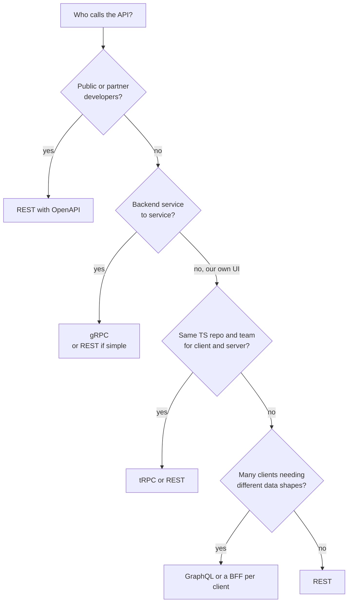
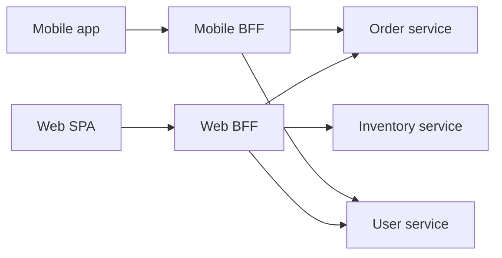
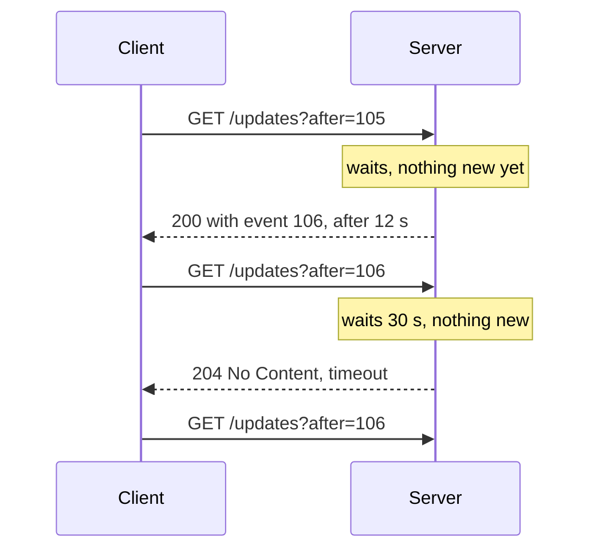
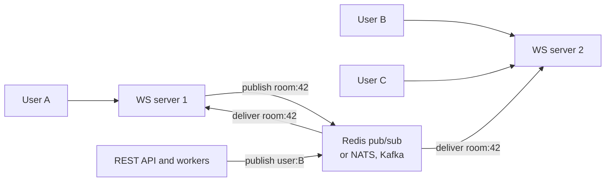
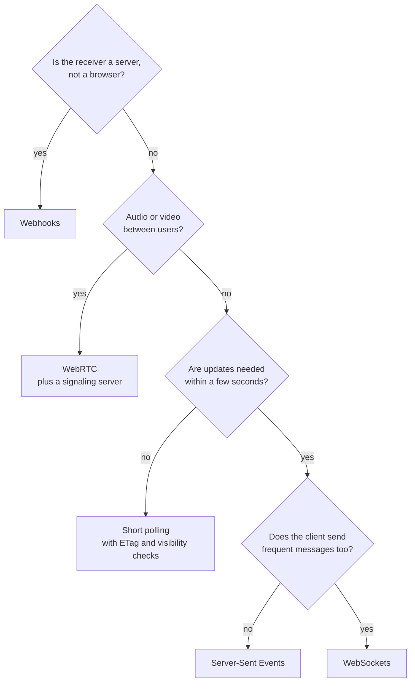

# API Styles and Real-Time Communication

> In this document you will learn how to choose between REST, GraphQL, gRPC and tRPC, how the BFF pattern and API gateways fit in, how to evolve APIs without breaking clients, and how to choose a real-time channel: polling, long polling, Server-Sent Events, WebSockets, WebRTC or webhooks. In system design interviews you must pick an API style and a real-time option for almost every design — and defend the choice.

**Before this:** [HTTP, HTTPS and TLS](../01-cs-and-web-fundamentals/05-http-https-and-tls.md) · [REST API design](../07-nodejs-backend/07-rest-api-design.md) · [API integration and data fetching](../05-frontend-engineering/07-api-integration-and-data-fetching.md) · **Interview questions:** [jump to the interview section](#interview-questions)

## Table of contents

1. [API styles at a glance](#api-styles-at-a-glance)
2. [REST in short](#rest-in-short)
3. [GraphQL](#graphql)
4. [gRPC](#grpc)
5. [tRPC](#trpc)
6. [JSON vs Protocol Buffers](#json-vs-protocol-buffers)
7. [Comparing REST, GraphQL, gRPC and tRPC](#comparing-rest-graphql-grpc-and-trpc)
8. [Backend for frontend BFF](#backend-for-frontend-bff)
9. [API gateway responsibilities](#api-gateway-responsibilities)
10. [Versioning and backward compatibility](#versioning-and-backward-compatibility)
11. [Contract-first design with OpenAPI](#contract-first-design-with-openapi)
12. [Real-time communication options](#real-time-communication-options)
13. [Short polling](#short-polling)
14. [Long polling](#long-polling)
15. [Server-Sent Events](#server-sent-events)
16. [WebSockets](#websockets)
17. [Scaling WebSockets](#scaling-websockets)
18. [WebRTC in brief](#webrtc-in-brief)
19. [Webhooks](#webhooks)
20. [Choosing a real-time option](#choosing-a-real-time-option)
21. [How to explain this in an interview](#how-to-explain-this-in-an-interview)
22. [Interview questions](#interview-questions)
23. [Summary](#summary)
24. [References](#references)

---

## API styles at a glance

An **API style** is the general shape of how a client asks a server for something. The four you will discuss most:

| Style | One-line idea | Transport | Data format |
| --- | --- | --- | --- |
| **REST** | Resources at URLs, standard HTTP methods | HTTP/1.1, 2 or 3 | Usually JSON |
| **GraphQL** | One endpoint; the client sends a query that says exactly which fields it wants | Usually HTTP POST (or GET) | JSON |
| **gRPC** | Call remote functions defined in a `.proto` file | HTTP/2 | Protocol Buffers (binary) |
| **tRPC** | Call TypeScript server functions from a TypeScript client with shared types | HTTP | JSON |

**Analogy:** ordering food.

- **REST** is a restaurant with a fixed menu of dishes. You order "dish number 4" and get the whole plate as the kitchen designed it.
- **GraphQL** is a buffet with a waiter who fills a plate exactly as you describe: "Only rice, two pieces of chicken, no salad."
- **gRPC** is a kitchen-to-kitchen order system between restaurants in the same chain. Very fast, strict forms, not meant for walk-in customers.
- **tRPC** is a family kitchen where everyone speaks the same language. Very easy — but only works if you are part of the family (TypeScript on both sides).

---

## REST in short

REST is explained in depth in [REST API design](../07-nodejs-backend/07-rest-api-design.md). The system-level reminders:

- **Resources and HTTP methods:** `GET /orders/42`, `POST /orders`, `PATCH /orders/42`.
- **Uses HTTP fully:** status codes, caching headers, ETags, content negotiation. CDNs and browsers understand it without extra work.
- **Simple and universal:** every language, tool and proxy understands it.
- **Weaknesses:** **over-fetching** (you get fields you do not need) and **under-fetching** (you need several requests to build one screen, for example order + customer + items + shipping).

REST is the **default** choice for public APIs and most web backends.

---

## GraphQL

### What it is

**GraphQL** is a query language for APIs and a runtime that answers those queries. The server publishes a **schema** (a typed description of all data and operations). The client sends a query that names exactly the fields it needs, and the response has exactly that shape.

It was created at Facebook (2012, open-sourced 2015) for mobile apps that needed many related pieces of data in one request on slow networks.

### Why it exists

Imagine a product page that needs the product, its reviews with each reviewer's name, and related products. With REST you might call:

```text
GET /products/42
GET /products/42/reviews
GET /users/7, GET /users/9, GET /users/12   (reviewers)
GET /products/42/related
```

That is under-fetching: many round trips. And each response contains fields you do not use: over-fetching. On mobile, this is slow.

### Schema, query and response

```text
# Schema (SDL — Schema Definition Language), defined on the server
type Product {
  id: ID!
  name: String!
  priceCents: Int!
  reviews(first: Int = 10): [Review!]!
}

type Review {
  id: ID!
  rating: Int!
  text: String
  author: User!
}

type User {
  id: ID!
  name: String!
}

type Query {
  product(id: ID!): Product
}

type Mutation {
  addReview(productId: ID!, rating: Int!, text: String): Review!
}
```

`!` means "not null". A client query:

```text
query ProductPage {
  product(id: "42") {
    name
    priceCents
    reviews(first: 2) {
      rating
      author { name }
    }
  }
}
```

The response has exactly this shape:

```json
{
  "data": {
    "product": {
      "name": "Laptop",
      "priceCents": 129999,
      "reviews": [
        { "rating": 5, "author": { "name": "Ana" } },
        { "rating": 4, "author": { "name": "Ben" } }
      ]
    }
  }
}
```

There are three operation types: **query** (read), **mutation** (write) and **subscription** (a stream of events, usually over WebSockets or SSE).

### Resolvers

A **resolver** is a function that produces the value of one field. The GraphQL engine walks the query tree and calls resolvers.

```js
const resolvers = {
  Query: {
    product: (_parent, { id }, ctx) => ctx.db.products.findById(id),
  },
  Product: {
    reviews: (product, { first }, ctx) => ctx.db.reviews.findByProduct(product.id, first),
  },
  Review: {
    author: (review, _args, ctx) => ctx.db.users.findById(review.authorId), // ⚠️ called once per review
  },
};
```

Each resolver receives `(parent, args, context, info)`. The `context` is created per request and holds things like the current user and database access.

### The N+1 problem

If a query returns 50 reviews, the `Review.author` resolver runs 50 times — 50 database queries, plus 1 for the reviews. That is the **N+1 problem**. (The same problem with ORMs is described in [Databases — The N+1 query problem](../07-nodejs-backend/10-databases.md#the-n1-query-problem).)

### DataLoader: batching the N+1

**DataLoader** (a small library from the GraphQL Foundation) collects all `load(id)` calls made during the same tick of the event loop and calls your batch function **once** with all IDs.

Here is a minimal version to see how it works:

```js
const authorsTable = { 1: { id: 1, name: 'Ana' }, 2: { id: 2, name: 'Ben' } };
const posts = [
  { id: 10, title: 'Caching', authorId: 1 },
  { id: 11, title: 'Queues', authorId: 2 },
  { id: 12, title: 'CDNs', authorId: 1 },
];
let queries = 0;

async function getAuthorById(id) { queries++; return authorsTable[id]; }
async function getAuthorsByIds(ids) { queries++; return ids.map((id) => authorsTable[id]); }

// ❌ Naive: one query per post
await Promise.all(posts.map((p) => getAuthorById(p.authorId)));
console.log('naive queries:', queries); // naive queries: 3

// ✅ Batched: collect keys during this tick, then one query
function createLoader(batchFn) {
  let queue = [];
  return function load(key) {
    return new Promise((resolve, reject) => {
      queue.push({ key, resolve, reject });
      if (queue.length === 1) {
        queueMicrotask(async () => {
          const batch = queue;
          queue = [];
          const uniqueKeys = [...new Set(batch.map((item) => item.key))];
          try {
            const values = await batchFn(uniqueKeys); // must return values in the same order as keys
            const byKey = new Map(uniqueKeys.map((k, i) => [k, values[i]]));
            for (const item of batch) item.resolve(byKey.get(item.key));
          } catch (err) {
            for (const item of batch) item.reject(err);
          }
        });
      }
    });
  };
}

queries = 0;
const loadAuthor = createLoader(getAuthorsByIds);
const authors = await Promise.all(posts.map((p) => loadAuthor(p.authorId)));
console.log('batched queries:', queries, authors.map((a) => a.name));
// batched queries: 1 [ 'Ana', 'Ben', 'Ana' ]
```

Step by step:

1. Three `loadAuthor` calls happen in the same synchronous loop. Each pushes to `queue`.
2. The first call schedules one microtask.
3. After the current synchronous code ends, the microtask runs. It takes all three items, removes duplicate keys (`[1, 2]`), and calls the batch function once.
4. Each promise resolves with its author.

In production, use the `dataloader` package and **create new loaders per request** (in the GraphQL context). A loader shared between requests would cache one user's data for another user.

### Over-fetching, under-fetching and the trade-off

GraphQL removes over- and under-fetching for the client. But the cost moves to the server: a single query can ask for a huge, deep tree. The server must protect itself.

### Caching is harder

With REST, `GET /products/42` is a URL; browsers and CDNs cache it with standard headers. With GraphQL:

- Most requests are `POST /graphql` with a body. HTTP caches do not cache POST by default.
- Every client can ask a different field set, so one URL has endless response shapes.

Solutions:

- **Client-side normalized caches** (Apollo Client, urql's graphcache, Relay): store objects by `__typename` + `id`, so an update to `Product:42` refreshes every view that shows it.
- **Persisted queries:** the client sends a hash or ID of a pre-registered query instead of the full text. Then requests can be `GET /graphql?id=abc123&variables=...`, which CDNs can cache. **Automatic persisted queries (APQ)** in Apollo send a SHA-256 hash first and the full query only if the server does not know it yet.
- **Server-side caching** per resolver or per field (with cache hints).

### Security and performance protections

Because clients write queries, you must limit them:

| Risk | Protection |
| --- | --- |
| Very deep queries (`friends { friends { friends ... } }`) | Maximum depth limit |
| Very expensive queries | Query cost / complexity analysis with a budget |
| Huge lists | Require pagination arguments; cap `first` |
| Schema discovery by attackers | Disable introspection in production for private APIs (it is not real security, but reduces exposure) |
| Arbitrary queries from public clients | **Trusted documents** (persisted query allow-list): only queries from your own build are accepted |
| Field-level data leaks | Authorization in resolvers or a shared authorization layer, not only at the endpoint |
| Batching attacks (many operations in one request) | Limit operations per request; rate limit by cost, not only by request count |

### Errors

A GraphQL response can contain both `data` and an `errors` array. Partial success is normal: one field fails, the rest of the data is returned. Many servers traditionally return HTTP `200` even when `errors` is present. The newer GraphQL-over-HTTP specification defines the `application/graphql-response+json` media type, which uses non-200 status codes for request-level failures (like a parse error). Clients must always check `errors`, not only the status code.

### When GraphQL fits

- Many different clients (web, iOS, Android, partners) need different shapes of the same data.
- Screens need deeply related data (social graphs, product pages with many related parts).
- A platform team wants one schema over many backend services (**federation**: Apollo Federation, GraphQL Mesh, WunderGraph Cosmo).

When it does not fit: simple CRUD APIs, public APIs that benefit from HTTP caching, file uploads and downloads, teams without capacity to operate it well.

---

## gRPC

### What it is

**gRPC** is a remote procedure call (RPC) framework created at Google and open-sourced in 2015. You define **services and messages** in a `.proto` file (Protocol Buffers). A code generator creates typed client and server code in many languages. The client calls `orderService.GetOrder({ id: 42 })` as if it were a local function.

### Why it exists

For **service-to-service** communication inside a company, you want:

- speed and small messages (binary encoding),
- strict, typed contracts shared across many languages,
- streaming,
- built-in deadlines, cancellation and metadata.

### The .proto file

```text
syntax = "proto3";

package shop.v1;

service OrderService {
  rpc GetOrder (GetOrderRequest) returns (Order);                       // unary
  rpc ListOrderUpdates (ListOrderUpdatesRequest) returns (stream OrderUpdate); // server streaming
  rpc UploadEvents (stream TrackingEvent) returns (UploadSummary);       // client streaming
  rpc Chat (stream ChatMessage) returns (stream ChatMessage);            // bidirectional
}

message GetOrderRequest {
  int64 id = 1;
}

message Order {
  int64 id = 1;
  string status = 2;
  int64 total_cents = 3;
  repeated OrderItem items = 4;
}

message OrderItem {
  string sku = 1;
  int32 quantity = 2;
}

message ListOrderUpdatesRequest { int64 order_id = 1; }
message OrderUpdate { string status = 1; }
message TrackingEvent { string name = 1; }
message UploadSummary { int32 count = 1; }
message ChatMessage { string text = 1; }
```

The numbers (`= 1`, `= 2`) are **field numbers**. They are what goes on the wire, not the names. That is why you must **never reuse or change a field number** once it is in use.

### HTTP/2 and streaming

gRPC runs on **HTTP/2**. HTTP/2 can carry many parallel streams on one TCP connection (multiplexing) and lets both sides send frames at any time. gRPC uses this for four call types:

| Type | Client sends | Server sends | Example |
| --- | --- | --- | --- |
| Unary | 1 message | 1 message | Get an order |
| Server streaming | 1 | many | Live order status updates |
| Client streaming | many | 1 | Upload a batch of tracking events |
| Bidirectional streaming | many | many | Chat, real-time sync |

### Deadlines

A gRPC client should set a **deadline** ("this call must finish within 300 ms"). The deadline travels to the server, and servers can pass the remaining time to the services they call. When it expires, the call fails with `DEADLINE_EXCEEDED` everywhere. This prevents long chains of waiting services.

gRPC has its own status codes (`OK`, `NOT_FOUND`, `INVALID_ARGUMENT`, `UNAVAILABLE`, `DEADLINE_EXCEEDED`, `PERMISSION_DENIED`...).

### gRPC in the browser: gRPC-Web and Connect

Browsers do not give JavaScript the low-level HTTP/2 control that gRPC needs (for example HTTP trailers, which carry the gRPC status). So a browser cannot call a normal gRPC server directly.

Options:

- **gRPC-Web:** a slightly different protocol that browsers can use. Usually a proxy (for example Envoy) translates gRPC-Web to gRPC. It supports unary and server-streaming calls, not client or bidirectional streaming.
- **Connect** (from Buf): a protocol and libraries that work in browsers with plain HTTP and JSON or binary, and servers built with Connect also speak gRPC and gRPC-Web.
- **Transcoding:** expose REST/JSON endpoints generated from the proto (for example with `google.api.http` annotations and a gateway).

In practice: **gRPC between backend services, REST or GraphQL to the browser**, often through a BFF.

### Node.js

Use `@grpc/grpc-js` (the pure-JavaScript implementation) with `@grpc/proto-loader`, or generated code from tools like `buf` with Connect-ES.

---

## tRPC

### What it is

**tRPC** lets a TypeScript client call TypeScript server procedures with **full type safety and no code generation**. The client imports the server's router **type** (only the type, not the code). If you rename a field on the server, the client shows a compile error immediately.

```ts
// server/router.ts
import { initTRPC } from '@trpc/server';
import { z } from 'zod';

const t = initTRPC.create();

export const appRouter = t.router({
  getProduct: t.procedure
    .input(z.object({ id: z.string() }))
    .query(async ({ input }) => {
      return { id: input.id, name: 'Laptop', priceCents: 129999 };
    }),
});

export type AppRouter = typeof appRouter; // only the type is shared
```

```ts
// client.ts
import { createTRPCClient, httpBatchLink } from '@trpc/client';
import type { AppRouter } from '../server/router';

const trpc = createTRPCClient<AppRouter>({
  links: [httpBatchLink({ url: '/api/trpc' })],
});

const product = await trpc.getProduct.query({ id: '42' });
product.priceCents; // number — typed from the server code
// product.price;   // compile error: property does not exist
```

(These names are from tRPC v11. `zod` validates the input at runtime — the types alone do not protect the server; see [Runtime validation and type-safe APIs](../03-typescript/11-runtime-validation-and-type-safe-apis.md).)

### When it fits

- One team owns both the frontend and the backend, both in TypeScript, often in a monorepo.
- Internal app APIs (the frontend's own backend).

### When it does not fit

- Public APIs or clients in other languages (mobile apps in Swift/Kotlin, partners).
- Teams that deploy client and server independently and need a stable, versioned contract.

tRPC is not a protocol standard like REST, GraphQL or gRPC. It is a TypeScript library over HTTP.

---

## JSON vs Protocol Buffers

### What they are

- **JSON** is a text format. Human-readable, self-describing (field names are in every message), supported everywhere.
- **Protocol Buffers (protobuf)** is a binary format. Fields are identified by numbers, integers use compact **varint** encoding, and you need the `.proto` schema to read the bytes.

### Size example

The same product as JSON and as protobuf (field 1 `id`, field 2 `name`, field 3 `price_cents`). The small encoder below implements just enough of the protobuf wire format to show the bytes:

```js
// Varint: 7 bits per byte; the high bit says "more bytes follow".
function encodeVarint(n) {
  const bytes = [];
  while (n > 127) {
    bytes.push((n & 0x7f) | 0x80);
    n >>>= 7;
  }
  bytes.push(n);
  return bytes;
}

function encodeProduct({ id, name, priceCents }) {
  const nameBytes = [...Buffer.from(name, 'utf8')];
  return Buffer.from([
    0x08, ...encodeVarint(id),                     // field 1, varint
    0x12, nameBytes.length, ...nameBytes,          // field 2, length-delimited
    0x18, ...encodeVarint(priceCents),             // field 3, varint
  ]);
}

const product = { id: 42, name: 'Laptop', priceCents: 129999 };
const json = JSON.stringify(product);
console.log(json, Buffer.byteLength(json), 'bytes as JSON');
// {"id":42,"name":"Laptop","priceCents":129999} 45 bytes as JSON

const pb = encodeProduct(product);
console.log(pb.toString('hex'), pb.length, 'bytes as protobuf');
// 082a12064c6170746f7018cff707 14 bytes as protobuf
```

The tag byte is `(fieldNumber << 3) | wireType`: `0x08` = field 1, type 0 (varint); `0x12` = field 2, type 2 (length-delimited); `0x18` = field 3, type 0.

### Comparison

| | JSON | Protobuf |
| --- | --- | --- |
| Size | Larger (field names repeated) | Smaller (here 14 vs 45 bytes) |
| Parse speed | Good (highly optimized in engines) | Usually faster, less allocation |
| Human-readable | Yes | No (needs tools) |
| Schema | Optional (JSON Schema, OpenAPI) | Required (`.proto`) |
| Evolution | Add fields freely; clients must ignore unknown ones | Add new field numbers; never reuse numbers |
| Browser support | Native (`JSON.parse`) | Needs a library |
| Compression | gzip/Brotli shrink JSON a lot | Already compact; compression helps less |

With HTTP compression, the size gap for typical API responses becomes much smaller. Choose protobuf for high-volume internal traffic, mobile clients on poor networks, or when you use gRPC anyway. Choose JSON for public and browser APIs where debuggability and universal support matter.

---

## Comparing REST, GraphQL, gRPC and tRPC

| | REST | GraphQL | gRPC | tRPC |
| --- | --- | --- | --- | --- |
| Contract | OpenAPI (optional) | Schema (required) | `.proto` (required) | TypeScript types |
| Data shape | Server decides per endpoint | Client decides per query | Server decides per method | Server decides per procedure |
| Over/under-fetching | Common | Solved for clients | Per method design | Per procedure design |
| HTTP caching / CDN | Excellent | Hard (needs persisted GET queries) | Not applicable | Possible for GET queries |
| Browser support | Native | Native (JSON over HTTP) | Needs gRPC-Web/Connect + proxy | Native |
| Streaming | Via SSE/WebSockets separately | Subscriptions (WS/SSE) | Built-in, 4 modes | Subscriptions (WS/SSE) |
| Performance | Good | Good; server cost per query varies | Very good | Good |
| Languages | All | All | Many (code generation) | TypeScript only |
| Tooling to debug | curl, browser | GraphiQL, Apollo tools | grpcurl, Buf tools | TypeScript IDE |
| Best for | Public APIs, CRUD, cacheable data | Many clients, complex related data | Internal service-to-service | Full-stack TS apps in one repo |



You can mix them: gRPC between services, a GraphQL or REST BFF for the web app, and REST for public partners.

---

## Backend for frontend BFF

### What it is

A **BFF (backend for frontend)** is a server-side layer built **for one specific client** — for example one BFF for the web app and one for the mobile app. The frontend team usually owns it. It calls the internal services and returns exactly what that client's screens need.

### Why it exists

- Internal services are designed around business domains (orders, users, inventory), not screens. A dashboard screen might need data from five services.
- Different clients need different shapes: the mobile app wants small payloads; the web app wants more detail.
- Some things should not run in the browser: secret API keys, token handling, calls to internal services that are not exposed to the internet.



### What a BFF does

- **Aggregation:** one call from the browser, several calls inside the data center (where round trips are cheap — about 0.5 ms vs maybe 100 ms from a phone).
- **Shaping:** remove unused fields, rename, format for the screen.
- **Auth handling:** in the security-focused BFF pattern, the BFF does the OAuth flow, keeps tokens on the server, and gives the browser only an `HttpOnly` session cookie. See [Auth architecture — The BFF pattern for tokens](06-auth-architecture-and-multi-tenancy.md#the-bff-pattern-keeping-tokens-out-of-the-browser).
- **Protocol translation:** talk gRPC to services, JSON to the browser.
- **Server-side rendering:** frameworks like Next.js, Nuxt, Remix, and Angular SSR often act as the BFF.

### Example: aggregating a dashboard

```js
// Web BFF route (Express): one browser request, three internal calls in parallel.
app.get('/bff/dashboard', requireSession, async (req, res) => {
  const userId = req.session.userId;
  const signal = AbortSignal.timeout(800); // overall budget for internal calls

  const [ordersResult, profileResult, alertsResult] = await Promise.allSettled([
    fetch(`${ORDERS_URL}/users/${userId}/orders?limit=5`, { signal }).then(okJson),
    fetch(`${USERS_URL}/users/${userId}`, { signal }).then(okJson),
    fetch(`${ALERTS_URL}/users/${userId}/alerts`, { signal }).then(okJson),
  ]);

  if (profileResult.status === 'rejected') {
    return res.status(502).json({ error: 'Profile unavailable' }); // critical part
  }

  res.json({
    name: profileResult.value.displayName,
    recentOrders: ordersResult.status === 'fulfilled'
      ? ordersResult.value.items.map((o) => ({ id: o.id, status: o.status, total: o.totalCents }))
      : null, // optional part: the UI shows "Orders unavailable"
    alertCount: alertsResult.status === 'fulfilled' ? alertsResult.value.length : null,
  });
});

async function okJson(response) {
  if (!response.ok) throw new Error(`HTTP ${response.status}`);
  return response.json();
}
```

Note the design choices: parallel calls, a time budget, and **partial failure** — the dashboard still works when a non-critical service is down.

### Trade-offs

| Advantages | Disadvantages |
| --- | --- |
| Fewer round trips from the client | Another service to build, deploy and monitor |
| Screen-shaped responses | Logic can be duplicated across BFFs |
| Secrets and tokens stay on the server | Can become a "mini-monolith" with business logic |
| Frontend team can change it quickly | Adds one network hop |

Rule: the BFF contains **presentation and aggregation logic**, not business rules. Business rules belong in the domain services.

### BFF vs GraphQL

GraphQL can play the BFF role: one flexible API that each client queries differently. A REST BFF per client is simpler to cache and operate. Choose GraphQL when you have many clients and many screens with different shapes; choose a BFF per client when you have few clients and want simple HTTP caching.

---

## API gateway responsibilities

The API gateway is introduced in [Scalability — Reverse proxy and API gateway](02-scalability-and-core-building-blocks.md#reverse-proxy-and-api-gateway). In the API-style discussion, remember what belongs there:

| Belongs in the gateway | Does not belong in the gateway |
| --- | --- |
| TLS termination, routing by path or host | Business rules ("orders over $1000 need approval") |
| Authentication (verify token signature, expiry) | Fine-grained authorization on specific records |
| Rate limiting, quotas, API keys | Data aggregation for one screen (that is a BFF) |
| Request size limits, CORS, basic validation | Database access |
| Logging, metrics, tracing headers | |
| Version routing (`/v1` → old service) | |

A common layering: **CDN → API gateway → BFF → domain services.**

---

## Versioning and backward compatibility

### Why it matters

Once an API has clients, you do not control when they update. Mobile apps can stay on old versions for months. Partners update once a year. An SPA tab can stay open for days with old code. So most changes must be **backward compatible**: old clients must keep working.

### Breaking vs non-breaking changes

| Usually safe (non-breaking) | Breaking |
| --- | --- |
| Add a new endpoint or field | Remove or rename a field |
| Add an optional request parameter | Make an optional parameter required |
| Add a new enum value *if clients handle unknown values* | Change a field's type (`"42"` → `42`) |
| Relax validation | Tighten validation |
| Add a new error code *if clients handle unknown codes* | Change the meaning of a field or status code |
| | Change default sorting or pagination behavior |
| | Change URL structure |

### Rules that keep APIs compatible

1. **Only add, never remove or change** in the same version.
2. **Tolerant reader:** clients ignore fields they do not know and handle unknown enum values with a default.
3. **Expand and contract** for renames: add the new field, write both, migrate clients, then remove the old field later (same idea as [database migrations — expand and contract](../07-nodejs-backend/10-databases.md#expand-and-contract-zero-downtime-changes)).
4. **Deprecate with a timeline:** announce, mark as deprecated (OpenAPI `deprecated: true`, GraphQL `@deprecated(reason: "...")`, HTTP `Deprecation` and `Sunset` headers), measure usage, then remove.
5. **Protobuf rules:** never reuse a field number; mark removed numbers and names as `reserved`; do not change a field's type.
6. **GraphQL:** usually no versions at all. You evolve one schema by adding fields and deprecating old ones; usage analytics show when a deprecated field is safe to remove.
7. **Contract tests:** consumer-driven contract testing (for example Pact) checks that a provider change does not break the consumers' expectations.

### Versioning strategies (REST)

URL versioning (`/v1/orders`), header versioning (`Accept: application/vnd.shop.v2+json` or a custom header) and date-based versions (Stripe-style `Stripe-Version: 2024-06-20`) are compared in [REST API design — Versioning](../07-nodejs-backend/07-rest-api-design.md#versioning-and-evolving-an-api). For most teams, URL major versions plus additive changes inside a version is the simplest approach.

### Frontend angle

- After a deploy, old SPA tabs call the new API. Keep the API compatible with at least the previous frontend version.
- Deploy the backend first (supporting old and new clients), then the frontend.
- Feature flags can hide new UI until the API is ready everywhere.

---

## Contract-first design with OpenAPI

### What it is

**Contract-first** (also called API-first or design-first) means you write the API contract **before** the implementation, review it with the client teams, and generate code and documentation from it.

**OpenAPI** is the standard format for describing REST APIs (formerly Swagger). OpenAPI 3.1 (2021) aligned its schemas with JSON Schema; OpenAPI 3.2 was released in September 2025 and added things like first-class streaming media types (for example SSE) and the `QUERY` method. Tool support for 3.2 is still growing, so check your tools.

### Example

OpenAPI files are usually YAML; the same structure in JSON:

```json
{
  "openapi": "3.1.0",
  "info": { "title": "Shop API", "version": "1.4.0" },
  "paths": {
    "/v1/orders/{orderId}": {
      "get": {
        "operationId": "getOrder",
        "parameters": [
          { "name": "orderId", "in": "path", "required": true, "schema": { "type": "string" } }
        ],
        "responses": {
          "200": {
            "description": "The order",
            "content": { "application/json": { "schema": { "$ref": "#/components/schemas/Order" } } }
          },
          "404": { "description": "Order not found" }
        }
      }
    }
  },
  "components": {
    "schemas": {
      "Order": {
        "type": "object",
        "required": ["id", "status", "totalCents"],
        "properties": {
          "id": { "type": "string" },
          "status": { "type": "string", "enum": ["PENDING", "PAID", "SHIPPED"] },
          "totalCents": { "type": "integer" }
        }
      }
    }
  }
}
```

### What you get

- **Documentation:** Swagger UI, Redoc, Scalar.
- **Generated clients and types:** `openapi-typescript` for TypeScript types, `openapi-generator` for Angular services and many languages.
- **Server validation:** middleware that validates requests and responses against the spec.
- **Mock servers** (for example Prism) so the frontend can start before the backend is ready.
- **Breaking-change detection** in CI by diffing the spec (tools like `oasdiff`).

### Code-first alternative

You write the code with annotations or schemas (NestJS decorators, Fastify JSON schemas, zod with `zod-to-openapi`) and generate the OpenAPI file. Faster for one team; contract-first is better when several teams must agree on the contract first.

GraphQL and gRPC are contract-first by nature: the schema or `.proto` file is the contract.

---

## Real-time communication options

Normal HTTP is **request–response**: the client asks, the server answers. But many features need the server to tell the client something **when it happens**: a new chat message, a price change, a job finished, a notification.

The options:

| Option | Direction | Connection | Browser API | Typical use |
| --- | --- | --- | --- | --- |
| Short polling | Client asks repeatedly | New request each time | `fetch` + timer | Job status, simple dashboards |
| Long polling | Client asks; server holds the request until data | Repeated long requests | `fetch` | Fallback when nothing else works |
| Server-Sent Events | Server → client | One long HTTP response | `EventSource` | Notifications, live feeds, AI token streaming |
| WebSockets | Both directions | One upgraded TCP connection | `WebSocket` | Chat, collaboration, games, trading |
| WebRTC | Peer to peer (browser to browser) | UDP-based, through NAT | `RTCPeerConnection` | Video/voice calls, P2P data |
| Webhooks | Server → another server | HTTP POST per event | Not a browser API | Payment notifications, integrations |

---

## Short polling

### What it is

The client asks the server for updates every N seconds.

```js
async function pollJobStatus(jobId, { intervalMs = 3000, signal } = {}) {
  while (!signal?.aborted) {
    const res = await fetch(`/api/jobs/${jobId}`, { signal });
    const job = await res.json();
    if (job.status === 'done' || job.status === 'failed') return job;
    await new Promise((resolve) => setTimeout(resolve, intervalMs));
  }
  throw new Error('Polling cancelled');
}
```

### Trade-offs

- Good: simplest; works everywhere; stateless servers; easy to cache and load-balance.
- Bad: delay up to the interval; most requests return "nothing new" (wasted work). With 100,000 clients polling every 5 seconds, that is 20,000 requests per second just to ask.
- Improve it: use `ETag`/`If-None-Match` so "nothing new" is a cheap `304`; poll slower when the tab is hidden (`document.visibilityState`); stop when the user leaves; increase the interval over time for long jobs.

Polling is a perfectly good answer when updates are not urgent (every 30–60 seconds is fine) — and it is often the best first version.

---

## Long polling

### What it is

The client sends a request. The server **does not answer immediately**. It holds the request open until there is new data (or a timeout like 30 seconds). Then the client immediately sends the next request.



### Trade-offs

- Good: near real-time; works over plain HTTP everywhere.
- Bad: each waiting client holds a request (fine in Node.js, which handles many idle connections cheaply, but watch proxy timeouts); message ordering and gaps must be handled with a cursor (`after=106`); a request/response cycle per message batch.

Today long polling is mostly a **fallback** (Socket.IO uses it to start or when WebSockets are blocked).

---

## Server-Sent Events

### What it is

**Server-Sent Events (SSE)** is a standard (part of the HTML Living Standard) where the server keeps one HTTP response open and writes **text events** to it over time. The browser's `EventSource` API reads them.

### The wire format

```text
HTTP/1.1 200 OK
Content-Type: text/event-stream
Cache-Control: no-cache

id: 101
event: order-status
data: {"orderId":"o_1","status":"PAID"}

id: 102
event: order-status
data: {"orderId":"o_1","status":"SHIPPED"}

: this is a comment, often used as a heartbeat

```

Each event ends with a blank line. `id` lets the browser resume; `event` names the event type; `data` is the payload; `retry: 5000` can set the reconnect delay.

### Server (Node.js, no library needed)

```js
import http from 'node:http';

const clients = new Set();
let lastId = 0;

http.createServer((req, res) => {
  if (req.url === '/events') {
    res.writeHead(200, {
      'Content-Type': 'text/event-stream',
      'Cache-Control': 'no-cache',
      Connection: 'keep-alive', // HTTP/1.1 only; not allowed in HTTP/2
    });
    const resumeFrom = req.headers['last-event-id']; // sent by the browser on reconnect
    // In a real app: replay events after resumeFrom from storage.
    clients.add(res);
    const heartbeat = setInterval(() => res.write(': ping\n\n'), 25_000);
    req.on('close', () => { clearInterval(heartbeat); clients.delete(res); });
    return;
  }
  res.writeHead(404).end();
}).listen(3000);

function broadcast(type, payload) {
  lastId++;
  for (const res of clients) {
    res.write(`id: ${lastId}\nevent: ${type}\ndata: ${JSON.stringify(payload)}\n\n`);
  }
}

setInterval(() => broadcast('tick', { at: new Date().toISOString() }), 5000);
```

### Client

```js
const source = new EventSource('/events', { withCredentials: true }); // sends cookies cross-origin if allowed

source.addEventListener('order-status', (event) => {
  const update = JSON.parse(event.data);
  console.log('Order', update.orderId, 'is now', update.status);
});

source.onerror = () => {
  // EventSource reconnects automatically; show a "reconnecting" badge if you want
};
```

### Strengths and limits

| Strengths | Limits |
| --- | --- |
| Plain HTTP: works with proxies, load balancers, HTTP/2 | Server → client only (client sends normal HTTP requests for the other direction) |
| Automatic reconnect built into `EventSource` | Text only (send JSON; binary needs encoding) |
| Resume with `Last-Event-ID` | `EventSource` cannot set custom headers like `Authorization` (use cookies, or a `fetch`-based SSE client) |
| Very simple server code | With HTTP/1.1, browsers allow about 6 connections per origin; many tabs with SSE can use them up. HTTP/2 multiplexing removes this problem |

SSE is a great fit for notifications, live dashboards, progress updates and streaming AI responses token by token. It is often the right answer when you only need server → client updates.

---

## WebSockets

### What it is

A **WebSocket** is a full-duplex connection: both client and server can send messages at any time over one long-lived TCP connection. It is standardized in RFC 6455 (2011). The browser API is `WebSocket`.

### The handshake

A WebSocket starts as a normal HTTP/1.1 request that asks to **upgrade** the connection:

```text
GET /chat HTTP/1.1
Host: chat.example.com
Upgrade: websocket
Connection: Upgrade
Sec-WebSocket-Key: dGhlIHNhbXBsZSBub25jZQ==
Sec-WebSocket-Version: 13
Origin: https://app.example.com

HTTP/1.1 101 Switching Protocols
Upgrade: websocket
Connection: Upgrade
Sec-WebSocket-Accept: s3pPLMBiTxaQ9kYGzzhZRbK+xOo=
```

The server proves it understood the WebSocket protocol by computing `Sec-WebSocket-Accept` = Base64(SHA-1(key + a fixed GUID from the RFC)):

```js
import { createHash } from 'node:crypto';

const key = 'dGhlIHNhbXBsZSBub25jZQ==';
const accept = createHash('sha1')
  .update(key + '258EAFA5-E914-47DA-95CA-C5AB0DC85B11')
  .digest('base64');
console.log(accept); // s3pPLMBiTxaQ9kYGzzhZRbK+xOo=
```

After `101 Switching Protocols`, the connection is no longer HTTP. Both sides send **frames** (text, binary, ping, pong, close). `wss://` is WebSocket over TLS — always use it in production.

(RFC 8441 defines WebSockets over HTTP/2, and RFC 9220 over HTTP/3, but HTTP/1.1 upgrade is still the most common path.)

### Server and client

Node.js has a built-in WebSocket **client** (the global `WebSocket`, enabled by default since Node.js 22.0 and no longer experimental since 22.4), but no built-in server. Use the `ws` package or a framework like Socket.IO.

```js
// server.js — using the 'ws' package
import { WebSocketServer } from 'ws';

const wss = new WebSocketServer({ port: 8080 });

wss.on('connection', (socket, req) => {
  // Authenticate here: check the session cookie or a short-lived ticket from the URL.
  // Also check req.headers.origin against an allow-list (WebSockets are not protected by CORS).
  socket.isAlive = true;
  socket.on('pong', () => { socket.isAlive = true; });

  socket.on('message', (raw) => {
    const msg = JSON.parse(raw.toString());
    if (msg.type === 'chat') {
      for (const client of wss.clients) {
        if (client.readyState === client.OPEN) {
          client.send(JSON.stringify({ type: 'chat', text: msg.text, at: Date.now() }));
        }
      }
    }
  });
});

// Heartbeat: detect dead connections (for example a laptop that went to sleep)
setInterval(() => {
  for (const socket of wss.clients) {
    if (!socket.isAlive) { socket.terminate(); continue; }
    socket.isAlive = false;
    socket.ping();
  }
}, 30_000);
```

### Heartbeats

TCP connections can die silently (Wi-Fi drops, a NAT router forgets the connection, a proxy times out idle connections after 60 seconds). Without traffic, neither side notices. **Heartbeats** (ping/pong frames, or app-level `{type:"ping"}` messages) keep the connection alive through proxies and detect dead peers.

Browsers answer protocol-level pings automatically, but browser JavaScript cannot send ping frames. So for client-side detection, use application-level ping messages and a timer.

### Reconnect with exponential backoff and jitter

Connections **will** drop: network changes, deploys, server restarts. The client must reconnect — but not all clients at the same moment (that would be a "thundering herd" that knocks the server over again). Use **exponential backoff with jitter**:

```js
function backoffDelay(attempt, { baseMs = 500, maxMs = 30_000, random = Math.random } = {}) {
  const exp = Math.min(maxMs, baseMs * 2 ** attempt);
  return Math.round(random() * exp); // "full jitter": a random value between 0 and exp
}

// With random() fixed at 1, you see the upper limits:
for (let attempt = 0; attempt < 7; attempt++) {
  console.log(attempt, backoffDelay(attempt, { random: () => 1 }));
}
// 0 500
// 1 1000
// 2 2000
// 3 4000
// 4 8000
// 5 16000
// 6 30000
```

A reconnecting client (browser code):

```js
function connect(url, { onMessage, getLastSeenId }) {
  let attempt = 0;
  let socket;
  let closedByUser = false;

  function open() {
    socket = new WebSocket(url);

    socket.onopen = () => {
      attempt = 0;
      // Resync: ask for everything after the last message we saw
      socket.send(JSON.stringify({ type: 'resume', afterId: getLastSeenId() }));
    };
    socket.onmessage = (event) => onMessage(JSON.parse(event.data));
    socket.onclose = () => {
      if (closedByUser) return;
      const delay = backoffDelay(attempt++);
      setTimeout(open, delay);
    };
  }

  open();
  window.addEventListener('online', () => { if (socket.readyState === WebSocket.CLOSED) open(); });
  return { send: (data) => socket.send(JSON.stringify(data)), close: () => { closedByUser = true; socket.close(); } };
}
```

Key points:

- **A WebSocket is a delivery channel, not a durable history.** Messages sent while the client was disconnected are lost unless you **resync** from a cursor (last seen message ID) through the socket or a REST endpoint.
- Messages can arrive **twice** after a resync. Deduplicate by message ID.
- Reset the attempt counter after a successful connection.

### Authentication

- Browsers cannot set an `Authorization` header on the `WebSocket` constructor.
- Options:
  - The session **cookie** is sent with the handshake (same site).
  - Or get a short-lived, one-time **ticket** from an authenticated REST call and pass it in the URL (`wss://.../chat?ticket=...`). Keep its lifetime short, because URLs end up in logs.
  - Or send a token in the first message, and close the connection if it is invalid.
- **Check the `Origin` header** on the server. CORS does not apply to WebSockets, so a malicious page could open a socket to your server with the user's cookies (cross-site WebSocket hijacking) unless you check the origin.
- Re-check authorization when tokens expire; long-lived connections can outlive a revoked session.

### Socket.IO

**Socket.IO** is a popular library on top of WebSockets (with HTTP long-polling fallback). It adds rooms, namespaces, automatic reconnection, acknowledgments and adapters for multiple servers. It uses its **own protocol**, so a plain WebSocket client cannot talk to a Socket.IO server — both sides need Socket.IO libraries.

---

## Scaling WebSockets

### Why it is harder than HTTP

- Each connection is **stateful** and long-lived; it lives on one server.
- A message for user B may be produced on server 1 while B is connected to server 3.
- Deploys and restarts drop all connections on a server at once.
- Each connection uses memory (buffers, per-connection state). One server can typically hold many thousands of mostly idle connections; the exact number depends on memory, message rate and the OS limits — measure it.

### Sticky sessions

A **sticky session** makes the load balancer keep a client on the same server. Plain WebSockets need it only for the duration of the connection (the TCP connection is already pinned). But Socket.IO with long-polling fallback needs real stickiness (a cookie or IP hash), because several HTTP requests must reach the same server during the handshake.

### Pub/sub between servers

Use a **pub/sub** layer so any server can deliver a message to any connected user:



1. User A sends a message to room 42 through server 1.
2. Server 1 saves it to the database, then publishes it on channel `room:42`.
3. Every WebSocket server subscribed to `room:42` receives it and sends it to its local connections in that room.

With Socket.IO, the **Redis adapter** (`@socket.io/redis-adapter`) or Redis Streams adapter does this for you: `io.to('room:42').emit(...)` works across servers.

Notes:

- Redis pub/sub is **fire-and-forget**: a server that is disconnected misses messages. That is OK if the database is the source of truth and clients resync. For guaranteed delivery between servers, use Redis Streams, Kafka or NATS JetStream.
- For a very large number of rooms, route users to servers by room (consistent hashing) to reduce fan-out.

### Other scaling points

- **Connection limits:** raise OS file descriptor limits; tune load balancer idle timeouts (longer than your heartbeat interval).
- **Graceful deploys:** drain servers slowly; tell clients to reconnect (close code `1012 Service Restart`) and spread reconnects with jitter.
- **Backpressure:** if a client reads slowly, its send buffer grows (`socket.bufferedAmount` in the browser, `ws` exposes `bufferedAmount` too). Drop or close slow consumers instead of buffering forever.
- **Managed services:** AWS API Gateway WebSocket APIs, Azure Web PubSub, Ably, Pusher handle connections for you; your backend publishes over HTTP.

The full chat design is in [Real-time chat and notifications](10-case-study-real-time-chat-and-notifications.md).

---

## WebRTC in brief

**WebRTC** lets browsers send audio, video and data **directly to each other** (peer to peer), with low latency, usually over UDP.

What you need to know for interviews:

- **Signaling:** peers must exchange connection offers (SDP) and network candidates before connecting. WebRTC does not define how — you use your own server, often over WebSockets.
- **NAT traversal:** most devices are behind routers. **STUN** servers help a peer discover its public address. **TURN** servers relay traffic when a direct connection is impossible (costly bandwidth).
- **Group calls:** full mesh (everyone connects to everyone) only works for a few people. Larger calls use an **SFU** (selective forwarding unit) server that receives each stream once and forwards it to others.
- **Data channels** (`RTCDataChannel`) can send arbitrary data peer to peer — for games or file transfer.

Choose WebRTC for real-time media (video calls, screen sharing). For normal app events (chat text, notifications) use WebSockets or SSE.

---

## Webhooks

### What it is

A **webhook** is an HTTP request **from one server to another server** when an event happens. For example, a payment provider sends `POST https://yourapp.com/webhooks/payments` when a payment succeeds. It is "real-time" between systems, not to browsers.

### Receiving webhooks safely

1. **Verify the signature.** The sender signs the body with a shared secret (usually HMAC-SHA256) and puts the signature in a header. Verify it using the **raw body** bytes, with a constant-time comparison.
2. **Check the timestamp** to stop replay attacks (reject events older than a few minutes).
3. **Respond fast (2xx)** and process asynchronously in a queue. Senders retry on timeouts.
4. **Be idempotent.** Senders deliver at least once. Store the event ID and skip duplicates.
5. **Do not trust the payload blindly.** For important actions, fetch the current state from the provider's API.
6. **Expect out-of-order delivery.** Use timestamps or versions.

```js
import { createHmac, timingSafeEqual } from 'node:crypto';

function sign(secret, timestamp, body) {
  return createHmac('sha256', secret).update(`${timestamp}.${body}`).digest('hex');
}

function verifyWebhook({ secret, body, timestamp, signature, now = Date.now(), toleranceMs = 5 * 60_000 }) {
  if (Math.abs(now - Number(timestamp)) > toleranceMs) return false; // too old: possible replay
  const expected = Buffer.from(sign(secret, timestamp, body), 'hex');
  const received = Buffer.from(signature, 'hex');
  return expected.length === received.length && timingSafeEqual(expected, received);
}

const secret = 'whsec_test_123';
const body = JSON.stringify({ type: 'order.paid', orderId: 'o_1' });
const ts = '1760000000000';
const sig = sign(secret, ts, body);

console.log(verifyWebhook({ secret, body, timestamp: ts, signature: sig, now: 1760000060000 })); // true
console.log(verifyWebhook({ secret, body: body.replace('o_1', 'o_2'), timestamp: ts, signature: sig, now: 1760000060000 })); // false (body changed)
console.log(verifyWebhook({ secret, body, timestamp: ts, signature: sig, now: 1760000000000 + 10 * 60_000 })); // false (too old)
```

Each provider has its own header names and exact signing format (Stripe, GitHub and others differ). Use their official library when one exists.

Sending webhooks (retries, backoff, signing, delivery logs) is covered in [Background jobs and queues — Webhooks](../07-nodejs-backend/13-background-jobs-and-queues.md#webhooks).

### Webhooks to the browser?

No. Webhooks reach your server. If the browser must know (for example "payment confirmed"), your server forwards the event over SSE or WebSocket, or the browser polls an order status endpoint.

---

## Choosing a real-time option

### Comparison

| | Short polling | Long polling | SSE | WebSockets | WebRTC | Webhooks |
| --- | --- | --- | --- | --- | --- | --- |
| Direction | Client pulls | Client pulls, server holds | Server → client | Both | Peer ↔ peer | Server → server |
| Latency | Up to the interval | Low | Low | Lowest | Lowest (media) | Low |
| Complexity | Very low | Low | Low | Medium–high | High | Low–medium |
| Works with HTTP infra (caches, proxies) | Yes | Mostly | Yes | Needs upgrade support | Separate | Yes |
| Auto reconnect | N/A | Manual | Built in | Manual | Manual | Sender retries |
| Binary data | Yes | Yes | No (text) | Yes | Yes | Yes |
| Server cost | Many requests | Held requests | One open response per client | One connection per client | Signaling + TURN | One request per event |
| Best for | Slow-changing status | Fallback | Notifications, feeds, progress, AI streaming | Chat, collaboration, games, trading | Calls, P2P | System integrations |

### Decision flowchart



Examples:

- **Export job status** → short polling every 3 seconds, or SSE.
- **Notification bell** → SSE (or polling every 30–60 seconds if it is not urgent).
- **Live sports score** → SSE.
- **Chat with typing indicators** → WebSockets.
- **Collaborative document editing** → WebSockets.
- **ChatGPT-style token streaming** → SSE (or a streamed `fetch` response).
- **Payment provider tells your backend about a payment** → webhook, then SSE/WebSocket/poll to the browser.

---

## How to explain this in an interview

1. **Define it:** "An API style is how clients and servers shape their requests: REST uses resources and HTTP semantics, GraphQL lets the client choose fields from a typed schema, gRPC is typed RPC over HTTP/2 with protobuf, and tRPC shares TypeScript types between client and server."
2. **Why it exists:** "Different consumers have different needs — public partners want simple, cacheable, stable contracts; internal services want speed and strict typing; complex UIs want to fetch exactly the data for a screen."
3. **How it works:** "I usually use REST with OpenAPI for public and browser APIs, gRPC between internal services, and a BFF or GraphQL layer when the UI needs aggregated data. For real-time, I pick the simplest channel that meets the latency and direction needs: polling, then SSE for server-to-client, then WebSockets for two-way."
4. **Small example:** "For an order-tracking page: REST for loading the order, SSE for status updates, and the payment provider calls our webhook, which we verify and forward."
5. **Where it is useful:** "Every system design: chat, dashboards, e-commerce, notifications."
6. **Trade-offs / gotchas:** "GraphQL makes caching and query cost harder; gRPC needs a proxy for browsers; WebSockets are stateful and need pub/sub, heartbeats, reconnect with backoff and resync. And APIs must evolve without breaking old clients."

---

## Interview questions

### Q1. REST vs GraphQL: when would you choose each?

**What the interviewer is checking:** Balanced trade-offs, not hype.

**Short spoken answer (30–60 seconds):**
> REST models resources at URLs and uses HTTP fully — methods, status codes, caching headers — so browsers and CDNs cache it out of the box, and it's simple for any client. Its weakness is over- and under-fetching: a screen may need several calls, and each returns more than needed. GraphQL gives one typed schema, and each client asks for exactly the fields it needs in one request, which is great when many clients need different shapes of related data. The cost moves to the server: N+1 resolver queries that need DataLoader, query cost limits, field-level authorization, and HTTP caching becomes hard without persisted queries. I'd choose REST for public APIs, CRUD and cacheable content, and GraphQL for a product with several clients and complex, related screens — or a BFF per client as a simpler middle ground.

**Follow-up questions:**
- **Can GraphQL be cached at a CDN?** — Yes with persisted queries sent as GET requests with stable URLs, plus cache hints; but personalized data still shouldn't be cached in shared caches.
- **How do you version GraphQL?** — Usually you don't; you add fields and mark old ones `@deprecated`, and remove them when usage analytics show nobody uses them.

**Common mistakes:** "GraphQL is faster" (it can be slower per request); ignoring caching and security costs.

**Where this is used in real projects:** GitHub and Shopify offer both REST and GraphQL public APIs.

### Q2. What is the N+1 problem in GraphQL, and how does DataLoader solve it?

**What the interviewer is checking:** Internal working of resolvers.

**Short spoken answer (30–60 seconds):**
> Resolvers run per field. If a query returns 50 posts and each post resolves its author, the author resolver runs 50 times — one query for the posts plus 50 for authors. DataLoader fixes it by batching: each resolver calls `loader.load(authorId)`, which returns a promise, and DataLoader collects all the keys requested in the same tick of the event loop, then calls one batch function with all IDs — one `WHERE id IN (...)` query. It also caches per request, so the same author is loaded once. The important rule is to create loaders per request, so one user's cached data never leaks to another.

**Code or diagram:** See the runnable `createLoader` example in [DataLoader: batching the N+1](#dataloader-batching-the-n1). Three loads became one batch call.

**Follow-up questions:**
- **What must the batch function return?** — An array of values in the same order and length as the keys (with `null` or an `Error` for missing ones).
- **Does DataLoader help across different fields?** — Only for loads of the same loader in the same tick; you design one loader per entity and key type.

**Common mistakes:** A global DataLoader shared across requests; returning results in database order instead of key order.

**Where this is used in real projects:** Every serious GraphQL server (Apollo Server, GraphQL Yoga, Mercurius).

### Q3. What is gRPC and why isn't it used directly from browsers?

**What the interviewer is checking:** Understanding of gRPC's transport.

**Short spoken answer (30–60 seconds):**
> gRPC is an RPC framework: you define services and messages in a `.proto` file, generate typed clients and servers in many languages, and call remote methods like local functions. It uses Protocol Buffers, a compact binary format, over HTTP/2, which gives multiplexing and four call types: unary, server streaming, client streaming and bidirectional streaming. It also has deadlines that propagate across services. Browsers don't let JavaScript control HTTP/2 at the level gRPC needs — for example reading trailers, where gRPC puts the status — so you use gRPC-Web with a proxy like Envoy, or the Connect protocol, or REST transcoding. In practice I use gRPC between backend services and REST or GraphQL to the browser.

**Follow-up questions:**
- **What streaming does gRPC-Web support?** — Unary and server streaming; not client or bidirectional streaming.
- **What breaks protobuf compatibility?** — Reusing a field number, changing a field's type, or changing its meaning. Add new numbers and mark removed ones `reserved`.

**Common mistakes:** Saying gRPC "can't work on the web at all"; not knowing about deadlines.

**Where this is used in real projects:** Internal microservice communication, Kubernetes components, mobile backends.

### Q4. What is a BFF, and when would you add one?

**What the interviewer is checking:** Frontend-oriented architecture.

**Short spoken answer (30–60 seconds):**
> A backend for frontend is a server-side layer built for one specific client, usually owned by the frontend team. It calls the internal domain services and returns exactly what that client's screens need. I'd add one when screens need data from several services — the BFF makes the calls in parallel inside the data center, where round trips are cheap, instead of the browser making five slow calls; when web and mobile need different shapes; and for security, to keep OAuth tokens and API keys out of the browser and give the browser only an HttpOnly session cookie. The risk is that it becomes a mini monolith with business logic, so I keep it to aggregation and presentation; business rules stay in the services.

**Follow-up questions:**
- **BFF vs API gateway?** — The gateway is shared and generic: routing, auth verification, rate limits. A BFF is client-specific and does aggregation and shaping.
- **How does a BFF handle a failing downstream service?** — Timeouts, parallel calls with `Promise.allSettled`, and partial responses: critical parts fail the request, optional parts return null and the UI shows a fallback.

**Common mistakes:** Putting business rules in the BFF; one BFF shared by all clients (that is just another gateway).

**Where this is used in real projects:** Next.js/Angular SSR servers acting as BFFs; separate mobile and web BFFs.

### Q5. How do you change an API without breaking existing clients?

**What the interviewer is checking:** Backward compatibility discipline.

**Short spoken answer (30–60 seconds):**
> I make changes additive: add new fields, endpoints and optional parameters, and never remove, rename or change the type of an existing field within a version. Clients follow the tolerant-reader rule: ignore unknown fields and handle unknown enum values. For a rename I use expand and contract: add the new field, return both, migrate clients, watch usage, and remove the old one later after a deprecation period with `Deprecation` and `Sunset` headers or `@deprecated` in GraphQL. A truly breaking change gets a new major version. I protect this with a contract — OpenAPI, GraphQL schema or proto — and CI checks that flag breaking diffs, plus consumer-driven contract tests.

**Follow-up questions:**
- **Is adding an enum value breaking?** — It can be, if clients use exhaustive switches without a default. Document that clients must handle unknown values.
- **Why do SPAs need backward compatibility too?** — Open tabs keep running old code after a deploy, so the API must support the previous frontend for a while.

**Common mistakes:** Thinking only public APIs need compatibility; renaming a field "because it's just our frontend".

**Where this is used in real projects:** Stripe-style dated versions, Google API design guide, protobuf `reserved` fields.

### Q6. Compare short polling, long polling, SSE and WebSockets.

**What the interviewer is checking:** The core real-time decision.

**Short spoken answer (30–60 seconds):**
> Short polling asks every few seconds — simplest and works everywhere, but adds delay and many empty requests. Long polling holds each request until there's data, so it's near real-time over plain HTTP, but it's clumsy and mostly a fallback. Server-Sent Events keep one HTTP response open and stream text events from server to client, with automatic reconnect and resume by `Last-Event-ID` — great for notifications, feeds and progress, and it works with normal HTTP infrastructure. WebSockets upgrade to a full-duplex connection where both sides send at any time, with binary support — needed for chat, collaboration and games — but they're stateful, need heartbeats, reconnect logic, and pub/sub to scale across servers. I choose the simplest that meets the direction and latency needs.

**Follow-up questions:**
- **Why might SSE fail with many tabs?** — Over HTTP/1.1, browsers limit about 6 connections per origin, and each SSE stream holds one. HTTP/2 multiplexes them on one connection.
- **Can SSE send the Authorization header?** — Not with `EventSource`. Use cookies or a `fetch`-based reader of the stream.

**Common mistakes:** Defaulting to WebSockets for one-way notifications.

**Where this is used in real projects:** SSE for AI token streaming and notifications; WebSockets for Slack-style chat.

### Q7. Explain the WebSocket handshake.

**What the interviewer is checking:** Protocol-level understanding.

**Short spoken answer (30–60 seconds):**
> The client sends a normal HTTP/1.1 GET with `Upgrade: websocket`, `Connection: Upgrade`, a random `Sec-WebSocket-Key` and `Sec-WebSocket-Version: 13`; the browser also sends `Origin` and cookies. If the server accepts, it replies `101 Switching Protocols` with `Sec-WebSocket-Accept`, which is the Base64 of the SHA-1 of the key plus a fixed GUID from the RFC — that proves it's a real WebSocket server, not a confused HTTP server. After that, the TCP connection carries WebSocket frames — text, binary, ping, pong, close — in both directions. Because it starts as HTTP, it goes through ports 80 and 443 and works with proxies that support upgrades.

**Code or diagram:**

```js
import { createHash } from 'node:crypto';
const accept = createHash('sha1')
  .update('dGhlIHNhbXBsZSBub25jZQ==' + '258EAFA5-E914-47DA-95CA-C5AB0DC85B11')
  .digest('base64');
console.log(accept); // s3pPLMBiTxaQ9kYGzzhZRbK+xOo=
```

**Follow-up questions:**
- **Is the WebSocket handshake protected by CORS?** — No. The server must check the `Origin` header itself, or a malicious site can open an authenticated socket using the user's cookies.
- **Is `Sec-WebSocket-Key` a security feature?** — No, it is not authentication. It only proves the server understands the protocol and prevents some caching proxy confusion.

**Common mistakes:** Thinking WebSockets are "HTTP requests"; forgetting Origin checks.

**Where this is used in real projects:** Debugging proxy and load balancer issues (missing upgrade support, idle timeouts).

### Q8. How do you scale WebSockets to millions of connections across many servers?

**What the interviewer is checking:** Stateful scaling design.

**Short spoken answer (30–60 seconds):**
> Each connection lives on one server, so the main problem is delivering a message to a user connected somewhere else. I put a pub/sub layer between servers — Redis pub/sub, or Kafka or NATS if I need durability. A server that produces a message publishes it to a channel like the room or user ID, and every server with subscribers for that channel pushes it to its local sockets. The database stays the source of truth, so clients that missed something resync from a cursor on reconnect. Around that: a load balancer that supports upgrades with idle timeouts longer than the heartbeat, least-connections balancing, heartbeats to detect dead sockets, raised file descriptor limits, graceful drains on deploy with jittered reconnects, and dropping slow consumers. With Socket.IO's long-polling fallback I also need sticky sessions.

**Follow-up questions:**
- **What if Redis pub/sub drops a message?** — Redis pub/sub is fire-and-forget. Clients detect gaps using sequence numbers or the last message ID and resync from the database; or use Redis Streams/Kafka for at-least-once delivery between servers.
- **How do you avoid a reconnect storm after a deploy?** — Drain servers gradually and add random jitter to client backoff.

**Common mistakes:** Thinking sticky sessions alone solve cross-server delivery.

**Where this is used in real projects:** Chat apps, live dashboards, multiplayer apps. See [Real-time chat and notifications](10-case-study-real-time-chat-and-notifications.md).

### Q9. Code review: what is wrong with this reconnect logic?

```js
function connect() {
  const ws = new WebSocket('wss://chat.example.com');
  ws.onclose = () => connect();
  ws.onmessage = (e) => render(JSON.parse(e.data));
}
connect();
```

**What the interviewer is checking:** Practical resilience thinking.

**Short spoken answer (30–60 seconds):**
> Three big problems. First, it reconnects immediately with no delay, so if the server is down, every client loops as fast as possible and creates a reconnect storm — it needs exponential backoff with jitter and a cap. Second, after reconnecting it doesn't resync, so any messages sent while it was disconnected are lost; it should send the last seen message ID and fetch what it missed, then deduplicate by ID. Third, there's no heartbeat, so a half-dead connection can look open for minutes. Smaller issues: no way to stop reconnecting on logout, no reset of the backoff after a successful connection, and no UI state for "reconnecting".

**Common mistakes:** Only noticing the missing delay.

**Where this is used in real projects:** Any real-time client; see the reconnecting client in [WebSockets](#websockets).

### Q10. How do you authenticate a WebSocket connection?

**What the interviewer is checking:** Security specifics of WebSockets.

**Short spoken answer (30–60 seconds):**
> The browser's WebSocket API can't set an Authorization header, so I use one of three ways. If the socket is on the same site, the session cookie is sent with the handshake and I validate it on upgrade — and check the Origin header against an allow-list, because CORS doesn't protect WebSockets. Otherwise, the client gets a short-lived, single-use ticket from an authenticated REST call and passes it in the connection URL; because URLs can be logged, it must expire in seconds. Or the client sends a token as the first message and the server closes the socket if it's invalid. For long-lived connections, I also re-check authorization periodically or when the session is revoked, and authorize each action, like joining a room, not only the connection.

**Common mistakes:** Long-lived tokens in the URL; no Origin check; authorizing only once at connect time.

**Where this is used in real projects:** Chat and collaboration apps, trading dashboards.

### Q11. How do you safely receive webhooks from a payment provider?

**What the interviewer is checking:** Security and reliability for server-to-server events.

**Short spoken answer (30–60 seconds):**
> I verify the HMAC signature over the raw request body with the shared secret, using a constant-time comparison, and reject old timestamps to prevent replays. Then I quickly store the event and respond 2xx, and process it in a background job, because providers retry on slow or failed responses. Processing is idempotent: I store the event ID with a unique constraint and skip duplicates. I don't assume order, and for important actions I can re-fetch the current state from the provider's API. If the browser is waiting, I forward the result over SSE or WebSocket, or the page polls the order status.

**Code or diagram:** See the runnable `verifyWebhook` example in [Webhooks](#webhooks).

**Follow-up questions:**
- **Why the raw body?** — Parsing and re-serializing JSON can change spacing or key order, so the signature would not match.
- **What if your endpoint is down for an hour?** — Providers retry with backoff for a period, and most have a dashboard or API to replay events. Also run a reconciliation job that compares your state with the provider's.

**Common mistakes:** Verifying a re-serialized body; doing slow work before responding; no idempotency.

**Where this is used in real projects:** Stripe, PayPal, GitHub, Shopify webhooks.

### Q12. JSON or Protocol Buffers?

**Short answer:** JSON is text, human-readable, self-describing and native in browsers — the right default for public and browser APIs. Protobuf is binary and schema-based: smaller (our product example was 14 bytes vs 45 bytes as JSON) and usually faster to parse, with clear evolution rules (new field numbers, never reuse old ones), but needs the `.proto` file and tools to read. With gzip or Brotli the size gap shrinks. I use protobuf with gRPC for high-volume internal traffic and JSON elsewhere.

### Q13. What is contract-first API design, and what does OpenAPI give you?

**What the interviewer is checking:** Team-level API process.

**Short spoken answer (30–60 seconds):**
> Contract-first means we write and review the API description before writing the implementation. For REST that's an OpenAPI document: paths, parameters, request and response schemas, errors, auth. The frontend and backend teams agree on it, then work in parallel — the frontend against a mock server generated from the spec, the backend implementing it. From the same file we generate TypeScript types or Angular clients, documentation, and request validation, and in CI we diff the spec to catch breaking changes. The alternative is code-first, generating the spec from annotations — faster for a single team, but the contract becomes a side effect instead of a decision.

**Follow-up questions:**
- **Which OpenAPI version?** — 3.1 is widely supported and aligns with JSON Schema; 3.2 was released in September 2025 with streaming and other additions, but check tool support before adopting it.

**Common mistakes:** A spec that drifts from the code because nothing validates it.

**Where this is used in real projects:** API platform teams, partner APIs, large frontend/backend organizations.

### Q14. A page shows live order status. The payment provider confirms payments by webhook. Design the flow.

**What the interviewer is checking:** Combining webhooks and browser real-time correctly.

**Short spoken answer (30–60 seconds):**
> The browser creates the order and gets an order ID with status pending. The payment provider calls our webhook endpoint; we verify the signature, store the event idempotently, and respond 200. A worker updates the order to paid in the database and publishes an "order updated" event. The browser has an SSE connection for that order — SSE is enough because the updates are one way. Our SSE server, subscribed through Redis pub/sub, pushes the new status. If the SSE connection drops, `EventSource` reconnects with `Last-Event-ID`, and the page also loads the current status with a normal GET on reconnect, so it never depends only on the push. If SSE isn't available, polling the status every few seconds is a fine fallback.

**Common mistakes:** Trying to send the webhook "to the browser"; trusting the redirect from the payment page instead of the verified webhook.

**Where this is used in real projects:** Checkout confirmation pages, see [E-commerce application](08-case-study-ecommerce-application.md).

### Q15. When would you choose tRPC?

**What the interviewer is checking:** Knowing a modern option and its limits.

**Short spoken answer (30–60 seconds):**
> When one team owns both the frontend and the backend, both in TypeScript, ideally in a monorepo, and the API is internal to that app. tRPC shares the router's type with the client, so I get end-to-end type safety with no code generation — renaming a field on the server immediately breaks the client build. I still validate input at runtime with something like zod, because types don't exist at runtime. I wouldn't use it for public APIs, mobile apps in other languages, or teams that deploy client and server independently and need a stable versioned contract — there REST with OpenAPI or GraphQL are better.

**Common mistakes:** Believing TypeScript types validate requests at runtime.

**Where this is used in real projects:** Full-stack TypeScript apps (for example Next.js with tRPC).

### Q16. What should and shouldn't an API gateway do?

**Short answer:** It should do cross-cutting edge concerns: TLS, routing, token verification, rate limits and quotas, request size limits, CORS, logging and tracing headers, and version routing. It should not contain business rules, record-level authorization or screen-specific aggregation — those belong in services and BFFs. Putting business logic in the gateway turns it into a shared monolith that every team must change and that can take down everything.

---

## Summary

- REST is the default for public and browser APIs: simple, universal and cacheable; it can over- or under-fetch.
- GraphQL lets clients choose fields from a typed schema; it needs DataLoader for N+1, cost and depth limits, field-level authorization, and persisted queries for caching.
- gRPC is typed RPC with protobuf over HTTP/2, with streaming and deadlines — ideal between services; browsers need gRPC-Web or Connect.
- tRPC gives end-to-end TypeScript types without codegen — for one team, one TS codebase; still validate input at runtime.
- A BFF is a client-specific backend for aggregation, shaping and keeping tokens out of the browser; keep business rules out of it.
- Evolve APIs additively, use tolerant readers, expand and contract for renames, deprecate with timelines, and check contracts (OpenAPI, schema, proto) in CI.
- Real-time: polling for slow updates, SSE for server-to-client streams, WebSockets for two-way, WebRTC for media, webhooks for server-to-server.
- WebSockets need heartbeats, reconnect with exponential backoff and jitter, resync from a cursor, deduplication, Origin checks and pub/sub to scale across servers.
- Webhooks: verify the signature on the raw body, check timestamps, respond fast, process idempotently in a queue.

## References

- GraphQL specification and "Learn GraphQL" — https://spec.graphql.org/ and https://graphql.org/learn/
- GraphQL over HTTP specification — https://graphql.github.io/graphql-over-http/
- DataLoader (GraphQL Foundation) — https://github.com/graphql/dataloader
- Apollo documentation, "Automatic persisted queries" — https://www.apollographql.com/docs/apollo-server/performance/apq
- gRPC documentation, "Core concepts" and "Deadlines" — https://grpc.io/docs/what-is-grpc/core-concepts/ and https://grpc.io/docs/guides/deadlines/
- gRPC-Web — https://github.com/grpc/grpc-web
- Protocol Buffers, "Encoding" and "Proto3 language guide" — https://protobuf.dev/programming-guides/encoding/ and https://protobuf.dev/programming-guides/proto3/
- Connect protocol (Buf) — https://connectrpc.com/docs/introduction
- tRPC documentation — https://trpc.io/docs
- OpenAPI Specification v3.1.0 and v3.2.0 — https://spec.openapis.org/oas/v3.1.0 and https://spec.openapis.org/oas/v3.2.0.html
- Sam Newman, "Backends For Frontends" — https://samnewman.io/patterns/architectural/bff/
- RFC 6455, "The WebSocket Protocol" — https://www.rfc-editor.org/rfc/rfc6455
- RFC 8441, "Bootstrapping WebSockets with HTTP/2" — https://www.rfc-editor.org/rfc/rfc8441
- HTML Living Standard, "Server-sent events" — https://html.spec.whatwg.org/multipage/server-sent-events.html
- MDN, "Using server-sent events" and "WebSocket" — https://developer.mozilla.org/en-US/docs/Web/API/Server-sent_events/Using_server-sent_events and https://developer.mozilla.org/en-US/docs/Web/API/WebSocket
- Node.js documentation, global `WebSocket` — https://nodejs.org/api/globals.html#websocket
- Socket.IO documentation, "Redis adapter" — https://socket.io/docs/v4/redis-adapter/
- MDN, "WebRTC API" — https://developer.mozilla.org/en-US/docs/Web/API/WebRTC_API
- Stripe documentation, "Receive Stripe events in your webhook endpoint" — https://docs.stripe.com/webhooks
- AWS Architecture Blog, "Exponential Backoff And Jitter" — https://aws.amazon.com/blogs/architecture/exponential-backoff-and-jitter/
