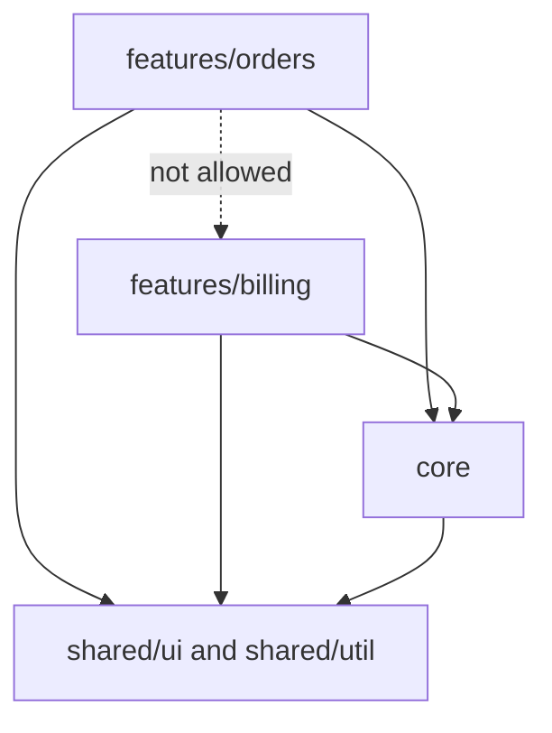
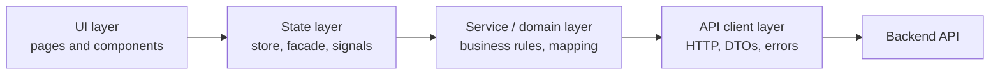
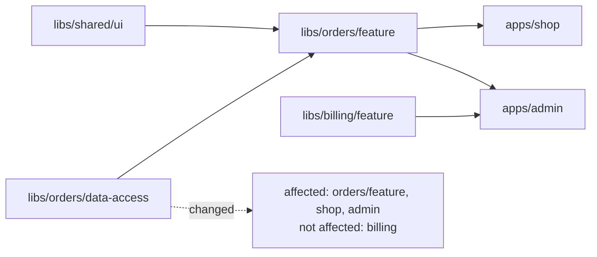
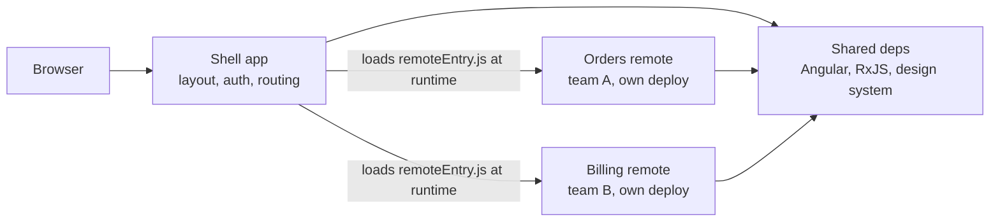
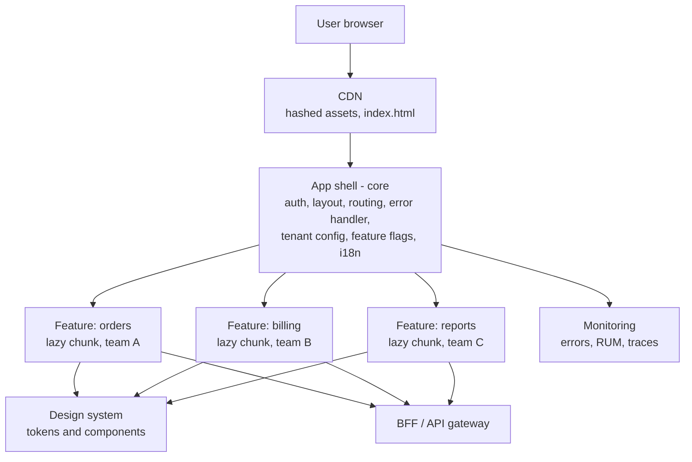

# Frontend Architecture at Scale

> In this document you will learn how to structure a large frontend that many developers and teams work on for years: feature boundaries, layers, design systems, state ownership, code splitting, monorepos, micro-frontends, multi-tenant UIs, internationalization, error monitoring, performance budgets, CSP, accessibility and team ownership. Senior frontend interviews often ask "How would you structure a large app?" or "Would you use micro-frontends?" — this document gives you the reasoning and the words.

**Before this:** [Components and state management](../05-frontend-engineering/06-components-and-state-management.md) · [Build tools and bundlers](../05-frontend-engineering/10-build-tools-and-bundlers.md) · [Angular enterprise architecture](../06-angular-16/13-enterprise-architecture.md) · **Interview questions:** [jump to the interview section](#interview-questions)

## Table of contents

1. [What "at scale" means for a frontend](#what-at-scale-means-for-a-frontend)
2. [Boundaries by feature and domain](#boundaries-by-feature-and-domain)
3. [A layered frontend](#a-layered-frontend)
4. [Design systems and design tokens](#design-systems-and-design-tokens)
5. [State ownership at scale](#state-ownership-at-scale)
6. [Code splitting strategy](#code-splitting-strategy)
7. [Monorepos](#monorepos)
8. [Micro-frontends](#micro-frontends)
9. [Multi-tenant frontends](#multi-tenant-frontends)
10. [Internationalization and localization](#internationalization-and-localization)
11. [Error handling and observability](#error-handling-and-observability)
12. [Performance budgets](#performance-budgets)
13. [CSP at scale](#csp-at-scale)
14. [Accessibility at scale](#accessibility-at-scale)
15. [Team ownership and versioning shared libraries](#team-ownership-and-versioning-shared-libraries)
16. [A reference architecture](#a-reference-architecture)
17. [How to explain this in an interview](#how-to-explain-this-in-an-interview)
18. [Interview questions](#interview-questions)
19. [Summary](#summary)
20. [References](#references)

---

## What "at scale" means for a frontend

A frontend is "at scale" when one or more of these is true:

- **Many developers or teams** change the same app (for example 5 teams, 40 developers).
- **A large codebase:** hundreds of routes and thousands of components.
- **A long life:** the app must stay maintainable for 5–10 years while frameworks change.
- **Many users and markets:** several languages, tenants, brands and devices.
- **High stakes:** errors cost money (checkout, banking, admin tools).

At this size, the hardest problems are not "which framework". They are:

- How do teams work **without blocking each other**?
- How do you keep the code **understandable** (where does a new file go)?
- How do you keep the app **fast** when everyone adds features?
- How do you **find and fix errors** in production quickly?
- How do you keep the UI **consistent and accessible**?

**Analogy:** a small shop vs a city. In a small shop, everyone knows where everything is. A city needs districts (features), roads with rules (boundaries and APIs), building codes (design system, accessibility), a power grid shared by all (core services), and a fire department (monitoring).

---

## Boundaries by feature and domain

### What it is

You organize code **by feature or business domain** (orders, catalog, billing, users), not by technical type (all components in one folder, all services in another). Each feature is a boundary: it owns its pages, components, state and API calls, and exposes a small public API to the rest of the app.

### Why it exists

- A developer working on "billing" finds everything in one place.
- A team can own a folder (and its CODEOWNERS entry).
- Deleting or moving a feature is easy.
- You can lazy-load each feature as one chunk.
- Rules can stop features from reaching into each other's internals.

### Example structure

```text
src/app/
  core/                  # app-wide singletons: auth, http interceptors, error handler, layout shell
  shared/
    ui/                  # dumb, reusable components (or a design-system package)
    util/                # pure helpers (formatting, dates)
  features/
    orders/
      pages/             # routed container components
      components/        # feature-specific presentational components
      data-access/       # API client, DTO mappers, state (store, facade)
      orders.routes.ts   # lazy-loaded routes
      index.ts           # the ONLY file other features may import
    catalog/
    billing/
```

(The Angular-specific version of this, with NgModule vs standalone, is in [Angular enterprise architecture — Folder structure](../06-angular-16/13-enterprise-architecture.md#folder-structure-core-shared-and-features).)

### Dependency rules



Typical rules:

1. A feature can import `shared` and `core`, and another feature **only through its `index.ts` public API** — or not at all.
2. `shared` must not import features (it would no longer be shared).
3. Presentational components must not import data-access code.

Rules that are only written in a wiki are broken in a month. **Enforce them with tools:**

- ESLint: `eslint-plugin-boundaries`, `import/no-restricted-paths`, or Nx's `@nx/enforce-module-boundaries`.
- TypeScript path aliases (`@shop/orders`) that point to the public `index.ts`.
- dependency-cruiser for custom rules and graphs.

### Domain-driven thinking

Boundaries are best when they match **business domains** (in domain-driven design these are called **bounded contexts**). "Orders" and "Shipping" may both have an "Address", but with different rules. It is fine for each to have its own model instead of one shared giant `Address` type.

---

## A layered frontend

### What it is

Inside each feature, split the code into layers with one direction of dependency:



| Layer | Responsibility | Must not |
| --- | --- | --- |
| UI | Render data, handle user events, accessibility | Call `HttpClient`/`fetch` directly; contain business rules |
| State | Hold and derive state, coordinate loading, caching | Know about DOM details |
| Service / domain | Business rules on the client (validation, calculations), DTO → domain mapping | Know about components |
| API client | HTTP calls, headers, retries, error normalization, DTO types | Know about UI or state |

### Why it exists

- **Change isolation:** if the backend renames a field, only the mapper changes, not 30 components.
- **Testing:** each layer can be tested alone (pure mappers, store logic, components with fake facades).
- **Reuse:** the same API client can serve several screens.

### Example (Angular 16, TypeScript)

```ts
// data-access/order.dto.ts — what the backend sends (snake_case, cents, ISO strings)
export interface OrderDto {
  order_id: string;
  status: 'PENDING' | 'PAID' | 'SHIPPED' | 'CANCELLED';
  total_cents: number;
  created_at: string;
}

// data-access/order.model.ts — what the UI uses
export interface Order {
  id: string;
  status: OrderDto['status'];
  total: number;        // in currency units
  createdAt: Date;
  canCancel: boolean;   // a client-side rule derived once, in one place
}

// data-access/order.mapper.ts — pure function, easy to unit test
export function toOrder(dto: OrderDto): Order {
  return {
    id: dto.order_id,
    status: dto.status,
    total: dto.total_cents / 100,
    createdAt: new Date(dto.created_at),
    canCancel: dto.status === 'PENDING',
  };
}
```

```ts
// data-access/order-api.service.ts — API client layer
import { Injectable } from '@angular/core';
import { HttpClient, HttpParams } from '@angular/common/http';
import { Observable, map } from 'rxjs';
import { OrderDto } from './order.dto';
import { Order } from './order.model';
import { toOrder } from './order.mapper';

@Injectable({ providedIn: 'root' })
export class OrderApi {
  constructor(private http: HttpClient) {}

  list(page: number): Observable<Order[]> {
    const params = new HttpParams().set('page', page);
    return this.http
      .get<{ items: OrderDto[] }>('/api/orders', { params })
      .pipe(map((res) => res.items.map(toOrder)));
  }
}
```

```ts
// data-access/orders.facade.ts — state layer exposed to the UI
import { Injectable } from '@angular/core';
import { BehaviorSubject, catchError, of, switchMap, tap } from 'rxjs';
import { OrderApi } from './order-api.service';
import { Order } from './order.model';

type OrdersState =
  | { status: 'loading' }
  | { status: 'error'; message: string }
  | { status: 'ready'; orders: Order[] };

@Injectable({ providedIn: 'root' })
export class OrdersFacade {
  private readonly page$ = new BehaviorSubject(1);
  private readonly state$ = new BehaviorSubject<OrdersState>({ status: 'loading' });
  readonly vm$ = this.state$.asObservable();

  constructor(private api: OrderApi) {
    this.page$
      .pipe(
        tap(() => this.state$.next({ status: 'loading' })),
        switchMap((page) =>                       // switchMap: latest page wins
          this.api.list(page).pipe(
            tap((orders) => this.state$.next({ status: 'ready', orders })),
            catchError(() => {
              this.state$.next({ status: 'error', message: 'Could not load orders' });
              return of(null);
            }),
          ),
        ),
      )
      .subscribe(); // root singleton: lives as long as the app
  }

  goToPage(page: number): void {
    this.page$.next(page);
  }
}
```

The page component only injects `OrdersFacade` and renders `vm$ | async`. It does not know about HTTP, DTOs or snake_case. If the team later moves to NgRx or signals, the component barely changes, because the facade is the boundary. (Facades are explained in [Angular state management — The facade pattern](../06-angular-16/11-state-management-and-ngrx.md#level-3-the-facade-pattern).)

### Common mistakes

- Components that call `http.get` and contain mapping logic — the same mapping is copied in five places.
- Passing DTOs straight into templates — a backend rename breaks many templates at runtime (TypeScript types do not exist at runtime; see [Runtime validation](../03-typescript/11-runtime-validation-and-type-safe-apis.md)).
- Too many layers for a tiny feature. For a simple read-only page, a component plus an API service is enough.

---

## Design systems and design tokens

### What it is

A **design system** is a shared set of design decisions, reusable components and guidelines that makes a product look and behave consistently. It has three parts:

1. **Design tokens** — named design values (colors, spacing, fonts, radii, shadows, motion).
2. **Components** — buttons, inputs, dialogs, tables, built once with accessibility and states (hover, focus, disabled, error, loading).
3. **Documentation** — usage rules, do/don't examples, often in Storybook.

### Why it exists

- Consistency across teams and pages.
- Accessibility built in once (focus rings, ARIA, keyboard support) instead of 50 times.
- Faster development: teams compose screens instead of building basics.
- Theming and rebranding by changing tokens, not code.

### Design tokens

A **design token** is a name for a design value. There are usually two or three levels:

```json
{
  "color": {
    "blue-600": { "$value": "#1d4ed8", "$type": "color" },
    "red-600": { "$value": "#dc2626", "$type": "color" }
  },
  "semantic": {
    "color-action-primary": { "$value": "{color.blue-600}", "$type": "color" },
    "color-feedback-error": { "$value": "{color.red-600}", "$type": "color" }
  },
  "space": {
    "2": { "$value": "8px", "$type": "dimension" },
    "4": { "$value": "16px", "$type": "dimension" }
  }
}
```

- **Primitive (global) tokens:** raw values (`blue-600`).
- **Semantic (alias) tokens:** meaning (`color-action-primary`). Components use **only** semantic tokens.
- **Component tokens** (optional): `button-primary-bg`.

This format follows the W3C Design Tokens Community Group format (`$value`, `$type`). Tools like Style Dictionary transform tokens into CSS variables, SCSS, iOS and Android files.

Output as CSS custom properties:

```css
:root {
  --color-action-primary: #1d4ed8;
  --color-feedback-error: #dc2626;
  --space-2: 8px;
  --space-4: 16px;
}

/* A theme only changes semantic tokens */
[data-theme='dark'] {
  --color-action-primary: #60a5fa;
}

.btn-primary {
  background: var(--color-action-primary);
  padding: var(--space-2) var(--space-4);
}
```

Why semantic tokens matter: if a component uses `blue-600` directly, a dark theme or a tenant brand must find and change every use. With `color-action-primary`, you change one value.

### Building the component library

- Build on **native HTML** elements where possible (`<button>`, `<dialog>`, `<input>`). They give keyboard and screen-reader support for free.
- Define **behavior contracts**: inputs, outputs, slots, keyboard interactions, focus management.
- Use **headless** libraries for complex behavior (Angular CDK, Radix, React Aria, Headless UI), and apply your own styles.
- Test: unit tests, visual regression (Chromatic, Playwright screenshots), automated accessibility checks (axe), and manual screen-reader checks.
- Document in **Storybook** with every state.
- Do not wrap every HTML tag. A design system owns shared interaction patterns, not every business screen.

### Distribution

| Option | Good | Bad |
| --- | --- | --- |
| Versioned npm package | Teams upgrade when ready; works across repos | Teams fall behind; many versions in production |
| Library inside a monorepo | Everyone always on the latest; atomic changes | A breaking change must fix all consumers at once |
| Copy-paste components (shadcn/ui style) | Full control per team | Fixes do not spread automatically |
| Web components | Framework-agnostic | SSR, forms and styling integration are harder |

---

## State ownership at scale

The kinds of state and where each lives are explained in [Components and state management — Kinds of state](../05-frontend-engineering/06-components-and-state-management.md#kinds-of-state). At scale, the key rules are:

### Separate server state from client state

| Kind | Example | Owner | Tool |
| --- | --- | --- | --- |
| Server state | Orders, products, users | The **backend** is the source of truth; the frontend keeps a cache | Query cache, NgRx entity, service with `shareReplay` |
| URL state | Filters, sort, page, selected tab | The **URL** | Router query params |
| Global client state | Current user, tenant, theme, feature flags | App core | A small store or root services/signals |
| Feature state | Wizard steps, selection in a table | The feature | Feature store, facade or component store |
| Local UI state | Is this dropdown open? | The component | Component fields / signals |
| Form state | Unsaved edits | The form | Reactive forms |

Most bugs in big apps come from **one piece of state having two owners**: for example the selected filter in the URL *and* in a store, getting out of sync.

### Rules

1. **One owner per piece of state.** Others read it or ask the owner to change it.
2. **Keep state as local as possible.** Lift it only when two distant parts really need it.
3. **Do not copy server data into a global store "just in case".** Cache it with clear freshness rules ([Caching strategies — Client data caching](03-caching-strategies-and-invalidation.md#client-data-caching)).
4. **Shareable state belongs in the URL** (filters, search, page) so reload, back button and links work.
5. **Feature state is private to the feature.** Other features use the feature's public facade, never its store internals.
6. **Reset state on logout and tenant switch.**

### Cross-feature communication

When feature A needs to react to something in feature B (for example "order placed" should update the cart badge):

- Prefer a **shared, explicit API**: a core service with an observable/signal (`cartCount`), or an app-level event with a typed contract.
- Avoid features importing each other's stores directly.
- In micro-frontends, use custom DOM events or a tiny shared event bus with versioned event types.

---

## Code splitting strategy

**Code splitting** breaks the JavaScript into chunks loaded only when needed. Mechanics (`import()`, chunk naming) are in [Build tools — Code splitting](../05-frontend-engineering/10-build-tools-and-bundlers.md#code-splitting-and-dynamic-import). Here is the strategy for a large app.

### Levels

1. **Route level (most important):** each feature is a lazy-loaded route. Users download only the features they visit.
2. **Component level:** heavy widgets that are not visible at first (charts, rich text editors, maps, PDF viewers) are loaded on demand.
3. **Library level:** big libraries loaded only where used (for example a date library or charting library inside one feature).
4. **Vendor chunks:** framework code in a separate, long-cached chunk (bundlers do this automatically in most setups).

### Angular 16 example

```ts
// app.routes.ts (standalone APIs, Angular 15+)
import { Routes } from '@angular/router';

export const routes: Routes = [
  { path: '', loadComponent: () => import('./features/home/home.page').then((m) => m.HomePage) },
  { path: 'orders', loadChildren: () => import('./features/orders/orders.routes').then((m) => m.ORDER_ROUTES) },
  { path: 'reports', loadChildren: () => import('./features/reports/reports.routes').then((m) => m.REPORT_ROUTES) },
];
```

With NgModules: `loadChildren: () => import('./orders/orders.module').then((m) => m.OrdersModule)`.

Component-level lazy loading in Angular 16 uses `ViewContainerRef.createComponent` after a dynamic `import()`:

```ts
async showChart(): Promise<void> {
  const { SalesChartComponent } = await import('./sales-chart.component');
  this.chartHost.clear();
  this.chartHost.createComponent(SalesChartComponent);
}
```

> **Newer Angular (17+):** `@defer` blocks in templates lazy-load components declaratively, with triggers like `on viewport`, `on idle` or `on interaction`, plus `@placeholder` and `@loading` blocks.

### Prefetching

Lazy loading saves the initial download but can make navigation slower. Prefetch likely next chunks:

- Angular: `PreloadAllModules`, or a custom preloading strategy (for example preload routes marked `data: { preload: true }`, or only on fast connections).
- Prefetch when the user hovers a link or when the browser is idle.
- `<link rel="modulepreload">` for chunks needed very soon.

### Watch out

- Too many tiny chunks: many requests and waterfalls. Group related code.
- A "shared" chunk that grows huge because every feature imports one big utility file.
- After a deploy, an open tab may request old chunk names that were deleted → handle chunk load errors with a reload prompt, and keep old chunks for a while ([Caching strategies — Deploy order](03-caching-strategies-and-invalidation.md#deploy-order-for-an-spa)).

---

## Monorepos

### What it is

A **monorepo** is one version-control repository that holds many projects: several apps (web, admin, mobile web) and many shared libraries (design system, API clients, utilities). The opposite is **polyrepo**: one repository per project.

A monorepo is **not** a monolith. Apps can still deploy separately.

### Why teams use them

- **Atomic changes:** change a shared library and all its users in one pull request.
- **One version** of dependencies (one Angular version, one TypeScript version) — fewer "works with v3 but not v4" problems.
- **Easy code sharing** without publishing npm packages.
- **Consistent tooling:** one lint config, one test setup, one CI.

### Costs

- CI gets slow unless you build and test only what changed.
- Tooling and repository size need care.
- Boundaries must be enforced, or everything imports everything.
- A breaking change to a shared library must be handled by its owners for all consumers.

### Tools

| Tool | What it does |
| --- | --- |
| **Nx** | Project graph, generators, `nx affected`, local and remote computation caching, module boundary lint rules with tags. Strong Angular support. |
| **Turborepo** | Task runner with caching (local and remote) for JS/TS monorepos, `--filter` to select packages (newer versions also have `--affected`). |
| **pnpm / npm / Yarn workspaces** | Link local packages together; the base layer under Nx or Turborepo. |
| Lerna, Rush, Bazel | Older or more specialized options (Bazel for very large, multi-language repos). |

### Affected builds

The tool builds a **dependency graph** of projects. When you change `libs/orders/data-access`, it knows which apps and libraries depend on it. CI runs build, lint and test only for those (the "affected" projects).



```bash
# Nx: run tests and builds only for projects affected by changes since main
npx nx affected -t lint test build --base=origin/main

# Turborepo: run builds for changed packages and their dependents
npx turbo run build --filter="...[origin/main]"
```

**Computation caching:** if the inputs of a task (source files, config, dependency versions) did not change, the tool reuses the old output. With a **remote cache**, a build done on one developer's machine or CI job can be reused by others.

### Library types and boundary tags (Nx style)

| Type | Contains | May depend on |
| --- | --- | --- |
| `feature` | Smart components, routes for a use case | ui, data-access, util |
| `ui` | Presentational components | ui, util |
| `data-access` | API clients, state | data-access, util |
| `util` | Pure functions | util |

```json
{
  "rules": {
    "@nx/enforce-module-boundaries": ["error", {
      "depConstraints": [
        { "sourceTag": "type:feature", "onlyDependOnLibsWithTags": ["type:feature", "type:ui", "type:data-access", "type:util"] },
        { "sourceTag": "type:ui", "onlyDependOnLibsWithTags": ["type:ui", "type:util"] },
        { "sourceTag": "type:util", "onlyDependOnLibsWithTags": ["type:util"] },
        { "sourceTag": "scope:orders", "onlyDependOnLibsWithTags": ["scope:orders", "scope:shared"] }
      ]
    }]
  }
}
```

Now a `ui` library cannot import a `data-access` library, and `orders` code cannot import `billing` internals. The linter fails the build if someone tries.

---

## Micro-frontends

### What it is

**Micro-frontends** split one web application into several smaller frontend applications that are **owned, built and often deployed independently** by different teams, and combined into one experience for the user. It is the microservices idea applied to the frontend.

### Why they exist

Mainly **organizational** reasons:

- Many teams (for example 8+) work on one huge app and block each other's releases.
- Different parts have very different release speeds.
- A gradual migration: a legacy AngularJS app is replaced piece by piece with a new framework.
- Some parts come from separate companies or business units.

### Ways to compose them

| Approach | How | Independent deploy | Pros | Cons |
| --- | --- | --- | --- | --- |
| **Build-time packages** | Each team publishes an npm package; the shell app installs and builds them together | No (shell must rebuild) | Simple, one bundle, type safety | Not truly independent; release coordination |
| **Runtime Module Federation** | The shell loads remote JS bundles at runtime from each team's URL; shared dependencies (Angular, React) loaded once | Yes | Real independent deploys, shared deps | Version mismatches, complex config, runtime errors |
| **iframes** | Each part is a separate page inside an `<iframe>` | Yes | Strong isolation (CSS, JS, security) | Hard routing, sizing, accessibility, performance, communication via `postMessage` |
| **Web components** | Each team ships custom elements (`<orders-widget>`) | Yes, if loaded at runtime | Framework-agnostic contract | Each may bundle its own framework; SSR and styling harder |
| **Server-side / edge composition** | The server or edge assembles HTML fragments (SSI, ESI, fragment services) | Yes | Fast first paint, SEO | Infrastructure complexity |
| **Route-based split (link-level)** | Different paths are different apps (`/shop` vs `/account`) | Yes | Simplest real independence | Full page loads between apps; shared header must be duplicated |

### Module Federation in short

**Module Federation** was introduced in webpack 5. A **host** (shell) app declares **remotes**; each remote **exposes** modules. At runtime, the host downloads a small `remoteEntry.js` from each remote and loads exposed modules on demand. **Shared** dependencies are negotiated so the framework is loaded only once if versions are compatible.



Angular options:

- `@angular-architects/module-federation` for the webpack-based builder (default in Angular 16).
- **Native Federation** (`@angular-architects/native-federation`), which follows the same idea with standard ES modules and import maps, and works with the esbuild-based builder (developer preview in Angular 16, default for new projects since Angular 17).
- Module Federation 2.0 (`@module-federation/enhanced`) supports webpack, Rspack and other bundlers.

### What the shell owns

To make micro-frontends feel like one product, a platform team usually owns:

- the shell: top-level routing, layout, navigation,
- authentication and the session,
- the design system and global styles,
- shared observability (error reporting, RUM) and the CSP,
- the contracts: how remotes receive context (user, tenant, locale) and how they communicate (custom events, a small shared API).

### Trade-offs

| Advantages | Disadvantages |
| --- | --- |
| Teams deploy independently | Much more complex build, deploy and runtime |
| Smaller codebases per team | Duplicate dependencies if versions differ → bigger downloads |
| Incremental migration between frameworks | Inconsistent UX unless the design system is strong |
| Fault isolation (one remote fails, others work) | Cross-app state, routing and auth are harder |
| | Harder testing of the whole system (integration, e2e) |
| | Version skew: shell and remotes must stay compatible at runtime |

### When NOT to use them

- One team or a few teams. A well-structured monorepo with lazy-loaded features gives most of the benefits.
- The problem is code quality, not team coordination. Micro-frontends do not fix messy code; they spread it.
- Performance is critical and you cannot control duplicate frameworks.
- You do not have a platform team to own the shell, contracts and tooling.

A good order of steps: modular monolith with feature boundaries → monorepo with enforced boundaries and affected builds → micro-frontends only for the parts where independent deployment really pays off.

---

## Multi-tenant frontends

A **multi-tenant** product serves many customer organizations (tenants) from one codebase. The backend side (data isolation) is in [Auth architecture and multi-tenancy](06-auth-architecture-and-multi-tenancy.md#multi-tenancy-models). On the frontend, tenants differ in:

- **branding:** logo, colors, fonts, custom domain,
- **configuration:** enabled modules, limits, default language, date formats,
- **features:** plan-based features, beta features,
- sometimes **custom workflows** or fields.

### Identify the tenant

| Method | Example | Notes |
| --- | --- | --- |
| Subdomain | `acme.app.com` | Clear; cookies can be scoped per subdomain; needs wildcard TLS certificate |
| Custom domain | `portal.acme.com` | Best branding; needs certificate automation and domain verification |
| Path | `app.com/acme/...` | Simple; one origin for all tenants (less isolation of cookies and storage) |
| From login | Tenant chosen after sign-in | For users in several tenants; store the current tenant in the session |

Important: the frontend's tenant choice is **for UX only**. The backend must take the tenant from the authenticated session or token and enforce it on every request.

### Runtime configuration

Do not build one bundle per tenant. **Build once, configure at runtime.**

```ts
// core/tenant-config.ts
export interface TenantConfig {
  tenantId: string;
  name: string;
  theme: { primary: string; logoUrl: string };
  locale: string;
  features: Record<string, boolean>;
}
```

```ts
// main.ts (Angular 16, standalone bootstrap) — load config before the app starts
import { bootstrapApplication } from '@angular/platform-browser';
import { APP_INITIALIZER, InjectionToken } from '@angular/core';
import { AppComponent } from './app/app.component';
import { TenantConfig } from './app/core/tenant-config';

export const TENANT_CONFIG = new InjectionToken<TenantConfig>('TENANT_CONFIG');

fetch('/api/tenant-config', { credentials: 'include' }) // the server resolves the tenant from host or session
  .then((res) => {
    if (!res.ok) throw new Error(`Config failed: ${res.status}`);
    return res.json() as Promise<TenantConfig>;
  })
  .then((config) => {
    applyTheme(config);
    return bootstrapApplication(AppComponent, {
      providers: [{ provide: TENANT_CONFIG, useValue: config }],
    });
  })
  .catch(() => {
    document.body.textContent = 'Sorry, the application could not start. Please try again.';
  });

function applyTheme(config: TenantConfig): void {
  const root = document.documentElement;
  root.style.setProperty('--color-action-primary', config.theme.primary); // semantic token
  document.title = config.name;
}
```

(`APP_INITIALIZER` is the other common option; see [Angular enterprise architecture — Runtime configuration](../06-angular-16/13-enterprise-architecture.md#runtime-configuration-with-app_initializer).)

Validate tenant colors before applying them (for example against a pattern like `#rrggbb`), and check contrast — a tenant's brand color can make text unreadable.

### Feature flags

A **feature flag** turns a feature on or off at runtime without a deploy. Uses: plan-based features, gradual rollouts, beta tenants, kill switches.

```js
// Deterministic percentage rollout: the same user always gets the same answer.
function isEnabled(flag, { tenantId, userId }) {
  if (flag.tenants?.includes(tenantId)) return true; // explicitly enabled tenants
  if (!flag.rolloutPercent) return false;
  let h = 0;
  for (const ch of `${flag.key}:${userId}`) h = (h * 31 + ch.charCodeAt(0)) >>> 0; // simple string hash
  return h % 100 < flag.rolloutPercent;
}

const flag = { key: 'new-checkout', tenants: ['acme'], rolloutPercent: 20 };
console.log(isEnabled(flag, { tenantId: 'acme', userId: 'u1' })); // true (tenant allow-list)

const users = Array.from({ length: 10000 }, (_, i) => `user-${i}`);
console.log(users.filter((u) => isEnabled(flag, { tenantId: 'globex', userId: u })).length); // 2010 (about 20%)
```

Rules for flags at scale:

- Evaluate on the **server** for anything security- or plan-related; the client flag only hides UI.
- Give every flag an **owner and an expiry date**; remove old flags (they are technical debt).
- Use a flag service (LaunchDarkly, Unleash, Flagsmith, ConfigCat, or the vendor-neutral OpenFeature API) when you have many flags.
- Test both states of a flag.

### Tenant switching

When a user switches tenant in the same tab:

1. Cancel in-flight requests.
2. Clear the store, query caches and tenant-specific storage.
3. Reload tenant config and theme.
4. Navigate to the new tenant's home.

Often the safest choice is a **full page reload** into the new tenant. Many subtle bugs (an old response arriving late) disappear.

---

## Internationalization and localization

### What they are

- **Internationalization (i18n):** making the app *able* to support many languages and regions — no hard-coded text, locale-aware formatting, room for longer text, right-to-left support.
- **Localization (l10n):** the actual translations and regional adaptations for a specific locale (for example `de-DE`, `hi-IN`).

### Use the built-in `Intl` APIs

JavaScript's `Intl` (ECMAScript Internationalization API) formats numbers, currencies, dates, relative times and plural rules correctly per locale:

```js
const price = 1234567.891;
console.log(new Intl.NumberFormat('en-US', { style: 'currency', currency: 'USD' }).format(price)); // $1,234,567.89
console.log(new Intl.NumberFormat('de-DE', { style: 'currency', currency: 'EUR' }).format(price)); // 1.234.567,89 €
console.log(new Intl.NumberFormat('en-IN', { style: 'currency', currency: 'INR' }).format(price)); // ₹12,34,567.89

const date = new Date(Date.UTC(2026, 9, 22, 14, 30));
console.log(new Intl.DateTimeFormat('en-US', { dateStyle: 'medium', timeZone: 'UTC' }).format(date)); // Oct 22, 2026
console.log(new Intl.DateTimeFormat('de-DE', { dateStyle: 'medium', timeZone: 'UTC' }).format(date)); // 22.10.2026

const rtf = new Intl.RelativeTimeFormat('en', { numeric: 'auto' });
console.log(rtf.format(-1, 'day'), '|', rtf.format(3, 'hour')); // yesterday | in 3 hours
```

Notice the Indian grouping (`12,34,567`) and that the euro sign goes after the number in German. (The space before `€` is a non-breaking space.) You should never build these formats by hand.

### Plurals are not "one vs many"

English has two plural forms. Polish has more; Arabic has six categories. `Intl.PluralRules` tells you which form to use:

```js
const pl = new Intl.PluralRules('pl-PL');
console.log([0, 1, 2, 5, 22].map((n) => pl.select(n)).join(',')); // many,one,few,many,few

const messages = {
  en: { items: { one: '{count} item', other: '{count} items' } },
  pl: { items: { one: '{count} produkt', few: '{count} produkty', many: '{count} produktów', other: '{count} produktu' } },
};

function t(locale, key, count) {
  const rule = new Intl.PluralRules(locale).select(count);
  const forms = messages[locale][key];
  return (forms[rule] ?? forms.other).replace('{count}', new Intl.NumberFormat(locale).format(count));
}

console.log(t('en', 'items', 1), '|', t('en', 'items', 5));  // 1 item | 5 items
console.log(t('pl', 'items', 2), '|', t('pl', 'items', 5), '|', t('pl', 'items', 22)); // 2 produkty | 5 produktów | 22 produkty
```

Real apps use **ICU message format** (`{count, plural, one {# item} other {# items}}`), supported by Angular i18n, FormatJS/react-intl, Transloco (with a plugin) and others.

### Architecture decisions

| Decision | Options |
| --- | --- |
| Build-time vs runtime translations | Angular's built-in i18n (`@angular/localize`) builds **one bundle per locale** (fast, no runtime cost, but a rebuild and a deploy per locale and a reload to switch). Runtime libraries (Transloco, ngx-translate, i18next) load translation JSON at runtime (switch without reload, translations can change without a build). Details: [Angular enterprise architecture — Internationalization](../06-angular-16/13-enterprise-architecture.md#internationalization). |
| Where translations live | In the repo (reviewed with code) or in a translation management system (Crowdin, Lokalise, Phrase) synced by CI |
| Loading | Per locale and per feature (lazy-load the orders translations with the orders chunk) |
| Locale detection | User setting > tenant default > `Accept-Language` / `navigator.languages` > app default |
| URLs | `/de/products` for public SEO pages, with `hreflang` tags |

### Common i18n mistakes

- Concatenating strings: `'You have ' + n + ' messages'` — word order differs between languages. Use whole messages with placeholders.
- Layouts that break when German text is 30% longer. Test with **pseudo-localization** (for example `[Ŝéţţîñĝš ~~~~]`), which makes text longer and reveals hard-coded strings.
- Ignoring **right-to-left** languages (Arabic, Hebrew): use `dir="rtl"` and CSS logical properties (`margin-inline-start` instead of `margin-left`).
- Formatting dates in the wrong time zone. Store and send UTC (ISO 8601); format in the user's time zone at display time.
- Putting text inside images.

---

## Error handling and observability

### Why it matters

In the backend, logs are on your servers. In the frontend, errors happen on **millions of devices you cannot see**: different browsers, extensions, slow networks, old app versions in open tabs. Without client-side monitoring, you only learn about bugs from angry users.

### Layers of error handling

1. **Local handling:** expected errors (validation, 404, network failure) are handled where they happen with a clear message and a retry.
2. **Error boundaries:** one broken widget should not break the whole page. React has error boundaries; in Angular, catch errors in the feature's facade or effects and show a fallback state.
3. **Global handlers:** catch everything else and report it.

### Global handlers

Browser-level:

```js
window.addEventListener('error', (event) => {
  report({ type: 'error', message: event.message, stack: event.error?.stack, source: event.filename });
});

window.addEventListener('unhandledrejection', (event) => {
  report({ type: 'unhandledrejection', reason: String(event.reason), stack: event.reason?.stack });
});
```

Angular — inside zone.js-managed code, Angular catches errors and sends them to `ErrorHandler`, so you replace it:

```ts
import { ErrorHandler, Injectable } from '@angular/core';
import { HttpErrorResponse } from '@angular/common/http';

@Injectable()
export class GlobalErrorHandler implements ErrorHandler {
  handleError(error: unknown): void {
    if (error instanceof HttpErrorResponse) {
      // usually already handled by an interceptor; report only unexpected statuses
      if (error.status >= 500) reportError(error, { kind: 'http' });
      return;
    }
    if (error instanceof Error && /Loading chunk|dynamically imported module/i.test(error.message)) {
      // an old tab after a deploy: offer a reload instead of a broken screen
      showReloadBanner();
      return;
    }
    reportError(error, { kind: 'runtime' });
    console.error(error);
  }
}

// providers: [{ provide: ErrorHandler, useClass: GlobalErrorHandler }]
declare function reportError(error: unknown, context: Record<string, string>): void;
declare function showReloadBanner(): void;
```

(More in [Angular enterprise architecture — Global error handling](../06-angular-16/13-enterprise-architecture.md#global-error-handling).)

### Error reporting tools

Tools like **Sentry**, Datadog RUM, New Relic Browser, Bugsnag, Rollbar or an OpenTelemetry-based setup collect errors with:

- the stack trace — made readable by uploading **source maps** to the tool (do not necessarily serve them publicly; see [Build tools — Source maps](../05-frontend-engineering/10-build-tools-and-bundlers.md#source-maps)),
- the **release version** (build ID), so you know which deploy introduced a bug,
- **breadcrumbs:** the clicks, navigations and requests before the error,
- browser, OS, URL, user ID or tenant (without personal data you do not need),
- a **trace ID** that links the frontend error to backend logs.

### RUM: real user monitoring

**RUM** measures what real users experience: page load and Core Web Vitals (LCP, INP, CLS), route change times, API latency and error rates, long tasks. Collect Web Vitals with the `web-vitals` library and send them to your analytics endpoint with `navigator.sendBeacon` ([Web performance — Field data](../05-frontend-engineering/05-web-performance-and-core-web-vitals.md#lab-data-vs-field-data)).

### Correlation with the backend

Send a trace header (the W3C `traceparent` header used by OpenTelemetry) with API requests. Then one user action can be followed from the click, through the API gateway and services, to the database. Observability in general is covered in [Production Node.js](../07-nodejs-backend/14-production-nodejs.md).

### Rules for client telemetry

- **Privacy first:** scrub passwords, tokens, personal data and form contents. Follow GDPR and consent rules.
- **Sample:** you do not need every event from every user. Sample performance data; keep all errors (with rate limits).
- **Batch and buffer** with a size limit; send with `sendBeacon` on page hide.
- **Never break the app:** if telemetry fails, ignore it silently. A logging failure must never turn a successful user action into an error.
- **Group and alert** on new error types after a release, error rate spikes, and Web Vitals regressions.

---

## Performance budgets

### What it is

A **performance budget** is a limit you agree on and enforce, for example "initial JavaScript under 200 KB compressed" or "LCP under 2.5 s at p75 on mobile". When a change goes over the budget, the build warns or fails.

### Why it exists

Performance usually gets worse slowly: each team adds "just 20 KB". Without a limit, no single change looks guilty, and after a year the app is slow. A budget makes the cost visible **in the pull request**.

### Types of budgets

| Type | Example | Where checked |
| --- | --- | --- |
| Size | Initial JS ≤ 200 KB gzip; any lazy chunk ≤ 100 KB | Build (Angular budgets, size-limit, bundlesize) |
| Timing (lab) | LCP ≤ 2.5 s, TBT ≤ 200 ms in Lighthouse on a mobile profile | CI (Lighthouse CI) |
| Field (real users) | p75 LCP ≤ 2.5 s, INP ≤ 200 ms, CLS ≤ 0.1 | RUM dashboards and alerts |
| Counts | ≤ 50 requests on first load; ≤ 3 third-party scripts | Lighthouse CI, reviews |

### Angular budgets

Angular CLI projects have budgets in `angular.json`:

```json
"configurations": {
  "production": {
    "budgets": [
      { "type": "initial", "maximumWarning": "500kb", "maximumError": "1mb" },
      { "type": "anyComponentStyle", "maximumWarning": "2kb", "maximumError": "4kb" },
      { "type": "anyScript", "maximumWarning": "250kb", "maximumError": "400kb" }
    ]
  }
}
```

The budget types include `initial` (the scripts and styles needed to start the app), `bundle` (one named bundle), `anyScript` (any single script file, including lazy chunks), `allScript`, `any`, `all` and `anyComponentStyle`. The CLI checks them on `ng build`. Note that Angular budget sizes are measured on the built (minified, not compressed) files.

### Making budgets work

- Start from today's numbers and tighten slowly; an impossible budget gets ignored.
- Fail the build on errors, not only warnings.
- Show bundle diffs in pull requests (bundle analyzers, `source-map-explorer`, size-limit comments).
- Give each team a budget for its own chunks.
- Review new dependencies (check their size before adding them).

Frontend optimizations themselves are in [Web performance and Core Web Vitals](../05-frontend-engineering/05-web-performance-and-core-web-vitals.md).

---

## CSP at scale

**Content Security Policy (CSP)** is an HTTP header that tells the browser which scripts, styles, images and connections are allowed. It is a strong defense against XSS. The attack and the directives are explained in [Web security — XSS, CSRF, CORS, CSP](../01-cs-and-web-fundamentals/08-browser-storage-and-web-security-basics.md). Here are the problems that appear in big apps.

### The recommended policy style: strict CSP

Instead of long allow-lists of domains (which are often bypassable), use **nonces** or **hashes**:

```text
Content-Security-Policy:
  script-src 'nonce-R4nd0m123' 'strict-dynamic';
  object-src 'none';
  base-uri 'none';
  frame-ancestors 'none';
  report-to csp-endpoint
```

- A **nonce** is a random value generated for **each response**. Only `<script nonce="R4nd0m123">` tags run.
- `'strict-dynamic'` lets those trusted scripts load further scripts (chunks) without listing every URL.
- This needs a server (or edge function) that generates the nonce per request and writes it into the HTML. For purely static hosting, use **hashes** of inline scripts instead.

### Angular 16

Angular 16 added support for CSP nonces for the styles Angular inserts at runtime: put `ngCspNonce="..."` on the root element (`<app-root ngCspNonce="">`) or provide the `CSP_NONCE` injection token. Angular templates are compiled ahead of time, so Angular apps do not need `'unsafe-eval'`.

### Challenges at scale and how to handle them

| Challenge | Approach |
| --- | --- |
| Many teams add third-party scripts (analytics, chat, A/B tests) | A central allow process; load third parties through a tag manager only if it is nonce-aware; review each one |
| Micro-frontends loaded from other origins | Each remote's origin must be allowed (or use `'strict-dynamic'` with a nonce-loaded shell) |
| Inline styles from libraries | Nonce support (Angular 16 `ngCspNonce`), or `style-src 'unsafe-inline'` as a known, documented exception (style injection is much less dangerous than script injection) |
| Rolling out without breaking production | Start with `Content-Security-Policy-Report-Only`, collect violation reports, fix, then enforce |
| Too many violation reports (browser extensions cause noise) | Aggregate and filter reports; alert on new sources only |
| Policy differs per app or tenant | Generate the header in one shared middleware or edge config, versioned in the repo |

Also use **Trusted Types** (`require-trusted-types-for 'script'`) where supported, to block dangerous DOM sinks like `innerHTML` with plain strings. Angular has built-in Trusted Types support.

---

## Accessibility at scale

Accessibility basics (semantic HTML, ARIA, keyboard, focus, contrast) are in [Accessibility](../05-frontend-engineering/04-accessibility.md). At scale, the question is: **how do 40 developers keep the app accessible without an expert reviewing every change?**

1. **Set a standard:** for example WCAG 2.2 level AA. Make it a written requirement, like performance and security.
2. **Build it into the design system:** accessible buttons, inputs with labels and error messages, dialogs with focus trapping, menus with keyboard support, visible focus rings, color tokens that meet contrast. If the base components are accessible, most screens are accessible by default.
3. **Automate what can be automated:**
   - lint rules (`@angular-eslint/template` accessibility rules, `eslint-plugin-jsx-a11y`),
   - axe-core checks in component tests and e2e tests (for example `@axe-core/playwright`),
   - Lighthouse accessibility audits in CI.
   Automated tools find only part of the problems. Issues like a confusing focus order, unclear labels or a broken screen-reader flow need a human. So automation is a floor, not a finish line.
4. **Manual testing:** keyboard-only walkthroughs and screen-reader checks (NVDA, JAWS, VoiceOver) on key flows, before major releases.
5. **Definition of done:** a feature is not done until keyboard, focus, labels and announcements work.
6. **Ownership and training:** accessibility champions in each team; clear guidance in Storybook ("use `<app-dialog>`, never a custom div modal").
7. **Track issues** like bugs, with severity.

Many countries have legal requirements (for example the European Accessibility Act applies to many products and services since June 2025, and the ADA in the US is applied to websites by courts). For enterprise and public-sector customers, accessibility conformance reports are often part of the sales process.

---

## Team ownership and versioning shared libraries

### CODEOWNERS

A **CODEOWNERS** file (supported by GitHub, GitLab and Bitbucket in similar forms) maps paths to the team that must review changes to them.

```text
# .github/CODEOWNERS — the last matching pattern wins
*                                  @shop/platform-team
/libs/shared/ui/                   @shop/design-system
/libs/orders/                      @shop/orders-team
/libs/billing/                     @shop/billing-team
/apps/admin/                       @shop/admin-team
/.github/workflows/                @shop/platform-team
```

With branch protection ("require review from code owners"), a change to `libs/billing` cannot merge without the billing team's approval. This makes ownership real, not only a diagram.

### Versioning shared libraries

**Inside a monorepo**, you often use a **single-version policy**: all apps use the current version of shared libraries in the same commit. No versions to manage, but a breaking change must update all consumers in the same pull request (the library owner's job, with help from codemods).

**Across repositories**, publish packages with **semantic versioning (semver)**:

- `MAJOR.MINOR.PATCH` — `2.4.1`.
- PATCH: bug fixes, no API change.
- MINOR: new features, backward compatible.
- MAJOR: breaking changes.

Practices:

- **Changesets** (or conventional commits with semantic-release) to generate versions and changelogs.
- **Deprecate before removing:** mark the old API deprecated (with a JSDoc `@deprecated` tag so editors show it), keep it for at least one minor version, then remove it in the next major.
- **Codemods / migration schematics:** Angular libraries can ship `ng update` schematics that rewrite consumer code automatically.
- **Peer dependencies** for the framework (`@angular/core`) so the app controls the framework version.
- Keep the number of supported major versions small (for example current and previous).

### Team topology

A common setup for a big frontend:

- **Stream-aligned feature teams** own features end to end (UI, state, sometimes the BFF).
- A **platform team** owns the shell, build tooling, CI, monitoring, CSP and shared infrastructure.
- A **design system team** owns tokens, components and accessibility guidance.

The architecture should match this: feature boundaries = team boundaries (Conway's law, see [Scalability — Monolith vs microservices](02-scalability-and-core-building-blocks.md#monolith-modular-monolith-and-microservices)).

---

## A reference architecture

Putting it together for a large enterprise frontend:



- One repository (monorepo) with apps and libraries, enforced boundaries, affected builds and remote caching.
- Each feature lazy-loaded, owned by one team via CODEOWNERS, with a layered structure (UI → state → services → API client).
- A design system with tokens, accessible components and Storybook.
- Runtime tenant configuration and feature flags; build once, deploy everywhere.
- Global error handling, RUM and source maps uploaded to the error tool.
- Performance budgets and accessibility checks in CI; strict CSP with nonces.
- Micro-frontends only if independent deployment between many teams is truly needed.

---

## How to explain this in an interview

For "How would you architect a large frontend application for several teams?":

1. **Define it:** "Frontend architecture at scale is about boundaries, ownership and shared foundations, so many teams can work in parallel on a fast, consistent app."
2. **Why it exists:** "Without boundaries, every change touches everything, teams block each other, the bundle grows and quality drifts."
3. **How it works:** "I split by business domain into lazy-loaded features, each with layers: UI, state, services and an API client that maps DTOs. Shared code lives in a design system and utility libraries. I use a monorepo with enforced module boundaries and affected builds, CODEOWNERS for ownership, and runtime config and feature flags for tenants. I add error monitoring, RUM, performance budgets and accessibility checks in CI."
4. **Small example:** "In an admin portal, orders, billing and reports are separate libraries owned by three teams; the lint rule stops reports from importing billing internals, and CI only rebuilds what a change affects."
5. **Where it is useful:** "Enterprise portals, e-commerce sites, SaaS products with many customers."
6. **Trade-offs / gotchas:** "More structure means more upfront work. Micro-frontends give independent deploys but add runtime complexity and duplicate dependencies — I'd use them only when team independence clearly outweighs that."

---

## Interview questions

### Q1. How would you structure a large frontend application worked on by several teams?

**What the interviewer is checking:** Boundaries, ownership and enforcement — not just folder names.

**Short spoken answer (30–60 seconds):**
> I organize by business domain, not by file type. Each domain — orders, billing, reports — is a feature with its own routes, components, state and API client, lazy-loaded as its own chunk, and it exposes only a small public API. Shared things go into a design system and utility libraries; app-wide services like auth, the error handler and tenant config go into core. Inside a feature I use layers: UI components, a state layer or facade, domain logic and mapping, and an API client. Then I enforce it: lint rules for module boundaries, CODEOWNERS so each team owns its folders, and a monorepo tool so CI builds only affected projects. Without enforcement, the boundaries disappear within months.

**Follow-up questions:**
- **How do two features communicate?** — Through a shared core service or a typed app-level event, or the router (navigate with IDs). Never by importing each other's stores.
- **Where does a component used by two features go?** — If it is generic, into the shared UI library or design system. If it is business-specific to one domain, it stays in that domain and the other feature uses it through the public API — or you question whether it really belongs to both.

**Common mistakes:** "components/, services/, models/" folders for the whole app; no enforcement.

**Where this is used in real projects:** Nx-based Angular enterprise apps, large React monorepos.

### Q2. Why separate the UI from the API client with DTO mappers?

**What the interviewer is checking:** Understanding of layers and change isolation.

**Short spoken answer (30–60 seconds):**
> Because the backend's data shape and the UI's needs change for different reasons. The API client knows HTTP, headers and DTOs — maybe snake_case fields, cents and ISO strings. A mapper turns that into a domain model the UI wants: camelCase, numbers in currency units, real Dates, and derived flags like `canCancel`. If the backend renames a field, I change one mapper, not thirty templates. The mapper is a pure function, so it's trivial to unit test, and it's a good place for runtime validation of the response. Components then depend on a facade, so I can even swap the state solution without touching them.

**Follow-up questions:**
- **Isn't that over-engineering for small apps?** — For a small read-only page, a component plus an API service is fine. Layers pay off when many screens share data or the backend contract is unstable.

**Common mistakes:** Binding DTOs directly to templates everywhere.

**Where this is used in real projects:** Angular data-access libraries, React query hooks with select/mapping functions.

### Q3. What are design tokens, and why do semantic tokens matter?

**What the interviewer is checking:** Design system fundamentals.

**Short spoken answer (30–60 seconds):**
> Design tokens are named design values — colors, spacing, typography, radii — stored in one source, usually JSON, and transformed by a tool like Style Dictionary into CSS variables and platform formats. There are primitive tokens like `blue-600`, and semantic tokens like `color-action-primary` that describe meaning and point to a primitive. Components should use only semantic tokens. Then a dark theme or a tenant's brand only changes the semantic mapping — one value — instead of finding every use of blue in the code. Tokens are also how design and code stay in sync: designers and developers use the same names.

**Follow-up questions:**
- **How do you theme at runtime?** — Redefine the CSS custom properties on `:root` or a `[data-theme]` attribute; components read `var(--token)` and update instantly.
- **How do you keep tenant colors accessible?** — Validate contrast when the tenant config is saved and derive accessible text colors automatically.

**Common mistakes:** Calling a Sass color variables file a "design system".

**Where this is used in real projects:** Material Design tokens, Salesforce Lightning, IBM Carbon.

### Q4. Should every component in a large app use a global store?

**What the interviewer is checking:** State ownership judgment.

**Short spoken answer (30–60 seconds):**
> No. Each piece of state should have one owner and live as close as possible to where it's used. Server data belongs to the backend, and the frontend should treat it as a cache with freshness rules, not copy it into a global store by default. Shareable UI state like filters and pagination belongs in the URL. Truly app-wide client state — the current user, tenant, theme, feature flags — goes into a small core store or services. Feature state stays private to the feature. Local UI state like "is this menu open" stays in the component. Most state bugs at scale come from two owners for the same data, like filters stored in both the URL and a store.

**Common mistakes:** Everything in NgRx; or no rules at all.

**Where this is used in real projects:** See [Components and state management](../05-frontend-engineering/06-components-and-state-management.md) and [Angular state management](../06-angular-16/11-state-management-and-ngrx.md).

### Q5. What is a monorepo, and what problems do Nx or Turborepo solve?

**What the interviewer is checking:** Practical knowledge of large-codebase tooling.

**Short spoken answer (30–60 seconds):**
> A monorepo is one repository with many apps and libraries. It enables atomic changes across a library and its consumers, one version of each dependency, and easy sharing without publishing packages. The problems are CI time and boundaries. Nx and Turborepo build a dependency graph of the projects, so CI runs lint, test and build only for projects affected by a change, and they cache task results locally and remotely, so unchanged work is reused across machines. Nx also provides module boundary rules with tags — for example a UI library can't import data access, and the orders scope can't import billing. A monorepo isn't a monolith: apps still deploy separately.

**Follow-up questions:**
- **What is a remote cache?** — A shared store of task outputs keyed by a hash of the inputs. If CI already built a library with the same inputs, your machine downloads the output instead of building.
- **Monorepo vs polyrepo?** — Monorepo for tight sharing and one team of teams; polyrepo for truly independent products, different access rules, or very different tech stacks.

**Common mistakes:** Thinking monorepo means one deployment.

**Where this is used in real projects:** Nx for Angular enterprises, Turborepo for JS/TS product teams.

### Q6. What are micro-frontends? When would you use them, and when not?

**What the interviewer is checking:** Senior-level trade-off judgment.

**Short spoken answer (30–60 seconds):**
> Micro-frontends split one web app into parts that different teams build and deploy independently, then compose into one experience — at build time as packages, at runtime with Module Federation, with web components, iframes, or by routing different paths to different apps. The main benefit is organizational: many teams can release without coordinating, and you can migrate a legacy app piece by piece. The costs are real: complex builds and runtime loading, duplicate framework code if versions differ, harder shared routing, auth and state, version skew between shell and remotes, and a constant effort to keep the UX consistent. I'd only use them with many teams and a platform team to own the shell and contracts. For a few teams, a monorepo with lazy-loaded features gives most of the benefit with far less complexity.

**Follow-up questions:**
- **How do micro-frontends communicate?** — Through narrow contracts: custom DOM events, a small shared event bus with versioned events, the URL, or shell-provided services for user and tenant. Never by reaching into each other's internal state.
- **How do you avoid loading Angular three times?** — Module Federation's shared dependencies with compatible version ranges, and governance so teams stay on the same major version.

**Common mistakes:** Proposing micro-frontends for a team of five; ignoring the shell's responsibilities.

**Where this is used in real projects:** Large retail and banking portals, gradual AngularJS-to-Angular migrations.

### Q7. Explain Module Federation.

**What the interviewer is checking:** How runtime composition actually works.

**Short spoken answer (30–60 seconds):**
> Module Federation, introduced in webpack 5, lets one application load code from another application at runtime. Each remote app builds a small `remoteEntry.js` manifest and exposes chosen modules, like its routes. The host, or shell, declares where the remotes live; when the user navigates to a remote's route, the host loads the manifest and the module on demand. Shared dependencies like Angular or React are declared as shared, so if versions are compatible they're loaded once. Because remotes are loaded from their own URLs, each team deploys independently. For Angular there's a plugin for the webpack builder and Native Federation for the newer esbuild builder, which uses import maps.

**Follow-up questions:**
- **What can go wrong at runtime?** — A remote is down or deployed with an incompatible shared version, so loading fails in production even though both builds passed. You need error handling with fallbacks, version contracts and integration tests.
- **How does the host know remote URLs?** — Often from a runtime manifest JSON per environment, so remotes can move without rebuilding the host.

**Common mistakes:** Thinking Module Federation removes the need for shared governance.

**Where this is used in real projects:** Angular shells with team-owned remotes, React platforms.

### Q8. How would you support many tenants with different branding and features in one frontend?

**What the interviewer is checking:** Multi-tenant frontend design.

**Short spoken answer (30–60 seconds):**
> Build once, configure at runtime. The tenant is identified by subdomain, custom domain or the session after login, and the backend resolves it — the frontend's choice is only for UX. Before bootstrapping, the app loads a tenant config: name, logo, theme colors, locale, enabled modules and feature flags. Theming works by setting semantic design tokens as CSS variables, so components don't change. Features are controlled by flags that the server also enforces. On tenant switch I cancel requests, clear stores and caches, and usually reload. I'd validate tenant-provided values, like colors and logo URLs, and check contrast so branding doesn't break accessibility.

**Follow-up questions:**
- **Why not one build per tenant?** — Hundreds of builds, slow releases and drift. Runtime config scales to any number of tenants and changes without deploys.
- **What if a tenant needs a custom workflow?** — Prefer configuration and extension points (custom fields, rules); avoid tenant-specific code branches, which explode over time.

**Common mistakes:** Trusting the tenant ID from the URL on the backend.

**Where this is used in real projects:** White-label SaaS portals; see [Enterprise admin portal](07-case-study-enterprise-admin-portal.md).

### Q9. What do you need to think about for internationalization in a large app?

**What the interviewer is checking:** Beyond "use a translation library".

**Short spoken answer (30–60 seconds):**
> No hard-coded strings — every text goes through message IDs with ICU format for plurals and placeholders, because plural rules differ a lot; Polish and Arabic have more forms than English. Numbers, currencies, dates and relative times must use `Intl` formatting with the user's locale and time zone, never manual formatting. Layouts must handle text that's 30% longer and right-to-left languages, so I use CSS logical properties and test with pseudo-localization. Architecturally I choose build-time i18n — like Angular's built-in i18n, one bundle per locale — or runtime translations like Transloco, which can switch languages without reloading. I lazy-load translations per feature and sync them with a translation management system in CI.

**Follow-up questions:**
- **Why not concatenate translated strings?** — Word order and grammar differ by language; translators need whole sentences with placeholders.
- **How do you store dates?** — In UTC (ISO 8601) on the server; convert to the user's time zone only for display.

**Common mistakes:** Treating plurals as `n === 1 ? 'item' : 'items'`.

**Where this is used in real projects:** Global e-commerce, enterprise SaaS.

### Q10. How do you handle and monitor errors in a large frontend?

**What the interviewer is checking:** Production thinking on the client.

**Short spoken answer (30–60 seconds):**
> In layers. Expected errors — validation, 404, network failures — are handled locally with a clear message and retry. Unexpected errors are contained so one broken widget doesn't break the page. Everything else reaches global handlers: `window.onerror`, `unhandledrejection`, and in Angular a custom `ErrorHandler`. They report to a tool like Sentry with the release version, breadcrumbs and a trace ID that links to backend logs, and source maps uploaded privately so stack traces are readable. I also collect real user monitoring — Core Web Vitals, API latency and error rates. Telemetry must scrub personal data, be sampled and batched, and never break the app if it fails. Alerts fire on new error types after a release.

**Follow-up questions:**
- **How do you handle "ChunkLoadError" after deploys?** — Detect it in the global handler and show a "new version available, reload" banner; keep old chunks on the CDN for a while.
- **How do you connect a frontend error to backend logs?** — Send a `traceparent` header with each request and include the trace ID in the error report.

**Common mistakes:** Only `console.log`; public source maps without thinking; logging personal data.

**Where this is used in real projects:** Sentry, Datadog RUM, OpenTelemetry web SDK.

### Q11. What is a performance budget, and how do you enforce it?

**What the interviewer is checking:** Process to keep performance from degrading.

**Short spoken answer (30–60 seconds):**
> A performance budget is an agreed limit, like initial JavaScript under 200 KB compressed, or p75 LCP under 2.5 seconds on mobile. It exists because performance degrades slowly — each team adds a little, and no single change looks guilty. I enforce size budgets in the build — Angular CLI budgets in `angular.json`, or size-limit — so the pull request fails or warns. I run Lighthouse CI for lab timing budgets, and I watch field metrics from RUM with alerts. Bundle diffs appear in pull requests, new dependencies get a size review, and each team has budgets for its own chunks. I start from current numbers and tighten over time, because an unrealistic budget just gets ignored.

**Common mistakes:** Budgets that only warn; measuring only in the lab.

**Where this is used in real projects:** Angular CLI budgets, Lighthouse CI in GitHub Actions.

### Q12. How do you roll out a strict CSP in a large existing app?

**What the interviewer is checking:** Security at scale with practical rollout.

**Short spoken answer (30–60 seconds):**
> I'd aim for a nonce-based strict policy — `script-src` with a per-response nonce and `'strict-dynamic'`, `object-src 'none'`, `base-uri 'none'` — because domain allow-lists are often bypassable. The server or edge generates the nonce for each HTML response. In Angular 16 I'd pass it with the `ngCspNonce` attribute or the `CSP_NONCE` token for Angular's inserted styles. I'd start in report-only mode, collect violation reports for a few weeks, fix inline scripts, inline event handlers and third-party tags, and then enforce. I'd centralize the policy in shared middleware, add a process for new third-party scripts, and filter report noise from browser extensions.

**Follow-up questions:**
- **What about static hosting with no server?** — Use hashes for any inline scripts, or move all scripts to files; an edge function can also inject nonces.
- **Does Angular need `unsafe-eval`?** — No; with AOT compilation (the default), templates are compiled at build time.

**Common mistakes:** Enforcing immediately and breaking production; adding `'unsafe-inline'` for scripts to make errors disappear.

**Where this is used in real projects:** Google's strict CSP guidance, enterprise security reviews.

### Q13. How do you keep a large app accessible with many developers?

**What the interviewer is checking:** Process, not only ARIA knowledge.

**Short spoken answer (30–60 seconds):**
> Make it part of the system, not a final audit. I set a target like WCAG 2.2 AA as a requirement. The design system provides accessible building blocks — labelled inputs with error messages, dialogs with focus management, keyboard-friendly menus, visible focus and contrast-safe tokens — so most screens are accessible by default. I automate checks with template lint rules and axe in component and end-to-end tests, but automated tools catch only part of the issues, so key flows also get keyboard and screen-reader testing before releases. Accessibility goes into the definition of done, each team has a champion, and issues are tracked like bugs with severity.

**Common mistakes:** "We'll run Lighthouse at the end."

**Where this is used in real projects:** Public sector and enterprise products with accessibility conformance requirements.

### Q14. How do you version and release a shared component library used by many apps?

**What the interviewer is checking:** Library ownership and change management.

**Short spoken answer (30–60 seconds):**
> Inside a monorepo, I prefer a single-version policy: apps always use the library at the same commit, and a breaking change updates all consumers in the same pull request, with help from codemods. Across repositories, I publish with semantic versioning: patch for fixes, minor for backward-compatible features, major for breaking changes, using Changesets to generate versions and changelogs. I deprecate before removing — mark the API `@deprecated`, keep it for a minor version, provide a migration guide or an `ng update` schematic, then remove it in the next major. The framework is a peer dependency, and I support only the current and previous major, so teams don't drift forever.

**Common mistakes:** Breaking changes in minor versions; no changelog; many unsupported majors in production.

**Where this is used in real projects:** Angular Material's `ng update` migrations, internal design system packages.

### Q15. What is CODEOWNERS, and why does it matter for architecture?

**Short answer:** A CODEOWNERS file maps paths to the teams that must review changes there (the last matching pattern wins). With branch protection requiring code-owner review, a change to `libs/billing` can't merge without the billing team. It turns the architecture's boundaries into real ownership: each feature library has an owning team, shared libraries have a platform or design-system owner, and nobody silently changes another team's internals.

### Q16. Code review: what is wrong with this feature structure?

```ts
// features/reports/report-page.component.ts
import { BillingStore } from '../../features/billing/state/billing.store';
import { HttpClient } from '@angular/common/http';

@Component({ /* ... */ })
export class ReportPageComponent {
  constructor(private http: HttpClient, private billingStore: BillingStore) {}

  ngOnInit() {
    this.http.get<any>('/api/reports').subscribe((r) => {
      this.rows = r.items.map((i: any) => ({ ...i, total: i.total_cents / 100 }));
    });
  }
}
```

**What the interviewer is checking:** Spotting boundary and layering violations.

**Short spoken answer (30–60 seconds):**
> Several problems. The reports feature imports billing's internal store directly, bypassing billing's public API — a lint boundary rule should block this, and it should use a facade or a shared core service. The component calls `HttpClient` itself and maps DTOs inline with `any`, so the mapping isn't reusable or tested, and a backend change breaks it silently; that belongs in a data-access API client with a typed mapper. There's no loading or error state. The subscription is never cleaned up — with the async pipe in the template or `takeUntilDestroyed` from Angular 16 it would be. And if the route has filters, they should come from the URL so the page is shareable.

**Common mistakes:** Only commenting on `any`.

**Where this is used in real projects:** Code review in any large Angular codebase.

---

## Summary

- At scale, architecture is about boundaries, ownership and shared foundations so many teams can work in parallel.
- Organize by business domain into lazy-loaded features with small public APIs; enforce boundaries with lint rules, not wikis.
- Layer each feature: UI → state/facade → domain/mapping → API client. Map DTOs at the edge.
- A design system = semantic design tokens + accessible components + documentation; themes change tokens, not components.
- Give each piece of state one owner: backend for server data (cached), URL for shareable UI state, core for app-wide state, components for local UI state.
- Split code by route first, then heavy components; prefetch likely next chunks; handle chunk load errors after deploys.
- Monorepos (Nx, Turborepo) give atomic changes, affected builds, caching and boundary rules — not a single deployment.
- Micro-frontends solve team independence at the cost of runtime complexity; avoid them for a few teams.
- Multi-tenant UIs: build once, load tenant config and flags at runtime; the backend enforces tenancy.
- Use `Intl` and ICU messages for i18n; plan for plurals, long text, RTL and time zones.
- Monitor real users: global error handlers, error tool with source maps and release versions, RUM, trace IDs, privacy-safe telemetry.
- Enforce performance budgets, strict CSP with nonces (Angular 16 `ngCspNonce`), and accessibility checks in CI; use CODEOWNERS and semver for ownership and shared libraries.

## References

- Angular (v16) documentation, "Lazy-loading feature modules" and "Configure size budgets" — https://v16.angular.io/guide/lazy-loading-ngmodules and https://v16.angular.io/guide/build#configuring-size-budgets
- Angular blog, "Angular v16 is here!" (CSP nonce support, esbuild developer preview) — https://blog.angular.dev/angular-v16-is-here-4d7a28ec680d
- Angular documentation, "Deferrable views" (Angular 17+) — https://angular.dev/guide/templates/defer
- Nx documentation, "Enforce Module Boundaries" and "Run only tasks affected by a PR" — https://nx.dev/features/enforce-module-boundaries and https://nx.dev/ci/features/affected
- Turborepo documentation, "Running tasks" and filtering — https://turborepo.dev/docs/crafting-your-repository/running-tasks
- webpack documentation, "Module Federation" — https://webpack.js.org/concepts/module-federation/
- Module Federation documentation — https://module-federation.io/
- Angular Architects, Native Federation — https://www.npmjs.com/package/@angular-architects/native-federation
- Martin Fowler / Cam Jackson, "Micro Frontends" — https://martinfowler.com/articles/micro-frontends.html
- W3C Design Tokens Community Group, "Design Tokens Format Module" — https://www.designtokens.org/tr/drafts/format/
- MDN, "Intl" — https://developer.mozilla.org/en-US/docs/Web/JavaScript/Reference/Global_Objects/Intl
- Unicode CLDR, "Language Plural Rules" — https://www.unicode.org/cldr/charts/latest/supplemental/language_plural_rules.html
- web.dev, "Mitigate cross-site scripting (XSS) with a strict Content Security Policy" — https://web.dev/articles/strict-csp
- MDN, "Content Security Policy (CSP)" — https://developer.mozilla.org/en-US/docs/Web/HTTP/Guides/CSP
- W3C, "Web Content Accessibility Guidelines (WCAG) 2.2" — https://www.w3.org/TR/WCAG22/
- Deque, axe-core — https://github.com/dequelabs/axe-core
- GitHub documentation, "About code owners" — https://docs.github.com/en/repositories/managing-your-repositorys-settings-and-features/customizing-your-repository/about-code-owners
- Semantic Versioning 2.0.0 — https://semver.org/
- Changesets — https://github.com/changesets/changesets
- W3C, "Trace Context" (traceparent header) — https://www.w3.org/TR/trace-context/
- OpenFeature — https://openfeature.dev/
