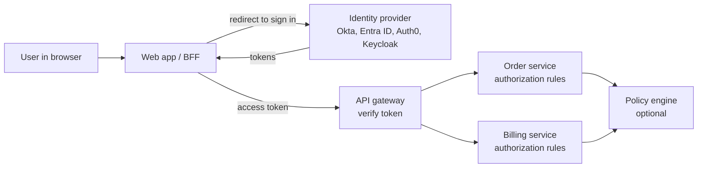
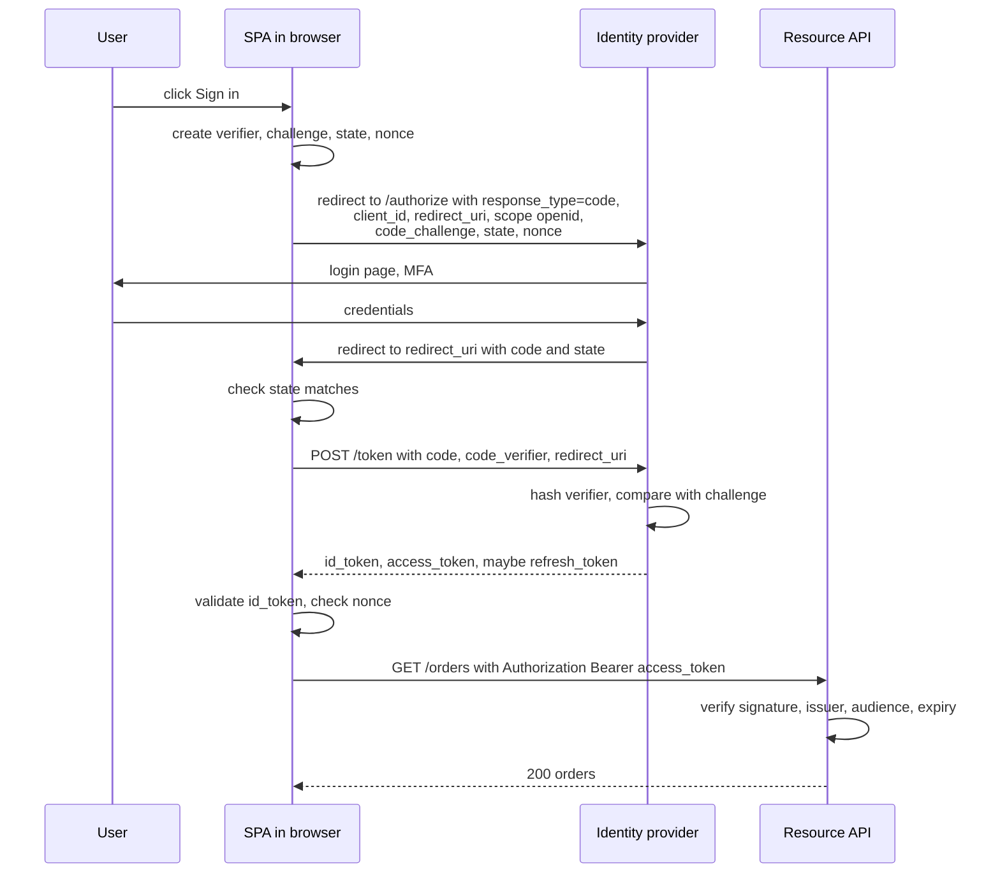
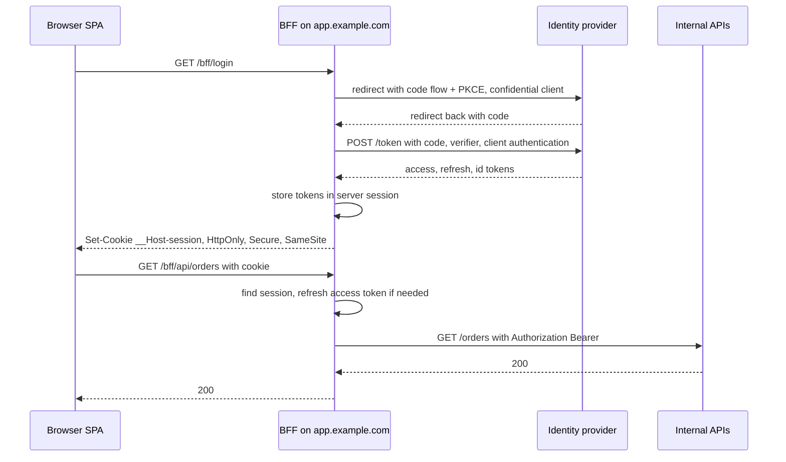
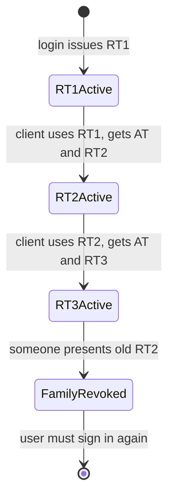
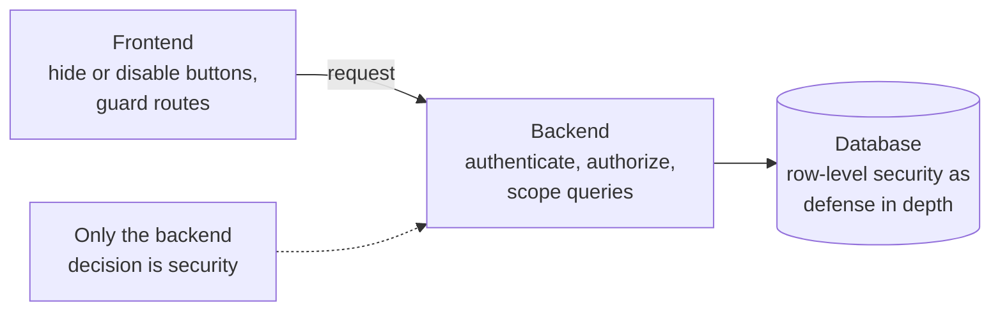
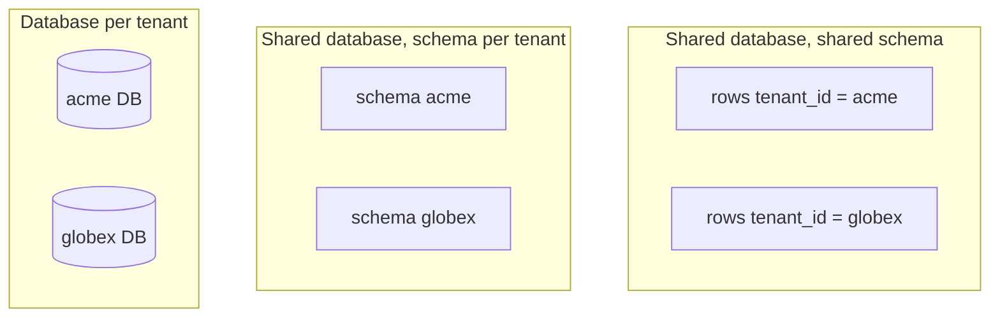
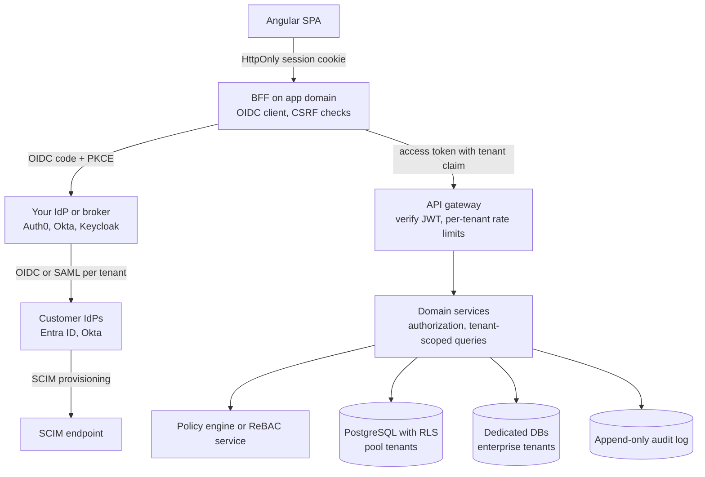

# Auth Architecture and Multi-Tenancy

> In this document you will learn how authentication and authorization are designed at the system level: sessions vs tokens, single sign-on with OpenID Connect, the authorization code flow with PKCE, the BFF pattern, the token lifecycle, service-to-service auth, RBAC/ABAC/ReBAC, and how to build a multi-tenant SaaS with real tenant isolation, impersonation and audit logs. These topics appear in almost every enterprise and SaaS system design interview.

**Before this:** [Authentication and authorization in Node.js](../07-nodejs-backend/09-authentication-and-authorization.md) · [HTTP, HTTPS and TLS — Cookies](../01-cs-and-web-fundamentals/05-http-https-and-tls.md#statelessness-cookies-and-sessions) · [API styles — BFF](04-api-styles-and-real-time-communication.md#backend-for-frontend-bff) · **Interview questions:** [jump to the interview section](#interview-questions)

## Table of contents

1. [The big picture](#the-big-picture)
2. [Session cookies vs tokens at the architecture level](#session-cookies-vs-tokens-at-the-architecture-level)
3. [Identity providers and single sign-on](#identity-providers-and-single-sign-on)
4. [OIDC authorization code flow with PKCE](#oidc-authorization-code-flow-with-pkce)
5. [The BFF pattern: keeping tokens out of the browser](#the-bff-pattern-keeping-tokens-out-of-the-browser)
6. [Where tokens live in a SPA](#where-tokens-live-in-a-spa)
7. [Token lifecycle](#token-lifecycle)
8. [Service-to-service authentication](#service-to-service-authentication)
9. [Authorization models: RBAC, ABAC and ReBAC](#authorization-models-rbac-abac-and-rebac)
10. [Frontend permission checks are UX, the backend enforces](#frontend-permission-checks-are-ux-the-backend-enforces)
11. [Multi-tenancy models](#multi-tenancy-models)
12. [Tenant isolation](#tenant-isolation)
13. [Tenant-aware caching, logging and rate limits](#tenant-aware-caching-logging-and-rate-limits)
14. [Admin impersonation with audit](#admin-impersonation-with-audit)
15. [SAML and SCIM in brief](#saml-and-scim-in-brief)
16. [Audit logs](#audit-logs)
17. [A reference architecture](#a-reference-architecture)
18. [Common mistakes](#common-mistakes)
19. [How to explain this in an interview](#how-to-explain-this-in-an-interview)
20. [Interview questions](#interview-questions)
21. [Summary](#summary)
22. [References](#references)

This document is the **architecture** view. How to hash passwords, build JWTs, write Express auth middleware, set up Passport or implement TOTP is in [Authentication and authorization in Node.js](../07-nodejs-backend/09-authentication-and-authorization.md). The secure auth checklist, secrets management and dependency security are in [Authentication and authorization](../07-nodejs-backend/09-authentication-and-authorization.md).

---

## The big picture

Three words that are often mixed up:

| Word | Question it answers | Example |
| --- | --- | --- |
| **Identity** | Who is this, and how do we know them? | A user account in Okta, linked to an email address |
| **Authentication (authn)** | Is this really that user (or service)? | Password + MFA, a passkey, a client certificate |
| **Authorization (authz)** | What is this user allowed to do here? | "Ana can approve invoices up to $5,000 in tenant Acme" |

In a modern system these jobs are usually split across components:



- The **identity provider (IdP)** authenticates users and issues tokens.
- The **gateway** verifies tokens (signature, expiry, audience) for every request.
- **Services** make the real authorization decisions about their own data, sometimes asking a central **policy engine**.

**Analogy:** an office building. The front desk (IdP) checks your passport and gives you a badge (token). The turnstile (gateway) checks that the badge is real and not expired. Each department's door (service) decides if *your* badge opens *that* room. The badge says who you are; each door decides what you can do.

---

## Session cookies vs tokens at the architecture level

The mechanics of each are in [Node.js auth — Sessions vs JWT](../07-nodejs-backend/09-authentication-and-authorization.md#sessions-vs-jwt-how-to-choose). Here is the system view.

### Server sessions

The server stores session data (in Redis or a database) and gives the browser a random **session ID** in an `HttpOnly` cookie. Every request sends the cookie; the server looks up the session.

### Self-contained tokens (JWT access tokens)

The server (or IdP) signs a token that contains claims (user ID, tenant, roles, expiry). Any service with the public key can verify it **without a lookup**.

### Comparison

| | Server session + cookie | JWT access token |
| --- | --- | --- |
| Where state lives | Server store (Redis) | Inside the token |
| Verification | Lookup per request | Signature check, no lookup |
| Revocation | Instant: delete the session | Hard: valid until it expires (or check a deny list) |
| Works across many services | Each service needs the session store, or a gateway translates | Yes, each service verifies with the public key |
| Works for mobile and third-party clients | Cookies are awkward outside browsers | Yes (`Authorization: Bearer`) |
| Browser XSS risk | `HttpOnly` cookie cannot be read by scripts | If stored in JS-readable storage, XSS can steal it |
| Browser CSRF risk | Yes, cookies are sent automatically → need `SameSite` + CSRF defenses | No, if sent in a header from JS memory |
| Size | Small cookie | Can be large (many claims) |

### The common hybrid

Large systems often use **both**:

- **Browser ↔ BFF or web backend:** an `HttpOnly`, `Secure`, `SameSite` **session cookie**.
- **BFF/backend ↔ internal services:** short-lived **JWT access tokens**.

The browser never sees the tokens; services get self-contained tokens they can verify quickly. This is the BFF pattern described below.

---

## Identity providers and single sign-on

### What SSO is

**Single sign-on (SSO)** means a user signs in once with one identity and can use many applications without signing in again. In companies, employees sign in to their corporate identity (for example Microsoft Entra ID or Okta) and then open Slack, Jira and your SaaS app without new passwords.

### Why it exists

- Users have one password (and one MFA setup) instead of many.
- The company controls access centrally: when an employee leaves, disabling one account removes access everywhere.
- Security policies (MFA, device checks, conditional access) are enforced in one place.
- Your app does not store passwords at all.

### The roles

| Term | Meaning |
| --- | --- |
| **Identity provider (IdP)** / OpenID Provider (OP) | The system that authenticates users and issues tokens or assertions |
| **Relying party (RP)** / service provider (SP) / client | Your application, which trusts the IdP |
| **Federation** | Trust between your app (or your IdP) and another organization's IdP |

### The protocols

| Protocol | What it is | Typical use |
| --- | --- | --- |
| **OAuth 2.0** | Delegated **authorization**: a client gets an access token to call an API | API access, "allow this app to read your calendar" |
| **OpenID Connect (OIDC)** | An identity layer on top of OAuth 2.0: adds the **ID token** and user info | Sign-in for web, SPA and mobile apps |
| **SAML 2.0** | Older XML-based SSO standard | Enterprise SSO, still very common |
| **SCIM 2.0** | User and group provisioning API | Create, update, deactivate users automatically |

OAuth 2.0 and OIDC basics are in [Node.js auth — OAuth 2.0](../07-nodejs-backend/09-authentication-and-authorization.md#oauth-20) and [OpenID Connect](../07-nodejs-backend/09-authentication-and-authorization.md#openid-connect).

### Common identity providers

| Product | Type | Notes |
| --- | --- | --- |
| **Auth0** (by Okta) | Managed (CIAM — customer identity) | Developer-friendly; social logins, enterprise connections, rules/actions |
| **Okta** (Workforce Identity) | Managed (workforce) | Very common for corporate SSO |
| **Microsoft Entra ID** (formerly Azure AD) | Managed (workforce); Entra External ID for customers | Default for Microsoft 365 companies |
| **Keycloak** | Open source, self-hosted | Full OIDC/SAML server; you run and patch it |
| **Amazon Cognito** | Managed (AWS) | User pools; integrates with AWS services |
| Others | Google Identity, Ping Identity, FusionAuth, Zitadel, Clerk, Firebase Auth | |

**Build vs buy:** writing your own identity system means handling password storage, MFA, account recovery, brute-force protection, SAML/OIDC federation and security patches. For most products, a managed or well-maintained open-source IdP is safer and cheaper.

### Enterprise SSO in a multi-tenant SaaS

In B2B SaaS, each customer tenant often wants to sign in with **its own** IdP: Acme uses Entra ID, Globex uses Okta.

- Your app (or your own IdP such as Auth0 or Keycloak acting as a broker) has one **connection per tenant**.
- **Home realm discovery:** the login page asks for the email first; `ana@acme.com` → domain `acme.com` → redirect to Acme's IdP. Or the tenant is chosen by subdomain (`acme.yourapp.com`).
- Verify domain ownership before linking a domain to a tenant, or an attacker could claim `acme.com`.
- Map IdP groups or claims to your app's roles (for example the Entra group "Finance-Approvers" → role `accountant`).
- Usually combined with **SCIM** so user accounts are created and deactivated automatically.

---

## OIDC authorization code flow with PKCE

### What it is

The **authorization code flow with PKCE** is the recommended way for browser apps, mobile apps and server apps to sign users in with OIDC. The IdP does not return tokens directly in the browser redirect. It returns a short-lived **authorization code**, and the client exchanges the code for tokens in a back-channel request. **PKCE** (Proof Key for Code Exchange, RFC 7636, pronounced "pixie") proves that the client that redeems the code is the same one that started the flow.

### Why PKCE exists

A SPA or mobile app is a **public client**: it cannot keep a client secret, because anyone can read its code. Without PKCE, an attacker who steals the authorization code (for example from a malicious app registered for the same redirect scheme on a phone, or from logs) could exchange it for tokens. With PKCE, the code is useless without the secret **code verifier** that only the real client knows.

The OAuth 2.0 Security Best Current Practice (RFC 9700, January 2025) recommends PKCE for **all** clients, including confidential server-side clients, and says the old **implicit flow** (tokens directly in the URL) should not be used.

### How PKCE works

1. The client creates a random **code verifier** (43–128 characters).
2. It computes the **code challenge** = Base64URL(SHA-256(verifier)).
3. It sends the challenge with the authorization request.
4. The IdP stores the challenge with the authorization code.
5. When exchanging the code, the client sends the verifier. The IdP hashes it and compares it with the stored challenge.

```js
import { createHash, randomBytes } from 'node:crypto';

function createPkcePair() {
  const verifier = randomBytes(32).toString('base64url');                           // 43 characters
  const challenge = createHash('sha256').update(verifier).digest('base64url');     // 43 characters
  return { verifier, challenge };
}

// Check with the example from RFC 7636, Appendix B:
const rfcVerifier = 'dBjftJeZ4CVP-mB92K27uhbUJU1p1r_wW1gFWFOEjXk';
console.log(createHash('sha256').update(rfcVerifier).digest('base64url'));
// E9Melhoa2OwvFrEMTJguCHaoeK1t8URWbuGJSstw-cM

const { verifier, challenge } = createPkcePair();
console.log(verifier.length, challenge.length); // 43 43
```

In a browser, the same is done with `crypto.getRandomValues` and `crypto.subtle.digest('SHA-256', ...)`. In practice, use a certified library (oidc-client-ts, angular-auth-oidc-client, MSAL, the IdP's SDK) rather than writing the flow yourself.

### The full flow for a SPA



What each parameter protects:

| Parameter | Protects against |
| --- | --- |
| `code_challenge` / `code_verifier` | Stolen authorization codes being redeemed by someone else |
| `state` | CSRF on the redirect (an attacker logging the victim into the attacker's account); also carries app state like the return URL |
| `nonce` | Replay of an old ID token; the ID token must contain the same nonce |
| Exact `redirect_uri` match (registered at the IdP) | Codes being sent to an attacker's URL |

### The tokens

| Token | For whom | Contains | Rule |
| --- | --- | --- | --- |
| **ID token** (always a JWT) | The **client**, to know who signed in | `sub`, `iss`, `aud` = client ID, `exp`, `nonce`, maybe name and email | Never send it to APIs as an access credential |
| **Access token** | The **API** (resource server) | Scopes, `aud` = the API, `exp`, maybe roles | Short-lived; APIs check `aud` and `iss` |
| **Refresh token** | The **client**, to get new access tokens from the IdP | Opaque usually | Long-lived, must be protected and rotated |

APIs must verify the access token **signature** (with the IdP's public keys from its JWKS endpoint, found via `/.well-known/openid-configuration`), the **issuer**, the **audience** (so a token issued for another API is rejected), and **expiry**.

### The weakness of tokens in a pure SPA

In the flow above, the SPA holds the tokens in JavaScript. Any XSS in the app (or a compromised third-party script) runs in the same context and can use or steal them. You can reduce the risk (memory-only storage, short lifetimes, refresh token rotation, strict CSP), but you cannot remove it. That is why many teams move the OAuth flow to a BFF.

---

## The BFF pattern: keeping tokens out of the browser

### What it is

In the **BFF (backend for frontend) auth pattern**, a small server-side component on the **same site** as the SPA acts as a **confidential OAuth client**. It performs the authorization code flow, stores the tokens on the server, and gives the browser only an `HttpOnly` session cookie. The SPA calls the BFF; the BFF attaches the access token and forwards the calls to APIs.

The IETF document "OAuth 2.0 for Browser-Based Applications" (published as RFC 10017, a Best Current Practice, in August 2026) describes this as the most secure of the browser architectures it covers (alongside the token-mediating backend and the pure browser-based client).

### The flow



### Why it is more secure

- **No tokens in the browser.** XSS cannot read an `HttpOnly` cookie or tokens it never received. (XSS can still make requests *through* the user's session while the page is open — so XSS prevention still matters — but it cannot steal long-lived credentials and use them elsewhere.)
- **Confidential client.** The BFF authenticates to the IdP with a secret or a private key, so refresh tokens are bound to it.
- **Token refresh is server-side**, invisible to the SPA, and not affected by browsers blocking third-party cookies (which breaks the old "silent renew in a hidden iframe" approach).

### What you must add

- **CSRF protection**, because the browser sends the cookie automatically: `SameSite=Lax` or `Strict`, plus a custom header requirement (for example the BFF only accepts API calls with `X-Requested-With` or a CSRF token header, which a cross-site form cannot set). See [Node.js auth — Where to keep tokens, and CSRF](../07-nodejs-backend/09-authentication-and-authorization.md#where-to-keep-tokens-in-the-browser-and-csrf).
- **Cookie settings:** `__Host-` prefix (forces `Secure`, `Path=/`, no `Domain`), `HttpOnly`, `Secure`, `SameSite`.
- **Session storage** in Redis (or encrypted cookies for small sessions).
- **Logout** that clears the server session and calls the IdP's end-session endpoint.
- The BFF is now a critical component: make it highly available and keep it small.

### Example: minimal BFF proxy route (Express)

```js
// After login, req.session holds { accessToken, refreshToken, expiresAt, userId, tenantId }.
app.use('/bff/api', requireSession, requireCsrfHeader, async (req, res) => {
  try {
    const accessToken = await getValidAccessToken(req.session); // refreshes on the server if expired
    const upstream = await fetch(`${API_BASE}${req.url}`, {
      method: req.method,
      headers: {
        Authorization: `Bearer ${accessToken}`,
        'Content-Type': req.get('Content-Type') ?? 'application/json',
        traceparent: req.get('traceparent') ?? '',
      },
      body: ['GET', 'HEAD'].includes(req.method) ? undefined : JSON.stringify(req.body),
      signal: AbortSignal.timeout(5000),
    });
    res.status(upstream.status);
    res.set('Content-Type', upstream.headers.get('Content-Type') ?? 'application/json');
    res.send(Buffer.from(await upstream.arrayBuffer()));
  } catch (err) {
    if (err.code === 'REFRESH_FAILED') return res.status(401).json({ error: 'Session expired' });
    res.status(502).json({ error: 'Upstream unavailable' });
  }
});

function requireCsrfHeader(req, res, next) {
  if (['GET', 'HEAD', 'OPTIONS'].includes(req.method)) return next();
  if (req.get('X-CSRF') !== '1') return res.status(403).json({ error: 'Missing CSRF header' });
  next();
}
```

A custom header like `X-CSRF: 1` works as a CSRF defense because a cross-site HTML form cannot set custom headers, and a cross-site `fetch` with a custom header triggers a CORS preflight that the BFF does not allow. Combine it with `SameSite` cookies.

### When the pure SPA flow is still acceptable

- No backend is available (static hosting only) and the risk profile is low.
- You use short-lived access tokens in memory, refresh token rotation with reuse detection, and a strict CSP.

For enterprise apps, admin portals and anything handling money or personal data, the BFF pattern is the stronger default.

---

## Where tokens live in a SPA

Details and code are in [Node.js auth — Where to keep tokens in the browser](../07-nodejs-backend/09-authentication-and-authorization.md#where-to-keep-tokens-in-the-browser-and-csrf) and [API integration — Auth tokens and the refresh flow](../05-frontend-engineering/07-api-integration-and-data-fetching.md#auth-tokens-and-the-refresh-flow). The architecture-level summary:

| Storage | Readable by XSS? | Survives reload? | Sent automatically (CSRF risk)? | Verdict |
| --- | --- | --- | --- | --- |
| `localStorage` | Yes | Yes | No | Avoid for tokens: any XSS can steal them, and they persist |
| `sessionStorage` | Yes | Per tab | No | Slightly better lifetime; same XSS problem |
| JavaScript memory (a variable in a service) | Only while the page runs, by injected script | No (needs refresh on reload) | No | Best place if the SPA must hold tokens |
| Web Worker / service worker holding tokens | Harder, not impossible | Depends | No | Extra isolation; complex |
| `HttpOnly` cookie | No | Yes | Yes → needs `SameSite` + CSRF defense | Best for session cookies (BFF pattern) |
| Not in the browser at all (BFF) | — | — | Session cookie only | Strongest |

Rules:

- Keep access tokens **short-lived** (for example 5–15 minutes).
- If the SPA must hold a refresh token, the IdP must **rotate** it on every use and detect reuse (RFC 9700 requires refresh tokens for public clients to be either sender-constrained or rotated).
- Never put tokens in URLs (they end up in logs, history and `Referer` headers).
- A strict CSP and good XSS hygiene protect every option.

---

## Token lifecycle

### Short-lived access tokens

Access tokens are usually **self-contained JWTs** verified without a lookup. That speed has a cost: **you cannot easily revoke them**. The standard answer is to keep them short-lived — minutes, not days — so a stolen or outdated token is useful only briefly.

What "outdated" can mean: the user was deactivated, their role changed, they logged out, or the token leaked.

### Refresh tokens and rotation

A **refresh token** lets the client get a new access token without the user signing in again. Because it is long-lived, it is the most valuable thing to steal.

**Refresh token rotation:** every time a refresh token is used, the IdP issues a **new** refresh token and invalidates the old one. **Reuse detection:** if an old (already used) refresh token is presented again, the IdP assumes theft and revokes the whole token family — the attacker and the real user are both logged out, and the real user signs in again.



Also set an **absolute lifetime** (for example 30 days) and an **idle timeout** (for example 7 days without use) for the refresh token family.

Sender-constrained tokens are a stronger alternative: **DPoP** (RFC 9449) binds tokens to a key pair held by the client, and **mTLS-bound tokens** (RFC 8705) bind them to a client certificate. A stolen token is then useless without the private key.

### Revocation options

| Technique | How | Cost |
| --- | --- | --- |
| Short access token lifetime | Wait for expiry (minutes) | Delay before revocation takes effect |
| Revoke the refresh token / session | IdP revocation endpoint (RFC 7009) or delete the server session | Takes effect at the next refresh |
| Token introspection (RFC 7662) | API asks the IdP "is this token active?" | A network call per request (cache the result briefly) |
| Deny list of token IDs (`jti`) | Store revoked `jti` values until their expiry; check on each request | A fast lookup (Redis) per request |
| Session or user version claim | Token contains `sv: 7`; on password change or role change increment the user's version; reject tokens with an older version | Lookup of a small value, cacheable |
| Opaque access tokens | Tokens are random references; APIs always introspect | Lookup per request; instant revocation |

A typical choice: 5–10 minute JWT access tokens, rotated refresh tokens, and for sensitive actions (change payout account, delete tenant) an extra live check or **step-up authentication** (ask for MFA again).

### Logout across systems

Logging out of a SSO world has several layers:

1. **Local logout:** clear your app session or tokens.
2. **IdP logout:** OIDC **RP-Initiated Logout** — redirect to the IdP's `end_session_endpoint` so the SSO session ends.
3. **Logout in other apps:** OIDC **Back-Channel Logout** — the IdP calls each app's server with a logout token so they end their sessions too. (Front-channel logout uses iframes and is less reliable now that browsers restrict third-party cookies.)

### Signing key rotation

IdPs rotate their signing keys. Tokens carry a `kid` (key ID) in the header. APIs fetch the IdP's **JWKS** (JSON Web Key Set), cache it, and refetch when they see an unknown `kid`. Libraries like `jose` (`createRemoteJWKSet`) do this for you. Never hard-code a single public key.

---

## Service-to-service authentication

When the order service calls the billing service, billing must know **which service** is calling and, often, **on behalf of which user**.

### Options

| Method | How it works | Good for |
| --- | --- | --- |
| **OAuth 2.0 client credentials** | The calling service authenticates to the IdP with its own credentials (a secret or, better, a signed JWT with a private key — `private_key_jwt`) and gets an access token with its own identity and scopes | Background jobs, service-to-service APIs, partner integrations |
| **mTLS** (mutual TLS) | Both sides present certificates during the TLS handshake; the server checks the client certificate | Zero-trust networks, service meshes |
| **Service mesh** (Istio, Linkerd) | Sidecar proxies do mTLS automatically between all services, with identities like SPIFFE IDs; policies say which service may call which | Kubernetes with many services |
| **Workload identity** | The platform gives each workload an identity (Kubernetes service account tokens, AWS IAM roles for service accounts, Azure managed identities, GCP workload identity) — no long-lived secrets in config | Cloud-native apps |
| Static API keys / shared secrets | A secret in a header | Simple internal tools; must be rotated, avoid for anything important |

The basic TLS and mTLS concepts are in [HTTP, HTTPS and TLS — Mutual TLS](../01-cs-and-web-fundamentals/05-http-https-and-tls.md#mutual-tls).

### Passing the user context

Service identity alone is not enough when the action is done for a user. Options:

- **Forward the user's access token** to downstream services. Simple, but the token's audience must include those services, and a compromised service can reuse it widely.
- **Token exchange** (RFC 8693): the service exchanges the incoming user token for a new token with a narrower audience and scopes for the next service ("on behalf of" flow). Microsoft Entra ID calls this the on-behalf-of flow.
- **Internal signed context:** the gateway verifies the external token and creates a short-lived internal token with user ID, tenant ID and roles, signed by an internal key.

Rule: **never trust an `X-User-Id` or `X-Tenant-Id` header from the network unless it is signed** or comes from a trusted proxy that strips client-supplied versions. Otherwise any caller can pretend to be anyone.

---

## Authorization models: RBAC, ABAC and ReBAC

Implementation of RBAC and ABAC middleware in Express is in [Node.js auth — Authorization models](../07-nodejs-backend/09-authentication-and-authorization.md#authorization-models). Here is the architecture view and how to choose.

### RBAC: role-based access control

Users get **roles**; roles have **permissions**. "Accountants can approve invoices."

- Good: simple to understand and audit; maps to job functions; easy admin UI.
- Bad: **role explosion** when rules depend on context ("accountant for region EU, up to $5,000, except own invoices") — you end up with hundreds of roles.

### ABAC: attribute-based access control

Decisions use **attributes** of the user, the resource, the action and the environment. "Allow approve if user.department = resource.department and resource.amount <= user.approvalLimit and time is within business hours."

- Good: expressive; fewer roles; handles context.
- Bad: harder to understand "who can access what?"; policies need testing and tooling.

### ReBAC: relationship-based access control

Decisions follow **relationships** between objects: "Ana can view this document because she is a member of the team that has viewer access to the folder that contains the document." Google's **Zanzibar** paper (2019) made this model popular. The paper describes the system behind permissions in Google Drive and other Google products. Open-source and managed implementations include **OpenFGA**, **SpiceDB** (AuthZed), Permify, and Ory Keto.

- Good: natural for sharing, hierarchies, organizations, nested groups (documents, folders, projects).
- Bad: needs a dedicated authorization service and data synchronization; more moving parts.

### Small examples of all three

```js
// RBAC + ABAC: roles give a permission, attributes narrow it down.
const rolePermissions = {
  viewer: ['invoice:read'],
  accountant: ['invoice:read', 'invoice:approve'],
  admin: ['invoice:read', 'invoice:approve', 'user:manage'],
};

function hasPermission(user, permission) {
  return user.roles.some((role) => rolePermissions[role]?.includes(permission));
}

function canApproveInvoice(user, invoice) {
  return (
    hasPermission(user, 'invoice:approve') &&          // RBAC
    invoice.tenantId === user.tenantId &&              // tenant isolation
    invoice.createdBy !== user.id &&                    // ABAC: no self-approval (separation of duties)
    invoice.amountCents <= user.approvalLimitCents      // ABAC: approval limit
  );
}

const ana = { id: 'u1', tenantId: 't1', roles: ['accountant'], approvalLimitCents: 500_000 };
console.log(canApproveInvoice(ana, { tenantId: 't1', createdBy: 'u2', amountCents: 120_000 })); // true
console.log(canApproveInvoice(ana, { tenantId: 't1', createdBy: 'u1', amountCents: 120_000 })); // false (own invoice)
console.log(canApproveInvoice(ana, { tenantId: 't2', createdBy: 'u9', amountCents: 1_000 }));   // false (other tenant)
console.log(canApproveInvoice(ana, { tenantId: 't1', createdBy: 'u2', amountCents: 900_000 })); // false (over limit)
```

```js
// ReBAC: relationship tuples (object, relation, subject), Zanzibar style.
const tuples = [
  ['doc:q3-report', 'owner', 'user:ana'],
  ['doc:q3-report', 'parent', 'folder:finance'],
  ['folder:finance', 'viewer', 'user:ben'],
  ['folder:finance', 'viewer', 'team:sales#member'], // every member of team sales
  ['team:sales', 'member', 'user:cara'],
];

function check(object, relation, user) {
  for (const [obj, rel, subject] of tuples) {
    if (obj !== object) continue;
    if (rel === relation && subject === user) return true;                 // direct relation
    if (rel === relation && subject.includes('#')) {                       // a group of users
      const [groupObject, groupRelation] = subject.split('#');
      if (check(groupObject, groupRelation, user)) return true;
    }
    if (rel === 'parent' && check(subject, relation, user)) return true;   // inherit from parent folder
  }
  if (relation === 'viewer' && check(object, 'owner', user)) return true;  // owners can also view
  return false;
}

console.log(check('doc:q3-report', 'viewer', 'user:ana'));  // true  (owner)
console.log(check('doc:q3-report', 'viewer', 'user:ben'));  // true  (viewer of the parent folder)
console.log(check('doc:q3-report', 'viewer', 'user:cara')); // true  (member of a team that can view the folder)
console.log(check('doc:q3-report', 'viewer', 'user:dan'));  // false
console.log(check('doc:q3-report', 'owner', 'user:ben'));   // false
```

Real ReBAC systems add a schema language, cycle protection, caching, consistency tokens (Zanzibar's "zookies") and the ability to list all objects a user can access.

### Choosing

| Situation | Model |
| --- | --- |
| Internal tool or admin portal with clear job roles | RBAC (with tenant scoping) |
| Rules depend on amounts, departments, regions, time, ownership | RBAC + ABAC conditions |
| Sharing, nested folders, organizations and teams, "can this user see this object?" for millions of objects | ReBAC |
| Many services must share consistent rules | Central policy engine or authorization service |

### Where to evaluate policies

- **In each service's code** (as above): simple, fast, but rules can be inconsistent across services.
- **A policy engine** (PDP — policy decision point) such as **Open Policy Agent (OPA)** with the Rego language, or **AWS Cedar** (used by Amazon Verified Permissions): services (PEPs — policy enforcement points) ask "can user X do action Y on resource Z?" and the engine decides. Policies are versioned and tested like code.
- **An authorization service** (OpenFGA, SpiceDB) for ReBAC.

Whatever you choose, enforce authorization **in the service that owns the data**, close to the database query — not only at the gateway.

### Object-level authorization

The number one risk in the OWASP API Security Top 10 (2023) is **Broken Object Level Authorization (BOLA)**: `GET /invoices/123` returns invoice 123 even though it belongs to another user or tenant. Every query must be scoped:

```js
// ❌ Wrong: any authenticated user can read any invoice by guessing IDs
const invoice = await db.query('SELECT * FROM invoices WHERE id = $1', [req.params.id]);

// ✅ Correct: scope by tenant (and by ownership where needed), return 404 if not found in scope
const invoice = await db.query(
  'SELECT * FROM invoices WHERE id = $1 AND tenant_id = $2',
  [req.params.id, req.auth.tenantId],
);
```

Returning `404` (not `403`) for objects in another tenant avoids revealing that the ID exists.

---

## Frontend permission checks are UX, the backend enforces

### The rule

Hiding a button in the UI is **not security**. Anyone can open DevTools, change the JavaScript, or call the API directly with `curl`. The frontend uses permissions to give a good experience — hide or disable actions the user cannot do, avoid dead ends — but **every API call must be authorized again on the server**.



### Where the frontend gets permissions

- From the ID token or access token claims (roles) — fine for coarse UI decisions.
- Better: a `GET /api/me/permissions` endpoint that returns the effective permissions for the current tenant, computed by the backend from the same rules it enforces. This avoids duplicating complex rules in the frontend.

### Angular 16 example

```ts
// core/auth/permission.service.ts
import { Injectable, signal, computed } from '@angular/core';

@Injectable({ providedIn: 'root' })
export class PermissionService {
  private readonly permissions = signal<ReadonlySet<string>>(new Set()); // signals: developer preview in v16

  setPermissions(list: string[]): void {
    this.permissions.set(new Set(list));
  }

  has(permission: string): boolean {
    return this.permissions().has(permission);
  }

  readonly canManageUsers = computed(() => this.permissions().has('user:manage'));
}
```

```ts
// core/auth/permission.guard.ts — functional guard (available since Angular 14.2; class guards deprecated in 15.2)
import { inject } from '@angular/core';
import { CanActivateFn, Router } from '@angular/router';
import { PermissionService } from './permission.service';

export function requirePermission(permission: string): CanActivateFn {
  return () => {
    const permissions = inject(PermissionService);
    const router = inject(Router);
    return permissions.has(permission) ? true : router.createUrlTree(['/forbidden']);
  };
}

// routes: { path: 'admin/users', canActivate: [requirePermission('user:manage')], loadChildren: ... }
```

```ts
// shared/has-permission.directive.ts — structural directive: *appHasPermission="'invoice:approve'"
import { Directive, Input, TemplateRef, ViewContainerRef } from '@angular/core';
import { PermissionService } from '../core/auth/permission.service';

@Directive({ selector: '[appHasPermission]', standalone: true })
export class HasPermissionDirective {
  private shown = false;

  constructor(
    private template: TemplateRef<unknown>,
    private container: ViewContainerRef,
    private permissions: PermissionService,
  ) {}

  @Input() set appHasPermission(permission: string) {
    const allowed = this.permissions.has(permission);
    if (allowed && !this.shown) {
      this.container.createEmbeddedView(this.template);
      this.shown = true;
    } else if (!allowed && this.shown) {
      this.container.clear();
      this.shown = false;
    }
  }
}
```

The server must still answer `403` if the user calls `POST /invoices/42/approve` without permission, and the UI must handle that `403` gracefully (permissions can change while the page is open).

---

## Multi-tenancy models

### What multi-tenancy is

A **multi-tenant** system serves many customer organizations (**tenants**) from one deployed product. Each tenant must see only its own data, but the infrastructure and code are shared to keep costs and operations manageable.

**Analogy:** an apartment building. Tenants share the building, the pipes and the elevator (infrastructure), but each has a locked apartment (data isolation). Some rich tenants want a separate house (dedicated database) and pay for it.

### The three main data models



| | Shared DB, shared schema (`tenant_id` column) | Shared DB, schema per tenant | Database per tenant |
| --- | --- | --- | --- |
| Also called | Pool model | Bridge model | Silo model |
| Isolation | Logical only (every query must filter) | Medium (schema boundary) | Strong (separate DB, can be separate server or region) |
| Cost per tenant | Lowest | Medium | Highest |
| Number of tenants it handles well | Very many (thousands to millions) | Hundreds to a few thousand (catalog and migration overhead grows) | Tens to hundreds (or more with automation) |
| Migrations | Once | Once per schema | Once per database (needs tooling) |
| Noisy neighbor risk | High (one tenant's heavy queries affect all) | Medium | Low |
| Per-tenant backup/restore | Hard (must extract rows) | Easier | Easy |
| Data residency (EU tenant in EU region) | Hard | Hard | Easy (place the DB in the region) |
| Cross-tenant analytics | Easy | Harder | Hardest |
| Risk of a data leak bug | Highest (one missing `WHERE tenant_id`) | Lower | Lowest |

The terms pool, bridge and silo come from AWS SaaS architecture guidance.

### Hybrid (tiered) models

Many SaaS products mix models:

- Small and free-tier tenants in the **shared pool**.
- Enterprise tenants who pay for it (or need data residency, compliance or performance guarantees) in **dedicated databases** or even dedicated deployments.
- A **tenant catalog** (directory) service maps each tenant to its database or shard, so the application connects to the right place.

```js
// Tenant catalog lookup: where does this tenant's data live?
const tenantCatalog = new Map([
  ['acme', { model: 'silo', connectionString: process.env.ACME_DB_URL, region: 'eu-central-1' }],
  ['globex', { model: 'pool', shard: 'pool-shard-2' }],
]);

function dataLocationFor(tenantId) {
  const entry = tenantCatalog.get(tenantId);
  if (!entry) throw new Error(`Unknown tenant ${tenantId}`);
  return entry;
}
```

### Choosing in an interview

> "I'd start with a shared schema and a `tenant_id` on every tenant-owned table, enforced with row-level security, because it's cheapest and simplest to operate for many small tenants. I'd design the tenant catalog from day one so large enterprise tenants can be moved to a dedicated database later for isolation, residency or performance."

---

## Tenant isolation

Isolation must hold at every layer: identity, API, data, cache, files, search, queues, logs.

### 1. Tenant context comes from the authenticated identity

The tenant ID must come from the **verified token or server session**, never from a value the client can freely change (a request body field, a query parameter or an unsigned header).

```js
// ❌ Wrong: the client decides which tenant's data it gets
const tenantId = req.headers['x-tenant-id'];

// ✅ Correct: the tenant comes from the verified token (set by auth middleware)
const tenantId = req.auth.tenantId; // claim like "tid" or "org_id" in a verified JWT, or from the session
```

If a user belongs to **several tenants**, the client may *request* a tenant (for example by subdomain or a header), but the server must check that the user is a member of that tenant before using it.

### 2. Every query is tenant-scoped — and the database enforces it

Application code can forget a `WHERE tenant_id = ...`. Use the database as a second line of defense. PostgreSQL **row-level security (RLS)** adds a filter to every query on a table automatically.

```text
-- Enable RLS on a tenant-owned table
ALTER TABLE invoices ENABLE ROW LEVEL SECURITY;
ALTER TABLE invoices FORCE ROW LEVEL SECURITY;   -- apply it to the table owner too

CREATE POLICY tenant_isolation ON invoices
  USING (tenant_id = current_setting('app.tenant_id', true)::uuid)        -- which rows can be read/updated/deleted
  WITH CHECK (tenant_id = current_setting('app.tenant_id', true)::uuid);  -- which rows can be inserted/updated to
```

Important details:

- `current_setting('app.tenant_id', true)` returns `NULL` when the setting is missing, so a forgotten setting returns **no rows** instead of all rows.
- Table owners bypass RLS unless you use `FORCE ROW LEVEL SECURITY`. Superusers and roles with the `BYPASSRLS` attribute always bypass it — so the application must connect with a normal role.
- With connection pools, set the tenant **per transaction**, not per connection, so a pooled connection never keeps the previous request's tenant:

```js
// Run a function inside a transaction with the tenant set for that transaction only.
async function withTenant(pool, tenantId, work) {
  const client = await pool.connect();
  try {
    await client.query('BEGIN');
    await client.query("SELECT set_config('app.tenant_id', $1, true)", [tenantId]); // true = local to this transaction
    const result = await work(client);
    await client.query('COMMIT');
    return result;
  } catch (err) {
    await client.query('ROLLBACK');
    throw err;
  } finally {
    client.release();
  }
}

// Usage in a route: RLS filters rows even if the query forgets the tenant
app.get('/api/invoices', requireAuth, async (req, res) => {
  const rows = await withTenant(pool, req.auth.tenantId, (db) =>
    db.query('SELECT id, number, amount_cents FROM invoices ORDER BY created_at DESC LIMIT 50'),
  );
  res.json(rows.rows);
});
```

Other databases have similar features (SQL Server row-level security; for MongoDB and DynamoDB you enforce the tenant key in a data-access layer and in IAM conditions such as DynamoDB's leading-key condition).

### 3. Unique constraints and IDs

- Make uniqueness tenant-scoped: `UNIQUE (tenant_id, invoice_number)` — two tenants can both have invoice number 1001.
- Use non-guessable IDs (UUIDs) for public identifiers, but **do not rely on them for security**. Authorization must still check the tenant.
- Include `tenant_id` in composite indexes that start with it, so tenant-scoped queries are fast.

### 4. Other stores

| Store | Isolation technique |
| --- | --- |
| Object storage | Prefix keys with the tenant (`tenants/acme/...`); presigned URLs only for that tenant's keys; per-tenant buckets for silo tenants |
| Search index | Always filter by `tenant_id` (or an index per large tenant); never let the client send the raw filter |
| Queues and jobs | Put `tenantId` in every message; workers set tenant context before touching data |
| Caches | Tenant in every key (next section) |
| Analytics / data warehouse | Tenant column and access policies; careful with exports |

### 5. Testing isolation

Write automated tests that create two tenants, log in as tenant B, and try to read, update and list tenant A's resources by ID through every endpoint. Run them in CI. Cross-tenant data leaks are among the worst incidents a SaaS company can have.

---

## Tenant-aware caching, logging and rate limits

### Caching

- **Every cache key includes the tenant**: `t:{tenantId}:invoice:{id}`. Use one key-builder helper that requires it (see [Caching strategies — Multi-tenant and personalized cache keys](03-caching-strategies-and-invalidation.md#multi-tenant-and-personalized-cache-keys)).
- **Never cache tenant data in shared HTTP caches** (CDN) unless the cache key includes the tenant and the data is not user-specific. Mark tenant API responses `Cache-Control: private` or `no-store`.
- **Frontend:** clear query caches, stores and service worker caches on logout and tenant switch.
- Consider per-tenant cache quotas so one tenant cannot evict everyone else's data.

### Logging and tracing

- Add `tenantId` (and `userId`, `requestId`, `traceId`) to **every log line and trace span** using request context (for example `AsyncLocalStorage` in Node.js — see [Production Node.js — Structured logging](../07-nodejs-backend/14-production-nodejs.md#structured-logging)).
- This lets you answer: "Which tenant is causing this error spike?" and "Show me everything tenant Acme did yesterday."
- Do not log personal data or secrets. Some tenants may require that their logs stay in a region.
- Offer tenant-level dashboards to support teams.

### Rate limits and quotas (noisy neighbors)

A **noisy neighbor** is a tenant whose heavy usage slows down others in shared infrastructure.

- **Rate limits per tenant** (and per user inside the tenant), keyed by `tenantId` in Redis.
- **Quotas per plan**: API calls per month, storage, seats, exports per day.
- **Separate queues or worker pools** for heavy tenants or heavy job types (exports), or weighted fair scheduling so one tenant's 10,000 jobs do not block everyone.
- **Database protections:** statement timeouts, query cost limits, and moving a very large tenant to its own database.
- **Metrics per tenant** (requests, errors, latency, storage) to see who uses what — this also helps pricing.

---

## Admin impersonation with audit

### What it is

**Impersonation** lets a support engineer or admin see the product **as a specific user** to debug a problem ("log in as Ana"). It is very useful and very dangerous.

### Design rules

1. **Separate permission:** only specific support roles can impersonate; require a reason and, for sensitive tenants, the customer's consent or an approval.
2. **Keep both identities:** the session or token records the **real actor** and the **impersonated user**. The OAuth token exchange standard (RFC 8693) defines an `act` (actor) claim for this:

```json
{
  "sub": "user:ana",
  "tid": "tenant:acme",
  "act": { "sub": "support:sam" },
  "imp_reason": "Ticket 4821: invoice totals look wrong",
  "exp": 1760003600
}
```

3. **Short sessions:** impersonation expires quickly (for example 30–60 minutes) and cannot be refreshed silently.
4. **Restricted actions:** often **read-only** by default. Block dangerous actions while impersonating: changing passwords or MFA, payment details, deleting data, exporting all data.
5. **Visible banner:** the UI shows "You are viewing as Ana (Acme). End impersonation."
6. **Audit everything:** start, end, reason, and every action taken, with both the actor and the subject.
7. **Notify** the tenant (or make impersonation history visible to tenant admins), depending on the product and contracts.

---

## SAML and SCIM in brief

### SAML 2.0

**SAML 2.0** (OASIS standard, 2005) is an XML-based SSO protocol, still very common in enterprises.

- The IdP sends a signed XML **assertion** (who the user is, attributes, when it expires) to your app's **Assertion Consumer Service (ACS)** URL, usually through the browser with an HTTP POST.
- Flows: **SP-initiated** (user starts at your app, which redirects to the IdP) and **IdP-initiated** (user clicks your app in the IdP's portal — more exposed to some attacks; validate carefully).
- Configuration is exchanged as **metadata XML** (entity IDs, endpoints, certificates).
- Security: always validate the XML signature with a well-maintained library (XML signature wrapping attacks are a known class of vulnerability), check audience, recipient, `NotBefore`/`NotOnOrAfter`, and prevent assertion replay.

SAML vs OIDC: OIDC is JSON/JWT-based, simpler, and works for mobile and SPAs. SAML is browser-centric and XML-based. New apps prefer OIDC; B2B SaaS usually supports **both**, because many enterprise customers still require SAML. Using an IdP broker (Auth0, Okta, Keycloak, WorkOS and similar) lets your app speak only OIDC while the broker speaks SAML to customers.

### SCIM 2.0

**SCIM** (System for Cross-domain Identity Management, RFC 7643 and RFC 7644) is a standard REST API for **provisioning**: the customer's IdP automatically creates, updates and deactivates users and groups in your app.

```text
POST   /scim/v2/Users          create a user when HR adds an employee
PATCH  /scim/v2/Users/{id}     update attributes, set active=false when they leave
GET    /scim/v2/Users?filter=userName eq "ana@acme.com"
POST   /scim/v2/Groups         create a group, add members
```

Why it matters: without SCIM, a fired employee may keep an active account in your app until someone remembers to remove it. With SSO + SCIM, access is created and removed automatically.

Design notes: authenticate SCIM endpoints with a per-tenant bearer token; deactivate (do not hard-delete) users; map groups to roles; make operations idempotent; audit all changes.

---

## Audit logs

### What it is

An **audit log** is a permanent, tamper-resistant record of **who did what, to which resource, when, from where, and with what result**. It is different from debug logs: audit logs are business records for security, compliance (SOC 2, ISO 27001, HIPAA, GDPR) and customer trust.

### What to record

| Field | Example |
| --- | --- |
| Timestamp (UTC) | `2026-10-22T09:15:03.120Z` |
| Tenant | `acme` |
| Actor | `user:ana` (and `act: support:sam` when impersonating; `service:billing-worker` for automated actions) |
| Action | `invoice.approve` |
| Resource | `invoice:9f3a...` |
| Result | `success` / `denied` / `error` |
| Changes | Before and after values for important fields (without secrets) |
| Context | IP address, user agent, request ID, trace ID, auth method |

Events worth auditing: sign-ins and failures, MFA changes, role and permission changes, impersonation, data exports, settings changes, deletions, API key creation, SSO and SCIM configuration changes, access denied events for sensitive resources.

### Design rules

- **Append-only:** no updates or deletes from the application. Use a separate store or table with restricted permissions, or a write-once storage (object lock / WORM).
- **Tamper evidence:** hash chaining (each record includes the hash of the previous one) or signed batches.
- **Written reliably:** write the audit record in the same transaction as the change (or via the outbox pattern), so a change cannot happen without its audit record.
- **Retention** per contract and regulation (for example 1–7 years), with deletion of personal data where the law requires it.
- **Tenant-visible:** enterprise customers often want to see and export their own audit log (or stream it to their SIEM, such as Splunk or Microsoft Sentinel).
- **Searchable** by tenant, actor, resource and time.

```js
// Write the business change and its audit record in one transaction.
async function approveInvoice(db, { auth, invoiceId }) {
  await db.query('BEGIN');
  try {
    const { rows } = await db.query(
      `UPDATE invoices SET status = 'APPROVED', approved_by = $1
       WHERE id = $2 AND tenant_id = $3 AND status = 'PENDING'
       RETURNING id, amount_cents`,
      [auth.userId, invoiceId, auth.tenantId],
    );
    if (rows.length === 0) throw Object.assign(new Error('Not found or not pending'), { status: 404 });

    await db.query(
      `INSERT INTO audit_log (tenant_id, actor, on_behalf_of, action, resource, result, details)
       VALUES ($1, $2, $3, 'invoice.approve', $4, 'success', $5)`,
      [auth.tenantId, auth.actorId ?? auth.userId, auth.actorId ? auth.userId : null,
       `invoice:${invoiceId}`, JSON.stringify({ amountCents: rows[0].amount_cents })],
    );
    await db.query('COMMIT');
  } catch (err) {
    await db.query('ROLLBACK');
    throw err;
  }
}
```

(`db` here is a single client from the pool, as in `withTenant` above, because a transaction belongs to one connection.)

---

## A reference architecture

A B2B SaaS with enterprise SSO, an Angular SPA and several services:



Flow summary:

1. The SPA talks only to the BFF with a session cookie.
2. The BFF signs the user in through your IdP broker, which federates to the customer's IdP (OIDC or SAML) using home realm discovery.
3. The BFF stores tokens server-side and calls the gateway with short-lived access tokens containing user, tenant and roles.
4. The gateway verifies tokens and applies per-tenant rate limits.
5. Services authorize every action (RBAC/ABAC, or ReBAC for sharing), scope every query by tenant, and the database enforces RLS as a second line.
6. A tenant catalog routes enterprise tenants to dedicated databases.
7. Every sensitive action writes an audit record; impersonation records both identities.
8. SCIM keeps users and groups in sync with customers' directories.

---

## Common mistakes

| Mistake | Why it is dangerous | Fix |
| --- | --- | --- |
| Tenant ID taken from a header or request body | Any user can read another tenant's data | Take it from the verified token or session; check membership |
| Missing `WHERE tenant_id` in one query | Cross-tenant data leak | Data-access layer that always scopes + RLS + isolation tests |
| Security by hiding buttons | APIs are callable directly | Enforce on the server for every request |
| Long-lived access tokens (days) | Stolen or outdated tokens stay valid | Minutes-long access tokens, rotated refresh tokens |
| Tokens in `localStorage` for a high-value app | XSS steals them | BFF pattern or in-memory tokens + strict CSP |
| Implicit flow or no PKCE | Token or code theft | Authorization code + PKCE for every client |
| Using the ID token to call APIs | Wrong audience; not meant for APIs | Use access tokens with the API as audience |
| Not validating `aud` and `iss` | Tokens for other apps are accepted | Validate issuer, audience, expiry, signature |
| Hard-coded IdP public key | Breaks on key rotation | Fetch and cache JWKS, handle `kid` |
| Trusting unsigned `X-User-Id` between services | Any caller can impersonate a user | mTLS/service tokens + signed user context |
| Impersonation without audit | Abuse is invisible | Actor claim, restrictions, banner, audit |
| SSO without SCIM or deprovisioning | Former employees keep access | SCIM or regular sync; short sessions |
| Tenant data cached without tenant in key | Data leak | Tenant-aware key builder; `private` responses |

---

## How to explain this in an interview

1. **Define it:** "Auth architecture is about who verifies identity, how that identity travels to each service, and where access decisions are made. Multi-tenancy is serving many customer organizations from one system while keeping each one's data isolated."
2. **Why it exists:** "Centralizing identity in an IdP gives SSO, MFA and one place to revoke access. Isolation protects customers and is a hard requirement for B2B SaaS."
3. **How it works:** "Users sign in through OIDC with the authorization code flow and PKCE. For a SPA I prefer a BFF that holds tokens server-side and gives the browser an HttpOnly cookie. Services receive short-lived access tokens with user, tenant and roles, verify them, and enforce authorization themselves. The tenant always comes from the verified token, every query is tenant-scoped, and the database enforces row-level security as defense in depth."
4. **Small example:** "In an invoicing SaaS, Ana from Acme signs in through Acme's Entra ID. Her token says tenant Acme and role accountant. When she approves an invoice, the service checks the role, the amount limit, that it's not her own invoice, and that the invoice belongs to Acme — and writes an audit record in the same transaction."
5. **Where it is useful:** "Enterprise portals, B2B SaaS, any platform with customers that want SSO, SCIM and audit logs."
6. **Trade-offs / gotchas:** "JWTs are fast but hard to revoke, so they must be short-lived. Shared-schema multi-tenancy is cheap but one missing filter leaks data, so I add RLS and isolation tests, and keep a path to dedicated databases for big tenants. Frontend permission checks are only UX."

---

## Interview questions

### Q1. Sessions or tokens: how do you choose at the architecture level?

**What the interviewer is checking:** Trade-offs beyond "JWT is modern".

**Short spoken answer (30–60 seconds):**
> Server sessions keep state in a store like Redis and give the browser an HttpOnly cookie. They're easy to revoke instantly and the cookie can't be read by XSS, but every request needs a lookup and cookies need CSRF protection. Self-contained JWT access tokens can be verified by any service with a public key and no lookup, which suits many services and non-browser clients, but they're hard to revoke, so they must be short-lived. In practice I often combine them: the browser has a session cookie with a BFF or web backend, and the backend uses short-lived JWTs to call internal services. That gives browser safety and service scalability.

**Follow-up questions:**
- **How do you revoke a JWT before it expires?** — Keep it short-lived, revoke the refresh token or session, and for urgent cases check a deny list of `jti` values or a user session-version claim.
- **Do JWTs make a system "stateless"?** — Authentication can be stateless, but revocation, refresh token rotation and logout almost always need some state.

**Common mistakes:** Storing long-lived JWTs in localStorage and calling it stateless and secure.

**Where this is used in real projects:** BFF + JWT hybrids in enterprise apps; pure JWT for mobile APIs.

### Q2. Explain the authorization code flow with PKCE for a SPA.

**What the interviewer is checking:** The main modern flow, step by step, and why each part exists.

**Short spoken answer (30–60 seconds):**
> The SPA creates a random code verifier and its SHA-256 hash, the code challenge, plus a random state and nonce. It redirects the user to the IdP's authorize endpoint with response type code, the client ID, the exact registered redirect URI, scopes and the challenge. The user signs in, with MFA, and the IdP redirects back with a short-lived authorization code and the state, which the SPA checks to prevent CSRF. The SPA then posts the code and the original verifier to the token endpoint; the IdP hashes the verifier and compares it with the stored challenge, so a stolen code is useless without the verifier. It returns an ID token — for the client to know who signed in, validated with the nonce — and an access token for APIs. APIs verify the signature, issuer, audience and expiry. The implicit flow is no longer recommended.

**Code or diagram:** See the sequence diagram in [OIDC authorization code flow with PKCE](#oidc-authorization-code-flow-with-pkce). The RFC 7636 test vector: verifier `dBjftJeZ4CVP-mB92K27uhbUJU1p1r_wW1gFWFOEjXk` → challenge `E9Melhoa2OwvFrEMTJguCHaoeK1t8URWbuGJSstw-cM`.

**Follow-up questions:**
- **Why use PKCE for confidential clients too?** — RFC 9700 recommends it for all clients; it protects against code injection and interception even when there is a client secret.
- **What is the difference between state and nonce?** — `state` protects the redirect back to the client (CSRF) and is checked by the client against what it sent. `nonce` is put inside the ID token by the IdP and protects against ID token replay.
- **Why not send the ID token to APIs?** — Its audience is the client, not the API. Access tokens are meant for APIs, with the API as audience and the right scopes.

**Common mistakes:** Confusing PKCE with encryption; forgetting state; using the ID token as an API credential.

**Where this is used in real projects:** oidc-client-ts, MSAL, angular-auth-oidc-client, Auth0 SPA SDK.

### Q3. What is the BFF pattern for authentication, and why is it more secure than tokens in the SPA?

**What the interviewer is checking:** Modern browser security architecture.

**Short spoken answer (30–60 seconds):**
> In the BFF pattern, a small server on the same site as the SPA is the OAuth client. It runs the authorization code flow as a confidential client, stores the access and refresh tokens server-side, and gives the browser only an HttpOnly, Secure, SameSite session cookie. The SPA calls the BFF, and the BFF attaches the access token and forwards to the APIs, refreshing tokens on the server when needed. It's more secure because the tokens never reach JavaScript, so XSS or a malicious third-party script can't steal them and use them elsewhere, and refresh doesn't depend on third-party cookies or iframes. The cost is an extra component, and since the browser sends the cookie automatically, I need CSRF protection: SameSite plus a required custom header or CSRF token.

**Follow-up questions:**
- **Does the BFF make XSS harmless?** — No. XSS can still act as the user through the session while the page is open. It just can't exfiltrate long-lived tokens. XSS prevention and CSP still matter.
- **How does the BFF scale?** — It's stateless except for the session store (Redis), so you run several instances.

**Common mistakes:** Forgetting CSRF; putting business logic in the BFF.

**Where this is used in real projects:** Duende BFF for .NET, Next.js/Nuxt server-side auth, custom Express BFFs; recommended in RFC 10017, "OAuth 2.0 for Browser-Based Applications".

### Q4. How do you design token lifetimes and refresh token rotation?

**What the interviewer is checking:** Lifecycle and theft handling.

**Short spoken answer (30–60 seconds):**
> Access tokens are short-lived — about 5 to 15 minutes — because they're verified without a lookup and hard to revoke. Refresh tokens are long-lived, so they're protected more: stored server-side in a BFF if possible, and rotated on every use. With rotation, each refresh returns a new refresh token and invalidates the old one; if an old one is ever used again, the IdP assumes it was stolen and revokes the whole family, forcing a new sign-in. I also set an idle timeout and an absolute lifetime. For stronger protection, tokens can be sender-constrained with DPoP or mTLS so a stolen token is useless without the client's key. Sensitive actions get step-up authentication.

**Follow-up questions:**
- **What happens with many parallel requests when the access token expires?** — The client must refresh once and queue the other requests (a single in-flight refresh), otherwise rotation causes reuse detection and logs the user out. See [API integration — The refresh flow](../05-frontend-engineering/07-api-integration-and-data-fetching.md#the-refresh-flow-and-the-concurrency-problem).

**Common mistakes:** Day-long access tokens; refresh tokens that never expire.

**Where this is used in real projects:** Auth0 and Okta refresh token rotation settings.

### Q5. How should one microservice authenticate to another?

**What the interviewer is checking:** Service identity vs user identity.

**Short spoken answer (30–60 seconds):**
> The service needs its own identity. Common options are OAuth client credentials — the service gets an access token from the IdP, ideally authenticating with a private key instead of a shared secret — or mutual TLS, often provided automatically by a service mesh like Istio or Linkerd, with workload identities instead of long-lived secrets. When the call is on behalf of a user, the downstream service also needs the user context: I either forward the user's token if its audience allows it, or use token exchange to get a narrower token for the next service, or have the gateway mint a short-lived signed internal token with user and tenant. I never trust plain `X-User-Id` headers unless they're signed or set by a trusted proxy.

**Follow-up questions:**
- **What is zero trust here?** — Every service authenticates and authorizes every call, even inside the network; being inside the VPC is not a reason to trust.

**Common mistakes:** "It's internal, so no auth needed."

**Where this is used in real projects:** Kubernetes with Istio mTLS, AWS IAM roles for service accounts, Entra ID on-behalf-of flow.

### Q6. Compare RBAC, ABAC and ReBAC. When would you use each?

**What the interviewer is checking:** Authorization modeling.

**Short spoken answer (30–60 seconds):**
> RBAC gives users roles, and roles have permissions — simple and easy to audit, good for clear job functions like viewer, editor, admin. It breaks down when rules depend on context, because you get role explosion. ABAC decides based on attributes of the user, resource, action and environment — like "approve if the amount is under your limit and it's not your own invoice" — very expressive but harder to reason about who can do what. ReBAC decides through relationships — Ana can view this document because she's in a team that can view its parent folder — which is the Google Zanzibar model, implemented by OpenFGA or SpiceDB, and it's the right fit for sharing and hierarchies. In practice I combine RBAC with a few ABAC conditions for most business apps, and add ReBAC when the product has sharing.

**Code or diagram:** See the runnable `canApproveInvoice` and `check` examples in [Authorization models](#small-examples-of-all-three).

**Follow-up questions:**
- **Where do you evaluate policies?** — In the service that owns the data, sometimes delegating to a policy engine like OPA or Cedar, or a ReBAC service. Never only at the gateway.
- **What is BOLA?** — Broken Object Level Authorization: the API returns an object by ID without checking the caller may access that object. It is first in the OWASP API Security Top 10 (2023).

**Common mistakes:** Only roles in the JWT and no object-level checks.

**Where this is used in real projects:** Admin portals (RBAC), finance approvals (ABAC), document sharing (ReBAC).

### Q7. Your frontend hides the "Delete user" button for non-admins. Is that enough?

**What the interviewer is checking:** The basic security principle.

**Short spoken answer (30–60 seconds):**
> No. Hiding the button is only UX. Anyone can call `DELETE /users/42` with curl or modify the JavaScript. The backend must authenticate the request, check the permission, check that the target user is in the same tenant, and return 403 or 404 otherwise. The frontend should get permissions from the backend — ideally an endpoint that returns effective permissions for the current tenant, computed by the same rules — and use them to hide or disable actions and guard routes. It also has to handle a 403 gracefully, because permissions can change while the page is open.

**Common mistakes:** Treating route guards as security.

**Where this is used in real projects:** Angular functional guards and structural directives backed by server-side checks.

### Q8. Compare the multi-tenancy models: shared schema, schema per tenant, database per tenant.

**What the interviewer is checking:** Core SaaS architecture trade-offs.

**Short spoken answer (30–60 seconds):**
> Shared schema with a `tenant_id` column is the cheapest and simplest to operate — one schema, one migration, scales to huge numbers of tenants — but isolation is only logical, so one missing filter leaks data, and noisy neighbors affect everyone. Schema per tenant gives a clearer boundary and easier per-tenant backup, but migrations run per schema and it gets heavy with thousands of tenants. Database per tenant gives the strongest isolation, per-tenant performance, easy restore and data residency in a chosen region, but it's the most expensive and needs automation for provisioning and migrations. Many SaaS products use a hybrid: small tenants in a shared pool with row-level security, and enterprise tenants in dedicated databases, with a tenant catalog that routes each tenant to its data.

**Follow-up questions:**
- **How do you move a tenant from the pool to its own database?** — Provision the database, copy the tenant's rows (with change data capture to catch new writes), switch the catalog entry during a short write freeze, verify, and clean up the old rows.
- **What about data residency?** — Silo tenants can be placed in their required region; pooled tenants need a pool per region.

**Common mistakes:** Choosing database-per-tenant for a product with 100,000 free-tier tenants.

**Where this is used in real projects:** AWS SaaS Lens silo/bridge/pool models; Citus distributed by `tenant_id`.

### Q9. How do you guarantee tenant isolation in a shared database?

**What the interviewer is checking:** Defense in depth, concretely.

**Short spoken answer (30–60 seconds):**
> Several layers. First, the tenant ID comes only from the verified token or session, never from a header or body the client controls; if a user belongs to several tenants, the server checks membership. Second, all data access goes through a layer that always adds the tenant filter, and tenant-scoped unique constraints and indexes start with `tenant_id`. Third, the database enforces it with PostgreSQL row-level security: a policy compares `tenant_id` with a session setting that I set per transaction with `set_config`, and I use FORCE ROW LEVEL SECURITY and a non-superuser role so nothing bypasses it. If the setting is missing, the policy returns no rows. Fourth, caches, files, search, queues and logs all carry the tenant. And I run automated cross-tenant tests in CI that try to read tenant A's resources as tenant B through every endpoint.

**Follow-up questions:**
- **Why set the tenant per transaction?** — With connection pooling, a per-connection setting could leak into the next request that reuses the connection. `set_config(..., true)` is local to the transaction.
- **Should a cross-tenant ID return 403 or 404?** — Usually 404, so you don't reveal that the object exists.

**Common mistakes:** Relying only on application code; superuser database connections that bypass RLS.

**Where this is used in real projects:** Supabase (RLS-based), many Postgres SaaS backends.

### Q10. How do you handle caching and rate limiting in a multi-tenant system?

**Short answer:** Every cache key includes the tenant, built by one helper that refuses keys without it; tenant data is never cached in shared HTTP caches (mark it `private` or `no-store`); client caches are cleared on tenant switch. Rate limits and quotas are keyed by tenant (and user within the tenant) so one tenant cannot starve others; heavy work goes to fair or per-tenant queues; and metrics and logs carry the tenant ID so you can find noisy neighbors and move very large tenants to dedicated resources.

### Q11. Design admin impersonation for a support team.

**What the interviewer is checking:** Security, auditability and UX together.

**Short spoken answer (30–60 seconds):**
> Only a specific support role can impersonate, and they must give a reason, like a ticket number; for sensitive customers it may need approval or the customer's consent. The session keeps both identities: the user being impersonated as the subject and the support engineer as the actor, like the `act` claim from the token exchange standard. Impersonation sessions are short and can't be silently refreshed. By default they're read-only, and dangerous actions — changing MFA, passwords, payment details, exports, deletions — are blocked. The UI shows a clear banner with an exit button. Every start, end and action goes to the audit log with both actor and subject, and tenant admins can see impersonation history.

**Common mistakes:** Simply logging in with the user's credentials or a master password; no audit trail.

**Where this is used in real projects:** Support tools in SaaS products; see [Enterprise admin portal](07-case-study-enterprise-admin-portal.md).

### Q12. What are SAML and SCIM, and why do enterprise customers ask for them?

**What the interviewer is checking:** B2B identity awareness.

**Short spoken answer (30–60 seconds):**
> SAML 2.0 is an older XML-based single sign-on standard: the customer's identity provider sends a signed assertion about the user to our app. Many enterprises still standardize on it, so B2B SaaS usually supports both SAML and OIDC, often through an identity broker so our app only speaks OIDC. SCIM is a REST standard for provisioning: the customer's directory automatically creates, updates and deactivates users and groups in our app. Enterprises ask for both because they want central control — employees sign in with corporate credentials and MFA, and when someone leaves, disabling them in the directory removes access to our app automatically. Without SCIM, deprovisioning depends on someone remembering.

**Follow-up questions:**
- **What is a key risk with SAML implementations?** — XML signature wrapping and weak validation. Use a well-maintained library, validate signature, audience, recipient and time conditions, and prevent replay.

**Common mistakes:** Thinking SSO alone handles deprovisioning (existing sessions and local accounts remain).

**Where this is used in real projects:** Enterprise plans of almost every B2B SaaS.

### Q13. What should an audit log contain, and how do you make it trustworthy?

**What the interviewer is checking:** Compliance-grade thinking.

**Short spoken answer (30–60 seconds):**
> An audit record answers who did what to which resource, when, from where, and with what result: timestamp in UTC, tenant, actor — including the real actor during impersonation or the service for automated actions — action, resource, success or denied, important before-and-after values without secrets, plus IP, user agent, request and trace IDs. To make it trustworthy, it's append-only with no update or delete from the app, stored with restricted access or write-once storage, optionally hash-chained for tamper evidence, and written in the same transaction as the change or through an outbox, so a change can't happen without its record. Retention follows contracts and regulations, and enterprise customers can view and export their own tenant's log or stream it to their SIEM.

**Common mistakes:** Treating debug logs as audit logs; audit writes that can fail silently.

**Where this is used in real projects:** SOC 2 and ISO 27001 controls, enterprise admin consoles.

### Q14. A B2B customer wants their employees to sign in with their company's Microsoft Entra ID. What do you build?

**What the interviewer is checking:** Putting SSO into a multi-tenant design.

**Short spoken answer (30–60 seconds):**
> I'd add an enterprise connection for that tenant — OIDC with Entra ID, or SAML if they prefer — usually configured in our identity broker. The customer registers our app in their Entra tenant, and we store their issuer, client ID and keys or metadata per tenant. For login, I use home realm discovery: the user enters their email or uses the tenant's subdomain, and we redirect to the right IdP. After sign-in we map their token claims — user ID, email, groups — to our user and roles, for example the group "Finance-Approvers" becomes our `accountant` role. Domain ownership must be verified before linking `company.com` to the tenant. I'd offer SCIM for provisioning and deprovisioning, an option to enforce SSO-only login for that tenant, and audit logging of SSO configuration changes.

**Common mistakes:** Matching users only by email without verified domains; forgetting deprovisioning.

**Where this is used in real projects:** "Enterprise SSO" features in SaaS products.

### Q15. Code review: what is wrong with this endpoint?

```js
app.get('/api/tenants/:tenantId/invoices/:id', requireAuth, async (req, res) => {
  const { rows } = await db.query(
    'SELECT * FROM invoices WHERE id = $1 AND tenant_id = $2',
    [req.params.id, req.params.tenantId],
  );
  if (!rows[0]) return res.status(403).json({ error: 'Forbidden' });
  res.set('Cache-Control', 'public, max-age=300');
  res.json(rows[0]);
});
```

**What the interviewer is checking:** Spotting multi-tenant security bugs.

**Short spoken answer (30–60 seconds):**
> The tenant comes from the URL, not from the verified identity, so any authenticated user can put another tenant's ID in the path and read their invoices — the query is scoped, but to the attacker's chosen tenant. It must use `req.auth.tenantId`, or check that the user is a member of the tenant in the path. There's no permission check that the user may read invoices at all. Returning 403 for "not found" reveals which IDs exist — 404 is better. `Cache-Control: public, max-age=300` lets a CDN or shared proxy cache a private invoice and serve it to others; it should be `private, no-store` or `no-cache`. `SELECT *` may return internal columns. And there's no audit for sensitive reads if the product requires it.

**Common mistakes:** Only noticing `SELECT *`.

**Where this is used in real projects:** Security reviews of SaaS APIs.

### Q16. Where should a SPA store tokens if there is no BFF?

**Short answer:** In JavaScript memory (for example a private field in an Angular service), not `localStorage`. Access tokens are short-lived; on page reload the app gets a new one through a refresh token that the IdP rotates with reuse detection, or through a fresh redirect to the IdP. Add a strict CSP to reduce XSS risk, never put tokens in URLs, and send them only to your own API origins in an interceptor. Explain that the BFF pattern is stronger, and recommend it for high-value apps.

---

## Summary

- Identity providers authenticate; gateways verify tokens; services make authorization decisions about their own data.
- Sessions are easy to revoke and safe from XSS with HttpOnly cookies; JWT access tokens scale across services but must be short-lived. A common hybrid: cookie to the BFF, JWTs between services.
- SSO uses OIDC (or SAML) with an IdP such as Okta, Entra ID, Auth0, Keycloak or Cognito; B2B SaaS often has one IdP connection per tenant with home realm discovery.
- Use the authorization code flow with PKCE for every client; check state, nonce, issuer, audience and expiry; never use the implicit flow.
- The BFF pattern keeps tokens out of the browser and gives the SPA an HttpOnly session cookie; add CSRF protection.
- Token lifecycle: short access tokens, rotated refresh tokens with reuse detection, revocation strategies, OIDC logout, JWKS key rotation.
- Services authenticate with client credentials, mTLS or workload identity, and pass user context with token exchange or signed internal tokens — never plain headers.
- RBAC for job roles, ABAC for contextual rules, ReBAC for sharing and hierarchies; always check object-level access (BOLA).
- Frontend permission checks are UX only; the backend enforces every request.
- Multi-tenancy models: shared schema (pool), schema per tenant (bridge), database per tenant (silo); hybrids with a tenant catalog are common.
- Tenant context comes from the verified identity; every query is scoped and PostgreSQL RLS enforces it per transaction; caches, logs, files, queues and rate limits are tenant-aware.
- Impersonation keeps both identities, is short and restricted, and is fully audited; audit logs are append-only, reliable and tenant-visible; SCIM handles provisioning and deprovisioning.

## References

- RFC 6749, "The OAuth 2.0 Authorization Framework" — https://www.rfc-editor.org/rfc/rfc6749
- RFC 7636, "Proof Key for Code Exchange (PKCE)" — https://www.rfc-editor.org/rfc/rfc7636
- RFC 9700, "Best Current Practice for OAuth 2.0 Security" (January 2025) — https://www.rfc-editor.org/rfc/rfc9700
- RFC 10017 (BCP 212), "OAuth 2.0 for Browser-Based Applications" (August 2026) — https://www.rfc-editor.org/info/rfc10017
- OpenID Connect Core 1.0 — https://openid.net/specs/openid-connect-core-1_0.html
- OpenID Connect RP-Initiated Logout 1.0 and Back-Channel Logout 1.0 — https://openid.net/specs/openid-connect-rpinitiated-1_0.html and https://openid.net/specs/openid-connect-backchannel-1_0.html
- RFC 7009 (Token Revocation), RFC 7662 (Token Introspection) — https://www.rfc-editor.org/rfc/rfc7009 and https://www.rfc-editor.org/rfc/rfc7662
- RFC 8693, "OAuth 2.0 Token Exchange" (actor claim) — https://www.rfc-editor.org/rfc/rfc8693
- RFC 8705 (OAuth mTLS) and RFC 9449 (DPoP) — https://www.rfc-editor.org/rfc/rfc8705 and https://www.rfc-editor.org/rfc/rfc9449
- RFC 7643 and RFC 7644, SCIM 2.0 — https://www.rfc-editor.org/rfc/rfc7643 and https://www.rfc-editor.org/rfc/rfc7644
- OASIS, SAML 2.0 technical overview — https://docs.oasis-open.org/security/saml/Post2.0/sstc-saml-tech-overview-2.0.html
- OWASP API Security Top 10 (2023) — https://owasp.org/API-Security/editions/2023/en/0x11-t10/
- OWASP Cheat Sheets: Authorization, Multi-Tenant Security (where available), Session Management — https://cheatsheetseries.owasp.org/
- Pang et al., "Zanzibar: Google's Consistent, Global Authorization System" (USENIX ATC 2019) — https://research.google/pubs/zanzibar-googles-consistent-global-authorization-system/
- OpenFGA documentation — https://openfga.dev/docs
- Open Policy Agent documentation — https://www.openpolicyagent.org/docs/latest/
- Cedar policy language — https://www.cedarpolicy.com/
- PostgreSQL documentation, "Row Security Policies" — https://www.postgresql.org/docs/current/ddl-rowsecurity.html
- AWS whitepaper, "SaaS Architecture Fundamentals" and SaaS Lens (silo, bridge, pool) — https://docs.aws.amazon.com/whitepapers/latest/saas-architecture-fundamentals/saas-architecture-fundamentals.html
- Microsoft identity platform, "OAuth 2.0 On-Behalf-Of flow" — https://learn.microsoft.com/en-us/entra/identity-platform/v2-oauth2-on-behalf-of-flow
- Angular (v16) documentation, "Router guards" (`CanActivateFn`) — https://v16.angular.io/api/router/CanActivateFn
