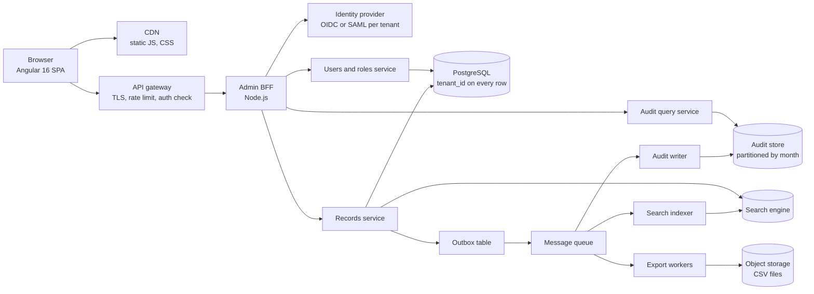
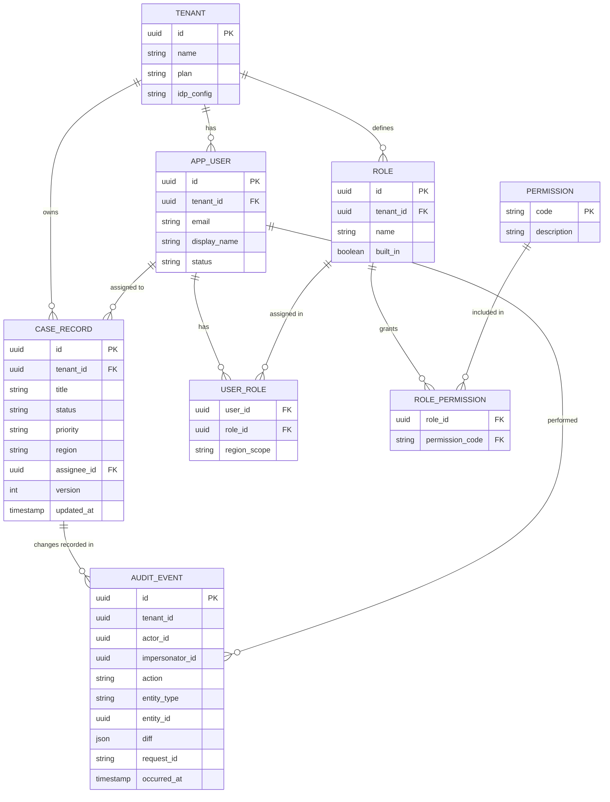
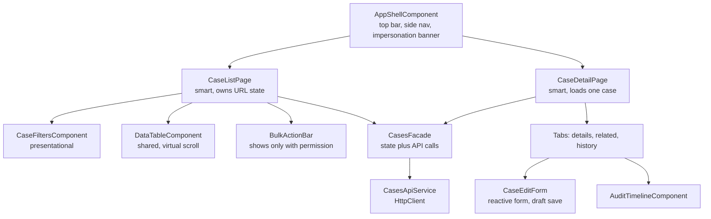
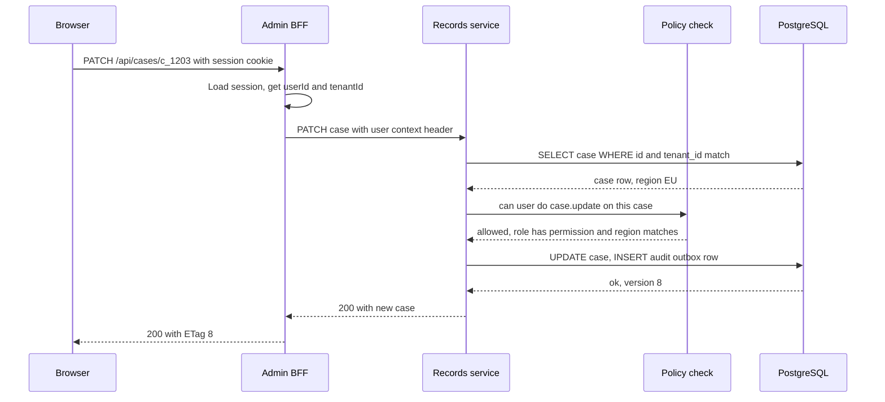
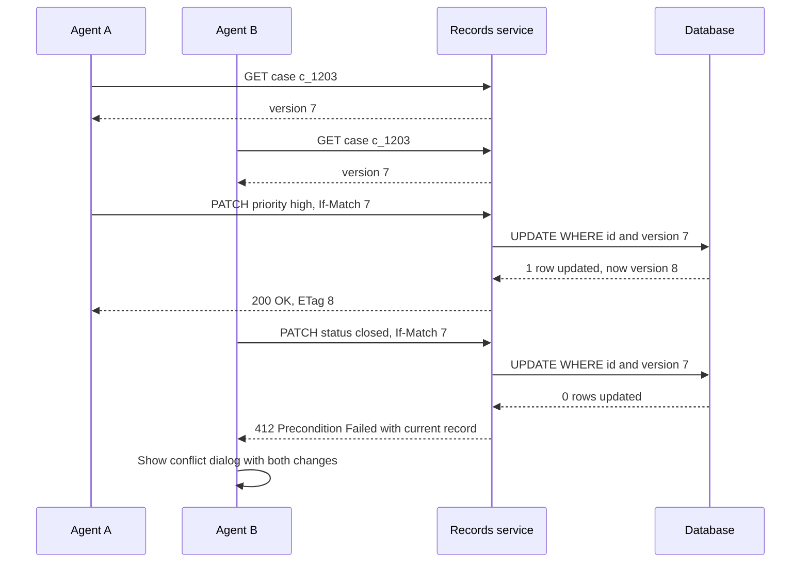
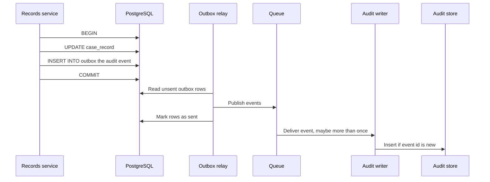

# Case Study: Enterprise Admin Portal

> In this case study you will design a multi-tenant admin portal: the kind of internal tool where support and operations staff search, view and edit thousands of records. It covers role-based access control, large tables, audit logs, complex forms and tenant isolation, with an Angular 16 frontend. These topics matter in enterprise frontend and full-stack interviews, because they are what real business applications are made of.

**Before this:** [System design interview approach](01-system-design-interview-approach.md) · [Frontend architecture at scale](05-frontend-architecture-at-scale.md) · [Auth architecture and multi-tenancy](06-auth-architecture-and-multi-tenancy.md) · [Angular enterprise architecture](../06-angular-16/13-enterprise-architecture.md) · **Interview questions:** [jump to the interview section](#interview-questions)

## Table of contents

1. [Problem statement](#problem-statement)
2. [Clarifying questions](#clarifying-questions)
3. [Requirements](#requirements)
4. [Estimates](#estimates)
5. [High-level architecture](#high-level-architecture)
6. [API design](#api-design)
7. [Data model](#data-model)
8. [Frontend architecture](#frontend-architecture)
9. [Deep dive 1: role-based access control](#deep-dive-1-role-based-access-control)
10. [Deep dive 2: the large records table](#deep-dive-2-the-large-records-table)
11. [Deep dive 3: complex forms and edit conflicts](#deep-dive-3-complex-forms-and-edit-conflicts)
12. [Deep dive 4: audit logs](#deep-dive-4-audit-logs)
13. [Performance](#performance)
14. [Security](#security)
15. [Scalability](#scalability)
16. [Failure handling](#failure-handling)
17. [Observability](#observability)
18. [Trade-offs and alternatives](#trade-offs-and-alternatives)
19. [How to present this in 45 minutes](#how-to-present-this-in-45-minutes)
20. [Interview questions](#interview-questions)
21. [Summary](#summary)
22. [References](#references)

---

## Problem statement

"Design an admin portal for a B2B SaaS product."

The company sells a product to many business customers. Each customer is a **tenant**: a separate organization with its own users and its own data. Inside each tenant, staff use the admin portal to:

- Search and browse records (for example customers, orders and support cases).
- Open a record, see its details and its history.
- Edit records with long, multi-step forms.
- Manage users and their roles.
- See who changed what, and when (the audit log).
- Export data for reports.

Some users are **platform staff** from the SaaS company itself. They can switch between tenants to help customers, but every action they take must be recorded.

This is not a high-traffic consumer system. The hard parts are **correctness, permissions, data isolation, big tables and complex forms**. A good answer shows that you know where the real difficulty is.

---

## Clarifying questions

Always ask before you design. Here are good questions, with the answers we will assume.

| Question | Why you ask it | Assumed answer |
| --- | --- | --- |
| How many tenants and users? | Decides if one database is enough. | 500 tenants, about 100,000 admin users in total, 20,000 active per day. |
| How big is the biggest tenant? | Large tenants drive table and search design. | Up to 2 million records of one type. Most tenants have under 100,000. |
| Who are the users? Tenant staff only, or platform staff too? | Platform staff need cross-tenant access and impersonation. | Both. Platform support can "act as" a tenant user, with an audit trail. |
| What roles exist? Are they fixed or customizable? | Fixed roles are simple RBAC. Custom roles need a permission model. | A few built-in roles, plus custom roles per tenant made from a fixed list of permissions. |
| Are there rules like "only your own region" or "only records you own"? | That is attribute-based access, not just roles. | Yes, some roles are limited to a region. |
| How long must audit logs be kept? Can they be changed? | Retention and immutability drive storage design. | 7 years. Nobody may edit or delete them. |
| Can two people edit the same record at the same time? | Decides on locking or conflict detection. | Yes, it happens. We must not lose anyone's changes silently. |
| What login do customers use? | Enterprise customers want their own identity provider. | Single sign-on with OIDC or SAML per tenant, plus email login for small tenants. |
| Does it need to work on mobile? Offline? | Changes the frontend scope. | Desktop browsers first. Tablet should work. No offline mode. |
| What is the tech stack? | You should design with what the team knows. | Angular 16 frontend, Node.js services, PostgreSQL. |

> **Tip:** you do not need to ask all of these in a real interview. Pick the four or five that change your design the most: scale, roles, audit, concurrent edits and login.

---

## Requirements

### Functional requirements

1. Users sign in with their tenant's identity provider (SSO) and see only their tenant's data.
2. Users browse records in a table with search, filter, sort and pagination over up to 2 million rows.
3. Users open a record detail page with tabs (details, related items, history).
4. Users create and edit records with multi-step forms, validation and draft saving.
5. Users can do bulk actions on selected rows (assign, change status, export).
6. Tenant admins manage users and assign roles. They can create custom roles.
7. Every change is recorded in an audit log that can be searched.
8. Platform support staff can impersonate a tenant user, with a clear banner and an audit trail.
9. Users can export filtered data to CSV.

### Non-functional requirements

| Quality | Target | Note |
| --- | --- | --- |
| Security and isolation | No cross-tenant data access, ever. | The most important requirement. |
| Correctness | No lost updates. Audit log is complete. | A missing audit entry is a compliance problem. |
| Latency | Table page loads under 500 ms at p95. Detail page under 300 ms at p95. | **p95** means 95% of requests are faster than this. |
| Availability | 99.9% during business hours. | About 43 minutes of downtime per month. |
| Accessibility | WCAG 2.1 AA. | Enterprise customers often require it in contracts. |
| Maintainability | Many teams add features over years. | Clear feature boundaries matter more than clever code. |

---

## Estimates

Admin portals are not huge, but numbers still guide choices. Show the math out loud.

**Requests**

- 20,000 daily active users × 300 API requests per day = 6,000,000 requests per day.
- 6,000,000 / 86,400 seconds ≈ 70 requests per second on average.
- Business-hours peak: assume 5× the average → about 350 requests per second.

That is small. A few Node.js instances behind a load balancer handle this easily.

**Writes**

- 20,000 users × 50 writes per day = 1,000,000 writes per day ≈ 12 writes per second on average, about 60 per second at peak.

**Records storage**

- 500 tenants × 200,000 records on average = 100,000,000 records.
- 2 KB per record → 100,000,000 × 2 KB = 200 GB. One PostgreSQL cluster can hold this, with good indexes.

**Audit storage**

- 1,000,000 writes per day, one audit event each, about 1 KB each (it stores the before/after change) → 1 GB per day.
- 1 GB × 365 ≈ 365 GB per year. 7 years ≈ 2.5 TB.

This is the one number that grows without stopping. So the audit log needs its own storage plan (partitioning by month and moving old data to cheaper storage).

**What the numbers tell us**

- Traffic is not the problem. **Data size per tenant** and **query shape** (filters, sorts) are the problem.
- The audit log grows forever, so it must be designed separately from the main data.

---

## High-level architecture



What each part does:

- **Angular 16 SPA** — the admin app. Served as static files from a CDN.
- **API gateway** — ends TLS, applies rate limits and rejects requests without a valid session. See [scalability building blocks](02-scalability-and-core-building-blocks.md).
- **Admin BFF (Backend for Frontend)** — a thin Node.js layer built only for this UI. It holds the session, talks to the identity provider and shapes responses for screens. It keeps tokens out of the browser (see [auth architecture](06-auth-architecture-and-multi-tenancy.md)).
- **Records service** and **Users and roles service** — the business logic. They **always** check permissions and tenant.
- **PostgreSQL** — the source of truth. Every table has a `tenant_id` column.
- **Outbox + queue** — every write also writes an event into an outbox table in the same transaction. A relay sends these events to a queue. See [the outbox pattern](../07-nodejs-backend/13-background-jobs-and-queues.md#the-outbox-pattern).
- **Audit writer** — reads events from the queue and stores them in the append-only audit store.
- **Search indexer + search engine** — keeps a search index for free-text search over big tenants.
- **Export workers** — build CSV files in the background and put them in object storage.

> **Why a BFF and not the SPA calling services directly?** The BFF keeps tokens on the server, combines several service calls into one screen response and lets the frontend team change screen data without changing core services. The cost is one more service to run.

---

## API design

The portal uses REST. Resources are tenant-scoped, but **the tenant comes from the session, not from the URL**. This is important: if the tenant came from the URL, a user could change it.

> Platform staff who switch tenants do it through an explicit "switch tenant" call that changes the session, and the switch is audited.

The full REST rules (status codes, error format, pagination styles) are in [REST API design](../07-nodejs-backend/07-rest-api-design.md). Here we show only the endpoints that matter for this design.

### Session and permissions

```text
GET /api/me
```

```json
{
  "user": { "id": "u_812", "name": "Priya Nair", "email": "priya@acme.com" },
  "tenant": { "id": "t_42", "name": "Acme Ltd", "plan": "enterprise" },
  "roles": ["support_agent"],
  "permissions": ["case.read", "case.update", "case.export", "customer.read"],
  "scopes": { "region": ["EU"] },
  "impersonatedBy": null
}
```

The frontend uses `permissions` only to **show or hide UI**. The backend checks again on every request.

### List records (server-side search, filter, sort, pagination)

```text
GET /api/cases?status=open&priority=high&q=refund&sort=-updatedAt&limit=50&cursor=eyJ1IjoiMjAyNi0xMC0yMFQxMDowMDowMFoiLCJpZCI6ImNfOTkxIn0
```

```json
{
  "items": [
    {
      "id": "c_1203",
      "title": "Refund not received",
      "status": "open",
      "priority": "high",
      "assignee": { "id": "u_812", "name": "Priya Nair" },
      "updatedAt": "2026-10-20T09:58:11Z",
      "version": 7
    }
  ],
  "nextCursor": "eyJ1IjoiMjAyNi0xMC0yMFQwOTo1ODoxMVoiLCJpZCI6ImNfMTIwMyJ9",
  "totalEstimate": 18250
}
```

- `cursor` pagination stays fast on deep pages and does not skip rows when new rows are added.
- `totalEstimate` is an estimate. An exact `COUNT(*)` over 2 million filtered rows is slow. The UI shows "about 18,000 results".
- For tables that need "jump to page 40", the API can also support `page` and `pageSize` (offset), but only for small result sets.

### Get one record

```text
GET /api/cases/c_1203
```

Response includes the record and an `ETag: "7"` header. The ETag is the record version.

### Update a record (with conflict detection)

```text
PATCH /api/cases/c_1203
If-Match: "7"
Content-Type: application/json

{ "status": "pending_customer", "assigneeId": "u_900" }
```

- `200 OK` with the new record and `ETag: "8"` if the version still was 7.
- `412 Precondition Failed` if someone else saved first. The body tells the UI what changed. See [concurrency control with ETags](../07-nodejs-backend/07-rest-api-design.md#concurrency-control-with-etags).

### Bulk action

```text
POST /api/cases/bulk-actions
Idempotency-Key: 6c1f6f6e-3b2a-4f5e-9a37-1c1b8d1e0a55

{ "action": "assign", "ids": ["c_1203", "c_1204", "c_1290"], "params": { "assigneeId": "u_900" } }
```

```json
{
  "succeeded": ["c_1203", "c_1290"],
  "failed": [{ "id": "c_1204", "code": "FORBIDDEN_REGION", "message": "This case is outside your region." }]
}
```

Bulk actions can partly fail. The response must say which items failed and why. The `Idempotency-Key` header makes a retry safe (see [idempotency keys](../07-nodejs-backend/07-rest-api-design.md#idempotency-keys-for-safe-retries)).

### Export (long-running)

```text
POST /api/exports        { "resource": "cases", "filters": { "status": "open" }, "columns": ["id", "title", "status"] }
→ 202 Accepted           { "exportId": "ex_77", "status": "queued" }

GET /api/exports/ex_77   → { "status": "ready", "downloadUrl": "https://files.example.com/...signed...", "expiresAt": "..." }
```

### Audit log

```text
GET /api/audit-events?entityType=case&entityId=c_1203&limit=50&cursor=...
GET /api/audit-events?actorId=u_812&from=2026-10-01&to=2026-10-31
```

### Roles

```text
GET    /api/roles
POST   /api/roles                 { "name": "EU Support Lead", "permissions": ["case.read", "case.update", "case.assign"] }
PUT    /api/users/u_900/roles     { "roleIds": ["r_eu_lead"] }
```

---

## Data model



Key decisions:

- **`tenant_id` on every row.** This is the "shared database, shared schema" model. It is the cheapest to run. Isolation is enforced with PostgreSQL **row-level security** (RLS) as a second safety net (explained in [Security](#security)). Other models (schema per tenant, database per tenant) are compared in [auth architecture and multi-tenancy](06-auth-architecture-and-multi-tenancy.md).
- **Permissions are a fixed list in code**, like `case.update`. Roles are tenant data. A custom role is just a named set of permission codes. This lets tenants build roles without new code.
- **`version` column** on records for optimistic locking.
- **Audit events do not have foreign keys** to records. A record may be deleted, but its history must stay. The audit store may also live in a different database.
- **Indexes** follow the table's main queries, and always start with `tenant_id`:

```sql
-- List view: "open cases in my tenant, newest first"
CREATE INDEX idx_case_tenant_status_updated
  ON case_record (tenant_id, status, updated_at DESC, id DESC);

-- "My cases"
CREATE INDEX idx_case_tenant_assignee_updated
  ON case_record (tenant_id, assignee_id, updated_at DESC, id DESC);
```

Why `id` at the end? Cursor pagination sorts by `updated_at` and then `id` as a tie-breaker. The index must match that sort. More on indexes in [Databases](../07-nodejs-backend/10-databases.md#indexes).

---

## Frontend architecture

### Feature structure

The Angular 16 app is split by **business domain**. Each domain is a lazy-loaded feature. Shared code lives in `core` (singletons) and `shared` (dumb UI). This structure is explained in detail in [Angular enterprise architecture](../06-angular-16/13-enterprise-architecture.md).

```text
src/app/
  core/                    auth, permissions, http interceptors, error handler, tenant context
  shared/ui/               data-table, form fields, dialogs, empty states (design system)
  features/
    cases/                 list page, detail page, edit form, bulk actions, facade, api service
    customers/
    users-and-roles/
    audit/
    exports/
  app-routing.module.ts
```

### Component tree for the cases feature



- **Smart components** (pages) know about the facade and the router.
- **Presentational components** get data by `@Input()` and send events by `@Output()`. They are easy to test and reuse.
- **Facade** hides where state comes from (a service with RxJS, or NgRx). Pages do not care. See [the facade pattern](../06-angular-16/13-enterprise-architecture.md#the-facade-pattern-as-a-feature-boundary).

### State ownership

The most important frontend decision is **who owns each piece of state**. Mixing these up causes most bugs in admin apps.

| State | Owner | Why |
| --- | --- | --- |
| Filters, sort, page cursor, selected tab | **The URL** (query params) | Users share links, use the back button and refresh the page. |
| The rows of the current page | Facade (server cache) | It is a copy of server data. It can go stale. |
| Selected row IDs | Facade (client state) | Lives only in the browser. Cleared when filters change. |
| Form values being edited | The reactive form | Local until saved. A draft copy goes to `localStorage` or the server. |
| Current user, tenant, permissions | `SessionService` in `core` | Loaded once at startup. Reloaded on tenant switch. |
| Column widths, saved views | Server (user preferences) | They should follow the user to another computer. |

### Routing

```ts
// app-routing.module.ts (Angular 16)
const routes: Routes = [
  {
    path: '',
    component: AppShellComponent,
    canActivate: [authGuard],
    children: [
      {
        path: 'cases',
        canMatch: [permissionGuard('case.read')],
        loadChildren: () => import('./features/cases/cases.routes').then(m => m.CASES_ROUTES),
      },
      {
        path: 'users',
        canMatch: [permissionGuard('user.manage')],
        loadChildren: () => import('./features/users-and-roles/users.routes').then(m => m.USERS_ROUTES),
      },
      {
        path: 'audit',
        canMatch: [permissionGuard('audit.read')],
        loadChildren: () => import('./features/audit/audit.routes').then(m => m.AUDIT_ROUTES),
      },
      { path: '', pathMatch: 'full', redirectTo: 'cases' },
    ],
  },
  { path: 'forbidden', component: ForbiddenPageComponent },
];
```

- `canMatch` (available since Angular 14.1) stops the lazy chunk from even being downloaded if the user lacks permission.
- Functional guards like `authGuard` are the recommended style since Angular 15. Routing details are in [Routing, guards and lazy loading](../06-angular-16/06-routing-guards-and-lazy-loading.md).

### Client caching

- Keep the last few list pages in the facade, keyed by the full query string. Going "back" from a detail page shows the list instantly, then refreshes in the background (stale-while-revalidate).
- After a save, **update the cached row** with the server's response and **invalidate** list pages that might now be wrong.
- On tenant switch, **clear every cache**. Old tenant data must never show after a switch.

Client caching patterns are explained in [API integration and data fetching](../05-frontend-engineering/07-api-integration-and-data-fetching.md#client-side-caching-and-stale-while-revalidate) and [caching strategies](03-caching-strategies-and-invalidation.md).

---

## Deep dive 1: role-based access control

### The core rule

**The frontend decides what to show. The backend decides what is allowed.**

Hiding a button is good user experience. It is not security. Anyone can open DevTools and send the request by hand. So every API endpoint must check the permission again. (The general rule is explained in [frontend permission checks are UX, the backend enforces](06-auth-architecture-and-multi-tenancy.md#frontend-permission-checks-are-ux-the-backend-enforces).)

### How permissions are evaluated

We use **RBAC** (role-based access control) with a small amount of **ABAC** (attribute-based access control):

- **RBAC:** a user has roles. A role has permissions. "Support agent can `case.update`."
- **ABAC:** a rule also looks at attributes of the user and the record. "Support agent can update a case **only if** the case region is in the user's regions."

The models are explained in [authorization models: RBAC, ABAC and ReBAC](06-auth-architecture-and-multi-tenancy.md#authorization-models-rbac-abac-and-rebac) (architecture level) and [authorization models in Node.js](../07-nodejs-backend/09-authentication-and-authorization.md#authorization-models) (implementation).



### Backend policy code

A small, central policy function is easier to test and review than permission checks spread across every handler.

```ts
// policy.ts
type Permission = 'case.read' | 'case.update' | 'case.assign' | 'case.export' | 'user.manage' | 'audit.read';

interface UserContext {
  userId: string;
  tenantId: string;
  permissions: Set<Permission>;
  regions: string[] | 'all';
}

interface CaseRecord {
  id: string;
  tenantId: string;
  region: string;
}

export function canOnCase(user: UserContext, action: Permission, record: CaseRecord): boolean {
  // 1. Tenant check first. This should never fail if queries are written correctly,
  //    but checking it here too is cheap defense in depth.
  if (record.tenantId !== user.tenantId) return false;

  // 2. Role check (RBAC).
  if (!user.permissions.has(action)) return false;

  // 3. Attribute check (ABAC).
  if (user.regions !== 'all' && !user.regions.includes(record.region)) return false;

  return true;
}
```

```ts
// In the Express handler
router.patch('/cases/:id', async (req, res) => {
  const user = req.userContext; // set by auth middleware
  const record = await casesRepo.findById(user.tenantId, req.params.id);
  if (!record || !canOnCase(user, 'case.read', record)) {
    // ✅ 404 when the user may not even see the record: a 403 would leak that it exists.
    return res.status(404).json({ title: 'Not found' });
  }
  if (!canOnCase(user, 'case.update', record)) {
    // ✅ 403 when the user can see the record but not change it.
    return res.status(403).json({ title: 'Forbidden', code: 'NO_UPDATE_PERMISSION' });
  }
  // ... update
});
```

> **404 or 403?** If the user cannot even *read* the record, return 404. A 403 would confirm that the ID exists in another tenant or region. If they can read it but not edit it, 403 is honest and helps the UI show a clear message.

### Filtering lists by permission

Checking one record at a time is easy. Lists are harder. You cannot load 2 million rows and filter them in Node.js. The rule must become part of the **SQL `WHERE` clause**:

```ts
function caseListQuery(user: UserContext, filters: { status?: string }) {
  const where: string[] = ['tenant_id = $1'];
  const params: unknown[] = [user.tenantId];

  if (filters.status) {
    params.push(filters.status);
    where.push(`status = $${params.length}`);
  }
  if (user.regions !== 'all') {
    params.push(user.regions);
    where.push(`region = ANY($${params.length})`);
  }
  // Values are always parameters ($1, $2...). Only fixed column names are in the SQL text.
  return { sql: `SELECT ... FROM case_record WHERE ${where.join(' AND ')}`, params };
}
```

This way the policy and the query agree. Counts and exports also stay correct.

### Frontend permission checks (UX only)

A basic permission directive and guard are shown in [auth architecture](06-auth-architecture-and-multi-tenancy.md#frontend-permission-checks-are-ux-the-backend-enforces). The version below adds one thing this portal needs: it subscribes to `permissions$`, so buttons appear or disappear when roles change during the session.

```ts
// has-permission.directive.ts (Angular 16, standalone)
@Directive({ selector: '[appHasPermission]', standalone: true })
export class HasPermissionDirective implements OnInit, OnDestroy {
  @Input('appHasPermission') permission!: string;
  private sub?: Subscription;

  constructor(
    private tpl: TemplateRef<unknown>,
    private vcr: ViewContainerRef,
    private session: SessionService,
  ) {}

  ngOnInit(): void {
    // permissions$ emits again after a tenant switch or role change
    this.sub = this.session.permissions$.subscribe(perms => {
      this.vcr.clear();
      if (perms.has(this.permission)) this.vcr.createEmbeddedView(this.tpl);
    });
  }

  ngOnDestroy(): void {
    this.sub?.unsubscribe();
  }
}
```

```html
<button *appHasPermission="'case.assign'" (click)="openAssignDialog()">Assign</button>
```

And a functional guard factory for routes:

```ts
// permission.guard.ts (Angular 16)
export function permissionGuard(permission: string): CanMatchFn {
  return () => {
    const session = inject(SessionService);
    const router = inject(Router);
    return session.permissions$.pipe(
      take(1),
      map(perms => (perms.has(permission) ? true : router.createUrlTree(['/forbidden']))),
    );
  };
}
```

### When permissions change

A tenant admin removes a role from Priya while she has the portal open. What happens?

1. Her next API call returns **403**. The backend is always correct.
2. The HTTP interceptor sees a 403 and reloads `/api/me`.
3. `permissions$` emits a new set. The directive hides buttons.
4. If she is on a page she can no longer see, the app sends her to `/forbidden`.

To keep permission lookups fast, the backend caches each user's effective permissions for a short time (for example 60 seconds) and deletes the cache key when roles change.

---

## Deep dive 2: the large records table

The case list is the screen people use most. A tenant can have 2 million cases. Here is how the table stays fast.

### Rule 1: the server does search, filter, sort and pagination

Never send 2 million rows to the browser. The server returns one page (50 rows). Every filter and sort goes to the server as a query parameter.

### Rule 2: the URL is the source of truth for table state

```ts
// case-list.page.ts (Angular 16)
@Component({
  selector: 'app-case-list-page',
  templateUrl: './case-list.page.html',
  changeDetection: ChangeDetectionStrategy.OnPush,
})
export class CaseListPage {
  private route = inject(ActivatedRoute);
  private router = inject(Router);
  private facade = inject(CasesFacade);

  // URL query params -> typed query -> API call. switchMap cancels the old request.
  readonly vm$ = this.route.queryParamMap.pipe(
    map(params => toCaseQuery(params)),
    distinctUntilChanged((a, b) => JSON.stringify(a) === JSON.stringify(b)),
    switchMap(query => this.facade.loadPage(query)),
  );

  onFiltersChange(filters: CaseFilters): void {
    // Changing filters resets the cursor. Selection is cleared in the facade.
    this.router.navigate([], {
      queryParams: { ...filters, cursor: null },
      queryParamsHandling: 'merge',
    });
  }
}
```

Why this design is good:

- **Refresh** keeps the same view.
- **Back button** works.
- **Shared links** open the exact same filtered list.
- `switchMap` cancels the previous HTTP request when filters change quickly. This prevents an old, slow response from replacing a newer one. See [race conditions](../05-frontend-engineering/07-api-integration-and-data-fetching.md#race-conditions-and-the-latest-request-wins) and [RxJS](../06-angular-16/09-rxjs.md).
- The free-text search box is debounced (about 300 ms) before it updates the URL.

### Rule 3: cursor pagination for deep lists

Offset pagination (`LIMIT 50 OFFSET 100000`) makes the database read and throw away 100,000 rows. It gets slower the deeper you go. Also, if new rows are added while you page, you see duplicates or miss rows.

**Cursor (keyset) pagination** remembers the last row you saw and asks for rows "after" it:

```sql
SELECT id, title, status, updated_at
FROM case_record
WHERE tenant_id = $1
  AND status = $2
  AND (updated_at, id) < ($3, $4)      -- the cursor: last row of the previous page
ORDER BY updated_at DESC, id DESC
LIMIT 51;                               -- one extra row tells us if there is a next page
```

The cursor is just the last row's `updated_at` and `id`, encoded in base64url so clients treat it as an opaque string:

```js
// cursor.js
function encodeCursor(row) {
  return Buffer.from(JSON.stringify({ u: row.updatedAt, id: row.id })).toString('base64url');
}
function decodeCursor(cursor) {
  return JSON.parse(Buffer.from(cursor, 'base64url').toString('utf8'));
}

const c = encodeCursor({ updatedAt: '2026-10-20T09:58:11Z', id: 'c_1203' });
console.log(c);               // eyJ1IjoiMjAyNi0xMC0yMFQwOTo1ODoxMVoiLCJpZCI6ImNfMTIwMyJ9
console.log(decodeCursor(c)); // { u: '2026-10-20T09:58:11Z', id: 'c_1203' }
```

Always validate a decoded cursor (types, length) before using it in a query. A cursor is user input.

| | Offset pagination | Cursor pagination |
| --- | --- | --- |
| "Jump to page 40" | Easy | Not possible directly |
| Speed on deep pages | Gets slower | Stays the same |
| New rows during paging | Duplicates or missed rows | Stable |
| Total page count | Needs `COUNT(*)` | Not needed |
| Best for | Small result sets, page numbers in UI | Big lists, "load more", infinite scroll |

Many admin tables use a **hybrid**: page numbers when the filtered result is small (under about 10,000 rows), cursor mode otherwise. More detail in [REST pagination](../07-nodejs-backend/07-rest-api-design.md#pagination).

### Rule 4: free-text search goes to a search engine

`WHERE title ILIKE '%refund%'` cannot use a normal B-tree index and scans the whole tenant. For big tenants, the search indexer copies records into a search engine (for example OpenSearch or Elasticsearch). The list endpoint sends free-text queries there, together with the tenant and permission filters.

The search index is **eventually consistent**: a record saved now may appear in search a second later. The UI handles this by updating the row in place after a save, so the user never sees their own change "disappear".

### Rule 5: render only what is visible

50 rows render fine. But some views let users show 1,000 rows per page or keep loading more. Rendering thousands of DOM rows makes scrolling slow. Use **virtual scrolling** — render only the rows in the viewport plus a small buffer. In Angular, the CDK `cdk-virtual-scroll-viewport` does this. See [virtual scrolling in Angular](../06-angular-16/12-performance.md#large-lists-virtual-scrolling). Also use `trackBy` and `OnPush`.

Virtual scrolling has costs: the browser's "find in page" does not find rows that are not rendered, and screen readers see only rendered rows. So give the table a real search box and announce the total count. More detail on huge tables is in the [analytics dashboard case study](09-case-study-analytics-dashboard-and-large-tables.md).

### Rule 6: selection must be clear

If the user selects 3 rows, changes the filter, and clicks "Assign", which rows are assigned? Avoid this confusion:

- Clear selection when filters change.
- Or support "select all 18,250 matching" explicitly. Then the bulk API receives the **filter**, not a list of IDs, and the server applies it as a background job.

---

## Deep dive 3: complex forms and edit conflicts

### The form

Editing a case has 4 steps (customer, problem, resolution, review), 40+ fields, conditional sections and cross-field rules ("resolution date must be after created date").

Design choices:

- **Reactive forms** with typed `FormGroup`s (typed forms exist since Angular 14). Each step is a nested `FormGroup`. See [Angular forms](../06-angular-16/07-forms.md).
- **Validation in two places.** The client validates for fast feedback. The server validates again, because the client can be bypassed. If possible, both use the same schema so rules do not drift. See [validation and error handling](../07-nodejs-backend/08-validation-and-error-handling.md).
- **Server errors map back to fields.** A 422 response lists errors with a field path, and the form shows them next to the right input.
- **Some parts are configuration-driven.** Tenants can add custom fields. The server sends a field schema, and a small dynamic form renderer builds controls from it. Keep this to custom fields only. A fully dynamic form engine for everything is hard to debug and test.

```ts
// Mapping server validation errors onto form controls
interface FieldError { pointer: string; detail: string } // pointer like "/resolution/date"

function applyServerErrors(form: FormGroup, errors: FieldError[]): void {
  for (const err of errors) {
    const path = err.pointer.split('/').filter(Boolean).join('.'); // "resolution.date"
    const control = form.get(path);
    if (control) {
      control.setErrors({ server: err.detail });
      control.markAsTouched();
    } else {
      form.setErrors({ server: err.detail }); // error not tied to one field
    }
  }
}
```

### Drafts

A user fills 30 fields, goes to lunch, and the session expires. Losing that work is a real complaint in admin tools.

- Save a **draft** a few seconds after changes stop (debounced) to `localStorage`, keyed by `tenantId + userId + recordId`.
- For long forms that people finish on another day or another computer, save drafts on the server instead.
- When the user comes back, offer "Restore your unsaved changes from 10:42?".
- Never store secrets or very sensitive fields in `localStorage`. Clear drafts after a successful save and on logout.

### Edit conflicts (the lost update problem)

Two agents open case `c_1203` at version 7.

- Agent A changes the priority and saves. Version becomes 8.
- Agent B changes the status and saves. If the server simply overwrites the whole record, A's priority change is **lost**. Nobody notices.

We prevent this with **optimistic locking**: every save sends the version the user started from.



The SQL makes this atomic. No separate "check, then update" step is needed:

```sql
UPDATE case_record
SET status = $3, version = version + 1, updated_at = now()
WHERE tenant_id = $1 AND id = $2 AND version = $4
RETURNING *;
-- 0 rows returned means someone else saved first (or the record does not exist)
```

On 412, the UI should not just say "error". It should help:

- If the other person changed **different fields**, the client can re-apply the user's changes on top of the new version and ask them to confirm.
- If they changed the **same field**, show both values side by side and let the user choose.

**Alternative: pessimistic locking** ("Priya is editing this record" lock). It avoids conflicts, but locks get stuck when people close the tab. It needs lock timeouts and a "take over" button. Use it only for workflows where conflicts are very expensive. Details in [optimistic and pessimistic locking](../07-nodejs-backend/10-databases.md#optimistic-and-pessimistic-locking).

---

## Deep dive 4: audit logs

The general rules for audit logs (which fields to record, append-only storage, tamper evidence) are in [auth architecture: audit logs](06-auth-architecture-and-multi-tenancy.md#audit-logs). Here we focus on how this portal meets them at its scale.

### What an audit log must guarantee

1. **Complete** — every change is recorded. No change without an event.
2. **Immutable** — nobody can edit or delete events, not even admins.
3. **Attributable** — who did it, from where, and on whose behalf (impersonation).
4. **Searchable** — by record, by user and by time range.
5. **Retained** — 7 years.

### Getting completeness right

The naive way is: update the record, then call the audit service. But if the audit call fails, or the process crashes between the two steps, the change has no audit entry.

The fix is the **transactional outbox**: write the record change and the audit event in **the same database transaction**. A separate relay process reads the outbox and publishes to the queue.



- Either both the change and the event are saved, or neither is.
- The relay and the queue deliver **at least once**, so the same event may arrive twice. The audit writer uses the event `id` as a unique key, so a duplicate insert is ignored. This makes the consumer **idempotent**. See [delivery guarantees](../07-nodejs-backend/13-background-jobs-and-queues.md#delivery-guarantees-and-idempotent-consumers).

### What one event looks like

```json
{
  "id": "evt_01JAX4M3S9",
  "tenantId": "t_42",
  "actorId": "u_812",
  "impersonatorId": null,
  "action": "case.updated",
  "entityType": "case",
  "entityId": "c_1203",
  "diff": { "status": { "from": "open", "to": "pending_customer" } },
  "requestId": "req_9f2c",
  "ip": "203.0.113.24",
  "occurredAt": "2026-10-20T10:02:33Z"
}
```

- Store the **diff** (changed fields only), not the whole record. It is smaller and easier to read.
- **Mask sensitive values** (for example, write `"***"` for a bank account change) but still record that the field changed.
- `requestId` connects the audit entry to application logs and traces.

### Immutability and retention

- The audit writer's database user has only `INSERT` and `SELECT` rights. No `UPDATE`, no `DELETE`.
- Partition the audit table by month. Queries for "last 30 days" touch one or two partitions.
- After 12 months, move old partitions to cheaper storage (for example compressed files in object storage with a write-once retention lock). Compliance staff can still search them, more slowly.
- For extra tamper evidence, each event can store a hash of the previous event (a **hash chain**). Changing an old event breaks the chain, and a daily job can detect it.

### Viewing the audit log

The record detail page has a "History" tab that calls `GET /api/audit-events?entityType=case&entityId=c_1203`. It shows a timeline: "Priya changed status from Open to Pending customer, 10:02". Events reach the audit store a moment after the change. So the UI adds the user's own change to the timeline immediately, and the next refresh replaces it with the stored event.

---

## Performance

| Area | What we do | Why |
| --- | --- | --- |
| Initial load | Lazy-load every feature. Keep the shell small. Use production builds and bundle budgets. | Admin apps grow big over years. See [Angular performance](../06-angular-16/12-performance.md). |
| Static assets | Hashed file names with long cache headers, served from a CDN. `index.html` is not cached long. | Returning users download almost nothing. |
| Table API | Composite indexes starting with `tenant_id`. Cursor pagination. Estimated counts. | Keeps p95 under 500 ms for big tenants. |
| Rendering | `OnPush`, `trackBy`, virtual scrolling for long lists, pure pipes. | Avoids slow change detection with many rows. |
| Repeat navigation | Keep recent list pages in the facade cache. Show them at once, refresh in the background. | "Back to list" feels instant. |
| Lookups | Cache reference data (statuses, countries, assignee list) for minutes. | These rarely change and appear on every form. |
| Permissions | Cache effective permissions per user for about 60 seconds in Redis. Delete on role change. | Avoids several joins on every request. |

---

## Security

The admin portal is a high-value target. One bug can leak all customers' data.

1. **Tenant isolation in layers.**
   - The tenant ID comes from the server-side session, never from the request body or URL.
   - Every repository function takes `tenantId` as a required first argument.
   - PostgreSQL **row-level security** (RLS) adds a second wall. Each request sets the tenant on its database transaction, and a policy hides rows from other tenants. If a developer forgets a `WHERE tenant_id = ...`, RLS still blocks other tenants' rows.
   - Automated tests try to read tenant B's records while signed in as tenant A. They run on every build.

   ```sql
   ALTER TABLE case_record ENABLE ROW LEVEL SECURITY;
   CREATE POLICY tenant_isolation ON case_record
     USING (tenant_id = current_setting('app.tenant_id')::uuid);

   -- At the start of each request's transaction (the value is the tenant from the session):
   SELECT set_config('app.tenant_id', $1, true);  -- true = only for this transaction
   ```

2. **Authentication.** SSO through OIDC (authorization code flow) handled by the BFF. The browser holds only an `HttpOnly`, `Secure`, `SameSite=Lax` session cookie. See [auth architecture](06-auth-architecture-and-multi-tenancy.md).
3. **CSRF.** Cookie sessions need CSRF protection on state-changing requests (SameSite cookies plus a CSRF token header). Angular's `HttpClient` has built-in XSRF token support. Details in [web security](../10-testing-security-production/05-web-security-xss-csrf-cors-csp.md).
4. **XSS.** Angular escapes interpolated values by default. Never use `bypassSecurityTrustHtml` on user content. Add a strict Content Security Policy. See [Angular security](../06-angular-16/15-security.md).
5. **Authorization on every endpoint**, including exports and bulk actions. Exports are a common hole: the list endpoint checks regions, but the export worker forgets to.
6. **Impersonation** (the general design is in [admin impersonation with audit](06-auth-architecture-and-multi-tenancy.md#admin-impersonation-with-audit)). Platform staff must give a reason. The session is time-limited. A banner shows "You are acting as Priya Nair (Acme)". Every event stores both `actorId` and `impersonatorId`. Some actions (changing security settings, deleting the tenant) are blocked during impersonation.
7. **Signed, short-lived download URLs** for exports, so a leaked link stops working quickly.
8. **Rate limits** on login, search and export to slow down scraping.

---

## Scalability

This system is not traffic-heavy, but it must handle **big tenants** and **steady data growth**.

- **Stateless services.** Sessions live in Redis, so any BFF instance can serve any request. Scale by adding instances.
- **Read replicas** for heavy reads (list pages, reports). Writes go to the primary. Right after a save, read from the primary (or show the saved response) so the user sees their own change. This is **read-your-writes** consistency. See [scalability building blocks](02-scalability-and-core-building-blocks.md).
- **Noisy neighbors.** One tenant running huge exports can slow everyone. Use per-tenant rate limits and per-tenant concurrency limits in the export queue.
- **Very large tenants** can move to their own database later. The `tenant_id` column makes this move possible without a schema change.
- **Audit store** grows forever. Monthly partitions plus archival keep the hot part small.
- **Search engine** scales separately from PostgreSQL.

---

## Failure handling

| Failure | What the user sees | What the system does |
| --- | --- | --- |
| Session expired | "Your session expired. Sign in again." The draft is kept. | Interceptor catches 401, saves the return URL, redirects to login, then back. |
| List API slow or down | Old rows stay on screen with a "Could not refresh. Retry" banner. | Timeout after a few seconds. Retry with backoff for GET only. |
| Search engine down | "Text search is unavailable. Filters still work." | Fall back to database filters without free text. |
| Save fails with 412 | Conflict dialog with both versions. | Nothing saved. The user decides. |
| Save fails with a network error | "Not saved. Retry?" The form keeps all values. | A retry with the same `If-Match` is safe: if the first try actually succeeded, the retry gets 412 and the UI reloads the record. |
| Bulk action partly fails | "18 updated, 2 failed" with a reason per row. | Each item is checked separately. The idempotency key makes a retry safe. |
| Audit writer down | Nothing. Users keep working. | Events wait in the outbox and queue. Alert if the backlog grows. |
| Export job fails | "Export failed. Try again." | The job retries a few times with backoff, then goes to a dead-letter queue. |
| Permission removed mid-session | Button disappears, or "You no longer have access". | 403 triggers a reload of `/api/me`. |

The patterns (timeouts, retries, circuit breakers) are in [reliability and resilience](../10-testing-security-production/09-reliability-and-resilience.md).

---

## Observability

You must be able to answer: "Is the portal slow for tenant Acme right now, and why?"

- **Structured logs** with `requestId`, `tenantId`, `userId`, route and duration. Never log full records or personal data.
- **Metrics:** p50/p95/p99 latency per endpoint and per tenant, error rate, 412 conflict rate, export queue depth, outbox backlog age, search indexing lag.
- **Tracing** across BFF → services → database, so a slow list request shows whether the time went into SQL, search or serialization.
- **Frontend monitoring (RUM, real user monitoring):** page load times, route change times, JavaScript errors and failed API calls, tagged with app version and tenant.
- **The audit log is not the application log.** The audit log is a business record for customers and auditors, kept for years. Application logs are for engineers and are deleted after weeks.
- **Alerts:** outbox backlog older than 5 minutes, p95 above target for 10 minutes, any failed cross-tenant test in production synthetic checks.

More in [logging, monitoring and observability](../10-testing-security-production/08-logging-monitoring-and-observability.md).

---

## Trade-offs and alternatives

| Decision | We chose | Alternative | When the alternative is better |
| --- | --- | --- | --- |
| Tenant data model | Shared tables with `tenant_id` + RLS | Schema per tenant, or database per tenant | Strict regulatory isolation, a few very large customers, per-tenant backup and restore. |
| Authorization | RBAC + a few ABAC rules in code | A policy engine (for example OPA or Cedar), or relationship-based access (ReBAC) | Many complex sharing rules ("share this folder with that team"). |
| Pagination | Cursor, with offset for small results | Offset only | Small datasets where page numbers matter. |
| Conflicts | Optimistic locking with versions | Pessimistic locks, or real-time collaborative editing | Long edits on the same record, or true multi-user editing like a shared document. |
| Audit | Outbox → queue → append-only store | Database triggers, or change data capture (CDC) from the database log | Triggers: simple systems with one database. CDC: you want every change, even from scripts, without app code. |
| Frontend state | Facades over RxJS services | NgRx store | Large teams, complex shared state, need for strict patterns and DevTools. See [state management](../06-angular-16/11-state-management-and-ngrx.md). |
| Frontend structure | One Angular app with lazy features in a monorepo | Micro-frontends | Many independent teams that must deploy separately. See [frontend architecture at scale](05-frontend-architecture-at-scale.md). |
| API style | REST + BFF | GraphQL | Many screens that need different shapes of the same data. See [API styles](04-api-styles-and-real-time-communication.md). |

---

## How to present this in 45 minutes

Here is a spoken script. Adjust it to what the interviewer wants to explore.

**Minutes 0–5: clarify.**
> "Before I design, let me check a few things. How many tenants, and how big is the biggest one? Are roles fixed, or can tenants make custom roles? How long do we keep audit logs, and must they be immutable? Can two people edit the same record? Do customers bring their own SSO? ... OK, I will assume 500 tenants, up to 2 million records in the largest, custom roles, a 7-year immutable audit log, and concurrent edits."

**Minutes 5–8: requirements and numbers.**
> "Functionally: browse and search big tables, edit records with long forms, manage roles, view history, export. Non-functionally, the top priority is tenant isolation. Then no lost updates and a complete audit log. Then p95 under half a second for the table. Traffic is small — about 70 requests per second on average — so the challenge is data size per tenant and correctness, not raw scale. The audit log grows about 365 GB a year, so it needs its own storage plan."

**Minutes 8–15: high-level design.**
> "Let me draw it. An Angular SPA from a CDN. An API gateway. A BFF that owns the session and keeps tokens out of the browser. Behind it, a records service and a users-and-roles service on PostgreSQL, with tenant_id on every row. Each write puts an audit event into an outbox in the same transaction. A relay pushes events to a queue. Consumers write the audit store, update the search index and run exports."

**Minutes 15–20: API and data model.**
> "The tenant always comes from the session. Lists use cursor pagination, with filters and sort as query params. Updates send If-Match with the version, so a conflict returns 412. Bulk actions take an idempotency key and return per-item results. Exports are async: 202, then poll. In the data model, roles are tenant data, permissions are a fixed list in code, records have a version column, and every index starts with tenant_id."

**Minutes 20–35: deep dives.**
> "Which part should I go deeper on — permissions, the big table, forms and conflicts, or the audit log?"

- Permissions: the frontend hides, the backend enforces; one policy function; list rules become SQL; RLS as a safety net.
- Big table: the URL owns table state; switchMap cancels old requests; cursor pagination SQL; a search engine for text; virtual scroll only when needed.
- Forms: typed reactive forms, server errors mapped to fields, drafts, optimistic locking with a conflict dialog.
- Audit: outbox for completeness, an idempotent writer, insert-only rights, monthly partitions, impersonation fields.

**Minutes 35–42: failures, security, scale.**
> "If the audit writer is down, events wait in the outbox. If search is down, filters still work. Session expiry keeps the draft. For security: RLS, CSRF protection, CSP, and impersonation with a banner and audit. For scale: stateless services, read replicas with care for read-your-writes, per-tenant limits for noisy neighbors, and the option to move a huge tenant to its own database."

**Minutes 42–45: trade-offs and wrap-up.**
> "The main trade-offs: a shared schema is cheap but needs careful isolation; optimistic locking is simple but users sometimes see a conflict dialog; cursor pagination is fast but loses page numbers. With more time, I would discuss saved views, SCIM user provisioning, and moving to a policy engine if sharing rules grow."

---

## Interview questions

### Q1. How do you make sure one tenant can never see another tenant's data?

**What the interviewer is checking:** whether you know that isolation needs several layers, and that the tenant must come from a trusted source.

**Short spoken answer (30–60 seconds):**
> "I use defense in depth. First, the tenant ID always comes from the server-side session or the verified token, never from the URL or the request body. Second, every repository function needs a tenant ID, and every query filters by it. Third, I turn on row-level security in PostgreSQL, so even if someone forgets the WHERE clause, the database hides other tenants' rows. Fourth, cache keys, search indexes, export files and logs are also tenant-scoped. And finally, I have automated tests that sign in as tenant A and try to read tenant B's IDs. Any one layer can have a bug, so I don't rely on just one."

**Detailed explanation:**
Most cross-tenant leaks are not clever attacks. They are a missing filter in one query, a cache key without the tenant, or an export job that forgets the rule. That is why the answer is about layers. Row-level security works by setting a per-transaction setting like `app.tenant_id` and a policy `USING (tenant_id = current_setting('app.tenant_id')::uuid)`. Be careful: table owners and superusers bypass RLS unless you use `FORCE ROW LEVEL SECURITY` and connect with a normal role.

**Follow-up questions:**
- **Why not put the tenant in the URL, like `/tenants/t_42/cases`?** — You can, for readability, but the server must still check that the URL tenant equals the session tenant. The trusted value is always the session. The URL is just a hint.
- **What about platform staff who work across tenants?** — They switch tenant explicitly. The switch changes their session, is time-limited, needs a reason and is audited. Their requests still run with exactly one tenant at a time.
- **When would you choose database per tenant?** — When a customer requires physical isolation, its own encryption keys, its own backup and restore, or when one tenant is so big that it needs its own hardware.

**Common mistakes:** saying "the frontend only shows the user's tenant"; forgetting caches, search and exports; trusting a `tenantId` field in the request body.

**Where this is used in real projects:** every B2B SaaS product. Many teams use RLS in PostgreSQL or tenant-scoped repositories with lint rules that block raw queries.

### Q2. Where should permission checks happen — frontend or backend?

**What the interviewer is checking:** that you understand frontend checks are user experience, not security.

**Short spoken answer (30–60 seconds):**
> "Both, but for different reasons. The backend is the real gate: every endpoint checks the user's permission and the record's attributes, because anyone can call the API directly. The frontend also checks, but only to give a good experience — hide buttons the user can't use, block routes they can't open, and avoid sending requests that will fail. In Angular I use a permission directive and canMatch guards, fed from a /me endpoint. If the backend returns 403 because roles changed, the frontend reloads permissions and updates the UI."

**Follow-up questions:**
- **Why `canMatch` instead of `canActivate` for lazy routes?** — `canMatch` runs before the router matches the route, so the lazy chunk is not even downloaded if the user lacks access. `canActivate` runs after matching, and with `loadChildren` the chunk may already be loading.
- **Should the frontend receive a list of roles or a list of permissions?** — Permissions. If the UI checks role names, every new custom role needs a code change. Checking `case.assign` works for any role that includes it.

**Common mistakes:** "we hide the button, so it's secure"; putting the full permission logic in the frontend only.

**Where this is used in real projects:** every admin tool with roles.

### Q3. Design the permission model for built-in and custom roles.

**What the interviewer is checking:** data modeling for RBAC and how to keep it flexible.

**Short spoken answer (30–60 seconds):**
> "Permissions are a fixed list defined in code, like case.read or case.update, because code is what enforces them. Roles are data: each tenant has some built-in roles plus custom roles, and a role is just a set of permission codes. Users get one or more roles, and a user-role assignment can carry a scope like region EU. When a request comes in, I compute the user's effective permissions — the union of all their roles — and cache it briefly. For rules that depend on the record, like region, I add attribute checks on top of the role check."

**Code or diagram:** see the [data model](#data-model) for the `ROLE`, `PERMISSION`, `ROLE_PERMISSION` and `USER_ROLE` tables.

**Follow-up questions:**
- **How do you add a new permission to existing built-in roles?** — A migration adds the new code and attaches it to the built-in roles. Custom roles do not get it automatically; tenant admins choose. Release notes tell them.
- **What about deny rules?** — Avoid them if you can. Pure "allow" sets are easy to reason about: effective permissions are a union. Deny rules need clear precedence and make debugging harder.
- **How do you show "why can't I do this"?** — Return a reason code with 403 (for example `NO_UPDATE_PERMISSION` or `OUTSIDE_REGION`) and map it to a friendly message.

**Common mistakes:** hard-coding role names in many places; storing permissions only in the JWT with no way to revoke them quickly.

**Where this is used in real projects:** tools like CRMs and help desks let customers build their own roles in exactly this way.

### Q4. A user's role is removed while they have the app open. What happens?

**Short answer:** The backend uses the new roles on the very next request (after the short permission cache expires or is deleted on change) and returns 403. The frontend interceptor reacts to 403 by reloading `/api/me`. The permission stream emits, the directive hides buttons, and the router sends the user away from a page they can no longer see. If permissions live inside a long-lived JWT, you need short token lifetimes or a revocation check, otherwise the old permissions stay valid until the token expires.

### Q5. Why cursor pagination instead of offset for the cases table?

**What the interviewer is checking:** database performance and consistency under concurrent writes.

**Short spoken answer (30–60 seconds):**
> "Offset pagination asks the database to skip N rows, and it really reads and throws them away, so page 2,000 is much slower than page 1. It also shifts when new rows are inserted, so users see duplicates or miss rows. Cursor pagination remembers the sort key of the last row — here updated_at plus id — and asks for rows after it. With a matching index, every page costs the same. The downside is no 'jump to page 40' and no exact page count. So I use cursors for big lists and allow page numbers only when the result set is small."

**Follow-up questions:**
- **Why add `id` to the cursor?** — Two rows can have the same `updated_at`. Without a unique tie-breaker, rows with equal timestamps can be skipped or repeated at page boundaries.
- **What if the user changes the sort?** — The cursor is tied to one sort order. Changing the sort resets the cursor to the first page.
- **How do you show the total?** — Use an estimated count (from the query planner or a cached count) and label it "about". Or show "1–50 of many" with a "load more" button.

**Common mistakes:** using a cursor without a matching composite index; exposing raw database IDs as cursors and trusting them without validation.

**Where this is used in real projects:** most large APIs use cursor-style pagination for feeds and lists.

### Q6. How do you prevent lost updates when two people edit the same record?

**What the interviewer is checking:** knowledge of optimistic locking and a good conflict UX.

**Short spoken answer (30–60 seconds):**
> "I use optimistic locking. Each record has a version number. When the user opens the form, they get version 7, and the API returns it as an ETag. When they save, the client sends If-Match 7. The update query says WHERE id = ... AND version = 7 and increments the version. If zero rows change, someone else saved first, and the API returns 412 with the current record. The UI then shows a conflict dialog: if different fields changed, it can merge and ask to confirm; if the same field changed, it shows both values. It's cheap and it never blocks people, unlike locks that get stuck when someone closes a tab."

**Follow-up questions:**
- **Why not "last write wins"?** — It silently throws away someone's work. In an admin tool that can mean a wrong refund or a lost note.
- **Is `PATCH` with only changed fields enough on its own?** — It reduces conflicts, because two people changing different fields do not overwrite each other. But without a version check you still lose updates when both change the same field, and you can break cross-field rules.
- **When is pessimistic locking better?** — When an edit takes a long time and a conflict is very costly, for example editing a contract. Then you add a lock with a timeout and a "take over" option.

**Common mistakes:** checking the version in application code with a separate SELECT and then UPDATE (a race condition); showing a generic error on 412.

**Where this is used in real projects:** HTTP `ETag`/`If-Match`, ORMs with a version column, and cloud APIs that use resource versions all follow this pattern.

### Q7. How do you guarantee every change has an audit entry?

**What the interviewer is checking:** the dual-write problem and the outbox pattern.

**Short spoken answer (30–60 seconds):**
> "If I update the database and then call an audit service, those are two separate writes. A crash between them gives a change with no audit entry. So I use a transactional outbox: in the same database transaction as the change, I insert the audit event into an outbox table. Either both commit or neither does. A relay reads the outbox and publishes to a queue, and the audit writer stores events in an append-only store. Delivery is at least once, so the writer uses the event ID as a unique key to ignore duplicates."

**Follow-up questions:**
- **Why not write the audit row directly into the main database in the same transaction?** — You can, and for small systems that is fine. The outbox becomes useful when the audit store is a separate system, or when other consumers (search, notifications) also need the events.
- **What about changes made by scripts or manual SQL?** — The outbox only sees changes made through the app. Database triggers or change data capture catch every change. Also, restrict direct production database access and audit it.
- **How do you make it tamper-evident?** — Insert-only database rights, write-once object storage for archives, and optionally a hash chain where each event includes the hash of the previous one.

**Common mistakes:** "we log it with console.log"; treating application logs as the audit log; putting full personal data into audit diffs.

**Where this is used in real projects:** financial, healthcare and enterprise SaaS products, where audit trails are compliance requirements.

### Q8. The audit log grows by 365 GB per year. How do you store and query it for 7 years?

**Short answer:** Partition the table by month so recent queries touch only a few partitions and old partitions can be detached cheaply. Keep about 12 months "hot" in the database with indexes on `(tenant_id, entity_type, entity_id, occurred_at)` and `(tenant_id, actor_id, occurred_at)`. Move older months to compressed columnar files in object storage with a retention lock, and query them with a batch query engine when compliance asks. The UI says "older history may take a minute to load".

### Q9. Walk me through the data flow when a user changes a filter on the table.

**What the interviewer is checking:** frontend state ownership and race conditions.

**Short spoken answer (30–60 seconds):**
> "The filter component emits a change. The page component doesn't call the API directly — it updates the URL query params with the new filter and clears the cursor. The page listens to queryParamMap, converts it into a typed query, drops duplicates with distinctUntilChanged, and calls the facade inside switchMap. switchMap cancels any request still in flight, so a slow old response can't overwrite the new one. The facade returns cached rows for that exact query if it has them, and refreshes in the background. Selection is cleared because the visible rows changed."

**Follow-up questions:**
- **Why put filters in the URL?** — Refresh, back button and shared links all work, and there is one source of truth instead of a component field and a URL that can disagree.
- **What about the text search box?** — Debounce it (about 300 ms) before it writes to the URL. Use `replaceUrl: true` while typing so the history is not filled with every keystroke.

**Common mistakes:** storing filters in a component field and also in a service; using `mergeMap` so responses arrive out of order.

**Where this is used in real projects:** every searchable list in an admin portal.

### Q10. How do you design bulk actions like "assign 500 cases"?

**Short answer:** For a small explicit selection, send IDs to `POST /bulk-actions` with an `Idempotency-Key`. The server checks permission for **each** item and returns `succeeded` and `failed` lists with reasons. For "select all matching" (thousands of rows), send the **filter** instead of IDs. The server creates a background job, returns `202` with a job ID, and the UI shows progress. Each item in the job is processed idempotently and audited separately.

### Q11. How would you build a 40-field multi-step form with custom fields per tenant?

**What the interviewer is checking:** practical Angular forms design and validation strategy.

**Short spoken answer (30–60 seconds):**
> "I'd use typed reactive forms, with one FormGroup per step inside a parent group, so each step can be validated on its own and the review step sees everything. Built-in fields are written as normal code, because they are easier to read and test. Only the tenant's custom fields are rendered from a schema sent by the server. Client validators give fast feedback, and the server validates again and returns errors with a field pointer, which I map back to controls. I save a debounced draft so work isn't lost, and I send the record version on save to catch conflicts."

**Follow-up questions:**
- **How do you share validation rules between client and server?** — Use a schema format both sides can read (for example JSON Schema, or a TypeScript validation library in a shared package). Server rules are still the final authority.
- **How do you keep it accessible?** — Real `<label>` elements, errors connected with `aria-describedby`, focus moved to the first error on submit, and a step indicator that screen readers can read. See [accessible forms](../05-frontend-engineering/04-accessibility.md#accessible-forms-and-error-messages).

**Common mistakes:** a fully generic form engine for every field; validating only on the client.

**Where this is used in real projects:** onboarding flows, claims forms, case management.

### Q12. How would you implement "support staff can impersonate a user"?

**What the interviewer is checking:** security thinking and auditability.

**Short spoken answer (30–60 seconds):**
> "Impersonation is a separate, explicit session state. A platform staff member starts it with a reason, maybe a ticket number, and it expires after a short time. The session stores both the real actor and the impersonated user. All permission checks use the impersonated user's permissions, but some dangerous actions are blocked. Every audit event stores both actorId and impersonatorId. The UI shows a banner that can't be dismissed, and ideally the tenant can see an 'accessed by support' entry in their own audit log."

**Follow-up questions:**
- **Should impersonation reuse the user's password or tokens?** — No. The staff member never sees the user's credentials. The server creates a special session linked to the staff member's own login.
- **Can tenants turn it off?** — Often yes, as a tenant setting, or they must approve each access. This is common in enterprise contracts.

**Common mistakes:** logging only the impersonated user as the actor, which makes it look like the customer did it.

**Where this is used in real projects:** support consoles in SaaS companies.

### Q13. Your list endpoint is slow for one big tenant. How do you investigate?

**Short answer:** Look at per-tenant p95 metrics and a trace of a slow request to see where the time goes. If it is SQL, run `EXPLAIN (ANALYZE, BUFFERS)` with that tenant's real filters. Common causes: an index that does not start with `tenant_id` or does not match the sort, a `COUNT(*)` on every page, an `ILIKE '%text%'` search, or offset pagination on deep pages. Fixes: a composite index matching filter + sort, estimated counts, sending text search to the search engine, cursor pagination, and returning only the columns the table shows.

### Q14. Why a BFF for this portal? What are the downsides?

**Short answer:** The BFF keeps OAuth tokens on the server (the browser only has an HttpOnly cookie), combines several service calls into one screen-shaped response, and lets the frontend team evolve its API without changing core services. Downsides: one more service to deploy and monitor, a risk that business logic leaks into it, and a possible bottleneck. Keep it thin: session, aggregation and shaping only. Business rules and permission checks stay in the domain services.

### Q15. What would change if the portal had to support 50 independent teams?

**What the interviewer is checking:** senior-level thinking about organization and architecture.

**Short spoken answer (30–60 seconds):**
> "The technical design mostly stays, but the boundaries matter more. I'd keep a monorepo with strict library boundaries and CODEOWNERS, a shared design system and shared core libraries for auth, permissions and HTTP. Each domain feature is a lazy-loaded library owned by one team. If teams really need independent deployment, I'd consider micro-frontends with Module Federation for the biggest domains, but only with a shared shell, shared dependencies and a common permission service — otherwise you get ten different tables and ten auth bugs. I'd also add contract tests between the frontend and the services."

**Follow-up questions:**
- **What is the biggest risk with micro-frontends here?** — Inconsistent UX and duplicated cross-cutting logic (auth, permissions, error handling). Also bigger bundles if shared libraries are not deduplicated.

**Common mistakes:** jumping straight to micro-frontends for a 5-person team.

**Where this is used in real projects:** large enterprise portals with many product lines. See [frontend architecture at scale](05-frontend-architecture-at-scale.md).

---

## Summary

- An admin portal's hard problems are **isolation, permissions, big tables, forms and audit**, not raw traffic.
- Take the **tenant from the session**, filter every query by it, and add **row-level security** as a safety net.
- **Frontend permission checks are UX. The backend enforces.** Use permission codes, not role names, in the UI.
- Put table state (filters, sort, cursor) in the **URL**. Use `switchMap` to cancel stale requests.
- Use **cursor pagination** with a matching composite index for big lists. Use estimated counts.
- Send free-text search to a **search engine**. Virtualize only when you render many rows.
- Prevent lost updates with **optimistic locking** (`version`, `If-Match`, `412`) and a helpful conflict dialog.
- Guarantee a complete audit log with the **transactional outbox** and an **idempotent**, insert-only writer.
- Plan audit storage separately: **monthly partitions** and archival.
- Make **impersonation** explicit, time-limited, visible and audited with both actor IDs.

## References

- PostgreSQL documentation — Row Security Policies: https://www.postgresql.org/docs/current/ddl-rowsecurity.html
- PostgreSQL documentation — Table Partitioning: https://www.postgresql.org/docs/current/ddl-partitioning.html
- MDN — `If-Match` header: https://developer.mozilla.org/en-US/docs/Web/HTTP/Headers/If-Match
- RFC 9110 — HTTP Semantics (conditional requests, 412): https://www.rfc-editor.org/rfc/rfc9110
- RFC 9457 — Problem Details for HTTP APIs: https://www.rfc-editor.org/rfc/rfc9457
- Angular v16 docs — Router guards and `CanMatchFn`: https://v16.angular.io/api/router/CanMatchFn
- Angular v16 docs — Typed reactive forms: https://v16.angular.io/guide/typed-forms
- Angular CDK — Scrolling (virtual scroll): https://material.angular.io/cdk/scrolling/overview
- OWASP — Authorization Cheat Sheet: https://cheatsheetseries.owasp.org/cheatsheets/Authorization_Cheat_Sheet.html
- OWASP — Logging Cheat Sheet: https://cheatsheetseries.owasp.org/cheatsheets/Logging_Cheat_Sheet.html
- microservices.io — Transactional outbox pattern: https://microservices.io/patterns/data/transactional-outbox.html
