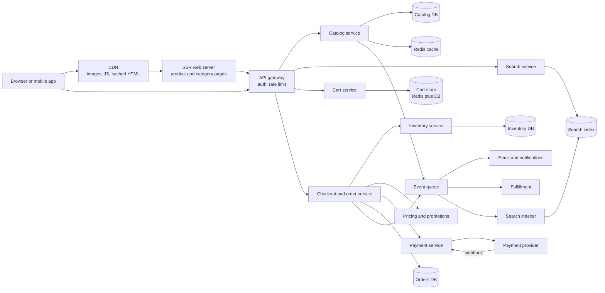
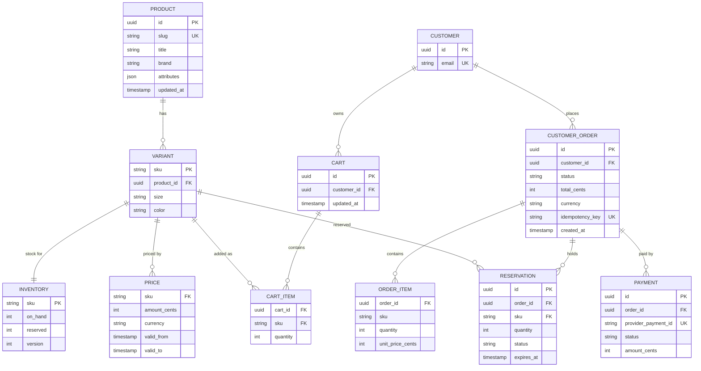
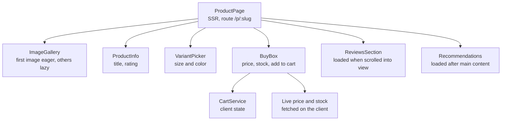
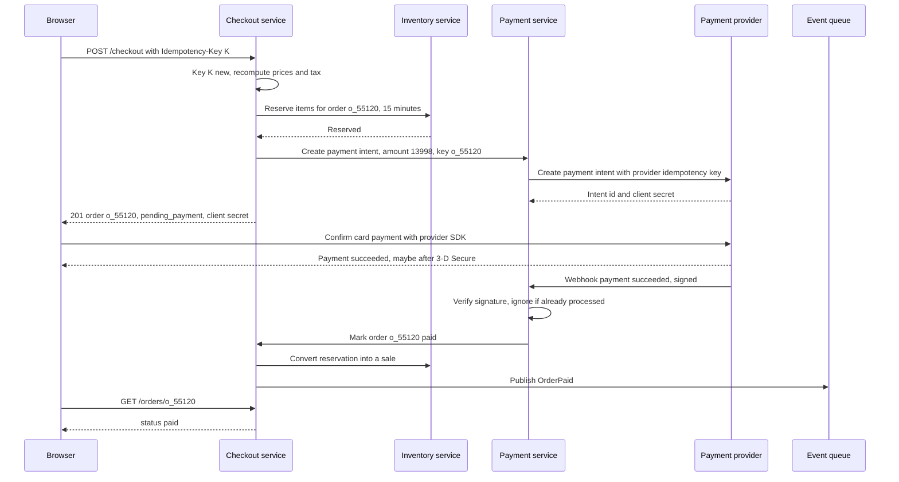
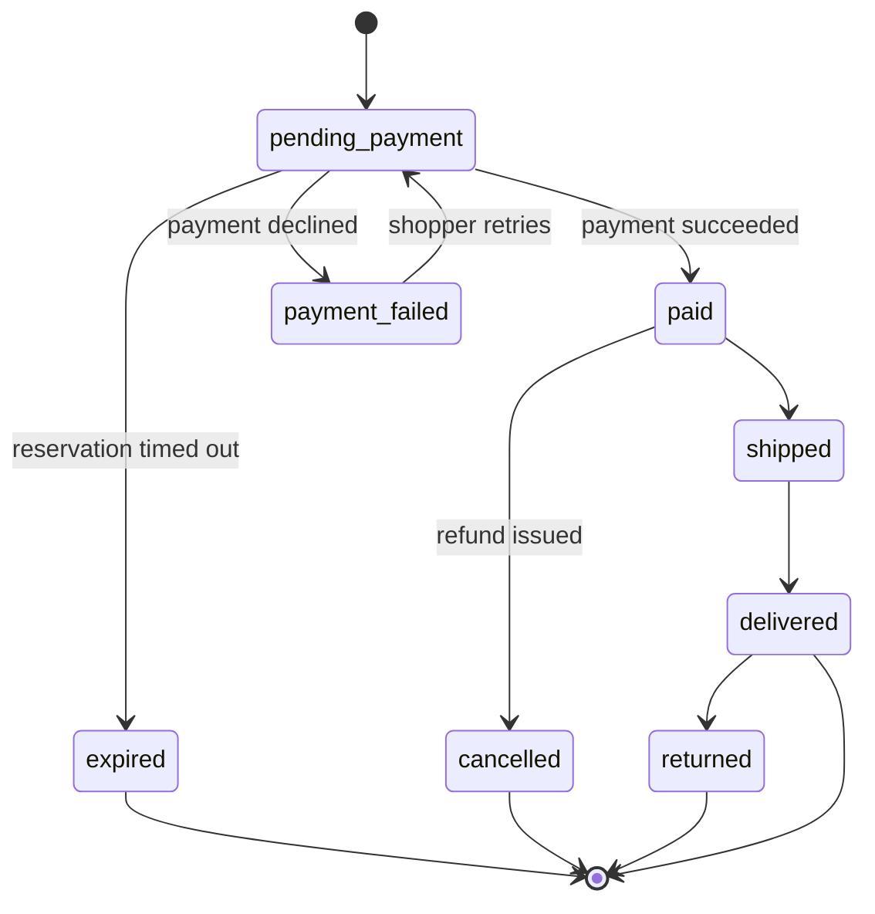
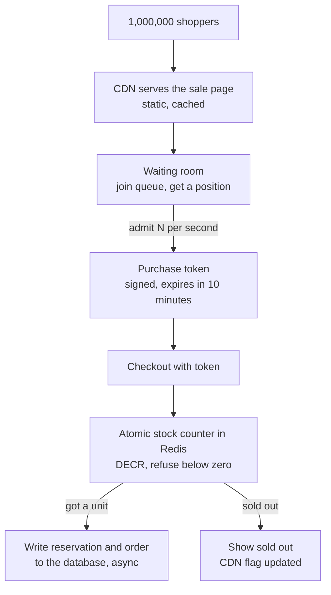
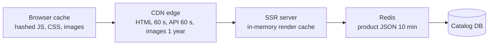

# Case Study: E-commerce Application

> In this case study you will design an online store end to end: product catalog, search, cart, checkout, payments, inventory and flash sales, with SEO-friendly server rendering. E-commerce is a rich interview topic because it mixes a read-heavy, cacheable part (browsing) with a write-heavy part where mistakes cost real money (checkout and stock).

**Before this:** [System design interview approach](01-system-design-interview-approach.md) · [Scalability and core building blocks](02-scalability-and-core-building-blocks.md) · [Caching strategies and invalidation](03-caching-strategies-and-invalidation.md) · [Rendering strategies](../05-frontend-engineering/09-rendering-strategies-csr-ssr-ssg.md) · **Interview questions:** [jump to the interview section](#interview-questions)

## Table of contents

1. [Problem statement](#problem-statement)
2. [Clarifying questions](#clarifying-questions)
3. [Requirements](#requirements)
4. [Estimates](#estimates)
5. [High-level architecture](#high-level-architecture)
6. [API design](#api-design)
7. [Data model](#data-model)
8. [Frontend architecture](#frontend-architecture)
9. [Deep dive 1: checkout and payment idempotency](#deep-dive-1-checkout-and-payment-idempotency)
10. [Deep dive 2: inventory consistency](#deep-dive-2-inventory-consistency)
11. [Deep dive 3: flash sales](#deep-dive-3-flash-sales)
12. [Deep dive 4: catalog caching, SEO and SSR](#deep-dive-4-catalog-caching-seo-and-ssr)
13. [Performance](#performance)
14. [Security](#security)
15. [Scalability](#scalability)
16. [Failure handling](#failure-handling)
17. [Observability](#observability)
18. [Trade-offs and alternatives](#trade-offs-and-alternatives)
19. [How to present this in 45 minutes](#how-to-present-this-in-45-minutes)
20. [Interview questions](#interview-questions)
21. [Summary](#summary)
22. [References](#references)

---

## Problem statement

"Design an e-commerce website like a large online retailer."

Shoppers should be able to:

- Browse categories and product pages.
- Search for products with filters (brand, price, size).
- Add items to a cart, as a guest or signed in.
- Check out: enter an address, choose delivery, pay.
- See their orders and order status.

The business also runs **flash sales**: a limited number of units at a big discount, starting at an exact time. Many people try to buy at the same second.

The key insight to say early in the interview:

> "This system has two very different halves. Browsing is read-heavy, can be slightly stale and should be cached everywhere. Checkout is write-heavy at the moment of purchase, must be correct, and must never charge twice or sell stock we don't have."

---

## Clarifying questions

| Question | Why you ask it | Assumed answer |
| --- | --- | --- |
| How many users and products? | Sets the scale for caching and search. | 5 million daily active users, 1 million products (SKUs). |
| One seller or a marketplace with many sellers? | Marketplaces need seller onboarding, payouts and split orders. | One retailer (no marketplace). |
| Which countries and currencies? | Tax, currency and localization. | One country, one currency to start. |
| Do guests check out without an account? | Cart ownership and merging. | Yes. Guest carts merge into the account at sign-in. |
| Do we build payments or use a provider? | You should not process raw card numbers yourself. | Use a payment provider (like Stripe or Adyen). |
| How strict is stock? Is overselling allowed? | Decides the reservation strategy. | Never oversell flash-sale items. Normal items may rarely go to backorder. |
| How big are flash sales? | Peak load and fairness design. | Up to 10,000 units, with up to 1 million people waiting at the start. |
| Is SEO important? | Decides SSR vs CSR for public pages. | Yes. Most new visitors come from search engines. |
| Mobile apps too? | API design should serve them. | Yes, they use the same APIs. |

---

## Requirements

### Functional requirements

1. Browse categories and product detail pages (images, price, variants, stock status, reviews summary).
2. Search with text, filters, sorting and facet counts ("Nike (120)").
3. Cart: add, update quantity, remove. Works for guests. Persists across devices for signed-in users.
4. Checkout: address, delivery option, price summary with tax and discounts, payment.
5. Orders: create an order, confirm it after payment, show status (paid, shipped, delivered, cancelled).
6. Inventory: show stock status; reserve stock during checkout.
7. Flash sales: limited stock, start time, fair access, no overselling.

### Non-functional requirements

| Quality | Target |
| --- | --- |
| Correctness of payments | Never charge a customer twice for one order. Never lose a paid order. |
| Inventory | Never oversell flash-sale stock. |
| Browse latency | Product page LCP under 2.5 s on mobile (Core Web Vitals "good"). API p95 under 200 ms. |
| Checkout latency | Checkout steps p95 under 1 s (excluding the payment provider). |
| Availability | Browsing 99.95%. Checkout 99.9%. Browsing must keep working even if checkout has problems. |
| SEO | Product and category pages are crawlable HTML with correct metadata. |
| Security | No card data on our servers (PCI DSS scope kept small). |

---

## Estimates

**Traffic**

- 5,000,000 daily users × 30 page views = 150,000,000 page views per day.
- 150,000,000 / 86,400 ≈ 1,740 page views per second on average.
- Evening peak about 5× → about 8,700 per second.
- Each page view makes a few API calls, but most are served by the CDN or cache.

**Orders**

- 200,000 orders per day → 200,000 / 86,400 ≈ 2.3 orders per second on average.
- That is tiny. The danger is the **flash sale**: 10,000 units sold in about 60 seconds ≈ 170 orders per second, while **1,000,000 people** refresh the page.
- If each waiting user polls once every 5 seconds: 1,000,000 / 5 = 200,000 requests per second for one page. That must be served from the CDN or an edge cache, not from the origin.

**Storage**

- Product data: 1,000,000 × 10 KB = 10 GB. Fits easily in one database and one search index.
- Images: 1,000,000 products × 10 images × 500 KB = 5 TB in object storage, served by a CDN in resized formats.
- Orders: 200,000 per day × 5 KB = 1 GB per day ≈ 365 GB per year.

**Ratio**

- Reads to writes is roughly 1,000 to 1 for browsing. This tells us: **cache browsing heavily, protect checkout carefully.**

---

## High-level architecture



The main parts:

- **CDN** serves images, JavaScript, CSS and cached HTML for product and category pages.
- **SSR web server** renders product and category pages to HTML for SEO and fast first paint.
- **Catalog service** owns product data. Changes go to the queue, and the search indexer updates the search index.
- **Search service** queries the search engine (text, filters, facets, sorting).
- **Cart service** stores carts. Carts are written often and are not critical money data, so a fast store like Redis with a database backup works.
- **Checkout and order service** runs the checkout flow and owns orders. It talks to pricing, inventory and payment.
- **Inventory service** owns stock counts and reservations. It is the single authority on "is it available?".
- **Payment service** talks to the external payment provider and receives its webhooks.
- **Event queue** carries events like `OrderPaid` to email, fulfillment and analytics.

> **Why split services?** Browsing and checkout have different load, different caching and different failure rules. Splitting them means a checkout problem does not take down browsing. A smaller company could start with a **modular monolith** with the same module boundaries. See [monolith vs microservices](02-scalability-and-core-building-blocks.md).

---

## API design

General REST rules are in [REST API design](../07-nodejs-backend/07-rest-api-design.md). Here are the endpoints that shape this design.

### Catalog and search

```text
GET /api/products/nike-air-zoom-pegasus-41
```

```json
{
  "id": "p_10293",
  "slug": "nike-air-zoom-pegasus-41",
  "title": "Nike Air Zoom Pegasus 41",
  "brand": "Nike",
  "images": [{ "url": "https://img.example.com/p_10293/1.jpg", "alt": "Side view" }],
  "variants": [
    { "sku": "PEG41-BLK-42", "size": "42", "color": "black", "price": { "amount": 12999, "currency": "EUR" }, "stockStatus": "in_stock" },
    { "sku": "PEG41-BLK-43", "size": "43", "color": "black", "price": { "amount": 12999, "currency": "EUR" }, "stockStatus": "low_stock" }
  ],
  "rating": { "average": 4.6, "count": 812 }
}
```

- Money is an **integer in the smallest unit** (cents) plus a currency. Never use floating-point numbers for money: `0.1 + 0.2` is `0.30000000000000004` in JavaScript.
- `stockStatus` is a coarse, cacheable value ("in_stock", "low_stock", "out_of_stock"). The exact count is checked at checkout.
- Response header: `Cache-Control: public, max-age=60, stale-while-revalidate=300`.

```text
GET /api/search?q=running+shoes&brand=nike&size=42&priceMax=15000&sort=price_asc&limit=24&cursor=...
```

```json
{
  "items": [ { "id": "p_10293", "title": "Nike Air Zoom Pegasus 41", "price": { "amount": 12999, "currency": "EUR" }, "image": "..." } ],
  "facets": {
    "brand": [{ "value": "nike", "count": 120 }, { "value": "adidas", "count": 98 }],
    "size": [{ "value": "42", "count": 75 }]
  },
  "nextCursor": "..."
}
```

### Cart

```text
POST   /api/carts                         → 201 { "cartId": "c_8f1", ... }   (guest cart, id stored in a cookie)
POST   /api/carts/c_8f1/items             { "sku": "PEG41-BLK-42", "quantity": 1 }
PATCH  /api/carts/c_8f1/items/PEG41-BLK-42 { "quantity": 2 }
DELETE /api/carts/c_8f1/items/PEG41-BLK-42
GET    /api/carts/c_8f1                    → items, current prices, warnings ("price changed", "only 1 left")
POST   /api/carts/merge                    { "guestCartId": "c_8f1" }   (after sign-in)
```

The cart stores **intent** (which SKU, how many). It does not lock prices or stock. Prices shown in the cart are recalculated on every read.

### Checkout and orders

```text
POST /api/checkout
Idempotency-Key: 0b9f6c8e-6a1d-4b0e-9f43-1f3d4c2a7e11

{ "cartId": "c_8f1", "shippingAddressId": "addr_3", "deliveryOption": "standard" }
```

```json
{
  "orderId": "o_55120",
  "status": "pending_payment",
  "total": { "amount": 13998, "currency": "EUR" },
  "reservationExpiresAt": "2026-10-22T18:15:00Z",
  "payment": { "provider": "stripe", "clientSecret": "pi_..._secret_..." }
}
```

- This call **creates the order**, **reserves stock** for 15 minutes and creates a **payment intent** with the provider.
- The `Idempotency-Key` is generated by the client once per checkout attempt. If the network fails and the client retries, the server returns the same order instead of creating a second one.
- The browser then confirms the payment directly with the provider's SDK (card details go to the provider, not to us).

```text
POST /api/payments/webhook        (called by the payment provider, signature verified)
GET  /api/orders/o_55120          → { "status": "paid", ... }
GET  /api/orders?cursor=...       → the user's order history
```

### Flash sale

```text
POST /api/flash-sales/fs_77/entries      → { "position": 48211, "status": "waiting" }  (join the waiting room)
GET  /api/flash-sales/fs_77/entries/me   → { "status": "admitted", "purchaseToken": "...", "expiresAt": "..." }
```

---

## Data model



Important choices:

- **Product vs variant.** A product ("Pegasus 41") has many variants (size 42 black). Stock and price belong to the **variant** (the SKU).
- **Order items copy the price.** `unit_price_cents` is stored on the order line. If the catalog price changes tomorrow, old orders stay correct.
- **`idempotency_key` is unique** on orders. The database itself blocks a duplicate order for the same checkout attempt.
- **`provider_payment_id` is unique** on payments. A webhook delivered twice cannot create two payment rows.
- **Inventory keeps `on_hand` and `reserved`.** Available = `on_hand - reserved`.
- **Different stores for different needs.** Catalog in a relational database plus a search index. Carts in Redis (fast, can be rebuilt) with a database copy for signed-in users. Orders and inventory in a relational database with transactions, because they are money data.

---

## Frontend architecture

### Rendering strategy per page

Not every page needs the same rendering. Choosing per route is a strong interview answer. Rendering options are explained in [rendering strategies](../05-frontend-engineering/09-rendering-strategies-csr-ssr-ssg.md).

| Page | Strategy | Why |
| --- | --- | --- |
| Home, category pages | SSR with CDN caching (or static generation refreshed every few minutes) | SEO, fast first paint, same for everyone. |
| Product detail | SSR + CDN cache for 1–5 minutes. Price/stock refreshed on the client. | SEO and speed. Stock changes often, so it is fetched fresh after load. |
| Search results | SSR for the first page (shareable URLs, SEO for popular queries), then client-side. | Filters change often; the client updates the list without full reloads. |
| Cart, checkout, account | Client-side rendering, never cached on the CDN. | Personal data. No SEO value. |

In **Angular 16**, SSR is done with Angular Universal (`@nguniversal/express-engine`). Angular 16 also added a developer preview of non-destructive hydration (`provideClientHydration()`).

> **Newer Angular (17+):** SSR moved into `@angular/ssr`, and hydration became stable in Angular 17. With React, frameworks like Next.js give the same per-route choice.

### Component tree for the product page



### State ownership

| State | Owner | Notes |
| --- | --- | --- |
| Product data | Server, cached at CDN and in the client | Can be a few minutes stale. |
| Exact price and stock | Server, fetched fresh | Re-checked again at checkout. |
| Selected variant, image index | URL (for variant) and component state | `?size=42` lets users share the exact variant. |
| Search query, filters, sort | URL | Shareable and crawlable. |
| Cart | Cart service on the server. Client keeps a copy for the badge and mini-cart. | Server is the source of truth. Client updates optimistically. |
| Checkout form | Local form state | Sent at the end. Never cached on the CDN. |
| Auth session | HttpOnly cookie | See [auth architecture](06-auth-architecture-and-multi-tenancy.md). |

### Cart updates on the client

Adding to cart should feel instant. Use an **optimistic update**: show the new count at once, send the request, and roll back if it fails. The pattern is explained in [optimistic updates](../05-frontend-engineering/07-api-integration-and-data-fetching.md#optimistic-updates-with-rollback).

```ts
// cart.service.ts (Angular 16, simplified)
@Injectable({ providedIn: 'root' })
export class CartService {
  private http = inject(HttpClient);
  private cart$ = new BehaviorSubject<Cart>(emptyCart());
  readonly itemCount$ = this.cart$.pipe(map(c => c.items.reduce((n, i) => n + i.quantity, 0)));

  addItem(sku: string, quantity: number): Observable<Cart> {
    const before = this.cart$.value;
    this.cart$.next(addLocally(before, sku, quantity)); // optimistic

    return this.http.post<Cart>(`/api/carts/${before.id}/items`, { sku, quantity }).pipe(
      tap(serverCart => this.cart$.next(serverCart)), // the server answer wins
      catchError(err => {
        this.cart$.next(before);                      // roll back
        return throwError(() => err);
      }),
    );
  }
}
```

Optimistic updates are fine for the **cart** (low risk, easy to undo). They are **not** fine for **payment** — there the UI must wait for the real answer.

### Client caching

- Product and category data: cache in memory with stale-while-revalidate. Going back to a category page is instant.
- Cart: refetch when the tab becomes visible again (another tab or device may have changed it).
- Never cache checkout or account responses in a shared cache. Personal API responses use `Cache-Control: private, no-store`.

---

## Deep dive 1: checkout and payment idempotency

### The problem

The shopper clicks "Pay". The request reaches the server, the order is created and the card is charged. But the response is lost (mobile network drops). The app shows "Something went wrong". The shopper clicks "Pay" again.

Without protection, they now have **two orders and two charges**. This is the most important bug to prevent in e-commerce.

### Idempotency: same request, same result

An operation is **idempotent** when doing it twice has the same effect as doing it once (the general idea is in [idempotency](02-scalability-and-core-building-blocks.md#idempotency)). `GET` and `PUT` are idempotent by design. `POST /checkout` is not. We make it idempotent with an **idempotency key**:

1. The client generates a random key (a UUID) **once per checkout attempt** and keeps it until the attempt finishes.
2. Every retry of that attempt sends the **same** key.
3. The server stores the key with the result. If the key is seen again, it returns the stored result instead of doing the work again.

```js
// idempotency.js — a minimal in-memory version to show the idea (production uses the DB or Redis)
const store = new Map(); // key -> { status: 'in_progress' | 'done', response }

async function withIdempotency(key, work) {
  const existing = store.get(key);
  if (existing?.status === 'done') return { ...existing.response, replayed: true };
  if (existing?.status === 'in_progress') return { status: 409, body: 'Request already in progress' };

  store.set(key, { status: 'in_progress' });
  try {
    const response = await work();
    store.set(key, { status: 'done', response });
    return response;
  } catch (err) {
    store.delete(key); // failed before any side effect: allow a clean retry
    throw err;
  }
}

let ordersCreated = 0;
const createOrder = async () => ({ status: 201, body: { orderId: `o_${++ordersCreated}` } });

(async () => {
  const key = 'checkout-attempt-1';
  console.log(await withIdempotency(key, createOrder)); // { status: 201, body: { orderId: 'o_1' } }
  console.log(await withIdempotency(key, createOrder)); // { status: 201, body: { orderId: 'o_1' }, replayed: true }
  console.log(ordersCreated);                            // 1
})();
```

In production:

- Store the key in the **same database** as the order, with a **unique constraint** (`idempotency_key UK` on `CUSTOMER_ORDER`). Two retries racing at the same moment cannot both insert.
- Also store a hash of the request body. If the same key comes with a different body, return `422` — it is a client bug.
- Keep keys for at least 24 hours.
- More detail in [idempotency keys for safe retries](../07-nodejs-backend/07-rest-api-design.md#idempotency-keys-for-safe-retries).

### The full checkout flow



Key points to say in the interview:

1. **The server recomputes the price.** The client sends only the cart ID. Never trust a price from the browser.
2. **Stock is reserved before payment**, with an expiry. If payment never happens, the reservation expires and stock returns.
3. **Card details never touch our servers.** The provider's SDK (hosted fields or a hosted page) sends them straight to the provider. This keeps our PCI DSS scope small.
4. **The webhook is the source of truth for payment success**, not the browser. The browser can close right after paying. The webhook still arrives.
5. **Every step is idempotent.** The payment service passes its own idempotency key to the provider. The webhook handler ignores events it already processed (unique `provider_payment_id` or stored event ID).
6. The browser shows "Processing your payment…" and polls `GET /orders/o_55120` (or listens on a WebSocket) until the status is `paid`.

### The order as a state machine

Orders move through clear states. Writing them as a state machine stops impossible moves, like "shipped" before "paid".



```js
// order-state.js
const transitions = {
  pending_payment: ['paid', 'payment_failed', 'expired'],
  payment_failed: ['pending_payment'],
  paid: ['shipped', 'cancelled'],
  shipped: ['delivered'],
  delivered: ['returned'],
};

function nextStatus(current, target) {
  if (current === target) return current; // idempotent: same event twice is fine
  if (!(transitions[current] ?? []).includes(target)) {
    throw new Error(`Illegal transition ${current} -> ${target}`);
  }
  return target;
}

console.log(nextStatus('pending_payment', 'paid')); // paid
console.log(nextStatus('paid', 'paid'));            // paid (duplicate webhook is harmless)
try {
  nextStatus('pending_payment', 'shipped');
} catch (e) {
  console.log(e.message);                           // Illegal transition pending_payment -> shipped
}
```

In the database, the transition is a conditional update, so two workers cannot both move the order:

```sql
UPDATE customer_order SET status = 'paid'
WHERE id = $1 AND status = 'pending_payment';
-- 0 rows: it was already paid (duplicate webhook) or it expired (see the race below)
```

### A tricky race: payment succeeds after the reservation expired

The shopper waits 16 minutes on the 3-D Secure screen. The reservation expired at minute 15 and the stock was sold to someone else. Then the payment succeeds.

Options:

- **Make the reservation outlive the payment window.** A payment attempt has a maximum time (for example, the checkout or 3-D Secure session times out). Set the reservation a bit longer than that maximum time.
- **Authorize first, capture later.** Ask the provider to only *authorize* (hold) the money. Capture (take) it only after inventory confirms the sale. If stock is gone, cancel the authorization — the hold is released and the shopper is never charged. In Stripe, for example, you create the PaymentIntent with `capture_method: "manual"`; after the card is authorized its status is `requires_capture`. You then call *capture*, or *cancel* the PaymentIntent to release the hold. An online card authorization usually stays valid for about 7 days, so capture well before that.
- If money was captured and stock is gone, **refund automatically** and tell the shopper. Track this as a metric; it should be rare.

Authorize-then-capture is the cleanest answer for physical goods.

---

## Deep dive 2: inventory consistency

### Why it is hard

Two shoppers buy the last pair of size-42 shoes at the same time. Both see "1 left". If both reservations succeed, we have oversold.

### The wrong way

```js
// ❌ Wrong: read, check, then write. Two requests can both pass the check.
const row = await db.query('SELECT on_hand, reserved FROM inventory WHERE sku = $1', [sku]);
if (row.on_hand - row.reserved >= qty) {
  await db.query('UPDATE inventory SET reserved = reserved + $2 WHERE sku = $1', [sku, qty]);
}
```

Between the `SELECT` and the `UPDATE`, another request can run the same `SELECT`. This is a classic **race condition**.

### The right way: one atomic conditional update

```sql
-- ✅ Correct: the check and the change happen in one statement
UPDATE inventory
SET reserved = reserved + $2
WHERE sku = $1
  AND on_hand - reserved >= $2
RETURNING on_hand, reserved;
-- 1 row: reserved. 0 rows: not enough stock.
```

The database locks the row during the update, so only one request can take the last unit. The other gets 0 rows and the UI says "Sorry, this size just sold out".

For an order with several items, do all reservations in **one transaction**. If any item fails, roll back so you never hold half an order. To avoid deadlocks, always update SKUs in the same order (for example sorted by SKU). See [transactions](../07-nodejs-backend/10-databases.md#transactions-and-acid).

### Reservations with expiry

```text
Reserve:   reserved += qty, insert RESERVATION(status = active, expires_at = now + 15 min)
Pay:       on_hand -= qty, reserved -= qty, RESERVATION.status = consumed
Expire:    reserved -= qty, RESERVATION.status = expired   (a job runs every minute)
Cancel:    same as expire
```

A background job finds expired active reservations and releases them. The release is also a conditional update (`WHERE status = 'active'`) so it is safe to run twice.

### Where stock status shows on the page

- The product page shows a **cached, coarse** status ("in stock", "only a few left"). A 1-minute delay is fine here.
- The **truth** is checked only at reservation time.
- Showing exact numbers ("3 left") on a cached page is risky: they will often be wrong. If the business wants it, fetch it fresh on the client.

### Many warehouses

With several warehouses, inventory is per `(sku, warehouse)`. The reservation chooses a warehouse (closest with stock). The page shows the total available. This adds complexity but the same conditional-update idea applies.

---

## Deep dive 3: flash sales

### What makes flash sales special

The building blocks used here (queues, rate limiting, backpressure) are explained in [scalability and core building blocks](02-scalability-and-core-building-blocks.md#rate-limiting-at-scale). This section shows how they combine for one hard case.

- Huge traffic at one exact moment (a **thundering herd**).
- Very small stock compared to demand: 10,000 units, 1,000,000 people.
- The same hot row (`inventory` for one SKU) is updated by everyone. Row locks on one row become a bottleneck.
- Bots try to buy everything.
- Fairness matters: people who were there first should get a better chance.

### Design



1. **Make the sale page static.** Before the start, the page (with a countdown) is pre-rendered and cached on the CDN. Only a tiny "status" JSON is fetched, also cached for a second or two.
2. **Waiting room.** At the start time, shoppers join a queue. Each gets a position. The system admits people at a rate checkout can handle (for example 500 per second). Admitted shoppers get a **signed purchase token** valid for a few minutes. The waiting room protects every service behind it.
3. **Pre-loaded stock counter.** Before the sale, load the sale stock into Redis: `SET flash:fs_77:stock 10000`. A purchase does `DECR`. Redis runs commands one at a time, so `DECR` is atomic. If the result is below zero, the unit was not available: `INCR` it back and answer "sold out".
4. **Write to the database asynchronously.** The winner's reservation and order go to the database via a queue. The database no longer has 170 conflicting updates per second on one row.
5. **Sold out quickly.** When the counter reaches zero, set a "sold out" flag that the CDN-cached status JSON picks up. Everyone waiting gets the news without hitting the origin.
6. **One per customer.** Use a Redis set or a unique constraint `(sale_id, customer_id)` to stop the same account buying many units.
7. **Bot protection.** Require sign-in, rate limit per account and per IP, and use a bot-detection service at the edge.

A tiny simulation of the counter idea. Redis gives the same guarantee across many servers, because every `DECR` runs one at a time on the Redis server.

```js
// flash-counter.js — simulate an atomic counter with many concurrent buyers
let stock = 3; // in Redis: SET flash:fs_77:stock 3

function decr() { stock -= 1; return stock; } // Redis DECR is atomic like this single step
function incr() { stock += 1; return stock; }

function tryBuy(customer) {
  const left = decr();
  if (left < 0) { incr(); return `${customer}: sold out`; }
  return `${customer}: got one (${left} left)`;
}

['ana', 'ben', 'chen', 'dev', 'eli'].forEach(c => console.log(tryBuy(c)));
// ana: got one (2 left)
// ben: got one (1 left)
// chen: got one (0 left)
// dev: sold out
// eli: sold out
```

A safer production version uses a small Lua script (or a Redis Function) that checks and decrements in one step, so the counter never goes below zero even for a moment.

### What if the buyer then does not pay?

The token and the Redis unit are tied to a reservation with a short expiry (for example 10 minutes). If payment does not happen, a job returns the unit (`INCR`) and the waiting room admits more people. Keep the Redis counter and the database **reconciled**: at the end, the number of paid orders plus remaining stock must equal the original stock. Run a check job and alert on any difference.

### Simpler alternatives

- **Lottery / raffle:** people enter during a window, winners are picked randomly, and only winners can buy. No race at all. Good for very high demand (sneaker drops).
- **Pre-orders:** take orders without a stock limit and fulfill later.

---

## Deep dive 4: catalog caching, SEO and SSR

### Caching layers for a product page



| What | Where cached | TTL | How it is invalidated |
| --- | --- | --- | --- |
| JS/CSS bundles | Browser + CDN | 1 year (`immutable`) | New file name (content hash) on each build. |
| Product images | CDN | 1 year | New URL when the image changes. |
| Product page HTML | CDN | 60 s + `stale-while-revalidate` | Purge by tag (`product:p_10293`) when the product changes. |
| Product API JSON | CDN + Redis | 60 s at CDN, 10 min in Redis | Delete Redis key and purge CDN tag on change event. |
| Live price and stock | Not cached at CDN (or 5 s) | Short | Fetched by the client after page load. |
| Cart, checkout, account | Never in shared caches | — | `Cache-Control: private, no-store`. |

The general strategy is in [caching strategies and invalidation](03-caching-strategies-and-invalidation.md). Redis details are in [caching in Node.js](../07-nodejs-backend/11-caching.md).

**Event-driven invalidation:** when a merchandiser changes a product, the catalog service publishes `ProductUpdated`. A consumer deletes the Redis key, purges the CDN by tag, and the search indexer updates the index. TTLs are a safety net in case an event is lost.

**Price changes are special.** A price shown on a cached page can be a minute old. That is acceptable **only because** checkout recomputes the price and the cart shows "Price changed from €129.99 to €119.99" when it differs. Say this clearly in the interview: caches can be stale; money decisions use the source of truth.

### Cache stampede on a hot product

When a popular product's cache entry expires, thousands of requests can miss at once and all hit the database. Protect with:

- **Request coalescing** — only one request rebuilds the entry, others wait for it.
- **Stale-while-revalidate** — serve the old value while one background request refreshes.
- **Jittered TTLs** — so many keys do not expire at the same second.

See [stampede, penetration and avalanche](../07-nodejs-backend/11-caching.md#when-caches-fail-stampede-penetration-and-avalanche).

### SEO essentials

- Each product has one **canonical URL** (`/p/nike-air-zoom-pegasus-41`). Variant URLs (`?size=42`) point to it with `<link rel="canonical">`.
- Server-rendered `<title>`, `<meta name="description">` and Open Graph tags for sharing.
- **Structured data** (JSON-LD with schema.org `Product` and `Offer`) so search engines can show price and rating.
- An XML **sitemap** listing product and category URLs, regenerated daily.
- Out-of-stock products keep their page (with "notify me") instead of returning 404, so search ranking is not lost. Permanently removed products return `410` or redirect (`301`) to a replacement.
- Fast pages help: Core Web Vitals are part of Google's page experience signals. See [web performance](../05-frontend-engineering/05-web-performance-and-core-web-vitals.md).

```html
<!-- Rendered on the server into the product page -->
<script type="application/ld+json">
{
  "@context": "https://schema.org",
  "@type": "Product",
  "name": "Nike Air Zoom Pegasus 41",
  "image": ["https://img.example.com/p_10293/1.jpg"],
  "brand": { "@type": "Brand", "name": "Nike" },
  "offers": {
    "@type": "Offer",
    "price": "129.99",
    "priceCurrency": "EUR",
    "availability": "https://schema.org/InStock"
  }
}
</script>
```

### SSR pitfalls

- **Do not render personal data into cached HTML.** "Hello Priya" or a cart count in SSR HTML that the CDN caches will be shown to other people. Render the shared page on the server; fill personal parts on the client.
- **Hydration mismatch.** If the server renders a price and the client immediately renders a different one, the page flickers. Render the cached price, then update the price area clearly when fresh data arrives.
- **SSR cost.** Rendering on every request is expensive. The CDN cache in front of SSR is what makes it affordable.

---

## Performance

| Area | Technique |
| --- | --- |
| LCP on product pages | SSR HTML from the CDN. The main product image is preloaded (`fetchpriority="high"`), served in modern formats (AVIF/WebP) at the right size with `srcset`. |
| CLS | Fixed width and height (or `aspect-ratio`) for images and the price box, so late data does not push content down. |
| INP | Keep the main thread free: small JavaScript bundles, lazy-load reviews and recommendations, avoid heavy work on "Add to cart" clicks. |
| JavaScript size | Route-based code splitting. Checkout code is not loaded on product pages. |
| API latency | Redis cache in front of the catalog DB. Search served from the search engine, not SQL. |
| Images | Image CDN that resizes on the fly. Lazy-load below-the-fold images with `loading="lazy"`. |
| Third-party scripts | Analytics, tag managers and chat widgets are a top cause of slow stores. Load them after the main content, and give each one a performance budget. |

Details and measurement are in [web performance and Core Web Vitals](../05-frontend-engineering/05-web-performance-and-core-web-vitals.md).

---

## Security

1. **Card data never reaches our servers.** Use the payment provider's hosted fields, hosted checkout page or SDK. This keeps PCI DSS scope small (usually the simplest self-assessment level).
2. **Verify webhook signatures.** Anyone can send a request to `/payments/webhook`. Check the provider's signature with the shared secret and reject old timestamps (replay protection). Use the raw request body for the signature check.
3. **Never trust client prices, discounts or totals.** The server recomputes everything from the cart, catalog and promotion rules.
4. **Coupon abuse.** Rate limit coupon attempts. Coupons have usage limits enforced with conditional updates, just like inventory.
5. **Account security.** Rate-limit login, detect credential stuffing (many failed logins from many IPs), offer MFA. See [authentication](../07-nodejs-backend/09-authentication-and-authorization.md).
6. **Insecure direct object references.** `GET /orders/o_55120` must check that the order belongs to the signed-in user. Use non-guessable IDs as an extra layer, not as the only check.
7. **XSS and CSP.** Product descriptions from a CMS and user reviews are untrusted content. Sanitize rich text and use a strict CSP. A script injected into a checkout page can steal card details typed into the page ("Magecart" style attacks), which is one more reason to use provider-hosted fields in an iframe. See [web security](../10-testing-security-production/05-web-security-xss-csrf-cors-csp.md).
8. **Bots and scalpers.** Edge bot detection, per-account limits for flash sales, sign-in required for limited items.
9. **Personal data.** Addresses and order history are personal data. Encrypt at rest, restrict access, and never put them in URLs or logs.

---

## Scalability

- **Browsing scales with caching.** About 1,740 page views per second on average, 8,700 at peak, and 200,000 requests per second during a flash sale on one page. The CDN absorbs almost all of it. The origin sees only cache misses.
- **Stateless web and API servers** behind load balancers. Autoscale on CPU and request rate. Scale up **before** a planned flash sale, because autoscaling reacts too slowly to a one-second spike.
- **Search engine** scales by adding replicas for read throughput and shards for data size.
- **Catalog DB** gets read replicas. Almost all reads hit Redis anyway.
- **Orders DB** is write-critical but low volume (2.3 per second average). One primary with a standby is enough for a long time. Later, shard by `customer_id` if needed.
- **Inventory hot spots** are solved by the Redis counter for flash sales, and by splitting stock per warehouse.
- **Cart store** can be sharded by cart ID. Redis Cluster does this automatically.
- **Asynchronous work** (emails, fulfillment, analytics, search indexing) goes through the queue so checkout latency does not depend on it. See [background jobs and queues](../07-nodejs-backend/13-background-jobs-and-queues.md).

---

## Failure handling

**Graceful degradation** is the main idea: when a non-critical part fails, the store should keep selling.

| Failure | Behavior |
| --- | --- |
| Recommendations service down | Hide the section. The page still works. |
| Reviews service slow | Load reviews later or hide them. Timeout after 300 ms during SSR. |
| Search engine down | Show category browsing and a simple fallback (popular products). Alert. |
| Redis down | Read from the database with tight timeouts and a circuit breaker. Expect higher latency. |
| Payment provider timeout | Do not mark the order failed. It may have succeeded. Show "We are confirming your payment" and wait for the webhook or query the provider by payment intent ID. |
| Webhook never arrives | A reconciliation job asks the provider for the status of orders stuck in `pending_payment` for more than N minutes. |
| Checkout service crashes after charging | The webhook arrives later and marks the order paid. The idempotency key lets the client's retry return the same order. |
| Email service down | `OrderPaid` events wait in the queue and are retried. Orders are not affected. |
| Inventory mismatch after a flash sale | A reconciliation job compares Redis, reservations and orders, and alerts. |

Two rules for money:

1. **Unknown is not failure.** A timeout means "we don't know". Find out before you tell the user it failed.
2. **Retry with the same key.** Every retry to the provider uses the same idempotency key, so a retry cannot double-charge.

See [reliability and resilience](../10-testing-security-production/09-reliability-and-resilience.md) for timeouts, retries and circuit breakers.

---

## Observability

- **Business metrics are the best alarms:** orders per minute, checkout conversion rate, payment success rate per payment method, add-to-cart rate. A drop in orders per minute catches problems that technical metrics miss.
- **Technical metrics:** p95 latency per service, CDN hit ratio, Redis hit ratio, error rates, queue lag, webhook processing delay, number of orders stuck in `pending_payment`.
- **Real user monitoring:** LCP, INP and CLS from real shoppers, split by page type and device.
- **Tracing** from the browser click through checkout, inventory and payment, with the order ID and idempotency key as attributes.
- **Logs** never contain card data, full addresses or tokens.
- **Flash-sale dashboard:** waiting room size, admission rate, Redis stock counter, sold count, error rate.

See [logging, monitoring and observability](../10-testing-security-production/08-logging-monitoring-and-observability.md).

---

## Trade-offs and alternatives

| Decision | We chose | Alternative | When the alternative is better |
| --- | --- | --- | --- |
| Architecture | Services split by domain (catalog, cart, checkout, inventory, payment) | Modular monolith | Small team, early stage. Keep the same module boundaries so you can split later. |
| Public pages | SSR + CDN cache | Static generation (SSG) with periodic rebuild | Small catalog that changes rarely. SSG is cheaper. |
| Stock | Reserve at checkout with expiry | Reserve at add-to-cart | Very limited items where holding stock in carts is acceptable (tickets). Usually bad: carts are often abandoned. |
| Flash-sale stock | Redis atomic counter + async DB write | Database row with conditional update only | Small sales with modest traffic. The database is simpler and stays the single source of truth. |
| Flash-sale fairness | Waiting room | Lottery | Extreme demand where "first come" becomes a bot race. |
| Payment | Authorize, then capture after stock is confirmed | Capture immediately | Digital goods with unlimited stock. |
| Cart storage | Redis with DB backup for signed-in users | Database only | Low traffic. One store is easier to operate. |
| Search | Dedicated search engine | Database full-text search | Small catalog. PostgreSQL full-text search can be enough. |

---

## How to present this in 45 minutes

**Minutes 0–5: clarify.**
> "A few questions first. Single retailer or marketplace? How many products and daily users? Do guests check out? Are we using a payment provider? How strict is stock, and how big are flash sales? Is SEO important? ... OK: single retailer, 1 million SKUs, 5 million daily users, guest checkout, an external payment provider, never oversell sale items, flash sales up to 10,000 units with a million people, and SEO matters."

**Minutes 5–9: requirements and numbers.**
> "Browsing is about 1,700 page views a second on average and close to 9,000 at peak. Orders are only about 2 a second on average, but a flash sale can be 170 orders a second with 200,000 requests a second on one page. So the design has two halves: cache browsing everywhere, and make checkout correct and protected. Correctness rules: never double-charge, never lose a paid order, never oversell sale stock."

**Minutes 9–16: high-level design.**
> "Users hit a CDN. Product and category pages are server-rendered for SEO and cached at the CDN for about a minute. APIs go through a gateway to catalog, search, cart, checkout, inventory and payment services. Catalog changes flow through a queue to the search indexer and to cache invalidation. Checkout reserves stock, creates a payment intent with the provider, and the provider's webhook confirms payment. Events like OrderPaid go to a queue for email and fulfillment."

**Minutes 16–21: API and data model.**
> "Money is integer cents. Products have variants, and stock and price live on the variant. Order lines copy the price. Checkout is a POST with an idempotency key, and the order table has a unique constraint on that key. Payments have a unique provider payment ID so duplicate webhooks are harmless. Inventory has on_hand and reserved."

**Minutes 21–36: deep dives.**
> "I'd like to go deep on checkout and payments first, because that's where money is lost."

- Idempotency key flow, server-side price recompute, webhook as source of truth, the order state machine, authorize-then-capture for the expired-reservation race.
- Inventory: atomic conditional `UPDATE`, reservations with expiry, a release job.
- Flash sale: static page on the CDN, waiting room, signed purchase tokens, Redis `DECR` counter, async order writes, reconciliation, bot limits.
- Catalog caching: layers and TTLs, event-driven purge by tag, stampede protection, SEO with canonical URLs and structured data, no personal data in cached HTML.

**Minutes 36–42: failures, security, observability.**
> "If recommendations or reviews fail, we hide them. If the payment provider times out, we treat it as unknown, not failed, and reconcile. Card data never touches our servers; we verify webhook signatures; we never trust client prices. Our best alarm is orders per minute."

**Minutes 42–45: trade-offs.**
> "A small team could start with a modular monolith and database-only inventory; I'd add the Redis counter and waiting room only for flash sales. Reserving at checkout instead of at add-to-cart avoids locking stock in abandoned carts, at the cost of an occasional 'just sold out' message."

---

## Interview questions

### Q1. How do you make sure a customer is never charged twice?

**What the interviewer is checking:** idempotency across retries, the client, your server and the payment provider.

**Short spoken answer (30–60 seconds):**
> "I make every step idempotent. The client generates an idempotency key once per checkout attempt and resends the same key on every retry. The server stores it with a unique constraint on the order, so a retry returns the existing order instead of creating a new one. When the server creates the payment with the provider, it passes its own idempotency key based on the order ID, so retrying that call can't create a second charge. And the webhook handler stores the provider's payment or event ID uniquely, so a duplicate webhook does nothing. Also, a timeout is treated as 'unknown', not 'failed' — we check the status before allowing a new attempt."

**Detailed explanation:**
Double charges happen at three boundaries: browser → our API (lost response, double click), our API → provider (timeout and retry), provider → our webhook (at-least-once delivery). Each boundary needs its own deduplication. A disabled "Pay" button after the first click helps user experience, but it is not a guarantee: the network can still retry, and the user can refresh.

**Follow-up questions:**
- **Where does the client keep the key?** — In memory for the checkout page, and in `sessionStorage` so a page refresh during payment keeps the same key. A new key is created only when the user starts a genuinely new attempt (for example after changing the cart).
- **What if the same key arrives with a different cart?** — Return `422`. The key is tied to a hash of the request body.
- **What if two retries arrive at the exact same time?** — The unique constraint lets only one insert win. The other waits and reads the stored result, or gets `409 in progress` and retries shortly.

**Common mistakes:** "we disable the button"; generating a new key on every retry; trusting the browser's "payment succeeded" message.

**Where this is used in real projects:** payment providers (Stripe, Adyen and others) support idempotency keys on their APIs for exactly this reason.

### Q2. Two people try to buy the last item at the same time. What happens?

**What the interviewer is checking:** race conditions and atomic database operations.

**Short spoken answer (30–60 seconds):**
> "If the code reads the stock, checks it, and then writes, both requests can pass the check and we oversell. So I make the check and the change one atomic statement: UPDATE inventory SET reserved = reserved + 1 WHERE sku = ? AND on_hand - reserved >= 1. The database locks the row for the update, so only one succeeds and gets one row back. The other gets zero rows and sees 'just sold out'. For multi-item orders I do all reservations in one transaction, in a fixed SKU order to avoid deadlocks."

**Follow-up questions:**
- **Why not `SELECT ... FOR UPDATE`?** — That also works: it locks the row, then you check and update. The conditional update is shorter and holds the lock for less time.
- **Why not a distributed lock in Redis?** — It adds another system that can fail, and the database already gives you a correct atomic update. Use Redis when the database row itself becomes the bottleneck, like a flash sale.

**Common mistakes:** checking stock only on the product page; using a JavaScript `if` after a `SELECT`.

**Where this is used in real projects:** any system with limited stock: tickets, hotel rooms, coupons.

### Q3. When do you reserve stock: at add-to-cart, at checkout, or at payment?

**Short answer:** Usually at **checkout start**, with a short expiry (10–15 minutes). Reserving at add-to-cart locks stock in carts that are mostly abandoned, which hides stock from real buyers. Reserving only at payment means a shopper can enter all their details and then fail at the last step. Checkout-time reservation is the usual balance. For tickets or seats, where the user picks a specific item, reserving when they pick it (with a visible timer) is normal.

### Q4. Design a flash sale for 10,000 units and 1 million shoppers.

**What the interviewer is checking:** handling extreme spikes, hot rows, fairness and bots.

**Short spoken answer (30–60 seconds):**
> "First, I protect the backend: the sale page is static and cached on the CDN, and the sale status is a tiny JSON cached for a second or two. At the start, shoppers enter a waiting room and get a position. We admit people at a rate checkout can handle and give each admitted shopper a signed purchase token that expires. Stock is pre-loaded into a Redis counter. Each purchase does an atomic decrement — if it goes below zero, we put it back and say sold out. Winners' orders are written to the database through a queue, so there's no hot row. One unit per account, sign-in required, bot detection at the edge. Afterwards a reconciliation job checks that Redis, reservations and orders add up."

**Follow-up questions:**
- **What if Redis crashes during the sale?** — Use a replicated Redis setup. The database reservations are the durable record, so you can rebuild the counter from "original stock minus active and consumed reservations". Pause admission while recovering.
- **What if winners don't pay?** — Their reservation expires, the counter is incremented, and the waiting room admits more people.
- **How do you make it fair?** — Positions in the waiting room are assigned in arrival order (or randomized among everyone who arrived before the start, to remove the advantage of fast bots).

**Common mistakes:** "just autoscale"; letting all traffic hit the database row; no plan for unpaid reservations.

**Where this is used in real projects:** ticket sales, limited sneaker drops, game console launches.

### Q5. How do you keep product pages fast but prices correct?

**What the interviewer is checking:** the difference between display data and authoritative data.

**Short spoken answer (30–60 seconds):**
> "I let the display be slightly stale and make the decision use fresh data. Product pages are server-rendered and cached at the CDN for about a minute, with purge-by-tag when a product changes. The client fetches live price and stock after load if the business wants it exact on screen. But the real protection is that checkout recomputes every price, discount and tax from the source of truth, and the cart shows 'price changed' if it differs from what the user saw. So a stale cache can never make us charge the wrong amount."

**Follow-up questions:**
- **How does purge-by-tag work?** — When the CDN caches a response, the origin adds a tag header (for example `Surrogate-Key` or `Cache-Tag`, depending on the CDN) like `product:p_10293`. On change, the catalog service calls the CDN API to purge everything with that tag.
- **Is it legal to show one price and charge another?** — Many countries have consumer rules about displayed prices. That is why you show the final price clearly before payment and never charge more than the confirmed amount.

**Common mistakes:** "turn off caching for prices"; trusting a price sent by the client.

**Where this is used in real projects:** every large store.

### Q6. Why use the payment webhook instead of the browser's "payment succeeded" callback?

**Short answer:** The browser is not reliable or trusted. The user can close the tab right after paying, the network can drop, and a malicious user can fake a success call. The webhook comes from the provider, is signed, and is retried by the provider until we acknowledge it. So the webhook (or a server-side status query to the provider) is the source of truth. The browser callback is only used to show a "processing" screen and start polling the order status.

### Q7. How do you handle a payment that succeeds after the reservation expired?

**Short answer:** Best: use **authorize, then capture**. The provider only holds the money. We capture only after inventory confirms the sale; if the stock is gone, we cancel the authorization and the shopper is never charged. Also, make the reservation last longer than the provider's maximum payment time. If money was captured anyway, refund automatically, notify the shopper and count it as a metric.

### Q8. Guest cart and account cart: how do you merge them?

**What the interviewer is checking:** practical cart ownership rules.

**Short spoken answer (30–60 seconds):**
> "A guest cart has an ID stored in a cookie. When the guest signs in, the client calls a merge endpoint with the guest cart ID. The server combines it with the account's existing cart: for the same SKU, I usually take the larger quantity or add them, capped by a max per item, and I tell the user what changed. Then the guest cart is marked as merged so a second merge call does nothing — the merge is idempotent. Prices and availability are re-checked after the merge."

**Follow-up questions:**
- **How long do guest carts live?** — Often 30 days. Store them with a TTL in Redis, and copy to the database when the user signs in.
- **What if two devices change the cart at once?** — The server is the source of truth. Each change is a small operation (add item, set quantity), not "replace the whole cart", so changes from two devices do not overwrite each other.

**Common mistakes:** replacing the account cart with the guest cart; keeping the cart only in `localStorage`.

**Where this is used in real projects:** every store with guest checkout.

### Q9. Which pages would you server-render, and why?

**Short answer:** Public, shareable, SEO-relevant pages: home, categories, product pages and popular search results. They are the same for everyone, so they cache well at the CDN. Cart, checkout and account pages are personal and have no SEO value, so they are client-rendered and never cached in shared caches. Inside a server-rendered page, personal parts (cart badge, "Hi Priya") are filled in on the client so the cached HTML stays the same for everyone. See [rendering strategies](../05-frontend-engineering/09-rendering-strategies-csr-ssr-ssg.md).

### Q10. Search: how do you build filters with counts like "Nike (120)"?

**Short answer:** Use a search engine with **aggregations** (facets). The query filters by text and selected filters, and the engine returns, for each facet field, the count of matching documents per value. A common detail: when the user selects "Nike", the brand facet counts should usually ignore the brand filter itself (so other brands still show counts), while other facets apply it. Products are indexed from catalog change events. Popular searches and facet results are cached briefly.

### Q11. The checkout success rate dropped 20% after a release. What do you do?

**What the interviewer is checking:** incident handling and observability.

**Short spoken answer (30–60 seconds):**
> "First, limit damage: if the drop lines up with the release, roll back or turn off the feature flag — I don't debug in production while losing orders. Then I look at the funnel: which step lost people — address, delivery, payment? I check error rates per endpoint and per payment method, frontend JavaScript errors from RUM, and traces for failing checkouts. Common causes are a frontend error on one browser, a validation change rejecting valid addresses, or a payment-method integration change. After the fix, I add a test and an alert on conversion per step."

**Common mistakes:** looking only at server error rates; not rolling back first.

**Where this is used in real projects:** every e-commerce team watches conversion and orders per minute as primary alerts.

### Q12. Microservices or monolith for this store?

**Short answer:** For a new store with a small team, a **modular monolith** with clear modules (catalog, cart, checkout, inventory, payment) is faster to build and easier to run. Keep separate database schemas per module and communicate through interfaces or events, so splitting later is possible. Split into services when teams, deploy speed or very different scaling needs (catalog read traffic vs checkout correctness) justify the extra operational cost. Browsing can also be isolated from checkout early by putting it behind the CDN and caches.

### Q13. How do you store money amounts?

**Short answer:** As integers in the smallest currency unit (cents) plus a currency code, or as a fixed-point decimal type in the database (`NUMERIC`). Never as floating-point numbers. In JavaScript, `0.1 + 0.2 === 0.3` is `false`. Do tax and discount rounding at defined steps with a defined rounding rule, and store the final amounts on the order so they never change later.

```js
console.log(0.1 + 0.2);           // 0.30000000000000004
console.log((10 + 20) / 100);     // 0.3  (work in cents, convert only for display)
```

### Q14. What is your biggest risk in this design, and how do you reduce it?

**Short answer:** The money and stock path: checkout, payments and inventory. I reduce risk with idempotency at every boundary, a state machine for orders, the webhook as the source of truth, reconciliation jobs (orders vs payments vs inventory), and strong alerts on business metrics. The second risk is flash-sale traffic, handled by the CDN, a waiting room and load tests before every big sale.

---

## Summary

- E-commerce has two halves: **browsing** (read-heavy, cache everywhere, can be stale) and **checkout** (must be correct).
- Store **money as integers** (cents). Order lines copy the price at purchase time.
- Make checkout **idempotent** at every boundary: client key + unique constraint, provider idempotency key, deduplicated webhooks.
- The **signed webhook** (or a server-side status query) is the source of truth for payment, not the browser.
- Model orders as a **state machine** with conditional updates.
- Prevent overselling with an **atomic conditional UPDATE** and **reservations with expiry**.
- **Flash sales:** static CDN page, waiting room, signed purchase tokens, Redis atomic counter, async writes, reconciliation, bot limits.
- **SSR + CDN** for public pages. Never put personal data in cached HTML. Use canonical URLs and structured data for SEO.
- **Degrade gracefully:** hide recommendations and reviews; never fail the sale because a side feature failed.
- Treat a payment **timeout as unknown**, not failure, and reconcile.

## References

- Stripe documentation — Idempotent requests: https://docs.stripe.com/api/idempotent_requests
- Stripe documentation — Webhooks and signature verification: https://docs.stripe.com/webhooks
- Stripe documentation — Place a hold on a payment method (authorize and capture): https://docs.stripe.com/payments/place-a-hold-on-a-payment-method
- PCI Security Standards Council — PCI DSS: https://www.pcisecuritystandards.org/standards/pci-dss/
- Redis documentation — DECR command: https://redis.io/docs/latest/commands/decr/
- Google Search Central — Product structured data: https://developers.google.com/search/docs/appearance/structured-data/product
- Google Search Central — Canonical URLs: https://developers.google.com/search/docs/crawling-indexing/consolidate-duplicate-urls
- web.dev — Core Web Vitals: https://web.dev/articles/vitals
- MDN — HTTP caching and `Cache-Control`: https://developer.mozilla.org/en-US/docs/Web/HTTP/Caching
- Angular v16 docs — Server-side rendering (Angular Universal): https://v16.angular.io/guide/universal
- Angular v16 docs — Hydration (developer preview): https://v16.angular.io/guide/hydration
- IETF draft — The Idempotency-Key HTTP header field: https://datatracker.ietf.org/doc/draft-ietf-httpapi-idempotency-key-header/
