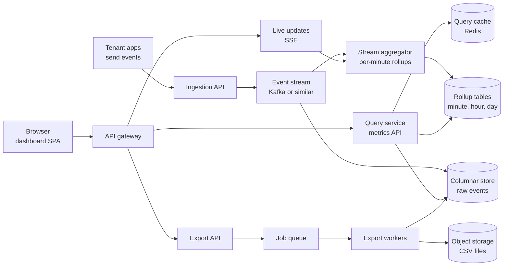
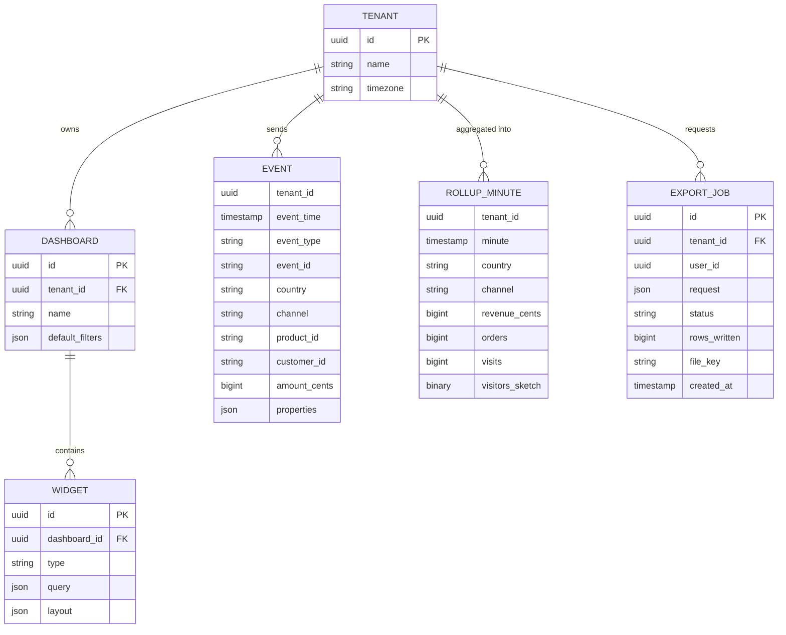
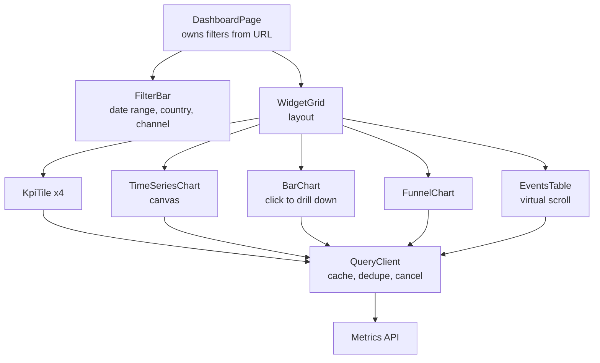
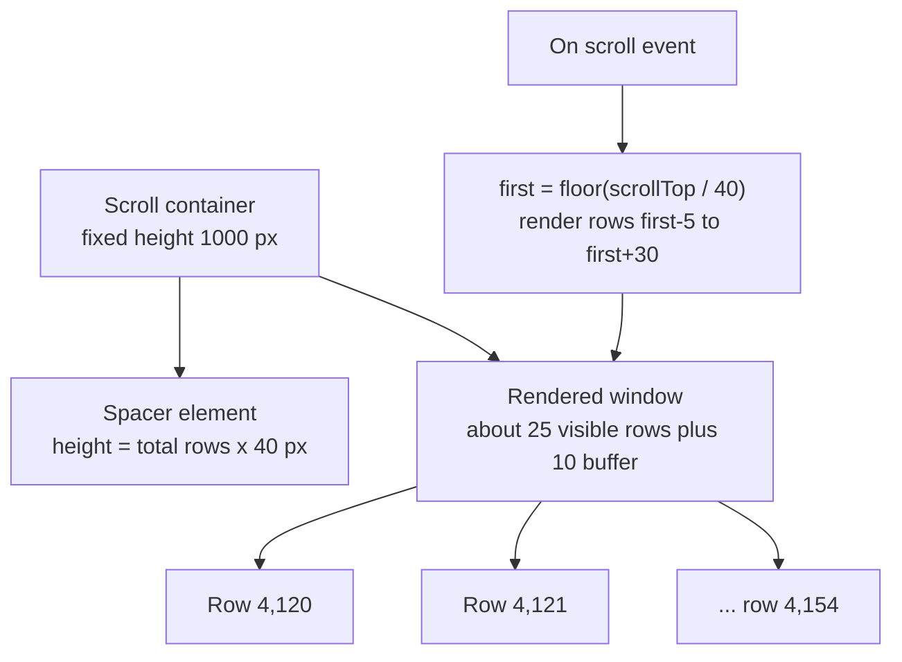
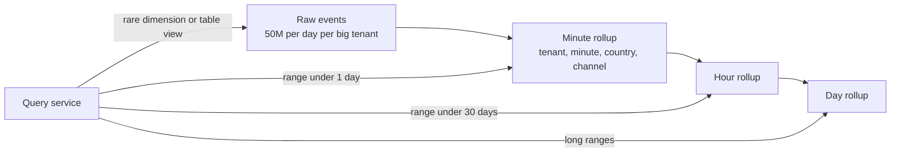
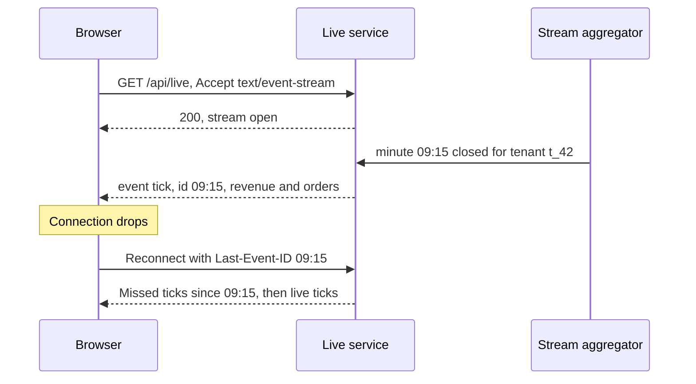
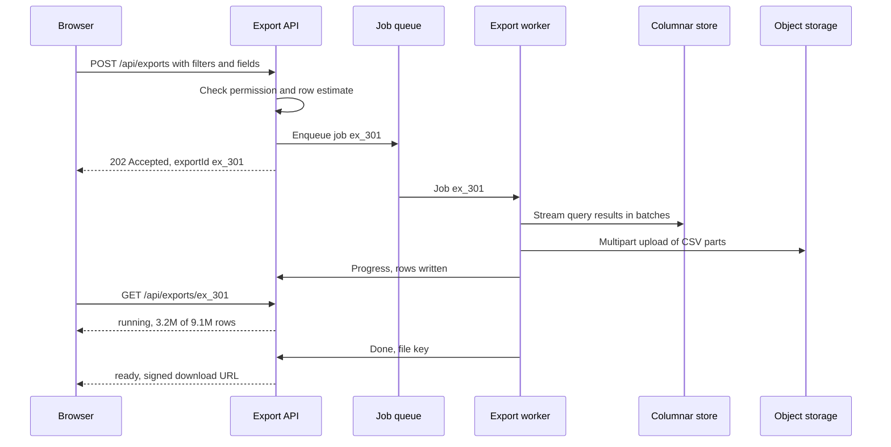

# Case Study: Analytics Dashboard and Large Tables

> In this case study you will design an analytics dashboard: many charts and big data tables over hundreds of millions of events, with filters, live updates and CSV exports. You will learn how the frontend stays fast (virtual scrolling, chart downsampling, request de-duplication) and how the backend answers heavy queries in milliseconds (pre-aggregation, columnar storage, query caching). Interviewers like this problem because it tests both frontend rendering skill and backend data thinking.

**Before this:** [System design interview approach](01-system-design-interview-approach.md) · [Caching strategies and invalidation](03-caching-strategies-and-invalidation.md) · [API integration and data fetching](../05-frontend-engineering/07-api-integration-and-data-fetching.md) · [Angular performance](../06-angular-16/12-performance.md) · **Interview questions:** [jump to the interview section](#interview-questions)

## Table of contents

1. [Problem statement](#problem-statement)
2. [Clarifying questions](#clarifying-questions)
3. [Requirements](#requirements)
4. [Estimates](#estimates)
5. [High-level architecture](#high-level-architecture)
6. [API design](#api-design)
7. [Data model](#data-model)
8. [Frontend architecture](#frontend-architecture)
9. [Deep dive 1: the large data table](#deep-dive-1-the-large-data-table)
10. [Deep dive 2: the aggregation backend and query caching](#deep-dive-2-the-aggregation-backend-and-query-caching)
11. [Deep dive 3: chart performance](#deep-dive-3-chart-performance)
12. [Deep dive 4: live updates and CSV export](#deep-dive-4-live-updates-and-csv-export)
13. [Performance](#performance)
14. [Security](#security)
15. [Scalability](#scalability)
16. [Failure handling](#failure-handling)
17. [Observability](#observability)
18. [Trade-offs and alternatives](#trade-offs-and-alternatives)
19. [How to present this in 45 minutes](#how-to-present-this-in-45-minutes)
20. [Interview questions](#interview-questions)
21. [Summary](#summary)
22. [References](#references)

---

## Problem statement

"Design an analytics dashboard for an online business platform."

Business customers (tenants) send us events: page views, sign-ups, orders, payments. Their staff open a dashboard to see:

- **KPI tiles:** revenue today, orders, conversion rate, compared with last week.
- **Charts:** revenue over time, orders by country, funnel from visit to purchase.
- **A big table:** every order or event, with search, filter, sort, column choice and millions of rows.
- **Global filters** at the top (date range, country, product, channel) that change every widget at once.
- **Live mode:** the "today" view updates every few seconds.
- **Export:** download the filtered table as CSV, even when it has millions of rows.

The challenge in one sentence:

> "Users expect a dashboard full of numbers to load in about a second, but those numbers come from scanning hundreds of millions of rows. The design must move work away from query time and away from the browser."

---

## Clarifying questions

| Question | Why you ask it | Assumed answer |
| --- | --- | --- |
| How much data per tenant? | Query cost and storage choice. | Up to 50 million events per day for the largest tenant. 500 million per day in total. |
| How fresh must numbers be? | Real-time streaming vs batch. | "Today" views within 1 minute. Historical views can be hours old. |
| How far back can users query? | Storage and rollup design. | 2 years of detail, 5 years of daily rollups. |
| Are dashboards fixed or user-built? | Fixed widgets can be pre-computed. Custom ones need a flexible query engine. | Fixed default dashboards plus custom widgets from a fixed set of metrics and dimensions. |
| How many rows can the table show? | Virtualization and pagination. | Any filter can match millions of rows. |
| How big are exports? | Sync download vs background job. | Up to 10 million rows. |
| Must numbers match the billing system exactly? | Exact vs approximate queries. | Revenue must be exact. Unique visitors can be approximate (within about 1%). |
| Accessibility needs? | Charts need text alternatives. | WCAG 2.1 AA. |

---

## Requirements

### Functional requirements

1. A dashboard with KPI tiles, time-series charts, bar charts and a funnel.
2. Global filters (date range, country, channel, product) shared by all widgets, plus per-widget options.
3. A data table with server-side search, filter, sort and pagination over millions of rows; column show/hide and resize; smooth scrolling.
4. Drill-down: click a bar ("Germany") to filter the dashboard by it.
5. Live mode for "today" with updates within a minute.
6. CSV export of any table view, up to 10 million rows.
7. Shareable dashboard URLs that restore all filters.

### Non-functional requirements

| Quality | Target |
| --- | --- |
| Dashboard load | First widgets visible in under 1 s, all widgets in under 3 s at p95. |
| Interaction | Filter change → updated widgets in under 1.5 s at p95. Scrolling the table at 60 frames per second. |
| Freshness | Today's data within 1 minute. |
| Correctness | Revenue exact. Approximate metrics labeled as approximate. |
| Isolation | Tenants never see each other's data. |
| Cost | Queries must not scan raw data for common dashboards. |

---

## Estimates

**Ingestion**

- 500,000,000 events per day / 86,400 ≈ 5,800 events per second on average. Peak maybe 3× → about 17,000 per second.
- 200 bytes per raw event → 500,000,000 × 200 B = 100 GB per day of raw data.
- Columnar storage compresses this kind of data a lot (often 5–10×). Assume about 15 GB per day stored → about 11 TB for 2 years. That is fine for a columnar analytics database.

**Queries**

- 50,000 daily dashboard users × 20 dashboard views × 8 widgets = 8,000,000 widget queries per day.
- 8,000,000 / 86,400 ≈ 93 queries per second on average. Business-hours peak 5× → about 460 per second.
- If each query scanned raw data (say 50 million rows for a big tenant's day), 460 per second would be impossible. **So most queries must hit pre-aggregated tables or a cache.**

**Frontend**

- A table row is about 40 px tall. A 1,000 px viewport shows about 25 rows. Rendering 1,000,000 rows as DOM nodes is impossible; rendering 25 + a buffer is easy.
- A line chart is about 1,200 px wide. Plotting more than about 2 points per pixel adds nothing visible. So a chart never needs more than a few thousand points, even for a year of per-minute data (525,600 points).

These two frontend numbers drive the whole frontend design: **render only what is visible**, and **send only what can be seen**.

---

## High-level architecture



- **Ingestion API + event stream.** Events arrive, are validated and are written to a durable stream. The stream decouples ingestion from storage.
- **Columnar store for raw events** (for example ClickHouse, Apache Druid, Apache Pinot, BigQuery or Snowflake). Columnar databases store each column together, so a query reading 3 columns out of 40 reads much less data.
- **Stream aggregator** builds **rollups**: pre-computed totals per minute, hour and day for each metric and common dimension (country, channel, product).
- **Query service** — a metrics API. It translates "revenue by day for October, country = DE" into the right query against the right table, checks the tenant and permissions, and caches results.
- **Live updates** push fresh per-minute numbers to open "today" dashboards via Server-Sent Events.
- **Export workers** run big CSV exports as background jobs and store the files in object storage.

---

## API design

### A metrics query API instead of one endpoint per widget

Each widget asks for a **metric** split by **dimensions** over a **time range**. One flexible but restricted endpoint serves all widgets.

```text
POST /api/query
```

```json
{
  "metrics": ["revenue", "orders"],
  "dimensions": ["day"],
  "filters": { "country": ["DE", "FR"], "channel": ["paid_search"] },
  "timeRange": { "from": "2026-10-01T00:00:00Z", "to": "2026-10-22T00:00:00Z" },
  "timezone": "Europe/Berlin",
  "limit": 1000
}
```

```json
{
  "columns": [
    { "name": "day", "type": "date" },
    { "name": "revenue", "type": "money", "currency": "EUR" },
    { "name": "orders", "type": "integer" }
  ],
  "rows": [
    ["2026-10-01", 1843250, 412],
    ["2026-10-02", 1790100, 398]
  ],
  "meta": {
    "source": "rollup_day",
    "cached": true,
    "dataFreshAsOf": "2026-10-22T09:14:00Z",
    "approximate": false,
    "queryMs": 38
  }
}
```

Why this shape:

- **Metrics and dimensions come from an allow-list.** The client cannot send raw SQL. The query service builds the query. This prevents injection and keeps queries predictable.
- **Rows as arrays** with a separate `columns` header are much smaller than an array of objects that repeats every key.
- **`meta` tells the UI** where the data came from, how fresh it is and whether it is approximate. The UI shows "Updated 1 min ago" and an "≈" sign for approximate numbers.
- It is a `POST` because the body can be large. It is still **safe** (it does not change anything). Caching happens in the query service, not in HTTP caches.

### Table endpoint (server-side pagination, sort, filter)

```text
GET /api/events?type=order&country=DE&q=refund&sort=-amount&limit=100&cursor=...&fields=id,time,customer,amount,status
```

```json
{
  "items": [
    { "id": "ev_9a1", "time": "2026-10-21T18:22:03Z", "customer": "c_118", "amount": 23999, "status": "refunded" }
  ],
  "nextCursor": "eyJhIjoyMzk5OSwiaWQiOiJldl85YTEifQ",
  "totalEstimate": 1284000
}
```

- `fields` lets the table request only visible columns. Fewer columns mean much less data to scan in a columnar store.
- Cursor pagination, as in the [admin portal case study](07-case-study-enterprise-admin-portal.md#deep-dive-2-the-large-records-table).

### Live updates

```text
GET /api/live?metrics=revenue,orders&filters=...     (Accept: text/event-stream)

event: tick
id: 2026-10-22T09:15:00Z
data: {"minute":"2026-10-22T09:15:00Z","revenue":48210,"orders":11}
```

### Export

```text
POST /api/exports      { "view": "events", "filters": {...}, "fields": [...], "format": "csv" }
→ 202 Accepted         { "exportId": "ex_301", "status": "queued" }

GET  /api/exports/ex_301
→ { "status": "running", "rowsWritten": 3200000, "estimatedRows": 9100000 }
→ { "status": "ready", "downloadUrl": "https://files.example.com/...signed...", "expiresAt": "2026-10-23T09:00:00Z" }
```

The pattern for long-running operations is described in [REST API design](../07-nodejs-backend/07-rest-api-design.md#long-running-operations).

---

## Data model



Notes:

- **`EVENT` lives in the columnar store**, sorted by `(tenant_id, event_time)`. Queries almost always filter by tenant and time range, so this sort order lets the database skip most of the data.
- The columnar store is **partitioned by day**. Deleting data older than 2 years means dropping old partitions — fast and cheap.
- **Rollup tables** (`ROLLUP_MINUTE`, plus hour and day versions) store sums and counts per time bucket and per common dimension. "Revenue by day for October" reads about 31 × (number of countries) rows instead of millions of events.
- **Unique visitors cannot be summed.** A visitor who came on Monday and Tuesday must count once for the week. So rollups store a **sketch** (for example HyperLogLog), a small data structure that can be merged and gives an approximate distinct count with about 1% error. This is why the API returns `approximate: true` for unique visitors.
- **`event_id`** lets ingestion drop duplicates (clients retry sends).
- **Dashboards and widgets** are normal relational data in PostgreSQL. A widget stores its query definition as JSON.

---

## Frontend architecture

### Component tree



### One owner for filters

The biggest frontend mistake in dashboards is letting each widget hold its own copy of the filters. Then they drift apart, and one filter change triggers a storm of uncoordinated requests.

- **The URL owns the global filters.** `?from=2026-10-01&to=2026-10-22&country=DE,FR&channel=paid_search`. Shareable and restorable.
- The **dashboard page** parses the URL into one immutable `filters` object and passes it down.
- Each **widget** combines the global filters with its own query definition to build a **query**.
- A shared **query client** turns each query into a **normalized key**, caches results by key, de-duplicates identical in-flight requests and cancels requests that are no longer needed.

### Normalized query keys

Two widgets asking for the same data with filters in a different order should share one request and one cache entry.

```js
// query-key.js
function normalize(value) {
  if (Array.isArray(value)) return [...value].map(normalize).sort();
  if (value && typeof value === 'object') {
    return Object.keys(value).sort().reduce((acc, k) => {
      acc[k] = normalize(value[k]);
      return acc;
    }, {});
  }
  return value;
}

const queryKey = q => JSON.stringify(normalize(q));

const a = { metrics: ['revenue'], filters: { country: ['FR', 'DE'], channel: ['paid'] } };
const b = { filters: { channel: ['paid'], country: ['DE', 'FR'] }, metrics: ['revenue'] };

console.log(queryKey(a) === queryKey(b)); // true
console.log(queryKey(a)); // {"filters":{"channel":["paid"],"country":["DE","FR"]},"metrics":["revenue"]}
```

> Sorting arrays is right for **sets** (countries, metrics). Do not sort arrays where order matters, like `dimensions: ['day', 'country']` (that order decides the grouping and output). A real implementation knows which fields are sets.

### In-flight de-duplication

```js
// dedupe.js
const inFlight = new Map();
let networkCalls = 0;

function fetchQuery(key) {
  if (inFlight.has(key)) return inFlight.get(key);         // reuse the same promise
  const p = new Promise(resolve => {
    networkCalls++;
    setTimeout(() => resolve({ key, rows: [[1, 2]] }), 50); // pretend network call
  }).finally(() => inFlight.delete(key));
  inFlight.set(key, p);
  return p;
}

Promise.all([fetchQuery('revenue-oct'), fetchQuery('revenue-oct'), fetchQuery('orders-oct')])
  .then(results => {
    console.log(results.length); // 3
    console.log(networkCalls);   // 2
  });
```

Libraries like TanStack Query do this (plus caching, stale-while-revalidate and cancellation) for you. In Angular 16 you can use a small service with RxJS `shareReplay` per key, or NgRx with effects. See [request de-duplication](../05-frontend-engineering/07-api-integration-and-data-fetching.md#request-de-duplication).

### Cancellation when filters change

The user drags a date-range slider. Every step produces new filters. Without care, you send 20 requests per widget and an older, slower response may arrive last and overwrite the newest data.

- **Debounce** filter changes (about 300 ms) before they reach the URL.
- **Cancel** stale requests: in Angular, `switchMap` unsubscribes from the old HTTP request, and `HttpClient` aborts it. With `fetch`, use `AbortController`.
- **Keep showing old data** with a "refreshing" indicator instead of blanking every widget. Blank flashing makes dashboards feel slow.

```ts
// widget.component.ts (Angular 16, simplified)
@Component({
  selector: 'app-revenue-chart',
  templateUrl: './revenue-chart.component.html',
  changeDetection: ChangeDetectionStrategy.OnPush,
})
export class RevenueChartComponent {
  private filters$ = inject(DashboardFiltersService).filters$; // from the URL, already debounced
  private queries = inject(QueryClientService);

  readonly state$ = this.filters$.pipe(
    map(f => ({ metrics: ['revenue'], dimensions: ['day'], filters: f.filters, timeRange: f.timeRange })),
    switchMap(q => this.queries.run(q)), // cancels the previous request for this widget
    // run() emits { status: 'loading', data: previousData } first, then { status: 'success', data }
  );
}
```

### Widget states

Each widget handles its own loading, error and empty state. **One failing widget must not break the dashboard.**

| State | What the widget shows |
| --- | --- |
| Loading (first time) | Skeleton with the final size (no layout shift). |
| Refreshing | Old data, slightly dimmed, with a small spinner. |
| Success | Data plus "Updated 2 min ago". |
| Empty | "No orders match these filters" with a hint to widen the date range. |
| Error | "Could not load revenue. Retry" — only this widget. |
| Partial or approximate | Data with "≈" and a tooltip explaining why. |

### Loading order

- Load KPI tiles and the visible charts first. Load widgets below the fold when they scroll into view (with `IntersectionObserver`).
- Limit concurrent requests (for example 6 at a time) so the first visible widgets are not stuck behind lower ones.
- Lazy-load the charting library itself. It is often one of the biggest bundles.

---

## Deep dive 1: the large data table

The events table can match millions of rows. Users want to scroll, sort, filter, resize columns and select rows — and it must feel smooth.

### Split the work: server for data, browser for pixels

| Job | Where | Why |
| --- | --- | --- |
| Filter, search, sort | Server | Only the server has all rows. Sorting 50 loaded rows on the client gives a wrong answer for the whole set. |
| Pagination | Server (cursor) | Fast on deep pages. Stable when new events arrive. |
| Choosing columns | Server (`fields=`) | Columnar stores read only requested columns. |
| Rendering visible rows | Browser (virtual scroll) | Keeps the DOM small. |
| Column widths, order, hidden columns | Browser, saved to user preferences | Pure UI state. |
| Selection | Browser (IDs), or a filter for "select all matching" | Must survive scrolling. |

### Virtual scrolling: how it works

A **virtual list** renders only the rows you can see, plus a few extra above and below (the buffer). A tall empty "spacer" element gives the scrollbar the right size, as if all rows existed.



The math is simple:

```js
// virtual-window.js
function visibleRange({ scrollTop, viewportHeight, rowHeight, totalRows, buffer }) {
  const first = Math.floor(scrollTop / rowHeight);
  const visibleCount = Math.ceil(viewportHeight / rowHeight);
  const start = Math.max(0, first - buffer);
  const endExclusive = Math.min(totalRows, first + visibleCount + buffer);
  return { start, endExclusive, offsetY: start * rowHeight };
}

console.log(visibleRange({ scrollTop: 164800, viewportHeight: 1000, rowHeight: 40, totalRows: 1284000, buffer: 5 }));
// { start: 4115, endExclusive: 4150, offsetY: 164600 }
```

Only 35 rows exist in the DOM, positioned with `transform: translateY(164600px)`, even though the table "has" 1.28 million rows.

In Angular, use the CDK:

```html
<!-- events-table.component.html (Angular 16 + @angular/cdk/scrolling) -->
<cdk-virtual-scroll-viewport itemSize="40" class="table-viewport" (scrolledIndexChange)="onIndex($event)">
  <div
    *cdkVirtualFor="let row of rows; trackBy: trackById"
    class="table-row"
    role="row">
    <span role="cell">{{ row.time | date: 'short' }}</span>
    <span role="cell">{{ row.customer }}</span>
    <span role="cell">{{ row.amount / 100 | currency: 'EUR' }}</span>
    <span role="cell">{{ row.status }}</span>
  </div>
</cdk-virtual-scroll-viewport>
```

See [virtual scrolling in Angular](../06-angular-16/12-performance.md#large-lists-virtual-scrolling).

### Combining virtual scroll with server pagination

The browser cannot hold 1.28 million rows either. So we combine both ideas: **infinite loading with a virtual window**.

1. Load the first page (100 rows).
2. When the rendered window gets within, say, 50 rows of the end of loaded data, load the next page with the cursor.
3. Keep at most a few thousand rows in memory. If the user scrolls very far, drop pages far away (and re-fetch them if the user scrolls back).

For "jump to row 900,000" (dragging the scrollbar far down), cursor pagination cannot jump. Options:

- Offer **sort + filter** to get there instead ("sort by amount descending").
- Or support **offset pages** for that case, accepting that deep offsets are slower.
- Or show a scrollbar only over loaded data ("Load more" pattern). Most products choose this. It is simpler and honest.

### Wide tables: column virtualization

With 80 columns, rendering every cell of 35 rows is 2,800 cells. Virtualize columns too (render only visible columns), or better, let users choose columns and default to about 10. Keep the first column (ID or name) sticky.

### Fixed vs variable row height

Virtual scrolling is simple when every row has the same height. Variable heights (wrapped text) need measuring rows as they render and estimating the rest, which causes scroll jumps. For data tables, **use fixed row heights** and truncate long text with a tooltip or a detail panel.

### Accessibility of virtualized tables

- Screen readers only see rendered rows. Set `aria-rowcount` on the table to the total, and `aria-rowindex` on each row, so assistive tech can announce "row 4,120 of 1,284,000".
- Keep keyboard navigation working: arrow keys move focus between cells, and the viewport scrolls to keep the focused row rendered.
- Provide a non-visual way to reach data: search, filters and export.

See [accessibility](../05-frontend-engineering/04-accessibility.md).

### Sorting and filtering UX

- Clicking a column header changes the URL (`?sort=-amount`), which resets the cursor and scroll position.
- Show a loading state over the table but keep the old rows until new ones arrive.
- Only allow sorting on columns the backend can sort efficiently (indexed or part of the sort key). Disable the sort control on others, rather than letting users trigger a full scan.

---

## Deep dive 2: the aggregation backend and query caching

### Why raw queries are too slow

"Revenue per day for the last 90 days" on raw events for a big tenant reads 90 × 50 million = 4.5 billion rows. Even a fast columnar database needs seconds and a lot of CPU for that. At 460 queries per second, that is impossible.

### Pre-aggregation (rollups)

Compute common answers **ahead of time**:



- The **stream aggregator** consumes events and updates per-minute buckets. Hour and day rollups are built from minute rollups.
- The query service **picks the cheapest table** that can answer the query. "Revenue by day for 90 days, by country" → day rollup: 90 days × ~50 countries = 4,500 rows. Milliseconds.
- Queries on dimensions that are not in any rollup (for example a custom event property) fall back to raw events and are slower. The UI can warn: "This query may take a few seconds."

Most columnar databases support this natively: ClickHouse has materialized views and AggregatingMergeTree tables; Druid and Pinot roll up at ingestion time.

### Late events and corrections

Events can arrive late (a mobile app sends events after reconnecting). Rollups must accept updates to old buckets:

- The minute rollup is **additive**: a late order adds to the correct past minute bucket.
- The day rollup for "yesterday" is recomputed a few times after midnight (for example at +1 hour and +24 hours).
- Refunds are separate events with negative amounts, not edits to old events.

### Time zones

"Revenue per day" depends on the tenant's time zone. A day in Berlin is not a day in UTC. Options:

- Store minute rollups in UTC and group them into days in the tenant's time zone at query time. This works because time zone offsets are whole hours or 30/45 minutes, so minute buckets always fit cleanly. Hour rollups only work for zones with whole-hour offsets. They do not work for India (UTC+5:30) or Nepal (UTC+5:45).
- Build day rollups per tenant time zone for speed.

Always send the time zone in the query (`"timezone": "Europe/Berlin"`), and make the UI show it.

### Query caching

Even rollup queries benefit from a cache, because many users of the same tenant open the same dashboard.

**The cache key** is the tenant + normalized query + data version (why the tenant must be in the key is explained in [multi-tenant and personalized cache keys](03-caching-strategies-and-invalidation.md#multi-tenant-and-personalized-cache-keys)):

```text
q:{tenantId}:{sha256(normalizedQuery)}:{rollupVersion}
```

**TTL depends on the time range**, because closed ranges do not change:

| Time range | Cacheable for | Why |
| --- | --- | --- |
| Fully in the past ("September") | Hours or days | Data will not change, except rare late events and corrections. Bump `rollupVersion` when a recompute happens. |
| Includes today | 30–60 seconds | New events arrive every second. |
| Live mode | Not cached; pushed | See live updates below. |

**Round time ranges for better hit rates.** If one user asks for "last 7 days" at 09:14:07 and another at 09:14:31, the exact ranges differ and nothing is shared. Round "now" down to the minute (or 5 minutes) for relative ranges:

```js
// round-range.js
function roundRelativeRange(now, days, bucketMs = 60_000) {
  const to = Math.floor(now / bucketMs) * bucketMs; // round down to the minute
  const from = to - days * 24 * 60 * 60 * 1000;
  return { from: new Date(from).toISOString(), to: new Date(to).toISOString() };
}

const t1 = Date.parse('2026-10-22T09:14:07Z');
const t2 = Date.parse('2026-10-22T09:14:31Z');
console.log(JSON.stringify(roundRelativeRange(t1, 7)) === JSON.stringify(roundRelativeRange(t2, 7))); // true
console.log(roundRelativeRange(t1, 7));
// { from: '2026-10-15T09:14:00.000Z', to: '2026-10-22T09:14:00.000Z' }
```

**Stampede protection:** when a popular dashboard's cache expires, many users would run the same query at once. The query service uses **single-flight** (one computation per key; others wait for it), the same idea as the frontend de-duplication, but on the server. See [stampede, penetration and avalanche](03-caching-strategies-and-invalidation.md#stampede-penetration-and-avalanche) and [stampede protection in Node.js](../07-nodejs-backend/11-caching.md#when-caches-fail-stampede-penetration-and-avalanche).

**Split long ranges into cacheable pieces:** "last 90 days" = 89 closed days (cached for a long time) + today (cached for 60 seconds). Merge the results. Only the small "today" piece is recomputed often.

### Protecting the cluster

- **Query cost limits:** maximum rows scanned, maximum execution time (for example 10 seconds), maximum result rows.
- **Per-tenant concurrency limits** so one tenant's heavy custom query does not slow everyone.
- **Separate pools:** interactive dashboard queries get priority over exports and scheduled reports.

---

## Deep dive 3: chart performance

### Send only what can be seen

A year of per-minute revenue is 525,600 points. A chart 1,200 px wide can show maybe 2,400 meaningful points. So the **server** decides the bucket size from the range and the chart width:

```text
range = 365 days, chart width = 1,200 px
→ about 1,200 buckets → bucket ≈ 365 × 24 × 60 / 1,200 ≈ 438 minutes → round to "6 hours" (1,460 points)
```

The client sends its width (or a `maxPoints` value). The server picks the rollup and bucket size.

### Downsampling without losing spikes

If you must reduce points on the client (for example a raw high-resolution series), averaging hides spikes. **Min-max downsampling** keeps the lowest and highest value in each bucket, so a spike stays visible:

```js
// minmax-downsample.js
function minMaxDownsample(points, buckets) {
  const size = Math.ceil(points.length / buckets);
  const out = [];
  for (let i = 0; i < points.length; i += size) {
    const chunk = points.slice(i, i + size);
    let min = chunk[0], max = chunk[0];
    for (const p of chunk) {
      if (p.y < min.y) min = p;
      if (p.y > max.y) max = p;
    }
    // keep time order inside the bucket
    if (min.x <= max.x) out.push(min, max); else out.push(max, min);
  }
  return out;
}

const series = Array.from({ length: 12 }, (_, i) => ({ x: i, y: i === 7 ? 100 : 10 }));
console.log(minMaxDownsample(series, 3).map(p => p.y)); // [ 10, 10, 10, 100, 10, 10 ]
```

The spike at `x = 7` survives. Simple averaging over 4 points would give 32.5 for that bucket and the spike would look small. A more advanced algorithm, **LTTB** (Largest-Triangle-Three-Buckets), keeps the visual shape with even fewer points.

### SVG vs Canvas vs WebGL

| | SVG | Canvas | WebGL |
| --- | --- | --- | --- |
| How it draws | One DOM element per shape | Pixels on one bitmap | Pixels via the GPU |
| Good for | Up to a few thousand shapes, crisp, easy styling, easy hover and accessibility | Tens of thousands of points | Hundreds of thousands to millions of points |
| Interaction | Native DOM events per shape | You compute what is under the mouse | You compute it |
| Accessibility | Can add titles and ARIA | Needs a separate text alternative | Same as canvas |

For this dashboard: SVG for bar charts and funnels (few shapes), Canvas for time series with many points. Many chart libraries offer both renderers.

### Keep the main thread free

- **Do not re-render all charts on every change.** In Angular, use `OnPush` and pass new immutable data only when the query result changes.
- **Run chart libraries outside Angular's zone.** Hover and animation events from chart libraries can trigger change detection many times per second. Use `NgZone.runOutsideAngular()` for the chart, and re-enter the zone only for meaningful events (a click that drills down). See [runOutsideAngular](../06-angular-16/12-performance.md#runoutsideangular-for-high-frequency-events).
- **Heavy transforms in a Web Worker.** Pivoting or downsampling hundreds of thousands of rows can take 100+ ms. Move it to a worker so typing and scrolling stay smooth.
- **Resize with care.** Use `ResizeObserver` and throttle redraws.
- **Turn off animations** for large updates and in live mode.

### Chart accessibility

Charts are images to a screen reader. Provide:

- A text summary: "Revenue rose 12% from 1 to 21 October. Highest day: 18 October, €21,400."
- A "View as table" toggle that shows the same data as an accessible table.
- Color plus another signal (pattern, label) so color-blind users can tell series apart.
- Keyboard access to data points where interaction matters (drill-down).

---

## Deep dive 4: live updates and CSV export

### Live updates

The "today" dashboard should update without reloading. Choices are compared in [API styles and real-time communication](04-api-styles-and-real-time-communication.md).

- **Polling every 30–60 seconds** is the simplest, works everywhere and caches well (all users of the tenant share one cached answer per minute). Often good enough.
- **Server-Sent Events (SSE)** — the server pushes small "tick" messages. One-way (server to client) is exactly what a dashboard needs. It runs over normal HTTP, and browsers reconnect automatically, sending `Last-Event-ID`.
- **WebSockets** are two-way. A dashboard does not need two-way messages, so SSE is usually the better fit.



Rules for live dashboards:

- **Push deltas, not whole dashboards.** "Minute 09:15: revenue +482.10, orders +11". The client adds it to the current series.
- **Throttle UI updates** to about once every few seconds, even if data arrives faster. Humans cannot read faster, and redrawing charts costs CPU.
- **Pause when the tab is hidden** (`document.visibilityState === 'hidden'`) and catch up when it is visible again.
- **After reconnect, resync.** Use `Last-Event-ID` to resend missed ticks, or simply re-run the "today" query. Never assume the stream was complete.
- **Scale:** one SSE connection per open dashboard. A live service with an event loop (Node.js) holds many thousands of idle connections per instance. The live service subscribes once per tenant to the aggregator's updates (for example through Redis pub/sub) and fans out to that tenant's connections.

### CSV export of millions of rows

A 10-million-row CSV is about 1–2 GB. It cannot be built inside one HTTP request: the request would time out, use a lot of memory, and fail if the connection drops.



How the worker stays safe on memory: it **streams**. Rows come from the database in batches, go through a CSV transform and go straight into an upload stream. It never holds the whole file in memory. Backpressure keeps the database read speed matched to the upload speed. See [streams and backpressure](../07-nodejs-backend/05-streams.md#backpressure).

```js
// export-worker.js (Node.js, simplified)
import { pipeline } from 'node:stream/promises';
import { Readable, Transform } from 'node:stream';

function csvEscape(value) {
  let s = value == null ? '' : String(value);
  // Prevent spreadsheet formula injection: a text cell starting with = + - @ can run as a formula.
  // (Only for strings, so negative numbers like -100 stay numbers.)
  if (typeof value === 'string' && /^[=+\-@\t\r]/.test(s)) s = `'${s}`;
  // Quote fields with commas, quotes or new lines. Double any quotes inside.
  return /[",\n\r]/.test(s) ? `"${s.replace(/"/g, '""')}"` : s;
}

function toCsv(fields) {
  let headerSent = false;
  return new Transform({
    objectMode: true,
    transform(row, _enc, cb) {
      let out = '';
      if (!headerSent) { out += fields.join(',') + '\n'; headerSent = true; }
      out += fields.map(f => csvEscape(row[f])).join(',') + '\n';
      cb(null, out);
    },
  });
}

async function* fakeRows() {
  yield { id: 'ev_1', customer: 'Acme, Inc.', amount: 23999 };
  yield { id: 'ev_2', customer: '=HYPERLINK("http://evil")', amount: 100 };
}

await pipeline(Readable.from(fakeRows()), toCsv(['id', 'customer', 'amount']), process.stdout);
// id,customer,amount
// ev_1,"Acme, Inc.",23999
// ev_2,"'=HYPERLINK(""http://evil"")",100
```

In production, `fakeRows()` is a database cursor or stream, and `process.stdout` is a multipart upload stream to object storage.

Other export rules:

- **Idempotent and resumable.** If the worker crashes, the job is retried. Write parts with deterministic names so a retry can continue or overwrite cleanly.
- **The export uses the same permission filter** as the table. Exports are a common data leak.
- **Snapshot consistency:** the export should reflect one moment. Use the query's `to` timestamp as an upper bound so rows arriving during the export are not half-included.
- **Notify** when ready (in-app notification or email with a link to the app, not the file itself).
- **Signed URLs** with short expiry, and delete files after a few days.
- **Limits** per tenant (concurrent exports, max rows). Offer scheduled exports or a data warehouse connector for very large needs.

Job queue concepts (retries, dead-letter queues) are in [background jobs and queues](../07-nodejs-backend/13-background-jobs-and-queues.md).

---

## Performance

| Layer | Technique | Effect |
| --- | --- | --- |
| Storage | Columnar store, sorted by `(tenant_id, event_time)`, partitioned by day | Queries read only needed columns and time ranges. |
| Aggregation | Minute, hour and day rollups | Common queries read thousands of rows, not billions. |
| Query service | Result cache, rounded time ranges, split closed and open ranges, single-flight | Most dashboard loads come from cache. |
| API payload | Columns + rows arrays, only requested fields, server-chosen bucket size | Smaller responses, faster parsing. |
| Network | Limited concurrency, visible widgets first, lazy widgets below the fold | Fast first meaningful view. |
| Rendering | `OnPush`, virtual scroll, Canvas for dense charts, charts outside the Angular zone, Web Workers for transforms | Smooth scrolling and typing. |
| Bundle | Lazy-load the chart library and the table module | Faster first load. See [Angular performance](../06-angular-16/12-performance.md). |

How to measure: track per-widget "time to data" and "time to render" separately in real user monitoring. If time to data is high, look at the backend. If time to render is high, look at the chart or the table. Use the Chrome Performance panel to find long tasks. See [web performance](../05-frontend-engineering/05-web-performance-and-core-web-vitals.md).

---

## Security

1. **Tenant isolation in every query.** The query service adds `tenant_id = <session tenant>` to every query it builds. The client never sends a tenant. Cache keys start with the tenant ID.
2. **No raw SQL from the client.** Metrics and dimensions come from an allow-list. Filter values are passed as parameters. This prevents SQL injection and runaway queries.
3. **Row and column permissions.** Some users may not see revenue, or may see only their region. The query service applies these rules to dashboards, tables, live streams **and exports** in one shared place.
4. **CSV injection.** Text cells that start with `=`, `+`, `-` or `@` can run as formulas in spreadsheet programs. Prefix them with `'` when exporting (see the worker code).
5. **Signed, short-lived export URLs**, and export files deleted after a few days.
6. **Ingestion security.** Tenant apps send events with a write-only ingestion key that cannot read data. Validate event size and schema. Rate-limit per key.
7. **Shared dashboard links** keep requiring sign-in. If "public links" are a feature, they use a separate signed token that allows only that dashboard, read-only, and can be revoked.
8. **Personal data.** Events may contain customer IDs or emails. Minimize what is stored, support deletion requests (delete or anonymize by customer ID) and mask personal fields in exports for roles that do not need them.

---

## Scalability

- **Ingestion** scales horizontally: stateless ingestion API instances write to a partitioned stream. Partition by tenant ID so events of one tenant stay ordered within a partition.
- **The columnar store** scales by sharding (for example by tenant ID hash) and adding replicas for read throughput. Huge tenants may get dedicated shards.
- **Rollups** reduce query load by orders of magnitude. This is the most important scaling tool.
- **Query cache** absorbs repeated dashboard views. A cache hit ratio of 80%+ is realistic for shared dashboards.
- **Live service** scales by connections. Each instance holds many SSE connections. Sticky routing is not needed, because a reconnect can go to any instance and resync.
- **Export workers** scale with the job queue length. They use a separate, lower-priority query pool so exports never slow down interactive dashboards.
- **Noisy neighbor control:** per-tenant query concurrency limits, per-tenant export limits, query timeouts.

See [scalability and core building blocks](02-scalability-and-core-building-blocks.md).

---

## Failure handling

| Failure | Behavior |
| --- | --- |
| One widget's query times out | Only that widget shows "Could not load. Retry". Others work. |
| Columnar store slow | Serve cached results (even slightly stale) with a "Data may be delayed" label. Shorter timeouts for interactive queries. |
| Aggregator lagging | Rollups fall behind. The API's `dataFreshAsOf` shows the real freshness, and the UI says "Data up to 09:02". Never present stale data as fresh. |
| Live stream disconnects | Browser reconnects automatically with `Last-Event-ID`. If the server cannot replay, the client re-runs the "today" query. |
| Duplicate events from clients | Dropped by `event_id` at ingestion (or deduplicated by the store's engine). |
| Export worker crashes | Job retried with backoff. After several failures it goes to a dead-letter queue and the user sees "Export failed. Try again." |
| Filter change while old requests are running | `switchMap` cancels old requests. Old responses can never overwrite newer state. |
| Query too expensive | Rejected quickly with a clear message: "This query covers too much data. Narrow the date range." |

General patterns: [reliability and resilience](../10-testing-security-production/09-reliability-and-resilience.md).

---

## Observability

- **Ingestion:** events per second per tenant, rejected events, stream lag (how far consumers are behind).
- **Freshness:** age of the newest rollup bucket per tenant. Alert when it is more than 5 minutes behind.
- **Queries:** p50/p95/p99 latency by source (cache, rollup, raw), rows scanned, cache hit ratio, timeouts, rejected queries.
- **Frontend:** per-widget time to data and time to render, long tasks, JavaScript errors, number of in-flight requests per dashboard load.
- **Exports:** queue length, job duration, failure rate, file sizes.
- **Correctness checks:** a daily job compares rollup totals with raw event totals for a sample of tenants and days. Any difference means the aggregator has a bug.

See [logging, monitoring and observability](../10-testing-security-production/08-logging-monitoring-and-observability.md).

---

## Trade-offs and alternatives

| Decision | We chose | Alternative | When the alternative is better |
| --- | --- | --- | --- |
| Analytics storage | Columnar store + rollups | PostgreSQL with materialized views | Small data (millions, not billions, of rows). Simpler to run. |
| Freshness | Streaming rollups (about 1 minute) | Nightly batch jobs | Reports that only need yesterday's numbers. Much cheaper. |
| Unique counts | Approximate sketches (HyperLogLog) | Exact distinct counts | Billing or legal numbers. Exact counts over long ranges are expensive. |
| Table navigation | Infinite loading + virtual window | Classic page numbers | Users who need "page 37" or printing. Smaller result sets. |
| Live updates | SSE | Polling every 30–60 s | Simple products, strict proxies, or when caching one shared answer per minute is enough. |
| Charts | Canvas for dense series, SVG for simple charts | All SVG | Few data points and a need for rich styling and accessibility. |
| Query API | One restricted metrics endpoint | GraphQL | Many different clients that need flexible shapes. Still needs cost limits. |
| Export | Async job + object storage | Streaming download directly from the API | Small exports (thousands of rows) that finish in seconds. |
| Build vs buy | Custom dashboard | Embedded BI tool (for example Metabase, Superset, Looker) | Internal dashboards where custom UX is not a product feature. |

---

## How to present this in 45 minutes

**Minutes 0–5: clarify.**
> "How much data per tenant per day? How fresh must the numbers be? How far back can users query? Are dashboards fixed or user-built? How big can exports get? Must numbers be exact? ... OK: up to 50 million events per day for the largest tenant, 500 million in total, one-minute freshness for today, two years of detail, fixed widgets plus some custom ones, exports up to 10 million rows, revenue exact and unique counts approximate."

**Minutes 5–9: numbers.**
> "That's about 5,800 events per second on average and about 100 GB of raw data per day. Dashboards cause around 90 queries per second on average and about 460 at peak. Scanning raw data for each of those is impossible, so most queries must hit pre-aggregated rollups or a cache. On the frontend, a viewport shows about 25 rows and a chart about 2,000 useful points — so we render only visible rows and send only visible points."

**Minutes 9–16: high-level design.**
> "Events go through an ingestion API into a stream. One consumer writes raw events to a columnar store, partitioned by day and sorted by tenant and time. A stream aggregator builds minute, hour and day rollups. The query service exposes a restricted metrics API — metrics, dimensions, filters, time range — picks the cheapest rollup, enforces tenant and permission filters, and caches results. A live service pushes per-minute ticks over SSE. Exports are background jobs that stream to object storage."

**Minutes 16–20: frontend architecture.**
> "The URL owns the global filters. The page passes one filter object down. Each widget builds a query, and a shared query client normalizes keys, caches, de-duplicates and cancels. Each widget has its own loading, error and empty state, so one failure doesn't break the page. Visible widgets load first."

**Minutes 20–36: deep dives.**
- Table: server filters, sorts and paginates with cursors; the browser virtualizes rows (and columns); fixed row heights; `aria-rowcount`; sort only on efficient columns.
- Backend: rollups, picking the right table, late events, time zones, cache keys with tenant and version, TTL by time range, rounding relative ranges, splitting closed and open ranges, single-flight, cost limits.
- Charts: server-side bucket size from chart width, min-max or LTTB downsampling, Canvas vs SVG, charts outside Angular's zone, workers, text alternatives.
- Live and export: SSE deltas, throttled redraws, pause when hidden, resync on reconnect; export as a streaming job with progress, permissions, CSV injection protection and signed URLs.

**Minutes 36–42: failures, security, observability.**
> "Partial failures stay inside one widget. When the aggregator lags, we show real freshness instead of pretending. Every query gets the tenant filter from the session, and clients can't send SQL. We alert on freshness, query p95 and cache hit ratio, and run a daily check that rollups match raw totals."

**Minutes 42–45: trade-offs.**
> "If the data were much smaller, I'd use PostgreSQL with materialized views and polling. If freshness of a day were fine, nightly batch rollups would cut cost a lot. Approximate unique counts are a deliberate trade-off — exact where money is involved, approximate where it's not."

---

## Interview questions

### Q1. How do you show a table with 1 million rows in the browser?

**What the interviewer is checking:** that you split data work (server) from rendering work (browser), and know how virtualization works.

**Short spoken answer (30–60 seconds):**
> "I don't send a million rows. The server does filtering, sorting and pagination, and returns pages of about 100 rows with a cursor. In the browser, I use virtual scrolling: only the rows in the viewport plus a small buffer exist in the DOM — maybe 35 — and a spacer element makes the scrollbar look right. As the user nears the end of loaded data, I fetch the next page. I use fixed row heights so the math is simple, trackBy so Angular reuses rows, and OnPush. For accessibility I set aria-rowcount and aria-rowindex, and I provide search and export, because find-in-page can't see rows that aren't rendered."

**Follow-up questions:**
- **Why not just paginate with page numbers?** — That is fine and often simpler. Virtual scrolling is for users who scan many rows quickly. Many products do both: pages for the table, virtualization inside a large page.
- **What breaks with variable row heights?** — The scroll position math needs measured heights. Rows are measured as they render, and unknown rows are estimated, which causes scroll jumps. Fixed heights avoid this.
- **How do you keep selection when rows are recycled?** — Store selected IDs in a `Set` in state, not in the row components. Rendering checks `selected.has(row.id)`.

**Common mistakes:** sorting only the loaded rows on the client; virtualizing without `trackBy`; forgetting accessibility.

**Where this is used in real projects:** log viewers, admin tables, spreadsheets, trading screens.

### Q2. How does virtual scrolling work internally?

**Short answer:** The container has a fixed height and `overflow: auto`. Inside it, a spacer has height `totalRows × rowHeight`, so the scrollbar is correct. On each scroll, the code computes `first = floor(scrollTop / rowHeight)`, renders rows `first - buffer` to `first + visibleCount + buffer`, and moves them down with `transform: translateY(start × rowHeight)`. Row DOM nodes are reused as the window moves. See the [walkthrough code](#deep-dive-1-the-large-data-table).

### Q3. A dashboard has 10 widgets and a date filter. How do you avoid a request storm when the user changes the filter?

**What the interviewer is checking:** state ownership, debouncing, cancellation and de-duplication.

**Short spoken answer (30–60 seconds):**
> "First, there's one owner for filters — the URL — so a change happens once, not ten times in ten places. I debounce slider and text inputs so a drag produces one change, not twenty. Each widget builds a query from the shared filters, and a query client normalizes the key so identical queries share one request and one cache entry. When the filter changes again, switchMap cancels the old requests, so an old slow response can't overwrite new data. I keep showing the previous data with a refreshing indicator instead of blanking the widgets. And I cap concurrent requests so the visible widgets come back first."

**Follow-up questions:**
- **Could the backend batch the queries?** — Yes. A `POST /api/query/batch` with several queries reduces round trips, and the server can share work between them. The cost is that one slow query can delay the whole batch, so return results as they finish (streaming) or keep batches small.
- **How do you test this?** — Change the filter twice quickly with a mocked slow first response, and assert the final state shows the second result.

**Common mistakes:** each widget subscribing to its own copy of filters; using `mergeMap` (responses can arrive out of order).

**Where this is used in real projects:** BI tools and monitoring dashboards.

### Q4. Why pre-aggregate? What are the downsides?

**What the interviewer is checking:** understanding of the read/compute trade-off in analytics.

**Short spoken answer (30–60 seconds):**
> "Most dashboard questions are the same few shapes — sums and counts per time bucket split by a few dimensions. Computing them from raw events on every view means scanning billions of rows. Rollups compute them once as events arrive, so a query reads thousands of rows instead. The downsides: you can only answer questions the rollups were designed for, so rare dimensions fall back to slower raw queries; rollups use extra storage; late events and corrections must update old buckets; and distinct counts can't simply be summed, so you need sketches like HyperLogLog, which are approximate."

**Follow-up questions:**
- **How do you choose which rollups to build?** — From query logs: the most frequent metric and dimension combinations. Review and adjust them over time.
- **How do you handle a new metric?** — Add it to the aggregator and **backfill** old buckets from raw events with a batch job.

**Common mistakes:** summing unique-visitor counts across days; ignoring late events.

**Where this is used in real projects:** materialized views in ClickHouse, rollups in Druid and Pinot, aggregate tables in data warehouses.

### Q5. How do you cache dashboard query results correctly?

**Short answer:** Key = tenant + normalized query + data version. TTL depends on the time range: closed past ranges can be cached for hours (bump the version when rollups are recomputed); ranges that include today get 30–60 seconds. Round relative ranges ("last 7 days") down to the minute so users share entries. Split long ranges into closed days (long TTL) plus today (short TTL). Use single-flight so an expired popular key is computed once. Apply permission filters **before** building the key, or include the user's permission scope in the key, so a restricted user never gets an unrestricted cached answer.

### Q6. A chart with 500,000 points freezes the page. How do you fix it?

**What the interviewer is checking:** knowing that the fix starts with less data, not faster drawing.

**Short spoken answer (30–60 seconds):**
> "A 1,200-pixel chart can't show 500,000 points — that's over 400 points per pixel. So first I reduce the data: the server chooses a bucket size from the time range and chart width and returns maybe 1,500 points. If I must reduce on the client, I use min-max or LTTB downsampling so spikes stay visible, and I do it in a Web Worker. Then I make drawing cheaper: Canvas instead of SVG for dense series, animations off, chart events outside Angular's zone so hovering doesn't trigger change detection. And I redraw only when the data actually changes."

**Follow-up questions:**
- **Why not just average the points?** — Averaging hides spikes. An outage of one minute disappears inside a 6-hour average. Min-max keeps the extremes.
- **What about zooming in?** — When the user zooms, request a smaller time range with a finer bucket size. The point count stays about the same.

**Common mistakes:** "use WebGL" as the first answer; downsampling on the main thread.

**Where this is used in real projects:** monitoring tools and stock charts request data at a resolution that matches the zoom level.

### Q7. SVG, Canvas or WebGL for charts?

**Short answer:** SVG creates a DOM element per shape: crisp, easy to style, easy hover and accessibility, but slow beyond a few thousand shapes. Canvas draws pixels on one bitmap: handles tens of thousands of points, but you compute hover targets yourself and must add a text alternative. WebGL uses the GPU for hundreds of thousands of points or more, with the most complexity. Pick SVG for bars and funnels, Canvas for dense time series, WebGL only for very dense scatter plots or maps.

### Q8. Should live updates use polling, SSE or WebSockets?

**What the interviewer is checking:** choosing the simplest tool that matches the data flow.

**Short spoken answer (30–60 seconds):**
> "A dashboard only needs server-to-client updates, about once a minute. Polling every 30 to 60 seconds is honestly fine and caches well, since all users of a tenant can share one cached answer. If we want faster, push-style updates, I'd pick Server-Sent Events: one-way, plain HTTP, automatic reconnect with Last-Event-ID. WebSockets are two-way, which we don't need, and they need more infrastructure work. Whatever I pick, I throttle redraws, pause when the tab is hidden, and resync after reconnect."

**Follow-up questions:**
- **What limits SSE?** — Over HTTP/1.1, browsers limit connections per host (about 6), and each SSE stream uses one. With HTTP/2 or HTTP/3, streams share one connection, so this is not a problem. Some old proxies buffer responses and break streaming.

**Common mistakes:** choosing WebSockets by default; redrawing on every message.

**Where this is used in real projects:** live dashboards, build status pages, stock tickers.

### Q9. Design CSV export for 10 million rows.

**What the interviewer is checking:** long-running jobs, streaming, memory and security.

**Short spoken answer (30–60 seconds):**
> "It can't be a normal request — it would time out and use too much memory. So POST /exports checks permissions and estimates size, queues a job and returns 202 with an export ID. A worker streams rows from the database in batches through a CSV transform into a multipart upload to object storage, so memory stays flat and backpressure keeps the speeds matched. The UI polls for progress, then gets a short-lived signed URL, and we notify the user when it's ready. The worker applies the same permission filters as the table, escapes CSV properly including formula injection, and the job is retryable. Files are deleted after a few days."

**Follow-up questions:**
- **What if the data changes during the export?** — Fix the time upper bound at the moment of the request, so the export is a consistent snapshot of "everything up to 09:15".
- **Why not generate the file in the browser?** — The browser would need all 10 million rows in memory. For small exports (a few thousand rows already loaded), client-side generation is fine.

**Common mistakes:** loading all rows into an array; forgetting permission filters in the worker; long-lived public file links.

**Where this is used in real projects:** reporting features in SaaS products.

### Q10. Unique visitors for a month: why not sum the daily unique visitors?

**Short answer:** A visitor who came on 20 different days would be counted 20 times. Unique counts are not additive. You either count distinct IDs over the whole month (expensive) or store a mergeable **sketch** per bucket, like HyperLogLog. Merging daily sketches gives the monthly unique count with about 1% error, using a few kilobytes per bucket. Label the number as approximate in the UI.

### Q11. How do you handle time zones in "revenue per day"?

**Short answer:** Store timestamps in UTC. Store rollups at minute or hour granularity in UTC, and group them into days in the tenant's (or user's) time zone at query time — this works because time zone offsets fit whole buckets. Pass the time zone explicitly in every query, show it in the UI, and be careful with daylight saving changes (a "day" can have 23 or 25 hours). Never let the browser and server silently use different time zones.

### Q12. How do you stop one tenant's heavy query from slowing down everyone?

**Short answer:** Per-tenant concurrency limits and query timeouts in the query service; cost limits (max rows scanned); separate pools for interactive queries and exports; caching so repeated heavy queries run once; and for huge tenants, dedicated shards. Measure rows scanned per tenant so you can see who is expensive.

### Q13. The dashboard shows different revenue than the billing system. What do you check?

**What the interviewer is checking:** data correctness debugging.

**Short spoken answer (30–60 seconds):**
> "I check the usual suspects in order. Time zones — billing may use UTC while the dashboard uses the tenant's zone. Late events — the dashboard may not have yesterday's late orders yet; check dataFreshAsOf. Duplicates — client retries counted twice if deduplication failed. Refunds and currency — whether refunds are subtracted and amounts converted the same way. Then I compare the rollup total with the raw events total for that day. If those differ, the aggregator has a bug; if they match, the difference is in definitions, and I align the definitions with finance and document them in the metric's tooltip."

**Common mistakes:** assuming the dashboard is right; not having a reconciliation job.

**Where this is used in real projects:** every analytics team has metric definitions and reconciliation checks.

---

## Summary

- **Render only what is visible** (virtual scrolling) and **send only what can be seen** (server-chosen bucket sizes, downsampling).
- The **server** filters, sorts and paginates large tables. The **browser** virtualizes rows and keeps UI state.
- The **URL owns global filters**. A shared query client **normalizes keys, caches, de-duplicates and cancels**.
- Each widget has its **own loading, error and empty state**. One failure stays local.
- Store raw events in a **columnar store** partitioned by day; build **minute, hour and day rollups**; use **sketches** for unique counts.
- Cache results by **tenant + normalized query + version**, with TTL based on whether the range is closed; round relative ranges; use single-flight.
- Charts: **min-max or LTTB** downsampling, **Canvas** for dense series, charts **outside the Angular zone**, workers for heavy transforms, text alternatives.
- Live updates: **SSE or polling**, push deltas, throttle redraws, pause when hidden, **resync after reconnect**.
- Exports: **async job**, streaming with backpressure, signed URLs, same permission filters, CSV formula escaping.
- Always show **data freshness** honestly.

## References

- Angular CDK — Scrolling (virtual scroll): https://material.angular.io/cdk/scrolling/overview
- Angular v16 docs — NgZone: https://v16.angular.io/api/core/NgZone
- MDN — Server-sent events: https://developer.mozilla.org/en-US/docs/Web/API/Server-sent_events/Using_server-sent_events
- MDN — Canvas API: https://developer.mozilla.org/en-US/docs/Web/API/Canvas_API
- MDN — Web Workers API: https://developer.mozilla.org/en-US/docs/Web/API/Web_Workers_API
- MDN — `aria-rowcount`: https://developer.mozilla.org/en-US/docs/Web/Accessibility/ARIA/Attributes/aria-rowcount
- MDN — Page Visibility API: https://developer.mozilla.org/en-US/docs/Web/API/Page_Visibility_API
- Node.js documentation — Stream: https://nodejs.org/api/stream.html
- OWASP — CSV Injection: https://owasp.org/www-community/attacks/CSV_Injection
- ClickHouse documentation — Materialized views: https://clickhouse.com/docs/materialized-view
- Apache Druid documentation — Data rollup: https://druid.apache.org/docs/latest/ingestion/rollup/
- TanStack Query documentation — Query keys: https://tanstack.com/query/latest/docs/framework/react/guides/query-keys
- Sveinn Steinarsson — Downsampling Time Series for Visual Representation (LTTB thesis): https://skemman.is/handle/1946/15343
