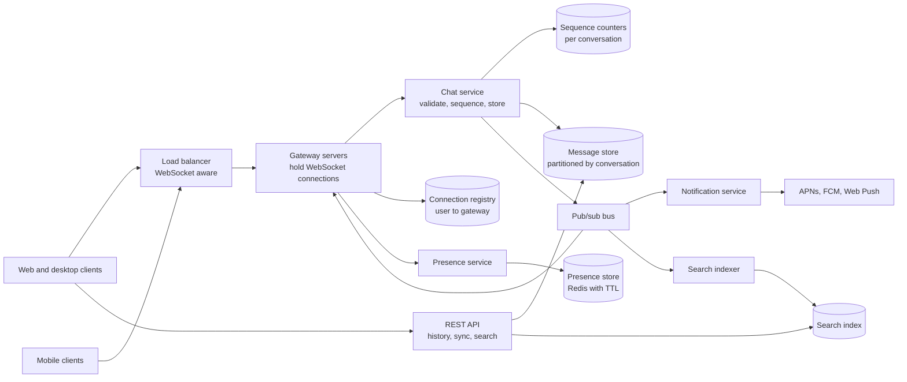
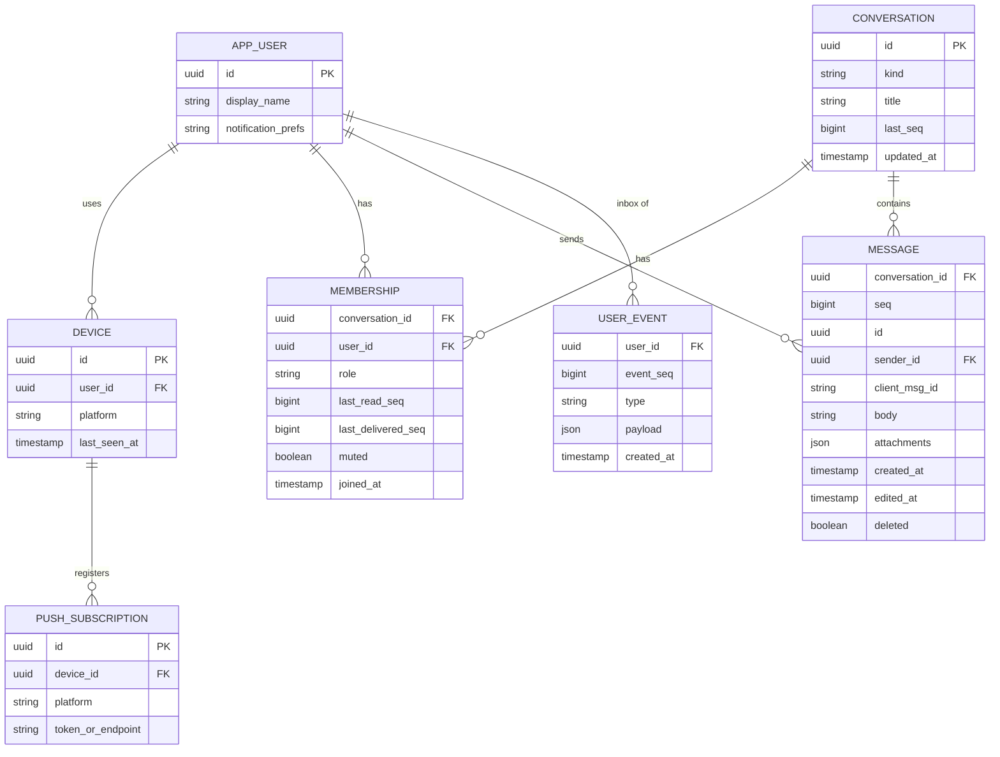
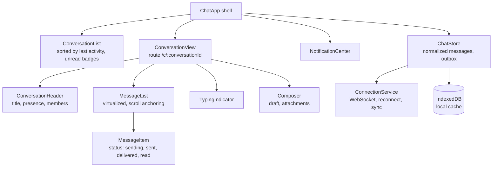
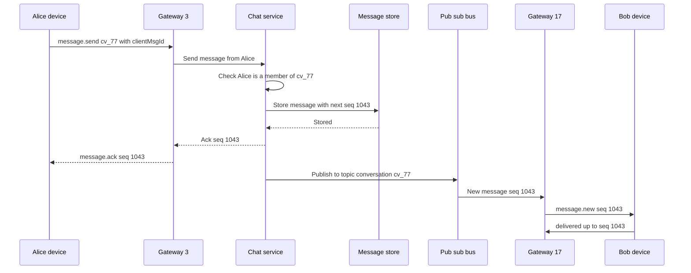
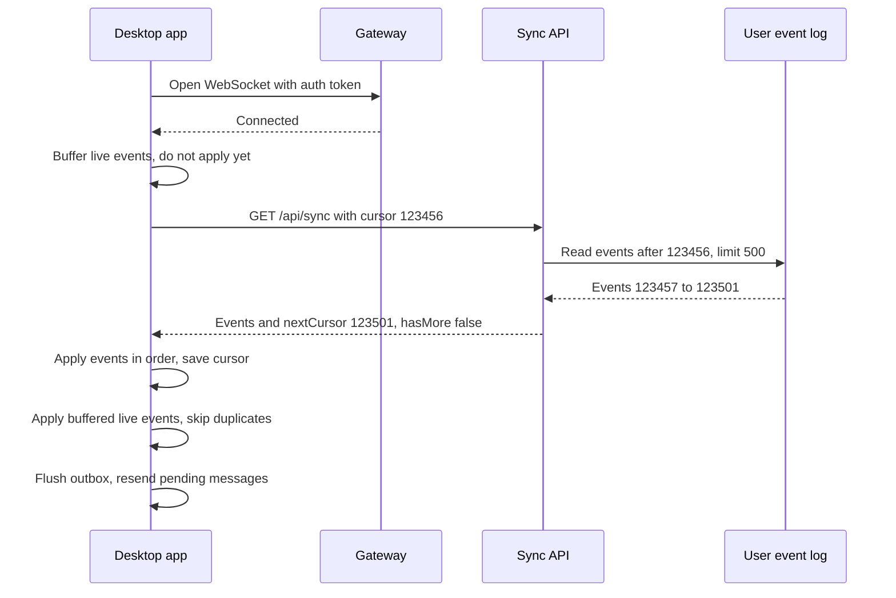
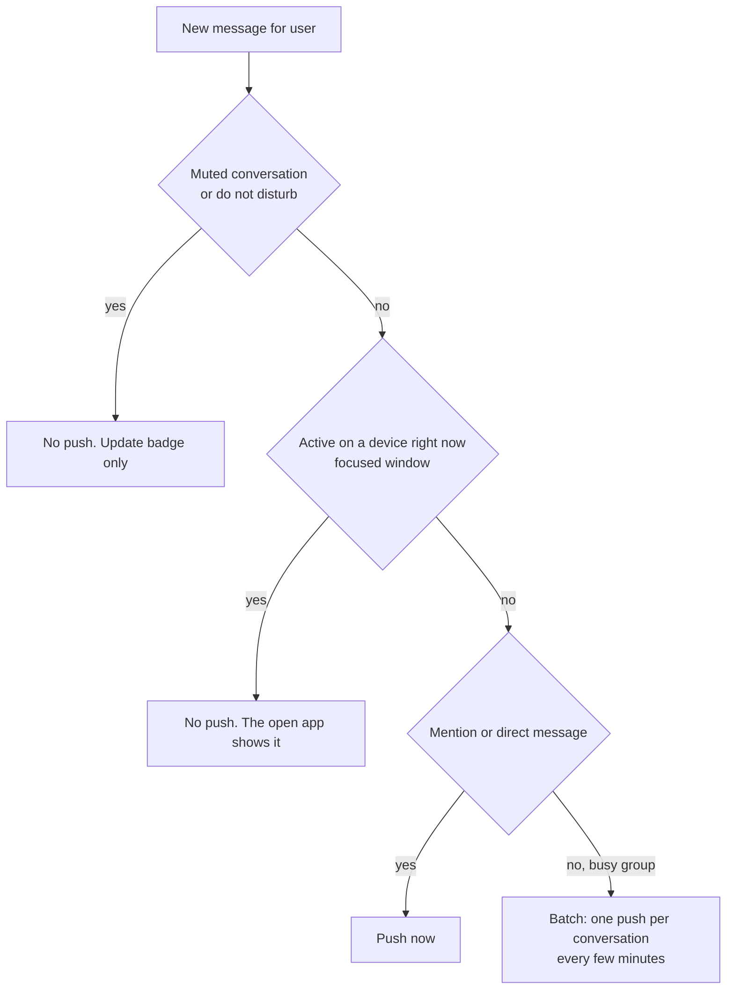

# Case Study: Real-time Chat and Notifications

> In this case study you will design a chat system with one-to-one and group conversations, presence ("online"), delivery and read receipts, offline sync and push notifications. You will learn how to scale millions of WebSocket connections, how to keep messages in order and never lost, and how the client stays correct after going offline. Chat is a classic interview problem because it tests real-time communication, distributed state and careful client design together.

**Before this:** [API styles and real-time communication](04-api-styles-and-real-time-communication.md) · [Scalability and core building blocks](02-scalability-and-core-building-blocks.md) · [Real-time updates on the frontend](../05-frontend-engineering/07-api-integration-and-data-fetching.md#real-time-updates-polling-sse-and-websockets) · [Node.js event loop](../07-nodejs-backend/02-node-event-loop.md) · **Interview questions:** [jump to the interview section](#interview-questions)

## Table of contents

1. [Problem statement](#problem-statement)
2. [Clarifying questions](#clarifying-questions)
3. [Requirements](#requirements)
4. [Estimates](#estimates)
5. [High-level architecture](#high-level-architecture)
6. [API design](#api-design)
7. [Data model](#data-model)
8. [Frontend architecture](#frontend-architecture)
9. [Deep dive 1: scaling WebSocket connections](#deep-dive-1-scaling-websocket-connections)
10. [Deep dive 2: message ordering and exactly-once display](#deep-dive-2-message-ordering-and-exactly-once-display)
11. [Deep dive 3: delivery receipts, read receipts and unread counts](#deep-dive-3-delivery-receipts-read-receipts-and-unread-counts)
12. [Deep dive 4: offline sync and reconnect](#deep-dive-4-offline-sync-and-reconnect)
13. [Deep dive 5: presence](#deep-dive-5-presence)
14. [Deep dive 6: push notifications](#deep-dive-6-push-notifications)
15. [Performance](#performance)
16. [Security](#security)
17. [Scalability](#scalability)
18. [Failure handling](#failure-handling)
19. [Observability](#observability)
20. [Trade-offs and alternatives](#trade-offs-and-alternatives)
21. [How to present this in 45 minutes](#how-to-present-this-in-45-minutes)
22. [Interview questions](#interview-questions)
23. [Summary](#summary)
24. [References](#references)

---

## Problem statement

"Design a chat application like Slack, Teams or WhatsApp, including notifications."

Users should be able to:

- Send and receive messages in one-to-one chats and group chats, in real time.
- See whether contacts are online ("presence") and who is typing.
- See delivery and read status ("sent", "delivered", "read by 3").
- Use several devices (browser, desktop app, phone). All stay in sync.
- Go offline and come back without losing or duplicating messages.
- Get push notifications when the app is closed.
- Scroll back through history and search it.

The core idea to say early:

> "A WebSocket is just a fast delivery pipe. It is not storage, and it can drop at any time. The durable source of truth is the message store, with a per-conversation sequence number. Everything else — real-time push, receipts, offline sync — is built on top of that sequence."

---

## Clarifying questions

| Question | Why you ask it | Assumed answer |
| --- | --- | --- |
| How many users? How many online at once? | Number of connections drives gateway design. | 10 million daily active users, up to 3 million connected at peak. |
| Max group size? | Fan-out cost and receipt design. | Groups up to 1,000 members. Larger "channels" are out of scope at first. |
| Message types? | Storage and upload design. | Text, emoji reactions, attachments (files and images via a separate upload service). |
| Multi-device? | Sync model. | Yes: web, desktop (Electron) and mobile. |
| End-to-end encryption? | Changes what the server can store, index and search. | No (workplace chat with server-side search). Mention E2EE as an alternative. |
| How long is history kept? | Storage size. | Forever by default; tenants can set retention. |
| Read receipts in groups? | Per-member receipts are expensive. | Show "read by N" plus the list on demand. |
| Is message order important? | Ordering guarantees. | Yes, within a conversation everyone must see the same order. |

---

## Requirements

### Functional requirements

1. Send and receive messages in one-to-one and group conversations in real time.
2. Message history with infinite scroll upward and search.
3. Delivery status per message: sending, sent, delivered, read.
4. Unread counts per conversation and a total badge.
5. Presence (online, away, offline) and typing indicators.
6. Multi-device sync: reading on the phone clears the unread badge on the desktop.
7. Offline: queue outgoing messages while offline; receive missed messages on reconnect.
8. Notifications: in-app, desktop and mobile push for new messages and mentions, with user preferences (mute, do not disturb).

### Non-functional requirements

| Quality | Target |
| --- | --- |
| Latency | Message delivered to online recipients in under 300 ms at p95 (same region). |
| Durability | A message acknowledged as "sent" is never lost. |
| Ordering | All members see the same order within a conversation. |
| No duplicates | Retries never show a message twice. |
| Availability | 99.99% for sending and receiving. |
| Scale | 3 million concurrent connections, about 14,000 messages per second at peak. |
| Battery and data | Mobile clients do not keep heavy connections in the background; they use push. |

---

## Estimates

**Messages**

- 10,000,000 daily users × 40 messages sent per day = 400,000,000 messages per day.
- 400,000,000 / 86,400 ≈ 4,630 messages per second on average. Peak about 3× → about 14,000 per second.

**Deliveries (fan-out)**

- Assume an average of 5 recipients per message (mix of 1:1 and groups).
- 400,000,000 × 5 = 2,000,000,000 deliveries per day ≈ 23,000 per second on average, about 70,000 per second at peak.
- Deliveries, not sends, are what the real-time layer must handle.

**Connections**

- 3,000,000 concurrent WebSocket connections at peak.
- One well-tuned server can hold tens of thousands of mostly idle connections. With 50,000 per server: 3,000,000 / 50,000 = 60 servers. Plan about 100 for headroom and failures.
- Heartbeats: if each connection sends a ping every 30 seconds, that is 3,000,000 / 30 = 100,000 small frames per second. Keep heartbeats cheap.

**Storage**

- About 1 KB per message including metadata and index overhead → 400,000,000 × 1 KB = 400 GB per day.
- 400 GB × 365 ≈ 146 TB per year. This needs a database that scales horizontally (wide-column stores like Cassandra or ScyllaDB are common for this), partitioned by conversation.
- Attachments are stored in object storage, not in the message table (see the [file upload case study](14-case-study-file-upload-service.md)).

---

## High-level architecture



What each part does:

- **Gateway servers** hold the long-lived WebSocket connections. They authenticate the connection, receive messages from clients and push messages to clients. They have almost no business logic, so they are easy to scale.
- **Connection registry** maps `userId → [gateway node, connection id]` for each device that is online. It lives in Redis.
- **Chat service** validates a message (is the sender a member?), assigns the next **sequence number** for the conversation, stores it and publishes it.
- **Message store** keeps every message, partitioned by `conversation_id` and sorted by sequence number.
- **Pub/sub bus** carries "new message in conversation X" to the gateways that have members of X connected. Redis pub/sub works at moderate scale; Kafka or NATS at larger scale.
- **Presence service** tracks who is online using heartbeats with TTLs.
- **Notification service** decides who should get a push notification (offline or inactive users, not muted) and sends it through Apple Push Notification service (APNs), Firebase Cloud Messaging (FCM) or Web Push.
- **REST API** for everything that is not real time: history pages, sync after reconnect, search, conversation settings.

---

## API design

### WebSocket protocol

One WebSocket per device. Messages are JSON frames with a `type`. (Binary formats like protobuf are an option at very large scale.)

**Client → server**

```json
{ "type": "message.send", "clientMsgId": "8c6b2f0e-3a1e-4c33-9b51-1f7d2c0a9e44", "conversationId": "cv_77", "body": "Can you review my PR?", "replyTo": null }
```

```json
{ "type": "read.update", "conversationId": "cv_77", "lastReadSeq": 1042 }
```

```json
{ "type": "typing", "conversationId": "cv_77" }
```

```json
{ "type": "ping" }
```

**Server → client**

```json
{ "type": "message.ack", "clientMsgId": "8c6b2f0e-3a1e-4c33-9b51-1f7d2c0a9e44", "conversationId": "cv_77", "seq": 1043, "createdAt": "2026-10-22T10:15:02.120Z" }
```

```json
{
  "type": "message.new",
  "conversationId": "cv_77",
  "message": { "id": "m_9f3", "seq": 1043, "senderId": "u_12", "body": "Can you review my PR?", "createdAt": "2026-10-22T10:15:02.120Z", "clientMsgId": "8c6b2f0e-..." }
}
```

```json
{ "type": "receipt", "conversationId": "cv_77", "userId": "u_31", "kind": "read", "upToSeq": 1043 }
```

```json
{ "type": "presence", "userId": "u_31", "status": "online" }
```

Key points:

- **`clientMsgId`** is a UUID made by the sender's device. It makes sending **idempotent**: if the device retries, the server finds the same `clientMsgId` and returns the original ack instead of storing a second copy.
- **`seq`** is assigned by the server, per conversation, strictly increasing. It defines the one true order.
- Receipts use **"up to seq"**, not one event per message. One read update can mark 50 messages as read.

### REST endpoints

```text
GET  /api/conversations?cursor=...                       → list with last message, unread count
GET  /api/conversations/cv_77/messages?beforeSeq=1000&limit=50   → older history (scroll up)
GET  /api/sync?cursor=eyJ1IjoiMTIzNDU2In0                 → everything that changed since the cursor
POST /api/conversations                                   { "memberIds": ["u_31", "u_44"], "title": "Release team" }
POST /api/push-subscriptions                              { "platform": "web", "endpoint": "...", "keys": { ... } }
GET  /api/search?q=release+notes&conversationId=cv_77
```

The sync endpoint is explained in [deep dive 4](#deep-dive-4-offline-sync-and-reconnect):

```json
{
  "events": [
    { "type": "message.new", "conversationId": "cv_77", "message": { "seq": 1044, "...": "..." } },
    { "type": "receipt", "conversationId": "cv_77", "userId": "u_31", "kind": "read", "upToSeq": 1044 },
    { "type": "conversation.updated", "conversationId": "cv_80", "title": "Release team (Q4)" }
  ],
  "nextCursor": "eyJ1IjoiMTIzNTAxIn0",
  "hasMore": false
}
```

---

## Data model



Design choices:

- **`MESSAGE` is partitioned by `conversation_id` and clustered by `seq`.** "Last 50 messages of conversation X" reads one partition in order. This is the most common query. Very busy conversations can be split into time buckets (`conversation_id + month`) so one partition does not grow forever.
- **`(conversation_id, client_msg_id)` is unique**, so a retried send is detected.
- **`MEMBERSHIP.last_read_seq`** stores read state as a **pointer**, not as a row per message per user. Unread count = `conversation.last_seq − membership.last_read_seq` (minus the user's own messages if you want to be exact).
- **`USER_EVENT`** is a per-user **inbox log** with its own sequence (`event_seq`). Every change that a user's devices must learn about (new message in any of their conversations, a receipt, a rename, being added to a group) is appended here. Devices sync by reading "events after my cursor". This makes multi-device sync simple. It costs extra writes: one per member per message. For large groups, store only lightweight pointers ("conversation cv_77 has new messages up to seq 1044") instead of copies.
- **Membership and conversation metadata** can live in a relational database. **Messages** go to a horizontally scalable store.

---

## Frontend architecture

### Component tree



### State ownership

| State | Owner | Notes |
| --- | --- | --- |
| Messages per conversation | `ChatStore`, normalized by `conversationId` then `seq` | Server data cached locally. Also saved in IndexedDB for instant start and offline reading. |
| Pending outgoing messages | `ChatStore` outbox, persisted in IndexedDB | Survive a page reload or app restart. |
| Unread counts | Computed from `lastSeq` and `lastReadSeq` | Not stored separately on the client, so they cannot drift. |
| Presence and typing | In-memory only | Short-lived; never persisted. |
| Current conversation | URL (`/c/cv_77`) | Deep links from notifications open the right chat. |
| Composer draft | Local per conversation (memory + `localStorage`) | Switching chats keeps each draft. |
| Sync cursor | IndexedDB | Tells the server where to resume after reconnect. |

In Angular 16, `ChatStore` can be an NgRx store with entity adapters, or a service with RxJS `BehaviorSubject`s. The WebSocket can use RxJS `webSocket()` from `rxjs/webSocket`, wrapped by a `ConnectionService` that adds reconnect, heartbeat and sync. See [RxJS](../06-angular-16/09-rxjs.md) and [state management](../06-angular-16/11-state-management-and-ngrx.md).

### The message list

A chat history list is a special kind of infinite scroll:

- It starts **at the bottom** (newest message) and loads **older** messages when you scroll **up**.
- When older messages are inserted above, the view must **not jump**. Keep the scroll position anchored to the message the user was looking at. The CSS property `overflow-anchor` helps in many browsers, but chat apps usually save the distance from the bottom before inserting and restore it after.
- When a new message arrives: if the user is at the bottom, scroll to show it. If they are reading older messages, **do not move them** — show a "3 new messages ↓" button instead.
- Long conversations are **virtualized** (only visible messages are in the DOM). Message heights vary (text length, images), so the virtual list must measure items. Reserve image space using width and height from the attachment metadata, so heights do not change after images load.
- For accessibility, the list uses `role="log"` (which is a polite live region), so screen readers announce new messages without stealing focus. Do not announce every message in a very busy channel. See [live regions](../05-frontend-engineering/04-accessibility.md#live-regions).

The virtual list technique and its trade-offs are explained in the [analytics dashboard case study](09-case-study-analytics-dashboard-and-large-tables.md#deep-dive-1-the-large-data-table) and the [news feed case study](12-case-study-news-feed-infinite-scroll.md).

### Optimistic sending

When the user presses Enter:

1. Create `clientMsgId`. Add the message to the store with `status: 'sending'` and a temporary position at the bottom.
2. Save it in the IndexedDB outbox.
3. Send it over the WebSocket (or keep it in the outbox if offline).
4. On `message.ack`, set `seq` and `status: 'sent'`, move it to its correct position by `seq`, and remove it from the outbox.
5. If no ack arrives in a few seconds, resend with the **same** `clientMsgId`. After several failures, show "Not sent. Tap to retry."

---

## Deep dive 1: scaling WebSocket connections

### Why WebSockets are harder to scale than HTTP

The general reasons are explained in [scaling WebSockets](04-api-styles-and-real-time-communication.md#scaling-websockets). In short: a normal HTTP request is short, and any server can answer it, then forget it. A WebSocket is a **long-lived, stateful connection**: the client is attached to one specific server for minutes or hours. That causes three problems:

1. **Routing a message to the right server.** User B is connected to gateway 17. The message from user A arrived at gateway 3. How does gateway 3 reach B?
2. **Many open connections** use memory and file descriptors even when idle.
3. **Deploys and crashes** disconnect thousands of users at once, who all reconnect at the same moment.

### Solving routing: registry + pub/sub



Two common ways to route:

- **Topic per conversation.** Each gateway subscribes to the topics of conversations its connected users belong to. When a message is published to `conversation:cv_77`, only gateways with members of cv_77 receive it. Simple, but a user in 500 conversations means 500 subscriptions per connected user.
- **Topic per gateway (or per user).** The chat service looks up members of cv_77, then asks the **connection registry** which gateways they are on, and publishes once per gateway. Fewer subscriptions, but a registry lookup per message.

At moderate scale, Redis pub/sub with either approach works well. Libraries like the Socket.IO Redis adapter implement the "broadcast across servers" part for you. At larger scale, use a broker built for high fan-out (for example NATS or Kafka) and partition topics.

### The ack comes after the store

Note the order in the diagram: the server **stores** the message **before** it sends `message.ack`. The ack means "it is durable". If the server crashes before the store, there is no ack, and the client resends with the same `clientMsgId`. Nothing is lost and nothing is duplicated.

The real-time push to Bob happens **after** the store too. If the push fails (Bob's connection just dropped), Bob gets the message later through sync. The push is an optimization; the store is the truth.

### Holding many connections

- Gateways should be **event-driven**: Node.js (with the `ws` library), Go, Elixir and Java Netty all handle many idle connections per process. Node.js is a good fit because idle sockets cost little and the event loop handles I/O without one thread per connection. See [Node.js runtime and architecture](../07-nodejs-backend/01-nodejs-runtime-and-architecture.md).
- Raise OS limits (open file descriptors) and tune memory per connection (small buffers).
- Keep gateways **thin**: authenticate, parse, forward, push. No database calls on the hot path except the registry.
- Use a **heartbeat**: the server sends a WebSocket ping (or the client sends an app-level ping) every 25–30 seconds. Many proxies and load balancers close connections idle for 60 seconds. Heartbeats also detect dead connections (a laptop that went to sleep never sends a close frame).

### Load balancing

- The load balancer must support WebSockets (HTTP Upgrade) and long idle timeouts.
- **Sticky sessions are not needed** for this design (see [sticky sessions](04-api-styles-and-real-time-communication.md#sticky-sessions)), because any gateway can serve any user: the registry and the bus make location irrelevant. (They *are* needed for some libraries' HTTP long-polling fallback, where several HTTP requests of one session must reach the same server.)
- Balance by **connection count** (least connections), not request count.

### Deploys and the reconnect storm

If you restart a gateway with 50,000 connections, 50,000 clients reconnect at once. If you restart all gateways, 3 million clients reconnect at once and overload authentication and sync.

- **Drain gracefully:** stop accepting new connections, then close existing ones slowly over a few minutes, with a "reconnect" close code.
- Clients reconnect with **exponential backoff and jitter** (random delay), so they spread out over time.

```js
// backoff.js — exponential backoff with "full jitter"
function reconnectDelay(attempt, { baseMs = 500, maxMs = 30_000, random = Math.random } = {}) {
  const cap = Math.min(maxMs, baseMs * 2 ** attempt);
  return Math.floor(random() * cap); // anywhere between 0 and cap
}

// With a fixed random value (0.5) to show the growth of the cap:
for (let attempt = 0; attempt < 8; attempt++) {
  console.log(attempt, reconnectDelay(attempt, { random: () => 0.5 }));
}
// 0 250
// 1 500
// 2 1000
// 3 2000
// 4 4000
// 5 8000
// 6 15000
// 7 15000
```

Without jitter, every client retries at exactly 0.5 s, 1 s, 2 s... and the waves stay synchronized. With jitter, the load is spread out.

---

## Deep dive 2: message ordering and exactly-once display

### Why order is tricky

- Alice and Bob send at the "same" time from different devices. Their clocks differ by seconds.
- Two messages from Alice can travel different network paths and arrive out of order.
- A retry can deliver the same message twice.

**Client timestamps cannot define order.** Device clocks are wrong, and users can change them.

### The solution: a server sequence per conversation

The chat service assigns `seq = last_seq + 1` for the conversation when it stores the message. Everyone sorts by `seq`. Everyone sees the same order.

How to assign `seq` safely when several chat service instances handle the same conversation:

- **Atomic counter:** `INCR conv:cv_77:seq` in Redis, or an `UPDATE conversation SET last_seq = last_seq + 1 ... RETURNING last_seq` in the database. Simple and correct. The counter for one conversation is a small hot spot, but one conversation rarely has more than a few messages per second.
- **Single writer per conversation:** route all sends of a conversation to one partition (for example a Kafka partition keyed by `conversationId`). The partition's consumer assigns sequence numbers in order.

> **Order is per conversation, not global.** There is no need for a global order across all conversations. Global ordering would be a massive bottleneck. Say this explicitly in the interview.

If you use a counter separate from the store, a crash between "got seq 1043" and "stored message 1043" leaves a **gap**. That is acceptable: clients must not assume sequences have no gaps. They use `seq` for ordering and the sync cursor for completeness.

### Exactly-once display on the client

Networks give you **at-least-once** delivery at best. The client makes display exactly-once by **de-duplicating**:

- Incoming messages are keyed by `(conversationId, seq)` or by message ID. A second copy replaces the first, it does not add.
- The sender's own optimistic message is matched by `clientMsgId` when the ack (or the echo through `message.new`) arrives.

```js
// merge-messages.js
function mergeMessage(list, incoming) {
  // 1. Replace a pending optimistic message with the same clientMsgId
  const pendingIndex = list.findIndex(m => m.seq == null && m.clientMsgId === incoming.clientMsgId);
  const withoutPending = pendingIndex >= 0 ? list.filter((_, i) => i !== pendingIndex) : list;

  // 2. Ignore duplicates of an already known seq
  if (withoutPending.some(m => m.seq === incoming.seq)) return withoutPending;

  // 3. Insert and keep sorted by seq (pending messages without seq stay at the bottom)
  const confirmed = [...withoutPending.filter(m => m.seq != null), incoming].sort((a, b) => a.seq - b.seq);
  const pending = withoutPending.filter(m => m.seq == null);
  return [...confirmed, ...pending];
}

let list = [
  { seq: 1041, body: 'Hi' },
  { seq: null, clientMsgId: 'c1', body: 'Can you review my PR?', status: 'sending' },
];
list = mergeMessage(list, { seq: 1043, clientMsgId: 'c1', body: 'Can you review my PR?', status: 'sent' });
list = mergeMessage(list, { seq: 1042, body: 'Sure, send the link' }); // arrived late
list = mergeMessage(list, { seq: 1043, clientMsgId: 'c1', body: 'Can you review my PR?', status: 'sent' }); // duplicate
console.log(list.map(m => `${m.seq}: ${m.body}`));
// [ '1041: Hi', '1042: Sure, send the link', '1043: Can you review my PR?' ]
```

### The "jumping message" UX problem

Alice sends "OK" at 10:00:00. Meanwhile Bob's message got `seq` 1042 and Alice's got 1043. Alice's message was shown at the bottom optimistically; it stays at the bottom. But in the opposite case, Alice's pending message may move **up** one place when its real `seq` arrives. Keep this movement small and smooth, and do not reorder messages the user has already scrolled past.

### Edits and deletes

An edit or delete does **not** change the message's `seq`. It is a separate event (`message.edited`, `message.deleted`) with its own position in the user event log, so devices learn about it during sync. Deleted messages become a tombstone ("This message was deleted") so `seq` positions stay stable.

---

## Deep dive 3: delivery receipts, read receipts and unread counts

### The three states

| State | Meaning | Who triggers it |
| --- | --- | --- |
| **Sent** (one check) | The server stored it. | Server ack to the sender. |
| **Delivered** (two checks) | At least one device of the recipient received it. | Recipient device acks `delivered up to seq`. |
| **Read** (blue checks) | The recipient saw it on screen. | Recipient device sends `read up to seq` when the message is visible and the window is focused. |

### Pointers, not per-message rows

Storing "Bob read message 1043" for every message and every member is a lot of rows: 2 billion deliveries per day would mean 2 billion receipt rows. Instead, store **one pointer per member per conversation**:

- `MEMBERSHIP.last_delivered_seq`
- `MEMBERSHIP.last_read_seq`

Reading message 1043 implies reading everything before it. One update covers many messages. Pointers only move forward:

```sql
UPDATE membership
SET last_read_seq = GREATEST(last_read_seq, $3)
WHERE conversation_id = $1 AND user_id = $2;
```

`GREATEST` makes the update safe when events arrive out of order (a late "read up to 1040" cannot move the pointer back from 1043).

### Group receipts

In a group of 200, the sender wants "Read by 37". Computing it: count members with `last_read_seq >= 1043`. For big groups:

- Do not push every member's read update to every other member (200 × 200 messages). Push receipt updates **only to the sender** of the message, and **throttle** them (for example once every few seconds, aggregated).
- Load the full "read by" list only when the sender opens message info.
- Many products turn off read receipts in large groups entirely.

### Unread counts

```js
// unread.js
function unreadCount(conversation, membership, ownMessagesAfterRead = 0) {
  return Math.max(0, conversation.lastSeq - membership.lastReadSeq - ownMessagesAfterRead);
}

console.log(unreadCount({ lastSeq: 1050 }, { lastReadSeq: 1043 }));    // 7
console.log(unreadCount({ lastSeq: 1050 }, { lastReadSeq: 1043 }, 2)); // 5 (2 of those were my own)
console.log(unreadCount({ lastSeq: 1043 }, { lastReadSeq: 1050 }));    // 0 (never negative)
```

The subtraction gives a fast **approximate** count (gaps in `seq`, deleted messages and your own messages make it slightly off). Many apps show "99+" anyway. For an exact count, count messages in the store with `seq > last_read_seq AND sender_id != me` — fine for one conversation, too slow for the whole conversation list on every load, so cache it.

### Multi-device read sync

Bob reads on his phone. His desktop must clear the badge:

1. The phone sends `read.update cv_77 up to 1043`.
2. The server updates `last_read_seq` and appends a `receipt` event to **Bob's own** user event log.
3. Bob's desktop receives the event (live, or on next sync) and clears the badge.

---

## Deep dive 4: offline sync and reconnect

### The rule

> After any disconnect, assume you missed events. Ask the server what changed since your last known position.

The WebSocket is not a reliable log. Messages pushed while the device was disconnected are gone from the pipe. The **sync endpoint** fills the gap.

### The sync cursor

Each device stores a **sync cursor**: the `event_seq` of the last user event it processed. On reconnect:



Why open the socket **first** and buffer live events? If you sync first and then connect, events that happen between the end of sync and the moment the socket opens are missed. Connect first, buffer, sync, then apply the buffer (dropping duplicates by `event_seq`).

### If the device was offline for a long time

After two weeks offline, there may be 100,000 events. Do not replay them all:

- If the cursor is too old (older than the log's retention, for example 30 days), the server answers `410 Gone` / "resync required".
- The client then does a **fresh start**: load the conversation list with unread counts and the last page of messages for each recent conversation. Older history loads lazily when the user scrolls.

### Sending while offline

- Messages go into the **outbox** (IndexedDB) with their `clientMsgId` and show "Waiting for network".
- On reconnect (after sync), the outbox is flushed in order. The server's `clientMsgId` check makes repeats safe.
- If the user was removed from the conversation while offline, the send is rejected with a clear error and the message stays visible as "Not sent".

### Local storage on each platform

- **Browser:** IndexedDB for messages, outbox and cursor. A service worker can cache the app shell so the app opens offline. Storage can be evicted by the browser under pressure; treat it as a cache.
- **Desktop (Electron):** IndexedDB in the renderer, or SQLite in the main process for large histories, accessed through a narrow IPC API. See [local databases in Electron](../08-electron-desktop/05-filesystem-child-processes-and-native-features.md#local-databases-sqlite-and-indexeddb).
- **Mobile:** SQLite (or a wrapper). Encrypt local data if the device may be shared or lost.

On logout, **delete local message data** for that account.

---

## Deep dive 5: presence

### What presence is

**Presence** is "who is online right now": online, away (idle for some minutes), offline, plus "last seen 10 minutes ago".

### How it works

- When a device connects, the gateway writes `presence:u_31 = online` in Redis with a **TTL** (for example 60 seconds), together with the device ID.
- Every heartbeat (every 30 seconds) **refreshes** the TTL.
- When the connection closes cleanly, the gateway deletes that device's entry.
- When a device disappears without closing (laptop lid closed, network lost), heartbeats stop and the TTL **expires** by itself. The user becomes offline within about a minute.
- A user is online if **any** of their devices is online. Store one key per device, or a Redis hash per user with one field per device.
- "Away" comes from the client: no mouse or keyboard activity for 5 minutes, or the window is hidden.

```text
HSET presence:u_31 dev_desktop "online|1729592102"
EXPIRE presence:u_31 60
```

### Presence fan-out is the expensive part

Every time someone goes online or offline, who needs to know? Everyone who has them in a visible contact list or open conversation. A user with 2,000 contacts going online would create 2,000 messages. Multiply by millions of users who come and go all day, and presence traffic can exceed message traffic.

Ways to reduce it:

- **Subscribe only to what is visible.** The client tells the server "I am looking at these 30 users" (open conversation members, visible part of the contact list). Presence updates are sent only for those.
- **Debounce flapping.** A phone on a train connects and disconnects every minute. Wait 10–30 seconds before announcing "offline".
- **Large groups:** do not show live presence for 1,000 members; show "37 online" computed lazily.
- **Typing indicators** are even more short-lived: send at most one "typing" event every 3 seconds, never store it, and expire it on the client after 5 seconds without a new event.

Presence is **soft state**: it can be slightly wrong without harm. Do not put it in the durable message store.

---

## Deep dive 6: push notifications

### When to notify

The notification service listens to `message.new` events and decides, per recipient:



Rules:

- **Do not notify where the user is already looking.** If the desktop app is focused, do not also buzz the phone. Clients report "active" state to the presence service.
- **Batch and collapse.** Ten messages in a group become one notification "10 new messages in Release team". APNs and FCM support collapse identifiers so newer notifications replace older ones.
- **Respect preferences:** mute, do not disturb hours, mentions only.
- **Clear notifications** on other devices when the message is read (send a silent/data push or let the OS badge update from the unread count).

### Platforms

| Platform | Mechanism |
| --- | --- |
| iOS | Apple Push Notification service (APNs), device token |
| Android | Firebase Cloud Messaging (FCM), registration token |
| Web browsers | Web Push API + a service worker. The server sends encrypted messages to the browser vendor's push service, authenticated with VAPID keys. |
| Desktop (Electron) | When the app is running, show OS notifications with Electron's `Notification` API from the main process. When it is closed, there is no push channel unless you use the OS's own services. See [Electron notifications](../08-electron-desktop/05-filesystem-child-processes-and-native-features.md#notifications). |

Web Push in short:

1. The page asks permission (only after a user action, like clicking "Enable notifications" — not on page load).
2. The service worker calls `registration.pushManager.subscribe({ userVisibleOnly: true, applicationServerKey })`.
3. The subscription (endpoint URL + keys) is sent to `POST /api/push-subscriptions`.
4. The server sends a push through the endpoint. The service worker's `push` event shows a notification, even if no tab is open.

### Privacy in push payloads

Push messages travel through Apple's, Google's or the browser vendor's servers. Web Push payloads are encrypted end to end between your server and the browser. For mobile, avoid putting full message text in the payload if your security policy forbids it: send "New message from Priya" and let the app fetch the content after it wakes up.

### Reliability

- Push services can drop, delay or throttle notifications. **Push is best effort.** It is never the only way a message reaches the user; sync on app open is.
- Remove tokens the provider reports as invalid (uninstalled app, expired subscription).
- Retry transient provider errors with backoff, but drop notifications that are too old to be useful.

### The in-app notification center

Besides chat messages, the product has other notifications (mentions, "you were added to a group", "your export is ready"). Store them per user with an ID, a type, a `read` flag and a link. The bell shows unread count. They arrive live through the same WebSocket and are synced through the same user event log. Cap stored items (for example 500 per user) and paginate.

---

## Performance

| Area | Technique |
| --- | --- |
| Send latency | Thin gateways, one store write, publish right after. Region-local gateways and stores. |
| Fan-out | Publish once per gateway, not once per recipient. Gateways fan out locally to their connections. |
| App start | Show cached conversations and messages from IndexedDB at once, then sync in the background. |
| History | Load 50 messages per page, newest first. Virtualize long conversations. Reserve image sizes. |
| Payload size | Compact JSON frames, or binary (protobuf) at scale. Enable WebSocket compression (`permessage-deflate`) carefully: it costs CPU and memory per connection. |
| Presence | Subscribe only to visible users, debounce flapping. |
| Rendering | Batch incoming messages into one render per animation frame in busy channels. In Angular, run the socket outside the zone and enter it once per batch. |
| Mobile battery | No persistent socket in the background; rely on push and sync on open. |

---

## Security

1. **Authenticate the WebSocket.** The handshake is an HTTP request, so cookies are sent, or the client passes a short-lived token. Avoid long-lived tokens in the URL query string, because URLs end up in logs. A common pattern: get a one-time ticket from `POST /api/ws-ticket` (authenticated with the normal session) and pass it in the connection URL; the gateway checks and burns it.
2. **Check the `Origin` header** on the WebSocket handshake. Browsers send cookies with cross-site WebSocket connections, so without an Origin check an evil site could open a socket as the user (cross-site WebSocket hijacking).
3. **Authorize every action**, not just the connection: "is this user a member of cv_77?" for every send, read update and history request. Membership can change while the socket is open.
4. **Revocation:** when a user is removed from a group or their account is disabled, the server closes affected subscriptions or the whole connection.
5. **Validate and limit messages:** maximum size, rate limit per user (for example 10 messages per second), reject unknown frame types.
6. **XSS:** message text is untrusted. Render as text, never as raw HTML. If you support Markdown, use a safe renderer with an allow-list. Link previews are fetched by the server with SSRF protection (block internal IP ranges). See [web security](../01-cs-and-web-fundamentals/08-browser-storage-and-web-security-basics.md).
7. **Attachments** go through the upload service with virus scanning and signed download URLs. See the [file upload case study](14-case-study-file-upload-service.md).
8. **Encryption:** TLS (`wss://`) always. Encrypt data at rest. For end-to-end encryption, the server cannot read messages — see trade-offs.
9. **Local data:** clear IndexedDB/SQLite on logout. On desktop, follow [Electron security](../08-electron-desktop/04-electron-security.md) — a chat app renders untrusted content all day.

---

## Scalability

- **Gateways** scale horizontally by connection count. About 100 servers for 3 million connections, with headroom.
- **Chat service** is stateless. Scale by CPU.
- **Message store** is partitioned by conversation. Wide-column stores (Cassandra, ScyllaDB) or sharded relational databases both work. Very active conversations are bucketed by time.
- **Sequence counters:** partitioned by conversation, so there is no global bottleneck.
- **Pub/sub** is partitioned by conversation or gateway. Redis pub/sub does not store messages — if a gateway is disconnected from Redis briefly, it misses publishes. That is acceptable **only because** clients sync on reconnect, and gateways can force their clients to resync after their own bus reconnect.
- **User event log** is partitioned by user. For very large groups, write lightweight pointers instead of full copies.
- **Multi-region:** users connect to the nearest region. A conversation has a **home region** that assigns its sequence numbers; other regions forward sends there. This keeps one ordering authority per conversation.

See [scalability and core building blocks](02-scalability-and-core-building-blocks.md).

---

## Failure handling

| Failure | What happens |
| --- | --- |
| Client network drops | Reconnect with backoff and jitter. Then sync from the cursor. Outbox resends with the same `clientMsgId`. |
| Gateway crashes | Its clients reconnect to other gateways. Registry entries expire by TTL. Nothing durable is lost. |
| Pub/sub hiccup | Some live pushes are missed. Clients catch up through sync. Gateways tell clients to resync after the bus reconnects. |
| Chat service crashes after storing, before ack | The client resends; the server finds the `clientMsgId` and returns the existing `seq`. |
| Message store unavailable | Sends fail fast; clients keep messages in the outbox with "Waiting…". Reading cached history still works. |
| Push provider down | Notifications are delayed or dropped. Users still see messages on next open via sync. |
| Reconnect storm after deploy | Graceful draining, jittered backoff, rate limits on the sync API with `Retry-After`. |
| Sync cursor too old | Server returns "resync required"; client does a fresh start. |
| Clock skew | Irrelevant for order (server `seq`). Display times come from the server's `createdAt`. |

See [Production Node.js](../07-nodejs-backend/14-production-nodejs.md).

---

## Observability

- **Connections:** current connections per gateway, connects and disconnects per second, close codes, reconnect rate (a spike means trouble).
- **Latency:** time from send to ack, and from store to delivery on the recipient's device (clients report delivered timestamps; sample them).
- **Throughput:** messages per second, deliveries per second, pub/sub lag.
- **Correctness:** rate of duplicate `clientMsgId` (retries), sync gaps found, outbox age on clients.
- **Push:** sent, failed, invalid tokens, provider latency.
- **Per-message tracing** with the message ID and `clientMsgId`, sampled.
- **Frontend:** time to first conversation render, WebSocket reconnect count per session, JavaScript errors.

See [Production Node.js](../07-nodejs-backend/14-production-nodejs.md).

---

## Trade-offs and alternatives

| Decision | We chose | Alternative | When the alternative is better |
| --- | --- | --- | --- |
| Transport | WebSockets | SSE for downstream + HTTP POST for sends; or long polling | Simpler infrastructure, strict proxies, notification-only features. See [API styles](04-api-styles-and-real-time-communication.md). |
| Order | Per-conversation server `seq` | Client timestamps; vector clocks or CRDTs | Peer-to-peer or E2EE systems where no server can order messages. |
| Fan-out | On write: publish to gateways and append to user event logs | On read: devices poll conversations they belong to | Huge broadcast channels (100,000 members): write once, readers pull. |
| Receipts | Pointers (`last_read_seq`) | Per-message receipt rows | Small groups needing exact per-message read lists for compliance. |
| Presence | TTL keys in Redis, visible-only subscriptions | Full presence broadcast | Very small teams. |
| Storage | Wide-column store partitioned by conversation | PostgreSQL | Smaller scale. PostgreSQL with good indexes handles a lot and keeps the stack simple. |
| Encryption | TLS + at rest, server can read (enables search) | End-to-end encryption (for example the Signal protocol) | Privacy-first consumer chat. The cost: no server-side search, harder multi-device sync and key management. |
| Build vs buy | Build | Hosted chat services or managed WebSocket platforms | Chat is not the core product. |

---

## How to present this in 45 minutes

**Minutes 0–5: clarify.**
> "How many daily users and how many connected at once? Max group size? Multi-device? End-to-end encryption? How long do we keep history? Do we need read receipts in groups? ... OK: 10 million daily users, 3 million connected at peak, groups up to 1,000, web, desktop and mobile, no E2EE so we can search, history kept forever, and 'read by N' in groups."

**Minutes 5–9: numbers.**
> "400 million messages a day is about 4,600 a second, around 14,000 at peak. With 5 recipients on average, that's about 70,000 deliveries a second at peak. 3 million connections at about 50,000 per server is 60 servers, so I'd plan around 100. Storage is about 400 GB a day, roughly 146 TB a year, so a horizontally scalable store partitioned by conversation."

**Minutes 9–16: high-level design.**
> "Clients hold one WebSocket each to a gateway. Gateways are thin. A message goes to the chat service, which checks membership, assigns the next per-conversation sequence number, stores it, acks the sender, and publishes to a pub/sub bus. Gateways that have members of that conversation push it out. A registry maps users to gateways, presence uses TTL keys, and a notification service sends push to users who aren't active. Everything non-real-time — history, sync, search — is REST."

**Minutes 16–20: API and data model.**
> "The client sends a clientMsgId with each message, so retries are idempotent. The server's seq defines order. Receipts are 'up to seq' pointers on the membership row, so one update marks many messages. A per-user event log with its own sequence drives multi-device sync."

**Minutes 20–38: deep dives.**
- Scaling sockets: routing through registry and pub/sub, ack after store, heartbeats, no sticky sessions needed, draining and jittered backoff.
- Ordering: server `seq` per conversation, no global order, gaps allowed, client de-duplication by `seq` and `clientMsgId`.
- Receipts and unread: pointers with `GREATEST`, throttled group receipts, unread = `lastSeq − lastReadSeq`.
- Offline: connect, buffer, sync from cursor, apply, flush outbox; fresh start when the cursor is too old; IndexedDB/SQLite.
- Presence: TTL heartbeats, any device online, visible-only subscriptions, debounce flapping.
- Push: decision flow, collapse, APNs/FCM/Web Push, privacy, best effort.

**Minutes 38–43: failure, security, observability.**
> "The main rule: after any disconnect, sync. That makes gateway crashes and pub/sub hiccups harmless. For security: authenticate the handshake with a short-lived ticket, check Origin, authorize every action, rate-limit, render text safely. I'd alert on reconnect spikes and send-to-ack latency."

**Minutes 43–45: trade-offs.**
> "For huge broadcast channels I'd switch to fan-out on read. If privacy required E2EE, we'd lose server search and need a key management design. At smaller scale, PostgreSQL and Redis pub/sub are enough."

---

## Interview questions

### Q1. How do you deliver a message to a user connected to a different server?

**What the interviewer is checking:** understanding of stateful connections and cross-server routing.

**Short spoken answer (30–60 seconds):**
> "Each WebSocket is attached to one gateway, so I need a way for any server to reach any connection. I keep a connection registry in Redis that maps each user's devices to their gateway, and I use a pub/sub bus. When a message is stored, the chat service publishes it — either to a topic for the conversation that gateways subscribe to, or directly to the gateways that the registry says hold members. Each gateway then pushes to its local connections. If a push fails because the user just disconnected, that's fine: the message is already stored, and the device gets it through sync when it reconnects."

**Follow-up questions:**
- **Do you need sticky sessions?** — Not for WebSockets themselves: a connection stays on one server by nature, and on reconnect any gateway works because routing goes through the registry and bus. Sticky sessions matter for HTTP long-polling fallbacks where many requests belong to one logical session.
- **What does Redis pub/sub not guarantee?** — It does not store messages. Subscribers that are disconnected miss them. That is acceptable only because clients sync from the durable store after reconnects.
- **How is this done with Socket.IO?** — Socket.IO's Redis adapter broadcasts events between Socket.IO servers using Redis pub/sub, so `io.to(room).emit()` reaches sockets on all servers.

**Common mistakes:** keeping all connections on one server; treating the bus as storage.

**Where this is used in real projects:** every scaled WebSocket system, from chat to live dashboards and multiplayer games.

### Q2. How do you guarantee message order?

**What the interviewer is checking:** why client clocks fail, and why ordering should be scoped.

**Short spoken answer (30–60 seconds):**
> "I never trust client timestamps — clocks are wrong and messages travel different paths. The server assigns a sequence number per conversation when it stores the message, using an atomic counter or a single writer per conversation partition. All clients sort by that seq, so everyone sees the same order. I only guarantee order within a conversation, because a global order would be a huge bottleneck and nobody needs it. Clients must accept gaps in seq, for example after a crash between getting a number and storing, and they de-duplicate by seq."

**Follow-up questions:**
- **What about multi-region?** — Give each conversation a home region that assigns sequence numbers. Users in other regions send through their local gateway, which forwards to the home region. Slightly higher latency for remote members, but one ordering authority.
- **What does the sender see before the seq arrives?** — An optimistic message at the bottom with "sending" status, matched later by `clientMsgId`.

**Common mistakes:** sorting by `createdAt` from the client; claiming a global total order.

**Where this is used in real projects:** chat systems, collaborative tools and event-sourced systems all use per-stream sequence numbers.

### Q3. How do you avoid losing or duplicating messages?

**What the interviewer is checking:** at-least-once delivery plus idempotency.

**Short spoken answer (30–60 seconds):**
> "No loss: the server acks a message only after it's durably stored. If the client gets no ack, it resends. Messages waiting to be sent sit in a persistent outbox, so even a reload or crash doesn't lose them. No duplicates: every message has a clientMsgId from the sender, and the server has a unique constraint on conversation plus clientMsgId, so a resend returns the original seq instead of storing a copy. On the receiving side, delivery is at-least-once — pushes plus sync can deliver the same message twice — so the client de-duplicates by seq or message ID. At-least-once plus idempotent handling gives you effectively exactly-once display."

**Follow-up questions:**
- **Is exactly-once delivery possible?** — Not over an unreliable network in general. You build "exactly-once effect" from at-least-once delivery and idempotent processing.
- **Where should the outbox live in a browser?** — IndexedDB, because it survives reloads and works in service workers. `localStorage` is synchronous and small.

**Common mistakes:** acking before storing; generating a new ID on each retry.

**Where this is used in real projects:** messaging apps, payment systems, queue consumers.

### Q4. How do read receipts work in a group of 500 people?

**Short answer:** Store one pointer per member: `last_read_seq`. Reading message 1043 moves the pointer to 1043 (only forward, using `GREATEST`). "Read by N" is the count of members whose pointer is at least that seq. Do not broadcast every member's read update to all 500 members; send aggregated, throttled updates only to the message's sender, and load the full list on demand. Many products turn off detailed receipts in large groups.

### Q5. A user's laptop sleeps for 3 hours and wakes up. Walk me through what happens.

**What the interviewer is checking:** reconnect and sync design, including the race between live events and sync.

**Short spoken answer (30–60 seconds):**
> "The socket is dead, but the client may not know yet. On wake, the browser fires online/visibility events, or the heartbeat times out, so the client reconnects with backoff and jitter. After the socket opens, it buffers live events but doesn't apply them yet. It calls the sync API with its saved cursor and gets everything that happened in its user event log since then — new messages, receipts, renames — in pages. It applies those in order, saves the new cursor, then applies the buffered live events, skipping duplicates. Finally it flushes the outbox. If the cursor were too old, the server would say 'resync required' and the client would reload the conversation list and recent messages instead."

**Follow-up questions:**
- **Why buffer live events instead of syncing first?** — If you sync and then connect, events between the end of sync and the socket opening are lost. Connect first, then sync, then merge.
- **How do you detect sleep?** — Heartbeat timeouts, the `online` event, `visibilitychange`, or noticing a large jump in time between timer ticks. On desktop, Electron's `powerMonitor` emits `resume`. See [power monitor](../08-electron-desktop/05-filesystem-child-processes-and-native-features.md#power-monitor-sleep-resume-and-lock).

**Common mistakes:** "the WebSocket will deliver what I missed"; replaying everything from the beginning.

**Where this is used in real projects:** every chat and collaboration client.

### Q6. How do you implement presence for millions of users?

**What the interviewer is checking:** soft state, TTLs and fan-out control.

**Short spoken answer (30–60 seconds):**
> "Each connected device has a key in Redis with a TTL of about a minute, refreshed by heartbeats. A user is online if any device key exists. If a laptop disappears without closing the socket, the TTL just expires. The hard part is fan-out: telling everyone who cares. So clients subscribe only to users they're currently showing — the open conversation's members and the visible contacts — and I debounce flapping connections for 10 to 30 seconds before announcing offline. Presence is soft state; it's okay to be a few seconds wrong, so it never goes into the durable store."

**Follow-up questions:**
- **How is "last seen" stored?** — Write the timestamp on disconnect or TTL expiry to a durable store, but only when it changes meaningfully (for example at most once per minute).
- **Privacy?** — Let users hide presence and last seen. The server must enforce that setting when answering presence queries.

**Common mistakes:** broadcasting every presence change to every contact; storing presence in the main database.

**Where this is used in real projects:** chat apps, collaborative editors ("who's viewing this document").

### Q7. WebSockets, SSE or long polling for chat?

**Short answer:** Chat is two-way and latency-sensitive, so **WebSockets** are the natural fit: one connection carries sends, receipts, typing and pushes. SSE can work (SSE for server → client, normal HTTP POST for sends) and is simpler through some proxies, but typing indicators and acks then cost a request each. Long polling is a fallback for networks that block WebSockets. Whatever the transport, the design is the same: durable store, sequence numbers and sync. Comparison in [API styles and real-time communication](04-api-styles-and-real-time-communication.md).

### Q8. How do you decide when to send a push notification?

**Short answer:** The notification service checks, per recipient: is the conversation muted or is do-not-disturb on (then only update the badge)? Is the user active on a device right now (then no push — the app shows it)? Is it a direct message or mention (push now) or a busy group (batch into one notification every few minutes)? Collapse notifications per conversation, clear them when read on another device, and treat push as best effort — the source of truth is always sync.

### Q9. How do you authenticate a WebSocket connection securely?

**What the interviewer is checking:** handshake security details people often miss.

**Short spoken answer (30–60 seconds):**
> "The WebSocket handshake is an HTTP GET with an Upgrade header, so I can authenticate it like a request. If the app uses a cookie session, the cookie is sent automatically — but then I must check the Origin header, because a malicious site can open a WebSocket to my server and the browser will attach the user's cookies. If the app uses tokens, I avoid putting a long-lived token in the URL, since URLs get logged; instead I fetch a short-lived, single-use ticket over an authenticated HTTP call and pass that. After connecting, I still authorize every action, because membership can change while the socket is open, and I close the connection when the session is revoked."

**Follow-up questions:**
- **Why can't you set an `Authorization` header?** — The browser `WebSocket` API does not let you set custom headers on the handshake. That is why cookies, a query parameter ticket or a first "auth" message are used.
- **What about token expiry during a long connection?** — The server checks expiry and asks the client to re-authenticate (send a fresh token message) or closes the socket with a specific code so the client reconnects with a new ticket.

**Common mistakes:** no Origin check; only checking auth at connect time.

**Where this is used in real projects:** any authenticated real-time feature.

### Q10. A celebrity channel has 100,000 members. What changes?

**Short answer:** Fan-out on write (appending to 100,000 user event logs and pushing to every gateway) becomes too expensive per message. Switch to **fan-out on read** for big channels: store the message once; members' devices fetch new messages when they open the channel, and only a lightweight "channel has new messages up to seq N" signal is pushed (or members poll). Turn off per-member receipts and presence, rate-limit who can post, and send push notifications only for mentions. The same hybrid idea is used in the [news feed case study](12-case-study-news-feed-infinite-scroll.md).

### Q11. How do you keep the message list from jumping when older messages load?

**Short answer:** Before inserting older messages at the top, record the distance from the bottom of the scroll container (`scrollHeight − scrollTop`). After the DOM updates, set `scrollTop = newScrollHeight − savedDistance`. Reserve space for images using their known dimensions so heights do not change later. CSS `overflow-anchor` handles some cases automatically, but virtualized chat lists usually manage it explicitly. For new messages at the bottom, auto-scroll only if the user was already at the bottom; otherwise show a "new messages" button.

### Q12. How would you test this system?

**What the interviewer is checking:** testing distributed and real-time behavior, not just units.

**Short spoken answer (30–60 seconds):**
> "Unit tests for the pure logic — merging messages, unread counts, backoff, receipt pointers. Integration tests that run two clients against a real gateway and check order and de-duplication when I inject delays and duplicates. Failure tests: kill a gateway mid-conversation and assert both clients converge to the same history after reconnect; drop the pub/sub connection; replay old sync cursors. Load tests that open hundreds of thousands of idle connections and measure memory per connection and send-to-delivery latency. And end-to-end tests in real browsers for the scroll behavior and notification permission flow."

**Common mistakes:** only testing the happy path with one client.

**Where this is used in real projects:** chaos testing and connection load testing are standard for real-time platforms. See [Angular testing](../06-angular-16/14-testing.md).

### Q13. How does end-to-end encryption change the design?

**Short answer:** The server only stores and forwards encrypted blobs. It cannot search, generate link previews or moderate content. Each device has its own keys, so a message to a user with 3 devices is encrypted for each device (or uses group key schemes). Adding a new device needs a way to share history or start fresh. Ordering and delivery (sequence numbers, receipts, sync) still work, because they use metadata, not content. Push payloads contain no readable text. It is a big increase in client complexity and key management.

---

## Summary

- A WebSocket is a **delivery pipe**, not storage. The **message store with a per-conversation `seq`** is the truth.
- **Ack after store.** Clients resend with the same **`clientMsgId`**, so sends are idempotent.
- Order is **per conversation**, assigned by the server. No client clocks, no global order. Gaps are allowed.
- Clients **de-duplicate** by `seq` and `clientMsgId`: at-least-once delivery, exactly-once display.
- Route across servers with a **connection registry + pub/sub**. Gateways stay thin. Heartbeats detect dead connections.
- Receipts and unread counts use **pointers** (`last_read_seq`), moved forward with `GREATEST`.
- **After any disconnect, sync from a cursor.** Connect first, buffer, sync, merge, then flush the outbox.
- **Presence** is soft state: TTL keys refreshed by heartbeats, visible-only subscriptions, debounced flapping.
- **Push** only when the user is not active, collapse and batch, respect preferences; push is best effort.
- Survive deploys with **graceful draining** and **exponential backoff with jitter**.

## References

- RFC 6455 — The WebSocket Protocol: https://www.rfc-editor.org/rfc/rfc6455
- MDN — WebSocket API: https://developer.mozilla.org/en-US/docs/Web/API/WebSockets_API
- MDN — Push API: https://developer.mozilla.org/en-US/docs/Web/API/Push_API
- MDN — Notifications API: https://developer.mozilla.org/en-US/docs/Web/API/Notifications_API
- MDN — IndexedDB API: https://developer.mozilla.org/en-US/docs/Web/API/IndexedDB_API
- MDN — ARIA `log` role: https://developer.mozilla.org/en-US/docs/Web/Accessibility/ARIA/Roles/log_role
- RFC 8292 — VAPID for Web Push: https://www.rfc-editor.org/rfc/rfc8292
- Apple Developer — User Notifications (APNs): https://developer.apple.com/documentation/usernotifications
- Firebase — Cloud Messaging: https://firebase.google.com/docs/cloud-messaging
- Socket.IO documentation — Redis adapter: https://socket.io/docs/v4/redis-adapter/
- Redis documentation — Pub/Sub: https://redis.io/docs/latest/develop/interact/pubsub/
- OWASP — WebSocket Security Cheat Sheet: https://cheatsheetseries.owasp.org/cheatsheets/WebSocket_Security_Cheat_Sheet.html
- Electron documentation — Notifications: https://www.electronjs.org/docs/latest/tutorial/notifications
- AWS Architecture Blog — Exponential Backoff and Jitter: https://aws.amazon.com/blogs/architecture/exponential-backoff-and-jitter/
