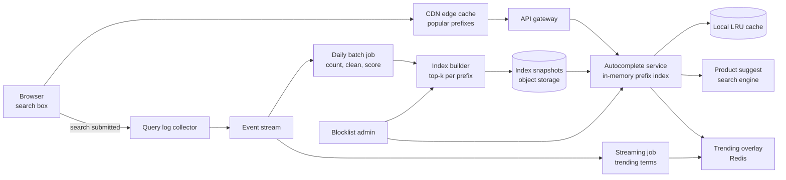
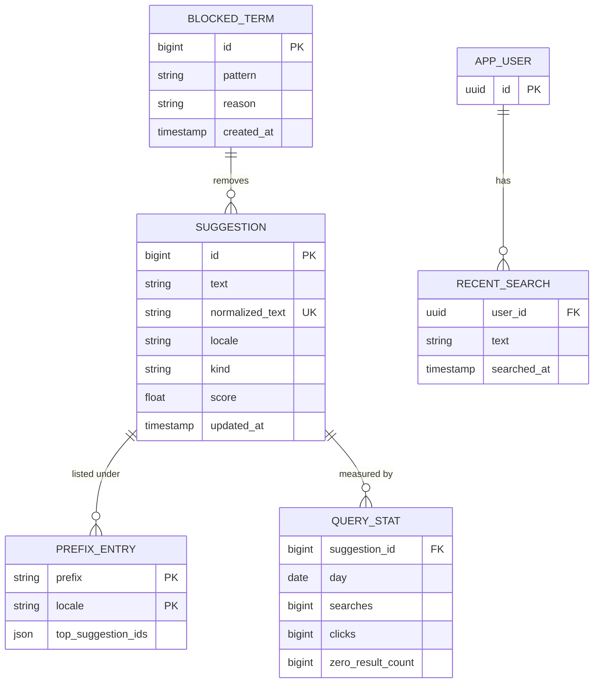
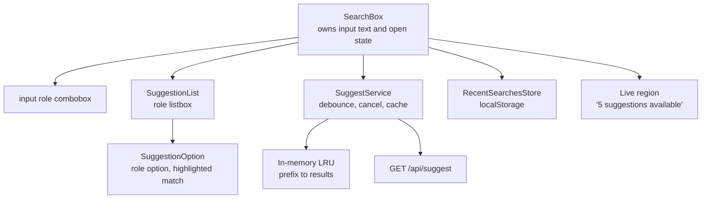
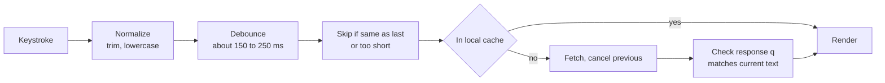
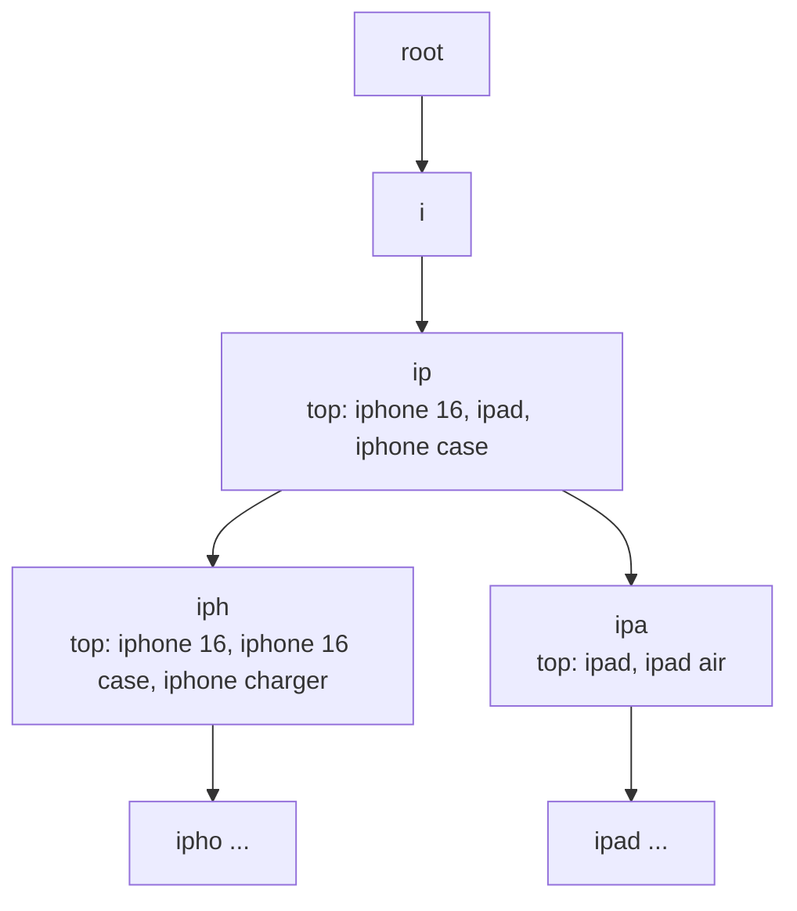
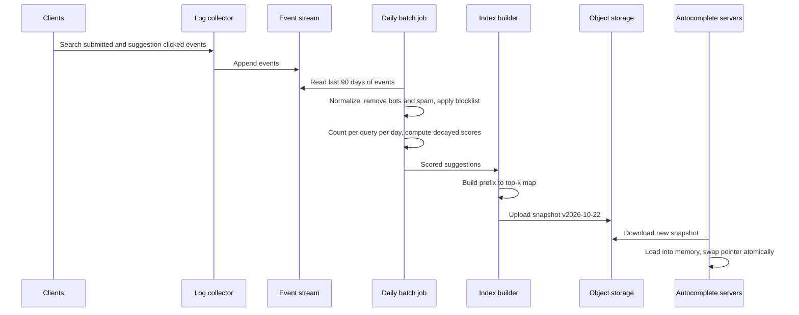

# Case Study: Autocomplete Search

> In this case study you will design search autocomplete (typeahead): the box that suggests "iphone 16 case" after you type "iph". You will learn the frontend side (debounce, request cancellation, caching, race conditions and a fully keyboard-accessible combobox) and the backend side (prefix indexes and tries, search engines, ranking and caching popular prefixes). This problem is asked in both frontend and backend interviews because it is small enough to cover end to end, but every layer has a real trap.

**Before this:** [System design interview approach](01-system-design-interview-approach.md) · [Debounce, throttle and performance](../02-javascript/20-debounce-throttle-and-performance.md) · [API integration and data fetching](../05-frontend-engineering/07-api-integration-and-data-fetching.md) · [Accessibility](../05-frontend-engineering/04-accessibility.md) · **Interview questions:** [jump to the interview section](#interview-questions)

## Table of contents

1. [Problem statement](#problem-statement)
2. [Clarifying questions](#clarifying-questions)
3. [Requirements](#requirements)
4. [Estimates](#estimates)
5. [High-level architecture](#high-level-architecture)
6. [API design](#api-design)
7. [Data model](#data-model)
8. [Frontend architecture](#frontend-architecture)
9. [Deep dive 1: the request pipeline on the client](#deep-dive-1-the-request-pipeline-on-the-client)
10. [Deep dive 2: keyboard accessibility and the combobox pattern](#deep-dive-2-keyboard-accessibility-and-the-combobox-pattern)
11. [Deep dive 3: the prefix index](#deep-dive-3-the-prefix-index)
12. [Deep dive 4: ranking and the data pipeline](#deep-dive-4-ranking-and-the-data-pipeline)
13. [Deep dive 5: caching popular prefixes](#deep-dive-5-caching-popular-prefixes)
14. [Performance](#performance)
15. [Security](#security)
16. [Scalability](#scalability)
17. [Failure handling](#failure-handling)
18. [Observability](#observability)
19. [Trade-offs and alternatives](#trade-offs-and-alternatives)
20. [How to present this in 45 minutes](#how-to-present-this-in-45-minutes)
21. [Interview questions](#interview-questions)
22. [Summary](#summary)
23. [References](#references)

---

## Problem statement

"Design the autocomplete for the search box of a large e-commerce site (or a search engine)."

As the user types, a dropdown shows up to 10 suggestions:

- **Query suggestions:** popular searches that start with the text ("iph" → "iphone 16", "iphone 16 case", "iphone charger").
- **Entity suggestions:** products, brands or categories ("Apple iPhone 16 Pro — €1,199").
- **Recent searches** of this user, when the box is empty or matches.

The user can click a suggestion or use the arrow keys and Enter. Suggestions must feel instant: they should appear while the user is still typing.

The key point to say early:

> "Autocomplete is a latency problem on both sides. On the frontend, I must send fewer requests, cancel stale ones and never show old results for new text. On the backend, I must answer a prefix lookup in a few milliseconds, which means precomputed top suggestions per prefix and heavy caching, not a full search on every keystroke."

---

## Clarifying questions

| Question | Why you ask it | Assumed answer |
| --- | --- | --- |
| What do we suggest: queries, products, or both? | Different indexes and UI. | Both: up to 6 query suggestions and 4 products. |
| How many users and searches? | Request rate. | 20 million daily users, 5 searches per user per day. |
| How fresh must suggestions be? | Batch vs streaming pipeline. | Popular queries updated daily; trending terms within about 15 minutes. |
| Personalized? | Caching becomes harder. | Light personalization: recent searches on the client, plus a small boost by user's region. |
| Languages? | Tokenization, accents, scripts. | English and German first. Ignore accents and case. |
| Typo tolerance? | Fuzzy matching cost. | Yes for typos after 4+ characters ("iphnoe" → "iphone"). |
| Content rules? | Offensive or legally blocked suggestions. | Yes, a blocklist and manual removals. |
| Mobile? | Touch UI and slow networks. | Yes, mobile web is 60% of traffic. |

---

## Requirements

### Functional requirements

1. Show up to 10 suggestions for the current text, ordered by relevance.
2. Match by prefix of any word ("16 case" can match "iphone 16 case"), case- and accent-insensitive.
3. Tolerate small typos for longer inputs.
4. Show recent searches when the input is focused and empty.
5. Highlight the matching part of each suggestion.
6. Full keyboard support: arrows, Enter, Escape, Tab. Screen reader support.
7. Selecting a suggestion runs the search (or opens the product).
8. Remove blocked or offensive suggestions quickly.

### Non-functional requirements

| Quality | Target |
| --- | --- |
| Latency | Server p95 under 50 ms. Suggestions visible within about 100 ms after the debounce fires (about 300 ms after the last keystroke with a 200 ms debounce). |
| Availability | 99.95%. If autocomplete fails, normal search must still work. |
| Correctness | Never show results for older text after newer text was typed. |
| Scale | About 14,000 requests per second at peak. |
| Accessibility | WCAG 2.1 AA, following the WAI-ARIA combobox pattern. |

---

## Estimates

**Requests**

- 20,000,000 users × 5 searches = 100,000,000 searches per day.
- Without debounce, each search could send one request per keystroke (about 10). With a 150–250 ms debounce, assume about 4 requests per search.
- 100,000,000 × 4 = 400,000,000 requests per day ≈ 4,630 per second on average. Peak about 3× → about 14,000 per second.

**Debounce saves a lot**

- Without debounce: 100,000,000 × 10 = 1,000,000,000 requests per day ≈ 11,600 per second on average, about 35,000 at peak.
- Debounce removes more than half of the load before any server work.

**Index size**

- Keep the top 10,000,000 distinct queries (from search logs) as suggestion candidates. Average length about 20 characters → 10,000,000 × 20 B = 200 MB of text.
- Precompute the top 10 suggestions for each prefix up to 20 characters long. Many queries share prefixes, so assume about 50,000,000 distinct prefixes.
- Each prefix stores 10 suggestion IDs and scores, about 8 bytes each → 50,000,000 × 10 × 8 B = 4 GB, plus about 0.5 GB for the prefix keys.
- About 5 GB fits in memory on one server. So every serving node can hold a full copy. We scale by **replicas**, not shards.

**Caching**

- Prefix popularity is very skewed. There are only 26 one-letter prefixes and 676 two-letter prefixes (a–z). Short prefixes get most traffic. A CDN cache for short and popular prefixes can serve a large share of requests.

---

## High-level architecture



Two paths:

- **Serving path (fast):** browser → CDN → autocomplete service. The service answers from an in-memory index, merges product suggestions from the search engine and trending terms from Redis, and returns in milliseconds.
- **Data path (slow, offline):** submitted searches are logged. A daily batch job counts and cleans queries, computes scores and builds a new **index snapshot**. Servers load new snapshots without downtime. A streaming job finds **trending** terms and writes them to a small overlay that is merged at query time.

This separation is the main design idea: **do the expensive work offline, keep the online lookup trivial.**

---

## API design

```text
GET /api/suggest?q=iph&limit=10&locale=en-GB&types=query,product
```

```json
{
  "q": "iph",
  "suggestions": [
    { "type": "query", "text": "iphone 16", "match": [[0, 3]] },
    { "type": "query", "text": "iphone 16 case", "match": [[0, 3]] },
    { "type": "query", "text": "iphone charger", "match": [[0, 3]] },
    {
      "type": "product",
      "id": "p_8812",
      "text": "Apple iPhone 16 Pro 256 GB",
      "price": { "amount": 119900, "currency": "EUR" },
      "image": "https://img.example.com/p_8812/thumb.jpg",
      "url": "/p/apple-iphone-16-pro-256gb",
      "match": [[6, 9]]
    }
  ]
}
```

Design notes:

- **The response echoes `q`.** The client checks that the response belongs to the current text. This is a simple extra guard against race conditions.
- **`match` gives character ranges** to highlight. The client does not need to re-implement the server's matching rules (accents, word starts).
- **`GET` with the prefix in the URL** makes responses cacheable by the CDN and the browser.
- **Normalize the key**: lowercase, trim, collapse spaces and remove accents **before** caching, so `"iPh "` and `"iph"` share one cache entry. The client should normalize too, so the URLs are identical.
- **Cache headers:** `Cache-Control: public, max-age=300` for anonymous query suggestions. Personalized parts are not in this response (see [caching](#deep-dive-5-caching-popular-prefixes)).
- **Empty `q`:** the client shows recent searches from local storage, and optionally "popular searches" from `GET /api/suggest?q=` (cached for everyone).

A separate endpoint receives feedback for ranking:

```text
POST /api/search-events   { "q": "iph", "selected": "iphone 16 case", "position": 2, "sessionId": "s_19" }
```

---

## Data model



- **`SUGGESTION`** is a cleaned, normalized query or entity name with a score. `normalized_text` is unique per locale.
- **`PREFIX_ENTRY`** is the precomputed answer: for prefix `"iph"` in `en-GB`, the IDs of the top suggestions in order. It is built offline and loaded into memory (or into a key-value store). It is **not** queried with SQL at request time.
- **`QUERY_STAT`** holds daily counts from logs (searches, clicks, how often the query found nothing). Scores come from these.
- **`BLOCKED_TERM`** patterns are applied both when building the index and at serving time (so a removal takes effect at once, without waiting for the next build).
- **`RECENT_SEARCH`** for signed-in users, synced across devices. For guests, recent searches stay in the browser.

---

## Frontend architecture

### Components



### State ownership

| State | Owner | Notes |
| --- | --- | --- |
| Input text | `SearchBox` (form control) | Changes on every keystroke. |
| Suggestions for the **current** text | `SuggestService` stream | Only the latest request's result is shown. |
| Active option index | `SearchBox` | Changed by arrow keys, reset when suggestions change. |
| Open/closed | `SearchBox` | Closed on Escape, blur, or selection. |
| Prefix cache | `SuggestService` (memory, per session) | Small LRU of recent prefixes. |
| Recent searches | `localStorage` (guests) or server (signed in) | Shown when empty. Users can remove items. |
| Submitted search | URL (`/search?q=iphone+16`) | The results page is shareable. |

---

## Deep dive 1: the request pipeline on the client

The client pipeline has five steps. Each one fixes a specific problem.



### Step 1: debounce

**Debounce** means "wait until the user stops typing for N milliseconds, then act once". Typing "iphone" quickly triggers one request instead of six. Debounce is explained in depth in [debounce, throttle and performance](../02-javascript/20-debounce-throttle-and-performance.md).

```js
// debounce.js
function debounce(fn, waitMs) {
  let timer;
  return (...args) => {
    clearTimeout(timer);
    timer = setTimeout(() => fn(...args), waitMs);
  };
}

const sent = [];
const requestSuggestions = debounce(q => sent.push(q), 200);

// Simulate typing "ipho" with 50 ms between keys, then a pause
['i', 'ip', 'iph', 'ipho'].forEach((text, i) => setTimeout(() => requestSuggestions(text), i * 50));
setTimeout(() => console.log(sent), 600); // [ 'ipho' ]
```

How long to wait?

- Too short (50 ms): almost every keystroke still sends a request.
- Too long (500 ms): the box feels slow.
- About **150–250 ms** is a common range. Some products send the **first** keystroke immediately (a "leading" call) because short prefixes are cached and fast.

### Step 2: skip useless requests

- Do not request for empty text (show recent searches instead).
- Optionally, require at least 1–2 characters.
- Do not request if the normalized text did not change ("iph" → "iph " after normalizing).

### Step 3: client-side cache

Users often type, delete and retype. "iph" → "ipho" → backspace → "iph". The second "iph" should not hit the network. Keep a small **LRU cache** (least recently used items are evicted first) in memory.

```js
// lru.js — a Map keeps insertion order, which makes a simple LRU
class LruCache {
  constructor(limit) { this.limit = limit; this.map = new Map(); }
  get(key) {
    if (!this.map.has(key)) return undefined;
    const value = this.map.get(key);
    this.map.delete(key);      // move to the "most recent" end
    this.map.set(key, value);
    return value;
  }
  set(key, value) {
    if (this.map.has(key)) this.map.delete(key);
    this.map.set(key, value);
    if (this.map.size > this.limit) {
      const oldest = this.map.keys().next().value;
      this.map.delete(oldest);
    }
  }
}

const cache = new LruCache(2);
cache.set('ip', ['ipad', 'iphone']);
cache.set('iph', ['iphone 16']);
cache.get('ip');                     // touch 'ip', so 'iph' is now the oldest
cache.set('ipho', ['iphone case']);  // evicts 'iph'
console.log([...cache.map.keys()]);  // [ 'ip', 'ipho' ]
```

A useful trick: if the cache has a **complete** result list for "iph" with fewer than `limit` items, then results for "ipho" are a subset. You can filter locally without a request. If the list was cut at `limit`, you cannot, because more matches may exist on the server.

The browser HTTP cache also helps, because responses have `Cache-Control: max-age=300`.

### Step 4: cancel stale requests

The user types "ip", pauses (request A), then types "iphone" (request B). If A is slow and arrives **after** B, the dropdown would show results for "ip" while the box says "iphone". This is the classic **race condition**. See [race conditions and the latest request wins](../05-frontend-engineering/07-api-integration-and-data-fetching.md#race-conditions-and-the-latest-request-wins).

Two defenses, use both:

1. **Cancel** the previous request when a new one starts (`AbortController` with `fetch`, or `switchMap` in RxJS).
2. **Check** that the response's `q` equals the current normalized text before rendering.

Plain TypeScript version:

```ts
// suggest-client.ts
let controller: AbortController | null = null;
let currentText = '';

async function updateSuggestions(rawText: string, render: (items: Suggestion[]) => void) {
  const text = normalize(rawText);
  currentText = text;

  controller?.abort();                 // cancel the previous request
  controller = new AbortController();

  try {
    const res = await fetch(`/api/suggest?q=${encodeURIComponent(text)}&limit=10`, {
      signal: controller.signal,
    });
    if (!res.ok) return;               // keep old suggestions on errors
    const body: SuggestResponse = await res.json();
    if (body.q !== currentText) return; // stale answer: ignore it
    render(body.suggestions);
  } catch (err) {
    if ((err as Error).name === 'AbortError') return; // expected when typing fast
    // network error: keep the current list, maybe show nothing new
  }
}
```

Angular 16 version with RxJS. The operators do all five steps in a few lines:

```ts
// search-box.component.ts (Angular 16)
@Component({
  selector: 'app-search-box',
  templateUrl: './search-box.component.html',
  changeDetection: ChangeDetectionStrategy.OnPush,
})
export class SearchBoxComponent {
  private suggest = inject(SuggestService);
  readonly query = new FormControl('', { nonNullable: true });

  readonly suggestions$ = this.query.valueChanges.pipe(
    map(text => normalize(text)),
    debounceTime(200),
    distinctUntilChanged(),
    switchMap(text =>
      text.length === 0
        ? of([] as Suggestion[])
        : this.suggest.get(text).pipe(       // get() checks the LRU cache first
            catchError(() => of(null)),      // on error, emit null = "keep showing the old list"
          ),
    ),
    filter((items): items is Suggestion[] => items !== null),
  );
}
```

- `debounceTime(200)` — wait for a pause.
- `distinctUntilChanged()` — skip if the text did not change.
- `switchMap` — when a new value arrives, it **unsubscribes** from the previous inner observable. Angular's `HttpClient` then **aborts** the HTTP request. Only the latest request can emit.
- `catchError` **inside** `switchMap` — an error for one request does not kill the whole stream. If you put `catchError` outside, the first network error would end the autocomplete forever.

See [RxJS](../06-angular-16/09-rxjs.md) for these operators.

### Step 5: render safely and quickly

- Render the list in one update. Ten items are cheap.
- Highlight matches with ranges from the server, building text nodes — **never** with `innerHTML` and string concatenation. Suggestions come from user search logs and are untrusted.

```js
// highlight.js — split text into parts; the UI renders <mark> for matched parts as text nodes
function highlightParts(text, ranges) {
  const parts = [];
  let pos = 0;
  for (const [start, endExclusive] of ranges) {
    if (start > pos) parts.push({ text: text.slice(pos, start), match: false });
    parts.push({ text: text.slice(start, endExclusive), match: true });
    pos = endExclusive;
  }
  if (pos < text.length) parts.push({ text: text.slice(pos), match: false });
  return parts;
}

console.log(highlightParts('Apple iPhone 16 Pro', [[6, 9]]));
// [
//   { text: 'Apple ', match: false },
//   { text: 'iPh', match: true },
//   { text: 'one 16 Pro', match: false }
// ]
```

```html
<!-- Angular template: interpolation escapes text, so this is XSS-safe -->
<ng-container *ngFor="let part of option.parts">
  <mark *ngIf="part.match">{{ part.text }}</mark>
  <ng-container *ngIf="!part.match">{{ part.text }}</ng-container>
</ng-container>
```

### Mobile and slow networks

- On slow connections, show a small spinner only if the request takes more than about 300 ms. A spinner that flashes for 50 ms looks like flicker.
- Keep the old suggestions visible while new ones load, unless they clearly no longer match.
- Use the `inputmode="search"` and `enterkeyhint="search"` attributes so mobile keyboards show a search key.

---

## Deep dive 2: keyboard accessibility and the combobox pattern

An autocomplete is an ARIA **combobox**: an input that controls a popup **listbox**. The WAI-ARIA Authoring Practices Guide describes exactly how it should behave. Frontend interviews may ask you to build or review it. The general concepts are in [accessibility](../05-frontend-engineering/04-accessibility.md).

### The markup

```html
<label for="site-search">Search products</label>
<div class="search">
  <input
    id="site-search"
    type="search"
    role="combobox"
    aria-autocomplete="list"
    aria-expanded="true"
    aria-controls="search-suggestions"
    aria-activedescendant="suggestion-2"
    autocomplete="off"
  />
  <ul id="search-suggestions" role="listbox" aria-label="Suggestions">
    <li id="suggestion-0" role="option" aria-selected="false">iphone 16</li>
    <li id="suggestion-1" role="option" aria-selected="false">iphone 16 case</li>
    <li id="suggestion-2" role="option" aria-selected="true">iphone charger</li>
  </ul>
</div>
<div class="visually-hidden" aria-live="polite">3 suggestions available.</div>
```

What each attribute does:

| Attribute | Meaning |
| --- | --- |
| `role="combobox"` on the input | "This input has a popup of options." |
| `aria-expanded` | Whether the popup is open. Screen readers announce it. |
| `aria-controls` | Which element is the popup. |
| `aria-autocomplete="list"` | Suggestions are shown in a list; the input text is not auto-completed inline. |
| `aria-activedescendant` | Which option is "active". **DOM focus stays in the input**, so the user can keep typing; the screen reader reads the active option. |
| `role="listbox"` / `role="option"` | The popup and its items. |
| `aria-selected="true"` | Marks the active option. |
| `autocomplete="off"` | Stops the browser's own autofill dropdown from covering ours. |
| Live region | Announces "3 suggestions available" when results change. Keep it short and debounced. |

### Keyboard behavior

| Key | Behavior |
| --- | --- |
| Typing | Updates text; suggestions update; active option resets to none. |
| Down arrow | Opens the list if closed; moves the active option down (wraps or stops at the end). |
| Up arrow | Moves the active option up. |
| Enter | If an option is active: select it. Otherwise: submit the typed text as a search. |
| Escape | Closes the list. A second Escape can clear the input. |
| Tab | Closes the list and moves focus normally. Do not trap focus. |
| Home / End | Move the cursor inside the input (do not hijack them). |

```ts
// keyboard handling (framework-neutral)
function onKeyDown(event: KeyboardEvent, state: ComboState): ComboState {
  const count = state.options.length;
  switch (event.key) {
    case 'ArrowDown':
      event.preventDefault();                        // stop the cursor moving in the input
      return { ...state, open: true, active: count ? (state.active + 1) % count : -1 };
    case 'ArrowUp':
      event.preventDefault();
      return { ...state, active: count ? (state.active - 1 + count) % count : -1 };
    case 'Enter':
      if (state.open && state.active >= 0) {
        event.preventDefault();
        return selectOption(state, state.options[state.active]);
      }
      return submitSearch(state);                    // search for the typed text
    case 'Escape':
      return { ...state, open: false, active: -1 };
    default:
      return state;
  }
}
```

### Common accessibility mistakes

- Moving real DOM focus into the list on arrow keys. The user can no longer type. Use `aria-activedescendant` instead.
- Opening the list on focus with no announcement, or announcing every keystroke.
- Options that are `<div>`s with click handlers only — not reachable by keyboard.
- Using only color to show the active option. Also use an outline or background with enough contrast.
- Clicking an option fires `blur` on the input first, which closes the list before the click lands. Use `mousedown` with `preventDefault()` on options, or delay closing.

> **Angular tip:** Angular Material's `MatAutocomplete` and the Angular CDK implement this pattern (including `aria-activedescendant` and the keyboard rules). Using them is often better than building your own. See [Angular CDK accessibility tools](../05-frontend-engineering/04-accessibility.md#angular-cdk-accessibility-tools).

---

## Deep dive 3: the prefix index

### Option A: a trie with top-k at each node

A **trie** (prefix tree) is a tree where each edge is one character. All words that start with "iph" are under the node reached by `i → p → h`.



The naive lookup finds the prefix node, then walks the whole subtree to find the best matches. For "i", that subtree has millions of entries — far too slow.

The fix: **store the top k suggestions at every node**, computed offline. Lookup becomes: walk `len(prefix)` steps down the tree, return the stored list. That is O(length of prefix), a few microseconds.

```js
// trie-topk.js
class TrieNode {
  constructor() { this.children = new Map(); this.top = []; }
}

class SuggestTrie {
  constructor(k) { this.k = k; this.root = new TrieNode(); }

  insert(text, score) {
    let node = this.root;
    for (const ch of text) {
      if (!node.children.has(ch)) node.children.set(ch, new TrieNode());
      node = node.children.get(ch);
      // keep the k best at each prefix node (done offline, so this cost is fine)
      node.top.push({ text, score });
      node.top.sort((a, b) => b.score - a.score);
      if (node.top.length > this.k) node.top.pop();
    }
  }

  suggest(prefix) {
    let node = this.root;
    for (const ch of prefix) {
      node = node.children.get(ch);
      if (!node) return [];
    }
    return node.top.map(s => s.text);
  }
}

const trie = new SuggestTrie(3);
[['iphone 16', 950], ['iphone 16 case', 720], ['ipad', 800], ['iphone charger', 610], ['ipad air', 400]]
  .forEach(([t, s]) => trie.insert(t, s));

console.log(trie.suggest('ip'));   // [ 'iphone 16', 'ipad', 'iphone 16 case' ]
console.log(trie.suggest('iph'));  // [ 'iphone 16', 'iphone 16 case', 'iphone charger' ]
console.log(trie.suggest('xbox')); // []
```

Trade-offs of storing top-k per node:

- **Memory:** every node stores k items. With 50 million prefix nodes and k = 10 this is the ~4 GB from the estimates. Store suggestion IDs (integers), not strings.
- **Updates are expensive**, because changing one score can change the top-k lists of all its prefixes. That is why the index is **rebuilt offline** and swapped in as a whole snapshot.
- **Limit prefix length** (for example 20 characters). Longer prefixes are rare; fall back to the search engine for them.

In practice, the trie is often flattened into a **key-value map**: `prefix → [top suggestion IDs]`. It is the same idea with a simpler data structure, and it can live in memory or in a key-value store like Redis. The `PREFIX_ENTRY` table in the data model is exactly this.

### Option B: a search engine

Search engines like Elasticsearch and OpenSearch have built-in features for autocomplete:

- **Completion suggester:** an in-memory structure (a finite state transducer) built for fast prefix lookups, with weights for ranking. Very fast, but only matches from the **start** of the input text, and filtering options are limited.
- **Edge n-grams:** at indexing time, each word is split into its prefixes ("iphone" → "i", "ip", "iph", ...). A normal query then matches any word's prefix, so "16 case" can match "iphone 16 case". This is flexible (filters, typo tolerance with fuzzy queries, ranking by many fields), but the index is bigger and queries are slower than a trie lookup.
- **`search_as_you_type` field type** (Elasticsearch) packages the n-gram setup.

### Which one?

| Need | Better choice |
| --- | --- |
| Query suggestions from logs, extreme QPS, simple ranking | Precomputed prefix → top-k map (trie idea) in memory |
| Product/entity suggestions with filters (in stock, category), word-anywhere matching, typos | Search engine with edge n-grams |
| Both (our case) | Both: prefix map for query suggestions, search engine for product suggestions, merged by the autocomplete service |

### Matching rules

- **Normalize** at index time and at query time in the **same** way: lowercase, Unicode normalization (NFKD), remove accents ("café" → "cafe"), collapse spaces.
- **Word-start matching:** for "16 case", also index each suffix that starts at a word ("16 case", "case"), or use edge n-grams per word.
- **Typos:** for inputs of 4+ characters, allow an edit distance of 1 (one wrong, missing or extra letter). Search engines support this with fuzzy queries. For the prefix map, a small "did you mean" lookup of common misspellings (learned from logs: users who typed "iphnoe" and then searched "iphone") works well.

---

## Deep dive 4: ranking and the data pipeline

### Where scores come from

The main signal is **popularity**: how often people searched for this query (and did not immediately rephrase it). But raw counts are not enough:

- **Recency:** "world cup tickets" was huge 3 years ago. Use **time decay**: recent searches count more.
- **Success:** a query that often returns zero results or no clicks is a bad suggestion. Down-rank it.
- **Business signals:** in-stock products, margins or promotions (carefully — too much hurts trust).
- **Personal and local context:** the user's region or language, their recent searches (applied as a small boost on the client or at query time).

A simple scoring formula with exponential decay (half-life of 7 days):

```js
// score.js
function decayedScore(dailyCounts, halfLifeDays = 7) {
  // dailyCounts[0] = today, dailyCounts[1] = yesterday, ...
  return dailyCounts.reduce((sum, count, ageDays) => sum + count * 0.5 ** (ageDays / halfLifeDays), 0);
}

const steady = Array(28).fill(100);             // 100 searches every day for 4 weeks
const oldSpike = [0, 0, 0, 0, 0, 0, 0, 0, 0, 0, 0, 0, 0, 0, 2000]; // a spike 14 days ago
console.log(Math.round(decayedScore(steady)));   // 994
console.log(Math.round(decayedScore(oldSpike))); // 500
```

The old spike had 2,000 searches — almost as many as the steady query's 2,800 over 4 weeks — but after decay it scores lower than the query people search for every day.

### The offline pipeline



Important cleaning steps:

- **Remove bot traffic** and spam (one IP searching the same thing 10,000 times).
- **Privacy filter:** only suggest queries searched by **many different users** (for example at least 50 distinct users). This stops personal data (someone searching their own email address or phone number) from appearing as a suggestion for others.
- **Blocklist** offensive, illegal or legally removed terms. The blocklist is also checked at serving time, so a removal works immediately.

**Swapping snapshots** without downtime: each server loads the new snapshot into memory next to the old one, then switches a single reference to point at the new one. In-flight requests finish with the old one. Then the old one is freed. Roll out server by server, and keep the previous snapshot for quick rollback.

### Trending terms

The daily batch is too slow for breaking news or a just-launched product. A **streaming job** counts searches in short windows (for example 5 minutes) and compares them with the normal rate for that query. Terms with a big jump are written to a small **trending overlay** in Redis (prefix → a few trending suggestions, with a TTL of about an hour). The autocomplete service merges the overlay with the snapshot results at request time. Trending terms also pass the blocklist and the minimum-distinct-users rule.

---

## Deep dive 5: caching popular prefixes

Caching happens at four levels:

| Level | What | TTL | Notes |
| --- | --- | --- | --- |
| Client memory (LRU) | Last ~50 prefixes of this session | Session | Handles backspace and retyping. |
| Browser HTTP cache | Responses with `Cache-Control: public, max-age=300` | 5 min | Free once headers are right. |
| CDN edge | Popular prefixes for anonymous users, keyed by normalized `q` + locale | 5–15 min | Short prefixes have huge hit rates. |
| Server memory | The whole index is in memory; a small LRU for merged results | Minutes | Merging product results is the slower part. |

Rules that make caching work:

- **Normalize the cache key** on the client and the server (`q=iph`, not `q=iPh%20`). Otherwise the same prefix is cached many times.
- **Keep the shared response anonymous.** If you add personalization inside the response, the CDN cannot share it. Put personal parts (recent searches) on the client, and keep the server response the same for everyone in a locale. If you need server-side personalization, add a coarse segment to the key (country, language) — never the user ID in a shared cache.
- **Do not cache errors** at the CDN for long, or one bad minute becomes ten bad minutes.
- **Invalidation:** most suggestions can be 15 minutes stale. Blocked terms are the exception: on a blocklist change, purge the CDN for affected prefixes (or keep CDN TTLs short enough to accept the delay, and filter on the client as a backup).
- Caching strategies and CDN purging in general are in [caching strategies and invalidation](03-caching-strategies-and-invalidation.md).

Why the hit rate is high: the number of short prefixes is tiny (26 one-letter, 676 two-letter, 17,576 three-letter for a–z), and those are exactly the prefixes everyone types first. Long prefixes are rare individually, but each one is cheap to compute from memory.

---

## Performance

| Layer | Technique | Effect |
| --- | --- | --- |
| Client | Debounce, distinct check, LRU cache, local filtering of complete lists | Fewer requests; instant results on backspace. |
| Network | `GET` + normalized URL + `Cache-Control`, CDN for popular prefixes, HTTP/2 connection reuse | Many requests never reach the origin. |
| Server | Whole index in memory, prefix lookup O(prefix length), IDs instead of strings | Lookup in microseconds. |
| Product suggestions | Search engine query with a strict timeout (for example 30 ms); if late, return query suggestions only | p95 stays low even when the search engine is slow. |
| Payload | At most 10 small items, thumbnails as small images | Response of a few kilobytes. |
| Rendering | Small list, `OnPush`, no layout shift (fixed dropdown height or reserved space) | Smooth typing (good INP). |

Prefetch idea: when the input gets focus, warm the connection (or fetch "popular searches" for the empty state), so the first real request does not pay for DNS and TLS setup. See [web performance](../05-frontend-engineering/05-web-performance-and-core-web-vitals.md).

---

## Security

1. **XSS through suggestions.** Suggestions come from what other users typed. Treat them as untrusted text. Render with text nodes or framework interpolation, never `innerHTML`. Highlight using ranges, not by injecting `<b>` tags into strings.
2. **Privacy leaks.** Only suggest queries typed by many distinct users. Never suggest personal data. Recent searches are private: keep them on the client or behind the user's session, never in a shared cache.
3. **Offensive and legally blocked suggestions.** Blocklist at build time and at serving time; fast manual removal tools; purge caches on removal.
4. **Manipulation.** Bots can search a phrase many times to push it into suggestions. Count distinct users, filter bot traffic, cap the influence of any single IP or account.
5. **Abuse and scraping.** Rate limit per IP and per session at the gateway. Autocomplete endpoints are cheap per request but called very often.
6. **Input limits.** Cap `q` length (for example 100 characters) and reject control characters. Escape input before passing it to the search engine query builder (never build query strings by concatenation).

---

## Scalability

- **Serving nodes are stateless replicas**, each with a full copy of the ~5 GB index in memory. Add replicas for more QPS. Put them in several regions, close to users.
- **If the index grows too big** for one machine (many languages, many more suggestions), shard by **locale** first (each server holds one or a few locales), then by prefix range if needed. Locale sharding is natural because a request always has a locale.
- **CDN** absorbs most short-prefix traffic.
- **Search engine** for product suggestions scales with replicas; keep its query cheap (few fields, small size).
- **Pipeline** is batch and streaming; it scales independently and does not affect serving latency.
- Building and distributing snapshots: build once, upload to object storage, every node downloads. Avoid every node building its own index.

---

## Failure handling

| Failure | Behavior |
| --- | --- |
| Autocomplete service down or slow | The client shows no suggestions (after a short timeout) but the search box still works: Enter runs a normal search. Never block typing. |
| Product suggest (search engine) slow | Return query suggestions only, within the time budget. |
| Trending overlay (Redis) down | Serve snapshot results only. |
| Bad snapshot (broken or offensive data) | Health checks validate a snapshot before swapping (size, sample lookups, blocklist test). Roll back to the previous snapshot. |
| Network error on one request | Keep the previous suggestions; the next keystroke retries naturally. No retry loops for autocomplete. |
| CDN serving stale or wrong data | Short TTLs; purge by prefix; versioned URLs (`&v=20261022`) can force a refresh after a new snapshot. |

---

## Observability

- **Latency:** server p50/p95/p99, and client-side "time from last keystroke to suggestions shown".
- **Traffic:** requests per second, CDN hit ratio, client cache hit ratio, requests per search session (shows whether debounce works).
- **Quality metrics:**
  - **Suggestion click-through rate**: how often users pick a suggestion.
  - **Mean position of the clicked suggestion**: lower is better.
  - **Keystrokes saved**: characters typed before selecting vs the length of the selected query.
  - **Zero-suggestion rate**: prefixes with no suggestions.
- **Pipeline:** snapshot age, build duration, number of suggestions, number of blocked terms removed.
- **A/B tests** for ranking changes, measured by click-through and by downstream search success (did the search lead to a click or a purchase?).

See [Production Node.js](../07-nodejs-backend/14-production-nodejs.md).

---

## Trade-offs and alternatives

| Decision | We chose | Alternative | When the alternative is better |
| --- | --- | --- | --- |
| Query suggestions | Precomputed prefix → top-k map in memory | Search engine completion suggester | Smaller scale, or you already run a search cluster and want one system. |
| Product suggestions | Search engine with edge n-grams | Same prefix map | Small, fixed catalogs where product names are just more suggestions. |
| Freshness | Daily snapshot + trending overlay | Real-time index updates | Fast-changing content (news, social) where hourly is too slow. |
| Debounce | 150–250 ms | Throttle; or no debounce with a very cheap backend | Throttle gives steady updates during long typing; no debounce when the data is local (for example filtering a client-side list of 200 items). |
| Personalization | Client-side recent searches + coarse locale | Fully personalized server ranking | When personalization gives a big quality win; the cost is losing shared caching. |
| Matching | Prefix of words + typo tolerance for 4+ chars | Full fuzzy matching everywhere | Small datasets where cost does not matter. Full fuzzy on short prefixes gives noisy results. |
| Client-side search | Server suggestions | Download the full list and search in the browser | Small datasets (a few thousand items): settings pages, country pickers, command palettes. |

---

## How to present this in 45 minutes

**Minutes 0–5: clarify.**
> "Are we suggesting search queries, products, or both? How many users and searches? How fresh must suggestions be — daily, or trending within minutes? Do we personalize? Which languages, and do we need typo tolerance? Any content rules? ... OK: queries plus products, 20 million daily users, daily updates plus trending within 15 minutes, light personalization, English and German, typo tolerance, and a blocklist."

**Minutes 5–9: requirements and numbers.**
> "100 million searches a day. With debounce, about 4 requests per search: 400 million a day, about 4,600 a second, around 14,000 at peak. Without debounce it would be more than double. Suggestions must appear within about 150 ms of a pause, so the server needs a p95 under about 50 ms. The index of top suggestions per prefix is around 5 GB, which fits in memory — so I scale with replicas, not shards."

**Minutes 9–15: high-level design.**
> "Two paths. The serving path: browser, CDN, autocomplete service with an in-memory prefix index, plus a search engine for product suggestions and a small Redis overlay for trending terms. The data path: search logs go to a stream; a daily batch job cleans and scores queries and builds a snapshot of top-k per prefix; servers load snapshots and swap atomically. A streaming job finds trending terms."

**Minutes 15–25: frontend deep dive.**
> "On the client: normalize, debounce around 200 ms, skip if unchanged, check an LRU cache, then fetch with cancellation — switchMap in Angular or AbortController with fetch — and double-check the response's q matches the current text. catchError goes inside switchMap so one error doesn't kill the stream. Highlight with ranges and text nodes, never innerHTML. For accessibility, it's the ARIA combobox pattern: role combobox, aria-expanded, aria-controls, aria-activedescendant so focus stays in the input, arrow keys, Enter, Escape, and a polite live region with the count."

**Minutes 25–37: backend deep dive.**
> "A trie with the top k stored at every node makes lookup O(prefix length). In practice it's a flat prefix-to-IDs map. It's rebuilt offline because updating top-k lists is expensive. Ranking uses decayed popularity, success rate and context, with a privacy rule that a query must come from many distinct users. Product suggestions come from a search engine with edge n-grams for word-anywhere matching and fuzzy matching for typos, with a strict timeout. Caching: client LRU, browser cache, CDN keyed by the normalized prefix, and keep the shared response anonymous."

**Minutes 37–42: failures, security, observability.**
> "If autocomplete fails, the search box still works. Bad snapshots are validated and can roll back. Suggestions are untrusted text, so XSS and privacy filters matter, and the blocklist works at serving time. I'd measure keystroke-to-render latency, click-through rate, position of the clicked suggestion and keystrokes saved."

**Minutes 42–45: trade-offs.**
> "For a small catalog, I'd just use the search engine's completion suggester or even client-side filtering. Heavy personalization would improve relevance but kill CDN caching, so I keep personal parts on the client."

---

## Interview questions

### Q1. Implement the frontend logic for autocomplete. What are the traps?

**What the interviewer is checking:** debounce, cancellation, race conditions, error handling and rendering safety — the full client pipeline.

**Short spoken answer (30–60 seconds):**
> "I listen to input changes, normalize the text, and debounce for about 200 milliseconds so I don't fire on every keystroke. I skip the request if the text didn't change or is empty. I check a small LRU cache. Then I fetch, and I make sure only the latest request can win: I cancel the previous one with AbortController or switchMap, and I also check that the response's query matches the current text. Errors keep the old list instead of breaking the box. And I render suggestions as text — they come from other users' searches, so innerHTML would be an XSS hole. Finally, the keyboard and screen-reader behavior follows the combobox pattern."

**Code or diagram:** see [deep dive 1](#deep-dive-1-the-request-pipeline-on-the-client).

**Follow-up questions:**
- **Why is debounce alone not enough?** — Debounce reduces requests, but two requests can still be in flight (the user pauses, then types again). Without cancellation or a response check, the slower old response can overwrite the new one.
- **Why put `catchError` inside `switchMap`?** — An error that reaches the outer stream completes it. After one network error, autocomplete would stop working until reload. Inside `switchMap`, the error is handled per request and the outer stream lives on.
- **Would you use `mergeMap` or `concatMap` here?** — No. `mergeMap` lets old responses arrive after new ones. `concatMap` queues requests and makes the user wait for outdated ones. `switchMap` is right because only the latest text matters.

**Common mistakes:** debounce on the wrong layer (debouncing the render, not the request); forgetting the empty-text case; `catchError` outside `switchMap`.

**Where this is used in real projects:** every search box, address lookup and user picker.

### Q2. What is the difference between debounce and throttle, and which fits autocomplete?

**Short answer:** **Debounce** waits until events stop for N ms, then runs once — good for "act when the user pauses", like autocomplete. **Throttle** runs at most once every N ms while events continue — good for steady updates like scroll position or resize. For autocomplete, debounce is the usual choice. Throttle can be used if you want suggestions to update during long, continuous typing. Full implementations are in [debounce, throttle and performance](../02-javascript/20-debounce-throttle-and-performance.md).

### Q3. Output prediction: what does this print?

```js
function debounce(fn, ms) {
  let t;
  return (x) => { clearTimeout(t); t = setTimeout(() => fn(x), ms); };
}
const log = debounce(x => console.log('search', x), 100);
log('a');
setTimeout(() => log('ab'), 50);
setTimeout(() => log('abc'), 120);
setTimeout(() => log('abcd'), 300);
```

**Answer:**

```text
search abc
search abcd
```

**Step by step:**

1. At 0 ms, `log('a')` starts a timer for 100 ms.
2. At 50 ms, `log('ab')` clears it and starts a new timer for 150 ms.
3. At 120 ms, `log('abc')` clears that (it had not fired yet) and starts a timer for 220 ms.
4. At 220 ms, nothing has reset it, so it fires: `search abc`.
5. At 300 ms, `log('abcd')` starts a timer for 400 ms. At 400 ms it fires: `search abcd`.

### Q4. How do you make the autocomplete accessible?

**What the interviewer is checking:** knowledge of the ARIA combobox pattern and keyboard behavior.

**Short spoken answer (30–60 seconds):**
> "I follow the WAI-ARIA combobox pattern. The input has role combobox, aria-expanded for the popup state, aria-controls pointing at the listbox, and aria-autocomplete list. Suggestions are a listbox with options. When the user presses the arrow keys, I don't move DOM focus — focus stays in the input so they can keep typing — instead I set aria-activedescendant to the active option's ID and mark it aria-selected. Enter selects, Escape closes, Tab leaves normally. A polite live region announces '5 suggestions available' after results settle. Every option is a real label with visible focus styling, not just color. If possible, I use a tested component like the Angular CDK or Material autocomplete."

**Follow-up questions:**
- **Why `aria-activedescendant` instead of focusing options?** — Focusing an option would take the text cursor out of the input, so typing would stop working. `aria-activedescendant` lets the screen reader read the active option while keyboard focus stays in the input.
- **What about mouse users clicking an option?** — The input's `blur` fires before `click`. If blur closes the list, the click misses. Handle `mousedown` with `preventDefault()` on the list, or close on blur with a small delay.

**Common mistakes:** divs with click handlers only; trapping focus; announcing every keystroke.

**Where this is used in real projects:** search boxes, comboboxes in forms, command palettes.

### Q5. Why precompute top-k per prefix instead of searching on every request?

**What the interviewer is checking:** moving work offline to meet a latency budget.

**Short spoken answer (30–60 seconds):**
> "Because short prefixes match a huge number of entries. For 'i', a normal search would have to score millions of candidates on every keystroke. If I store the best 10 suggestions at every prefix node, computed offline from logs, a request just walks a few characters and returns a stored list — a few microseconds. The cost moves to the offline build: more memory, about 4 to 5 GB in our numbers, and updates are expensive because one score change touches many prefixes. So I rebuild snapshots daily and add a small real-time overlay for trending terms."

**Follow-up questions:**
- **How do you store it compactly?** — Store integer suggestion IDs instead of strings, limit prefix length, and use compact structures (a flat sorted array of prefixes with offsets, or a finite state transducer like search engines use).
- **What if a suggestion is not in the top 10 for "i" but is perfect for "ipho"?** — It will be in the top 10 for "ipho". Each prefix has its own list, so longer prefixes reach less popular suggestions.

**Common mistakes:** "use `LIKE 'iph%'` in SQL" at this scale; walking the subtree at query time.

**Where this is used in real projects:** large search engines and e-commerce sites precompute suggestion lists offline.

### Q6. Implement a trie with top-k suggestions.

**Short answer:** Each node has a `children` map and a `top` list. On insert (offline), walk each character, create missing nodes, and add the suggestion to each node's `top` list, keeping only the best k by score. On lookup, walk the prefix and return that node's `top`. See the runnable code in [deep dive 3](#deep-dive-3-the-prefix-index). Complexity: insert O(L × k log k), lookup O(L) where L is the prefix length.

### Q7. How do you rank suggestions?

**What the interviewer is checking:** that ranking is more than raw counts.

**Short spoken answer (30–60 seconds):**
> "The base is popularity from search logs, but with time decay — something searched a lot last year shouldn't beat what people search today. I down-rank queries that often get zero results or no clicks, because they don't help users. I add context: the user's locale or region, and their own recent searches as a boost on the client. For products, in-stock and relevance signals matter. Then I check the result with metrics — click-through rate and the position of the clicked suggestion — and run A/B tests before changing weights."

**Follow-up questions:**
- **How do you handle trending events?** — A streaming job compares recent counts with the normal rate and puts strong risers into a short-lived overlay that is merged at request time.
- **How do you stop people from gaming suggestions?** — Count distinct users, filter bots, cap per-IP influence and keep a human review path for sensitive prefixes.

**Common mistakes:** only raw counts; personalization that breaks caching for everyone.

**Where this is used in real projects:** search ranking teams use these signals and A/B testing.

### Q8. How do you cache autocomplete results?

**Short answer:** Four levels: an in-memory LRU on the client (for backspace and retyping), the browser HTTP cache (`Cache-Control: public, max-age=300`), a CDN keyed by the **normalized** prefix and locale, and the in-memory index on the server. Keep shared responses anonymous so the CDN can share them; do personalization (recent searches) on the client. Short prefixes are few and very popular, so hit rates are high. Purge or keep TTLs short for blocklist changes.

### Q9. A user types fast and sees suggestions for an older prefix. Why, and how do you fix it?

**Short answer:** It is a race condition: the request for the older prefix finished after the newer one. Fix with cancellation (`switchMap` or `AbortController`) so old responses are dropped, plus a guard that compares the response's `q` with the current input before rendering. Check also that the client cache is keyed by the normalized text, so a cached result for "ip" is not shown for "iph".

### Q10. How do you avoid suggesting private or offensive content?

**Short answer:** Only include queries searched by at least N distinct users (privacy threshold), remove bot traffic, apply a blocklist both when building the index and at serving time, provide a fast manual removal tool that also purges caches, and review sensitive prefixes (names, health, violence). Recent searches are private per user and are never mixed into shared suggestions.

### Q11. When would you NOT use a backend for autocomplete?

**Short answer:** When the dataset is small and not secret: a country picker (about 200 items), a settings search, a command palette, or a list of a team's 500 projects. Download the list once and filter on the client. It is instant, works offline and needs no debounce. A backend is needed when the data is large, changes often, is ranked by global behavior, or must be filtered by permissions.

### Q12. The autocomplete p95 jumped from 40 ms to 300 ms. How do you investigate?

**What the interviewer is checking:** structured debugging across layers.

**Short spoken answer (30–60 seconds):**
> "First I check whether it's all requests or a part: by region, by locale, by suggestion type. If only product suggestions are slow, the search engine is the problem, and the timeout fallback should already be returning query-only results — so I'd check that too. If everything is slow, I look at recent changes: a new snapshot that's much bigger and causes memory pressure or GC pauses, a deploy, or a drop in CDN hit ratio sending more traffic to the origin — for example if a client change broke URL normalization. I compare CDN hit ratio, requests per search session, server CPU and GC metrics before and after."

**Common mistakes:** jumping to "add more servers" without finding the cause.

**Where this is used in real projects:** on-call investigations for search infrastructure.

---

## Summary

- Autocomplete is a **latency problem on both sides**: fewer, cancellable requests on the client; precomputed answers on the server.
- Client pipeline: **normalize → debounce (150–250 ms) → skip unchanged → LRU cache → fetch with cancellation → check `q` → render as text**.
- In RxJS: `debounceTime`, `distinctUntilChanged`, `switchMap`, with **`catchError` inside** `switchMap`.
- Follow the **ARIA combobox** pattern: `aria-expanded`, `aria-controls`, **`aria-activedescendant`** (focus stays in the input), arrow keys, Enter, Escape, live region.
- A **trie with top-k per node** (or a flat prefix → IDs map) gives O(prefix length) lookups. Build it **offline** and **swap snapshots atomically**.
- Use a **search engine with edge n-grams and fuzzy matching** for entity suggestions with filters and typos.
- Rank with **decayed popularity**, success signals and context. Add a **trending overlay** for fresh terms.
- **Privacy threshold** (many distinct users) and a **serving-time blocklist** protect users.
- Cache at client, browser, CDN and server; keep shared responses **anonymous**; normalize cache keys.
- If autocomplete fails, **search must still work**.

## References

- W3C WAI-ARIA Authoring Practices Guide — Combobox pattern: https://www.w3.org/WAI/ARIA/apg/patterns/combobox/
- MDN — `aria-activedescendant`: https://developer.mozilla.org/en-US/docs/Web/Accessibility/ARIA/Attributes/aria-activedescendant
- MDN — `AbortController`: https://developer.mozilla.org/en-US/docs/Web/API/AbortController
- MDN — `String.prototype.normalize()`: https://developer.mozilla.org/en-US/docs/Web/JavaScript/Reference/Global_Objects/String/normalize
- RxJS documentation — `switchMap`: https://rxjs.dev/api/operators/switchMap
- RxJS documentation — `debounceTime`: https://rxjs.dev/api/operators/debounceTime
- Angular Material — Autocomplete: https://material.angular.io/components/autocomplete/overview
- Elasticsearch documentation — Completion suggester: https://www.elastic.co/guide/en/elasticsearch/reference/current/search-suggesters.html
- Elasticsearch documentation — Edge n-gram tokenizer: https://www.elastic.co/guide/en/elasticsearch/reference/current/analysis-edgengram-tokenizer.html
- Elasticsearch documentation — `search_as_you_type` field type: https://www.elastic.co/guide/en/elasticsearch/reference/current/search-as-you-type.html
- MDN — HTTP caching: https://developer.mozilla.org/en-US/docs/Web/HTTP/Caching
