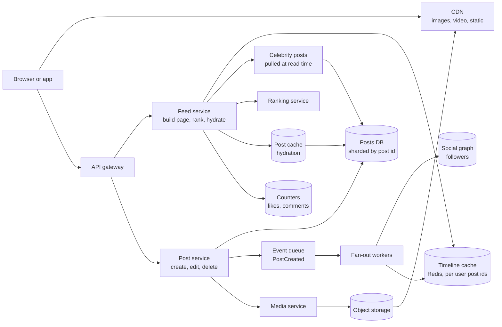
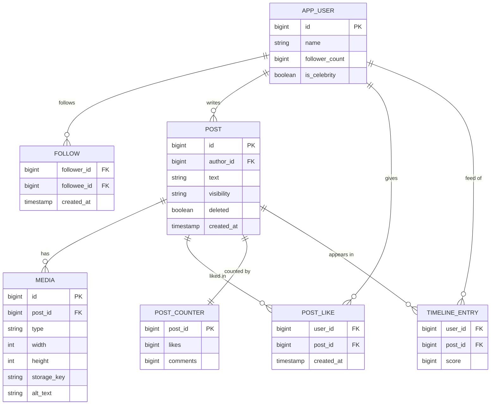
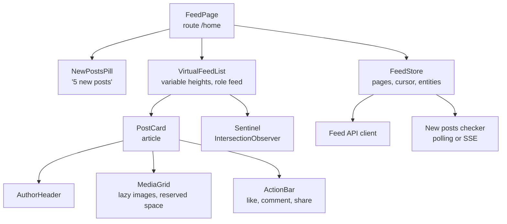
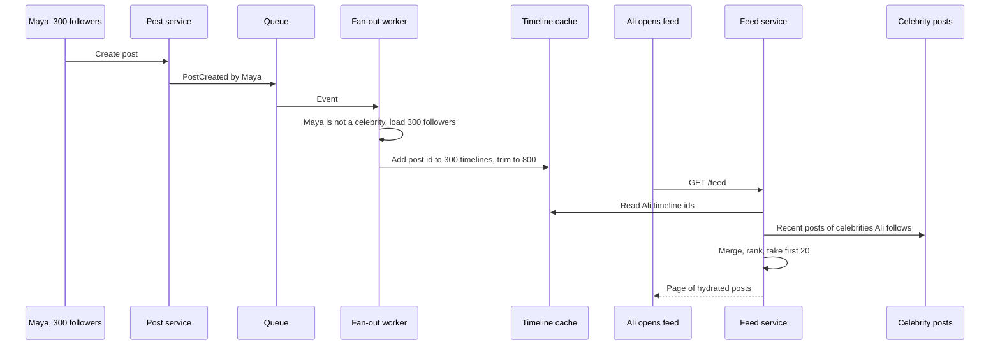
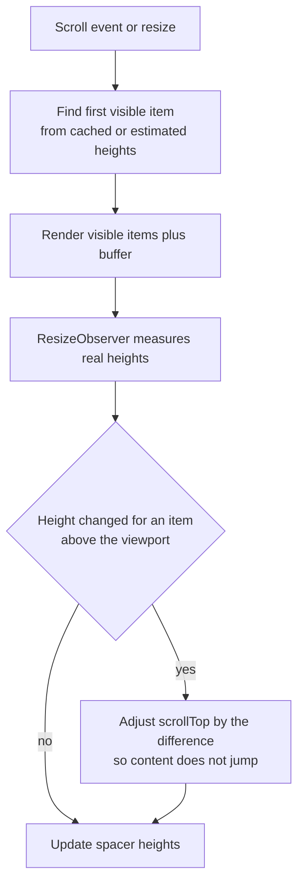

# Case Study: News Feed with Infinite Scroll

> In this case study you will design a social news feed, like the home timeline of a social network. On the backend you will compare fan-out on write and fan-out on read, and build a hybrid for celebrity accounts. On the frontend you will build infinite scroll with cursor pagination, a virtualized list with variable heights, a "new posts" indicator and lazy-loaded images. Interviewers use this problem to see if you can connect backend data flow with real browser performance.

**Before this:** [System design interview approach](01-system-design-interview-approach.md) · [Scalability and core building blocks](02-scalability-and-core-building-blocks.md) · [Pagination and infinite scroll](../05-frontend-engineering/07-api-integration-and-data-fetching.md#pagination-and-infinite-scroll) · [Web performance](../05-frontend-engineering/05-web-performance-and-core-web-vitals.md) · **Interview questions:** [jump to the interview section](#interview-questions)

## Table of contents

1. [Problem statement](#problem-statement)
2. [Clarifying questions](#clarifying-questions)
3. [Requirements](#requirements)
4. [Estimates](#estimates)
5. [High-level architecture](#high-level-architecture)
6. [API design](#api-design)
7. [Data model](#data-model)
8. [Frontend architecture](#frontend-architecture)
9. [Deep dive 1: fan-out on write vs fan-out on read](#deep-dive-1-fan-out-on-write-vs-fan-out-on-read)
10. [Deep dive 2: cursor pagination for feeds](#deep-dive-2-cursor-pagination-for-feeds)
11. [Deep dive 3: infinite scroll and the virtualized list](#deep-dive-3-infinite-scroll-and-the-virtualized-list)
12. [Deep dive 4: the new posts indicator](#deep-dive-4-the-new-posts-indicator)
13. [Deep dive 5: images and media](#deep-dive-5-images-and-media)
14. [Performance](#performance)
15. [Security](#security)
16. [Scalability](#scalability)
17. [Failure handling](#failure-handling)
18. [Observability](#observability)
19. [Trade-offs and alternatives](#trade-offs-and-alternatives)
20. [How to present this in 45 minutes](#how-to-present-this-in-45-minutes)
21. [Interview questions](#interview-questions)
22. [Summary](#summary)
23. [References](#references)

---

## Problem statement

"Design the home news feed of a social network."

- Users follow other users (friends, creators, brands).
- The home feed shows posts from people they follow: text, images, links, videos.
- Users scroll endlessly. New pages load automatically.
- While the user reads, new posts are published. The app shows "5 new posts" at the top instead of moving the content.
- Users can like and comment. Counts update.
- Some accounts have millions of followers.

The core insight:

> "A feed is a read-heavy merge problem: each user's feed is a merge of posts from hundreds of accounts. The main backend decision is **when** we do that merge — when a post is written (fan-out on write) or when a feed is read (fan-out on read). The main frontend challenge is showing an endless, changing list without using endless memory or jumping around."

---

## Clarifying questions

| Question | Why you ask it | Assumed answer |
| --- | --- | --- |
| How many users? How often do they open the feed? | Read load. | 50 million daily users, about 10 feed opens each per day. |
| How many follows per user? Any very large accounts? | Fan-out cost. | Average 200 follows. Some accounts have up to 50 million followers. |
| Chronological or ranked feed? | Pagination and caching design. | Ranked ("most relevant first"), with an option for "latest". |
| How fresh must the feed be? | Fan-out timing. | New posts from followed accounts should appear within about 1 minute. |
| Media types? | Storage and loading. | Text, images (up to 4 per post), short videos. |
| Web, mobile or both? | Client design. | Both. We focus on the web client. |
| Should edits and deletes show up in feeds? | Hydration and caching. | Yes, deletes must disappear quickly. |

---

## Requirements

### Functional requirements

1. Show a home feed of posts from followed accounts, ranked, with an option for chronological order.
2. Infinite scroll: load the next page when the user nears the bottom.
3. Show a "new posts" indicator when new content is available; clicking it shows them at the top.
4. Show images and videos efficiently.
5. Like, comment and share with counts that update.
6. Returning to the feed (for example after opening a post) restores the same position.
7. Deleted or hidden posts disappear.

### Non-functional requirements

| Quality | Target |
| --- | --- |
| Feed load | First page p95 under 300 ms on the server. LCP under 2.5 s on mobile. |
| Scrolling | Smooth (no long tasks while scrolling), stable layout (CLS under 0.1). |
| Freshness | New posts in followers' feeds within about 1 minute. |
| Availability | 99.95%. A degraded feed (older or less personalized) is better than an error. |
| Memory | The page must not slow down after scrolling through hundreds of posts. |

---

## Estimates

**Reads**

- 50,000,000 daily users × 10 feed opens = 500,000,000 feed requests per day (first pages).
- 500,000,000 / 86,400 ≈ 5,800 per second on average. Peak about 3× → about 17,000 per second.
- Scrolling adds next-page requests; assume about 2 more per open → about 1.5 billion page requests per day in total.

**Writes**

- 50,000,000 users × 0.2 posts per day = 10,000,000 posts per day ≈ 116 posts per second.
- Reads outnumber writes by roughly 100 to 1 or more. **Optimize for reads.**

**Fan-out on write cost**

- 10,000,000 posts × 200 followers on average = 2,000,000,000 timeline inserts per day ≈ 23,000 per second. That is a lot, but it is manageable for a sharded in-memory store.
- **One celebrity post** with 50,000,000 followers means 50,000,000 inserts for a single post. That breaks the simple model and is why we need a hybrid.

**Timeline cache**

- Keep the newest 800 post IDs per active user. 800 × 8 bytes = 6,400 bytes ≈ 6.4 KB per user.
- 50,000,000 active users × 6.4 KB = 320 GB. This fits in a sharded Redis cluster (plus overhead and replicas).

**Media**

- 30% of posts have an image: 3,000,000 images per day × 300 KB = 900 GB per day of originals, plus resized versions. Served almost entirely by the CDN.

---

## High-level architecture



- **Post service** writes posts and publishes `PostCreated` events.
- **Fan-out workers** read the author's followers from the **social graph** and push the post ID into each follower's **timeline cache** (a list of post IDs per user, newest first).
- **Feed service** builds a page: reads the user's timeline IDs, merges recent posts from **celebrities** they follow (pulled at read time), asks the **ranking service** to order candidates, then **hydrates** IDs into full posts from the post cache.
- **Counters** (likes, comments) are stored separately because they change very often.
- **Media service** stores uploads in object storage; the CDN serves resized versions.

---

## API design

### Get a feed page

```text
GET /api/feed?limit=20
GET /api/feed?limit=20&cursor=eyJzIjoiZnNfOGQyIiwibyI6MjB9
```

```json
{
  "items": [
    {
      "id": "post_918273",
      "author": { "id": "u_44", "name": "Maya Chen", "avatar": "https://img.example.com/u_44/48.webp", "verified": false },
      "createdAt": "2026-10-22T08:41:10Z",
      "text": "Our team shipped the new release today!",
      "media": [
        {
          "type": "image",
          "width": 1200,
          "height": 800,
          "alt": "Team photo in front of a whiteboard",
          "placeholder": "data:image/webp;base64,UklGRh4AAABXRUJQVlA4...",
          "src": "https://img.example.com/p/918273/1-800.webp",
          "srcset": "https://img.example.com/p/918273/1-400.webp 400w, https://img.example.com/p/918273/1-800.webp 800w, https://img.example.com/p/918273/1-1200.webp 1200w"
        }
      ],
      "counts": { "likes": 132, "comments": 18 },
      "viewer": { "liked": false }
    }
  ],
  "nextCursor": "eyJzIjoiZnNfOGQyIiwibyI6NDB9",
  "feedSessionId": "fs_8d2"
}
```

- **Cursor-based**, opaque to the client. For a ranked feed, the cursor points into a ranked list stored for this **feed session** (explained in [deep dive 2](#deep-dive-2-cursor-pagination-for-feeds)).
- **Media includes `width` and `height`** so the browser reserves space before the image loads (no layout shift), and a tiny **placeholder**.
- **`viewer`** holds per-user state (did I like this?). It is personal, so the response is `Cache-Control: private`.

### Check for new posts

```text
GET /api/feed/new?since=post_918273
→ { "count": 5, "preview": [{ "authorAvatar": "..." }, { "authorAvatar": "..." }] }
```

### Get new posts

```text
GET /api/feed?limit=20&after=post_918273   → newer posts to put on top
```

### Interactions

```text
POST   /api/posts/post_918273/like        (idempotent: liking twice is still one like)
DELETE /api/posts/post_918273/like
POST   /api/posts/post_918273/comments    { "text": "Congrats!" }
POST   /api/posts                          { "text": "...", "mediaIds": ["m_1"] }
```

`POST .../like` is designed to be idempotent: the server stores `(user_id, post_id)` with a unique constraint, so a double tap or retry does not count twice. REST rules are in [REST API design](../07-nodejs-backend/07-rest-api-design.md).

---

## Data model



- **Post IDs are time-sortable** (for example Snowflake-style IDs: timestamp bits + machine bits + sequence). Sorting by ID is sorting by time, and an ID makes a good cursor. ID generation is discussed in the [URL shortener case study](13-case-study-url-shortener.md).
- **`FOLLOW`** is stored twice in practice: by `follower_id` ("whom do I follow?") and by `followee_id` ("who follows me?" — needed for fan-out). Each direction is sharded by its first column.
- **`TIMELINE_ENTRY`** is not a database table at runtime; it is a Redis sorted set per user (`timeline:{userId}`, score = post time, member = post ID), trimmed to 800 entries. It can be rebuilt from the graph and posts if lost.
- **`POST_COUNTER`** is separate from `POST` because likes change thousands of times a second for popular posts. Counters are updated in Redis and flushed to the database in batches.
- **`POST_LIKE`** with a unique `(user_id, post_id)` makes likes idempotent and answers "did I like this?".

---

## Frontend architecture

### Component tree



### State ownership

| State | Owner | Notes |
| --- | --- | --- |
| Loaded posts | `FeedStore`: an ordered list of post IDs + a map `id → post` (normalized) | A post updated in one place (like count) updates everywhere. |
| Cursor and `feedSessionId` | `FeedStore` | Needed to load the next page of the same ranked list. |
| Pending new posts | `FeedStore` (`pendingNewIds`) | Not shown until the user clicks the pill. |
| Scroll position | `FeedStore` + `sessionStorage` | Restored when the user comes back from a post page. |
| Measured row heights | Virtual list | Needed for virtualization; can be cached by post ID. |
| Like state | Optimistic in `FeedStore`, confirmed by the server | Rollback on failure. |

In Angular 16, `FeedStore` can be an NgRx feature with an entity adapter, or a service with signals (developer preview in 16) or RxJS subjects. See [components and state management](../05-frontend-engineering/06-components-and-state-management.md).

---

## Deep dive 1: fan-out on write vs fan-out on read

### Fan-out on write (push model)

When Maya posts, a worker looks up all her followers and **pushes** the post ID into each follower's timeline list. Reading a feed is then trivial: read your own list.

### Fan-out on read (pull model)

Nothing happens on post. When Ali opens his feed, the server looks up everyone Ali follows, fetches their recent posts and **merges** them on the spot.

### Comparison

| | Fan-out on write (push) | Fan-out on read (pull) |
| --- | --- | --- |
| Work at post time | High: one insert per follower | None |
| Work at read time | Low: read one list | High: query N followees and merge |
| Read latency | Very low | Higher, grows with number of follows |
| Celebrity with 50M followers | 50M inserts per post — very slow and costly | No problem |
| Inactive users | Wasted work: we fill timelines nobody reads | No waste |
| Freshness | Seconds to minutes (async workers) | Always current |
| Storage | A timeline list per user | None extra |

Our numbers: reads are about 100× writes, so the push model fits most users. But celebrity posts break it.

### The hybrid

- **Normal authors (say, under 100,000 followers):** fan-out on write.
- **Celebrities (over the threshold):** no fan-out. Their posts are pulled at read time.
- **Inactive users** (not seen for 30 days): skip fan-out for them. When they come back, build their timeline with a pull, then switch back to push.



The merge at read time is a **k-way merge** of sorted lists: Ali's timeline (already merged) plus a few celebrity lists. Ali might follow 10 celebrities, so it is a merge of about 11 short lists — cheap.

```js
// merge-feeds.js — merge sorted lists (newest first) and remove duplicates
function mergeNewestFirst(lists, limit) {
  const seen = new Set();
  const out = [];
  const idx = lists.map(() => 0);
  while (out.length < limit) {
    let best = -1;
    for (let i = 0; i < lists.length; i++) {
      const item = lists[i][idx[i]];
      if (item && (best === -1 || item.ts > lists[best][idx[best]].ts)) best = i;
    }
    if (best === -1) break;                 // all lists are empty
    const item = lists[best][idx[best]++];
    if (!seen.has(item.id)) { seen.add(item.id); out.push(item); }
  }
  return out;
}

const pushedTimeline = [{ id: 'p9', ts: 900 }, { id: 'p7', ts: 700 }, { id: 'p3', ts: 300 }];
const celebrityA = [{ id: 'c8', ts: 800 }, { id: 'c2', ts: 200 }];
const celebrityB = [{ id: 'p7', ts: 700 }, { id: 'c6', ts: 600 }]; // p7 appears twice: duplicate
console.log(mergeNewestFirst([pushedTimeline, celebrityA, celebrityB], 5).map(p => p.id));
// [ 'p9', 'c8', 'p7', 'c6', 'p3' ]
```

(For a few short lists, this simple loop is fine. For many lists, use a heap.)

### Details that matter

- **Fan-out is async.** The author gets "posted" immediately. Followers see it after workers process the event (usually seconds). Show the author's own post in their feed **immediately** from the client, so they never think it failed.
- **Fan-out writes only IDs**, not post content. Content is fetched at read time (hydration). So an edit or delete does not need to touch millions of timelines: the hydration step reads the current post, and deleted posts are filtered out.
- **Unfollow:** remove the author's posts from the user's timeline lazily (filter at read time against the follow list), or with a background cleanup.
- **New follow:** pull the followee's recent posts into the timeline right away, so the feed changes at once.
- **Backpressure:** a burst of posts creates a burst of fan-out work. The queue absorbs it; workers scale with queue depth. See [background jobs and queues](../07-nodejs-backend/13-background-jobs-and-queues.md).

### Ranking

A chronological feed is just the merge. A **ranked** feed adds steps:

1. **Candidate generation:** take a few hundred recent candidates from the timeline and celebrity lists (and maybe recommendations).
2. **Scoring:** a ranking model predicts how interesting each post is for this user (signals: relationship strength, post age, engagement so far, content type the user likes).
3. **Re-ranking rules:** diversity (not 5 posts in a row from one author), remove already-seen posts, apply safety filters.
4. **Store the ranked list for the session** so pagination is stable (next section).

Ranking models are their own field. In a system design interview, show **where** ranking fits and its latency budget (for example 50 ms), not the model details.

---

## Deep dive 2: cursor pagination for feeds

### Why offset pagination fails for feeds

`GET /feed?page=2` (offset 20) on a feed that changes every second:

- 3 new posts arrive at the top between page 1 and page 2. Everything shifts down by 3. Page 2 now starts with the last 3 posts of page 1: **duplicates**.
- If posts are deleted, items shift up: some posts are **skipped**.
- Deep offsets are slow on databases.

### Cursor pagination for a chronological feed

The cursor is "the last item I saw". The next page is "items older than that":

```text
GET /api/feed?limit=20&before=post_918100
```

Because post IDs are time-sortable and unique, `before=<id>` is a perfect cursor. New posts at the top do not affect older pages.

### Cursor pagination for a ranked feed

Ranked order is not by time, so "older than X" does not work. And re-ranking on every page request would reorder items between pages (duplicates and gaps again).

Solution: **rank once per feed session, then page through the stored result.**

1. On the first request, the feed service ranks ~500 candidates and stores the ordered ID list in a cache under a `feedSessionId` (TTL about 30 minutes).
2. The cursor encodes `{ session, offset }`. The offset is into **this fixed list**, so it is stable.
3. When the list runs out, the next request generates a new batch of candidates **older** than everything already shown, ranks them and appends.
4. If the session expired (user came back after an hour), start a new session and use a set of already-seen IDs to avoid repeating posts.

```js
// feed-cursor.js
const encode = obj => Buffer.from(JSON.stringify(obj)).toString('base64url');
const decode = str => JSON.parse(Buffer.from(str, 'base64url').toString('utf8'));

const sessions = new Map([['fs_8d2', ['p50', 'p41', 'p47', 'p38', 'p45', 'p30']]]); // ranked ids

function getPage(cursor, limit) {
  const { s, o } = decode(cursor);
  const ranked = sessions.get(s);
  if (!ranked) return { error: 'SESSION_EXPIRED' }; // client starts a new session
  const items = ranked.slice(o, o + limit);
  const nextOffset = o + items.length;
  return { items, nextCursor: nextOffset < ranked.length ? encode({ s, o: nextOffset }) : null };
}

const first = encode({ s: 'fs_8d2', o: 0 });
const page1 = getPage(first, 4);
console.log(page1.items);              // [ 'p50', 'p41', 'p47', 'p38' ]
console.log(getPage(page1.nextCursor, 4)); // { items: [ 'p45', 'p30' ], nextCursor: null }
console.log(encode({ s: 'fs_8d2', o: 20 })); // eyJzIjoiZnNfOGQyIiwibyI6MjB9
```

Here an offset is fine, because it indexes a **frozen** list, not a live table.

### New posts vs older posts

There are two directions:

- **Down (older):** the cursor of the last item — infinite scroll.
- **Up (newer):** "posts newer than the first item I have" — the new posts indicator.

Keep both cursors in the client store: `newestId` and `nextCursor`.

More on pagination styles: [REST pagination](../07-nodejs-backend/07-rest-api-design.md#pagination).

---

## Deep dive 3: infinite scroll and the virtualized list

### Triggering the next page with IntersectionObserver

Do not listen to every `scroll` event and calculate positions. Put an invisible **sentinel** element near the bottom of the list and let the browser tell you when it becomes visible:

```ts
// infinite-scroll.ts (browser code)
function observeSentinel(sentinel: Element, loadMore: () => Promise<void>) {
  let loading = false;
  const observer = new IntersectionObserver(
    async entries => {
      if (!entries[0].isIntersecting || loading) return;
      loading = true;
      try {
        await loadMore();
      } finally {
        loading = false;
      }
    },
    { rootMargin: '800px 0px' }, // start loading 800 px before the user reaches the bottom
  );
  observer.observe(sentinel);
  return () => observer.disconnect(); // call on destroy to avoid leaks
}
```

- `rootMargin: '800px 0px'` loads the next page **before** the user reaches the bottom, so they rarely see a spinner.
- The `loading` flag prevents duplicate requests for the same page.
- Stop observing when `nextCursor` is `null` (the end) and show "You're all caught up".
- In Angular, wrap this in a directive and run the observer callback outside the zone, entering the zone only to update state. See [runOutsideAngular](../06-angular-16/12-performance.md#runoutsideangular-for-high-frequency-events).

### Why virtualize

After scrolling 300 posts, a non-virtual page has 300 post cards, each with images, buttons and many DOM nodes. Memory grows, style recalculation slows down, and scrolling becomes janky, especially on phones.

**Virtualization** keeps only the posts near the viewport in the DOM. Posts far above and below are removed and replaced by empty space of the right height.

### Variable heights: the hard part

Feed posts have very different heights (one line of text vs a tall photo). A virtual list needs every item's height to know what to render and how tall the spacers are.

1. **Estimate** heights before an item is rendered (for example from text length and known image aspect ratios — this is why the API sends `width` and `height`).
2. **Measure** the real height once the item renders, with `ResizeObserver`. Cache it by post ID.
3. **Correct** the positions of items below. If an item **above** the viewport changes height, adjust `scrollTop` by the difference so the content the user is reading does not jump.



Libraries handle this for you: TanStack Virtual (framework-agnostic), react-window / react-virtuoso (React), and the Angular CDK virtual scroll. Note that the Angular CDK's built-in strategy expects a **fixed** item size; for variable heights you need the experimental autosize strategy from `@angular/cdk-experimental` or a custom strategy. Be honest about this in an interview: variable-height virtualization is harder than fixed-height.

### When not to virtualize

Virtualization has costs: browser find-in-page does not see removed items, screen readers lose context, and focus can be lost when an item with focus is removed. Alternatives:

- **Do not virtualize the first few pages.** Most users scroll fewer than 50 posts. Virtualize only after, say, 100 items.
- **CSS `content-visibility: auto`** with `contain-intrinsic-size`: the browser skips rendering off-screen items but keeps them in the DOM (find-in-page and accessibility keep working). It saves rendering work, not memory.
- **Unload media** of far-away posts (remove `src` of images far off screen) while keeping the text.

### Accessibility of a feed

- Use the ARIA **`feed`** role on the list and `article` for each post. Set `aria-busy="true"` on the feed while loading a page.
- Each article gets `aria-posinset` and `aria-setsize` (use `-1` when the total is unknown).
- Infinite scroll can make the page footer unreachable. Put important links elsewhere, or show a **"Load more"** button after a few automatic loads.
- Keep keyboard focus stable: if the focused post would be removed by virtualization, keep it rendered.
- See [accessibility](../05-frontend-engineering/04-accessibility.md).

### Restoring the scroll position

The user opens a post, then presses Back. They expect to be exactly where they were.

- Keep the `FeedStore` alive across navigation (a root-level service in Angular, not a component-level one), so posts do not reload.
- Save the **anchor**: the ID of the first visible post and its offset from the top of the viewport, in `sessionStorage`.
- On return, render the list from the store, scroll so the anchor post is at the same offset. Do not rely only on a raw pixel `scrollTop`, because heights may differ after re-render.
- In Angular, `RouterModule.forRoot(routes, { scrollPositionRestoration: 'enabled' })` restores pixel positions for simple pages; feeds with virtualization usually need the anchor approach.

---

## Deep dive 4: the new posts indicator

### The rule: never move content under the user's eyes

If new posts are inserted at the top while the user is reading, the content jumps down. The user loses their place (and may tap the wrong thing). So:

- New posts are fetched or counted in the background.
- A pill appears: **"↑ 5 new posts"**.
- Only when the user clicks it (or scrolls to the very top) do we insert the posts and scroll to the top.

### How the client learns about new posts

| Option | How | Trade-off |
| --- | --- | --- |
| Polling | `GET /api/feed/new?since=<newestId>` every 60 s while the tab is visible | Simple, cacheable, cheap if the endpoint reads only the timeline head. |
| Server-Sent Events | Server pushes "new posts available" | Lower latency; one connection per open tab. |
| WebSocket | Same, two-way | Only worth it if the app already has a socket (for chat or notifications). |

For a feed, **polling every 30–60 seconds** is usually enough and much cheaper. Pause polling when the tab is hidden (`document.visibilityState`). Comparison in [API styles and real-time communication](04-api-styles-and-real-time-communication.md).

```js
// new-posts.js — what to show in the pill
function newPostsPill(pendingIds, loadedIds) {
  const loaded = new Set(loadedIds);
  const fresh = pendingIds.filter(id => !loaded.has(id)); // the author's own post may already be shown
  if (fresh.length === 0) return null;
  return fresh.length > 99 ? '99+ new posts' : `${fresh.length} new post${fresh.length === 1 ? '' : 's'}`;
}

console.log(newPostsPill(['p60', 'p59', 'p58'], ['p58', 'p50'])); // 2 new posts
console.log(newPostsPill(['p61'], []));                           // 1 new post
console.log(newPostsPill(['p58'], ['p58']));                      // null
```

### Inserting new posts

1. Fetch the new posts (`GET /api/feed?after=<newestId>`).
2. **De-duplicate** against what is already loaded (the user's own optimistic post, or a post that appeared in both responses).
3. Insert them at the top, update `newestId`, scroll to the top and move focus to the first new post (for keyboard and screen reader users), and announce "5 new posts loaded" in a polite live region.

For a ranked feed, "new posts" usually means starting a **new feed session** with fresh ranking, placed above the old items.

---

## Deep dive 5: images and media

Images are usually the biggest bytes in a feed, and the main source of layout shift.

### Reserve space (no layout shift)

Always set `width` and `height` attributes (the API sends them). Modern browsers use them to compute the **aspect ratio** before the image loads, so content below does not jump. This keeps **CLS** low. See [CLS](../05-frontend-engineering/05-web-performance-and-core-web-vitals.md#cls-cumulative-layout-shift).

### Load lazily, but not the first ones

```html
<!-- First post in the feed: likely the LCP element. Load eagerly with high priority. -->


<!-- Later posts: native lazy loading -->

```

- **`loading="lazy"`** lets the browser load the image only when it gets close to the viewport. Never lazy-load the LCP image (the first big image) — that delays LCP.
- **`srcset` + `sizes`** let the browser choose the right size for the screen. A phone should not download a 1,200 px image for a 375 px wide slot.
- **Modern formats** (AVIF, WebP) are much smaller than JPEG. The image CDN chooses the format from the `Accept` header.
- **Placeholders:** a tiny blurred version (a few hundred bytes, inlined) or the image's dominant color as a background, shown until the real image loads.
- **Alt text:** let authors add it; fall back to automatically generated descriptions where available. Decorative images use `alt=""`.

In Angular 16, `NgOptimizedImage` (the `ngSrc` directive) enforces `width`/`height`, lazy-loads by default, and supports `priority` for the LCP image. See [Angular images](../06-angular-16/12-performance.md#load-performance-images-with-ngoptimizedimage).

### Video

- Do not autoplay with sound. Autoplay muted only when the video is mostly visible (use `IntersectionObserver`), and pause it when it scrolls away.
- `preload="none"` or `preload="metadata"` and a `poster` image, so videos do not download until needed.
- Use adaptive streaming (HLS or DASH) for longer videos, so quality adapts to the network.

### Media upload

Uploading goes through the media service with presigned URLs and background processing (resizing, format conversion, scanning). This is the [file upload case study](14-case-study-file-upload-service.md).

---

## Performance

| Area | Technique |
| --- | --- |
| Server first page | Timeline IDs from Redis, celebrity posts from a cache, hydration with a batched multi-get from the post cache, counters from Redis. One round trip per store, in parallel. |
| Ranking | Strict latency budget (for example 50 ms). If ranking is slow, return the chronological merge. |
| First paint | Server-render or inline the first page of the feed (or a skeleton plus a fast API call). The first image is the likely LCP element: preload it, no lazy loading. |
| Scrolling | Prefetch the next page early (`rootMargin`), virtualize after many items, avoid layout thrash, passive listeners. |
| Images | Right size via `srcset`, AVIF/WebP, lazy loading, reserved space. |
| JavaScript | Code-split heavy features (video player, comment composer) and load them when needed. |
| Interactions | Optimistic likes (instant UI), with rollback. Keep click handlers small for good INP. |
| Memory | Virtualization, unloading far-away media, cleaning up observers and subscriptions on destroy. |

See [web performance and Core Web Vitals](../05-frontend-engineering/05-web-performance-and-core-web-vitals.md).

---

## Security

1. **Visibility rules at read time.** A post can be private, followers-only or blocked for a viewer. Fan-out writes IDs, but the **hydration step must check visibility** for this viewer (blocked users, deleted posts, privacy changes). Never trust that "it was in the timeline, so the viewer may see it".
2. **XSS:** post text and link previews are user content. Render text safely; linkify with a safe library; sanitize any rich text. Link preview fetching happens on the server with SSRF protection. See [web security](../01-cs-and-web-fundamentals/08-browser-storage-and-web-security-basics.md).
3. **Media safety:** uploaded images are re-encoded (this also strips metadata like GPS location), scanned and moderated before wide distribution.
4. **Rate limits** on posting, liking and following to stop spam and fake engagement.
5. **Private API responses:** feeds are personal. `Cache-Control: private, no-store` (or `private` with short max-age). Images can be public on the CDN only if the post is public; private media uses signed URLs.
6. **Enumeration:** time-sortable IDs reveal roughly when a post was created. That is usually acceptable for posts. Do not use sequential IDs where the total count is sensitive.

---

## Scalability

- **Feed service** is stateless; scale horizontally.
- **Timeline cache** (about 320 GB of IDs) is a sharded Redis cluster, sharded by user ID, with replicas. If a shard is lost, timelines can be rebuilt from the graph and posts (slow, so replicas matter).
- **Fan-out workers** scale with queue depth. Prioritize fan-out to **active** users first.
- **Celebrity threshold** keeps the worst-case fan-out bounded. Tune it from data (for example 100,000 followers).
- **Posts DB** sharded by post ID; a post cache in front for hydration (hot posts are read millions of times).
- **Counters** for viral posts: one Redis key updated 10,000 times a second becomes a hot key. Use **sharded counters** (split into N sub-keys, sum on read) or batch increments in the app before writing.
- **Graph store** sharded by user ID for both directions of the follow relation.
- **Media** served by the CDN; the origin only sees cache misses.

See [scalability and core building blocks](02-scalability-and-core-building-blocks.md).

---

## Failure handling

| Failure | Behavior |
| --- | --- |
| Ranking service slow or down | Fall back to chronological merge. |
| Timeline cache shard down | Use replica; if missing, build the feed with fan-out on read for affected users (slower, still works). |
| Fan-out backlog | New posts appear later. Authors still see their own posts. Alert on queue age. |
| Celebrity posts service slow | Return the feed without the celebrity part for this page; fill in on the next page. |
| Next page request fails | Show "Couldn't load more. Retry" at the bottom. Keep loaded posts. |
| Feed session expired | Start a new session; skip already-seen IDs. |
| Like request fails | Roll back the optimistic like and show a small message. |
| Image fails to load | Show the placeholder with a retry; never collapse the layout. |
| New posts check fails | Silently try again later; the feed keeps working. |

See [Production Node.js](../07-nodejs-backend/14-production-nodejs.md).

---

## Observability

- **Backend:** feed p50/p95/p99 latency, timeline cache hit ratio, hydration time, ranking time and fallbacks, fan-out queue age and lag, celebrity-pull latency.
- **Freshness:** time from post creation to appearance in followers' timelines (sample).
- **Frontend (RUM):** LCP, CLS, INP on the feed; time to next page; how often users see the bottom spinner (prefetch too late); memory after long sessions; JavaScript errors.
- **Product metrics:** scroll depth, time spent, posts seen per session, like rate, "new posts" pill click rate.
- **Correctness:** duplicate posts shown per session (should be zero), deleted posts served after deletion.

See [Production Node.js](../07-nodejs-backend/14-production-nodejs.md).

---

## Trade-offs and alternatives

| Decision | We chose | Alternative | When the alternative is better |
| --- | --- | --- | --- |
| Fan-out | Hybrid: push for normal authors, pull for celebrities, skip inactive users | Pure push | Small networks with no huge accounts. Simplest. |
| | | Pure pull | Write-heavy systems, or follow counts small enough that reading is cheap. |
| Timeline storage | Redis sorted set of IDs per user | Wide-column database (for example Cassandra) | Need durable timelines, larger history per user, lower memory cost. |
| Pagination | Ranked session list + offset cursor | Time-based cursor (`before=id`) | Chronological feeds. Simpler and stateless. |
| New content | Polling with a pill | SSE or WebSocket push | Real-time products (live events) or when a socket already exists. |
| Long lists | Virtualize after many items | Never virtualize; `content-visibility` | Short sessions or simple cards where DOM size stays small. |
| Infinite scroll | Auto-load with a sentinel | "Load more" button or numbered pages | Users need the footer, or need to find their position again (search results, archives). |
| Ranking | Ranked by default | Chronological only | Products that promise "latest first", or regulatory requirements for a non-personalized option. |

---

## How to present this in 45 minutes

**Minutes 0–5: clarify.**
> "How many users and how often do they open the feed? Average follows, and are there huge accounts? Ranked or chronological? How fresh? Which media types? ... OK: 50 million daily users, about 10 opens a day, 200 follows on average, accounts up to 50 million followers, ranked with a 'latest' option, new posts within a minute, text plus images and short video."

**Minutes 5–9: numbers.**
> "That's about 5,800 feed requests a second on average, around 17,000 at peak, and only about 116 new posts a second — reads dominate by 100 to 1, so I optimize reads. Fan-out on write would be about 2 billion timeline inserts a day — fine — except a single celebrity post would be 50 million inserts. Timeline IDs for active users are about 320 GB, which fits a sharded Redis cluster."

**Minutes 9–16: high-level design and API.**
> "Post service writes posts and emits events. Fan-out workers push post IDs into followers' timelines, except for celebrities and inactive users. The feed service reads the timeline, merges in celebrity posts, ranks, and hydrates IDs into posts and counts. The API returns 20 posts with an opaque cursor and a feed session ID; images come with width, height, srcset and a placeholder. A separate endpoint returns the count of new posts."

**Minutes 16–26: backend deep dive.**
> "Push vs pull: push makes reads cheap but fails for celebrities; pull is always fresh but makes reads expensive. The hybrid gives the best of both. Fan-out writes only IDs, so edits and deletes are handled at hydration. For ranked feeds, offset pagination on a live list causes duplicates, so I rank once per session, store the ordered IDs, and page through that frozen list."

**Minutes 26–38: frontend deep dive.**
> "Infinite scroll uses an IntersectionObserver sentinel with a large rootMargin so the next page loads early, with a loading flag against duplicate requests. After many posts I virtualize, which is harder with variable heights: estimate from aspect ratios, measure with ResizeObserver, and correct scrollTop for changes above the viewport. New posts never push content down — they show a pill. Images have width and height to avoid layout shift, the first image loads eagerly with high priority, others lazy. I restore the scroll position by anchor post when the user comes back."

**Minutes 38–42: failures, security.**
> "If ranking fails, chronological. If the timeline cache misses, pull. Visibility is checked at hydration, not trusted from the timeline. Hot counters are sharded."

**Minutes 42–45: trade-offs.**
> "For a small network, pure push is simpler. For a chronological feed, a time-based cursor avoids session state. A 'Load more' button is a valid choice when the footer matters."

---

## Interview questions

### Q1. Fan-out on write or fan-out on read?

**What the interviewer is checking:** whether you can reason from the read/write ratio and the follower distribution.

**Short spoken answer (30–60 seconds):**
> "Fan-out on write pushes each new post ID into every follower's timeline when it's created. Reading a feed is then a single list read, which is great because reads are about 100 times more common than writes. The problem is celebrities: one post from an account with 50 million followers is 50 million writes. Fan-out on read does nothing at write time and merges followees' posts when you open the feed — always fresh and no celebrity problem, but reads get expensive when you follow hundreds of accounts. So I use a hybrid: push for normal accounts, pull for celebrities at read time, and skip fan-out for inactive users."

**Follow-up questions:**
- **How do you pick the celebrity threshold?** — From data: the follower count where fan-out time or cost becomes unacceptable (for example over 100,000 followers). It can also be dynamic, based on how many followers are active.
- **What does "inactive" mean and what happens when they return?** — For example no visit in 30 days. When they return, build their timeline by pulling recent posts from their followees, then resume pushing.
- **What is stored in the timeline: posts or IDs?** — IDs. Content is fetched at read time, so edits and deletes need no fan-out.

**Common mistakes:** choosing one model without mentioning celebrities; storing full post content in every timeline.

**Where this is used in real projects:** large social networks have described hybrid fan-out approaches publicly.

### Q2. Why not offset pagination for a feed?

**Short answer:** New posts at the top shift every item, so page 2 repeats items from page 1; deletions cause skipped items; deep offsets are slow. Use a cursor: for chronological feeds, "posts older than ID X" with time-sortable IDs; for ranked feeds, a stored ranked list per feed session with the cursor pointing into it. See [deep dive 2](#deep-dive-2-cursor-pagination-for-feeds).

### Q3. How do you paginate a ranked feed without duplicates?

**What the interviewer is checking:** understanding that ranking and pagination interact.

**Short spoken answer (30–60 seconds):**
> "If I re-rank on every page request, the order changes between pages, so items repeat or vanish. Instead, on the first request I rank a few hundred candidates once and store the ordered ID list in a cache under a feed session ID. The cursor encodes the session and an offset into that frozen list, so paging is stable. When the list runs out, I rank the next batch of older candidates and append. If the session expires, I start a new one and filter out IDs the user has already seen."

**Follow-up questions:**
- **How long do sessions live?** — Around the length of a typical visit, for example 30 minutes, with a TTL in Redis.
- **What about new posts during the session?** — They are not inserted into the session list. The client learns about them through the new posts indicator, which starts a new session on top.

**Common mistakes:** "use offset with a ranked query".

**Where this is used in real projects:** ranked feeds and recommendation lists.

### Q4. Implement infinite scroll. What can go wrong?

**What the interviewer is checking:** practical frontend skills.

**Short spoken answer (30–60 seconds):**
> "I put a sentinel element after the last item and observe it with IntersectionObserver, with a rootMargin of several hundred pixels so loading starts before the user reaches the bottom. When it intersects and I'm not already loading and there is a next cursor, I fetch the next page and append it, de-duplicating by ID. Things that go wrong: firing the same page twice without a loading flag; a scroll listener doing layout reads on every event; memory growing after hundreds of items, so I virtualize; losing the scroll position on Back; the footer becoming unreachable; and errors — I show a retry button at the bottom instead of failing silently."

**Follow-up questions:**
- **Why IntersectionObserver over scroll events?** — The browser computes intersections efficiently and calls you only when visibility changes. Scroll handlers fire very often and reading layout in them causes jank.
- **What if the first page does not fill the screen?** — The sentinel is visible immediately, so the observer fires again after loading. Make sure your code handles repeated triggers until the screen is filled or the feed ends.

**Common mistakes:** no de-duplication; no end state; forgetting to disconnect the observer.

**Where this is used in real projects:** feeds, search results, product listings.

### Q5. How do you virtualize a list with variable-height items?

**What the interviewer is checking:** depth beyond "use a library".

**Short spoken answer (30–60 seconds):**
> "The virtual list needs heights to know what's on screen and how big the spacers are. With variable heights, I start with an estimate — for feed posts I can estimate well from text length and image aspect ratios from the API. When an item renders, I measure it with ResizeObserver and cache the height by ID. Positions below it update. The tricky part is when an item above the viewport changes height — for example an image loads — then I adjust scrollTop by the same amount so what the user is reading doesn't move. I keep a buffer of items above and below, and keep the focused item rendered for accessibility. Libraries like TanStack Virtual do this; the Angular CDK's default strategy is fixed-size, so variable heights need the experimental autosize strategy or a custom one."

**Follow-up questions:**
- **What is `content-visibility: auto`?** — A CSS property that lets the browser skip rendering work for off-screen elements while keeping them in the DOM. Use it with `contain-intrinsic-size` to give a placeholder size. It helps rendering cost but not DOM memory.

**Common mistakes:** assuming fixed heights; scroll jumps when images load.

**Where this is used in real projects:** chat apps, social feeds, long comment threads.

### Q6. How does the "new posts" indicator work, and why not just insert new posts?

**Short answer:** Inserting posts at the top while the user reads pushes the content down: the user loses their place and may tap the wrong post. So the client checks in the background (polling every 30–60 seconds while visible, or a push channel), shows a pill with the count, and inserts the posts only when the user clicks it or is already at the top. Insertion de-duplicates against loaded posts, scrolls to the top, moves focus to the first new post and announces it politely.

### Q7. How do you avoid layout shift from images in the feed?

**Short answer:** Send `width` and `height` with every image and put them on the `` element (or use CSS `aspect-ratio`), so the browser reserves the right space before loading. Use a blurred placeholder or dominant color. Do not insert content above existing content without user action. Reserve space for embeds and ads. Load the first image eagerly with `fetchpriority="high"`, others with `loading="lazy"`.

### Q8. How do you handle a viral post getting 10,000 likes per second?

**What the interviewer is checking:** hot keys and counter design.

**Short spoken answer (30–60 seconds):**
> "Writing each like to one database row or one Redis key makes that key hot. First, the like itself is a row with a unique user and post pair, so it's idempotent, and those writes are spread across shards by user. For the count, I use sharded counters: N sub-keys per post, each like increments a random one, and reading sums them. Or I buffer increments in memory for a second and write one batched increment. The UI doesn't need an exact real-time count — showing '12.4K' that updates every few seconds is fine — so I can cache the count briefly."

**Follow-up questions:**
- **How does the user see their own like immediately?** — Optimistic UI: the client flips the heart and adds 1 locally. The server response confirms or rolls back.

**Common mistakes:** `UPDATE posts SET likes = likes + 1` for every like on the hot row.

**Where this is used in real projects:** view counts, likes, votes.

### Q9. A user deletes a post. How do you remove it from millions of feeds?

**Short answer:** You do not touch the timelines. Timelines store only IDs. Hydration loads the post and filters out deleted ones (and the post cache is invalidated on delete). Clients that already show the post learn about it when they refresh, or via a small "post deleted" event if the app has a live channel. A background job can clean old IDs from timelines lazily.

### Q10. How do you restore the user's position after they go to a post and come back?

**Short answer:** Keep the feed data in a store that survives navigation (a root-level service), so nothing reloads. Save an anchor — the first visible post's ID and its offset — in `sessionStorage`. On return, render from the store and scroll so that post is at the same offset. Pixel `scrollTop` alone is fragile with virtualization and variable heights.

### Q11. How would you make the feed accessible?

**Short answer:** Follow the WAI-ARIA feed pattern:

- Use the ARIA `feed` role. Each post is an `article` with `aria-posinset`, `aria-setsize` and a label from the author and time.
- Set `aria-busy` while a page is loading.
- Keep focus stable during virtualization.
- If possible, give keyboard shortcuts to move between posts.
- Keep important links (footer, settings) reachable despite infinite loading, or give a "Load more" button.
- Give images alt text, and announce "new posts loaded" politely.

### Q12. The feed gets slow on phones after 10 minutes of scrolling. How do you find and fix it?

**What the interviewer is checking:** performance debugging on the client.

**Short spoken answer (30–60 seconds):**
> "It sounds like DOM and memory growth. I'd record a performance trace and a memory snapshot after long scrolling: check DOM node count, detached nodes, event listeners and image memory. Typical causes: no virtualization, so thousands of cards stay in the DOM; IntersectionObservers or subscriptions created per card and never disconnected; videos that keep decoding off screen; and images kept at full resolution. Fixes: virtualize after a threshold, clean up observers on destroy, pause and unload off-screen media, use correctly sized images, and keep the store from holding unbounded data — drop pages far behind the user."

**Common mistakes:** blaming the network; only testing on a fast laptop.

**Where this is used in real projects:** performance work on mobile web feeds. See [memory management](../02-javascript/19-memory-management-and-garbage-collection.md).

---

## Summary

- A feed is a **read-heavy merge**. Decide **when** to merge: on write (push) or on read (pull).
- Use a **hybrid**: push for normal authors, **pull for celebrities**, skip inactive users.
- Timelines store **IDs only**; **hydrate** at read time, which also applies **visibility checks** and hides deleted posts.
- **Cursor pagination** always. For ranked feeds, **rank once per feed session** and page through the frozen list.
- Infinite scroll with an **IntersectionObserver sentinel** and a large `rootMargin`; guard against duplicate loads; show an end state and a retry.
- **Virtualize** long feeds; variable heights need **estimates, measurement and scroll correction**.
- **Never move content under the user**: new posts appear behind a **"new posts" pill**.
- Images: **width/height** for zero layout shift, **eager + high priority** for the first image, **lazy** for the rest, `srcset` and modern formats.
- Restore position with an **anchor post**, not just pixels.
- **Hot counters** are sharded or batched; likes are idempotent.

## References

- MDN — Intersection Observer API: https://developer.mozilla.org/en-US/docs/Web/API/Intersection_Observer_API
- MDN — Resize Observer API: https://developer.mozilla.org/en-US/docs/Web/API/Resize_Observer_API
- MDN — Lazy loading: https://developer.mozilla.org/en-US/docs/Web/Performance/Guides/Lazy_loading
- MDN — `content-visibility`: https://developer.mozilla.org/en-US/docs/Web/CSS/content-visibility
- W3C WAI-ARIA Authoring Practices Guide — Feed pattern: https://www.w3.org/WAI/ARIA/apg/patterns/feed/
- web.dev — Optimize Cumulative Layout Shift: https://web.dev/articles/optimize-cls
- web.dev — Optimize Largest Contentful Paint: https://web.dev/articles/optimize-lcp
- web.dev — Fetch Priority API: https://web.dev/articles/fetch-priority
- Angular v16 docs — NgOptimizedImage: https://v16.angular.io/guide/image-directive
- Angular CDK — Scrolling: https://material.angular.io/cdk/scrolling/overview
- TanStack Virtual documentation: https://tanstack.com/virtual/latest
- Redis documentation — Sorted sets: https://redis.io/docs/latest/develop/data-types/sorted-sets/
