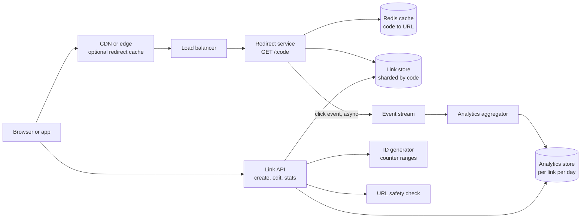
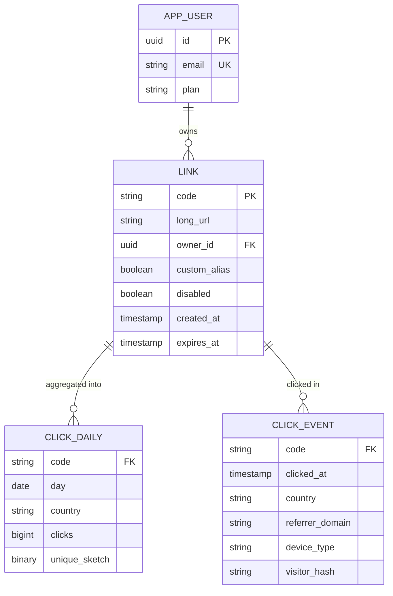
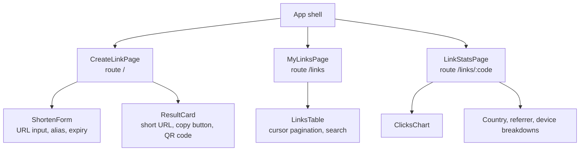
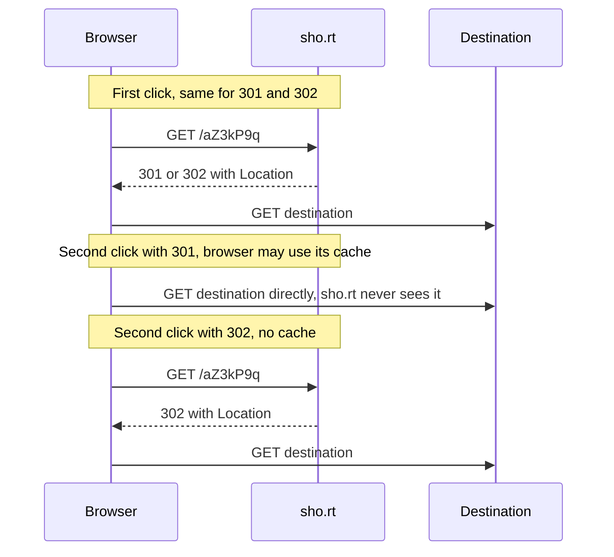
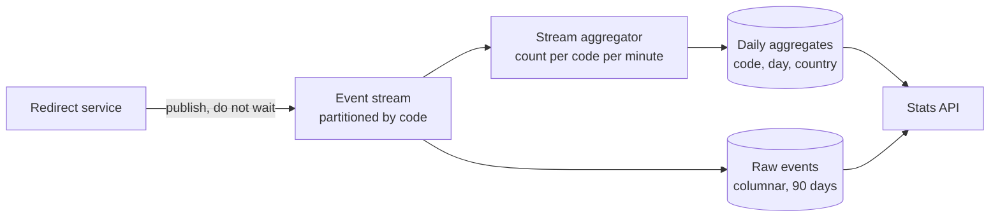

# Case Study: URL Shortener

> In this case study you will design a URL shortener like bit.ly or TinyURL: turn a long link into a short code, redirect billions of clicks quickly, and show click analytics. It is a classic first system design question. It is small, but it tests the fundamentals: back-of-the-envelope estimates, ID generation and collisions, base62 encoding, choosing between 301 and 302, caching a read-heavy workload and recording analytics without slowing down redirects.

**Before this:** [System design interview approach](01-system-design-interview-approach.md) · [Scalability and core building blocks](02-scalability-and-core-building-blocks.md) · [HTTP, HTTPS and TLS](../01-cs-and-web-fundamentals/05-http-https-and-tls.md) · [Caching in Node.js](../07-nodejs-backend/11-caching.md) · **Interview questions:** [jump to the interview section](#interview-questions)

## Table of contents

1. [Problem statement](#problem-statement)
2. [Clarifying questions](#clarifying-questions)
3. [Requirements](#requirements)
4. [Estimates](#estimates)
5. [High-level architecture](#high-level-architecture)
6. [API design](#api-design)
7. [Data model](#data-model)
8. [Frontend architecture](#frontend-architecture)
9. [Deep dive 1: generating short codes](#deep-dive-1-generating-short-codes)
10. [Deep dive 2: the redirect, 301 vs 302](#deep-dive-2-the-redirect-301-vs-302)
11. [Deep dive 3: caching the redirect path](#deep-dive-3-caching-the-redirect-path)
12. [Deep dive 4: click analytics](#deep-dive-4-click-analytics)
13. [Performance](#performance)
14. [Security](#security)
15. [Scalability](#scalability)
16. [Failure handling](#failure-handling)
17. [Observability](#observability)
18. [Trade-offs and alternatives](#trade-offs-and-alternatives)
19. [How to present this in 45 minutes](#how-to-present-this-in-45-minutes)
20. [Interview questions](#interview-questions)
21. [Summary](#summary)
22. [References](#references)

---

## Problem statement

"Design a URL shortening service."

- A user pastes a long URL like `https://shop.example.com/products/running-shoes?utm_source=newsletter&utm_campaign=oct` and gets back `https://sho.rt/aZ3kP9q`.
- Anyone who opens `https://sho.rt/aZ3kP9q` is redirected to the long URL.
- Signed-in users can choose a custom alias (`sho.rt/oct-sale`), set an expiry date, and see click statistics: clicks per day, countries, referrers, devices.

The key insight to say early:

> "This is an extremely read-heavy system — maybe 100 redirects for every new link. The redirect path must be tiny and fast: look up a code, return a redirect. Everything else, especially analytics, must happen off that path. The interesting design choices are how to generate short unique codes, which redirect status to use, and how to cache."

---

## Clarifying questions

| Question | Why you ask it | Assumed answer |
| --- | --- | --- |
| How many new links per month? | Write rate and key space. | 100 million new links per month. |
| Read/write ratio? | Read capacity and caching. | About 100 redirects per new link. |
| How long are links kept? | Storage and key space. | 5 years by default; users can set an earlier expiry. |
| How short must the code be? | Key length. | As short as possible; 7 characters is fine. |
| Custom aliases? | Uniqueness checks and reserved words. | Yes, for signed-in users. |
| Can a link's destination be edited? | Affects 301 vs 302 and caching. | Yes, for signed-in users (for example to fix a typo). |
| Analytics needed? | Changes the redirect status choice. | Yes: clicks, countries, referrers, devices. Near real time (minutes) is enough. |
| Same long URL twice → same code? | Deduplication. | Not required. Each request may get a new code (different users want separate stats). |
| Anonymous creation? | Abuse controls. | Yes, with rate limits; signed-in users get more features. |

---

## Requirements

### Functional requirements

1. Create a short link for a long URL; return the short URL.
2. Redirect a short URL to its long URL.
3. Custom aliases for signed-in users.
4. Optional expiry; expired links return `410 Gone` (or a friendly page).
5. Edit the destination or disable a link (signed-in owner).
6. Click analytics per link: total clicks, clicks over time, top countries, referrers and devices.

### Non-functional requirements

| Quality | Target |
| --- | --- |
| Redirect latency | p99 under 50 ms at the server (plus network). Users should not notice the hop. |
| Availability | 99.99% for redirects. A broken short link breaks every place it was shared: emails, printed flyers, QR codes. |
| Durability | A created link must never be lost. |
| Uniqueness | Two different links never share a code. |
| Unpredictability | Codes should not be easy to enumerate (to protect "unlisted" links). |
| Analytics | Eventually consistent, within a few minutes. Never slows down redirects. |

---

## Estimates

This problem is a good place to show your estimation skills, so show your work clearly. The method (round numbers, peak factor, a conclusion after each number) is in [back-of-the-envelope estimates](01-system-design-interview-approach.md#step-2-back-of-the-envelope-estimates).

**Writes**

- 100,000,000 new links per month.
- Seconds per month: 30 × 86,400 = 2,592,000.
- 100,000,000 / 2,592,000 ≈ **39 writes per second** on average. Peak maybe 3× → about 120 per second. Small.

**Reads (redirects)**

- 100 reads per write → 39 × 100 ≈ **3,900 redirects per second** on average.
- Peak 3× → about **12,000 per second**. Viral links can be much higher for one code.
- Per month: 100,000,000 × 100 = 10,000,000,000 (10 billion) redirects.

**Storage**

- Links over 5 years: 100,000,000 × 12 × 5 = **6,000,000,000** (6 billion) links.
- About 500 bytes per link (long URL up to a few hundred bytes, code, owner, timestamps, index overhead).
- 6,000,000,000 × 500 B = **3 TB**. Large for one server, comfortable for a sharded database or a distributed key-value store.

**Key space (how long must the code be?)**

Base62 uses `0–9`, `a–z`, `A–Z`: 62 characters.

| Length | Possible codes | Enough for 6 billion? |
| --- | --- | --- |
| 6 | 62^6 = 56,800,235,584 (about 57 billion) | Yes, but about 10% of the space would already be used (6 / 57). Random codes would collide more and more often as the space fills. |
| 7 | 62^7 = 3,521,614,606,208 (about 3.5 trillion) | Yes, with lots of room. |

We choose **7 characters**. With 6 billion links in a space of 3.5 trillion, only about 0.17% of codes are used, so random codes rarely collide.

**Cache**

- Traffic is very skewed: a small fraction of links gets most clicks.
- Redirects per day: 10,000,000,000 / 30 ≈ 333,000,000.
- If 20,000,000 distinct links are clicked per day and we cache all of them: 20,000,000 × 500 B = **10 GB**. That fits in memory on a small Redis cluster.

**Analytics**

- One click event ≈ 100 bytes (code, time, country, referrer domain, device type).
- 10,000,000,000 clicks per month × 100 B = **1 TB per month** of raw events. This goes to a stream and an analytics store, not to the main database.

---

## High-level architecture



- **Redirect service** handles `GET /:code`. It checks Redis, falls back to the link store, returns a redirect, and emits a click event **asynchronously**.
- **Link API** creates and edits links, checks URL safety and serves stats to the dashboard.
- **ID generator** hands out unique numbers in ranges so link creation never waits on a central counter.
- **Link store** is a key-value lookup by code. A sharded relational database or a distributed key-value store (DynamoDB, Cassandra) both work.
- **Event stream + aggregator** turn raw click events into per-link, per-day counts.

Two services, not one: the redirect path and the management API have very different load and reliability needs. A bug in the stats dashboard must never break redirects.

---

## API design

### Create a link

```text
POST /api/links
Authorization: Bearer <token>        (optional for anonymous links)
Idempotency-Key: 6f0e2b8a-1a9c-4c2e-8f7d-2b4b0d9c1e33

{
  "url": "https://shop.example.com/products/running-shoes?utm_source=newsletter&utm_campaign=oct",
  "alias": "oct-sale",
  "expiresAt": "2026-12-31T23:59:59Z"
}
```

```json
201 Created
{
  "code": "oct-sale",
  "shortUrl": "https://sho.rt/oct-sale",
  "url": "https://shop.example.com/products/running-shoes?utm_source=newsletter&utm_campaign=oct",
  "createdAt": "2026-10-22T10:00:00Z",
  "expiresAt": "2026-12-31T23:59:59Z"
}
```

Errors:

- `400` — not a valid `http` or `https` URL.
- `409` — alias already taken.
- `422` — URL is blocked (malware or phishing).
- `429` — rate limit exceeded.

The `Idempotency-Key` stops a double-click from creating two links. See [idempotency keys](../07-nodejs-backend/07-rest-api-design.md#idempotency-keys-for-safe-retries).

### Redirect

```text
GET https://sho.rt/aZ3kP9q
```

```text
HTTP/1.1 302 Found
Location: https://shop.example.com/products/running-shoes?utm_source=newsletter&utm_campaign=oct
Cache-Control: private, max-age=90
```

- `404` — the code does not exist (show a friendly page).
- `410 Gone` — the link expired or was disabled.
- The choice of `302` vs `301` and the cache header is the subject of [deep dive 2](#deep-dive-2-the-redirect-301-vs-302).
- **Referrer:** on a redirect, the browser usually sends the destination the referrer of the page where the link was clicked (limited by that page's referrer policy). Some shorteners add `Referrer-Policy: no-referrer` to the redirect for privacy. Decide deliberately.

### Manage links

```text
GET    /api/links?cursor=...                 → the user's links
PATCH  /api/links/aZ3kP9q    { "url": "https://...", "disabled": false }
DELETE /api/links/aZ3kP9q                    → disable (codes are never reused)
GET    /api/links/aZ3kP9q/stats?from=2026-10-01&to=2026-10-22&groupBy=day
```

```json
{
  "code": "aZ3kP9q",
  "totalClicks": 18452,
  "series": [{ "date": "2026-10-21", "clicks": 1290 }, { "date": "2026-10-22", "clicks": 841 }],
  "topCountries": [{ "country": "DE", "clicks": 6120 }, { "country": "US", "clicks": 4010 }],
  "topReferrers": [{ "domain": "newsletter.example.com", "clicks": 9100 }],
  "devices": { "mobile": 11800, "desktop": 6400, "other": 252 },
  "dataFreshAsOf": "2026-10-22T09:58:00Z"
}
```

---

## Data model



- **`LINK.code` is the primary key** and the shard key. Every redirect is a single-key lookup: `GET code → long_url`. This is the perfect access pattern for a key-value store.
- **A secondary index on `owner_id`** serves "my links" in the dashboard. In a key-value store this is a separate table keyed by `(owner_id, created_at)`.
- **No index on `long_url`**, because we do not deduplicate. If you want "same URL → same code" for anonymous links, add a table keyed by a hash of the URL.
- **`CLICK_EVENT`** lives in an append-only analytics store (columnar), not in the link database. It is partitioned by day and can be deleted after, say, 90 days.
- **`CLICK_DAILY`** holds aggregates for the dashboard: clicks per link per day per country, plus a sketch (HyperLogLog) for approximate unique visitors.
- **`visitor_hash`** is a hashed, salted identifier (for example from IP + user agent + daily salt) for unique counts, so raw IP addresses are not stored. Check privacy laws (GDPR) for what you may store.
- **Codes are never reused**, even after a link is deleted. A reused code would send old printed QR codes to someone else's page.

---

## Frontend architecture

The frontend is small, but interviewers may ask about it in a frontend round.



- **Form validation:** check that the input parses as a URL with `new URL(value)` and uses `http:` or `https:` — fast feedback before the request. The server validates again. Check alias availability with a debounced `GET /api/aliases/oct-sale` while typing, but treat the final `POST` as the authority (another user might take the alias in between; handle `409`).
- **Copy to clipboard:** `navigator.clipboard.writeText(shortUrl)` (needs a secure context and a user gesture), with a visible and announced "Copied" confirmation for screen readers.
- **QR code:** generated on the client from the short URL, or by an API endpoint that returns an image. Remind users that printed codes live forever.
- **State:** the create form is local state; "my links" is server state cached with stale-while-revalidate; the stats page reads `dataFreshAsOf` and shows "Updated 2 minutes ago".
- **The redirect itself has no frontend.** It is a pure HTTP response. Do not render an HTML page with JavaScript that redirects — it is slower, breaks for clients without JavaScript, and confuses crawlers. The exception is an optional **interstitial** warning page for suspicious links.

```js
// validate-url.js
function validateLongUrl(input) {
  let url;
  try {
    url = new URL(input.trim());
  } catch {
    return { ok: false, reason: 'Enter a full URL, starting with https://' };
  }
  if (url.protocol !== 'https:' && url.protocol !== 'http:') {
    return { ok: false, reason: 'Only http and https links are allowed' };
  }
  if (url.hostname === 'sho.rt') {
    return { ok: false, reason: 'This is already a short link' }; // avoid redirect loops
  }
  return { ok: true, url: url.href };
}

console.log(validateLongUrl('https://shop.example.com/a?b=1')); // { ok: true, url: 'https://shop.example.com/a?b=1' }
console.log(validateLongUrl('javascript:alert(1)').reason);    // Only http and https links are allowed
console.log(validateLongUrl('shop.example.com').reason);       // Enter a full URL, starting with https://
console.log(validateLongUrl('https://sho.rt/abc').reason);     // This is already a short link
```

Blocking `javascript:` and `data:` URLs matters: a shortener that redirects to `javascript:` URLs could become an XSS tool in some contexts.

---

## Deep dive 1: generating short codes

We need codes that are **short**, **unique**, ideally **hard to guess**, and generated **without a bottleneck**. There are four common approaches.

### Base62 encoding first

All approaches produce a number, then turn it into text with **base62**. Base62 is like decimal, but each "digit" has 62 possible values: `0–9`, `a–z`, `A–Z`. It is URL-safe (no `+`, `/` or `=` like base64).

```js
// base62.js
const ALPHABET = '0123456789abcdefghijklmnopqrstuvwxyzABCDEFGHIJKLMNOPQRSTUVWXYZ';

function encode(n) {               // n is a BigInt
  if (n === 0n) return '0';
  let s = '';
  while (n > 0n) {
    s = ALPHABET[Number(n % 62n)] + s;
    n /= 62n;                      // BigInt division drops the remainder
  }
  return s;
}

function decode(s) {
  let n = 0n;
  for (const ch of s) {
    const v = ALPHABET.indexOf(ch);
    if (v < 0) throw new Error(`Invalid character ${ch}`);
    n = n * 62n + BigInt(v);
  }
  return n;
}

console.log(encode(125n));      // 21      (2 × 62 + 1 = 125)
console.log(encode(1000000n));  // 4c92
console.log(decode('4c92'));    // 1000000n
console.log(62n ** 7n);         // 3521614606208n  (codes possible with 7 characters)
```

`BigInt` keeps the math exact for large numbers. A 7-character code goes up to 62^7 − 1 ≈ 3.5 × 10^12, which is still below `Number.MAX_SAFE_INTEGER` (about 9 × 10^15). So plain numbers would work too, but BigInt avoids surprises with longer codes.

> **Readability tip:** some services remove look-alike characters (`0`/`O`, `1`/`l`/`I`) so people can type codes from print. That gives base57 or similar — slightly longer codes, fewer support tickets.

### Approach 1: hash the long URL

Take `SHA-256(longUrl)`, encode it in base62 and keep the first 7 characters.

- ✅ No coordination: any server computes the same code for the same URL.
- ❌ **Collisions**: different URLs can share the first 7 characters. You must check the database and, on collision, try again with a salt (`SHA-256(longUrl + "1")`).
- ❌ The same URL always gives the same code, so two users get the same link and share stats. (Fixable by hashing `url + userId`.)

### Approach 2: random codes

Pick 7 random base62 characters from a cryptographically secure random generator. Insert with a **unique constraint** on `code`. If the insert fails because the code exists, try again.

- ✅ Unpredictable: nobody can guess other links by counting.
- ✅ No central coordination.
- ❌ Needs a uniqueness check on every insert (the database does this with the primary key).
- How often do we collide? With 6 billion codes in a space of 3.5 trillion, the chance that a **new** random code is taken is about 6 × 10^9 / 3.5 × 10^12 ≈ **0.17%**. One retry in about 600 inserts. Fine.

```js
// random-code.js
import { randomInt } from 'node:crypto';
const ALPHABET = '0123456789abcdefghijklmnopqrstuvwxyzABCDEFGHIJKLMNOPQRSTUVWXYZ';

function randomCode(length = 7) {
  let code = '';
  for (let i = 0; i < length; i++) code += ALPHABET[randomInt(62)]; // crypto-quality randomness
  return code;
}

const usedFraction = 6e9 / 62 ** 7;
console.log(randomCode().length);            // 7
console.log((usedFraction * 100).toFixed(2)); // 0.17   (% chance a new random code is already taken)
```

> Use `crypto.randomInt` (Node.js) or `crypto.getRandomValues` (browser), not `Math.random()`. `Math.random()` is not designed to be unpredictable.

### Approach 3: a counter + base62

Keep a global counter. Each new link gets the next number: 1, 2, 3... Encode in base62.

- ✅ **No collisions ever.** Every number is unique.
- ✅ Short codes at first (the first 62 links have 1 character).
- ❌ **Predictable:** `sho.rt/4c92` tells everyone that `sho.rt/4c93` exists. Competitors can count your links, and "unlisted" links can be found by walking the numbers.
- ❌ A single global counter is a bottleneck and a single point of failure.

**Fix the bottleneck with ranges.** Each API server asks a central allocator (a database sequence, Redis `INCRBY`, or ZooKeeper/etcd) for a **block** of 1,000,000 numbers at a time, then hands them out locally from memory. The allocator is called once per million links.

```js
// id-ranges.js
let allocatorNext = 1;                       // stands in for a DB sequence or Redis INCRBY
function allocateRange(size) {
  const start = allocatorNext;
  allocatorNext += size;
  return { next: start, end: start + size }; // [start, end)
}

class IdGenerator {
  constructor(rangeSize) { this.rangeSize = rangeSize; this.range = allocateRange(rangeSize); }
  nextId() {
    if (this.range.next >= this.range.end) this.range = allocateRange(this.rangeSize); // rare call
    return this.range.next++;
  }
}

const serverA = new IdGenerator(3);
const serverB = new IdGenerator(3);
console.log([serverA.nextId(), serverA.nextId(), serverB.nextId(), serverA.nextId(), serverA.nextId()]);
// [ 1, 2, 4, 3, 7 ]
```

Server A got the range 1–3, server B got 4–6. When A used up 3, it got the next range starting at 7. IDs are unique but not in global order — that is fine for short codes. If a server crashes, the rest of its range is wasted. With 3.5 trillion codes available, losing some is acceptable.

**Fix predictability with a reversible scramble.** Map each counter value to a different-looking number in the same range with a **bijection** (a one-to-one mapping). A simple one: multiply by a large constant `P` modulo 62^7, where `P` shares no factor with 62^7 (so it must be odd and not divisible by 31). Different inputs always give different outputs, so uniqueness is kept.

```js
// scramble.js
const SPACE = 62n ** 7n;           // 3521614606208n
const P = 2718281828459n;          // odd and not divisible by 31, so it is coprime with 62^7
const ALPHABET = '0123456789abcdefghijklmnopqrstuvwxyzABCDEFGHIJKLMNOPQRSTUVWXYZ';
function encode(n) {
  let s = '';
  do { s = ALPHABET[Number(n % 62n)] + s; n /= 62n; } while (n > 0n);
  return s.padStart(7, '0');
}

for (const id of [1n, 2n, 3n, 1000000n]) {
  console.log(id, encode((id * P) % SPACE));
}
// 1n LR7PwZJ
// 2n xIfF3Zs
// 3n jznuAZb
// 1000000n 5X6iJws
```

Consecutive IDs now produce codes that look unrelated. This is **obfuscation, not security**: someone who collects enough codes could work out `P`. If links must be truly unguessable (private documents), use random codes (approach 2) and longer codes.

### Approach 4: Snowflake-style IDs

A **Snowflake ID** is a 64-bit number made of a timestamp (milliseconds), a machine ID and a per-machine sequence. Every server makes unique IDs on its own, sorted by time. Encoded in base62, a 64-bit ID is up to 11 characters — longer than we want for a shortener, but great for things like post IDs in the [news feed case study](12-case-study-news-feed-infinite-scroll.md).

### Comparison and choice

| Approach | Unique without checks | Unpredictable | Coordination | Code length |
| --- | --- | --- | --- | --- |
| Hash of URL | No (check + retry) | Somewhat | None | 7 |
| Random | No (check + retry, rare) | Yes | None | 7 |
| Counter + ranges | Yes | No (unless scrambled) | Range allocator, rarely | Grows from 1 to 7 |
| Counter + ranges + scramble | Yes | Looks random (obfuscated) | Range allocator, rarely | Fixed 7 |
| Snowflake | Yes | No (time-ordered) | Machine ID assignment | About 11 |

**Our choice:** random 7-character codes with a unique constraint, because they are simple and unpredictable, and the collision rate is tiny. Counter ranges with a scramble are an equally good answer if the interviewer wants "no collision checks". Say why you chose.

### Custom aliases

- Validate: allowed characters (`a-z`, `0-9`, `-`), length 3–30.
- **Reserved words:** block aliases like `api`, `admin`, `login`, `help` and anything that conflicts with your own routes.
- Check offensive words and trademarks (policy decision).
- Uniqueness via the same primary key. Random codes are always exactly 7 base62 characters; to make sure a custom alias can never block a future random code, either require aliases to contain a `-` or be a different length, or keep them in a separate namespace.

---

## Deep dive 2: the redirect, 301 vs 302

### The status codes

| Code | Name | Meaning | Browser caching | Method kept? |
| --- | --- | --- | --- | --- |
| 301 | Moved Permanently | The resource moved for good. | Cached by default, often for a very long time. | Historically `POST` may become `GET`. |
| 302 | Found | Temporary redirect. | Not cached unless `Cache-Control`/`Expires` allow it. | Historically `POST` may become `GET`. |
| 307 | Temporary Redirect | Like 302, but the method must not change. | Like 302. | Yes. |
| 308 | Permanent Redirect | Like 301, but the method must not change. | Like 301. | Yes. |

Short links are opened with `GET`, so the method difference does not matter much. The real decision is **permanent (cached) vs temporary (not cached)**.

### The trade-off



| | 301 (permanent) | 302 (temporary) |
| --- | --- | --- |
| Speed for repeat clicks | Faster: the browser skips us | One extra round trip every time |
| Load on our servers | Lower | Higher |
| Analytics | Repeat clicks from the same browser are **lost** | Every click is counted |
| Editing the destination | Browsers that cached the old target keep using it — sometimes for a very long time | Changes take effect at once |
| Disabling a malicious link | Cached copies keep working | Takes effect at once |

**Our choice: 302 with a short `Cache-Control: private, max-age=90`** (or `no-cache` if every click must count). Reasons: we promised analytics, editable destinations, and the ability to disable bad links. The short `max-age` still absorbs rapid repeat clicks (a user clicking twice) without losing control for long.

If the product had **no analytics and no editing** (a pure "make it short" tool), 301 would be a fine choice to reduce load.

> **SEO note:** search engines treat both 301 and 302 redirects as signals for which URL to index. Google says both pass ranking signals. For a shortener, SEO of the short URL itself rarely matters.

### The redirect handler

```js
// redirect-handler.js (Express-style, simplified)
app.get('/:code', async (req, res) => {
  const { code } = req.params;
  if (!/^[0-9A-Za-z-]{1,30}$/.test(code)) return res.status(404).send(notFoundPage);

  const link = await linkCache.get(code) ?? await loadAndCache(code); // cache-aside
  if (!link || link.missing) return res.status(404).send(notFoundPage);
  if (link.disabled || (link.expiresAt && Date.parse(link.expiresAt) < Date.now())) {
    return res.status(410).send(gonePage);
  }

  // Fire and forget: analytics must never slow down or break the redirect
  clickEvents.publish({
    code,
    at: Date.now(),
    country: req.get('cf-ipcountry') ?? null,         // or a GeoIP lookup, depending on your edge
    referrer: safeDomain(req.get('referer')),
    ua: req.get('user-agent') ?? '',
  }).catch(() => metrics.increment('click_event_dropped'));

  res.set('Cache-Control', 'private, max-age=90');
  res.redirect(302, link.longUrl);
});
```

Notes:

- `loadAndCache` stores **"missing"** markers for unknown codes too (negative caching), so random bad codes do not hit the database every time.
- The analytics publish is **not awaited** and has its own error handling. The user is redirected even if analytics is down.
- The header name for the country depends on your CDN; that line is an example.

---

## Deep dive 3: caching the redirect path

The redirect path is a perfect cache workload: read-heavy, tiny values, a hot set that fits in memory, and rare updates.

### Cache layers

| Layer | What it does | TTL | Invalidation |
| --- | --- | --- | --- |
| Browser | Caches the redirect if allowed by `Cache-Control` | 90 s (our choice) | Expires by itself |
| CDN or edge | Can cache redirect responses (or run the lookup at the edge with a replicated key-value store) | Minutes | Purge by URL on edit or disable |
| Redirect service memory | Small LRU for the hottest codes (viral links) | Seconds to minutes | Short TTL, or pub/sub invalidation |
| Redis | `code → {longUrl, disabled, expiresAt}` for the daily hot set (~10 GB) | Hours, plus jitter | Delete key on edit or disable |
| Link store | Source of truth | — | — |

The pattern is **cache-aside**: read cache, on miss read the database and fill the cache. Details in [caching patterns](../07-nodejs-backend/11-caching.md#caching-patterns).

### Edits and disables

When a user edits a link, or the safety team disables a phishing link:

1. Update the link store.
2. **Delete** the Redis key (do not try to update it; delete is simpler and avoids races).
3. Publish an invalidation message so redirect servers drop the code from their in-memory LRU.
4. Purge the CDN entry for `https://sho.rt/<code>` if the CDN caches redirects.
5. Browsers may keep the old redirect for up to `max-age` (90 s). That is the price of browser caching; keep `max-age` short.

### Cache failure modes

- **Penetration:** attackers request random codes that do not exist. Every request misses the cache and hits the database. Fix: cache "missing" results for a short time, validate code format first, and optionally keep a **Bloom filter** of existing codes in memory (a compact structure that can say "definitely not present").
- **Stampede:** a viral link's key expires and thousands of requests miss at once. Fix: request coalescing (one request loads, others wait) and the in-memory LRU in front of Redis.
- **Hot key:** one code gets 100,000 clicks per second; one Redis shard gets all of them. Fix: the in-process LRU absorbs it, or the CDN caches it.

See [stampede, penetration and avalanche](../07-nodejs-backend/11-caching.md#when-caches-fail-stampede-penetration-and-avalanche) and [caching strategies](03-caching-strategies-and-invalidation.md).

---

## Deep dive 4: click analytics

### Rule: analytics is off the critical path

The redirect must return in milliseconds. Writing to an analytics database on every click would add latency and make redirects fail when analytics fails.



- The redirect service publishes a small event to a stream (Kafka, Kinesis or similar). Publishing is batched in memory and sent every few milliseconds, so the per-click cost is tiny.
- If the stream is unavailable, the service buffers a limited number of events in memory and then drops them (and counts the drops). Losing a few clicks is acceptable; failing redirects is not.
- A **stream aggregator** counts clicks per code per minute and per dimension (country, referrer domain, device) and writes them to an aggregate table. The dashboard reads aggregates, not raw events.
- **Raw events** are kept for a limited time in a columnar store for ad-hoc questions.
- **Unique visitors** use HyperLogLog sketches per code per day, merged for longer ranges (approximate, about 1% error).

### What to record

| Field | Source | Privacy note |
| --- | --- | --- |
| Code, timestamp | Request | — |
| Country | CDN header or GeoIP database | Store country only, not the IP. |
| Referrer domain | `Referer` header | Store the domain, not the full URL (it can contain personal data). |
| Device type, browser family | `User-Agent` (parsed) | Store the category, not the raw string. |
| Visitor hash | Salted hash of IP + user agent, salt rotated daily | Allows daily unique counts without storing IPs. |

### Bots

Link-preview bots (chat apps, social networks) and security scanners open links automatically. They inflate counts. Detect known bot user agents and mark (or exclude) those clicks. Show "human clicks" by default.

### Exactly-right counts?

Not needed. Stream processing gives at-least-once delivery, so a click can rarely be counted twice; buffers can rarely drop a click. For a link-analytics product, this is fine. Say so in the interview. (If clicks were billed, you would need idempotent event IDs and exactly-once processing.)

---

## Performance

| Area | Technique |
| --- | --- |
| Redirect latency | Cache-aside with Redis + in-process LRU; one key lookup; no synchronous analytics; keep-alive connections to Redis and the database. |
| Network | Deploy redirect services in several regions near users, with the link data replicated. Optional edge lookup. |
| Response size | A redirect response is a few hundred bytes. No HTML body needed (a tiny fallback link is enough). |
| TLS | Session resumption and HTTP/2 or HTTP/3 at the edge reduce handshake cost for the extra hop. |
| Create path | Allocate IDs locally (ranges) or random codes with a primary-key insert; no global lock. |
| Dashboard | Read pre-aggregated daily counts; cache stats responses for a minute. |

---

## Security

1. **Malicious destinations.** Shorteners are popular with phishing and malware because they hide the real domain. Check new URLs against a threat list (for example the Google Safe Browsing API), re-check popular links regularly, and allow users to report links. Disabled links return `410` with a warning page.
2. **Allowed schemes only.** Accept only `http` and `https`. Reject `javascript:`, `data:`, `file:` and others.
3. **No redirect loops or chains.** Refuse URLs that point to your own short domain, and optionally to other known shorteners.
4. **Enumeration.** Random or scrambled codes prevent walking the code space. Rate-limit `404`s per IP to slow down scanning. Do not offer "unlisted" links as a privacy feature unless codes are long and random.
5. **Abuse and spam.** Rate-limit link creation per IP and per account; require sign-in above a limit; use bot protection on the anonymous form.
6. **Interstitial for risky links.** Show "You are leaving sho.rt for example.com" for links flagged as suspicious, so users can see the real domain.
7. **Privacy of analytics.** Store country, referrer domain and device category, not raw IPs or full referrer URLs. Only the link owner sees stats.
8. **Authorization.** Only the owner (or their team) can edit, disable or see stats of a link. Check ownership on every management request.

See [web security](../10-testing-security-production/05-web-security-xss-csrf-cors-csp.md) and the OWASP guidance on unvalidated redirects.

---

## Scalability

- **Redirect service** is stateless; scale horizontally behind load balancers in several regions. About 12,000 requests per second at peak is modest for a cached key lookup — a handful of instances per region with headroom.
- **Redis** cluster with replicas holds the hot set (~10 GB). Shard by code.
- **Link store** (3 TB) sharded by code. Codes are random, so data spreads evenly with hash sharding. Replicate across regions for reads; writes are low (about 39 per second) and can go to one primary region or use a multi-region database.
- **ID generation** is local (random) or nearly local (ranges), so link creation scales without a central bottleneck.
- **Analytics** scales separately through the stream (partitioned by code) and the columnar store.
- **Viral links** are absorbed by in-process caches and the CDN.

See [scalability and core building blocks](02-scalability-and-core-building-blocks.md).

---

## Failure handling

| Failure | Behavior |
| --- | --- |
| Redis down | Read from the link store with tight timeouts and a circuit breaker; in-process LRU keeps hot links working. Expect higher latency. |
| Link store primary down | Redirects continue from caches and read replicas. Link creation fails over to a new primary, or returns a clear error. |
| Analytics stream down | Buffer briefly, then drop events and count drops. Redirects are unaffected. |
| Safety API down | Queue new links for checking; optionally allow creation for trusted accounts and check later. |
| A region goes down | DNS or anycast routes users to another region with replicated link data. |
| Bad deploy of redirect service | Canary releases and automatic rollback on error-rate increase. Redirects are the most critical path. |
| Code collision on insert | Unique constraint fails; generate a new code and retry (rare). |

See [reliability and resilience](../10-testing-security-production/09-reliability-and-resilience.md).

---

## Observability

- **Redirects:** requests per second, p50/p99 latency, status codes (`302`, `404`, `410`), cache hit ratio per layer.
- **Errors:** database timeouts, Redis errors, circuit breaker state.
- **Abuse:** `404` rate per IP (scanning), creation rate per account, links blocked by the safety check.
- **Analytics pipeline:** events published, events dropped, stream lag, aggregate freshness.
- **Synthetic checks:** a set of known short links is requested from several regions every minute. If they fail, page the on-call engineer — this catches problems before users report them.

See [logging, monitoring and observability](../10-testing-security-production/08-logging-monitoring-and-observability.md).

---

## Trade-offs and alternatives

| Decision | We chose | Alternative | When the alternative is better |
| --- | --- | --- | --- |
| Code generation | Random 7-char base62 + unique constraint | Counter ranges + scramble | You want zero collision retries and can accept obfuscation instead of true randomness. |
| | | Hash of URL | You want the same URL to always give the same code (deduplication). |
| Redirect status | 302 + short `max-age` | 301 | No analytics, no editing, minimum load. |
| Storage | Key-value store sharded by code | Single PostgreSQL | Smaller scale. One PostgreSQL instance with a primary key on `code` handles a lot. |
| Analytics | Async stream + aggregates | Synchronous counter increment in Redis | Simple totals only, and you accept a small latency cost. |
| Edge | Redirect service in regions + Redis | Edge functions with an edge key-value store | Global audience and very low latency targets. |
| Deduplication | None (each request gets a new code) | Same URL → same code | Anonymous use, to save storage and codes. |

---

## How to present this in 45 minutes

**Minutes 0–5: clarify.**
> "How many new links per month and what's the read/write ratio? How long do we keep links? Custom aliases? Can destinations be edited? Do we need analytics, and how fresh? ... OK: 100 million new links a month, about 100 redirects per link, keep for 5 years, custom aliases, editable destinations, analytics within minutes."

**Minutes 5–10: estimates.**
> "100 million a month is about 39 writes a second. With 100 to 1, that's about 3,900 redirects a second, around 12,000 at peak. Over 5 years that's 6 billion links; at 500 bytes each, 3 TB. For the code: base62 with 7 characters gives 3.5 trillion codes, so 6 billion uses about 0.17% — random codes rarely collide. The daily hot set is maybe 20 million links, about 10 GB, which fits in Redis."

**Minutes 10–16: API and high-level design.**
> "Two services. A redirect service: GET /code, check an in-process cache and Redis, fall back to the sharded link store, return 302, and publish a click event asynchronously. A link API: POST /links with an idempotency key, validates the URL, checks a safety list, generates the code, stores it. Clicks go through a stream to an aggregator that writes per-link daily counts for the dashboard."

**Minutes 16–26: ID generation deep dive.**
> "Options: hash of the URL, random codes, a counter with base62, or Snowflake IDs. Hashing needs collision checks and gives the same code for the same URL. A counter never collides but is predictable and needs coordination — I'd fix that with ranges per server and a reversible scramble. Random codes are simplest and unpredictable; the collision chance is about 0.17% per insert, handled by the primary key and a retry. I'll pick random, and reserve words for custom aliases."

**Minutes 26–33: redirect and caching.**
> "301 is cached by browsers, which is faster but loses repeat-click analytics and makes edits and takedowns slow. So I use 302 with a short private max-age. Caching is cache-aside with Redis, an in-process LRU for viral links, negative caching for unknown codes, and on edit I delete the key and purge."

**Minutes 33–40: analytics, security, failures.**
> "Analytics never blocks the redirect: fire-and-forget into a stream, aggregate per minute and day, HyperLogLog for unique visitors, bot filtering. Security: only http and https, safety checks against phishing, no self-redirect loops, rate limits on creation and on 404s. If Redis fails we fall back to the database; if analytics fails we drop events, not redirects."

**Minutes 40–45: trade-offs and wrap-up.**
> "At smaller scale a single PostgreSQL with a primary key on code is enough. If the product had no analytics or editing, 301 would reduce load. If I had more time: multi-region active-active writes, link expiry cleanup jobs, and team accounts."

---

## Interview questions

### Q1. How do you generate short codes? Compare the options.

**What the interviewer is checking:** uniqueness, predictability and coordination trade-offs.

**Short spoken answer (30–60 seconds):**
> "There are four main ways. Hashing the URL and taking 7 characters needs no coordination, but collisions happen and need a check-and-retry, and the same URL always gives the same code. A counter encoded in base62 never collides, but it's predictable — anyone can walk the codes — and a single counter is a bottleneck, so I'd give each server a range of a million IDs and scramble the numbers with a reversible mapping. Random 7-character codes from a secure random source are unpredictable and need no coordination; with 6 billion links in 3.5 trillion possible codes, a new code collides about 0.17% of the time, and the database's primary key catches it so I just retry. Snowflake IDs are unique without checks but are about 11 characters. I'd choose random codes for simplicity and unpredictability."

**Follow-up questions:**
- **How do you make random codes safe under concurrency?** — The `code` column is the primary key, so two inserts with the same code cannot both succeed. The loser gets a duplicate-key error and retries with a new code. No separate "check then insert" step.
- **Why not `Math.random()`?** — It is not cryptographically secure; its output can be predicted in some engines. Use `crypto.randomInt` or `crypto.getRandomValues`.
- **When would you prefer the counter?** — When you want guaranteed uniqueness with no retries and short codes early on, and unpredictability is not required (or obfuscation is enough).

**Common mistakes:** using MD5 and ignoring collisions; a single global auto-increment with no plan for scale; claiming hashes never collide.

**Where this is used in real projects:** public URL shorteners, invite codes, short share links.

### Q2. How many characters do you need?

**Short answer:** Count the links you must support, then find the smallest length L with 62^L comfortably larger. 6 billion links: 62^6 ≈ 57 billion (enough, but about 10% full — random codes would collide often over time), 62^7 ≈ 3.5 trillion (about 0.17% full). Choose 7. If you remove look-alike characters, recompute with the smaller alphabet.

### Q3. 301 or 302 — which do you use and why?

**What the interviewer is checking:** HTTP caching semantics and how they affect product features.

**Short spoken answer (30–60 seconds):**
> "A 301 is permanent and browsers cache it, often for a long time, so repeat clicks go straight to the destination. That's faster and cheaper for us, but we lose those clicks in analytics, and if the owner edits the destination or we disable a phishing link, browsers that cached it keep using the old target. A 302 is temporary and not cached by default, so every click comes to us: accurate analytics and instant edits and takedowns, at the cost of one extra hop. Since our product promises analytics and editable links, I use 302 with a short private max-age, like 90 seconds, to absorb double-clicks without losing control."

**Follow-up questions:**
- **What about 307 and 308?** — They are the same as 302 and 301 but guarantee the HTTP method is not changed (a `POST` stays a `POST`). Short links are `GET`, so it rarely matters; 308 and 307 are fine choices too.
- **Can you make a 301 less sticky?** — You can send `Cache-Control: max-age=...` with a 301 to limit caching, but some clients and intermediaries still treat 301s as long-lived. If you need control, use 302.

**Common mistakes:** "301 because it's better for SEO" without considering analytics and editing.

**Where this is used in real projects:** shorteners differ: some use 301 for speed, others 302 for tracking. Knowing why is the point.

### Q4. Walk me through the estimate for storage and QPS.

**Short answer:** 100 million links per month ÷ 2,592,000 seconds ≈ 39 writes per second. × 100 reads per write ≈ 3,900 redirects per second, ~12,000 at peak. 100 million × 12 × 5 years = 6 billion links × 500 bytes = 3 TB. Daily hot set ~20 million links × 500 B = 10 GB of cache. Click events: 10 billion per month × 100 B = 1 TB per month. Conclusion: reads dominate, the hot set fits in memory, storage needs sharding or a distributed store, analytics needs its own pipeline. See [the estimates section](#estimates).

### Q5. How do you keep the redirect fast under heavy load?

**Short answer:** Make the redirect path a single key lookup with caching at several layers: an in-process LRU for viral links, Redis for the daily hot set, the sharded store as the source of truth. Do no synchronous work besides the lookup — analytics is published asynchronously. Cache "not found" results. Deploy in several regions near users. Keep connections warm (keep-alive, connection pools). Optionally cache redirects at the CDN or run the lookup at the edge.

### Q6. How do you record analytics without slowing redirects?

**What the interviewer is checking:** decoupling the critical path from secondary work.

**Short spoken answer (30–60 seconds):**
> "The redirect handler publishes a small click event to a stream without waiting for it — batched in memory and flushed every few milliseconds — and returns the redirect immediately. If the stream is down, it buffers a little and then drops events and counts the drops, because losing a few clicks is far better than failing redirects. A stream aggregator counts clicks per link per minute and per country, referrer and device, and writes daily aggregates that the dashboard reads. Unique visitors use HyperLogLog. Bots like link-preview crawlers are filtered so counts reflect humans."

**Follow-up questions:**
- **Can a click be counted twice?** — Yes, rarely, with at-least-once processing. For analytics that is acceptable. For billing you would need event IDs and idempotent counting.
- **Why not increment a counter in Redis on each click?** — It works for simple totals and is a fine small-scale answer, but it adds a network call to the critical path and does not give breakdowns over time.

**Common mistakes:** writing every click synchronously to the main database.

**Where this is used in real projects:** ad click tracking, email open/click tracking, link analytics.

### Q7. A link is reported as phishing. What happens end to end?

**Short answer:** The safety team (or an automatic check) marks the link `disabled`. The service deletes the Redis key, broadcasts an invalidation so redirect servers drop it from memory, and purges the CDN entry. New clicks get `410` with a warning page. Browsers that cached the 302 may follow the old target for up to `max-age` (90 seconds) — one more reason to keep that short and not use long-cached 301s. The link owner is notified and may be suspended.

### Q8. How do you stop people from scanning the code space?

**Short answer:** Use random (or scrambled) codes so neighbors of a known code are not valid. Rate-limit `404` responses per IP and per network, and block aggressive scanners. Do not promise privacy for "unlisted" short links unless codes are long and random. Monitor the `404` rate as an abuse signal.

### Q9. How do you support custom aliases safely?

**Short answer:** Validate characters and length, block reserved words (`api`, `admin`, `login`, your own routes), block offensive or trademarked terms by policy, and insert with the same unique primary key (return `409` if taken). Make sure aliases cannot collide with future random codes — for example require a `-` in aliases or a different length, or use a separate namespace. Check availability while typing in the UI, but treat the final insert as the authority.

### Q10. Same long URL submitted twice: same short code or a new one?

**Short answer:** It depends on the product. Same code saves storage and codes (useful for anonymous use) — store a table keyed by a hash of the normalized URL. A new code each time lets different users (or campaigns) have separate analytics, settings and expiry — the usual choice for signed-in users. A mix is common: deduplicate per user, not globally.

### Q11. What if Redis goes down?

**Short answer:** The redirect service falls back to the link store with short timeouts and a circuit breaker, so a slow database does not hang every request. The in-process LRU keeps the hottest links fast. Database read replicas absorb the extra load. Latency goes up but redirects keep working. When Redis comes back, the cache warms up again; protect the database from a stampede with request coalescing.

### Q12. Would you design this differently at 1% of the scale?

**What the interviewer is checking:** not over-engineering.

**Short spoken answer (30–60 seconds):**
> "Yes. At around 40 redirects a second and 60 million links, one PostgreSQL primary with a replica, a primary key on code, and maybe a small Redis cache is plenty. Random codes with the primary key as the collision check. One stateless Node.js service handles both redirects and the API, behind a load balancer. Analytics can be a simple table of daily counts updated in batches. I'd still keep analytics off the redirect path and use 302, because those are product decisions, not scale decisions. I'd split services and add a stream only when traffic or team size demands it."

**Common mistakes:** drawing Kafka, Cassandra and ten services for a small product.

**Where this is used in real projects:** internal short-link tools for companies (go-links) are often exactly this small design.

---

## Summary

- A URL shortener is **read-heavy** (about 100:1). Keep the redirect path a **single cached key lookup**.
- Estimates: ~39 writes/s, ~3,900 redirects/s (12,000 peak), 6 billion links, **3 TB**, hot set **~10 GB**.
- **Base62** with **7 characters** gives 3.5 trillion codes; 6 billion links use about **0.17%**.
- Code options: **hash** (collisions, dedup), **random** (simple, unpredictable, rare retries), **counter + ranges** (no collisions, predictable unless scrambled), **Snowflake** (longer).
- The **primary key on `code`** is the collision check; never "check then insert".
- **302 + short max-age** keeps analytics, edits and takedowns working; **301** is faster but sticky.
- Cache-aside with Redis, an **in-process LRU** for viral links, **negative caching** for unknown codes.
- Analytics is **asynchronous**: stream → aggregates; drop events rather than fail redirects; filter bots.
- Security: only **http/https**, **safety checks** for phishing, no loops, rate limits, enumeration resistance.
- **Never reuse codes.** Printed links and QR codes live forever.

## References

- RFC 9110 — HTTP Semantics (redirect status codes 301, 302, 307, 308): https://www.rfc-editor.org/rfc/rfc9110#name-redirection-3xx
- MDN — HTTP redirections: https://developer.mozilla.org/en-US/docs/Web/HTTP/Guides/Redirections
- MDN — `Cache-Control`: https://developer.mozilla.org/en-US/docs/Web/HTTP/Reference/Headers/Cache-Control
- MDN — `Referrer-Policy`: https://developer.mozilla.org/en-US/docs/Web/HTTP/Reference/Headers/Referrer-Policy
- MDN — `BigInt`: https://developer.mozilla.org/en-US/docs/Web/JavaScript/Reference/Global_Objects/BigInt
- Node.js documentation — `crypto.randomInt`: https://nodejs.org/api/crypto.html#cryptorandomintmin-max-callback
- Google Search Central — Redirects and Google Search: https://developers.google.com/search/docs/crawling-indexing/301-redirects
- Google Safe Browsing: https://developers.google.com/safe-browsing
- OWASP — Unvalidated Redirects and Forwards Cheat Sheet: https://cheatsheetseries.owasp.org/cheatsheets/Unvalidated_Redirects_and_Forwards_Cheat_Sheet.html
- Redis documentation — HyperLogLog: https://redis.io/docs/latest/develop/data-types/probabilistic/hyperloglogs/
