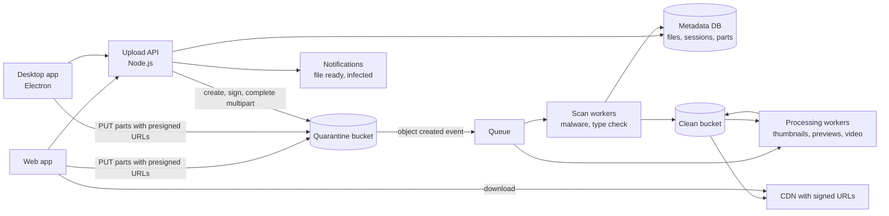
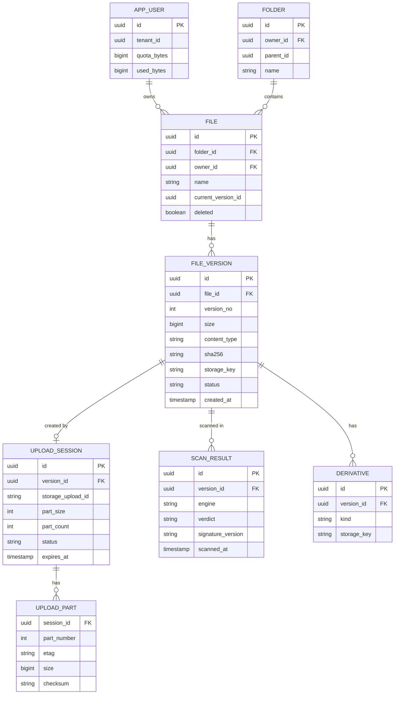
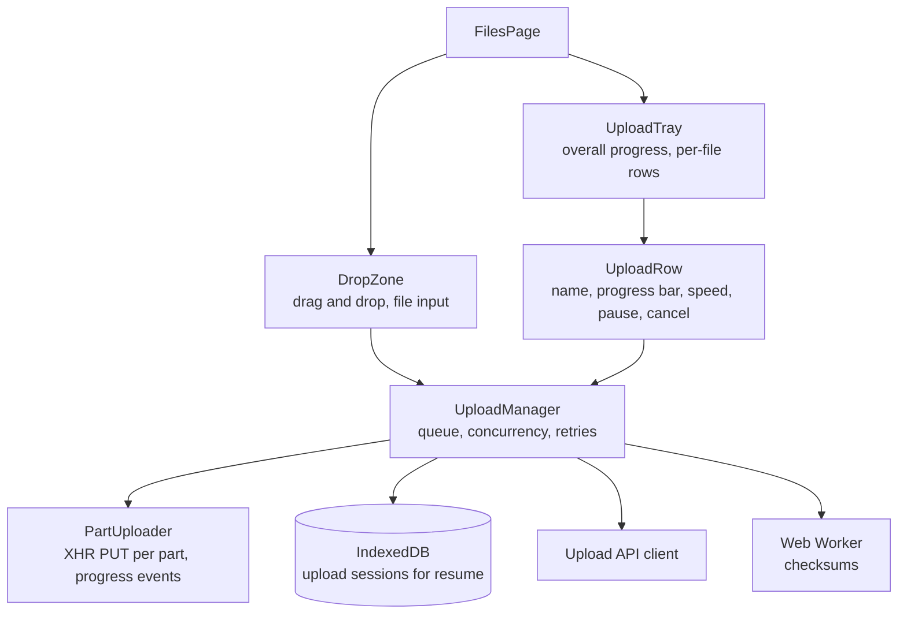
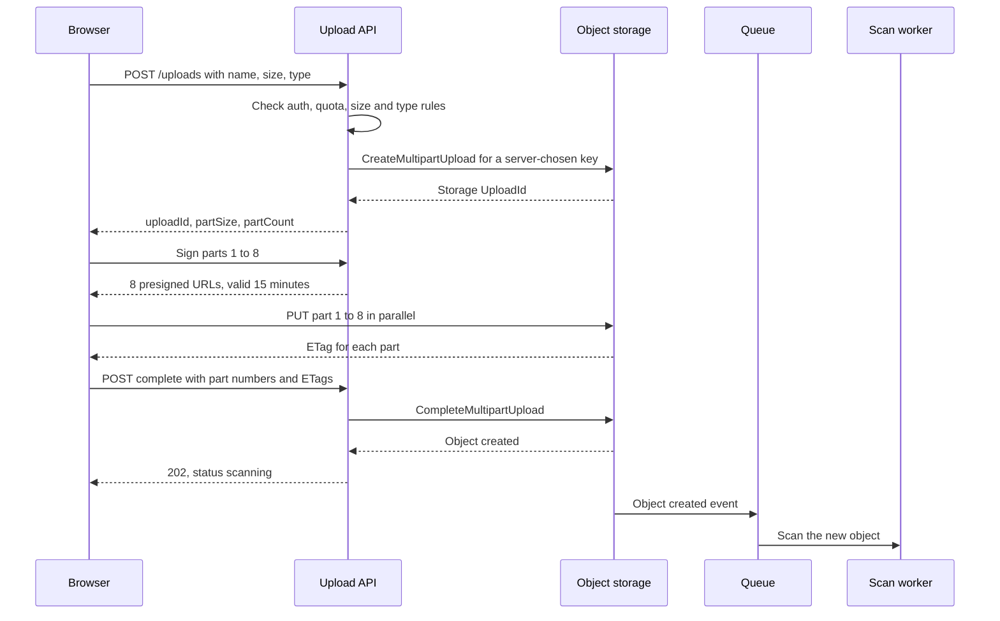
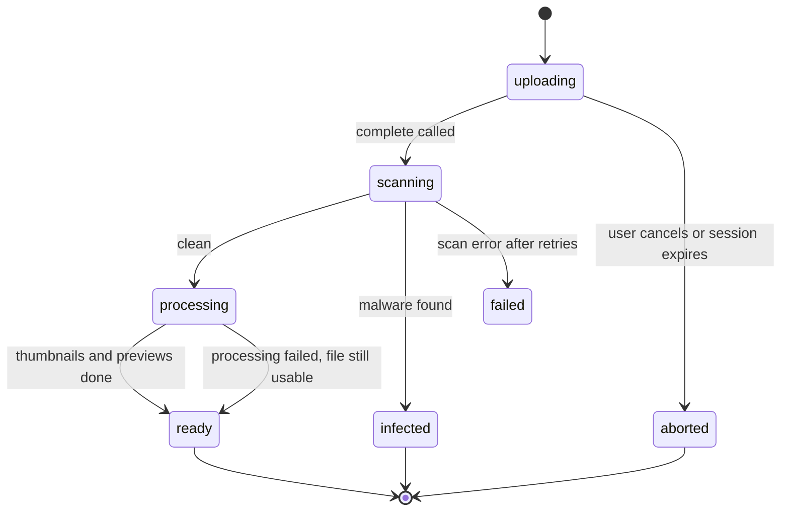
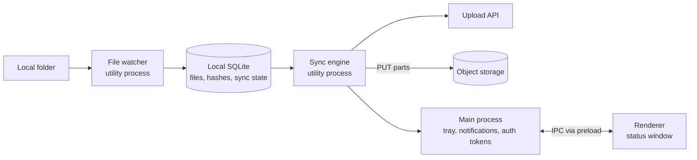

# Case Study: File Upload Service

> In this case study you will design a file upload service that handles everything from a 50 KB profile photo to a 50 GB video: direct uploads to object storage with presigned URLs, chunked and resumable multipart uploads, virus scanning, a progress UI with pause and resume, and a desktop (Electron) sync client. File uploads appear in almost every product, and interviewers use them to test HTTP knowledge, failure handling, security and frontend UX together.

**Before this:** [System design interview approach](01-system-design-interview-approach.md) · [Scalability and core building blocks](02-scalability-and-core-building-blocks.md) · [File uploads with progress](../05-frontend-engineering/07-api-integration-and-data-fetching.md#file-uploads-with-progress) · [Streams](../07-nodejs-backend/05-streams.md) · **Interview questions:** [jump to the interview section](#interview-questions)

## Table of contents

1. [Problem statement](#problem-statement)
2. [Clarifying questions](#clarifying-questions)
3. [Requirements](#requirements)
4. [Estimates](#estimates)
5. [High-level architecture](#high-level-architecture)
6. [API design](#api-design)
7. [Data model](#data-model)
8. [Frontend architecture](#frontend-architecture)
9. [Deep dive 1: presigned URLs and direct-to-storage uploads](#deep-dive-1-presigned-urls-and-direct-to-storage-uploads)
10. [Deep dive 2: chunked and resumable uploads](#deep-dive-2-chunked-and-resumable-uploads)
11. [Deep dive 3: the progress UI](#deep-dive-3-the-progress-ui)
12. [Deep dive 4: virus scanning and file processing](#deep-dive-4-virus-scanning-and-file-processing)
13. [Deep dive 5: very large files](#deep-dive-5-very-large-files)
14. [Deep dive 6: the desktop sync client in Electron](#deep-dive-6-the-desktop-sync-client-in-electron)
15. [Performance](#performance)
16. [Security](#security)
17. [Scalability](#scalability)
18. [Failure handling](#failure-handling)
19. [Observability](#observability)
20. [Trade-offs and alternatives](#trade-offs-and-alternatives)
21. [How to present this in 45 minutes](#how-to-present-this-in-45-minutes)
22. [Interview questions](#interview-questions)
23. [Summary](#summary)
24. [References](#references)

---

## Problem statement

"Design a file upload service for a business document and media platform."

Users upload files from the web app and from a desktop sync app:

- Small files (images, PDFs) and very large files (videos, design files, database exports up to 50 GB).
- Uploads must survive bad networks: a dropped Wi-Fi connection at 80% must not mean starting from zero.
- Users see progress, speed and time left, and can pause, resume and cancel.
- Every file is scanned for malware before anyone else can download it.
- Images and videos get thumbnails and previews.
- A desktop app keeps a local folder in sync with the cloud, like Dropbox or OneDrive.

The key idea to say early:

> "File bytes should never flow through our application servers. The browser uploads straight to object storage using short-lived presigned URLs, in parts, so uploads are fast, resumable and cheap. Our servers only handle small control messages: start an upload, sign parts, complete it. After the upload, the file stays in quarantine until a background pipeline has scanned and processed it."

---

## Clarifying questions

| Question | Why you ask it | Assumed answer |
| --- | --- | --- |
| What is the maximum file size? | Decides single upload vs multipart, part size. | 50 GB. |
| How many uploads per day, and typical size? | Bandwidth and storage. | 3 million uploads per day, average 2 MB (mostly documents, some huge videos). |
| Which clients? | Browser limits vs desktop capabilities. | Web app, desktop app (Electron), mobile later. |
| Must uploads resume after a page reload or app restart? | Where upload state is stored. | Yes for files over 100 MB. |
| Who can download a file? | Access control on downloads. | The owner and people the file is shared with. |
| Is malware scanning required? | Quarantine flow. | Yes, before anyone except the uploader can access it. |
| Allowed file types? | Validation rules. | Most types; executables are allowed but flagged; HTML/SVG never rendered inline. |
| Storage location and retention? | Region and compliance. | Region chosen per customer; files kept until deleted, plus 30 days in trash. |
| Duplicate files? | Deduplication. | Nice to have in the desktop sync (skip unchanged files). |

---

## Requirements

### Functional requirements

1. Upload files from 1 byte to 50 GB from the browser and the desktop app.
2. Chunked uploads that resume after network errors, page reloads and app restarts.
3. Progress per file and overall: percent, speed, time left. Pause, resume, cancel. Multiple files at once, with drag and drop.
4. Malware scan before a file becomes available to others.
5. Thumbnails for images, previews for PDFs, poster frames for videos.
6. Secure downloads with access checks, including resumable downloads (HTTP range requests).
7. Desktop sync: watch a folder, upload new and changed files, download remote changes, handle conflicts.

### Non-functional requirements

| Quality | Target |
| --- | --- |
| Reliability | An upload that the server confirmed is never lost. Retries never corrupt a file. |
| Throughput | Uploads use most of the user's bandwidth (parallel parts). |
| Cost | Our servers do not proxy file bytes. Abandoned uploads are cleaned up. |
| Security | No malware spread; no stored XSS through uploaded files; least-privilege upload URLs. |
| Latency | Small files usable (scanned) within about 10 seconds of upload completing. |
| Availability | 99.9% for starting and completing uploads. |

---

## Estimates

**Uploads and bandwidth**

- 3,000,000 uploads per day / 86,400 ≈ 35 upload sessions started per second on average. Peak about 3× → about 100 per second. The control API load is small.
- Data: 3,000,000 × 2 MB = 6 TB per day.
- 6 TB / 86,400 s ≈ 69 MB/s on average ≈ 555 Mbit/s. Peak about 3× → about 1.7 Gbit/s.

If all of that passed through our Node.js servers, we would need many servers just to copy bytes, and long uploads would tie up connections for hours. With **direct-to-storage uploads**, this bandwidth goes to the object storage service, which is built for it.

**Storage**

- 6 TB per day × 365 ≈ 2.2 PB per year (before deduplication and deletions).
- Object storage (Amazon S3, Google Cloud Storage, Azure Blob Storage) handles this. Use storage classes: frequently used files in standard storage, old files moved to cheaper tiers by lifecycle rules.

**Parts for the largest file**

- Amazon S3 multipart rules: up to 10,000 parts per upload; each part 5 MiB to 5 GiB (the last part can be smaller); objects up to 5 TiB.
- 50 GB with 16 MiB parts: 50,000,000,000 / 16,777,216 ≈ 2,980.2 → **2,981 parts**. Well under 10,000.
- With 5 MiB parts it would be about 9,537 parts — close to the limit. So the part size must **grow with the file size**.

**Metadata**

- 3,000,000 file rows per day × 1 KB ≈ 3 GB per day ≈ 1.1 TB per year. A sharded relational database or a scalable key-value store.

---

## High-level architecture



- **Upload API** (small Node.js service): authenticates the user, checks quota and file rules, starts multipart uploads, signs part URLs, completes uploads and records metadata. It never touches file bytes.
- **Quarantine bucket**: where uploads land. Nobody except internal workers can read from it.
- **Queue + scan workers**: the storage service emits an "object created" event. Scan workers check the file (malware engine, real file type) and move clean files to the clean bucket.
- **Processing workers**: thumbnails, previews and video transcoding, after the scan.
- **Clean bucket + CDN**: downloads use short-lived signed URLs, issued only after an access check.
- **Metadata DB**: files, versions, upload sessions, parts, scan results, sharing.

---

## API design

### Start an upload

```text
POST /api/uploads
Idempotency-Key: 3a2f1d9e-5b7c-4f1e-a0d2-9c8b7a6e5f41

{
  "fileName": "launch-video-final.mp4",
  "size": 4831838208,
  "contentType": "video/mp4",
  "folderId": "fld_12",
  "lastModified": 1729590000000
}
```

```json
201 Created
{
  "uploadId": "up_7f3c",
  "fileId": "file_9a21",
  "strategy": "multipart",
  "partSize": 16777216,
  "partCount": 288,
  "expiresAt": "2026-10-29T10:00:00Z"
}
```

- The server decides **strategy** and **part size**. Small files (under about 100 MB) use a single presigned `PUT`. Bigger files use multipart.
- The server checks size limits, quota and file name rules **before** anything is uploaded.
- The server creates the storage key (for example `quarantine/t_42/file_9a21/v1`). The user never chooses the storage path.

### Get presigned URLs for parts

```text
POST /api/uploads/up_7f3c/parts/sign
{ "partNumbers": [1, 2, 3, 4, 5, 6, 7, 8] }
```

```json
{
  "urls": [
    { "partNumber": 1, "url": "https://files-quarantine.s3.eu-central-1.amazonaws.com/quarantine/t_42/file_9a21/v1?partNumber=1&uploadId=...&X-Amz-Signature=...", "expiresAt": "2026-10-22T10:15:00Z" }
  ]
}
```

URLs are signed in **batches** and expire after about 15 minutes. If they expire during a long upload, the client asks for new ones.

### Upload a part (directly to storage)

```text
PUT <presigned URL for part 1>
Content-Length: 16777216

<16 MiB of bytes>

→ 200 OK
  ETag: "a54357aff0632cce46d942af68356b38"
```

The client keeps each part's `ETag`. The storage bucket's CORS settings must allow `PUT` from the app's origin and must **expose the `ETag` header**, otherwise browser JavaScript cannot read it.

### Check status (for resume)

```text
GET /api/uploads/up_7f3c
→ { "status": "uploading", "partSize": 16777216, "partCount": 288,
    "uploadedParts": [{ "partNumber": 1, "etag": "\"a543...\"", "size": 16777216 }, ...] }
```

The server gets the uploaded parts from the storage service (S3 `ListParts`), so it is the source of truth, not the client's memory.

### Complete

```text
POST /api/uploads/up_7f3c/complete
{ "parts": [{ "partNumber": 1, "etag": "\"a543...\"" }, { "partNumber": 2, "etag": "\"77c1...\"" }] }

→ 202 Accepted
{ "fileId": "file_9a21", "status": "scanning" }
```

`202` because the file is not ready yet: it is being scanned.

### Abort

```text
DELETE /api/uploads/up_7f3c       → aborts the multipart upload and frees stored parts
```

### File status and download

```text
GET /api/files/file_9a21
→ { "id": "file_9a21", "name": "launch-video-final.mp4", "size": 4831838208, "status": "ready",
    "thumbnails": { "small": "https://cdn.example.com/...signed..." } }

GET /api/files/file_9a21/download
→ 302 Found, Location: https://cdn.example.com/...signed URL, valid 5 minutes...
```

`status` moves through `uploading → scanning → processing → ready` (or `infected` / `failed`).

---

## Data model



- **`FILE` vs `FILE_VERSION`.** A file is the thing the user sees ("report.pdf"). Each upload creates a new version. Downloads use `current_version_id`. Old versions allow restore and conflict handling.
- **`storage_key` is generated by the server** (IDs only, never the user's file name). The user's name lives only in metadata. This avoids path traversal and naming conflicts in storage.
- **`UPLOAD_SESSION`** maps our upload to the storage provider's multipart `UploadId`. It expires (for example after 7 days); a cleanup job aborts expired sessions.
- **`UPLOAD_PART`** is optional bookkeeping (the storage service can list parts), but storing parts with checksums makes resume and verification easier.
- **`SCAN_RESULT`** keeps which engine and signature version scanned the file, for audits and re-scans.
- **`used_bytes`** for quotas is updated when an upload completes (with the final size from storage, not the size the client claimed).

---

## Frontend architecture

### Components



### State ownership

| State | Owner | Notes |
| --- | --- | --- |
| Upload queue and statuses | `UploadManager` (a root-level service) | Survives route changes; uploads continue while the user browses. |
| Bytes sent per part | `UploadManager` | Combined into file and overall progress. |
| Resume data (`uploadId`, file fingerprint, part size) | IndexedDB | So uploads can resume after a reload. |
| The `File` object | Memory only | Browsers cannot keep file access after a reload; the user must pick the file again (see resume). |
| File list in the folder | Server state cache | New file appears as "Uploading", then "Scanning", then "Ready". |
| Tray open/closed | UI state | Small, local. |

The `UploadManager` must live at the app level (for example a `providedIn: 'root'` service in Angular), not inside the page component, or navigating away would cancel uploads. Warn before closing the tab while uploads are running (`beforeunload`).

### Accessibility basics

- The drop zone must also be a normal button that opens the file picker (`<input type="file" multiple>`). Drag and drop alone is not accessible.
- Progress uses a real `<progress>` element (or `role="progressbar"` with `aria-valuenow`), with a text label.
- Announce important changes in a polite live region: "launch-video-final.mp4 uploaded", "Upload paused: network offline". Do not announce every percent.
- Pause, resume and cancel buttons have clear labels that include the file name ("Pause upload of launch-video-final.mp4").

See [accessibility](../05-frontend-engineering/04-accessibility.md).

---

## Deep dive 1: presigned URLs and direct-to-storage uploads

### The naive design and why it hurts

```text
Browser → POST /upload (multipart/form-data, 4 GB) → Node.js server → object storage
```

Problems:

- Every byte crosses our servers twice (in and out). At 1.7 Gbit/s peak, that is a lot of servers doing nothing but copying.
- A 4 GB upload on a slow connection holds a request open for hours. Deploys and timeouts kill it.
- If the server buffers the file in memory (a common bug with some upload middleware), one large file can crash the process.
- Load balancers and gateways often have body size limits and timeouts.

If you **must** proxy uploads (for example, an on-premises system with no object storage), stream them: pipe the request into the storage client without buffering, with backpressure. See [streams and backpressure](../07-nodejs-backend/05-streams.md#backpressure).

### Presigned URLs

A **presigned URL** is a URL to the storage service that already contains a signature made with our server's credentials. It allows **one specific operation** (for example `PUT` to one exact key, or upload of part 7 of one multipart upload) until it **expires**. The browser can use it without having any storage credentials.



Why this is good:

- **No file bytes on our servers.** The upload API handles tiny JSON requests.
- **Least privilege.** Each URL works for one key (and one part), one method, for a few minutes.
- **Storage handles scale**: object storage services are designed for very high parallel throughput.

### Signing on the server (Node.js)

```js
// sign-part.js (AWS SDK for JavaScript v3; other clouds have equivalents)
import { S3Client, UploadPartCommand } from '@aws-sdk/client-s3';
import { getSignedUrl } from '@aws-sdk/s3-request-presigner';

const s3 = new S3Client({ region: 'eu-central-1' });

export async function signPart(session, partNumber) {
  if (!Number.isInteger(partNumber) || partNumber < 1 || partNumber > session.partCount) {
    throw new Error('Invalid part number');
  }
  const command = new UploadPartCommand({
    Bucket: 'files-quarantine',
    Key: session.storageKey,           // chosen by the server, never by the client
    UploadId: session.storageUploadId,
    PartNumber: partNumber,
  });
  return getSignedUrl(s3, command, { expiresIn: 900 }); // 15 minutes
}
```

The API checks that the session belongs to the signed-in user before calling `signPart`.

### Single PUT for small files

For files under about 100 MB, multipart is extra work for little benefit. Use one presigned `PUT` (or a presigned **POST policy**, which can also enforce a `content-length-range` so the storage service itself rejects files that are too big). Then call `complete` so the API records the file and starts the scan.

### Verifying what was uploaded

A presigned URL alone does not prove the client uploaded what it claimed. On `complete`:

- Read the object's real size from storage (`HeadObject`) and compare it with the declared size and quota. Reject and delete if it is too big.
- Optionally verify checksums: S3 supports per-part checksums (for example SHA-256 or CRC32C) sent by the client and checked by the service, so a corrupted part is rejected at upload time.
- Never trust the client's `Content-Type`. The scan step checks the real type from the file's first bytes ("magic bytes").

---

## Deep dive 2: chunked and resumable uploads

### Why chunks

- **Resume:** if the connection drops, only the part in progress is lost (at most 16 MiB), not 4 GB.
- **Parallelism:** 4–6 parts upload at the same time, which uses more of the available bandwidth (one TCP connection often cannot fill a fast link, especially with high latency).
- **Retries are cheap:** a failed part is retried alone.

### Choosing the part size

The part size must respect the storage limits (at least 5 MiB except the last part, at most 10,000 parts) and should not be so big that a retry is expensive.

```js
// plan-parts.js
const MiB = 1024 * 1024;
const MIN_PART = 5 * MiB;
const MAX_PARTS = 10_000;

function planParts(fileSize, preferred = 16 * MiB) {
  // Grow the part size (in whole MiB) until the part count fits under the limit
  let partSize = Math.max(MIN_PART, preferred);
  while (Math.ceil(fileSize / partSize) > MAX_PARTS) partSize += MiB;
  const partCount = Math.max(1, Math.ceil(fileSize / partSize));
  const lastPartSize = fileSize - (partCount - 1) * partSize;
  return { partSize, partCount, lastPartSize };
}

console.log(planParts(4831838208));         // { partSize: 16777216, partCount: 288, lastPartSize: 16777216 }
console.log(planParts(50_000_000_000));     // { partSize: 16777216, partCount: 2981, lastPartSize: 3896320 }
console.log(planParts(500_000_000_000).partSize / MiB); // 48  (500 GB needs bigger parts)
```

### Resuming

Resume has to handle three situations:

| Situation | What survives | How to resume |
| --- | --- | --- |
| Network drops for a while | Everything in memory | Retry failed parts with backoff; continue. |
| Page reload or browser crash | IndexedDB, not the `File` object | Show "1 upload paused — select the file again to continue". When the user picks a file, match it by **fingerprint** (name + size + `lastModified`, plus a checksum of the first part if you want to be sure). Ask the server which parts exist; upload the rest. |
| Desktop app restart | Local database + the file on disk | Resume automatically (the app can reopen the file by path). |

Browsers cannot reopen a file by path after a reload for security reasons. That is why web resume needs the user to pick the file again. (The File System Access API can keep a file handle in some Chromium browsers, with permission. Treat it as an enhancement, not a requirement.)

```js
// resume.js — which parts still need uploading?
function partsToUpload(partCount, uploadedParts) {
  const done = new Set(uploadedParts.map(p => p.partNumber));
  const missing = [];
  for (let n = 1; n <= partCount; n++) if (!done.has(n)) missing.push(n);
  return missing;
}

const fromServer = [{ partNumber: 1 }, { partNumber: 2 }, { partNumber: 4 }]; // part 3 failed earlier
console.log(partsToUpload(6, fromServer)); // [ 3, 5, 6 ]
```

Always ask the **server** (which asks the storage service) for the list of uploaded parts. The client's own record may be wrong: a part may have finished on the storage side after the client lost its connection.

### Concurrency and retries

```js
// upload-queue.js — upload parts with a concurrency limit and retries with backoff
async function uploadAll(partNumbers, uploadPart, { concurrency = 4, maxRetries = 3 } = {}) {
  const results = new Map();
  const queue = [...partNumbers];

  async function worker() {
    while (queue.length) {
      const n = queue.shift();
      for (let attempt = 0; ; attempt++) {
        try {
          results.set(n, await uploadPart(n));
          break;
        } catch (err) {
          if (attempt >= maxRetries) throw new Error(`Part ${n} failed: ${err.message}`);
          await new Promise(r => setTimeout(r, 2 ** attempt * 10)); // short delays for the demo
        }
      }
    }
  }

  await Promise.all(Array.from({ length: concurrency }, worker));
  return [...results.entries()].sort((a, b) => a[0] - b[0]).map(([partNumber, etag]) => ({ partNumber, etag }));
}

// Fake uploader: part 3 fails once, then succeeds
const failures = new Set([3]);
const fakeUploadPart = async n => {
  await new Promise(r => setTimeout(r, 5));
  if (failures.delete(n)) throw new Error('network');
  return `"etag-${n}"`;
};

uploadAll([1, 2, 3, 4, 5], fakeUploadPart, { concurrency: 2 }).then(parts => console.log(parts));
// [
//   { partNumber: 1, etag: '"etag-1"' },
//   { partNumber: 2, etag: '"etag-2"' },
//   { partNumber: 3, etag: '"etag-3"' },
//   { partNumber: 4, etag: '"etag-4"' },
//   { partNumber: 5, etag: '"etag-5"' }
// ]
```

Notes:

- 4–6 parallel parts is a good default for browsers. More parts compete for the same bandwidth and memory.
- Re-uploading a part number replaces the old part, so retries are **idempotent**.
- If a presigned URL expired (`403`), get a new URL and retry — do not count it as a normal failure.
- Pause = stop taking new parts from the queue and abort in-flight requests. Resume = continue from the server's part list.
- When the browser goes offline (`offline` event), pause automatically; resume on `online`.

### The tus protocol

**tus** is an open protocol for resumable uploads over HTTP. The client creates an upload, sends bytes with `PATCH` and an `Upload-Offset` header, and after a failure asks the server (`HEAD`) for the current offset and continues. Client libraries (for example tus-js-client) and servers exist. It is a good choice when you control the upload server or use a provider that speaks tus. The multipart + presigned design above gives similar resume behavior while sending bytes directly to object storage.

---

## Deep dive 3: the progress UI

### Getting progress events

- **`XMLHttpRequest`** has `xhr.upload.onprogress` with `loaded` and `total`. It works in all browsers. It is the usual choice for upload progress.
- **`fetch`** has no upload progress events. (Chromium supports streaming request bodies with `duplex: 'half'`, but that still does not give simple progress events, and support is limited.) Use XHR for uploads with progress, or a library that does.
- Angular's `HttpClient` with `reportProgress: true` and `observe: 'events'` gives `HttpEventType.UploadProgress` events. It uses XHR by default.

```ts
// part-uploader.ts — one part with progress and abort
function putPart(url: string, blob: Blob, onProgress: (loaded: number) => void, signal: AbortSignal): Promise<string> {
  return new Promise((resolve, reject) => {
    const xhr = new XMLHttpRequest();
    xhr.open('PUT', url);
    xhr.upload.onprogress = e => onProgress(e.loaded);
    xhr.onload = () => {
      if (xhr.status >= 200 && xhr.status < 300) resolve(xhr.getResponseHeader('ETag') ?? '');
      else reject(new Error(`HTTP ${xhr.status}`));
    };
    xhr.onerror = () => reject(new Error('network'));
    signal.addEventListener('abort', () => { xhr.abort(); reject(new DOMException('Aborted', 'AbortError')); });
    xhr.send(blob); // blob = file.slice(start, end) — slicing does not read the file into memory
  });
}
```

`file.slice(start, end)` creates a `Blob` that **refers** to part of the file. The browser reads it from disk while sending. So uploading a 50 GB file does not need 50 GB of memory.

### Combining part progress into file progress

With parallel parts, the file's progress is **bytes of finished parts + bytes in flight**:

```js
// progress.js
function fileProgress({ totalBytes, completedBytes, inFlight }) {
  const inFlightBytes = Object.values(inFlight).reduce((sum, b) => sum + b, 0);
  const sent = completedBytes + inFlightBytes;
  return Math.min(100, Math.floor((sent / totalBytes) * 100));
}

// 100 MB file: 5 parts of 16 MiB done, 2 parts in flight
const MiB = 1024 * 1024;
console.log(fileProgress({
  totalBytes: 100 * MiB,
  completedBytes: 5 * 16 * MiB,
  inFlight: { 6: 8 * MiB, 7: 3 * MiB },
})); // 91
```

When a part fails and restarts, its in-flight bytes drop back to 0, so progress can go **down** a little. Either accept it, or show the maximum value reached so far — but never show 100% before `complete` succeeds.

### Speed and time left

- Measure speed with a **moving average** over the last few seconds, not since the start (the network changes).
- Time left = remaining bytes / current speed. Round it ("about 3 minutes"), and update the text at most once per second so it does not flicker.
- Show distinct states: Waiting, Uploading 45% · 12 MB/s · about 3 min, Paused, Retrying (network), Finishing, Scanning, Ready, Failed (with reason and retry), Blocked (malware).

### Rendering cheaply

Progress events fire very often. Do not trigger a full re-render on each one:

- Store progress in the manager, and update the UI on an animation frame or every 200–500 ms.
- In Angular, run XHR progress handlers outside the zone (or throttle) and enter the zone only for throttled UI updates. See [runOutsideAngular](../06-angular-16/12-performance.md#runoutsideangular-for-high-frequency-events).
- For 1,000 files dropped at once, virtualize the tray list and show an overall summary.

---

## Deep dive 4: virus scanning and file processing

### Quarantine first

Uploaded files go to a **quarantine** bucket that only internal workers can read. The file's status is `scanning`. Only after a clean result is it copied (or moved) to the clean bucket and marked `ready`. The uploader can see "Scanning…"; nobody else can download it.



### The scan worker

1. Receive the "object created" event from the queue.
2. **Stream** the object from storage into the scanner (an antivirus engine such as ClamAV running as a service, or a commercial scanning API). Do not download huge files to memory.
3. Check the **real file type** from magic bytes. A file named `invoice.pdf` that is really a Windows executable is suspicious.
4. Apply limits for archives: maximum unpacked size, maximum nesting depth, maximum number of files — to defend against **zip bombs** (small archives that expand to terabytes).
5. Write a `SCAN_RESULT` (engine, signature version, verdict).
6. Clean → copy to the clean bucket, set status `processing`, emit `FileClean`. Infected → delete or keep in a locked bucket for investigation, set status `infected`, notify the uploader (and security, if needed).
7. The worker is **idempotent**: the same event delivered twice does not create two copies or two notifications (check the current status first). See [idempotent consumers](../07-nodejs-backend/13-background-jobs-and-queues.md#delivery-guarantees-and-idempotent-consumers).

Important honesty point for interviews: **scanning reduces risk; it does not remove it.** New malware is not in signature databases yet. So also:

- Never render uploaded HTML or SVG inline on your main domain (see [Security](#security)).
- Re-scan files when they are downloaded after a long time, or periodically with new signatures, for high-risk content.
- For high-security environments, consider **content disarm and reconstruction** (CDR): rebuilding documents without active content (macros, scripts).

### Processing

After a clean scan, processing workers create derivatives:

- **Images:** decode, strip metadata (EXIF can contain GPS location), resize to a few sizes, convert to WebP/AVIF. Use a well-maintained image library and limit pixel dimensions (a "pixel flood" image can use huge memory).
- **PDFs and documents:** render the first page as a preview image in a sandboxed worker.
- **Videos:** poster frame and transcoding to streaming formats (HLS/DASH) — a heavy job for a separate, autoscaled queue.

Processing failures do not block the file: the file is still `ready`, just without a preview.

### Time budget

For a small file: upload completes → event in about a second → scan in a few seconds → `ready`. The UI listens for status changes (polling `GET /files/:id` every 2 seconds for files in `scanning`, or a WebSocket/SSE notification) and updates the row to "Ready".

---

## Deep dive 5: very large files

Files of 10–50 GB add problems beyond "use more parts":

| Problem | Solution |
| --- | --- |
| Parts limit (10,000) | Grow part size with file size (`planParts`). |
| Upload takes hours | Resume across sessions; presigned URLs signed in batches and refreshed when expired; upload session valid for days. |
| Laptop sleeps or network changes | Pause on `offline`, resume on `online`; on desktop, resume after `powerMonitor` `resume` events. |
| Memory | `file.slice()` in the browser and file streams on desktop — never read the whole file. |
| Checksums | Web Crypto's `crypto.subtle.digest` needs the whole input at once and has no incremental API. For a whole-file SHA-256, use an incremental hashing library in a **Web Worker**, or rely on **per-part checksums** verified by the storage service. |
| Abandoned uploads | Incomplete multipart uploads keep their parts in storage — and you pay for them. Use a bucket **lifecycle rule** to abort incomplete multipart uploads after N days, plus our own cleanup job for expired sessions. |
| Scanning time | Scanning 50 GB takes a while; show "Scanning large file, this can take several minutes". Some scanners have size limits; define a policy (for example, files over the limit are marked "not scanned" and only downloadable by the owner). |
| Download | Use HTTP **range requests** (`Range: bytes=...`) so downloads can resume too. Object storage and CDNs support them. |
| Upload acceleration | Some providers offer edge-accelerated upload endpoints that route uploads over their backbone network; useful for users far from the storage region. |

---

## Deep dive 6: the desktop sync client in Electron

A desktop sync app keeps a local folder in sync with the cloud. It adds capabilities the browser does not have (reading files by path, background work, running at login) and new problems (conflicts, many files, long-running state).

### Architecture inside the app



- **The renderer** (the UI) shows status and settings only. It has no Node.js access and talks to the main process through a narrow **preload** API, with `contextIsolation: true`, `sandbox: true` and `nodeIntegration: false`. See [IPC and preload scripts](../08-electron-desktop/03-ipc-and-preload-scripts.md) and [Electron security](../08-electron-desktop/04-electron-security.md).
- **The main process** owns the app lifecycle, the tray icon, OS notifications and the auth tokens (stored with the OS keychain, for example through Electron's `safeStorage`).
- **The file watcher and sync engine** run in a **utility process** (Electron's `utilityProcess`), so heavy hashing and I/O never freeze the UI or the main process. See [choosing utilityProcess, child_process or worker_threads](../08-electron-desktop/05-filesystem-child-processes-and-native-features.md#choosing-utilityprocess-child_process-or-worker_threads).
- **A local SQLite database** records each file's path, size, modified time, content hash, the server version it matches and its sync state. This is what makes resume after restart and change detection possible. See [local databases](../08-electron-desktop/05-filesystem-child-processes-and-native-features.md#local-databases-sqlite-and-indexeddb).

### Detecting changes

- Watch the folder for changes (Node's `fs.watch` or a library built on it). Watch events are noisy and can be missed (for example, during sleep), so also do a **periodic full scan** that compares size and modified time with the local database.
- **Debounce** changes: an editor may write a file several times in a second. Wait until the file has been stable for a couple of seconds before uploading.
- Ignore temporary files (`~$report.docx`, `.tmp`, `.DS_Store`).

### Uploading only what changed

- If size and modified time are unchanged, skip the file.
- Otherwise compute the content hash; if it equals the last synced hash, skip the upload (only metadata changed).
- **Delta sync** (advanced): split files into chunks and upload only chunks whose hash the server does not have. With **fixed-size chunks**, inserting one byte near the start shifts every later chunk, so every chunk looks new. **Content-defined chunking** (chunk boundaries chosen by a rolling hash of the content) keeps most chunks identical after an insertion. This is what large sync products and backup tools use.

```js
// delta.js — fixed-size chunk hashes: which chunks changed?
import { createHash } from 'node:crypto';

function chunkHashes(buffer, chunkSize) {
  const hashes = [];
  for (let i = 0; i < buffer.length; i += chunkSize) {
    hashes.push(createHash('sha256').update(buffer.subarray(i, i + chunkSize)).digest('hex').slice(0, 8));
  }
  return hashes;
}

const before = Buffer.from('AAAABBBBCCCCDDDD');
const edited = Buffer.from('AAAABBBBXXXXDDDD'); // only the third chunk changed
const inserted = Buffer.from('ZAAAABBBBCCCCDDDD'); // one byte inserted at the start

const changed = (a, b) => b.map((h, i) => (h === a[i] ? '=' : 'changed'));
console.log(changed(chunkHashes(before, 4), chunkHashes(edited, 4)));   // [ '=', '=', 'changed', '=' ]
console.log(changed(chunkHashes(before, 4), chunkHashes(inserted, 4))); // [ 'changed', 'changed', 'changed', 'changed', 'changed' ]
```

The second line shows why fixed chunks fail after an insertion — and why content-defined chunking exists.

### Conflicts

The same file is edited on the laptop (offline) and on the web. When the laptop syncs:

1. The client uploads with the **base version** it started from (`baseVersionId`), like optimistic locking in the [admin portal case study](07-case-study-enterprise-admin-portal.md#deep-dive-3-complex-forms-and-edit-conflicts).
2. If the server's current version is different, the server rejects with `409 Conflict`.
3. The client keeps both: it saves the remote version as `report.docx` and renames the local one to `report (Priya's laptop conflicted copy 2026-10-22).docx`, then uploads that as a new file. No data is lost, and the user decides.

Automatic merging is only possible for some formats (plain text). For binary files, "keep both" is the safe default.

### Being a good desktop citizen

- **Bandwidth limits** (user setting) and pausing on metered connections.
- **Pause on battery saver**, resume on power.
- Handle **sleep and resume**: the `powerMonitor` `resume` event triggers a rescan and reconnect. See [power monitor](../08-electron-desktop/05-filesystem-child-processes-and-native-features.md#power-monitor-sleep-resume-and-lock).
- **OS notifications** for important events only (conflicts, quota full, malware found).
- **Crash recovery:** all sync state is in SQLite, written atomically; after a crash, the engine resumes from the database. See [logging, crash recovery and monitoring](../08-electron-desktop/08-logging-crash-recovery-and-monitoring.md).
- **Auto-updates** for the client, because sync protocol changes need clients to update. See [auto-updates](../08-electron-desktop/07-auto-updates.md).
- **Paths:** handle Windows path length limits, case-insensitive file systems (two cloud files `Report.pdf` and `report.pdf` cannot both exist locally on Windows or default macOS), and characters that are invalid on one OS.

---

## Performance

| Area | Technique |
| --- | --- |
| Throughput | Direct-to-storage uploads; 4–6 parallel parts; part size 8–64 MiB depending on file size; HTTP/2 or HTTP/3 to storage where supported. |
| Control API | Sign part URLs in batches (for example 8–20 at a time) instead of one request per part. |
| Client memory | `file.slice()` (browser) and streams (desktop); never read whole files. |
| Client CPU | Hashing in a Web Worker or a utility process; throttled progress rendering. |
| Time to ready | Event-driven scanning (no polling of buckets); scan workers autoscale on queue depth; small files first (separate queue for large files so one 50 GB scan does not block thousands of small ones). |
| Downloads | CDN with signed URLs, range requests, thumbnails instead of originals in lists. |
| Distance | Storage region close to the user, or accelerated upload endpoints for far-away users. |

---

## Security

1. **Server-chosen storage keys.** The client never decides the path. This prevents overwriting other users' files and path traversal (`../../`).
2. **Least-privilege presigned URLs:** one key, one method, one part, short expiry. Signed only after checking that the user owns the upload session.
3. **Validate size and type on the server:** check declared size before signing, real size after upload (`HeadObject`), and real type from magic bytes during the scan. Enforce quotas with the real size.
4. **Quarantine + scan** before sharing; archive limits against zip bombs; image dimension limits against pixel floods.
5. **Never serve user files as active content on your main domain.** An uploaded `.html` or `.svg` file served inline from `app.example.com` can run JavaScript with your users' cookies (stored XSS). Serve user content from a **separate domain** (for example `usercontent.example-cdn.com`), with `Content-Disposition: attachment` for risky types, `X-Content-Type-Options: nosniff`, and a restrictive `Content-Security-Policy` (for example `sandbox`). See [web security](../10-testing-security-production/05-web-security-xss-csrf-cors-csp.md).
6. **Access-checked downloads:** every download request checks permission, then returns a short-lived signed URL. Do not make buckets public.
7. **Bucket CORS:** allow only your app origins and only the needed methods (`PUT`, `GET`) and headers; expose `ETag`.
8. **Strip metadata** from images (EXIF GPS) before sharing derivatives; keep originals private.
9. **Encryption** at rest (storage-managed keys, or customer-managed keys for enterprise tenants) and in transit (HTTPS only).
10. **Desktop client:** tokens in the OS keychain, a locked-down renderer, signed installers and updates. See [Electron security](../08-electron-desktop/04-electron-security.md) and [packaging and code signing](../08-electron-desktop/06-packaging-installers-and-code-signing.md).
11. **File names are untrusted input:** render them as text, limit length, and remove control characters (for example right-to-left override characters used to disguise `exe` files).

---

## Scalability

- **Upload API** is stateless and small; it scales horizontally. It handles about 100 session starts per second at peak plus part-signing requests.
- **Object storage** absorbs the bandwidth (about 1.7 Gbit/s at peak) and scales automatically. Spread keys well (random IDs in keys) so the storage service can partition them.
- **Metadata DB** is sharded by tenant or owner. Upload session and part rows are short-lived and can live in a separate store with a TTL.
- **Scan and processing workers** autoscale on queue depth, with separate queues by size and type (images, documents, videos).
- **CDN** handles download traffic.
- **Multi-region:** each customer's data in its chosen region; the upload API in that region signs URLs for that region's buckets.

See [scalability and core building blocks](02-scalability-and-core-building-blocks.md).

---

## Failure handling

| Failure | Behavior |
| --- | --- |
| Network drops mid-part | Part retried with exponential backoff and jitter; other parts continue. |
| Browser goes offline | Uploads pause automatically and resume on `online`. |
| Page reload | Resume data in IndexedDB; user re-selects the file; server lists uploaded parts; only missing parts are sent. |
| Presigned URL expired | `403` from storage → request a fresh URL → retry the part. |
| `complete` request fails or times out | Retry safely: completing an already completed upload is detected (session status is `completed`), and the API returns the same file. |
| Client never calls `complete` | Session expires; cleanup job aborts the multipart upload; bucket lifecycle rule as a backup. |
| Scan worker crashes | Event is redelivered; the worker is idempotent. After several failures → dead-letter queue and status `failed` with an alert. |
| Scanner down | Files stay in `scanning`; the uploader sees "Scanning delayed". Never mark files clean without a scan. |
| Processing fails | File stays `ready` without previews; retry later. |
| Storage region outage | Uploads fail fast with a clear message; resume later (the session survives). |
| Desktop app crash | State in SQLite; restart resumes from the last committed state. |

See [reliability and resilience](../10-testing-security-production/09-reliability-and-resilience.md).

---

## Observability

- **Upload funnel:** sessions started, completed, aborted, expired; completion rate by file size and client type.
- **Speed and duration:** average throughput per upload (from client reports), time from `complete` to `ready`.
- **Errors:** part retry rate, expired-URL rate, `complete` failures, by browser and network type.
- **Scanning:** queue depth and age, scan duration by size, infected count, scan errors, signature database age.
- **Cost signals:** bytes in incomplete multipart uploads, storage growth per tenant.
- **Desktop clients:** sync backlog per device, conflicts created, app version distribution, crash rate.
- **Client logs** include the `uploadId` so support can trace one user's failed upload end to end.

See [logging, monitoring and observability](../10-testing-security-production/08-logging-monitoring-and-observability.md).

---

## Trade-offs and alternatives

| Decision | We chose | Alternative | When the alternative is better |
| --- | --- | --- | --- |
| Data path | Direct to storage with presigned URLs | Upload through our servers (streamed) | On-premises systems without object storage; when you must inspect bytes inline (for example DLP before storage). |
| Large files | Storage-native multipart | tus protocol | You run your own upload server or a provider that supports tus; you want a standard, open resumable protocol across clients. |
| Small files | Single presigned `PUT` or POST policy | Always multipart | Simpler code path with one strategy, at the cost of extra requests for small files. |
| Scanning | Async, quarantine bucket | Synchronous scan before `complete` returns | Tiny files where the user must know the result immediately (for example avatar upload). |
| Progress | XHR progress events | `fetch` with streaming bodies | When fetch upload progress is supported everywhere you need it. |
| Desktop sync | Whole-file upload with hash skip | Content-defined chunking delta sync | Large files edited often (design files, VM images) where re-uploading everything is too slow. |
| Conflicts | Keep both copies | Automatic merge or file locking | Text formats that can merge; workflows that require checkout/lock (for example CAD files). |
| Build vs buy | Build on object storage | Managed upload services | Uploads are not core to your product and you want resumable uploads, scanning and processing out of the box. |

---

## How to present this in 45 minutes

**Minutes 0–5: clarify.**
> "What's the biggest file? How many uploads per day and what's the typical size? Which clients — browser only, or also desktop? Must uploads resume after a reload? Who can download a file, and do we need malware scanning? ... OK: up to 50 GB, 3 million uploads a day averaging 2 MB, web plus an Electron desktop sync app, resume required for big files, sharing with access checks, and mandatory scanning."

**Minutes 5–9: numbers.**
> "That's about 6 TB a day, roughly 70 MB a second on average and close to 2 Gbit/s at peak. I don't want that flowing through our servers, so uploads go straight to object storage. The control API only sees about 35 session starts a second. For a 50 GB file with 16 MiB parts it's about 2,981 parts, under the 10,000-part limit, so part size must grow for bigger files. Storage grows about 2 PB a year."

**Minutes 9–16: high-level design and API.**
> "The client calls POST /uploads; the API checks quota and rules, creates a multipart upload with a server-chosen key and returns the part size. The client asks for presigned URLs in batches, PUTs parts directly to a quarantine bucket in parallel, collects ETags, then calls complete. The storage event goes to a queue; scan workers check the file and move it to the clean bucket; processing workers make thumbnails; downloads use short-lived signed CDN URLs after an access check."

**Minutes 16–30: deep dives.**
- Presigned URLs: least privilege, no bytes through our servers, verify real size and type after upload.
- Chunked and resumable: part planning, parallel parts with retries, idempotent part re-uploads, resume from the server's part list, re-selecting the file after a reload, tus as an alternative.
- Progress UI: XHR progress per part, combined progress, moving-average speed, clear states, throttled rendering, accessibility.
- Scanning: quarantine, streaming scan, magic bytes, zip bomb limits, idempotent worker, scanning reduces but does not remove risk.

**Minutes 30–38: large files and desktop.**
> "For huge files: bigger parts, URL refresh, pause on offline, incremental hashing in a worker or per-part checksums, lifecycle rules to clean up abandoned parts, and range requests for downloads. The Electron sync client watches the folder from a utility process, keeps state in SQLite, skips unchanged files by hash, uses a base version to detect conflicts and keeps both copies, and the renderer only talks to the main process through a narrow preload API."

**Minutes 38–43: security and failures.**
> "Server-chosen keys, short-lived URLs, real size and type checks, quarantine, user content served from a separate domain with attachment disposition so an uploaded HTML or SVG can't run as our site. Every step is retryable: parts, complete, and scan events."

**Minutes 43–45: trade-offs.**
> "If we had no object storage, I'd stream through the server. For a tiny avatar upload, a synchronous scan is fine. For files edited constantly, content-defined chunking would cut desktop upload time."

---

## Interview questions

### Q1. Why upload directly to object storage instead of through your API server?

**What the interviewer is checking:** understanding of bandwidth, connection time and cost at scale.

**Short spoken answer (30–60 seconds):**
> "If files go through my API server, every byte crosses my infrastructure twice, long uploads hold connections open for hours, deploys and timeouts break them, and a careless middleware might buffer a whole file in memory. Object storage is built to take huge parallel uploads. So my API only handles small control requests: it checks the user and quota, creates the upload, and signs short-lived presigned URLs. The browser sends the bytes straight to storage. My servers stay small and the upload gets the storage service's throughput and reliability."

**Follow-up questions:**
- **What is a presigned URL exactly?** — A storage URL with a signature (made with our credentials) that allows one operation on one key until an expiry time. The client needs no credentials of its own.
- **How do you still enforce limits?** — Check the declared size before signing; use a POST policy with `content-length-range` for single uploads; after upload, read the real size from storage and reject or delete files over the limit; charge quota with the real size.
- **When would you proxy anyway?** — When there is no object storage, or when policy requires inspecting bytes before they are stored. Then stream with backpressure, never buffer.

**Common mistakes:** proxying with an in-memory body parser; long-lived or wildcard presigned URLs.

**Where this is used in real projects:** almost every modern app that stores user files on S3, GCS or Azure Blob.

### Q2. How do resumable uploads work?

**What the interviewer is checking:** chunking, server-side state and what survives a failure.

**Short spoken answer (30–60 seconds):**
> "The file is split into parts, for example 16 MiB each, uploaded in parallel through a multipart upload. Each finished part is stored by the storage service and identified by its number and ETag. If the connection drops, I only redo the part that was in flight. To resume after a reload, I keep the upload ID and a fingerprint of the file in IndexedDB. The browser can't reopen the file by itself, so the user selects it again; I match the fingerprint, ask the server which parts already exist — the server asks the storage service, which is the source of truth — and upload only the missing ones. Then I call complete with the full part list."

**Follow-up questions:**
- **What if the user selects a different file with the same name?** — The fingerprint includes size and `lastModified`; for extra safety, hash the first part and compare with what was uploaded.
- **What about tus?** — tus is an open protocol for resumable uploads: create, `PATCH` bytes with an offset, `HEAD` to learn the offset after failure. Good when you run the upload server; multipart with presigned URLs gives similar resume while sending bytes directly to storage.

**Common mistakes:** trusting the client's memory of which parts finished; restarting from zero on every failure.

**Where this is used in real projects:** video platforms, cloud drives, backup tools.

### Q3. How do you choose the chunk size?

**Short answer:** Respect the storage limits (S3: at least 5 MiB per part except the last, at most 10,000 parts) and balance retry cost against request overhead. A good default is 8–16 MiB, growing with file size so the part count stays under the limit: 50 GB with 16 MiB parts is about 2,981 parts; a 500 GB file needs about 48 MiB parts. On slow or unreliable networks, smaller parts lose less work per failure. See `planParts` in [deep dive 2](#deep-dive-2-chunked-and-resumable-uploads).

### Q4. How do you show accurate progress for parallel chunk uploads?

**What the interviewer is checking:** practical frontend implementation details.

**Short spoken answer (30–60 seconds):**
> "I use XMLHttpRequest for each part because its upload progress events work everywhere — fetch doesn't give upload progress. I keep the bytes of completed parts plus the current loaded bytes of each in-flight part, and progress is their sum over the total. If a part fails and restarts, its in-flight bytes reset, so progress can dip; I either accept that or show the highest value so far, and never 100% until complete succeeds. Speed is a moving average over the last few seconds, time left is remaining bytes divided by that speed, and I update the UI a few times per second, not on every event. The bar is a real progress element with a label, and milestones are announced in a live region."

**Follow-up questions:**
- **How do you do this in Angular?** — `HttpClient` with `reportProgress: true` and `observe: 'events'`, filtering `HttpEventType.UploadProgress`. Throttle the updates and use `OnPush`.
- **Does `file.slice()` load the file into memory?** — No. It creates a `Blob` that refers to a range of the file; the browser reads it while sending.

**Common mistakes:** showing progress of only one part; updating the DOM on every progress event.

**Where this is used in real projects:** every upload UI.

### Q5. How do you handle malware in uploaded files?

**What the interviewer is checking:** security design and realistic expectations.

**Short spoken answer (30–60 seconds):**
> "Uploads land in a quarantine bucket that only workers can read, with status 'scanning'. A storage event triggers a scan worker that streams the file through an antivirus engine, checks the real type from magic bytes, and limits archive expansion against zip bombs. Clean files move to the clean bucket and become downloadable; infected ones are blocked and the uploader is told. The worker is idempotent because events can repeat. And I'm honest that scanning only catches known threats, so I also serve user files from a separate domain as attachments, never inline on the main site, and can re-scan with newer signatures."

**Follow-up questions:**
- **Why not scan synchronously during upload?** — Large files take a long time to scan, and holding the request open is fragile. Async scanning with a clear status is more reliable. For tiny files like avatars, synchronous checks are acceptable.
- **What is CDR?** — Content disarm and reconstruction: rebuilding documents without active content like macros. Used in high-security environments.

**Common mistakes:** trusting the file extension or `Content-Type`; making files available before the scan finishes.

**Where this is used in real projects:** email attachments, document portals, support ticket attachments.

### Q6. A user uploads an SVG with JavaScript inside. What can go wrong and how do you prevent it?

**Short answer:** If the SVG (or an HTML file) is served inline from your main domain, the browser runs its script with your origin — stored XSS that can act as any user who opens it. Prevent it by serving user content from a **separate domain** with no cookies, sending `Content-Disposition: attachment` for active types, `X-Content-Type-Options: nosniff`, and a `Content-Security-Policy: sandbox` header; and by generating safe raster thumbnails instead of displaying the SVG itself. Never rely on the file extension. See [web security](../10-testing-security-production/05-web-security-xss-csrf-cors-csp.md).

### Q7. What happens to uploads that never complete?

**Short answer:** Their parts stay in storage and cost money, even though no object is visible. Our upload sessions have an expiry; a cleanup job aborts expired multipart uploads and marks sessions `aborted`. As a backup, the bucket has a lifecycle rule that aborts incomplete multipart uploads after a few days. Monitor the bytes in incomplete uploads as a cost metric.

### Q8. How would you upload a 50 GB file from a browser?

**What the interviewer is checking:** whether you know the limits that appear only at large sizes.

**Short spoken answer (30–60 seconds):**
> "Multipart with a part size chosen so the count stays under 10,000 — around 16 MiB gives about 2,981 parts. I read parts with file.slice so memory stays small, upload 4 to 6 at a time with retries, and sign URLs in batches, refreshing them when they expire, because the upload can take hours. I pause on offline and resume from the server's part list, and keep resume data in IndexedDB in case of a reload. For integrity I use per-part checksums checked by the storage service, since Web Crypto can't hash a 50 GB file incrementally. Abandoned parts are cleaned up by lifecycle rules. And scanning and downloads need the same care: async scanning with a clear status, and range requests for downloads."

**Common mistakes:** one giant request; reading the file into an `ArrayBuffer`; ignoring the part limit.

**Where this is used in real projects:** video upload sites, backup and data transfer tools.

### Q9. Design the desktop sync client. What changes compared to the browser?

**What the interviewer is checking:** desktop architecture and sync correctness.

**Short spoken answer (30–60 seconds):**
> "The desktop app can read files by path and run in the background, so resume after restart is automatic. In Electron, I'd keep the renderer as a pure UI with a narrow preload API, the main process for lifecycle, tray, notifications and tokens in the OS keychain, and the watcher plus sync engine in a utility process so hashing never freezes anything. A local SQLite database stores each file's path, size, modified time, hash and the server version it matches. Watch events are unreliable, so I also run periodic scans. Unchanged hashes skip uploads. Each upload sends the base version; if the server has a newer one, I keep both and create a conflicted copy. I also handle sleep and resume, bandwidth limits and Windows path rules."

**Follow-up questions:**
- **How do you upload only the changed part of a big file?** — Split it into chunks and upload only chunks with new hashes. Content-defined chunking keeps chunk boundaries stable when bytes are inserted; fixed-size chunks do not.
- **Why not do the sync work in the renderer?** — The renderer should not have Node.js or file system access for security, and heavy work there would freeze the UI.

**Common mistakes:** trusting only file watcher events; last-write-wins that silently loses edits; `nodeIntegration: true` in the renderer.

**Where this is used in real projects:** Dropbox, OneDrive and Google Drive desktop clients follow this general shape. See [Electron architecture](../08-electron-desktop/01-electron-architecture-and-process-model.md).

### Q10. Output prediction: what does this print?

```js
const MiB = 1024 * 1024;
const size = 40 * MiB + 1;
const partSize = 16 * MiB;
const parts = Math.ceil(size / partSize);
const last = size - (parts - 1) * partSize;
console.log(parts, last);
```

**Answer:**

```text
3 8388609
```

**Step by step:**

1. `size` is 41,943,041 bytes (40 MiB plus one byte). `partSize` is 16,777,216.
2. `size / partSize` is 2.5000000596..., and `Math.ceil` gives `3` parts.
3. The first two parts take 32 MiB (33,554,432 bytes).
4. The last part is 41,943,041 − 33,554,432 = `8388609` bytes (8 MiB plus one byte). It is allowed to be smaller than the 5 MiB minimum only because it is the last part — here it is bigger anyway.

### Q11. How do you make `complete` safe to retry?

**Short answer:** The client may not receive the response to `complete` even though it succeeded. Store the session status: if `complete` arrives for a session already `completed`, return the same file ID and status instead of an error. Use an `Idempotency-Key` on the request too. On the storage side, completing a multipart upload that was already completed fails, so the API must check its own session state first and treat that case as success.

### Q12. How do you test an upload system?

**Short answer:** Unit-test the pure logic (part planning, progress math, resume part lists, retry policy). Integration-test against a local S3-compatible server (for example MinIO) for create/sign/upload/complete/abort, including expired URLs and duplicate completes. Inject failures: drop the network mid-part, reload the page, kill the scan worker. Test security: a different user signing parts of my upload, oversized files, SVG with script, zip bombs, wrong magic bytes. End-to-end tests in real browsers for drag and drop, pause/resume and keyboard access. See [testing Node.js APIs](../10-testing-security-production/03-testing-nodejs-apis.md).

---

## Summary

- **Bytes never go through your API servers**: use presigned URLs to upload directly to object storage.
- The API handles control only: **start, sign, complete, abort** — with auth, quota and rules checked first.
- **Multipart uploads**: part size grows with file size (S3: 5 MiB–5 GiB, at most 10,000 parts); 4–6 parts in parallel; retries per part are idempotent.
- **Resume** from the **server's list of uploaded parts**; on the web, the user re-selects the file and you match a fingerprint.
- **Progress** with XHR per part, combined bytes, moving-average speed, throttled rendering, accessible progress and announcements.
- **Quarantine → scan → clean → process**: idempotent workers, magic-byte checks, archive limits; scanning reduces risk, it does not remove it.
- Serve user files from a **separate domain** as **attachments** with `nosniff`, never inline on the app domain.
- Clean up **abandoned multipart uploads** with expiry jobs and lifecycle rules.
- Very large files: batch-signed and refreshed URLs, per-part checksums, range-request downloads.
- **Electron sync**: UI in a sandboxed renderer, work in a utility process, state in SQLite, hash-based change detection, base-version conflict detection with conflicted copies.

## References

- AWS documentation — Uploading and copying objects using multipart upload: https://docs.aws.amazon.com/AmazonS3/latest/userguide/mpuoverview.html
- AWS documentation — Amazon S3 multipart upload limits: https://docs.aws.amazon.com/AmazonS3/latest/userguide/qfacts.html
- AWS documentation — Uploading objects with presigned URLs: https://docs.aws.amazon.com/AmazonS3/latest/userguide/PresignedUrlUploadObject.html
- AWS documentation — Checking object integrity (checksums): https://docs.aws.amazon.com/AmazonS3/latest/userguide/checking-object-integrity.html
- AWS documentation — Lifecycle rule to abort incomplete multipart uploads: https://docs.aws.amazon.com/AmazonS3/latest/userguide/mpu-abort-incomplete-mpu-lifecycle-config.html
- AWS SDK for JavaScript v3 — S3 request presigner: https://docs.aws.amazon.com/AWSJavaScriptSDK/v3/latest/Package/-aws-sdk-s3-request-presigner/
- tus — Resumable upload protocol: https://tus.io/protocols/resumable-upload
- MDN — `XMLHttpRequest.upload` and progress events: https://developer.mozilla.org/en-US/docs/Web/API/XMLHttpRequest/upload
- MDN — `Blob.slice()`: https://developer.mozilla.org/en-US/docs/Web/API/Blob/slice
- MDN — `SubtleCrypto.digest()`: https://developer.mozilla.org/en-US/docs/Web/API/SubtleCrypto/digest
- MDN — HTTP range requests: https://developer.mozilla.org/en-US/docs/Web/HTTP/Guides/Range_requests
- OWASP — File Upload Cheat Sheet: https://cheatsheetseries.owasp.org/cheatsheets/File_Upload_Cheat_Sheet.html
- Electron documentation — utilityProcess: https://www.electronjs.org/docs/latest/api/utility-process
- Electron documentation — safeStorage: https://www.electronjs.org/docs/latest/api/safe-storage
- Electron documentation — powerMonitor: https://www.electronjs.org/docs/latest/api/power-monitor
- Angular v16 docs — HttpClient progress events: https://v16.angular.io/guide/http-track-show-request-progress
