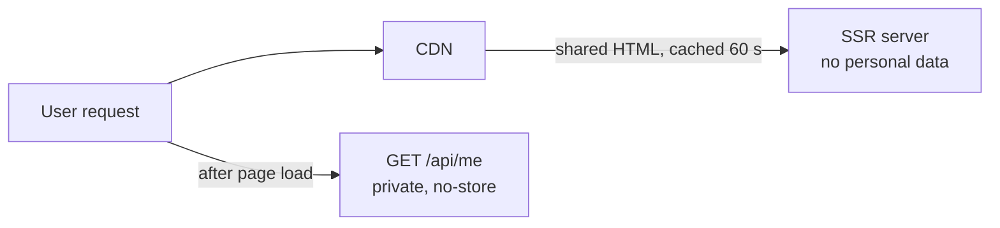
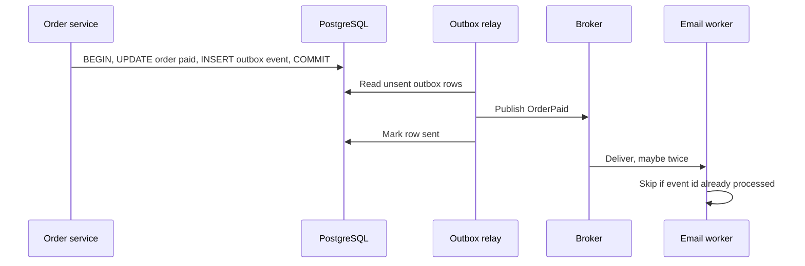
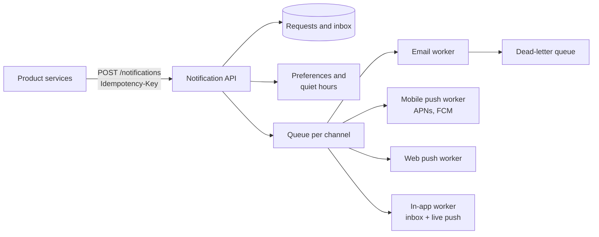
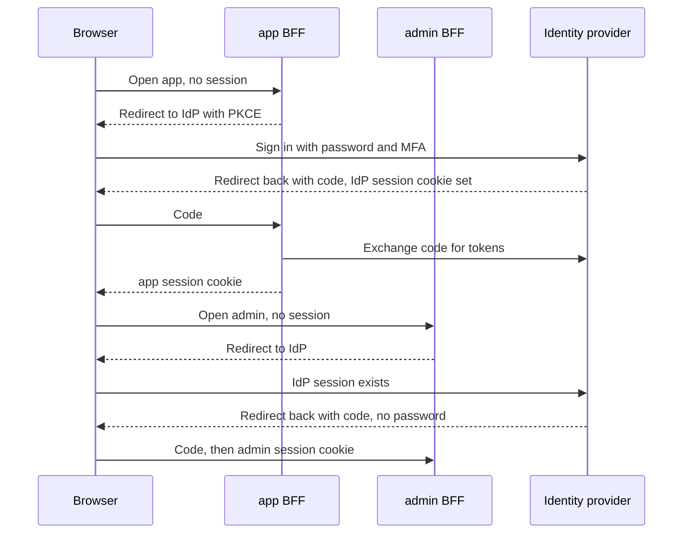
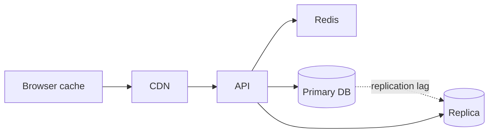
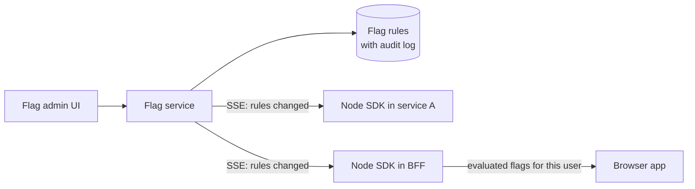
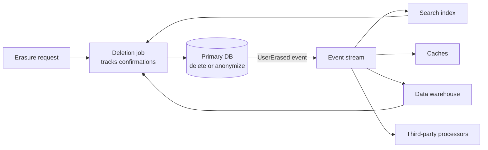

# System Design — Mixed Interview Questions

> This file is mixed, cross-topic interview practice for the whole system design subject: the six concept documents and the eight case studies. Each document already has its own interview questions. Use this file after you have studied them, and again right before an interview.

## Table of contents

1. [All topic questions at a glance](#all-topic-questions-at-a-glance)
2. [Mixed and cross-topic questions](#mixed-and-cross-topic-questions)
3. [Rapid revision round](#rapid-revision-round)
4. [Summary](#summary)

## All topic questions at a glance

Every question from the 14 documents (concept documents and case studies), in order. Use this list to find a question quickly, or to check that you can answer each one out loud.

### [How to Approach System Design Interviews](01-system-design-interview-approach.md)

- [Q1. How do you start a system design interview?](01-system-design-interview-approach.md#q1-how-do-you-start-a-system-design-interview)
- [Q2. What is the difference between functional and non-functional requirements? Give examples.](01-system-design-interview-approach.md#q2-what-is-the-difference-between-functional-and-non-functional-requirements-give-examples)
- [Q3. Estimate the QPS and storage for a service with 50 million DAU, where each user sends 20 messages per day and a message is 200 bytes. Keep data for 3 years.](01-system-design-interview-approach.md#q3-estimate-the-qps-and-storage-for-a-service-with-50-million-dau-where-each-user-sends-20-messages-per-day-and-a-message-is-200-bytes-keep-data-for-3-years)
- [Q4. Why do we do back-of-the-envelope estimates if they are so rough?](01-system-design-interview-approach.md#q4-why-do-we-do-back-of-the-envelope-estimates-if-they-are-so-rough)
- [Q5. What is the RADIO framework? How is frontend system design different from backend system design?](01-system-design-interview-approach.md#q5-what-is-the-radio-framework-how-is-frontend-system-design-different-from-backend-system-design)
- [Q6. How do you manage time in a 45-minute design interview?](01-system-design-interview-approach.md#q6-how-do-you-manage-time-in-a-45-minute-design-interview)
- [Q7. The interviewer asks: "Why did you choose PostgreSQL and not MongoDB?" How do you answer?](01-system-design-interview-approach.md#q7-the-interviewer-asks-why-did-you-choose-postgresql-and-not-mongodb-how-do-you-answer)
- [Q8. What do you do when you don't know a technology the interviewer mentions?](01-system-design-interview-approach.md#q8-what-do-you-do-when-you-dont-know-a-technology-the-interviewer-mentions)
- [Q9. How do you decide which parts to deep dive into?](01-system-design-interview-approach.md#q9-how-do-you-decide-which-parts-to-deep-dive-into)
- [Q10. What are the common reasons candidates fail system design interviews?](01-system-design-interview-approach.md#q10-what-are-the-common-reasons-candidates-fail-system-design-interviews)
- [Q11. What are p50, p95 and p99 latency, and why not use the average?](01-system-design-interview-approach.md#q11-what-are-p50-p95-and-p99-latency-and-why-not-use-the-average)
- [Q12. How would you explain the latency numbers table, and why does it matter for design?](01-system-design-interview-approach.md#q12-how-would-you-explain-the-latency-numbers-table-and-why-does-it-matter-for-design)
- [Q13. How do you present a trade-off? Give an example.](01-system-design-interview-approach.md#q13-how-do-you-present-a-trade-off-give-an-example)
- [Q14. In a frontend system design interview, how much backend should you discuss?](01-system-design-interview-approach.md#q14-in-a-frontend-system-design-interview-how-much-backend-should-you-discuss)
- [Q15. How do you end the interview?](01-system-design-interview-approach.md#q15-how-do-you-end-the-interview)

### [Scalability and Core Building Blocks](02-scalability-and-core-building-blocks.md)

- [Q1. What is the difference between vertical and horizontal scaling? Which do you choose?](02-scalability-and-core-building-blocks.md#q1-what-is-the-difference-between-vertical-and-horizontal-scaling-which-do-you-choose)
- [Q2. What does "stateless service" mean, and why is it important?](02-scalability-and-core-building-blocks.md#q2-what-does-stateless-service-mean-and-why-is-it-important)
- [Q3. Explain Layer 4 vs Layer 7 load balancing.](02-scalability-and-core-building-blocks.md#q3-explain-layer-4-vs-layer-7-load-balancing)
- [Q4. What is replication lag, and how can it hurt users? How do you fix it?](02-scalability-and-core-building-blocks.md#q4-what-is-replication-lag-and-how-can-it-hurt-users-how-do-you-fix-it)
- [Q5. What is sharding, how do you choose a shard key, and what are the costs?](02-scalability-and-core-building-blocks.md#q5-what-is-sharding-how-do-you-choose-a-shard-key-and-what-are-the-costs)
- [Q6. Explain consistent hashing and virtual nodes.](02-scalability-and-core-building-blocks.md#q6-explain-consistent-hashing-and-virtual-nodes)
- [Q7. Explain the CAP theorem with an example. Is it "pick two of three"?](02-scalability-and-core-building-blocks.md#q7-explain-the-cap-theorem-with-an-example-is-it-pick-two-of-three)
- [Q8. What consistency models do you know? When is eventual consistency acceptable?](02-scalability-and-core-building-blocks.md#q8-what-consistency-models-do-you-know-when-is-eventual-consistency-acceptable)
- [Q9. When would you introduce a message queue? What problems does it bring?](02-scalability-and-core-building-blocks.md#q9-when-would-you-introduce-a-message-queue-what-problems-does-it-bring)
- [Q10. Monolith or microservices for a new product with a team of six engineers?](02-scalability-and-core-building-blocks.md#q10-monolith-or-microservices-for-a-new-product-with-a-team-of-six-engineers)
- [Q11. How do you implement rate limiting across many API servers?](02-scalability-and-core-building-blocks.md#q11-how-do-you-implement-rate-limiting-across-many-api-servers)
- [Q12. A client times out while creating a payment and retries. How do you prevent a double charge?](02-scalability-and-core-building-blocks.md#q12-a-client-times-out-while-creating-a-payment-and-retries-how-do-you-prevent-a-double-charge)
- [Q13. How do you find and remove single points of failure in a design?](02-scalability-and-core-building-blocks.md#q13-how-do-you-find-and-remove-single-points-of-failure-in-a-design)
- [Q14. What is backpressure? Give examples from frontend and backend.](02-scalability-and-core-building-blocks.md#q14-what-is-backpressure-give-examples-from-frontend-and-backend)
- [Q15. Why store images in object storage instead of the database? How does the browser upload them?](02-scalability-and-core-building-blocks.md#q15-why-store-images-in-object-storage-instead-of-the-database-how-does-the-browser-upload-them)
- [Q16. Your product search uses `WHERE name LIKE '%term%'` and it is slow. What do you do?](02-scalability-and-core-building-blocks.md#q16-your-product-search-uses-where-name-like-term-and-it-is-slow-what-do-you-do)
- [Q17. Walk me through how you would scale a system from 1,000 to 10 million users.](02-scalability-and-core-building-blocks.md#q17-walk-me-through-how-you-would-scale-a-system-from-1000-to-10-million-users)

### [Caching Strategies and Invalidation](03-caching-strategies-and-invalidation.md)

- [Q1. Walk me through all the cache layers a request can pass through in a web app.](03-caching-strategies-and-invalidation.md#q1-walk-me-through-all-the-cache-layers-a-request-can-pass-through-in-a-web-app)
- [Q2. How would you set caching headers for an Angular or React SPA deployed to a CDN?](03-caching-strategies-and-invalidation.md#q2-how-would-you-set-caching-headers-for-an-angular-or-react-spa-deployed-to-a-cdn)
- [Q3. Compare cache-aside, write-through and write-back.](03-caching-strategies-and-invalidation.md#q3-compare-cache-aside-write-through-and-write-back)
- [Q4. Why is cache invalidation hard? Show a race condition.](03-caching-strategies-and-invalidation.md#q4-why-is-cache-invalidation-hard-show-a-race-condition)
- [Q5. What are cache stampede, cache penetration and cache avalanche? How do you prevent each?](03-caching-strategies-and-invalidation.md#q5-what-are-cache-stampede-cache-penetration-and-cache-avalanche-how-do-you-prevent-each)
- [Q6. How do CDNs get new content to users after a change?](03-caching-strategies-and-invalidation.md#q6-how-do-cdns-get-new-content-to-users-after-a-change)
- [Q7. A user in tenant B sees tenant A's dashboard data. What could cause this and how do you fix it?](03-caching-strategies-and-invalidation.md#q7-a-user-in-tenant-b-sees-tenant-as-dashboard-data-what-could-cause-this-and-how-do-you-fix-it)
- [Q8. What is stale-while-revalidate? Where can you use it?](03-caching-strategies-and-invalidation.md#q8-what-is-stale-while-revalidate-where-can-you-use-it)
- [Q9. How would you cache data in an Angular 16 app?](03-caching-strategies-and-invalidation.md#q9-how-would-you-cache-data-in-an-angular-16-app)
- [Q10. How do you decide the TTL for a cache entry?](03-caching-strategies-and-invalidation.md#q10-how-do-you-decide-the-ttl-for-a-cache-entry)
- [Q11. Your cache hit ratio dropped from 95% to 60% after a release. What do you check?](03-caching-strategies-and-invalidation.md#q11-your-cache-hit-ratio-dropped-from-95-to-60-after-a-release-what-do-you-check)
- [Q12. Should you cache permissions? How?](03-caching-strategies-and-invalidation.md#q12-should-you-cache-permissions-how)
- [Q13. When should you NOT add a cache?](03-caching-strategies-and-invalidation.md#q13-when-should-you-not-add-a-cache)
- [Q14. How do you measure whether a cache is helping?](03-caching-strategies-and-invalidation.md#q14-how-do-you-measure-whether-a-cache-is-helping)
- [Q15. Design caching for a product page on an e-commerce site.](03-caching-strategies-and-invalidation.md#q15-design-caching-for-a-product-page-on-an-e-commerce-site)

### [API Styles and Real-Time Communication](04-api-styles-and-real-time-communication.md)

- [Q1. REST vs GraphQL: when would you choose each?](04-api-styles-and-real-time-communication.md#q1-rest-vs-graphql-when-would-you-choose-each)
- [Q2. What is the N+1 problem in GraphQL, and how does DataLoader solve it?](04-api-styles-and-real-time-communication.md#q2-what-is-the-n1-problem-in-graphql-and-how-does-dataloader-solve-it)
- [Q3. What is gRPC and why isn't it used directly from browsers?](04-api-styles-and-real-time-communication.md#q3-what-is-grpc-and-why-isnt-it-used-directly-from-browsers)
- [Q4. What is a BFF, and when would you add one?](04-api-styles-and-real-time-communication.md#q4-what-is-a-bff-and-when-would-you-add-one)
- [Q5. How do you change an API without breaking existing clients?](04-api-styles-and-real-time-communication.md#q5-how-do-you-change-an-api-without-breaking-existing-clients)
- [Q6. Compare short polling, long polling, SSE and WebSockets.](04-api-styles-and-real-time-communication.md#q6-compare-short-polling-long-polling-sse-and-websockets)
- [Q7. Explain the WebSocket handshake.](04-api-styles-and-real-time-communication.md#q7-explain-the-websocket-handshake)
- [Q8. How do you scale WebSockets to millions of connections across many servers?](04-api-styles-and-real-time-communication.md#q8-how-do-you-scale-websockets-to-millions-of-connections-across-many-servers)
- [Q9. Code review: what is wrong with this reconnect logic?](04-api-styles-and-real-time-communication.md#q9-code-review-what-is-wrong-with-this-reconnect-logic)
- [Q10. How do you authenticate a WebSocket connection?](04-api-styles-and-real-time-communication.md#q10-how-do-you-authenticate-a-websocket-connection)
- [Q11. How do you safely receive webhooks from a payment provider?](04-api-styles-and-real-time-communication.md#q11-how-do-you-safely-receive-webhooks-from-a-payment-provider)
- [Q12. JSON or Protocol Buffers?](04-api-styles-and-real-time-communication.md#q12-json-or-protocol-buffers)
- [Q13. What is contract-first API design, and what does OpenAPI give you?](04-api-styles-and-real-time-communication.md#q13-what-is-contract-first-api-design-and-what-does-openapi-give-you)
- [Q14. A page shows live order status. The payment provider confirms payments by webhook. Design the flow.](04-api-styles-and-real-time-communication.md#q14-a-page-shows-live-order-status-the-payment-provider-confirms-payments-by-webhook-design-the-flow)
- [Q15. When would you choose tRPC?](04-api-styles-and-real-time-communication.md#q15-when-would-you-choose-trpc)
- [Q16. What should and shouldn't an API gateway do?](04-api-styles-and-real-time-communication.md#q16-what-should-and-shouldnt-an-api-gateway-do)

### [Frontend Architecture at Scale](05-frontend-architecture-at-scale.md)

- [Q1. How would you structure a large frontend application worked on by several teams?](05-frontend-architecture-at-scale.md#q1-how-would-you-structure-a-large-frontend-application-worked-on-by-several-teams)
- [Q2. Why separate the UI from the API client with DTO mappers?](05-frontend-architecture-at-scale.md#q2-why-separate-the-ui-from-the-api-client-with-dto-mappers)
- [Q3. What are design tokens, and why do semantic tokens matter?](05-frontend-architecture-at-scale.md#q3-what-are-design-tokens-and-why-do-semantic-tokens-matter)
- [Q4. Should every component in a large app use a global store?](05-frontend-architecture-at-scale.md#q4-should-every-component-in-a-large-app-use-a-global-store)
- [Q5. What is a monorepo, and what problems do Nx or Turborepo solve?](05-frontend-architecture-at-scale.md#q5-what-is-a-monorepo-and-what-problems-do-nx-or-turborepo-solve)
- [Q6. What are micro-frontends? When would you use them, and when not?](05-frontend-architecture-at-scale.md#q6-what-are-micro-frontends-when-would-you-use-them-and-when-not)
- [Q7. Explain Module Federation.](05-frontend-architecture-at-scale.md#q7-explain-module-federation)
- [Q8. How would you support many tenants with different branding and features in one frontend?](05-frontend-architecture-at-scale.md#q8-how-would-you-support-many-tenants-with-different-branding-and-features-in-one-frontend)
- [Q9. What do you need to think about for internationalization in a large app?](05-frontend-architecture-at-scale.md#q9-what-do-you-need-to-think-about-for-internationalization-in-a-large-app)
- [Q10. How do you handle and monitor errors in a large frontend?](05-frontend-architecture-at-scale.md#q10-how-do-you-handle-and-monitor-errors-in-a-large-frontend)
- [Q11. What is a performance budget, and how do you enforce it?](05-frontend-architecture-at-scale.md#q11-what-is-a-performance-budget-and-how-do-you-enforce-it)
- [Q12. How do you roll out a strict CSP in a large existing app?](05-frontend-architecture-at-scale.md#q12-how-do-you-roll-out-a-strict-csp-in-a-large-existing-app)
- [Q13. How do you keep a large app accessible with many developers?](05-frontend-architecture-at-scale.md#q13-how-do-you-keep-a-large-app-accessible-with-many-developers)
- [Q14. How do you version and release a shared component library used by many apps?](05-frontend-architecture-at-scale.md#q14-how-do-you-version-and-release-a-shared-component-library-used-by-many-apps)
- [Q15. What is CODEOWNERS, and why does it matter for architecture?](05-frontend-architecture-at-scale.md#q15-what-is-codeowners-and-why-does-it-matter-for-architecture)
- [Q16. Code review: what is wrong with this feature structure?](05-frontend-architecture-at-scale.md#q16-code-review-what-is-wrong-with-this-feature-structure)

### [Auth Architecture and Multi-Tenancy](06-auth-architecture-and-multi-tenancy.md)

- [Q1. Sessions or tokens: how do you choose at the architecture level?](06-auth-architecture-and-multi-tenancy.md#q1-sessions-or-tokens-how-do-you-choose-at-the-architecture-level)
- [Q2. Explain the authorization code flow with PKCE for a SPA.](06-auth-architecture-and-multi-tenancy.md#q2-explain-the-authorization-code-flow-with-pkce-for-a-spa)
- [Q3. What is the BFF pattern for authentication, and why is it more secure than tokens in the SPA?](06-auth-architecture-and-multi-tenancy.md#q3-what-is-the-bff-pattern-for-authentication-and-why-is-it-more-secure-than-tokens-in-the-spa)
- [Q4. How do you design token lifetimes and refresh token rotation?](06-auth-architecture-and-multi-tenancy.md#q4-how-do-you-design-token-lifetimes-and-refresh-token-rotation)
- [Q5. How should one microservice authenticate to another?](06-auth-architecture-and-multi-tenancy.md#q5-how-should-one-microservice-authenticate-to-another)
- [Q6. Compare RBAC, ABAC and ReBAC. When would you use each?](06-auth-architecture-and-multi-tenancy.md#q6-compare-rbac-abac-and-rebac-when-would-you-use-each)
- [Q7. Your frontend hides the "Delete user" button for non-admins. Is that enough?](06-auth-architecture-and-multi-tenancy.md#q7-your-frontend-hides-the-delete-user-button-for-non-admins-is-that-enough)
- [Q8. Compare the multi-tenancy models: shared schema, schema per tenant, database per tenant.](06-auth-architecture-and-multi-tenancy.md#q8-compare-the-multi-tenancy-models-shared-schema-schema-per-tenant-database-per-tenant)
- [Q9. How do you guarantee tenant isolation in a shared database?](06-auth-architecture-and-multi-tenancy.md#q9-how-do-you-guarantee-tenant-isolation-in-a-shared-database)
- [Q10. How do you handle caching and rate limiting in a multi-tenant system?](06-auth-architecture-and-multi-tenancy.md#q10-how-do-you-handle-caching-and-rate-limiting-in-a-multi-tenant-system)
- [Q11. Design admin impersonation for a support team.](06-auth-architecture-and-multi-tenancy.md#q11-design-admin-impersonation-for-a-support-team)
- [Q12. What are SAML and SCIM, and why do enterprise customers ask for them?](06-auth-architecture-and-multi-tenancy.md#q12-what-are-saml-and-scim-and-why-do-enterprise-customers-ask-for-them)
- [Q13. What should an audit log contain, and how do you make it trustworthy?](06-auth-architecture-and-multi-tenancy.md#q13-what-should-an-audit-log-contain-and-how-do-you-make-it-trustworthy)
- [Q14. A B2B customer wants their employees to sign in with their company's Microsoft Entra ID. What do you build?](06-auth-architecture-and-multi-tenancy.md#q14-a-b2b-customer-wants-their-employees-to-sign-in-with-their-companys-microsoft-entra-id-what-do-you-build)
- [Q15. Code review: what is wrong with this endpoint?](06-auth-architecture-and-multi-tenancy.md#q15-code-review-what-is-wrong-with-this-endpoint)
- [Q16. Where should a SPA store tokens if there is no BFF?](06-auth-architecture-and-multi-tenancy.md#q16-where-should-a-spa-store-tokens-if-there-is-no-bff)

### [Case Study: Enterprise Admin Portal](07-case-study-enterprise-admin-portal.md)

- [Q1. How do you make sure one tenant can never see another tenant's data?](07-case-study-enterprise-admin-portal.md#q1-how-do-you-make-sure-one-tenant-can-never-see-another-tenants-data)
- [Q2. Where should permission checks happen — frontend or backend?](07-case-study-enterprise-admin-portal.md#q2-where-should-permission-checks-happen--frontend-or-backend)
- [Q3. Design the permission model for built-in and custom roles.](07-case-study-enterprise-admin-portal.md#q3-design-the-permission-model-for-built-in-and-custom-roles)
- [Q4. A user's role is removed while they have the app open. What happens?](07-case-study-enterprise-admin-portal.md#q4-a-users-role-is-removed-while-they-have-the-app-open-what-happens)
- [Q5. Why cursor pagination instead of offset for the cases table?](07-case-study-enterprise-admin-portal.md#q5-why-cursor-pagination-instead-of-offset-for-the-cases-table)
- [Q6. How do you prevent lost updates when two people edit the same record?](07-case-study-enterprise-admin-portal.md#q6-how-do-you-prevent-lost-updates-when-two-people-edit-the-same-record)
- [Q7. How do you guarantee every change has an audit entry?](07-case-study-enterprise-admin-portal.md#q7-how-do-you-guarantee-every-change-has-an-audit-entry)
- [Q8. The audit log grows by 365 GB per year. How do you store and query it for 7 years?](07-case-study-enterprise-admin-portal.md#q8-the-audit-log-grows-by-365-gb-per-year-how-do-you-store-and-query-it-for-7-years)
- [Q9. Walk me through the data flow when a user changes a filter on the table.](07-case-study-enterprise-admin-portal.md#q9-walk-me-through-the-data-flow-when-a-user-changes-a-filter-on-the-table)
- [Q10. How do you design bulk actions like "assign 500 cases"?](07-case-study-enterprise-admin-portal.md#q10-how-do-you-design-bulk-actions-like-assign-500-cases)
- [Q11. How would you build a 40-field multi-step form with custom fields per tenant?](07-case-study-enterprise-admin-portal.md#q11-how-would-you-build-a-40-field-multi-step-form-with-custom-fields-per-tenant)
- [Q12. How would you implement "support staff can impersonate a user"?](07-case-study-enterprise-admin-portal.md#q12-how-would-you-implement-support-staff-can-impersonate-a-user)
- [Q13. Your list endpoint is slow for one big tenant. How do you investigate?](07-case-study-enterprise-admin-portal.md#q13-your-list-endpoint-is-slow-for-one-big-tenant-how-do-you-investigate)
- [Q14. Why a BFF for this portal? What are the downsides?](07-case-study-enterprise-admin-portal.md#q14-why-a-bff-for-this-portal-what-are-the-downsides)
- [Q15. What would change if the portal had to support 50 independent teams?](07-case-study-enterprise-admin-portal.md#q15-what-would-change-if-the-portal-had-to-support-50-independent-teams)

### [Case Study: E-commerce Application](08-case-study-ecommerce-application.md)

- [Q1. How do you make sure a customer is never charged twice?](08-case-study-ecommerce-application.md#q1-how-do-you-make-sure-a-customer-is-never-charged-twice)
- [Q2. Two people try to buy the last item at the same time. What happens?](08-case-study-ecommerce-application.md#q2-two-people-try-to-buy-the-last-item-at-the-same-time-what-happens)
- [Q3. When do you reserve stock: at add-to-cart, at checkout, or at payment?](08-case-study-ecommerce-application.md#q3-when-do-you-reserve-stock-at-add-to-cart-at-checkout-or-at-payment)
- [Q4. Design a flash sale for 10,000 units and 1 million shoppers.](08-case-study-ecommerce-application.md#q4-design-a-flash-sale-for-10000-units-and-1-million-shoppers)
- [Q5. How do you keep product pages fast but prices correct?](08-case-study-ecommerce-application.md#q5-how-do-you-keep-product-pages-fast-but-prices-correct)
- [Q6. Why use the payment webhook instead of the browser's "payment succeeded" callback?](08-case-study-ecommerce-application.md#q6-why-use-the-payment-webhook-instead-of-the-browsers-payment-succeeded-callback)
- [Q7. How do you handle a payment that succeeds after the reservation expired?](08-case-study-ecommerce-application.md#q7-how-do-you-handle-a-payment-that-succeeds-after-the-reservation-expired)
- [Q8. Guest cart and account cart: how do you merge them?](08-case-study-ecommerce-application.md#q8-guest-cart-and-account-cart-how-do-you-merge-them)
- [Q9. Which pages would you server-render, and why?](08-case-study-ecommerce-application.md#q9-which-pages-would-you-server-render-and-why)
- [Q10. Search: how do you build filters with counts like "Nike (120)"?](08-case-study-ecommerce-application.md#q10-search-how-do-you-build-filters-with-counts-like-nike-120)
- [Q11. The checkout success rate dropped 20% after a release. What do you do?](08-case-study-ecommerce-application.md#q11-the-checkout-success-rate-dropped-20-after-a-release-what-do-you-do)
- [Q12. Microservices or monolith for this store?](08-case-study-ecommerce-application.md#q12-microservices-or-monolith-for-this-store)
- [Q13. How do you store money amounts?](08-case-study-ecommerce-application.md#q13-how-do-you-store-money-amounts)
- [Q14. What is your biggest risk in this design, and how do you reduce it?](08-case-study-ecommerce-application.md#q14-what-is-your-biggest-risk-in-this-design-and-how-do-you-reduce-it)

### [Case Study: Analytics Dashboard and Large Tables](09-case-study-analytics-dashboard-and-large-tables.md)

- [Q1. How do you show a table with 1 million rows in the browser?](09-case-study-analytics-dashboard-and-large-tables.md#q1-how-do-you-show-a-table-with-1-million-rows-in-the-browser)
- [Q2. How does virtual scrolling work internally?](09-case-study-analytics-dashboard-and-large-tables.md#q2-how-does-virtual-scrolling-work-internally)
- [Q3. A dashboard has 10 widgets and a date filter. How do you avoid a request storm when the user changes the filter?](09-case-study-analytics-dashboard-and-large-tables.md#q3-a-dashboard-has-10-widgets-and-a-date-filter-how-do-you-avoid-a-request-storm-when-the-user-changes-the-filter)
- [Q4. Why pre-aggregate? What are the downsides?](09-case-study-analytics-dashboard-and-large-tables.md#q4-why-pre-aggregate-what-are-the-downsides)
- [Q5. How do you cache dashboard query results correctly?](09-case-study-analytics-dashboard-and-large-tables.md#q5-how-do-you-cache-dashboard-query-results-correctly)
- [Q6. A chart with 500,000 points freezes the page. How do you fix it?](09-case-study-analytics-dashboard-and-large-tables.md#q6-a-chart-with-500000-points-freezes-the-page-how-do-you-fix-it)
- [Q7. SVG, Canvas or WebGL for charts?](09-case-study-analytics-dashboard-and-large-tables.md#q7-svg-canvas-or-webgl-for-charts)
- [Q8. Should live updates use polling, SSE or WebSockets?](09-case-study-analytics-dashboard-and-large-tables.md#q8-should-live-updates-use-polling-sse-or-websockets)
- [Q9. Design CSV export for 10 million rows.](09-case-study-analytics-dashboard-and-large-tables.md#q9-design-csv-export-for-10-million-rows)
- [Q10. Unique visitors for a month: why not sum the daily unique visitors?](09-case-study-analytics-dashboard-and-large-tables.md#q10-unique-visitors-for-a-month-why-not-sum-the-daily-unique-visitors)
- [Q11. How do you handle time zones in "revenue per day"?](09-case-study-analytics-dashboard-and-large-tables.md#q11-how-do-you-handle-time-zones-in-revenue-per-day)
- [Q12. How do you stop one tenant's heavy query from slowing down everyone?](09-case-study-analytics-dashboard-and-large-tables.md#q12-how-do-you-stop-one-tenants-heavy-query-from-slowing-down-everyone)
- [Q13. The dashboard shows different revenue than the billing system. What do you check?](09-case-study-analytics-dashboard-and-large-tables.md#q13-the-dashboard-shows-different-revenue-than-the-billing-system-what-do-you-check)

### [Case Study: Real-time Chat and Notifications](10-case-study-real-time-chat-and-notifications.md)

- [Q1. How do you deliver a message to a user connected to a different server?](10-case-study-real-time-chat-and-notifications.md#q1-how-do-you-deliver-a-message-to-a-user-connected-to-a-different-server)
- [Q2. How do you guarantee message order?](10-case-study-real-time-chat-and-notifications.md#q2-how-do-you-guarantee-message-order)
- [Q3. How do you avoid losing or duplicating messages?](10-case-study-real-time-chat-and-notifications.md#q3-how-do-you-avoid-losing-or-duplicating-messages)
- [Q4. How do read receipts work in a group of 500 people?](10-case-study-real-time-chat-and-notifications.md#q4-how-do-read-receipts-work-in-a-group-of-500-people)
- [Q5. A user's laptop sleeps for 3 hours and wakes up. Walk me through what happens.](10-case-study-real-time-chat-and-notifications.md#q5-a-users-laptop-sleeps-for-3-hours-and-wakes-up-walk-me-through-what-happens)
- [Q6. How do you implement presence for millions of users?](10-case-study-real-time-chat-and-notifications.md#q6-how-do-you-implement-presence-for-millions-of-users)
- [Q7. WebSockets, SSE or long polling for chat?](10-case-study-real-time-chat-and-notifications.md#q7-websockets-sse-or-long-polling-for-chat)
- [Q8. How do you decide when to send a push notification?](10-case-study-real-time-chat-and-notifications.md#q8-how-do-you-decide-when-to-send-a-push-notification)
- [Q9. How do you authenticate a WebSocket connection securely?](10-case-study-real-time-chat-and-notifications.md#q9-how-do-you-authenticate-a-websocket-connection-securely)
- [Q10. A celebrity channel has 100,000 members. What changes?](10-case-study-real-time-chat-and-notifications.md#q10-a-celebrity-channel-has-100000-members-what-changes)
- [Q11. How do you keep the message list from jumping when older messages load?](10-case-study-real-time-chat-and-notifications.md#q11-how-do-you-keep-the-message-list-from-jumping-when-older-messages-load)
- [Q12. How would you test this system?](10-case-study-real-time-chat-and-notifications.md#q12-how-would-you-test-this-system)
- [Q13. How does end-to-end encryption change the design?](10-case-study-real-time-chat-and-notifications.md#q13-how-does-end-to-end-encryption-change-the-design)

### [Case Study: Autocomplete Search](11-case-study-autocomplete-search.md)

- [Q1. Implement the frontend logic for autocomplete. What are the traps?](11-case-study-autocomplete-search.md#q1-implement-the-frontend-logic-for-autocomplete-what-are-the-traps)
- [Q2. What is the difference between debounce and throttle, and which fits autocomplete?](11-case-study-autocomplete-search.md#q2-what-is-the-difference-between-debounce-and-throttle-and-which-fits-autocomplete)
- [Q3. Output prediction: what does this print?](11-case-study-autocomplete-search.md#q3-output-prediction-what-does-this-print)
- [Q4. How do you make the autocomplete accessible?](11-case-study-autocomplete-search.md#q4-how-do-you-make-the-autocomplete-accessible)
- [Q5. Why precompute top-k per prefix instead of searching on every request?](11-case-study-autocomplete-search.md#q5-why-precompute-top-k-per-prefix-instead-of-searching-on-every-request)
- [Q6. Implement a trie with top-k suggestions.](11-case-study-autocomplete-search.md#q6-implement-a-trie-with-top-k-suggestions)
- [Q7. How do you rank suggestions?](11-case-study-autocomplete-search.md#q7-how-do-you-rank-suggestions)
- [Q8. How do you cache autocomplete results?](11-case-study-autocomplete-search.md#q8-how-do-you-cache-autocomplete-results)
- [Q9. A user types fast and sees suggestions for an older prefix. Why, and how do you fix it?](11-case-study-autocomplete-search.md#q9-a-user-types-fast-and-sees-suggestions-for-an-older-prefix-why-and-how-do-you-fix-it)
- [Q10. How do you avoid suggesting private or offensive content?](11-case-study-autocomplete-search.md#q10-how-do-you-avoid-suggesting-private-or-offensive-content)
- [Q11. When would you NOT use a backend for autocomplete?](11-case-study-autocomplete-search.md#q11-when-would-you-not-use-a-backend-for-autocomplete)
- [Q12. The autocomplete p95 jumped from 40 ms to 300 ms. How do you investigate?](11-case-study-autocomplete-search.md#q12-the-autocomplete-p95-jumped-from-40-ms-to-300-ms-how-do-you-investigate)

### [Case Study: News Feed with Infinite Scroll](12-case-study-news-feed-infinite-scroll.md)

- [Q1. Fan-out on write or fan-out on read?](12-case-study-news-feed-infinite-scroll.md#q1-fan-out-on-write-or-fan-out-on-read)
- [Q2. Why not offset pagination for a feed?](12-case-study-news-feed-infinite-scroll.md#q2-why-not-offset-pagination-for-a-feed)
- [Q3. How do you paginate a ranked feed without duplicates?](12-case-study-news-feed-infinite-scroll.md#q3-how-do-you-paginate-a-ranked-feed-without-duplicates)
- [Q4. Implement infinite scroll. What can go wrong?](12-case-study-news-feed-infinite-scroll.md#q4-implement-infinite-scroll-what-can-go-wrong)
- [Q5. How do you virtualize a list with variable-height items?](12-case-study-news-feed-infinite-scroll.md#q5-how-do-you-virtualize-a-list-with-variable-height-items)
- [Q6. How does the "new posts" indicator work, and why not just insert new posts?](12-case-study-news-feed-infinite-scroll.md#q6-how-does-the-new-posts-indicator-work-and-why-not-just-insert-new-posts)
- [Q7. How do you avoid layout shift from images in the feed?](12-case-study-news-feed-infinite-scroll.md#q7-how-do-you-avoid-layout-shift-from-images-in-the-feed)
- [Q8. How do you handle a viral post getting 10,000 likes per second?](12-case-study-news-feed-infinite-scroll.md#q8-how-do-you-handle-a-viral-post-getting-10000-likes-per-second)
- [Q9. A user deletes a post. How do you remove it from millions of feeds?](12-case-study-news-feed-infinite-scroll.md#q9-a-user-deletes-a-post-how-do-you-remove-it-from-millions-of-feeds)
- [Q10. How do you restore the user's position after they go to a post and come back?](12-case-study-news-feed-infinite-scroll.md#q10-how-do-you-restore-the-users-position-after-they-go-to-a-post-and-come-back)
- [Q11. How would you make the feed accessible?](12-case-study-news-feed-infinite-scroll.md#q11-how-would-you-make-the-feed-accessible)
- [Q12. The feed gets slow on phones after 10 minutes of scrolling. How do you find and fix it?](12-case-study-news-feed-infinite-scroll.md#q12-the-feed-gets-slow-on-phones-after-10-minutes-of-scrolling-how-do-you-find-and-fix-it)

### [Case Study: URL Shortener](13-case-study-url-shortener.md)

- [Q1. How do you generate short codes? Compare the options.](13-case-study-url-shortener.md#q1-how-do-you-generate-short-codes-compare-the-options)
- [Q2. How many characters do you need?](13-case-study-url-shortener.md#q2-how-many-characters-do-you-need)
- [Q3. 301 or 302 — which do you use and why?](13-case-study-url-shortener.md#q3-301-or-302--which-do-you-use-and-why)
- [Q4. Walk me through the estimate for storage and QPS.](13-case-study-url-shortener.md#q4-walk-me-through-the-estimate-for-storage-and-qps)
- [Q5. How do you keep the redirect fast under heavy load?](13-case-study-url-shortener.md#q5-how-do-you-keep-the-redirect-fast-under-heavy-load)
- [Q6. How do you record analytics without slowing redirects?](13-case-study-url-shortener.md#q6-how-do-you-record-analytics-without-slowing-redirects)
- [Q7. A link is reported as phishing. What happens end to end?](13-case-study-url-shortener.md#q7-a-link-is-reported-as-phishing-what-happens-end-to-end)
- [Q8. How do you stop people from scanning the code space?](13-case-study-url-shortener.md#q8-how-do-you-stop-people-from-scanning-the-code-space)
- [Q9. How do you support custom aliases safely?](13-case-study-url-shortener.md#q9-how-do-you-support-custom-aliases-safely)
- [Q10. Same long URL submitted twice: same short code or a new one?](13-case-study-url-shortener.md#q10-same-long-url-submitted-twice-same-short-code-or-a-new-one)
- [Q11. What if Redis goes down?](13-case-study-url-shortener.md#q11-what-if-redis-goes-down)
- [Q12. Would you design this differently at 1% of the scale?](13-case-study-url-shortener.md#q12-would-you-design-this-differently-at-1-of-the-scale)

### [Case Study: File Upload Service](14-case-study-file-upload-service.md)

- [Q1. Why upload directly to object storage instead of through your API server?](14-case-study-file-upload-service.md#q1-why-upload-directly-to-object-storage-instead-of-through-your-api-server)
- [Q2. How do resumable uploads work?](14-case-study-file-upload-service.md#q2-how-do-resumable-uploads-work)
- [Q3. How do you choose the chunk size?](14-case-study-file-upload-service.md#q3-how-do-you-choose-the-chunk-size)
- [Q4. How do you show accurate progress for parallel chunk uploads?](14-case-study-file-upload-service.md#q4-how-do-you-show-accurate-progress-for-parallel-chunk-uploads)
- [Q5. How do you handle malware in uploaded files?](14-case-study-file-upload-service.md#q5-how-do-you-handle-malware-in-uploaded-files)
- [Q6. A user uploads an SVG with JavaScript inside. What can go wrong and how do you prevent it?](14-case-study-file-upload-service.md#q6-a-user-uploads-an-svg-with-javascript-inside-what-can-go-wrong-and-how-do-you-prevent-it)
- [Q7. What happens to uploads that never complete?](14-case-study-file-upload-service.md#q7-what-happens-to-uploads-that-never-complete)
- [Q8. How would you upload a 50 GB file from a browser?](14-case-study-file-upload-service.md#q8-how-would-you-upload-a-50-gb-file-from-a-browser)
- [Q9. Design the desktop sync client. What changes compared to the browser?](14-case-study-file-upload-service.md#q9-design-the-desktop-sync-client-what-changes-compared-to-the-browser)
- [Q10. Output prediction: what does this print?](14-case-study-file-upload-service.md#q10-output-prediction-what-does-this-print)
- [Q11. How do you make `complete` safe to retry?](14-case-study-file-upload-service.md#q11-how-do-you-make-complete-safe-to-retry)
- [Q12. How do you test an upload system?](14-case-study-file-upload-service.md#q12-how-do-you-test-an-upload-system)
## Mixed and cross-topic questions

These questions combine several topics. Many are scenarios ("production issue: ...") or design discussions where you must choose and defend a trade-off. Each one links to the documents it draws on.

### Q1. Production issue: after you put the CDN in front of your server-rendered pages, some users see another person's name in the header. What happened, and how do you fix it?

**What the interviewer is checking:** Whether you understand shared caches, which responses are safe to cache, and how SSR and personalization interact.

**Short spoken answer (30–60 seconds):**
> The CDN is a shared cache. It stored an HTML page that was rendered for one signed-in user, and then served that same copy to other users. The server sent a cacheable `Cache-Control` header on a personalized page. First I stop the leak: purge the CDN and mark every personalized response `private, no-store`. Then I fix the design. The server renders only the shared part of the page, which is safe to cache. The personal parts — name, cart count — are loaded on the client from an API with `private` caching. I also add a CDN rule that never caches responses that carry a `Set-Cookie` header or a session cookie, and an automated test that checks the cache headers of personal routes.

**Detailed explanation:**

There are usually three causes. Often more than one is present:

| Cause | Example | Fix |
| --- | --- | --- |
| Wrong header on a personal page | SSR route returns `Cache-Control: public, max-age=60` for every page | `private, no-store` for anything that depends on the user |
| Personal data mixed into shared HTML | "Hello Priya" rendered on the server into a product page | Render the shared shell on the server; fill personal parts on the client |
| Cache key ignores who the user is | CDN key is only the URL, but the response depends on a cookie | Do not cache it, or (rarely) vary the key on a coarse segment such as country, never on the user ID |

Steps in order:

1. **Stop the bleeding:** purge the affected paths, or temporarily bypass the CDN for HTML.
2. **Find the source:** look at the response headers of the leaked page. Check whether `Set-Cookie` was cached too. If a session cookie was cached, it is a security incident: other users may have received someone's session. Rotate the affected sessions.
3. **Fix the design:** split shared and personal content, as above.
4. **Add guard rails:** a CDN rule "bypass cache if the request has a session cookie", and a test in CI that requests personal routes and fails if `Cache-Control` is not `private` or `no-store`.



**Follow-up questions:**
- **Is `Vary: Cookie` a good fix?** — It technically works, but every user has a different cookie, so the hit ratio drops to almost zero. It also depends on the CDN respecting `Vary`. It is better to not cache personal responses at all.
- **What about a page that is "the same for everyone in a country"?** — Then you can cache it with a key that includes the country (or a header such as the CDN's country header). Keep the number of variants small.
- **Could the same bug happen in a service worker?** — Yes, if the service worker caches personal API responses and the next user on a shared computer opens the app. Clear the service worker caches on logout.

**Common mistakes:** Only purging the CDN without fixing the headers. Adding `Vary: Cookie` and calling it done. Forgetting that a cached `Set-Cookie` can leak sessions.

**Where this is used in real projects:** Every e-commerce or content site that adds a CDN in front of SSR pages.

Topics: [HTTP caching design](03-caching-strategies-and-invalidation.md#http-caching-design-for-a-real-app) · [Multi-tenant and personalized cache keys](03-caching-strategies-and-invalidation.md#multi-tenant-and-personalized-cache-keys) · [E-commerce: SSR pitfalls](08-case-study-ecommerce-application.md#ssr-pitfalls) · [Rendering strategies](../05-frontend-engineering/09-rendering-strategies-csr-ssr-ssg.md)

---

### Q2. Output prediction: what does this token bucket rate limiter print?

```js
// token-bucket.js
function createBucket({ capacity, refillPerSec }) {
  let tokens = capacity;
  let last = 0; // time in ms
  return function allow(nowMs) {
    const elapsedSec = (nowMs - last) / 1000;
    tokens = Math.min(capacity, tokens + elapsedSec * refillPerSec);
    last = nowMs;
    if (tokens >= 1) { tokens -= 1; return true; }
    return false;
  };
}

const allow = createBucket({ capacity: 3, refillPerSec: 1 });
const times = [0, 0, 0, 0, 500, 1000, 1000, 3500];
console.log(times.map(t => (allow(t) ? 'ok' : '429')).join(' '));
```

**Answer:**

```text
ok ok ok 429 429 ok 429 ok
```

**Step by step:**

1. The bucket starts full with 3 tokens.
2. Three requests at 0 ms each take a token: `ok ok ok`. Tokens: 0.
3. The fourth request at 0 ms finds 0 tokens: `429`.
4. At 500 ms, half a second has passed, so 0.5 tokens were added. 0.5 is less than 1: `429`.
5. At 1000 ms, another 0.5 tokens arrive. Now there is exactly 1: `ok`. Tokens: 0.
6. The second request at 1000 ms finds 0 tokens: `429`.
7. At 3500 ms, 2.5 seconds have passed, so 2.5 tokens are added: `ok`. Tokens: 1.5.

**What the interviewer is checking:** That you understand how a token bucket allows short bursts (up to the capacity) but limits the average rate (the refill rate).

**Follow-up questions:**
- **How do you run this across 20 API servers?** — Keep the bucket in Redis and do the "refill, check, take" step atomically in a Lua script (or a Redis function). Otherwise two servers can both read "1 token" and both allow a request.
- **Token bucket or fixed window counter?** — A fixed window ("100 requests per minute") is simpler, but allows a double burst at the window edge (100 at 0:59 and 100 at 1:00). A token bucket or a sliding window smooths this.
- **What should the 429 response contain?** — A `Retry-After` header, and ideally headers that show the limit and the remaining quota, so good clients can slow down.

**Common mistakes:** Forgetting to cap tokens at the capacity (then a quiet client saves up thousands of tokens). Doing the check and the update in two separate Redis calls.

**Where this is used in real projects:** API gateways, login endpoints, public partner APIs, and per-tenant limits in SaaS products.

Topics: [Rate limiting at scale](02-scalability-and-core-building-blocks.md#rate-limiting-at-scale) · [API gateway responsibilities](04-api-styles-and-real-time-communication.md#api-gateway-responsibilities) · [Tenant-aware rate limits](06-auth-architecture-and-multi-tenancy.md#tenant-aware-caching-logging-and-rate-limits)

---

### Q3. Find the bug: this cursor pagination sometimes skips rows. Why?

```js
const rows = [
  { id: 'c1', updatedAt: 10 }, { id: 'c2', updatedAt: 9 }, { id: 'c3', updatedAt: 9 },
  { id: 'c4', updatedAt: 9 }, { id: 'c5', updatedAt: 8 },
]; // sorted by updatedAt DESC

// ❌ Wrong: the cursor is only the last updatedAt
function page(cursor, limit) {
  return rows.filter(r => cursor == null || r.updatedAt < cursor).slice(0, limit);
}
const p1 = page(null, 2);
const p2 = page(p1.at(-1).updatedAt, 2);
console.log(p1.map(r => r.id), p2.map(r => r.id));
// [ 'c1', 'c2' ] [ 'c5' ]
```

**What the interviewer is checking:** Whether you know that a keyset cursor needs a unique tie-breaker, and whether you can debug data bugs that only appear with duplicate values.

**Short spoken answer (30–60 seconds):**
> The cursor uses only `updatedAt`, and that value is not unique. Page 1 ends with c2 at time 9. Page 2 asks for rows with `updatedAt < 9`, so c3 and c4, which also have time 9, are skipped forever. The fix is to sort by a unique combination — `updatedAt` and then `id` — and to put both values in the cursor. The query becomes "rows where (updatedAt, id) is after (9, 'c2')". The database index must match the same sort order, for example `(tenant_id, updated_at DESC, id DESC)`.

**Detailed explanation:**

The bug is invisible in small test data, because timestamps are usually different. In production, many rows share the same timestamp (bulk imports, the same second, a default value), and users report "missing records".

```sql
-- ✅ Correct: compare the pair (updated_at, id) and order by both
SELECT id, updated_at
FROM case_record
WHERE tenant_id = $1
  AND (updated_at, id) < ($2, $3)   -- cursor: last row of the previous page
ORDER BY updated_at DESC, id DESC
LIMIT 50;
```

Using `<=` instead of `<` is not a fix either. Then c2 appears again on page 2 (a duplicate) and, with enough equal values, the client can loop forever.

**Follow-up questions:**
- **Why encode the cursor as an opaque base64 string?** — So clients do not build cursors themselves, and you can change the cursor's contents later. Still validate it on the server, because it is user input.
- **How does this change for a ranked feed?** — Scores change between requests, so a score cursor is not stable. Feeds often snapshot the ranked list (a feed session) and page through the snapshot with an offset into it.
- **What if the user changes the sort?** — The cursor belongs to one sort order and one filter. Reset it whenever sort or filters change.

**Common mistakes:** Using a non-unique column as the cursor. Using `<=` to "fix" skipped rows. An index that does not match the `ORDER BY`, which makes the database sort millions of rows.

**Where this is used in real projects:** Admin tables, activity logs, chat history and feeds — any long list with "load more".

Topics: [Admin portal: cursor pagination](07-case-study-enterprise-admin-portal.md#rule-3-cursor-pagination-for-deep-lists) · [News feed: cursor pagination](12-case-study-news-feed-infinite-scroll.md#deep-dive-2-cursor-pagination-for-feeds) · [REST pagination](../07-nodejs-backend/07-rest-api-design.md#pagination)

---

### Q4. Output prediction: one widget fails. What does the dashboard show with `Promise.all` and with `Promise.allSettled`?

```js
const load = (name, ms, fail) => new Promise((res, rej) =>
  setTimeout(() => (fail ? rej(new Error(`${name} failed`)) : res(`${name} ok`)), ms));

async function withAll() {
  try {
    const r = await Promise.all([load('revenue', 30), load('orders', 10, true), load('visitors', 20)]);
    console.log('all:', r);
  } catch (e) {
    console.log('all:', e.message);
  }
}
async function withAllSettled() {
  const r = await Promise.allSettled([load('revenue', 30), load('orders', 10, true), load('visitors', 20)]);
  console.log('allSettled:', r.map(x => (x.status === 'fulfilled' ? x.value : x.reason.message)));
}
await withAll();
await withAllSettled();
```

**Answer:**

```text
all: orders failed
allSettled: [ 'revenue ok', 'orders failed', 'visitors ok' ]
```

**Step by step:**

1. `Promise.all` rejects as soon as **any** promise rejects. "orders" fails at 10 ms, so the whole `await` throws. The two successful results are lost.
2. `Promise.allSettled` waits for all three and never rejects. Each result has a `status` of `fulfilled` or `rejected`.
3. Note that `Promise.all` does **not** cancel the other two requests. They still run to the end; you just cannot use their results.

**What the interviewer is checking:** Whether you connect a JavaScript detail to a system design rule: one failing part must not break the whole page.

**Follow-up questions:**
- **How do you design this in a real dashboard?** — Do not load all widgets with one combined promise. Give each widget its own request and its own loading, error and empty state. A "Retry" button appears only on the failed widget.
- **What about a backend BFF that combines three services?** — Same rule. Call them in parallel with timeouts, return partial data with a clear marker (for example `"orders": null, "errors": ["orders_unavailable"]`), and let the UI show what it has.
- **When is `Promise.all` the right choice?** — When the parts are useless without each other, for example "load the order and its line items" before showing an invoice.

**Common mistakes:** One global spinner and one global error for the whole page. Thinking `Promise.all` cancels the other requests.

**Where this is used in real projects:** Analytics dashboards, home pages built from many widgets, BFF aggregation endpoints.

Topics: [Analytics dashboard: widget states](09-case-study-analytics-dashboard-and-large-tables.md#widget-states) · [BFF](04-api-styles-and-real-time-communication.md#backend-for-frontend-bff) · [Promise combinators](../02-javascript/17-callbacks-and-promises.md)

---

### Q5. Three services are called one after another to serve a request. Each has 99.9% availability. What is the availability of the request? How do you improve it?

**What the interviewer is checking:** Availability math for serial and redundant parts, and design moves that improve it.

**Short spoken answer (30–60 seconds):**
> When parts are in a chain, you multiply their availabilities: 0.999 to the power of 3 is about 99.7%. That is about 129 minutes of failure per month instead of 43. Chains get worse with every hop. To improve it, I remove hard dependencies from the request path — for example, I make analytics and email asynchronous through a queue. I add redundancy: two independent replicas of a 99% service give 99.99% if their failures are independent. And I add fallbacks, such as serving stale data from a cache when a dependency is down.

**Detailed explanation:**

```js
const serial = (...a) => a.reduce((p, x) => p * x, 1);
const parallel = (a, n) => 1 - (1 - a) ** n;
const pct = x => (x * 100).toFixed(3) + '%';
console.log(pct(serial(0.999, 0.999, 0.999))); // 99.700%  (three services in a chain)
console.log(pct(parallel(0.99, 2)));           // 99.990%  (two replicas of a 99% service)
const minutesPerMonth = 30 * 24 * 60;
console.log(Math.round((1 - 0.999) * minutesPerMonth),
            Math.round((1 - serial(0.999, 0.999, 0.999)) * minutesPerMonth)); // 43 129
```

| Move | Effect |
| --- | --- |
| Make a call asynchronous (queue) | Removes it from the chain; it can fail without failing the request |
| Run replicas behind a load balancer | Parallel availability, if failures are independent |
| Cache with stale fallback | The request still succeeds when the source is down |
| Timeouts and circuit breakers | A slow dependency does not use up all your threads or connections |
| Graceful degradation | Show the page without recommendations instead of an error page |

The "independent failures" assumption is important. Two replicas in the same data center, with the same bad deploy, fail together. Redundancy needs separate zones, and staged rollouts.

**Follow-up questions:**
- **What is an error budget?** — If the target (SLO) is 99.9%, you may fail 0.1% of the time. When the budget is used up, the team slows down releases and works on reliability.
- **Why not aim for 100%?** — Each extra "nine" costs much more (more regions, more people on call), and users cannot tell the difference beyond their own network's reliability.
- **What is the availability of a request that needs one of two services (either one is enough)?** — That is the parallel formula: 1 − (1 − a)(1 − b).

**Common mistakes:** Adding availabilities instead of multiplying. Assuming replicas fail independently when they share a database, a region or a deploy.

**Where this is used in real projects:** Setting SLOs, deciding which calls must be synchronous, and reviewing microservice designs that grew long call chains.

Topics: [Availability, redundancy and failover](02-scalability-and-core-building-blocks.md#availability-redundancy-and-failover) · [Queues](02-scalability-and-core-building-blocks.md#queues-and-asynchronous-processing) · [Reliability and resilience](../10-testing-security-production/09-reliability-and-resilience.md)

---

### Q6. Your API handles 2,000 requests per second. Each request holds a database connection for 50 ms. How big must the connection pool be, and what goes wrong if you get it wrong?

**What the interviewer is checking:** Little's law (concurrency = arrival rate × time in the system), and practical capacity thinking.

**Short spoken answer (30–60 seconds):**
> I use Little's law: the number of things in progress equals the rate times the time each one takes. 2,000 per second times 0.05 seconds is 100 connections busy on average. With 10 API instances, that is about 10 per instance, and I add headroom for peaks, so maybe 15 to 20 each. Too small, and requests wait in the pool queue, so latency jumps even though the database is fine. Too big — say 10 instances times 100 connections — and the database gets 1,000 connections. That uses a lot of database memory and can make it slower. If the total is large, I put a pooler like PgBouncer in front of the database.

**Detailed explanation:**

```text
Concurrency = rate × time
            = 2,000 req/s × 0.05 s
            = 100 connections in use on average
Per instance (10 instances) ≈ 10, plan 15–20 for peaks
```

The same law appears in many places:

| Question | Rate | Time | Result |
| --- | --- | --- | --- |
| How many WebSocket gateways? | — | — | Connections ÷ connections per server |
| How many queue workers? | 500 jobs/s | 0.2 s per job | 100 jobs in progress → about 100 concurrent workers |
| How many in-flight uploads? | 35 uploads/s | 60 s each | about 2,100 uploads in progress |

When the database slows down (50 ms becomes 500 ms), the same traffic needs 10× more connections. The pool fills up and requests start to wait. This is why a slow database often shows up first as "the API is slow" and "pool timeout" errors.

**Follow-up questions:**
- **What should happen when the pool is full?** — Wait a short time, then fail fast with a 503. Waiting forever makes the problem worse (see backpressure).
- **Why does a long transaction hurt?** — It holds a connection for its whole duration, so it reduces the capacity of the pool for everyone.
- **Where do you get the 50 ms?** — From metrics: query duration percentiles. Use p95 or p99, not the average, when you size for peaks.

**Common mistakes:** Setting the pool size per instance without multiplying by the number of instances. Making the pool huge "to be safe".

**Where this is used in real projects:** Sizing database pools in Node.js services, Lambda concurrency limits, and worker counts for queues.

Topics: [Back-of-the-envelope estimates](01-system-design-interview-approach.md#step-2-back-of-the-envelope-estimates) · [Backpressure](02-scalability-and-core-building-blocks.md#backpressure) · [Connection pooling](../07-nodejs-backend/10-databases.md#connection-pooling)

---

### Q7. Code review: what is wrong with this "resilient" fetch wrapper?

```js
// ❌ Wrong
async function fetchWithRetry(url, options = {}) {
  for (let attempt = 0; ; attempt++) {
    try {
      const res = await fetch(url, options);
      if (!res.ok) throw new Error(`HTTP ${res.status}`);
      return res.json();
    } catch (err) {
      await new Promise(r => setTimeout(r, 1000)); // wait 1 second and try again
    }
  }
}

// Used for: fetchWithRetry('/api/checkout', { method: 'POST', body })
```

**What the interviewer is checking:** Whether you know the rules for safe retries: what to retry, how many times, how long to wait, and how to make non-idempotent calls safe.

**Short spoken answer (30–60 seconds):**
> There are five problems. It retries forever. It retries every error, including 400 and 403, which will never succeed. It waits a fixed second, so after an outage all clients retry together in waves. It has no timeout, so one hung request blocks forever. And the worst one: it retries a `POST /checkout` without an idempotency key, so a lost response can create two orders and two charges. I would retry only network errors, 429 and 5xx, at most a few times, with exponential backoff and jitter, respect `Retry-After`, add a timeout with `AbortSignal.timeout`, and send the same `Idempotency-Key` on every retry of the checkout.

**Detailed explanation:**

```js
// ✅ Correct
const RETRYABLE = new Set([408, 429, 500, 502, 503, 504]);

async function fetchWithRetry(url, options = {}, { retries = 3, baseMs = 300, timeoutMs = 10_000 } = {}) {
  for (let attempt = 0; ; attempt++) {
    try {
      const res = await fetch(url, { ...options, signal: AbortSignal.timeout(timeoutMs) });
      if (res.ok) return res.json();
      if (!RETRYABLE.has(res.status) || attempt >= retries) throw new Error(`HTTP ${res.status}`);
      const retryAfterSec = Number(res.headers.get('retry-after'));
      const waitMs = retryAfterSec > 0 ? retryAfterSec * 1000 : Math.random() * baseMs * 2 ** attempt;
      await new Promise(r => setTimeout(r, waitMs));
    } catch (err) {
      const isNetworkError = err.name === 'TypeError' || err.name === 'TimeoutError';
      if (!isNetworkError || attempt >= retries) throw err;
      await new Promise(r => setTimeout(r, Math.random() * baseMs * 2 ** attempt));
    }
  }
}

// The caller creates the key ONCE per checkout attempt, so every retry sends the same key.
const idempotencyKey = crypto.randomUUID();
fetchWithRetry('/api/checkout', {
  method: 'POST',
  headers: { 'Content-Type': 'application/json', 'Idempotency-Key': idempotencyKey },
  body,
});
```

| Problem | Why it hurts | Fix |
| --- | --- | --- |
| Infinite loop | A permanent failure never ends | Maximum attempts |
| Retries 4xx | Wastes load; will never succeed | Retry only network errors, 408, 429, 5xx |
| Fixed delay | Synchronized retry storms | Exponential backoff with jitter |
| No timeout | A hung request blocks the user forever | `AbortSignal.timeout(ms)` |
| Retrying POST blindly | Duplicate orders and charges | Idempotency key, created once per attempt |

**Follow-up questions:**
- **Who else is retrying?** — Often the browser code, the BFF, a service mesh and the SDK all retry. Retries multiply (3 × 3 × 3 = 27 calls). Retry in one layer only, and use a retry budget.
- **When should the client stop retrying entirely?** — When a circuit breaker on the server side is open, or when the user leaves the page. Pass an `AbortController` signal from the page.

**Common mistakes:** "Retries make it reliable" without idempotency. Retrying inside a loop that the user can also trigger by clicking again.

**Where this is used in real projects:** API clients in frontends, BFFs calling services, and Electron apps syncing with a backend.

Topics: [Idempotency](02-scalability-and-core-building-blocks.md#idempotency) · [E-commerce: checkout idempotency](08-case-study-ecommerce-application.md#deep-dive-1-checkout-and-payment-idempotency) · [Chat: reconnect storm](10-case-study-real-time-chat-and-notifications.md#deploys-and-the-reconnect-storm) · [Idempotency keys](../07-nodejs-backend/07-rest-api-design.md#idempotency-keys-for-safe-retries)

---

### Q8. You save an order in PostgreSQL and then publish an `OrderPaid` event. Sometimes the email is never sent, and sometimes it is sent for an order that was rolled back. What is the problem and the fix?

**What the interviewer is checking:** The dual-write problem, and the transactional outbox or change data capture as solutions.

**Short spoken answer (30–60 seconds):**
> This is the dual-write problem. The database and the message broker are two separate systems, and there is no transaction across both. If the process crashes after the commit but before the publish, the event is lost, so no email. If it publishes first and then the transaction rolls back, the event describes something that never happened. The fix is the transactional outbox: in the same database transaction as the order, I insert the event into an outbox table. A separate relay reads the outbox and publishes to the broker, then marks the rows as sent. Delivery becomes at-least-once, so consumers must be idempotent, for example by storing processed event IDs.

**Detailed explanation:**



The same problem appears in many designs in this subject:

| Design | Dual write | Usual fix |
| --- | --- | --- |
| Admin portal | Record change + audit event | Outbox in the same transaction |
| E-commerce | Catalog change + search index + CDN purge | Event after commit via outbox; TTL as a safety net |
| Chat | Store message + push to gateways | Store first, then push; clients sync if the push is lost |
| Cache | Database update + cache update | Update the database, then **delete** the cache key |

**Change data capture (CDC)** is an alternative: a tool reads the database's write-ahead log and turns committed changes into events. Nothing in the application code can forget it, but it adds infrastructure.

**Follow-up questions:**
- **Why not publish inside the transaction?** — The broker call can succeed and the commit can still fail. And a slow broker would hold database locks.
- **Does the outbox give exactly-once delivery?** — No. The relay can crash after publishing and before marking the row, so it publishes again. You get at-least-once delivery plus idempotent consumers, which behaves like exactly-once processing.
- **How do you keep the outbox table small?** — Delete or archive sent rows on a schedule, and alert when the oldest unsent row is too old.

**Common mistakes:** "Just use a try/catch around the publish." Assuming the broker or the outbox gives exactly-once delivery.

**Where this is used in real projects:** Order systems, audit logs, search indexing and any microservice that must tell others about its changes.

Topics: [Admin portal: audit completeness](07-case-study-enterprise-admin-portal.md#getting-completeness-right) · [Queues](02-scalability-and-core-building-blocks.md#queues-and-asynchronous-processing) · [Invalidation strategies](03-caching-strategies-and-invalidation.md#invalidation-strategies-and-why-invalidation-is-hard) · [The outbox pattern](../07-nodejs-backend/13-background-jobs-and-queues.md#the-outbox-pattern)

---

### Q9. The "hot key" problem appears in many designs. Compare how you handle it in a news feed, a chat app, a URL shortener and a flash sale.

**What the interviewer is checking:** Whether you recognize one pattern across different problems and can choose the right tool for each.

**Short spoken answer (30–60 seconds):**
> A hot key is one item that gets far more traffic than the rest, so the shard or cache node that owns it is overloaded while others are idle. The fix depends on whether the hot traffic is reads or writes. For reads — a viral short link or a hot product page — I add caching close to the user: an in-process cache, the CDN, or replicas of the hot key. For fan-out writes — a celebrity post — I avoid the write fan-out and pull celebrity posts at read time. For a contended counter — flash-sale stock — I use one atomic counter in Redis, put a waiting room in front of it so only a controlled rate reaches it, and sometimes split the stock into several sub-counters.

**Detailed explanation:**

| Design | Hot thing | Kind of load | Main fix |
| --- | --- | --- | --- |
| URL shortener | One viral code | Reads | In-process LRU in front of Redis, CDN caching of the redirect |
| News feed | Celebrity with 50M followers | Write fan-out | Hybrid: no fan-out for celebrities; merge their posts at read time |
| News feed | Viral post's like counter | Writes | Buffer increments and write in batches; sharded counters |
| Chat | Huge channel (100,000 members) | Fan-out of each message | Push to gateways once per gateway, not per member; reduce receipts and presence |
| Flash sale | Stock counter of one SKU | Contended writes | Atomic `DECR` in Redis, waiting room, admission rate limit |
| Analytics | One big tenant's dashboard | Reads and heavy queries | Query cache with single-flight; per-tenant limits |

General tools:

- **Replicate** the hot key (several copies with a random suffix, `key#1`…`key#4`, read from any).
- **Split** a counter into N sub-counters and sum them on read.
- **Batch** writes in memory and flush every second.
- **Cache** near the client, so most requests never reach the shard.
- **Admit** traffic at a controlled rate (queue or waiting room).

**Follow-up questions:**
- **How do you find hot keys in production?** — Per-key metrics or sampling (for example `redis-cli --hotkeys`, which needs an LFU eviction policy), and per-shard CPU graphs that show one shard much busier than others.
- **Why doesn't consistent hashing solve this?** — It spreads *keys* evenly, but one key always maps to one node. It cannot split the traffic of a single key.

**Common mistakes:** Answering "add more shards" — that does not help one key. Using the same fix for read-hot and write-hot keys.

**Where this is used in real projects:** Social apps, ticketing and flash sales, viral links, multi-tenant SaaS with one huge customer.

Topics: [News feed: the hybrid](12-case-study-news-feed-infinite-scroll.md#the-hybrid) · [URL shortener: cache failure modes](13-case-study-url-shortener.md#cache-failure-modes) · [E-commerce: flash sales](08-case-study-ecommerce-application.md#deep-dive-3-flash-sales) · [Chat: Q10](10-case-study-real-time-chat-and-notifications.md#interview-questions) · [Consistent hashing](02-scalability-and-core-building-blocks.md#consistent-hashing)

---

### Q10. Production issue: every hour, on the hour, p99 latency jumps from 80 ms to 2 seconds for about a minute. What do you suspect?

**What the interviewer is checking:** Debugging by correlating timing with causes: cache expiry patterns, scheduled jobs and synchronized clients.

**Short spoken answer (30–60 seconds):**
> Something is synchronized to the clock. My first suspects: many cache entries were written at the same moment with the same one-hour TTL, so they all expire together and the database gets a stampede — a cache avalanche. Second: a cron job on the hour, like a report, a backup or a cache warm-up that runs heavy queries. Third: clients that poll exactly on the hour. I check the cache hit ratio and database QPS graphs at that minute, and the list of scheduled jobs. The fixes are jittered TTLs, single-flight rebuilds or stale-while-revalidate, moving heavy jobs to replicas or off-peak times, and adding jitter to client schedules.

**Detailed explanation:**

How to confirm each suspect:

| Suspect | Evidence | Fix |
| --- | --- | --- |
| Cache avalanche | Hit ratio drops at :00; database QPS spikes | Random TTL jitter (for example 55–65 minutes); refresh-ahead for hot keys |
| Stampede on hot keys | Many identical queries in the database at once | Single-flight per key; serve stale while one request refreshes |
| Scheduled jobs | Job logs start at :00; long queries in the database | Run on a replica; spread or throttle; run at a random minute |
| Synchronized clients | Request rate spikes at :00 from many clients | Add jitter to client timers; use server push instead of polling |
| Certificate or token refresh | Many auth calls at :00 | Refresh early with jitter |

```js
// Jittered TTL: spread expiry over ±10% so keys do not expire together
const ttlSeconds = (base) => Math.round(base * (0.9 + Math.random() * 0.2));
```

**Follow-up questions:**
- **Why does p99 jump but not p50?** — Only the requests that miss the cache or wait for the database are slow. Most requests still hit the cache.
- **How would you prove it in a test?** — Load-test with realistic TTLs and warm caches, then let the TTL expire during the test.

**Common mistakes:** Only adding database capacity. Looking at averages, where a one-minute spike disappears.

**Where this is used in real projects:** Any read-heavy service with a cache layer and scheduled jobs.

Topics: [Stampede, penetration and avalanche](03-caching-strategies-and-invalidation.md#stampede-penetration-and-avalanche) · [Measuring a cache](03-caching-strategies-and-invalidation.md#measuring-a-cache) · [p50, p95, p99](01-system-design-interview-approach.md#q11-what-are-p50-p95-and-p99-latency-and-why-not-use-the-average)

---

### Q11. Design a notification service that several products in your company can use: email, mobile push, web push and an in-app inbox.

**What the interviewer is checking:** Designing a shared platform service: a clean API, queues, user preferences, retries, idempotency and multi-tenancy.

**Short spoken answer (30–60 seconds):**
> Products call one API: "send notification type X to user Y with this data", with an idempotency key. The service stores the request, checks the user's preferences and quiet hours, renders the template in the user's language, and puts one job per channel on a queue. Channel workers send through providers — an email provider, APNs and FCM for mobile, Web Push for browsers — with retries and backoff, and record the result. The in-app inbox is a table per user plus a real-time push to open apps. I add per-product rate limits, deduplication, and a dead-letter queue. Delivery is at-least-once, so the idempotency key prevents double sends.

**Detailed explanation:**



Key decisions:

- **API:** `POST /notifications { type, userId, data, channels? }` with `Idempotency-Key`. The service owns templates, so products do not format emails.
- **Preferences:** per user, per notification type, per channel. Some types (password reset, security alerts) ignore "off".
- **Priority:** separate queues for urgent (password reset, 2FA codes) and bulk (marketing). Bulk must never delay urgent.
- **Retries:** exponential backoff for temporary errors. Do not retry permanent errors (invalid address, uninstalled app); remove dead tokens.
- **Deduplication and batching:** "5 new comments" instead of five pushes.
- **Privacy:** do not put sensitive content in push payloads; they appear on lock screens.
- **Multi-tenancy:** per-product and per-tenant quotas so one product's campaign cannot block others.
- **Observability:** sent, delivered, opened, failed per channel and type; alert on provider error spikes.

**Follow-up questions:**
- **How do you avoid sending a push when the user is already looking at the chat?** — Track presence or the app's foreground state. If an active session has the conversation open, skip the push (see the chat case study).
- **How do you handle a provider outage?** — Queue backlog grows; workers retry with backoff; for email, fail over to a second provider if contracts allow. Alert on queue age.
- **Exactly-once sends?** — Not possible with external providers. Use idempotency keys where the provider supports them, and accept a rare duplicate.

**Common mistakes:** Sending synchronously inside the product's request. One queue for everything. Ignoring user preferences and quiet hours.

**Where this is used in real projects:** Almost every company with more than one product builds or buys this (for example, using a hosted notification platform).

Topics: [Chat: push notifications](10-case-study-real-time-chat-and-notifications.md#deep-dive-6-push-notifications) · [Queues](02-scalability-and-core-building-blocks.md#queues-and-asynchronous-processing) · [Idempotency](02-scalability-and-core-building-blocks.md#idempotency) · [Background jobs](../07-nodejs-backend/13-background-jobs-and-queues.md)

---

### Q12. You must rename the field `customerName` to `fullName` in an API used by your web app, an old mobile app and three internal services. How do you do it without downtime?

**What the interviewer is checking:** Backward-compatible change, expand-and-contract, and the fact that old clients live for a long time.

**Short spoken answer (30–60 seconds):**
> I never rename in one step. I use expand and contract. First, expand: add `fullName` to the database and the API, and fill both fields — writes go to both, reads return both. Then migrate the consumers one by one: the web app, the services, and a new mobile release. I measure who still reads the old field, with logs or API analytics per client version. Only when usage is near zero — and the old mobile versions are below the support threshold — do I contract: stop returning `customerName`, then drop the old column. Each step is deployable and reversible on its own.

**Detailed explanation:**

| Step | Database | API | Clients |
| --- | --- | --- | --- |
| 1. Expand | Add `full_name`; backfill in batches; write both columns | Return both fields; accept both on input | No change |
| 2. Migrate | Still both | Mark `customerName` as deprecated in OpenAPI | Web, services, new mobile release use `fullName` |
| 3. Observe | — | Log reads of the old field by client version | Wait for old mobile versions to fade (force-upgrade if needed) |
| 4. Contract | Stop writing old column, then drop it | Remove `customerName` (or move it to a new major version) | — |

Why so careful? A web app updates on the next page load. A mobile app may stay installed for years. A service deployed by another team updates when that team has time. The database migration and the code deploy also happen at different moments, so each version of the code must work with both database shapes.

**Follow-up questions:**
- **When do you create a `/v2` instead?** — When the change is large and incompatible, or many fields change together. Then you run v1 and v2 side by side and give a deprecation date.
- **How does GraphQL change this?** — Add the new field, mark the old one `@deprecated`, and use field-level usage statistics to see when nobody queries it.
- **How do you backfill 50 million rows safely?** — In small batches with a pause between them, outside peak hours, and with progress tracking, so you do not lock the table or overload replicas.

**Common mistakes:** Renaming the column and the API in one deploy. Forgetting that old mobile apps cannot be updated by you.

**Where this is used in real projects:** Every long-lived API. Contract tests (for example with OpenAPI) catch accidental breaking changes in CI.

Topics: [Versioning and backward compatibility](04-api-styles-and-real-time-communication.md#versioning-and-backward-compatibility) · [Contract-first design with OpenAPI](04-api-styles-and-real-time-communication.md#contract-first-design-with-openapi) · [REST API design](../07-nodejs-backend/07-rest-api-design.md)

---

### Q13. Your company has three frontends on different subdomains (`app.`, `admin.`, `billing.example.com`), built by different teams. Users should sign in once. How do you design authentication?

**What the interviewer is checking:** SSO with OIDC, cookie scope, the BFF pattern, and how micro-frontends or separate apps share identity safely.

**Short spoken answer (30–60 seconds):**
> I use one identity provider with OpenID Connect. Each app is its own OIDC client, ideally with its own small BFF that does the authorization code flow and keeps tokens on the server. The browser only has an `HttpOnly` session cookie per app. Single sign-on comes from the identity provider's own session: when the user opens the second app, it redirects to the identity provider, which sees the existing session and sends them straight back — no password again. I do not share one session cookie across all subdomains, because then a bug in one app can steal sessions for all of them. For logout, I use the identity provider's logout plus back-channel logout so all apps end their sessions.

**Detailed explanation:**



| Choice | Trade-off |
| --- | --- |
| Separate session per app (recommended) | A compromise of one app does not give sessions for others; each app can have its own roles and timeouts |
| One cookie for `.example.com` | Simpler, but every subdomain (including a forgotten marketing site) receives it |
| Tokens in each SPA's memory | No BFF needed, but tokens are reachable by XSS in each app |

The `admin` app should ask for stronger authentication (MFA, shorter session) — the identity provider can enforce this per client.

**Follow-up questions:**
- **What if the apps are micro-frontends inside one shell?** — Then the shell owns the session (one BFF, one cookie), and the micro-frontends call APIs through it. They should not each run their own login.
- **How do permissions work across apps?** — The identity provider proves who the user is. Each app (or a central authorization service) decides what the user may do, per tenant.
- **How does an enterprise customer bring their own login?** — The identity provider federates to the customer's IdP (OIDC or SAML), and SCIM provisions their users.

**Common mistakes:** Sharing access tokens between apps through `localStorage` on a parent domain. Forgetting logout across apps.

**Where this is used in real projects:** Any company with several web products: "Sign in with your company account" across a suite.

Topics: [Identity providers and SSO](06-auth-architecture-and-multi-tenancy.md#identity-providers-and-single-sign-on) · [The BFF pattern](06-auth-architecture-and-multi-tenancy.md#the-bff-pattern-keeping-tokens-out-of-the-browser) · [Micro-frontends](05-frontend-architecture-at-scale.md#micro-frontends) · [Cookies and same-origin](../01-cs-and-web-fundamentals/08-browser-storage-and-web-security-basics.md)


---

### Q14. Production issue: a user saves their profile, the page reloads, and it shows the old value. A few seconds later the new value appears. Where can the stale value come from?

**What the interviewer is checking:** Whether you can follow a read through every layer (browser, CDN, client cache, server cache, database replicas) and know read-your-writes consistency.

**Short spoken answer (30–60 seconds):**
> The write worked; the read came from somewhere stale. I check each layer from the user inward. The browser or a service worker may have cached the GET. The CDN may cache the API response. The frontend data cache may show its old copy and refetch late. The server may read from a Redis cache that was not invalidated. Or the read went to a database replica that is a few seconds behind the primary — replication lag. The fix depends on the layer, but the goal is read-your-writes: after a user changes something, that user must see the change. Common fixes: update the client cache with the save response, delete the server cache key after the write, and read from the primary for a short time after a user's own write.

**Detailed explanation:**

| Layer | How to check | Fix |
| --- | --- | --- |
| Browser HTTP cache / service worker | DevTools: "from disk cache" or "from ServiceWorker" | `Cache-Control: private, no-cache` for personal data; network-first in the service worker |
| CDN | `Age` or cache-status header on the response | Do not cache personal API responses at the CDN |
| Frontend data cache | The UI shows the cached value before refetch | Put the save response into the cache; invalidate the related queries |
| Server cache (Redis) | Compare Redis value with the database | Delete the key after the database write (not before) |
| Read replica | Replication lag metric; the read hits a replica | Read from the primary for N seconds after a write by this user, or use a "last write" token |



Read-your-writes is a per-user promise. Other users can see the change a few seconds later (eventual consistency) and that is normally fine.

**Follow-up questions:**
- **How does the server know to read from the primary?** — Store "last write time" in the session (or a cookie). If it is less than, say, 5 seconds ago, route this user's reads to the primary.
- **Why delete the cache key instead of updating it?** — Two concurrent writers can update the cache in the wrong order. Deleting makes the next read load the fresh value.
- **Is optimistic UI enough?** — It hides the problem in the current page, but a reload still reads stale data. You need the server-side fix too.

**Common mistakes:** Blaming "eventual consistency" without finding the layer. Turning off all caching.

**Where this is used in real projects:** Settings pages, profile edits, admin forms — anywhere a user edits and immediately looks at the result.

Topics: [Consistency models](02-scalability-and-core-building-blocks.md#consistency-models) · [Replication](02-scalability-and-core-building-blocks.md#replication) · [Cache layers end to end](03-caching-strategies-and-invalidation.md#cache-layers-end-to-end) · [Client data caching](03-caching-strategies-and-invalidation.md#client-data-caching)

---

### Q15. The business wants the app to keep working if a whole cloud region goes down. What changes in your design when you go from one region to two?

**What the interviewer is checking:** Senior-level trade-offs: active-passive vs active-active, data replication, consistency, cost and complexity.

**Short spoken answer (30–60 seconds):**
> First I ask what "keep working" means: how much data can we lose (RPO) and how long can we be down (RTO). The simplest answer is active-passive: one region serves traffic, the database replicates asynchronously to the second region, and on failure we promote the replica and switch DNS. We may lose a few seconds of writes and be down for minutes. Active-active — both regions take writes — gives lower latency and faster failover, but now two regions can change the same data at the same time, so I need conflict rules or a database built for multi-region writes. Stateless services, caches and static assets are easy to duplicate. The hard part is always the data, and the cost roughly doubles.

**Detailed explanation:**

| | Active-passive | Active-active |
| --- | --- | --- |
| Writes | One region | Both regions |
| Data loss on failure (RPO) | Seconds (async replication) | Depends on conflict handling |
| Failover time (RTO) | Minutes (promote, switch DNS) | Seconds (traffic shifts) |
| Complexity | Moderate | High: conflicts, global IDs, routing |
| Latency for far users | Higher | Lower (served nearby) |

What changes in each layer:

- **Static assets and SSR:** already at the CDN; deploy the SSR servers in both regions.
- **Sessions:** if sessions live in a regional Redis, a failover logs everyone out. Replicate sessions, or use tokens that any region can validate.
- **Caches:** per region; after failover they start cold, so expect a load spike (warm the most important keys).
- **IDs:** auto-increment counters clash; use UUIDs, Snowflake IDs or per-region ranges.
- **Queues and jobs:** decide which region runs scheduled jobs, so they do not run twice.
- **Data:** some data can partition by user's home region (each user's writes go to one region), which avoids most conflicts.

**Follow-up questions:**
- **How does CAP apply here?** — During a network split between regions, you choose: stop writes in one region (consistency) or accept writes in both and reconcile later (availability).
- **How do you test it?** — Regular failover drills (game days) in production-like conditions. An untested failover usually fails.

**Common mistakes:** Duplicating servers but not data. Forgetting sessions, scheduled jobs and DNS TTLs.

**Where this is used in real projects:** Payment systems, SaaS products with enterprise SLAs, and anything with legal data-residency rules.

Topics: [Availability, redundancy and failover](02-scalability-and-core-building-blocks.md#availability-redundancy-and-failover) · [CAP and PACELC](02-scalability-and-core-building-blocks.md#cap-and-pacelc) · [Replication](02-scalability-and-core-building-blocks.md#replication) · [Session cookies vs tokens](06-auth-architecture-and-multi-tenancy.md#session-cookies-vs-tokens-at-the-architecture-level)

---

### Q16. Design a feature flag service for a multi-tenant SaaS with a web app, an Angular admin app and Node.js services.

**What the interviewer is checking:** Combining caching, real-time updates, multi-tenancy and safe rollouts in one small but realistic design.

**Short spoken answer (30–60 seconds):**
> Flags are read millions of times and changed rarely, so the design is "read from memory, push changes". An admin UI writes flag rules to a database: on or off, a tenant allow-list, a percentage rollout. Services use an SDK that downloads all rules at startup, evaluates flags locally in memory, and listens for changes over Server-Sent Events or polls every 30 seconds. Percentage rollouts use a stable hash of the user ID, so a user always gets the same answer. The frontend gets the already-evaluated flags for the current user from the BFF, so rules for other tenants are not exposed. If the flag service is down, SDKs keep the last known rules and fall back to safe defaults.

**Detailed explanation:**



- **Local evaluation:** no network call per check; a flag check costs microseconds.
- **Stable bucketing:** `hash(flagKey + userId) % 100 < percentage`. Including the flag key means different flags pick different users.
- **Tenant targeting:** rules can target tenant IDs or plans. Evaluation needs the tenant from the trusted session, not from the client.
- **Safety:** every change is audited, can be scheduled, and has a kill switch. Old flags are removed from code regularly (flag debt).
- **Frontend:** do not ship all rules to the browser; send the evaluated result. Re-fetch on tenant switch.

**Follow-up questions:**
- **Why not just use environment variables?** — Changing them needs a deploy, cannot target a tenant or a percentage, and cannot be turned off instantly.
- **How do you avoid flicker in the UI?** — Load flags before the first render (an app initializer in Angular, or embed them in the SSR HTML).
- **What is the risk of too many flags?** — Many code paths that nobody tests together. Give each flag an owner and an expiry date.

**Common mistakes:** A network call per flag check. Random (non-sticky) percentage rollouts, so users switch between versions on every request.

**Where this is used in real projects:** Gradual rollouts, kill switches during incidents, tenant-specific features and A/B tests.

Topics: [Multi-tenant frontends](05-frontend-architecture-at-scale.md#multi-tenant-frontends) · [Server-Sent Events](04-api-styles-and-real-time-communication.md#server-sent-events) · [Caching strategies](03-caching-strategies-and-invalidation.md#caching-strategies) · [Tenant isolation](06-auth-architecture-and-multi-tenancy.md#tenant-isolation)

---

### Q17. Production issue: the memory of your WebSocket gateways grows slowly until they crash. CPU is low. What is happening?

**What the interviewer is checking:** Backpressure and slow consumers in long-lived connections, and memory leak hunting in Node.js.

**Short spoken answer (30–60 seconds):**
> With long-lived connections, my first suspect is slow consumers. If a client on a bad mobile network reads slower than we send, the server buffers the outgoing messages in memory for that socket. With thousands of such clients, buffers grow without limit. I check `bufferedAmount` per socket. The fix is backpressure: set a limit per connection, and when a client goes over it, drop non-essential messages like typing and presence, or close the connection — the client will reconnect and sync. My second suspect is a real leak: connections that are closed but still referenced in a map or a pub/sub subscription that is never removed. Heap snapshots over time show which objects grow.

**Detailed explanation:**

| Cause | Sign | Fix |
| --- | --- | --- |
| Slow consumers | High `bufferedAmount` on some sockets | Per-connection buffer limit; drop or close slow clients |
| Dead connections kept | Connection count higher than real users | Heartbeats; remove from maps on `close` and `error` |
| Subscriptions not removed | Pub/sub channel count only grows | Unsubscribe when the last local member leaves a room |
| Large per-connection state | Memory per connection grows with time | Keep only IDs; load data on demand |

```js
// Backpressure for one client: never let its outgoing buffer grow without limit
const MAX_BUFFERED = 1_000_000; // about 1 MB

function sendToClient(ws, message, { essential }) {
  if (ws.bufferedAmount > MAX_BUFFERED) {
    if (!essential) return;            // drop typing, presence, etc.
    ws.close(4008, 'too slow');        // the client reconnects and uses the sync API
    return;
  }
  ws.send(JSON.stringify(message));
}
```

This is safe only because the design treats the WebSocket as a fast path and the sync endpoint as the source of truth. A client that was disconnected loses nothing.

**Follow-up questions:**
- **How do you find a real leak in Node.js?** — Take heap snapshots a few minutes apart and compare them; look for growing counts of `WebSocket`, closures or arrays. Watch `process.memoryUsage()` metrics over time.
- **Why is CPU low?** — Buffering and leaking objects cost memory, not CPU, until garbage collection starts running all the time near the limit.

**Common mistakes:** Restarting the servers every night and calling it fixed. Raising the memory limit.

**Where this is used in real projects:** Chat, live dashboards, multiplayer apps, trading screens.

Topics: [Scaling WebSockets](04-api-styles-and-real-time-communication.md#scaling-websockets) · [Backpressure](02-scalability-and-core-building-blocks.md#backpressure) · [Chat: offline sync](10-case-study-real-time-chat-and-notifications.md#deep-dive-4-offline-sync-and-reconnect) · [Memory management](../02-javascript/19-memory-management-and-garbage-collection.md)

---

### Q18. Design a live leaderboard for a game with 10 million players: show the top 100 and each player's own rank.

**What the interviewer is checking:** Choosing the right data structure (sorted sets), estimating, and handling the "my rank" query at scale.

**Short spoken answer (30–60 seconds):**
> A Redis sorted set is made for this: `ZADD` updates a score, `ZREVRANGE 0 99` returns the top 100, and `ZREVRANK` returns a player's rank, all in logarithmic time. 10 million members with short IDs fit in about a gigabyte of memory, so one sorted set per leaderboard works. Scores also go to a database as the source of truth, so the set can be rebuilt. The top 100 is the same for everyone, so I cache it for a second or two and push changes to open screens. If one sorted set becomes too hot or too big — for example, many separate leaderboards per country and week — I shard by leaderboard, not by player.

**Detailed explanation:**

```text
ZADD   lb:weekly:2026-43 4210 player:81      # set score
ZINCRBY lb:weekly:2026-43 50 player:81       # add points
ZREVRANGE lb:weekly:2026-43 0 99 WITHSCORES  # top 100
ZREVRANK lb:weekly:2026-43 player:81         # my rank (0-based)
```

Estimates (using the method from the approach document):

- 10,000,000 players, about 100 bytes per sorted-set entry with overhead → about 1 GB. Fits in one Redis node; use a replica for failover.
- Score updates: if 1,000,000 players finish a match per hour → about 280 updates per second. Easy.
- "Top 100" reads: very high, but cacheable for 1–2 seconds and the same for everyone.

Design points:

- **Ties:** sorted sets order equal scores by member name. If the rule is "first to reach the score wins", encode time into the score (for example `score * 10^10 + (MAX_TIME - time)`).
- **Weekly reset:** use a new key per week and expire old keys, instead of deleting 10 million members.
- **Cheating:** scores come from the game server, never directly from the client.
- **Frontend:** the top list updates via polling every few seconds or SSE; the user's own row is highlighted and fetched separately.

**Follow-up questions:**
- **What if you need exact ranks across 1 billion players?** — Shard by score ranges and keep counts per range, or accept an approximate rank ("top 3%") for players far from the top.
- **Why not `SELECT ... ORDER BY score LIMIT 100` in SQL?** — The top 100 is fine with an index, but "my rank" needs `COUNT(*) WHERE score > mine`, which gets slow for millions of players under heavy writes.

**Common mistakes:** Computing ranks with SQL `COUNT` on every request. Forgetting ties and resets.

**Where this is used in real projects:** Games, fitness apps, sales competitions, "top sellers" lists.

Topics: [Back-of-the-envelope estimates](01-system-design-interview-approach.md#step-2-back-of-the-envelope-estimates) · [Sharding and partitioning](02-scalability-and-core-building-blocks.md#sharding-and-partitioning) · [Choosing a real-time option](04-api-styles-and-real-time-communication.md#choosing-a-real-time-option) · [Caching in Node.js](../07-nodejs-backend/11-caching.md)

---

### Q19. Design a reminder feature: "Remind me about this invoice at 9:00 tomorrow" for millions of users in many time zones.

**What the interviewer is checking:** Scheduled work at scale: storing due times, polling vs delayed queues, time zones, idempotent execution and failure recovery.

**Short spoken answer (30–60 seconds):**
> I store each reminder in the database with the due time converted to UTC, plus the user's time zone for display. A scheduler process wakes up every few seconds, selects reminders that are due and not yet sent, in small batches, and puts them on a queue. It claims rows with `FOR UPDATE SKIP LOCKED` so several scheduler instances never take the same row. Workers send the notification and mark the reminder as sent with a conditional update, so a retry cannot send it twice. Because the database is the source of truth, a crash only delays reminders; nothing is lost. For "every Monday at 9" I store the rule and compute the next UTC time after each run, so daylight saving changes are handled.

**Detailed explanation:**

```sql
-- Claim a batch of due reminders; other scheduler instances skip locked rows
UPDATE reminder SET status = 'queued'
WHERE id IN (
  SELECT id FROM reminder
  WHERE status = 'pending' AND due_at <= now()
  ORDER BY due_at
  LIMIT 500
  FOR UPDATE SKIP LOCKED
)
RETURNING id, user_id, payload;
```

- **Index** on `(status, due_at)` so the query stays fast with millions of rows.
- **Time zones:** "9:00 tomorrow" means 9:00 in the user's zone. Convert with the IANA zone name (`Europe/Berlin`), not a fixed offset, because offsets change with daylight saving.
- **Spikes:** many users choose 9:00. The queue smooths the burst; workers scale on queue depth.
- **Idempotency:** `UPDATE reminder SET status = 'sent' WHERE id = $1 AND status = 'queued'` — 0 rows means it was already sent.
- **Stuck jobs:** a reminder `queued` for more than 10 minutes is reset to `pending` by a repair job.

**Follow-up questions:**
- **Why not `setTimeout` in Node.js?** — Timers live in one process's memory. A restart or deploy loses them, and they do not scale across instances.
- **Why not a delayed message in the queue for each reminder?** — Some brokers limit how long a message can be delayed, and cancelling or editing a reminder is hard once the message is in the queue. The database row is easier to change.
- **How precise is it?** — Within the polling interval plus queue delay (seconds). That is fine for reminders.

**Common mistakes:** Storing local time without the zone. One scheduler instance as a single point of failure, or several instances without locking.

**Where this is used in real projects:** Reminders, scheduled emails, subscription renewals, "publish this post at 10:00".

Topics: [Queues](02-scalability-and-core-building-blocks.md#queues-and-asynchronous-processing) · [Idempotency](02-scalability-and-core-building-blocks.md#idempotency) · [Background jobs and queues](../07-nodejs-backend/13-background-jobs-and-queues.md) · [Dates and time zones](../02-javascript/11-strings-numbers-and-dates.md)

---

### Q20. Your app needs three real-time features: live order status after payment, a support chat, and a stock-price ticker on the dashboard. Do you use one technology for all three?

**What the interviewer is checking:** Choosing real-time channels by the shape of the traffic, and knowing when one shared connection is better than three.

**Short spoken answer (30–60 seconds):**
> I look at each feature's direction and frequency. Order status is a few one-way updates over a minute — short polling every two seconds, or SSE, is enough, and the webhook from the payment provider is the source of truth. The ticker is frequent one-way data — SSE fits well, with throttled UI updates. The chat is two-way and low-latency — that needs WebSockets. If the app already has a WebSocket connection for chat, I may carry the other two over the same connection to avoid opening three, but I keep the server-side source of truth and the reconnect-and-sync logic the same: after any disconnect, the client asks what it missed.

**Detailed explanation:**

| Feature | Direction | Frequency | Good choice | Why |
| --- | --- | --- | --- | --- |
| Order status | Server → client | A few events | Polling or SSE | Simple; works through every proxy; ends after "paid" |
| Price ticker | Server → client | Many per second | SSE (throttled) | One-way, automatic reconnect with `Last-Event-ID` |
| Support chat | Both ways | Bursty | WebSocket | Low latency, two-way, typing indicators |

One shared WebSocket for everything reduces connections, but every feature now depends on it, and it is harder to cache or scale separately. Separate channels are easier to reason about. Both are valid; say which you pick and why.

Common rules for all channels:

- The real-time message is a **hint**; the API is the **truth**. On reconnect, refetch or sync.
- Pause or slow updates when the tab is hidden.
- Authenticate the connection, and re-check permissions when sending tenant data.

**Follow-up questions:**
- **What about HTTP/2 and the browser's limit of six connections per host?** — That limit applies to HTTP/1.1. Over HTTP/2, many SSE streams share one connection, so the old limit stops being a problem.
- **When is plain polling the best answer?** — Low frequency, many clients, and data that can be cached by the CDN (all users see the same "sold out" status).

**Common mistakes:** Choosing WebSockets for everything by default. Assuming a real-time message can never be lost.

**Where this is used in real projects:** E-commerce checkout pages, trading and analytics dashboards, customer-support widgets.

Topics: [Choosing a real-time option](04-api-styles-and-real-time-communication.md#choosing-a-real-time-option) · [Webhooks](04-api-styles-and-real-time-communication.md#webhooks) · [Analytics dashboard: live updates](09-case-study-analytics-dashboard-and-large-tables.md#live-updates) · [Chat case study](10-case-study-real-time-chat-and-notifications.md)

---

### Q21. Frontend design: several teams need a data table component (sorting, filtering, selection, virtual scrolling, export). Design it as a shared library.

**What the interviewer is checking:** Component API design, separation of data and presentation, accessibility, performance and versioning for a design system.

**Short spoken answer (30–60 seconds):**
> I separate the table into a headless core and a presentational layer. The core manages state — sort, filters, selection, visible columns — and does not fetch data itself. The page passes rows and gets events like "sort changed", so the same table works with server-side pagination for two million rows or client-side data for fifty. The view renders with fixed row height and virtual scrolling for long lists, and follows the ARIA grid or table pattern with keyboard navigation and `aria-rowcount`. Table state can be serialized to the URL. The library has a small, stable API, lives in the design system, is versioned with semver, and has visual and accessibility tests in CI.

**Detailed explanation:**

| Concern | Decision |
| --- | --- |
| Data ownership | The table does not call APIs. The page (or a facade) owns loading, so server-side sort and pagination are possible |
| State | Controlled inputs: `sort`, `filters`, `selection`, `columns`; outputs for every change |
| Selection | Two modes: explicit IDs, or "all matching this filter" (sent to the server as a filter) |
| Performance | Fixed row height, virtual scroll, `trackBy`, `OnPush`, column virtualization for very wide tables |
| Accessibility | Real table semantics or ARIA grid, `aria-sort`, `aria-rowcount`/`aria-rowindex`, focus management |
| Customization | Cell templates (`ng-template`) instead of dozens of boolean inputs |
| Export | Not inside the component; the page calls a server export job with the same filters |

```ts
// Angular 16 component API sketch
@Component({ selector: 'ds-data-table', standalone: true, changeDetection: ChangeDetectionStrategy.OnPush, templateUrl: './data-table.component.html' })
export class DataTableComponent<T> {
  @Input({ required: true }) rows: readonly T[] = [];
  @Input({ required: true }) columns: readonly ColumnDef<T>[] = [];
  @Input() sort: SortState | null = null;
  @Input() totalEstimate: number | null = null;   // for "about 18,000 results" and aria-rowcount
  @Output() sortChange = new EventEmitter<SortState>();
  @Output() selectionChange = new EventEmitter<Selection>();
  @Output() nearEnd = new EventEmitter<void>();    // the page loads the next cursor page
}
```

(`@Input({ required: true })` is available since Angular 16.)

**Follow-up questions:**
- **How do you avoid breaking 20 apps when you change the table?** — Semver, a changelog, deprecations before removals, and codemods for big changes. Visual regression tests catch accidental changes.
- **Build or buy?** — Mature grid libraries exist (AG Grid, TanStack Table). Wrapping one behind your own API can save months, but you inherit its bundle size and limits.

**Common mistakes:** A table that fetches its own data (cannot be reused). Client-side sorting on one page of server data. Forgetting keyboard and screen-reader support.

**Where this is used in real projects:** Admin portals, analytics products, any enterprise design system.

Topics: [Design systems](05-frontend-architecture-at-scale.md#design-systems-and-design-tokens) · [Versioning shared libraries](05-frontend-architecture-at-scale.md#team-ownership-and-versioning-shared-libraries) · [Admin portal: the large records table](07-case-study-enterprise-admin-portal.md#deep-dive-2-the-large-records-table) · [Analytics: the large data table](09-case-study-analytics-dashboard-and-large-tables.md#deep-dive-1-the-large-data-table)

---

### Q22. Security review: your product adds "share a file with anyone who has the link". What risks do you check, and how does the design handle them?

**What the interviewer is checking:** Threat thinking across several case studies: unguessable IDs, signed URLs, revocation, malware, content types and abuse.

**Short spoken answer (30–60 seconds):**
> A share link is a bearer secret: whoever has it gets the file. So the link token must be long and random — at least 128 bits from a secure random generator — not a counter or a short code. The link points to our app, which checks the token, expiry and revocation on every access, then redirects to a short-lived signed storage URL. Links can expire, have a password, and be revoked, and revocation works at once because the check happens on our side. Files are served from a separate domain with `Content-Disposition: attachment` and `nosniff`, so an uploaded HTML or SVG file cannot run script on our domain. Files are scanned before sharing. And I rate-limit link access to stop scanning and abuse.

**Detailed explanation:**

| Risk | Defense |
| --- | --- |
| Guessing links | 128+ bit random tokens; rate-limit 404s per IP |
| Link leaks (forwarded email, logs) | Expiry, optional password, revocation, access log for the owner |
| Revocation not working | Check the token on each access; storage URLs live only minutes |
| Stored XSS through uploads | Separate download domain, `attachment` disposition, `X-Content-Type-Options: nosniff`, sanitize or rasterize SVG |
| Malware distribution | Quarantine and scan before the link works; re-scan with new signatures |
| Phishing hosting | Report button, takedown process, interstitial warning for risky types |
| Search engines indexing links | `X-Robots-Tag: noindex`; never list share links publicly |
| Referrer leaks | `Referrer-Policy: no-referrer` on share pages |

Compare with the URL shortener: there, a 7-character code is fine because short links are meant to be public. A private share link needs a much bigger, unguessable token.

**Follow-up questions:**
- **Why not put the signed storage URL directly in the share link?** — It cannot be revoked before it expires, and it usually expires too soon for sharing. The app-level token gives control.
- **How do you let an enterprise tenant forbid public links?** — A tenant-level policy checked when a link is created and when it is opened.

**Common mistakes:** Short or sequential share IDs. Serving user files from the main app domain. Treating "unlisted" as private.

**Where this is used in real projects:** File sharing, document tools, photo albums, invoice links sent by email.

Topics: [File upload: security](14-case-study-file-upload-service.md#security) · [URL shortener: generating short codes](13-case-study-url-shortener.md#deep-dive-1-generating-short-codes) · [Blob storage](02-scalability-and-core-building-blocks.md#blob-storage) · [Web security](../10-testing-security-production/05-web-security-xss-csrf-cors-csp.md)

---

### Q23. You have a 6-year-old monolith. Leadership wants "microservices". How do you decide what to split first, and how do you split it safely?

**What the interviewer is checking:** Pragmatic architecture: splitting for real reasons, data ownership, the strangler fig pattern and the cost of distribution.

**Short spoken answer (30–60 seconds):**
> I first ask which problem we are solving: slow deploys, teams blocking each other, one part needing different scaling, or reliability. If the real problem is messy code, a modular monolith with enforced boundaries may solve it without the network. If we do split, I pick a part with clear boundaries and a strong reason — for example, notifications or search — not the core order logic first. I use the strangler fig pattern: put a router in front, build the new service, move traffic for one route at a time, and keep the old path as a fallback. The hardest part is data: the new service must own its tables, and other code must stop reading them directly and use the API or events instead.

**Detailed explanation:**

Steps:

1. **Map the domain** and find modules with few dependencies. Measure: which modules change together? Which are slow to deploy?
2. **Enforce boundaries inside the monolith first** (module APIs, no cross-module table access). This is cheap and reveals hidden coupling.
3. **Extract one service** behind the same API (routing at the gateway). Use feature flags to shift a percentage of traffic.
4. **Move the data:** copy with change data capture or dual writes plus a backfill, compare results, then switch ownership. Remove the old tables last.
5. **Add the platform pieces** you now need: service discovery, tracing, per-service CI/CD, on-call ownership.

| Split when | Do not split when |
| --- | --- |
| A team needs to deploy independently and often | The team is small and changes cross all modules |
| A part has very different load or reliability needs | The boundary is unclear |
| A part needs a different technology (for example, search) | The reason is only "it is modern" |

**Follow-up questions:**
- **What gets worse after the split?** — Network failures, latency, distributed transactions (now sagas), debugging across services, and local development.
- **How do you handle a transaction that spanned two modules?** — A saga: a series of local transactions with compensating actions, coordinated by events or an orchestrator.

**Common mistakes:** A "distributed monolith": many services that share one database and must deploy together. Splitting by technical layer (a "database service") instead of business capability.

**Where this is used in real projects:** Almost every growing company goes through this. Many end up with a few well-chosen services around a modular core.

Topics: [Monolith, modular monolith and microservices](02-scalability-and-core-building-blocks.md#monolith-modular-monolith-and-microservices) · [API gateway responsibilities](04-api-styles-and-real-time-communication.md#api-gateway-responsibilities) · [E-commerce: Q12](08-case-study-ecommerce-application.md#q12-microservices-or-monolith-for-this-store) · [Coupling and cohesion](../04-oop-solid-design-patterns/04-coupling-cohesion-and-design-principles.md)

---

### Q24. A customer asks you to delete all their personal data (GDPR "right to erasure"). Your system has a database, a search index, caches, a data warehouse, logs, backups and an audit log. How do you design deletion?

**What the interviewer is checking:** Whether you can follow data across every copy in a system, and handle legal conflicts such as audit retention.

**Short spoken answer (30–60 seconds):**
> First I need a data map: every place personal data is copied. Deletion is then a workflow, not one SQL statement. The request creates a deletion job. The primary database deletes or anonymizes the user's rows and publishes a `UserErased` event. Every consumer — search index, caches, analytics warehouse, email provider — handles that event and confirms. Logs should not contain personal data in the first place, and expire after weeks. Backups are not edited; they expire on their normal schedule, and if one is restored, the deletion log is replayed. Audit logs may have to be kept by law, so I keep the event but replace the person's identity with a pseudonym. The job tracks every system's confirmation, so we can prove it finished.

**Detailed explanation:**



| Place | Approach |
| --- | --- |
| Primary database | Delete, or anonymize when rows must stay for accounting (orders keep amounts, lose the name) |
| Search index, caches | Delete documents and keys on the event; TTLs as a safety net |
| Data warehouse | Delete or re-key; prefer storing pseudonymous IDs from the start |
| Logs | Do not log personal data; short retention |
| Backups | Let them expire; keep a deletion list to re-apply after a restore |
| Audit log | Legal retention may require keeping it; pseudonymize the person |
| Files in object storage | Delete objects and their versions |

**Follow-up questions:**
- **How does multi-tenancy help?** — With database-per-tenant, deleting a whole customer is dropping one database. With a shared schema, you need `tenant_id` filters everywhere — including the warehouse.
- **What is crypto-shredding?** — Encrypt each user's data with their own key; deleting the key makes all copies unreadable, including in backups.

**Common mistakes:** Deleting only from the main database. Logging emails and names everywhere, which makes deletion impossible.

**Where this is used in real projects:** Any product with users in the EU or with privacy-focused enterprise customers.

Topics: [Multi-tenancy models](06-auth-architecture-and-multi-tenancy.md#multi-tenancy-models) · [Audit logs](06-auth-architecture-and-multi-tenancy.md#audit-logs) · [Queues](02-scalability-and-core-building-blocks.md#queues-and-asynchronous-processing) · [Logging and observability](../10-testing-security-production/08-logging-monitoring-and-observability.md)

---

### Q25. The interviewer says: "Your design is done. How would you know, in production, that it is working?" Answer for any of the case studies.

**What the interviewer is checking:** Observability as part of design: SLIs, SLOs, business metrics and alerts that point to causes.

**Short spoken answer (30–60 seconds):**
> I define a few service level indicators that match what users feel — for the URL shortener, redirect success rate and p99 redirect latency; for chat, message delivery latency; for e-commerce, checkout success rate. Each gets an objective, for example 99.9% of redirects under 100 ms. I add business metrics, because a system can be "up" while orders drop to zero. Then I add the supporting signals: queue age, cache hit ratio, replication lag, error rates per dependency. Alerts fire on symptoms — SLO burn rate — not on every CPU spike. Logs and traces carry a request ID and tenant ID, so I can go from "checkout is slow for tenant Acme" to the exact slow query.

**Detailed explanation:**

| Case study | Key user-facing SLI | Important internal signals |
| --- | --- | --- |
| Admin portal | Table load p95, save success rate | Outbox backlog age, 412 conflict rate, per-tenant latency |
| E-commerce | Checkout success rate, product page LCP | Payment webhook lag, reservation expiry rate, CDN hit ratio |
| Analytics dashboard | Widget load p95, data freshness | Rollup lag, query cache hit ratio, export queue depth |
| Chat | Send-to-deliver latency p99 | Connections per gateway, reconnect rate, sync size |
| Autocomplete | Suggest p95, zero-result rate | Index build age, CDN hit ratio |
| News feed | Feed load p95, scroll errors | Fan-out lag, timeline cache hit ratio |
| URL shortener | Redirect success and p99 latency | Redis hit ratio, click events dropped |
| File upload | Upload completion rate | Scan backlog, abandoned multipart uploads |

Frontend metrics (real user monitoring) belong here too: Core Web Vitals, JavaScript errors and failed API calls per release.

**Follow-up questions:**
- **What is a burn-rate alert?** — An alert when you use the error budget too fast (for example, at a rate that would empty a month's budget in two days). It catches real incidents and ignores short blips.
- **Why business metrics?** — A bug that sends every user to an empty page returns HTTP 200. Only "orders per minute" shows it.

**Common mistakes:** Listing tools ("Prometheus, Grafana") instead of what to measure. Alerting on causes (CPU) instead of symptoms (users failing).

**Where this is used in real projects:** On-call, incident response and the review of every new design.

Topics: [Step 7: bottlenecks, failures and trade-offs](01-system-design-interview-approach.md#step-7-bottlenecks-failures-and-trade-offs) · [Measuring a cache](03-caching-strategies-and-invalidation.md#measuring-a-cache) · [Frontend error handling and observability](05-frontend-architecture-at-scale.md#error-handling-and-observability) · [Logging, monitoring and observability](../10-testing-security-production/08-logging-monitoring-and-observability.md)

---

### Q26. Users on cheap Android phones say your app is slow, but it is fast on developer laptops. The app has a feed, a dashboard with charts, and an admin table. Where do you look?

**What the interviewer is checking:** Frontend performance at system level: JavaScript cost, main-thread work, DOM size and measuring on real devices.

**Short spoken answer (30–60 seconds):**
> Laptops hide the real cost of JavaScript. A cheap phone can be many times slower at parsing and running it. So I measure on real devices and with real user monitoring, looking at INP and long tasks, not just load time. Usual causes in these screens: too much JavaScript in the first bundle — fix with route-level code splitting and lazy-loading the chart library; huge DOMs from feeds and tables that keep every item — fix with virtualization; charts drawing too many points in SVG — fix with server-side bucketing and Canvas; heavy work on the main thread — move to a Web Worker; and in Angular, change detection running on every chart hover — use `OnPush` and `runOutsideAngular`. Then I set performance budgets in CI so it does not come back.

**Detailed explanation:**

| Screen | Typical problem | Fix | Where explained |
| --- | --- | --- | --- |
| Whole app | 2 MB of JavaScript at start | Route-level splitting, lazy features, budgets | [Code splitting](05-frontend-architecture-at-scale.md#code-splitting-strategy) |
| Feed | 2,000 posts in the DOM after 10 minutes | Virtualized list, image dimensions, `content-visibility` | [Feed: infinite scroll](12-case-study-news-feed-infinite-scroll.md#deep-dive-3-infinite-scroll-and-the-virtualized-list) |
| Dashboard | 500,000 SVG points; redraw on every hover | Bucketing on the server, Canvas, throttled redraws | [Chart performance](09-case-study-analytics-dashboard-and-large-tables.md#deep-dive-3-chart-performance) |
| Admin table | 1,000 rows with complex cells | Virtual scroll, `trackBy`, `OnPush`, simpler cells | [Large records table](07-case-study-enterprise-admin-portal.md#deep-dive-2-the-large-records-table) |
| Any | Third-party scripts | Load after content; budget per script | [Performance budgets](05-frontend-architecture-at-scale.md#performance-budgets) |

**Follow-up questions:**
- **How do you reproduce it locally?** — Chrome DevTools CPU throttling (4–6×) and a real mid-range device over remote debugging. Record a performance profile and look for long tasks.
- **How do you prevent regressions?** — Bundle size budgets in the build, Lighthouse CI on key pages, and RUM dashboards per release.

**Common mistakes:** Testing only on fast laptops and fast Wi-Fi. Optimizing network requests when the problem is JavaScript execution.

**Where this is used in real projects:** Consumer apps in markets where many users have low-end devices, and any large enterprise app that grew over years.

Topics: [Performance budgets](05-frontend-architecture-at-scale.md#performance-budgets) · [Web performance and Core Web Vitals](../05-frontend-engineering/05-web-performance-and-core-web-vitals.md) · [Angular performance](../06-angular-16/12-performance.md)

## Rapid revision round

Short questions for the last hour before an interview. Answer each one out loud in one or two sentences, then check.

### R1. What are the steps of a backend system design interview?

Clarify requirements, estimate, define the API, define the data model, draw the high-level design, deep dive into two or three parts, then discuss bottlenecks, failures and trade-offs. Wrap up with a short summary. [Approach](01-system-design-interview-approach.md#the-step-by-step-framework)

### R2. What does RADIO stand for?

Requirements, Architecture, Data model, Interface definition (API), Optimizations. It is a framework for frontend system design interviews. [Approach: RADIO](01-system-design-interview-approach.md#frontend-system-design-with-radio)

### R3. How many seconds are in a day, and what round number do you use?

86,400. Use 100,000 for quick math; the result is about 15% low, which does not change the design. [Estimates](01-system-design-interview-approach.md#step-2-back-of-the-envelope-estimates)

### R4. 10 million users each make 30 requests a day. What is the average QPS?

300 million ÷ 86,400 ≈ 3,500 requests per second. With a 3× peak factor, plan for about 10,000. [Estimates](01-system-design-interview-approach.md#worked-example-the-photo-app)

### R5. How long is a round trip between continents, and inside a data center?

About 150 ms between continents, about 0.5 ms inside one data center. That is why CDNs and edge servers sit near users. [Latency numbers](01-system-design-interview-approach.md#latency-numbers-every-engineer-should-know)

### R6. Why use p95 or p99 instead of the average latency?

The average hides the slow requests that users notice. p99 tells you what the slowest 1% of requests experience. [Approach: Q11](01-system-design-interview-approach.md#q11-what-are-p50-p95-and-p99-latency-and-why-not-use-the-average)

### R7. Vertical vs horizontal scaling in one sentence?

Vertical means a bigger machine (simple, but limited and a single point of failure); horizontal means more machines (scales further, but needs stateless services and a load balancer). [Scalability](02-scalability-and-core-building-blocks.md#vertical-vs-horizontal-scaling)

### R8. Why must services be stateless to scale out?

So any instance can handle any request. Session data goes to a shared store (Redis) or a token, not to one server's memory. [Stateless services](02-scalability-and-core-building-blocks.md#stateless-services)

### R9. Layer 4 vs Layer 7 load balancer?

Layer 4 routes TCP connections by IP and port and is very fast. Layer 7 understands HTTP, so it can route by path or header, terminate TLS and retry. [Load balancers](02-scalability-and-core-building-blocks.md#layer-4-vs-layer-7)

### R10. What is replication lag and what bug does it cause?

The delay before a write on the primary appears on a replica. A user saves something and then reads old data from a replica. [Replication](02-scalability-and-core-building-blocks.md#replication)

### R11. What makes a good shard key?

High cardinality, even distribution, and matching the main query (so most queries hit one shard). A bad key creates hot shards or cross-shard queries. [Sharding](02-scalability-and-core-building-blocks.md#sharding-and-partitioning)

### R12. Why consistent hashing instead of `hash % N`?

With `% N`, adding a server moves most keys. With consistent hashing, only about 1/N of the keys move. [Consistent hashing](02-scalability-and-core-building-blocks.md#consistent-hashing)

### R13. What does CAP really say?

During a network partition, a distributed system must choose between consistency and availability. When there is no partition, PACELC adds the trade-off between latency and consistency. [CAP and PACELC](02-scalability-and-core-building-blocks.md#cap-and-pacelc)

### R14. When do you add a message queue?

When work can happen later (emails, image processing), to absorb traffic spikes, or to decouple services. It brings at-least-once delivery, so consumers must be idempotent. [Queues](02-scalability-and-core-building-blocks.md#queues-and-asynchronous-processing)

### R15. What is idempotency?

Doing an operation twice has the same effect as doing it once. You make `POST` safe to retry with an idempotency key stored with a unique constraint. [Idempotency](02-scalability-and-core-building-blocks.md#idempotency)

### R16. What is backpressure?

A way for a slow consumer to tell a fast producer to slow down, instead of buffering forever. Examples: stream `pipe`, queue limits, `429` responses. [Backpressure](02-scalability-and-core-building-blocks.md#backpressure)

### R17. Why do files go to object storage and not the database?

Object storage is cheap, durable and built for large files and high throughput. The database keeps only metadata and the object key. [Blob storage](02-scalability-and-core-building-blocks.md#blob-storage)

### R18. Cache-aside in one sentence?

The application reads the cache; on a miss it reads the database and writes the result to the cache with a TTL. [Caching strategies](03-caching-strategies-and-invalidation.md#caching-strategies)

### R19. What headers do hashed JS bundles and `index.html` get?

Hashed bundles: `Cache-Control: public, max-age=31536000, immutable`. `index.html`: `no-cache`, so the browser always checks for a new version. [HTTP caching design](03-caching-strategies-and-invalidation.md#http-caching-design-for-a-real-app)

### R20. Stampede, penetration, avalanche?

Stampede: many requests miss one hot expired key. Penetration: requests for keys that do not exist. Avalanche: many keys expire at once. Fixes: single-flight, negative caching or Bloom filters, and jittered TTLs. [Stampede, penetration and avalanche](03-caching-strategies-and-invalidation.md#stampede-penetration-and-avalanche)

### R21. What does `stale-while-revalidate` do?

It lets a cache serve a stale copy for a while after expiry, while it fetches a fresh copy in the background. Users get fast responses; data is refreshed soon after. [CDN caching](03-caching-strategies-and-invalidation.md#cdn-caching-and-invalidation)

### R22. How do CDNs invalidate many URLs after one product changes?

Purge by tag: responses carry a tag header (`Surrogate-Key` on Fastly, `Cache-Tag` on Cloudflare), and one API call purges every response with that tag. [CDN caching and invalidation](03-caching-strategies-and-invalidation.md#cdn-caching-and-invalidation)

### R23. Why must the tenant be in every shared cache key?

Without it, one tenant can receive another tenant's cached data. Take the tenant from the trusted session, not from the request. [Multi-tenant cache keys](03-caching-strategies-and-invalidation.md#multi-tenant-and-personalized-cache-keys)

### R24. REST vs GraphQL in one sentence each?

REST: resources with HTTP semantics and easy HTTP caching. GraphQL: one endpoint where the client picks fields, good for many screens with different data needs, but caching and query cost control are harder. [API styles](04-api-styles-and-real-time-communication.md#comparing-rest-graphql-grpc-and-trpc)

### R25. Why can't browsers call gRPC services directly?

Browsers do not give JavaScript the low-level HTTP/2 control (trailers) that gRPC needs. Use gRPC-Web through a proxy, or REST/JSON at the edge. [gRPC](04-api-styles-and-real-time-communication.md#grpc)

### R26. What is a BFF?

A backend for frontend: a small server built for one UI. It aggregates calls, shapes data for screens and can keep tokens out of the browser. [BFF](04-api-styles-and-real-time-communication.md#backend-for-frontend-bff)

### R27. SSE vs WebSockets?

SSE is one-way (server to client) over normal HTTP, with automatic reconnect. WebSockets are two-way. Choose SSE for live feeds and dashboards, WebSockets for chat and collaboration. [Choosing a real-time option](04-api-styles-and-real-time-communication.md#choosing-a-real-time-option)

### R28. How do you send a message to a WebSocket user connected to another server?

Through a pub/sub layer (Redis pub/sub, NATS, Kafka) or a connection registry that knows which gateway holds the user. [Scaling WebSockets](04-api-styles-and-real-time-communication.md#scaling-websockets)

### R29. How do you receive webhooks safely?

Verify the signature over the raw body, reject old timestamps, return 2xx quickly and process asynchronously, and de-duplicate by event ID. [Webhooks](04-api-styles-and-real-time-communication.md#webhooks)

### R30. Monorepo vs micro-frontends?

A monorepo is about where code lives (shared tooling, atomic changes). Micro-frontends are about independent deployment of parts of the UI at runtime. You can have either without the other. [Frontend architecture](05-frontend-architecture-at-scale.md#micro-frontends)

### R31. What is a design token?

A named design value (color, spacing, font) stored once and used everywhere. Semantic tokens (`color-danger`) let you change themes and brands without touching components. [Design systems](05-frontend-architecture-at-scale.md#design-systems-and-design-tokens)

### R32. What is a performance budget?

A limit on a measurable value (bundle size, LCP, number of requests) checked in CI, so performance does not slowly get worse. [Performance budgets](05-frontend-architecture-at-scale.md#performance-budgets)

### R33. Why use the authorization code flow with PKCE in a SPA?

The implicit flow leaked tokens in URLs. Code flow with PKCE proves that the app that started the login is the same one exchanging the code. [OIDC code flow with PKCE](06-auth-architecture-and-multi-tenancy.md#oidc-authorization-code-flow-with-pkce)

### R34. Why is the BFF auth pattern considered the most secure for browser apps?

Tokens stay on the server. The browser holds only an `HttpOnly` session cookie, so XSS cannot read tokens. RFC 10017 ("OAuth 2.0 for Browser-Based Applications") describes it. [BFF pattern](06-auth-architecture-and-multi-tenancy.md#the-bff-pattern-keeping-tokens-out-of-the-browser)

### R35. RBAC vs ABAC vs ReBAC?

RBAC: permissions through roles. ABAC: rules on attributes of the user and the resource. ReBAC: permissions follow relationships ("member of a team that can view the folder"). [Authorization models](06-auth-architecture-and-multi-tenancy.md#authorization-models-rbac-abac-and-rebac)

### R36. Shared schema, schema per tenant, database per tenant?

Shared schema is cheapest but needs strict filters and RLS. Schema per tenant is a middle ground. Database per tenant gives the strongest isolation and easy per-tenant backup, but costs more to operate. [Multi-tenancy models](06-auth-architecture-and-multi-tenancy.md#multi-tenancy-models)

### R37. Why return 404 instead of 403 for another tenant's record?

A 403 confirms that the ID exists. A 404 reveals nothing. [Admin portal: backend policy code](07-case-study-enterprise-admin-portal.md#backend-policy-code)

### R38. How do you prevent lost updates when two people edit one record?

Optimistic locking: send the version with `If-Match`, update `WHERE version = $old`, and return `412` if someone saved first. [Admin portal: edit conflicts](07-case-study-enterprise-admin-portal.md#edit-conflicts-the-lost-update-problem)

### R39. Why is the payment webhook the source of truth, not the browser?

The browser can close or lose its connection right after paying. The provider's signed webhook always arrives (with retries). [E-commerce: checkout flow](08-case-study-ecommerce-application.md#the-full-checkout-flow)

### R40. How do you stop overselling the last item?

One atomic conditional update: `UPDATE inventory SET reserved = reserved + $2 WHERE sku = $1 AND on_hand - reserved >= $2`. Zero rows updated means not enough stock. [E-commerce: inventory](08-case-study-ecommerce-application.md#deep-dive-2-inventory-consistency)

### R41. How do you show a table with 1 million rows?

The server filters, sorts and paginates; the browser renders only visible rows with virtual scrolling. [Analytics: large data table](09-case-study-analytics-dashboard-and-large-tables.md#deep-dive-1-the-large-data-table)

### R42. Why can't you add up daily unique visitors to get monthly unique visitors?

The same visitor appears on many days and would be counted many times. Use HyperLogLog sketches, which can be merged without double counting. [Analytics: Q10](09-case-study-analytics-dashboard-and-large-tables.md#q10-unique-visitors-for-a-month-why-not-sum-the-daily-unique-visitors)

### R43. How does chat guarantee message order?

The server assigns a sequence number per conversation. Clients sort by it, never by device clocks. [Chat: ordering](10-case-study-real-time-chat-and-notifications.md#deep-dive-2-message-ordering-and-exactly-once-display)

### R44. What does a client do after a WebSocket reconnect?

Open the socket, buffer live events, call the sync endpoint with its cursor, apply missed events, then apply the buffer and drop duplicates. [Chat: offline sync](10-case-study-real-time-chat-and-notifications.md#deep-dive-4-offline-sync-and-reconnect)

### R45. What are the five client-side steps of autocomplete?

Normalize, debounce, skip useless requests, check the local cache, then fetch with cancellation and check that the response matches the current text. [Autocomplete: request pipeline](11-case-study-autocomplete-search.md#deep-dive-1-the-request-pipeline-on-the-client)

### R46. Why use `switchMap` for search-as-you-type in Angular?

It unsubscribes from the previous request when a new value arrives, and `HttpClient` aborts it. Only the latest request can emit. [Autocomplete: cancel stale requests](11-case-study-autocomplete-search.md#step-4-cancel-stale-requests)

### R47. Fan-out on write vs fan-out on read?

Write: push post IDs into every follower's timeline at post time (fast reads, expensive for celebrities). Read: merge followees' posts when the feed is opened (no waste, slower reads). Use a hybrid. [News feed: fan-out](12-case-study-news-feed-infinite-scroll.md#deep-dive-1-fan-out-on-write-vs-fan-out-on-read)

### R48. Why show a "new posts" pill instead of inserting new posts at the top?

Inserting content moves what the user is reading (layout shift) and loses their place. The pill lets them choose. [News feed: new posts indicator](12-case-study-news-feed-infinite-scroll.md#deep-dive-4-the-new-posts-indicator)

### R49. How many 7-character base62 codes exist?

62^7 ≈ 3.5 trillion. That is plenty for 6 billion links, so random codes rarely collide. [URL shortener: estimates](13-case-study-url-shortener.md#estimates)

### R50. 301 or 302 for a URL shortener with analytics?

302 (with a short `max-age`), because 301 is cached by browsers, so repeat clicks skip your server, analytics are lost, and edits or takedowns do not take effect. [URL shortener: 301 vs 302](13-case-study-url-shortener.md#deep-dive-2-the-redirect-301-vs-302)

### R51. What is a presigned URL?

A storage URL signed by your server that allows one specific operation (for example, upload part 7 of one file) until it expires. The browser uploads directly to storage without credentials. [File upload: presigned URLs](14-case-study-file-upload-service.md#deep-dive-1-presigned-urls-and-direct-to-storage-uploads)

### R52. What are the S3 multipart upload limits?

Up to 10,000 parts; each part 5 MiB to 5 GiB (the last part can be smaller); objects up to 5 TiB. So the part size must grow with the file size. [File upload: estimates](14-case-study-file-upload-service.md#estimates)

### R53. Why must uploaded files be quarantined before use?

They may contain malware or active content. Scan them first, and serve them from a separate domain with `Content-Disposition: attachment`. [File upload: virus scanning](14-case-study-file-upload-service.md#deep-dive-4-virus-scanning-and-file-processing)

## Summary

- **Clarify, then estimate, then design.** Most weak answers start drawing boxes too early. Ask the four or five questions that change the design, and turn every estimate into a conclusion ("3,500 reads per second, so we need a cache").
- **Find where the real difficulty is.** For an admin portal it is permissions and data isolation; for e-commerce it is money and stock; for chat it is delivery and ordering; for a URL shortener it is the read path. Spend your deep dives there.
- **Caching is everywhere, and so is staleness.** For every cache, say what it stores, how long, how it is invalidated, and why stale data is acceptable there — and where it is not (prices at checkout, permissions, personal pages).
- **Retries need idempotency.** Networks fail, so clients retry, queues redeliver and webhooks arrive twice. Idempotency keys, unique constraints and conditional updates make that safe.
- **The database (or log) is the truth; real-time channels are hints.** WebSocket pushes, SSE ticks and cache entries can be lost or stale. Design a sync or refetch path for every one of them.
- **Multi-tenancy and authorization are layered.** The tenant comes from the trusted session; every query, cache key, search index, export and log is scoped; the frontend hides, the backend decides.
- **The frontend is part of the system.** Render only what is visible, send only what can be seen, keep state in the URL when users share it, and measure on real devices.
- **Every design has trade-offs; say them out loud.** "I chose X because of Y; the cost is Z; if the requirement changes to W, I would switch to V." This sentence pattern shows senior thinking.
- **Plan for failure and prove it works.** Name what happens when each dependency is down, and which metrics (SLIs, business metrics, queue age, cache hit ratio) would tell you the design is healthy.
