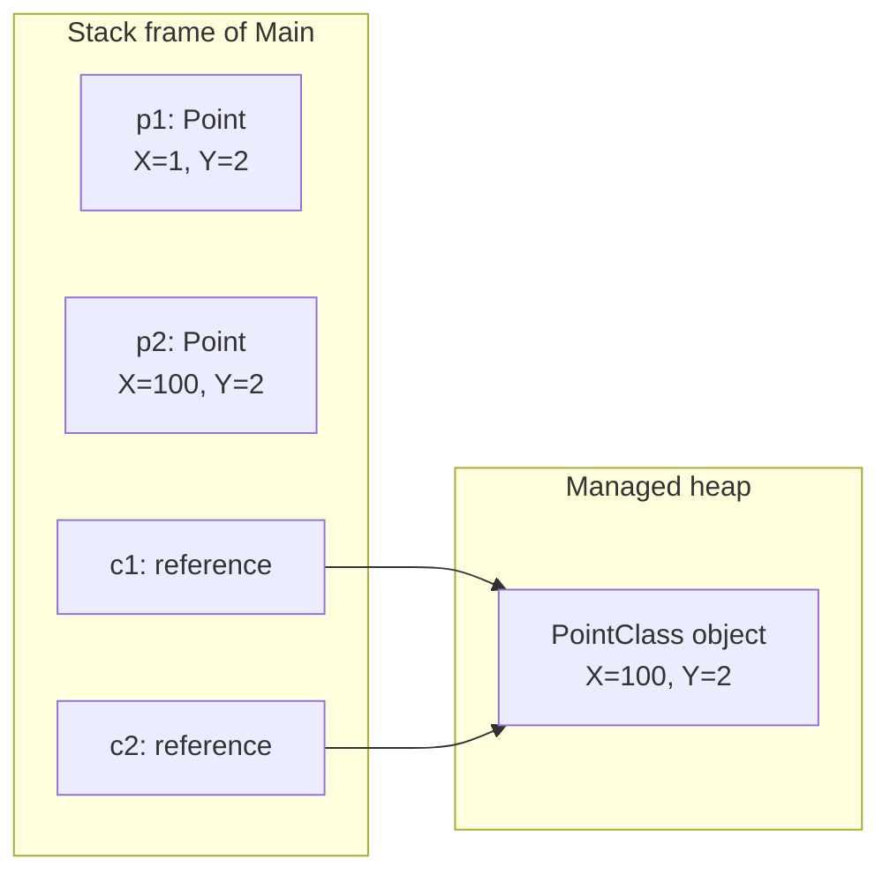
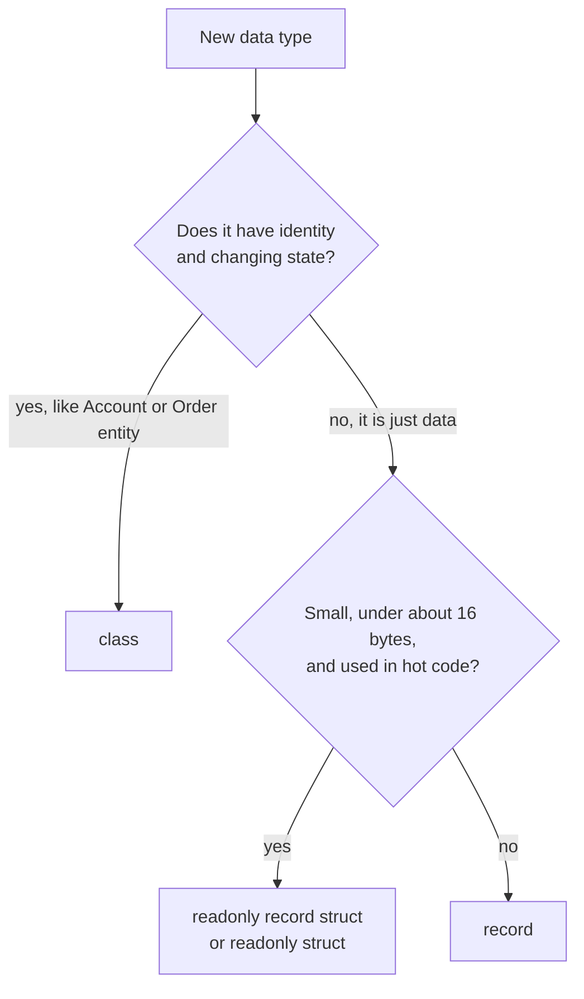

# C# Fundamentals and the Type System

> In this document you will learn how the C# type system works: value types and reference types, structs, classes and records, boxing, strings, equality, nullable types, parameters, enums, tuples and pattern matching. These ideas sit under every .NET interview question, and many "what does this print?" puzzles test exactly these rules. Every output in this document was checked by running it on .NET 10 (C# 14).

**Before this:** [JavaScript basics, variables and types](../02-javascript/01-basics-variables-types-operators.md) · [TypeScript basics and types](../03-typescript/01-typescript-basics-and-types.md) · **Interview questions:** [jump to the interview section](#interview-questions)

## Table of contents

1. [C# compared with JavaScript and TypeScript](#c-compared-with-javascript-and-typescript)
2. [Value types and reference types](#value-types-and-reference-types)
3. [Struct, class, record and record struct](#struct-class-record-and-record-struct)
4. [Boxing and unboxing](#boxing-and-unboxing)
5. [Strings](#strings)
6. [Equality](#equality)
7. [Nullable value types and nullable reference types](#nullable-value-types-and-nullable-reference-types)
8. [var, dynamic and object](#var-dynamic-and-object)
9. [Properties, constructors, static, const and readonly](#properties-constructors-static-const-and-readonly)
10. [Parameter passing: ref, out, in and params](#parameter-passing-ref-out-in-and-params)
11. [Enums](#enums)
12. [Tuples and deconstruction](#tuples-and-deconstruction)
13. [Pattern matching and switch expressions](#pattern-matching-and-switch-expressions)
14. [Access modifiers](#access-modifiers)
15. [Numbers: overflow, integer division and decimal](#numbers-overflow-integer-division-and-decimal)
16. [Common mistakes](#common-mistakes)
17. [Best practices](#best-practices)
18. [How to explain this in an interview](#how-to-explain-this-in-an-interview)
19. [Interview questions](#interview-questions)
20. [Summary](#summary)
21. [References](#references)

---

## C# compared with JavaScript and TypeScript

**C#** is a statically typed, compiled, object-oriented language from Microsoft. It runs on **.NET**, a runtime and a large standard library. In this repository the main target is **C# 14 on .NET 10** (an LTS release from November 2025). Many companies still run **.NET 8** (also LTS, but its support ends on November 10, 2026; see [release cadence](06-dotnet-runtime-sdk-and-project-structure.md#release-cadence-lts-and-sts)), so features newer than C# 12 are labeled.

If you know TypeScript, C# will feel familiar. Anders Hejlsberg designed both languages. But there is one huge difference:

- **TypeScript types disappear at runtime.** The compiler checks them, then removes them. At runtime you have plain JavaScript.
- **C# types exist at runtime.** The runtime knows that a variable holds a `List<int>`. You can ask for it with `GetType()`. A wrong cast throws an exception at runtime.

| Topic | JavaScript / TypeScript | C# |
| --- | --- | --- |
| Typing | Dynamic (JS), compile-time only (TS) | Static, enforced by compiler **and** runtime |
| Numbers | One `number` type (64-bit float) plus `bigint` | Many: `int`, `long`, `double`, `decimal`, `byte`... |
| Run model | Interpreted and JIT-compiled by V8 | Compiled to IL, then JIT-compiled by the .NET runtime |
| Objects | Always by reference | Classes by reference, structs by value |
| Equality | `===` compares references for objects | `==` can be overloaded; records compare by value |
| Null | `null` and `undefined` | Only `null`; value types cannot be null unless `T?` |
| Threads | One JS thread (plus workers) | Many threads; async code can run on any of them |
| Entry point | Any script file | `Program.cs` with top-level statements or `Main` |

A tiny C# program with **top-level statements** (no `Main` method needed since C# 9):

```csharp
// Program.cs
string name = "Asha";
int age = 30;
Console.WriteLine($"{name} is {age} years old"); // Asha is 30 years old
```

`$"..."` is an **interpolated string**, like a JavaScript template literal.

> **New in .NET 10:** you can run a single file without a project: `dotnet run app.cs`. This is called a **file-based app**. It is great for learning and for trying out the examples in this document. See [.NET runtime, SDK and project structure](06-dotnet-runtime-sdk-and-project-structure.md).

## Value types and reference types

### What it is

Every C# type is either a **value type** or a **reference type**.

- A **value type** variable holds the data itself. Copying the variable copies the data.
- A **reference type** variable holds a reference (an address) to an object somewhere else in memory. Copying the variable copies only the reference. Both variables then point to the same object.

| Value types | Reference types |
| --- | --- |
| `int`, `long`, `double`, `decimal`, `bool`, `char` | `class` types (your own classes, `List<T>`, `Dictionary<K,V>`) |
| `struct` types (`DateTime`, `Guid`, `TimeSpan`, your own structs) | `string` |
| `enum` types | arrays (`int[]` is a reference type, even though `int` is a value type) |
| `record struct` | `record` (record class) |
| tuples like `(int, string)` (`ValueTuple`) | delegates, interfaces (when you hold an object through them) |

### Why it exists

Value types are cheap for small data. A `Point` with two numbers does not need its own object on the heap with a header and garbage collection. Reference types are better for larger objects that many parts of the program share and change.

### Analogy

- A value type is like **a sheet of paper you photocopy**. You give someone a copy. If they write on it, your sheet does not change.
- A reference type is like **a shared Google Doc link**. You give someone the link. If they edit the document, you see the change, because there is only one document.

### Example 1: copying

```csharp
struct Point { public int X; public int Y; public Point(int x, int y) { X = x; Y = y; } }
class PointClass { public int X; public int Y; }

Point p1 = new Point(1, 2);
Point p2 = p1;          // copies the whole struct
p2.X = 100;
Console.WriteLine($"{p1.X} {p2.X}"); // 1 100

PointClass c1 = new PointClass { X = 1, Y = 2 };
PointClass c2 = c1;     // copies only the reference
c2.X = 100;
Console.WriteLine($"{c1.X} {c2.X}"); // 100 100
```

Step by step:

1. `p1` holds the values `X=1, Y=2` directly.
2. `p2 = p1` makes a second, independent copy.
3. Changing `p2.X` changes only the copy. `p1.X` is still `1`.
4. `c1` holds a reference to one object on the heap.
5. `c2 = c1` copies the reference. Now two variables point to the same object.
6. Changing `c2.X` changes that one object, so `c1.X` is also `100`.

This is the same as JavaScript objects for classes. Structs have no JavaScript equivalent.

### Where do they live? Stack and heap (simplified but correct)

You will hear "value types live on the stack, reference types live on the heap". This is **half true**. A better rule:

- **Reference type objects** live on the **managed heap**. The garbage collector cleans them up. (Newer JITs can sometimes put a small object that never leaves a method on the stack. That is an optimization, not a rule you can depend on. See [Memory, GC and performance](05-memory-gc-and-performance.md).)
- **Value types live wherever their container lives.**
  - A local `int` variable in a method usually lives on the **stack** (or in a CPU register).
  - An `int` field inside a class object lives **inside that object, on the heap**.
  - The elements of an `int[]` live **inside the array, on the heap**.
  - A local variable captured by a lambda moves into a hidden heap object.



The **stack** is a fast memory area for the currently running methods. Each method call gets a **stack frame** with its local variables. When the method returns, the frame is gone. The **heap** is a large memory area for objects that can live longer. The **garbage collector (GC)** finds heap objects nobody references and frees them. For the OS-level view of stack and heap, see [Operating systems: processes, threads and memory](../01-cs-and-web-fundamentals/03-operating-systems-processes-threads-memory.md).

### Example 2: passing to a method

C# passes arguments **by value** by default. For a struct, the value is the whole data. For a class, the value is the reference.

```csharp
static void MoveStruct(Point p) { p.X = 50; }
static void MoveClass(PointClass p) { p.X = 50; }
static void Replace(PointClass p) { p = new PointClass { X = 999 }; }
static void ReplaceRef(ref PointClass p) { p = new PointClass { X = 999 }; }

var pv = new Point(1, 2);
MoveStruct(pv);
Console.WriteLine(pv.X); // 1    (method changed its own copy)

var pc = new PointClass { X = 1 };
MoveClass(pc);
Console.WriteLine(pc.X); // 50   (same object, changed through the copied reference)

Replace(pc);
Console.WriteLine(pc.X); // 50   (method pointed its local copy at a new object)

ReplaceRef(ref pc);
Console.WriteLine(pc.X); // 999  (ref lets the method change the caller's variable)
```

The third case is the classic trap. Inside `Replace`, `p` is a **copy of the reference**. Pointing the copy at a new object does not change the caller's variable. JavaScript behaves exactly the same way. Only `ref` changes this.

### Example 3: the mutable struct in a list

```csharp
var points = new List<Point> { new Point(1, 1) };
var temp = points[0];  // the indexer returns a COPY of the struct
temp.X = 9;
Console.WriteLine(points[0].X); // 1
```

If you write `points[0].X = 9;` directly, the compiler gives error CS1612 ("Cannot modify the return value... because it is not a variable"). The compiler protects you because the change would be lost on a temporary copy. This is one reason the rule is: **make structs immutable**.

### Default values

Every type has a **default value**. You get it from `default(T)` and in fields that you did not set.

```csharp
Console.WriteLine(default(int));        // 0
Console.WriteLine(default(bool));       // False
Console.WriteLine(default(string));     // (empty line, because the value is null)
Console.WriteLine(default(Point).X);    // 0
Console.WriteLine(default(DateTime).ToString("yyyy-MM-dd")); // 0001-01-01
```

Reference types default to `null`. Value types default to "all bits zero".

## Struct, class, record and record struct

C# gives you four ways to define your own data type.

| Kind | Value or reference | Equality by default | Typical use |
| --- | --- | --- | --- |
| `class` | Reference | Reference (same object?) | Services, entities, objects with identity and behavior |
| `struct` | Value | Value (field by field, through `ValueType.Equals`) | Small, short-lived values: `Point`, `Money`, `Range` |
| `record` (or `record class`) | Reference | **Value** (compiler-generated) | DTOs, messages, immutable data |
| `record struct` | Value | **Value** (compiler-generated, fast) | Small immutable values with nice `ToString` and `==` |

### class

```csharp
class BankAccount(string id, decimal opening)   // primary constructor (C# 12)
{
    public string Id { get; } = id;
    public decimal Balance { get; private set; } = opening;

    public void Deposit(decimal amount)
    {
        if (amount <= 0) throw new ArgumentOutOfRangeException(nameof(amount));
        Balance += amount;
    }
}

var account = new BankAccount("A-1", 50m);
account.Deposit(25m);
Console.WriteLine($"{account.Id} {account.Balance}"); // A-1 75
```

A class has **identity**. Two accounts with the same balance are still two different accounts.

### struct

```csharp
struct Point { public int X; public int Y; public Point(int x, int y) { X = x; Y = y; } }

Console.WriteLine(new Point(1, 2).Equals(new Point(1, 2))); // True
```

Struct `Equals` compares fields. The default implementation from `ValueType` can use reflection, which is slow. If you put a struct in a `Dictionary` or `HashSet`, implement `IEquatable<T>` or use a `record struct` instead.

Use a struct when **all** of these are true: it is small (Microsoft's guideline is roughly 16 bytes or less), it represents a single value, it is immutable, and it will not be boxed often.

### record

A **record** is a type whose main job is to hold data. The compiler writes a lot of code for you:

- Value-based `Equals`, `GetHashCode`, `==` and `!=`.
- A readable `ToString()`.
- A `Deconstruct` method (for positional records).
- Support for `with` expressions (non-destructive copy).

```csharp
record UserRecord(string Name, string Email);   // positional record

var u1 = new UserRecord("Asha", "asha@example.com");
var u2 = new UserRecord("Asha", "asha@example.com");
Console.WriteLine(u1 == u2);                // True   (same values)
Console.WriteLine(u1.Equals(u2));           // True
Console.WriteLine(ReferenceEquals(u1, u2)); // False  (still two objects)

var u3 = u1 with { Email = "new@example.com" };
Console.WriteLine(u3); // UserRecord { Name = Asha, Email = new@example.com }
Console.WriteLine(u1); // UserRecord { Name = Asha, Email = asha@example.com }
```

The positional properties (`Name`, `Email`) are `init`-only. You cannot change them after creation. To "change" a record, you create a copy with `with`.

Compare with a normal class:

```csharp
class UserClass(string name) { public string Name { get; } = name; }

var a = new UserClass("Asha");
var b = new UserClass("Asha");
Console.WriteLine(a == b);       // False
Console.WriteLine(a.Equals(b));  // False
```

### The record trap: equality and `with` are shallow

```csharp
record Order(int Id, List<string> Items);

var o1 = new Order(1, new List<string> { "pen" });
var o2 = new Order(1, new List<string> { "pen" });
Console.WriteLine(o1 == o2); // False  (two different List objects)

var o3 = o1 with { };   // shallow copy: o3.Items is the SAME list as o1.Items
o3.Items.Add("book");
Console.WriteLine(o1.Items.Count);           // 2
Console.WriteLine(ReferenceEquals(o1, o3));  // False
Console.WriteLine(o1 == o3);                 // True  (same Id, same list reference)
```

Record equality compares each property with `EqualityComparer<T>.Default`. For a `List<string>`, that means **reference** equality. So records are only "immutable" if their properties are immutable too. Use `IReadOnlyList<T>` or `ImmutableArray<T>` for collections in records, and remember that equality still compares the collection reference.

### record struct

```csharp
readonly record struct Money(decimal Amount, string Currency);

var m1 = new Money(10m, "USD");
var m2 = new Money(10m, "USD");
Console.WriteLine(m1 == m2); // True
Console.WriteLine(m1);       // Money { Amount = 10, Currency = USD }
```

`readonly record struct` (C# 10) makes all properties read-only. Without `readonly`, a positional `record struct` has **mutable** `get; set;` properties. That surprises many people.

### Realistic example: a DTO in a Web API

```csharp
public record CreateOrderRequest(int CustomerId, IReadOnlyList<OrderLine> Lines);
public record OrderLine(string Sku, int Quantity);
public record OrderResponse(int Id, decimal Total, string Status);
```

Records are a natural fit for request and response DTOs in ASP.NET Core. They are short, immutable and easy to compare in tests. See [Web APIs, validation and error handling](09-web-apis-validation-and-error-handling.md).

### How to choose



Note: EF Core entities are usually normal classes, because the change tracker needs identity and mutable properties. See [Entity Framework Core and data access](10-entity-framework-core-and-data-access.md).

## Boxing and unboxing

### What it is

**Boxing** is converting a value type to `object` (or to an interface it implements). The runtime creates a new object on the heap and **copies** the value into it. **Unboxing** is the opposite: it copies the value out of the box with an explicit cast.

```csharp
int n = 42;
object boxed = n;    // boxing: new heap object holding a copy of 42
n = 7;
Console.WriteLine($"{n} {boxed}"); // 7 42
int back = (int)boxed;             // unboxing
```

The box holds a **copy**. Changing `n` later does not change the box.

### Why it matters

1. **Performance.** Each box is a heap allocation. In a hot loop, boxing creates garbage and makes the GC work harder.
2. **Surprising equality.**

```csharp
object a = 5, b = 5;
Console.WriteLine(a == b);      // False  (== on object compares references: two boxes)
Console.WriteLine(a.Equals(b)); // True   (Int32.Equals compares values)

int x = 5, y = 5;
Console.WriteLine(x == y);      // True
```

3. **Unboxing needs the exact type.** `object o = 5; long l = (long)o;` throws `InvalidCastException`. You must unbox to `int` first: `(long)(int)o`.

### Where boxing happens without you noticing

- Old non-generic collections: `ArrayList`, `Hashtable`. Use `List<T>` and `Dictionary<K,V>` instead. Generics were added in C# 2 mostly to solve this.
- Passing a struct to a parameter of type `object` or of an interface type.
- `string.Format("{0}", 5)` with an `int` argument (interpolated strings in modern C# avoid this through interpolated string handlers).
- Calling `Equals(object)` on a struct that does not implement `IEquatable<T>`.

How to measure and avoid boxing is covered in [Memory, GC and performance](05-memory-gc-and-performance.md).

## Strings

### Strings are immutable reference types

`string` is a reference type, but it **behaves like a value** in two ways:

1. It is **immutable**. No method changes a string. Methods like `ToUpper`, `Replace` and `Trim` return a **new** string.
2. `==` is overloaded to compare **contents**, not references.

```csharp
string name = "asha";
name.ToUpper();            // result thrown away
Console.WriteLine(name);   // asha
name = name.ToUpper();     // keep the new string
Console.WriteLine(name);   // ASHA
```

Immutability makes strings safe to share between threads and safe to use as dictionary keys.

### Interning

**String interning** means the runtime keeps one shared copy of each string literal. Two identical literals in your code point to the same object.

```csharp
string s1 = "hello";
string s2 = "hel" + "lo";                          // constant: the compiler joins it at compile time
string s3 = new string("hello".ToCharArray());     // built at runtime: a new object

Console.WriteLine(s1 == s3);                        // True   (contents)
Console.WriteLine(ReferenceEquals(s1, s2));         // True   (same interned literal)
Console.WriteLine(ReferenceEquals(s1, s3));         // False  (different object)
Console.WriteLine(ReferenceEquals(s1, string.Intern(s3))); // True
```

Strings built at runtime are **not** interned automatically. You rarely call `string.Intern` yourself; it keeps strings alive for the whole process.

### The `object` trap with strings

```csharp
object os1 = s1, os3 = s3;
Console.WriteLine(os1 == os3);       // False  (object == compares references)
Console.WriteLine(os1.Equals(os3));  // True   (virtual Equals runs string.Equals)
```

Operators like `==` are chosen at **compile time** by the static type. Because the variables are typed `object`, the compiler uses reference equality. `Equals` is a **virtual** method, so it runs the string version at runtime. The compiler warns you about this case (CS0252/CS0253).

### StringBuilder

Building a string in a loop with `+=` creates a new string every time. Each new string copies all the old characters. For 1,000 appends that is about 1,000 strings and roughly O(n²) copying.

```csharp
// ❌ Wrong: creates a new string on every iteration
string csv = "";
foreach (var id in orderIds) csv += id + ",";

// ✅ Correct: StringBuilder grows one internal buffer
var sb = new StringBuilder();
for (int i = 0; i < 3; i++) sb.Append(i).Append(',');
Console.WriteLine(sb.ToString().TrimEnd(',')); // 0,1,2

// ✅ Even better when you already have a collection
string joined = string.Join(",", orderIds);
```

Rules of thumb:

- A few concatenations in one expression (`a + b + c`) are fine. The compiler turns them into one `string.Concat` call.
- Use `StringBuilder` for loops or many appends.
- Use `string.Join`, interpolation, or `string.Create` for formatting.

### Comparing strings correctly

```csharp
bool same = string.Equals("Admin", "admin", StringComparison.OrdinalIgnoreCase); // True
var roles = new Dictionary<string, int>(StringComparer.OrdinalIgnoreCase);
```

Use `Ordinal` or `OrdinalIgnoreCase` for identifiers, keys, file paths and protocol values. Use culture-aware comparison only for text shown to humans. `ToLower()` before comparing creates garbage and can be wrong in some cultures (the classic example is the Turkish dotless i).

### Useful string features

```csharp
string path = @"C:\logs\app.txt";                // verbatim string: backslash is not an escape
string json = """
    { "name": "Asha", "age": 30 }
    """;                                         // raw string literal (C# 11): no escaping needed
string msg = $"Total: {total:C2}";               // interpolation with a format string
bool empty = string.IsNullOrWhiteSpace(input);   // null, "", or only spaces
```

## Equality

Equality is one of the most tested C# topics, because C# has several kinds.

| Tool | What it compares |
| --- | --- |
| `ReferenceEquals(a, b)` | Always: are these the same object? |
| `a == b` | Chosen at compile time. Reference equality for classes, unless the type overloads `==` (string, records, many structs) |
| `a.Equals(b)` | Virtual. Default for classes is reference equality. Structs and records override it to compare values |
| `EqualityComparer<T>.Default` | What `Dictionary`, `HashSet`, `List.Contains` and records use. Prefers `IEquatable<T>` |

### The `GetHashCode` contract

A `Dictionary` or `HashSet` first uses `GetHashCode()` to find a bucket. Only inside that bucket does it call `Equals`. So the rules are:

1. If `a.Equals(b)` is true, then `a.GetHashCode()` **must** equal `b.GetHashCode()`.
2. Two different objects may have the same hash code (a collision). That is allowed.
3. The hash code must not change while the object is inside a hash collection. So do not use mutable fields in it.

Break rule 1 and hash collections silently break:

```csharp
class BadKey(int id)
{
    public int Id { get; } = id;
    public override bool Equals(object? obj) => obj is BadKey b && b.Id == Id;
    // ❌ Wrong: no GetHashCode override (compiler warning CS0659)
}

var set = new HashSet<BadKey> { new BadKey(1), new BadKey(1) };
Console.WriteLine(set.Count); // 2   (different default hash codes, so Equals is never called)

var records = new HashSet<UserRecord> { u1, u2 };   // records generate both methods
Console.WriteLine(records.Count); // 1
```

The correct way:

```csharp
// ✅ Correct
public sealed class Sku(string code) : IEquatable<Sku>
{
    public string Code { get; } = code;
    public bool Equals(Sku? other) => other is not null && Code == other.Code;
    public override bool Equals(object? obj) => Equals(obj as Sku);
    public override int GetHashCode() => Code.GetHashCode();
    public static bool operator ==(Sku? a, Sku? b) => Equals(a, b);
    public static bool operator !=(Sku? a, Sku? b) => !Equals(a, b);
}
```

For several fields use `HashCode.Combine(Major, Minor)`. Or just use a `record`, which writes all of this for you.

## Nullable value types and nullable reference types

C# has two different features that both use `?`. Do not mix them up.

### Nullable value types: `int?`

A value type like `int` can never be `null`. `int?` is short for `Nullable<int>`, a struct with two parts: `HasValue` and `Value`.

```csharp
int? maybe = null;
Console.WriteLine(maybe.HasValue);            // False
Console.WriteLine(maybe ?? -1);               // -1
Console.WriteLine(maybe.GetValueOrDefault()); // 0

int? sum = maybe + 5;                         // "lifted" operator: null + 5 is null
Console.WriteLine(sum == null);               // True
```

Typical use: a database column that allows `NULL`, like `DateTime? ShippedAt`.

Reading `maybe.Value` when it has no value throws `InvalidOperationException`.

### Nullable reference types (NRT): `string?`

Reference types could always be `null`. The **nullable reference types** feature (C# 8, on by default in new projects through `<Nullable>enable</Nullable>`) adds **compile-time warnings** that help you avoid `NullReferenceException`.

- `string` means "should never be null".
- `string?` means "may be null, check before use".
- `!` (the **null-forgiving operator**) means "trust me, it is not null". It only silences the warning.

```csharp
static string? GetName(bool found) => found ? "asha" : null;

string? maybeName = GetName(false);
Console.WriteLine(maybeName?.ToUpper() ?? "anonymous"); // anonymous

int len = maybeName.Length;   // warning CS8602: Dereference of a possibly null reference
```

**Very important:** NRT is like TypeScript's `strictNullChecks`. It exists only at compile time. At runtime `string` and `string?` are the same type. Nothing stops a `null` from arriving, for example from JSON or old code. And `!` does not add a check:

```csharp
string?[] names = ["a", null];
Console.WriteLine(names[1]!.Length);  // compiles without warning, but throws NullReferenceException at runtime
```

### Null operators

| Operator | Meaning | Example |
| --- | --- | --- |
| `?.` | Null-conditional access: stop and return null if left side is null | `order?.Customer?.Name` |
| `??` | Null-coalescing: use right side if left is null | `name ?? "guest"` |
| `??=` | Assign only if currently null | `cache ??= new()` |
| `?[]` | Null-conditional index | `items?[0]` |
| `is null` / `is not null` | Null check that ignores overloaded `==` | `if (user is null) return;` |

> **New in C# 14:** **null-conditional assignment**. `customer?.Nickname = "Bob";` assigns only if `customer` is not null. Before C# 14 you needed an `if`.

```csharp
Customer? customer = null;
customer?.Nickname = "x";            // C# 14: does nothing, no exception
var other = new Customer();
other?.Nickname = "Bob";
Console.WriteLine(other.Nickname);   // Bob
```

Guard clauses at the start of public methods are still a good habit:

```csharp
public void Ship(Order order)
{
    ArgumentNullException.ThrowIfNull(order);   // .NET 6+
    // ...
}
```

## var, dynamic and object

These three are often confused.

| Keyword | When is the type decided? | Type checking | Typical use |
| --- | --- | --- | --- |
| `var` | Compile time (inferred) | Full compile-time checking | Everyday local variables |
| `object` | Compile time (the type is `object`) | You must cast to use members | Rare: very generic APIs |
| `dynamic` | Runtime | No compile-time checks; errors at runtime | COM interop, some JSON or scripting scenarios |

```csharp
var v = 10;        // v is int. It is NOT like JavaScript's var
object o = 10;     // boxed int; o.GetType() is Int32, but you can only call object members
dynamic d = 10;    // checked at runtime

Console.WriteLine($"{v.GetType().Name} {o.GetType().Name} {d.GetType().Name} {d + 5}"); // Int32 Int32 Int32 15

d = "text";
Console.WriteLine(d.Length); // 4
d.Fly();                     // compiles, but throws RuntimeBinderException at runtime
```

`var` is still strongly typed. `var x = 10; x = "hi";` does not compile. Use `var` when the type is obvious from the right side (`var orders = new List<Order>();`). Write the type when it helps the reader.

Avoid `dynamic` in normal code. It is slow, gives no IntelliSense, and does not work with Native AOT trimming.

## Properties, constructors, static, const and readonly

### Properties

A **property** looks like a field from outside but is really a pair of methods (`get` and `set`). This lets you add validation later without breaking callers.

```csharp
public class Product
{
    public int Id { get; set; }                       // auto-property
    public required string Name { get; init; }        // required (C# 11) + init-only (C# 9)
    public decimal Price { get; private set; }        // public read, private write
    public decimal PriceWithTax => Price * 1.18m;     // computed, read-only
}

var product = new Product { Name = "Pen" };   // OK
// var bad = new Product();                    // error CS9035: required member 'Name' must be set
// product.Name = "Book";                      // error: init-only property
```

- `init` means "can be set only during object creation" (constructor or object initializer).
- `required` means "the caller **must** set this in the object initializer". The compiler enforces it.

> **New in C# 14:** the **`field` keyword** gives you access to the hidden backing field of an auto-property. You can add logic to one accessor without declaring a private field by hand.

```csharp
class Tag
{
    public string Label { get; set => field = value.Trim(); } = "";
}

var tag = new Tag();
tag.Label = "  sale  ";
Console.WriteLine($"[{tag.Label}]"); // [sale]
```

### Constructors and primary constructors

```csharp
// Classic constructor
public class OrderService
{
    private readonly IOrderRepository _repository;
    public OrderService(IOrderRepository repository) => _repository = repository;
}

// Primary constructor (C# 12): parameters are in scope in the whole class body
public class OrderService2(IOrderRepository repository, ILogger<OrderService2> logger)
{
    public Order? Get(int id)
    {
        logger.LogInformation("Loading order {Id}", id);
        return repository.Find(id);
    }
}
```

Primary constructors are popular for dependency injection in ASP.NET Core. Two things to know:

- For **classes and structs**, the parameters are **not** properties. They are captured parameters. They are also **not readonly**: code in the class could assign to them. If you want a read-only field, write `private readonly IOrderRepository _repository = repository;`.
- For **records**, primary constructor parameters **do** become public properties.

### static

A **static** member belongs to the type, not to an object. A `static class` cannot be instantiated and holds only static members (for example helpers and extension methods).

```csharp
public static class PriceCalculator
{
    public static decimal AddTax(decimal price, decimal rate) => price * (1 + rate);
}
Console.WriteLine(PriceCalculator.AddTax(100m, 0.18m)); // 118.00
```

Static mutable state is shared by all threads and all requests in a web server. That is a common source of bugs. Prefer DI singletons over static state. See [Dependency injection in ASP.NET Core](08-dependency-injection-in-aspnet-core.md).

### const vs readonly

```csharp
static class Config
{
    public const int MaxItems = 100;                                // compile-time constant
    public static readonly DateTime StartedAt = DateTime.UtcNow;    // set once at runtime
}
```

| | `const` | `readonly` |
| --- | --- | --- |
| When is the value fixed? | Compile time | Runtime, in the declaration or constructor |
| Allowed types | Primitives, `string`, enums, `null` | Any type |
| Static? | Always (implicitly) | Instance or static |
| Copied into other assemblies? | **Yes**, the value is baked into callers | No, callers read the field |

The last row is an interview favorite. If library A has `public const int Version = 1;` and app B uses it, B's compiled code contains `1`. If you change A to `2` and redeploy only A, B still sees `1` until B is recompiled. Use `const` only for values that truly never change (like `Math.PI`). Use `static readonly` for everything else.

`readonly` on a reference field means the **reference** cannot change. The object can still change: `readonly List<int> _ids` can still be `_ids.Add(5)`.

## Parameter passing: ref, out, in and params

| Modifier | Must the caller initialize? | Can the method change the caller's variable? | Typical use |
| --- | --- | --- | --- |
| (none) | Yes | No (gets a copy) | Default |
| `ref` | Yes | Yes | Swap, change caller's variable |
| `out` | No | Yes, **must** assign before returning | `TryParse` pattern, extra return values |
| `in` | Yes | No (read-only reference) | Pass a large struct without copying |
| `params` | n/a | n/a | Variable number of arguments |

```csharp
static void Increment(ref int value) => value++;
static void Swap(ref int a, ref int b) => (a, b) = (b, a);
static int Sum(params int[] values) => values.Sum();

int counter = 0;
Increment(ref counter);
Console.WriteLine(counter);                 // 1

if (int.TryParse("123", out int parsed))    // out variable declared inline
    Console.WriteLine(parsed);              // 123

Console.WriteLine($"{Sum()} {Sum(1, 2, 3)} {Sum([4, 5])}"); // 0 6 9
```

The **Try pattern** (`bool TryX(input, out result)`) is the C# way to report "this might fail" without exceptions: `int.TryParse`, `Dictionary.TryGetValue`, `Enum.TryParse`.

> **New in C# 13:** `params` works with collection types, not just arrays: `params ReadOnlySpan<int> values` or `params IEnumerable<int> values`. A `params ReadOnlySpan<T>` can avoid the array allocation.

`ref`, `out` and `in` parameters are not allowed in `async` methods and iterators. Use return values or tuples there.

## Enums

An **enum** is a set of named integer constants. It is a value type.

```csharp
enum OrderStatus { Pending, Paid, Shipped = 5, Delivered }

var status = OrderStatus.Shipped;
Console.WriteLine(status);                          // Shipped
Console.WriteLine((int)status);                     // 5
Console.WriteLine((int)OrderStatus.Delivered);      // 6   (continues from the previous value)
Console.WriteLine((OrderStatus)99);                 // 99  (no error! any int can be cast)
Console.WriteLine(Enum.IsDefined((OrderStatus)99)); // False
Console.WriteLine(Enum.Parse<OrderStatus>("Paid")); // Paid
Console.WriteLine(Enum.TryParse<OrderStatus>("Lost", out var lost)); // False
Console.WriteLine(lost);                            // Pending (default value 0)
```

The trap: an enum variable can hold **any** number of the underlying type. If a value comes from outside (JSON, database, query string), validate it with `Enum.IsDefined` or a `switch` with a default case.

### Flags enums

Use `[Flags]` when values can be combined. Give each value a power of two.

```csharp
[Flags] enum Permissions { None = 0, Read = 1, Write = 2, Delete = 4 }

var perms = Permissions.Read | Permissions.Write;
Console.WriteLine(perms);                               // Read, Write
Console.WriteLine(perms.HasFlag(Permissions.Write));    // True
Console.WriteLine(perms.HasFlag(Permissions.Delete));   // False
```

Comparison with TypeScript: TS enums are also numbers by default, but TS string unions (`'pending' | 'paid'`) are more common. In C#, enums are the normal tool. In Web APIs, configure JSON to send enums as strings (`JsonStringEnumConverter`) so clients see `"Shipped"` instead of `5`.

## Tuples and deconstruction

A **tuple** groups a few values without creating a named type. Modern C# tuples are `ValueTuple` structs.

```csharp
static (int Min, int Max) MinMax(int[] values) => (values.Min(), values.Max());

var (min, max) = MinMax([3, 9, 1]);        // deconstruction
Console.WriteLine($"{min} {max}");          // 1 9

var item = (Name: "pen", Price: 10m);
Console.WriteLine($"{item.Name} {item.Item2} {item}"); // pen 10 (pen, 10)

Console.WriteLine((1, "a") == (1, "a"));    // True (tuples support == since C# 7.3)

int a = 1, b = 2;
(a, b) = (b, a);                            // swap without a temp variable
Console.WriteLine($"{a} {b}");              // 2 1
```

Element names like `Min` and `Max` exist only at compile time. At runtime they are still `Item1` and `Item2`. That is why names are lost when you serialize a tuple to JSON. For public API return types, prefer a small `record` over a tuple.

Records and your own types can be deconstructed too: `var (name, email) = user;` works for positional records.

## Pattern matching and switch expressions

**Pattern matching** lets you test a value's shape and pull data out in one step. It is similar to TypeScript narrowing, but checked at runtime with real types.

### Type pattern with `is`

```csharp
object input = "hello";
if (input is string text && text.Length > 3)
    Console.WriteLine(text.ToUpper()); // HELLO
```

### Switch expression

```csharp
static string Describe(object? o) => o switch
{
    null                     => "null",
    int i when i > 40        => $"big int {i}",        // case guard
    int i                    => $"int {i}",
    string { Length: 0 }     => "empty string",        // property pattern
    string s                 => $"string of {s.Length}",
    Point { X: 0, Y: var y } => $"point on Y axis at {y}",
    IEnumerable<int> list    => $"sequence of {list.Count()}",
    _                        => $"other {o.GetType().Name}"   // discard: matches anything
};

Console.WriteLine(Describe(42));                       // big int 42
Console.WriteLine(Describe(7));                        // int 7
Console.WriteLine(Describe(""));                       // empty string
Console.WriteLine(Describe(3.5));                      // other Double
Console.WriteLine(Describe(new Point(0, 5)));          // point on Y axis at 5
Console.WriteLine(Describe(new List<int> { 1, 2 }));   // sequence of 2
```

Arms are checked **from top to bottom**. The first match wins. If you put `int i` before `int i when i > 40`, the compiler reports an error because the second arm can never match.

### Property, relational and logical patterns

```csharp
record Order2(string Country, decimal Total);

static decimal Shipping(Order2 o) => o switch
{
    { Country: "IN", Total: >= 500m } => 0m,     // property + relational pattern
    { Country: "IN" }                  => 40m,
    _                                  => 150m
};
Console.WriteLine($"{Shipping(new("IN", 40m))} {Shipping(new("IN", 600m))} {Shipping(new("US", 100m))}"); // 40 0 150

static string Grade(int score) => score switch
{
    < 0 or > 100      => "invalid",   // logical 'or'
    >= 90             => "A",
    >= 70 and < 90    => "B",         // logical 'and'
    _                 => "C"
};
Console.WriteLine($"{Grade(95)} {Grade(72)} {Grade(-3)} {Grade(50)}"); // A B invalid C
```

### List patterns (C# 11)

```csharp
static string ListInfo(int[] xs) => xs switch
{
    []                        => "empty",
    [var only]                => $"one:{only}",
    [var f, var s]            => $"two:{f},{s}",
    [var first, .., var last] => $"many:{first}..{last}",   // .. is the slice pattern
};
Console.WriteLine($"{ListInfo([])} {ListInfo([7])} {ListInfo([1, 2])} {ListInfo([1, 5, 9, 3])}");
// empty one:7 two:1,2 many:1..3
```

If a switch expression does not cover all cases and no arm matches at runtime, it throws `SwitchExpressionException`. The compiler warns you (CS8509) when cases are missing.

### Real-world usage

- Mapping domain results to HTTP results: `result switch { NotFound => Results.NotFound(), Success s => Results.Ok(s.Value), ... }`.
- Validating input shapes and ranges in one readable block.
- Replacing long `if/else if` chains on types.

## Access modifiers

| Modifier | Who can access |
| --- | --- |
| `public` | Everyone |
| `private` | Only the same type (default for class members) |
| `protected` | Same type and derived types |
| `internal` | Same assembly (project) only (default for top-level types) |
| `protected internal` | Same assembly **or** derived types |
| `private protected` | Derived types **in the same assembly** |
| `file` (C# 11) | Only the same source file (for top-level types) |

Defaults matter: a class written as `class Foo` is `internal`. A member written as `int count;` is `private`.

Use `internal` to hide implementation classes inside a library. Tests can still see them with `[assembly: InternalsVisibleTo("MyApp.Tests")]`.

## Numbers: overflow, integer division and decimal

```csharp
int big = int.MaxValue;
Console.WriteLine(unchecked(big + 1));   // -2147483648  (wraps around silently by default)
checked { int z = big; z++; }            // throws OverflowException

Console.WriteLine(7 / 2);                // 3     (integer division)
Console.WriteLine(7 / 2.0);              // 3.5
Console.WriteLine(7 % 3);                // 1
Console.WriteLine(0.1 + 0.2 == 0.3);     // False (double is binary floating point, like JS)
Console.WriteLine(0.1m + 0.2m == 0.3m);  // True  (decimal is base-10)
Console.WriteLine(1.0 / 0);              // ∞     (double: Infinity, no exception)
int zero = 0;
Console.WriteLine(1 / zero);             // throws DivideByZeroException (integers)
```

- Integer arithmetic **wraps** on overflow by default. Use `checked` (or the project setting `<CheckForOverflowUnderflow>`) where overflow would be a bug.
- **Use `decimal` for money.** `double` cannot represent 0.1 exactly. JavaScript has the same problem because every JS number is a `double`.
- The `m` suffix makes a `decimal` literal (`10m`). `L` is `long`, `f` is `float`, `d` is `double`.

## Common mistakes

1. **Thinking "value types always live on the stack".** A value type field of a class lives on the heap inside the object.
2. **Mutable structs.** Changes are lost on copies (list indexer, `foreach` variable, properties). Make structs `readonly`.
3. **Overriding `Equals` without `GetHashCode`.** Dictionaries and sets stop working.
4. **Assuming records are deeply immutable.** A `List<T>` property can still be changed, and `with` copies the reference.
5. **Using `==` on `object` variables** and expecting value comparison.
6. **Trusting `!`.** The null-forgiving operator removes a warning, not a bug.
7. **Using `double` for money.** Use `decimal`.
8. **Changing a public `const` in a library** and not recompiling the callers.
9. **String concatenation in loops.** Use `StringBuilder` or `string.Join`.
10. **Casting unvalidated ints to enums.** Any number is accepted.
11. **Comparing strings with `ToLower()`.** Use `StringComparison.OrdinalIgnoreCase`.

## Best practices

- **Turn on nullable reference types** (`<Nullable>enable</Nullable>`) and treat warnings seriously. It moves many `NullReferenceException`s to compile time.
- **Use records for DTOs and messages.** You get value equality, `ToString` and `with` for free.
- **Use classes for entities and services.** They have identity and behavior.
- **Use `readonly struct` or `readonly record struct` for small values.** Immutability avoids copy bugs.
- **Prefer `static readonly` over `const` for public values** that might change.
- **Use `decimal` for money and `checked` where overflow is a bug.**
- **Implement `IEquatable<T>` together with `Equals` and `GetHashCode`** when you need custom equality, or use a record.
- **Prefer switch expressions with patterns** over long `if/else` chains. They are shorter and the compiler checks completeness.
- **Use the Try pattern** for expected failures (parsing, lookups) and exceptions for unexpected ones.
- **Keep fields private** and expose properties. It lets you add validation later.

## How to explain this in an interview

**Topic: value types vs reference types**

1. **Define it:** "In C#, every type is either a value type or a reference type. A value type variable holds the data itself. A reference type variable holds a reference to an object on the managed heap."
2. **Why it exists:** "Small values like numbers, dates or points do not need a heap object and garbage collection. Value types make them cheap. Bigger objects with identity are shared through references."
3. **How it works:** "Assignment and method calls copy the variable. For a struct that copies all the data. For a class it copies only the reference, so both variables see the same object."
4. **Small example:** "If I copy a `Point` struct and change the copy, the original stays the same. If I copy a `Customer` class variable and change the name, both variables show the new name."
5. **Where it is useful:** "`DateTime`, `Guid`, `decimal` and `int` are structs. Services, entities and collections are classes. I use `readonly record struct` for small values like `Money` and `record` for DTOs."
6. **Trade-offs / gotchas:** "Big structs are expensive to copy, structs get boxed when you treat them as `object` or an interface, and mutable structs lose changes on copies. Also, 'value types live on the stack' is not fully true: a value type field inside a class lives on the heap."

## Interview questions

### Q1. What is the difference between a value type and a reference type?

**What the interviewer is checking:** Whether you understand copy semantics and memory, not only the definitions.

**Short spoken answer (30–60 seconds):**
> A value type holds its data directly, and a reference type holds a reference to an object on the heap. The practical difference is what happens when you copy. If I assign one struct variable to another, I get two independent copies. If I assign one class variable to another, both point to the same object, so a change through one is visible through the other. Numbers, `bool`, `DateTime`, enums and structs are value types. Classes, strings, arrays and delegates are reference types. One detail I always add: value types do not always live on the stack. They live wherever their container lives, so an `int` field inside a class object is on the heap.

**Detailed explanation:** Value types are copied on assignment, on method calls (unless `ref`/`in`/`out`), and when returned. They cannot be `null` unless wrapped in `Nullable<T>`. Reference type objects are allocated on the managed heap and cleaned up by the GC. Both kinds are passed **by value** by default. For a reference type, the value is the reference.

**Follow-up questions:**
- **Is `string` a value type?** — No. It is a reference type, but it is immutable and overloads `==` to compare content, so it often feels like a value type.
- **Are arrays of `int` value types?** — No. Every array is a reference type. Its elements are stored inline inside the array object on the heap.
- **Can a struct have a constructor and methods?** — Yes. Structs can have constructors (including parameterless ones since C# 10), methods, properties and can implement interfaces. They cannot inherit from another struct or class.
- **Where is a local variable captured by a lambda stored?** — The compiler moves it into a hidden class (a "closure" object) on the heap, so it can outlive the method.

**Common mistakes:** Saying "value types are always on the stack". Saying "reference types are passed by reference".

**Where this is used in real projects:** Choosing record vs record struct for DTOs, understanding why a change to an object passed to a service is visible to the caller, avoiding struct copies in hot code.

### Q2. What does this print?

```csharp
static void Replace(PointClass p) { p = new PointClass { X = 999 }; }
static void Change(PointClass p) { p.X = 50; }

var pc = new PointClass { X = 1 };
Change(pc);
Replace(pc);
Console.WriteLine(pc.X);
```

**Answer:** `50`

**Step by step:**
1. `pc` references one object with `X = 1`.
2. `Change` receives a copy of the reference. It changes the shared object, so `X` becomes `50`.
3. `Replace` receives another copy of the reference. It points that local copy at a new object. The caller's `pc` still points to the original object.
4. So `pc.X` is `50`. With `ref PointClass p`, the result would be `999`.

### Q3. Struct vs class vs record vs record struct: when do you use each?

**What the interviewer is checking:** Practical design judgment, and knowledge of records (C# 9) and record structs (C# 10).

**Short spoken answer (30–60 seconds):**
> I use a class for things with identity and behavior, like services and EF Core entities. Two customers with the same name are still different customers. I use a record for data: DTOs, API requests and responses, messages and events. Records give me value equality, a readable `ToString`, and `with` expressions for non-destructive copies. I use a struct, usually a `readonly record struct`, only for small values that are created a lot, like `Money` or a coordinate, because it avoids a heap allocation. The main risks with structs are large copies and boxing, and the main trap with records is that equality and `with` are shallow.

**Detailed explanation:** See the table in [Struct, class, record and record struct](#struct-class-record-and-record-struct). Records are classes by default (`record` = `record class`). Positional records create `init`-only properties. Positional `record struct` creates mutable properties unless you add `readonly`.

**Follow-up questions:**
- **Can records inherit?** — Record classes can inherit from other record classes. Equality then also checks the runtime type (through a generated `EqualityContract`), so a `Student` record never equals a `Person` record with the same values.
- **Can I use a record as an EF Core entity?** — You can, but it is usually a bad fit. Value equality conflicts with the change tracker's identity tracking, and entities are usually mutable.
- **What is the size guideline for structs?** — Microsoft's design guidelines suggest roughly 16 bytes or less, immutable, and not boxed frequently.
- **Does `with` work on structs?** — Yes, since C# 10 `with` works on any struct and on anonymous types.

**Common mistakes:** Making large mutable structs "for performance". Assuming records are deeply immutable.

**Where this is used in real projects:** DTO design in Web APIs, domain value objects (`Money`, `EmailAddress`), messages in a queue.

### Q4. What does this print?

```csharp
record Order(int Id, List<string> Items);

var o1 = new Order(1, new List<string> { "pen" });
var o3 = o1 with { };
o3.Items.Add("book");
Console.WriteLine($"{o1.Items.Count} {ReferenceEquals(o1, o3)} {o1 == o3}");
```

**Answer:** `2 False True`

**Step by step:**
1. `with { }` creates a new record object (so `ReferenceEquals` is `False`).
2. The copy is **shallow**. `o3.Items` is the same `List<string>` object as `o1.Items`.
3. Adding "book" through `o3` changes the shared list. `o1.Items.Count` is `2`.
4. Record equality compares `Id` (equal) and `Items` by reference (same list). So `o1 == o3` is `True`.

### Q5. What is boxing, and why should you care?

**What the interviewer is checking:** Understanding of the cost of treating value types as objects, and where it hides.

**Short spoken answer (30–60 seconds):**
> Boxing is when a value type is converted to `object` or to an interface. The runtime allocates a new object on the heap and copies the value into it. Unboxing copies it back out with a cast. It matters for two reasons. First, performance: every box is an allocation, so boxing inside a hot loop creates garbage for the GC. Second, behavior: the box is a copy, and `==` on two `object` variables compares references, so two boxed fives are not `==`. Generics mostly solved this, which is why we use `List<int>` instead of `ArrayList`.

**Code:**

```csharp
object a = 5, b = 5;
Console.WriteLine(a == b);      // False
Console.WriteLine(a.Equals(b)); // True
```

**Follow-up questions:**
- **Does calling an interface method on a struct box it?** — Yes, if you store the struct in an interface-typed variable. A generic method with a constraint (`void M<T>(T x) where T : IShape`) calls it without boxing.
- **Can you unbox an `int` box to `long`?** — No. `(long)obj` throws `InvalidCastException`. Unbox to the exact type first: `(long)(int)obj`.
- **How do you find boxing?** — Allocation profilers (Visual Studio, dotnet-trace), BenchmarkDotNet's memory diagnoser, or `GC.GetAllocatedBytesForCurrentThread()` in a quick test.

**Common mistakes:** Thinking boxing changes the original variable. Not knowing that `ArrayList` boxes every `int`.

**Where this is used in real projects:** Logging calls with value-type arguments, old APIs that take `object`, hot paths in high-throughput services.

### Q6. Why are strings immutable in C#, and what does that mean for performance?

**What the interviewer is checking:** String internals and `StringBuilder` use.

**Short spoken answer (30–60 seconds):**
> A `string` in .NET can never change after it is created. Methods like `Replace` or `ToUpper` return a new string. This makes strings safe to share between threads, safe as dictionary keys, and allows interning, where identical literals share one object. The cost is that building a string piece by piece in a loop with `+=` creates a new string every time and copies all previous characters, which is quadratic. For that I use `StringBuilder`, which grows one buffer, or `string.Join` when I already have a collection.

**Follow-up questions:**
- **Is `"a" + "b" + "c"` slow?** — No. Constants are joined at compile time, and a single expression with variables becomes one `string.Concat` call.
- **What is string interning?** — The runtime keeps one copy of each literal string. Runtime-built strings are not interned unless you call `string.Intern`.
- **What does this print: `ReferenceEquals("hello", "hel" + "lo")`?** — `True`, because the compiler folds the constant expression into the same interned literal.

**Common mistakes:** Calling `name.Trim();` and expecting `name` to change.

**Where this is used in real projects:** Building CSV or log lines, generating SQL or HTML text, key building in caches.

### Q7. What does this print?

```csharp
string s1 = "hello";
string s3 = new string("hello".ToCharArray());
object os1 = s1, os3 = s3;
Console.WriteLine(s1 == s3);
Console.WriteLine(os1 == os3);
Console.WriteLine(os1.Equals(os3));
```

**Answer:**

```text
True
False
True
```

**Step by step:**
1. `s1 == s3` uses `string`'s overloaded `==`, which compares characters. `True`.
2. `os1 == os3`: the static type is `object`. Operators are chosen at compile time, so this is reference equality. `s3` is a different object. `False`.
3. `os1.Equals(os3)`: `Equals` is virtual, so the runtime calls `string.Equals`, which compares content. `True`.

### Q8. Explain `==`, `Equals`, `ReferenceEquals` and `GetHashCode`.

**What the interviewer is checking:** Understanding of the equality model and the hash code contract.

**Short spoken answer (30–60 seconds):**
> `ReferenceEquals` always asks "is this the same object?". `Equals` is a virtual method; for classes it defaults to reference equality, but structs, strings and records override it to compare values. `==` is an operator chosen at compile time: for classes it is reference equality unless the type overloads it, like `string` and records do. `GetHashCode` is what dictionaries and hash sets use to pick a bucket before calling `Equals`. The rule is: if two objects are equal, they must have the same hash code. If I override `Equals` and forget `GetHashCode`, lookups in a `Dictionary` or `HashSet` break. In practice I implement `IEquatable<T>` with `HashCode.Combine`, or I just use a record.

**Code:** see [The GetHashCode contract](#the-gethashcode-contract).

**Follow-up questions:**
- **Why should hash codes not depend on mutable fields?** — If a field changes while the object is in a `HashSet`, it is now in the wrong bucket and `Contains` returns false.
- **Why `is null` instead of `== null`?** — `==` can be overloaded and could behave strangely. `is null` always checks for a null reference.
- **What does `HashSet<T>` use to compare?** — `EqualityComparer<T>.Default`, which uses `IEquatable<T>.Equals` if available, otherwise `object.Equals`. You can pass a custom `IEqualityComparer<T>`.

**Common mistakes:** Thinking `==` and `Equals` are always the same. Forgetting `GetHashCode`.

**Where this is used in real projects:** Value objects in domain models, de-duplicating with `Distinct` or `HashSet`, dictionary keys, comparing DTOs in unit tests.

### Q9. What is the difference between `int?` and `string?`?

**What the interviewer is checking:** That you know these are two different features.

**Short spoken answer (30–60 seconds):**
> They look the same but they are completely different. `int?` is a real runtime type, `Nullable<int>`, a struct with `HasValue` and `Value`, because a normal `int` cannot be null. `string?` is part of nullable reference types, which is only a compile-time annotation. A `string` could always be null at runtime. With nullable reference types enabled, the compiler warns me when I might dereference a null. But at runtime `string` and `string?` are the same type, so null can still arrive from JSON or old code, and the null-forgiving operator `!` only hides the warning.

**Follow-up questions:**
- **What is `maybe + 5` when `maybe` is a null `int?`?** — `null`. Arithmetic operators are "lifted" and return null if any operand is null.
- **How do you enable NRT?** — `<Nullable>enable</Nullable>` in the `.csproj` (default in new templates), or `#nullable enable` in a file.
- **Is NRT like TypeScript?** — Yes, it is similar to `strictNullChecks`: compile-time only.
- **How do you tell the compiler a method checks for null?** — Attributes like `[NotNullWhen(true)]` on a `Try` method's `out` parameter, or `[MemberNotNull]`.

**Common mistakes:** Saying `string?` creates a different runtime type. Using `!` everywhere to remove warnings.

**Where this is used in real projects:** Optional database columns (`DateTime?`), optional DTO fields, eliminating null bugs in large codebases.

### Q10. What is the difference between `const` and `readonly`?

**What the interviewer is checking:** Compile-time vs runtime constants and the versioning trap.

**Short spoken answer (30–60 seconds):**
> A `const` is a compile-time constant. It must be a primitive, string or enum, it is implicitly static, and the compiler copies the value into every place that uses it, even in other assemblies. A `readonly` field is set once at runtime, in its declaration or in the constructor, and it can be any type. The important trap is versioning: if a library changes a public `const` and only the library is redeployed, callers still use the old value until they are recompiled. So I use `const` only for truly fixed values and `static readonly` for things like configuration defaults.

**Follow-up questions:**
- **Does `readonly List<int>` make the list read-only?** — No. Only the field reference is fixed. Use `IReadOnlyList<T>` or an immutable collection for read-only content.
- **Can a `const` be a `DateTime`?** — No. `DateTime` is not a compile-time constant type. Use `static readonly`.

### Q11. What does this print?

```csharp
enum OrderStatus { Pending, Paid, Shipped = 5, Delivered }

Console.WriteLine((int)OrderStatus.Delivered);
Console.WriteLine((OrderStatus)99);
Console.WriteLine(Enum.IsDefined((OrderStatus)99));
```

**Answer:**

```text
6
99
False
```

**Step by step:** `Delivered` comes after `Shipped = 5`, so it gets `6`. Casting `99` to the enum is allowed. There is no name for it, so `ToString()` prints the number. `IsDefined` shows it is not a valid named value.

### Q12. Explain `ref`, `out` and `in`.

**What the interviewer is checking:** Parameter passing modes and when each is useful.

**Short spoken answer (30–60 seconds):**
> By default C# passes arguments by value, so the method gets a copy. `ref` passes the caller's variable itself, so the method can read and replace it; the caller must initialize it first. `out` is similar but the variable does not need to be initialized, and the method must assign it before returning. It is used in the Try pattern, like `int.TryParse(text, out var number)`. `in` passes a read-only reference, which is useful for large structs to avoid copying while promising not to change them. None of these can be used in async methods.

**Follow-up questions:**
- **Why not just return a tuple instead of `out`?** — You often can. `out` stays common for the Try pattern because it works nicely inside `if` conditions.
- **What is `ref return` / `ref local`?** — A method can return a reference to a storage location (for example an array element), so the caller can change it in place without copying. Used in high-performance code.

### Q13. What is the difference between `var`, `object` and `dynamic`?

**Short answer:** `var` is compile-time type inference; the variable is still strongly typed. `object` is the base type of everything; you must cast to use specific members, and value types get boxed. `dynamic` skips compile-time checking; member access is resolved at runtime and fails with `RuntimeBinderException` if the member does not exist. Use `var` daily, `object` rarely, and `dynamic` almost never.

### Q14. What do these switch expressions return?

```csharp
static string Grade(int score) => score switch
{
    < 0 or > 100   => "invalid",
    >= 90          => "A",
    >= 70 and < 90 => "B",
    _              => "C"
};
Console.WriteLine($"{Grade(95)} {Grade(72)} {Grade(-3)} {Grade(50)}");
```

**Answer:** `A B invalid C`

**Explanation:** Arms are checked top to bottom. `-3` matches `< 0`. `95` matches `>= 90`. `72` matches the `and` pattern. `50` falls to the discard `_`.

**Follow-up questions:**
- **What if no arm matches?** — The compiler warns (CS8509), and at runtime a `SwitchExpressionException` is thrown.
- **What is a property pattern?** — `{ Country: "IN", Total: >= 500m }` checks properties of an object, including nested ones like `{ Customer.Address.City: "Pune" }` (extended property patterns, C# 10).

### Q15. What is pattern matching, and how is it different from TypeScript narrowing?

**What the interviewer is checking:** Modern C# fluency and awareness of runtime types.

**Short spoken answer (30–60 seconds):**
> Pattern matching lets me test the shape of a value and extract parts of it in one expression. I can match on type, like `if (shape is Circle c)`, on properties, on ranges with relational patterns like `>= 90`, combine them with `and`, `or`, `not`, and match arrays with list patterns. Switch expressions use these patterns to return a value, and the compiler warns me when cases are missing. The difference from TypeScript narrowing is that C# types are real at runtime, so `is Circle` is a real runtime type check, not just a compile-time hint.

**Follow-up questions:**
- **What does `is not null` do?** — It is a negated constant pattern. It checks for a non-null reference and is not affected by overloaded operators.
- **What is a `when` clause?** — A case guard: an extra boolean condition on a pattern arm.

### Q16. What does this print, and why?

```csharp
var points = new List<Point> { new Point(1, 1) };  // Point is a mutable struct
var temp = points[0];
temp.X = 9;
Console.WriteLine(points[0].X);
```

**Answer:** `1`

**Explanation:** The list indexer returns a **copy** of the struct. Changing `temp` changes only the copy. Writing `points[0].X = 9;` directly does not compile (CS1612) for this reason. This is a strong argument for immutable structs.

### Q17. What is the null-forgiving operator, and when is it dangerous?

**Short answer:** `!` tells the compiler "this expression is not null" and removes the nullable warning. It generates no runtime check. If the value really is null, you still get `NullReferenceException`. Use it only when you know more than the compiler (for example after a check the compiler cannot see). Prefer real checks, `??`, or nullable attributes.

### Q18. Code review: what is wrong with this class?

```csharp
public class OrderTotals
{
    public static List<decimal> Totals = new();       // 1
    public const string ApiVersion = "2025-01";       // 2
    public double Amount;                             // 3

    public override bool Equals(object? obj) =>       // 4
        obj is OrderTotals o && o.Amount == Amount;
}
```

**Answer:**
1. A **public static mutable list** is shared by every request and thread in a web app. It is not thread-safe and grows forever (a memory leak). Use a scoped or singleton service with proper synchronization.
2. A **public `const` that may change** is baked into callers. Use `static readonly`.
3. **Money as `double`** gives rounding errors. Use `decimal`. A public field also prevents later validation; use a property.
4. **`Equals` without `GetHashCode`**, and based on a mutable field. Hash collections will break. Implement both from immutable data, or use a record.

### Q19. What is a primary constructor, and what is the gotcha?

**Short spoken answer (30–60 seconds):**
> A primary constructor, added for classes and structs in C# 12, puts constructor parameters right after the type name, like `class OrderService(IOrderRepository repository)`. The parameters are in scope in the whole class, which removes the boilerplate of fields and assignments, so it is popular for dependency injection. The gotcha is that for classes these parameters are not properties and are not readonly. They are captured like variables, so code could reassign them. For records, primary constructor parameters do become public init-only properties. If I want a readonly field, I assign the parameter to a `private readonly` field.

### Q20. What does `required` do, and how is it different from `init`?

**Short answer:** `init` controls **when** a property can be set: only during construction or in an object initializer. `required` (C# 11) controls **whether** it must be set: the compiler gives an error if an object initializer does not set it. They are often used together: `public required string Name { get; init; }`. `required` is checked only at compile time; a deserializer like `System.Text.Json` (since .NET 7) also respects it.

## Summary

- C# types exist at runtime, unlike TypeScript types. The main target is C# 14 on .NET 10; many teams still run .NET 8.
- **Value types** hold data and are copied on assignment. **Reference types** hold a reference to a heap object. Both are passed by value by default.
- Value types live wherever their container lives; "structs are always on the stack" is not correct.
- Use **classes** for identity and behavior, **records** for data (value equality, `with`), and **readonly record structs** for small values. Record equality and `with` are shallow.
- **Boxing** copies a value type into a heap object. It costs allocations and changes `==` behavior.
- **Strings** are immutable reference types with content-based `==`. Use `StringBuilder` or `string.Join` in loops, and ordinal comparison for identifiers.
- `==` is chosen at compile time; `Equals` is virtual; equal objects must have equal hash codes.
- `int?` is a runtime `Nullable<T>` struct. `string?` is a compile-time annotation. `!` adds no runtime check.
- `const` is baked into callers; prefer `static readonly` for values that might change.
- `ref`, `out`, `in` and `params` control parameter passing; the Try pattern uses `out`.
- Enums accept any number of the underlying type, so validate external input.
- Pattern matching (type, property, relational, logical and list patterns) with switch expressions replaces long `if` chains. C# 14 adds the `field` keyword and null-conditional assignment.

## References

- [C# language documentation — Microsoft Learn](https://learn.microsoft.com/en-us/dotnet/csharp/)
- [What's new in C# 14](https://learn.microsoft.com/en-us/dotnet/csharp/whats-new/csharp-14)
- [Value types (C# reference)](https://learn.microsoft.com/en-us/dotnet/csharp/language-reference/builtin-types/value-types)
- [Reference types (C# reference)](https://learn.microsoft.com/en-us/dotnet/csharp/language-reference/keywords/reference-types)
- [Records (C# reference)](https://learn.microsoft.com/en-us/dotnet/csharp/language-reference/builtin-types/record)
- [Choosing between class and struct — .NET design guidelines](https://learn.microsoft.com/en-us/dotnet/standard/design-guidelines/choosing-between-class-and-struct)
- [Boxing and unboxing](https://learn.microsoft.com/en-us/dotnet/csharp/programming-guide/types/boxing-and-unboxing)
- [Nullable reference types](https://learn.microsoft.com/en-us/dotnet/csharp/nullable-references)
- [Pattern matching overview](https://learn.microsoft.com/en-us/dotnet/csharp/fundamentals/functional/pattern-matching)
- [Primary constructors](https://learn.microsoft.com/en-us/dotnet/csharp/whats-new/tutorials/primary-constructors)
- [Equality comparisons](https://learn.microsoft.com/en-us/dotnet/csharp/programming-guide/statements-expressions-operators/equality-comparisons)
- [Object.GetHashCode remarks](https://learn.microsoft.com/en-us/dotnet/fundamentals/runtime-libraries/system-object-gethashcode)
