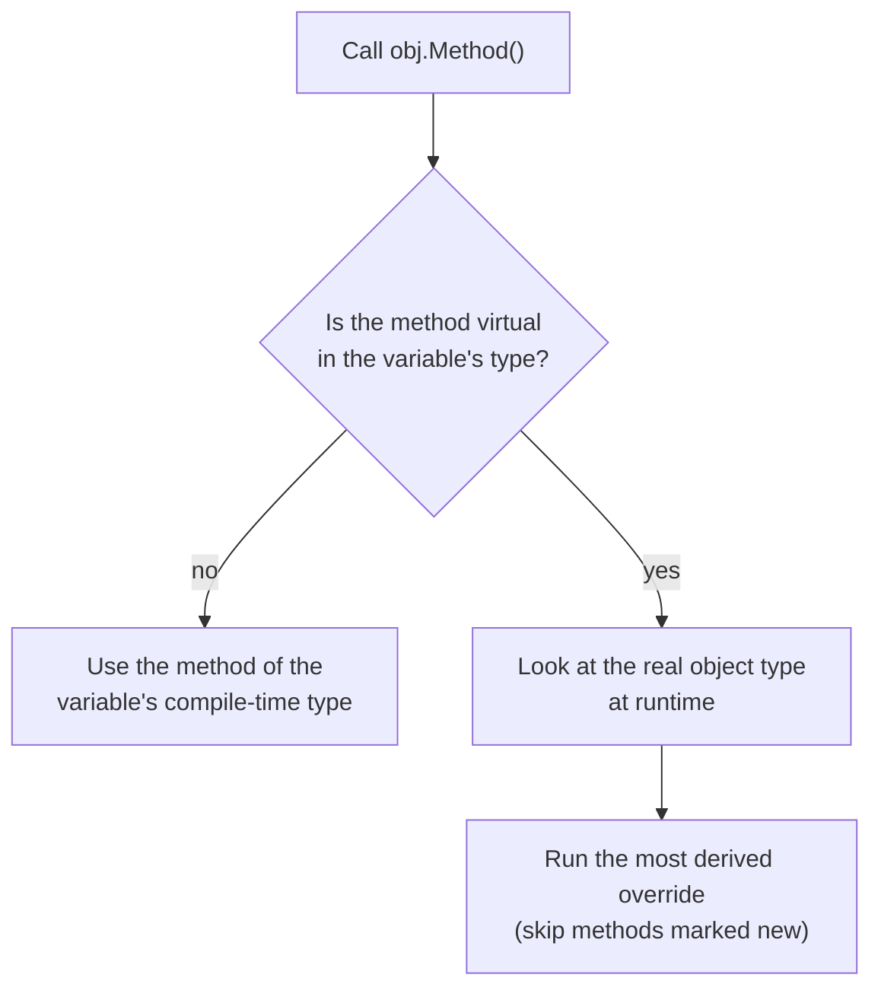

# OOP, Interfaces, Generics and Delegates in C#

> In this document you will learn how C# does object-oriented programming: inheritance, `virtual`/`override`/`new`, abstract and sealed classes, interfaces (including default and explicit members), generics with constraints and variance, delegates, lambdas, closures, events, extension methods and operator overloading. These features appear in every .NET codebase, and interviewers like output questions about method hiding, constructor order and loop closures. All outputs here were checked on .NET 10 (C# 14).

**Before this:** [C# fundamentals and the type system](01-csharp-fundamentals-and-type-system.md) · [OOP four pillars](../04-oop-solid-design-patterns/01-oop-four-pillars.md) · **Interview questions:** [jump to the interview section](#interview-questions)

## Table of contents

1. [Classes and inheritance](#classes-and-inheritance)
2. [virtual, override and new](#virtual-override-and-new)
3. [Constructor order and calling virtual methods in constructors](#constructor-order-and-calling-virtual-methods-in-constructors)
4. [Abstract and sealed classes](#abstract-and-sealed-classes)
5. [Interfaces](#interfaces)
6. [Interface vs abstract class](#interface-vs-abstract-class)
7. [Polymorphism and casting](#polymorphism-and-casting)
8. [Generics](#generics)
9. [Covariance and contravariance](#covariance-and-contravariance)
10. [Delegates, Func, Action and Predicate](#delegates-func-action-and-predicate)
11. [Lambdas and closures](#lambdas-and-closures)
12. [Events and the observer pattern](#events-and-the-observer-pattern)
13. [Extension methods and C# 14 extension members](#extension-methods-and-c-14-extension-members)
14. [Operator overloading](#operator-overloading)
15. [IComparable and IEquatable](#icomparable-and-iequatable)
16. [Static constructors](#static-constructors)
17. [Common mistakes](#common-mistakes)
18. [Best practices](#best-practices)
19. [How to explain this in an interview](#how-to-explain-this-in-an-interview)
20. [Interview questions](#interview-questions)
21. [Summary](#summary)
22. [References](#references)

---

The general ideas of OOP (encapsulation, abstraction, inheritance, polymorphism), SOLID and design patterns are taught in [subject 04](../04-oop-solid-design-patterns/01-oop-four-pillars.md). This document focuses on **how C# implements them** and on the C#-specific traps.

## Classes and inheritance

A class can inherit from **one** base class. It inherits all non-private members. Every class ultimately inherits from `System.Object`, which gives `ToString`, `Equals`, `GetHashCode` and `GetType`.

```csharp
public class Animal
{
    public string Name { get; }
    public Animal(string name) => Name = name;
    public string Introduce() => $"I am {Name}";
}

public class Dog : Animal
{
    public Dog(string name) : base(name) { }   // call the base constructor
    public string Fetch() => $"{Name} fetches the ball";
}

var dog = new Dog("Rex");
Console.WriteLine(dog.Introduce()); // I am Rex
Console.WriteLine(dog.Fetch());     // Rex fetches the ball
```

If you know JavaScript classes: `: Animal` is `extends Animal`, and `: base(name)` is `super(name)`. The big difference is that C# methods are **not virtual by default**. In JavaScript every method can be overridden. In C# you must opt in with `virtual`.

## virtual, override and new

This is the most tested inheritance topic in C#.

- **`virtual`** in the base class says "derived classes may replace this method".
- **`override`** in the derived class replaces it. The call is decided at **runtime** by the **actual object type**. This is called **dynamic dispatch**.
- **`new`** in the derived class **hides** the base method. It creates a separate, unrelated method with the same name. The call is decided at **compile time** by the **variable type**.

### Example

```csharp
class Animal
{
    public virtual void Speak() => Console.WriteLine("Animal sound");
    public void Describe() => Console.WriteLine("I am an animal");
}
class Dog : Animal
{
    public override void Speak() => Console.WriteLine("Woof");
    public new void Describe() => Console.WriteLine("I am a dog");
}

Animal a = new Dog();
Dog d = new Dog();

a.Speak();     // Woof            (override: runtime type is Dog)
d.Speak();     // Woof
a.Describe();  // I am an animal  (new: variable type is Animal)
d.Describe();  // I am a dog      (variable type is Dog)
```

Step by step:

1. Both variables point to a `Dog` object.
2. `Speak` is virtual. The runtime looks at the object (a `Dog`) and calls `Dog.Speak`. The variable type does not matter.
3. `Describe` is not virtual. `Dog.Describe` with `new` is a different method. The compiler picks the method from the variable type. `a` is typed `Animal`, so `Animal.Describe` runs.

If you leave out both `override` and `new`, the code still compiles, but you get warning CS0108 ("hides inherited member; use the new keyword if hiding was intended"). The behavior is the same as `new`.

### A deeper twist

```csharp
class Puppy : Dog
{
    public new void Speak() => Console.WriteLine("Yip");  // hides Dog.Speak, does not override
}

Animal a2 = new Puppy();
a2.Speak();               // Woof
((Dog)a2).Describe();     // I am a dog
```

`a2.Speak()` is a virtual call. The runtime finds the most derived **override** of `Animal.Speak`. That is `Dog.Speak`. `Puppy.Speak` is a new, unrelated method that only runs when the variable type is `Puppy`.



### Real-world usage

- `override` is used everywhere: `ToString()`, `Equals()`, ASP.NET Core `ControllerBase`, EF Core `DbContext.OnModelCreating`, `BackgroundService.ExecuteAsync`.
- `new` is rare. It is mostly used when a base library adds a member with the same name as yours and you cannot rename yours. Treat it as a code smell in your own designs.

### Calling the base version

```csharp
class SalesReport : BaseReport
{
    protected sealed override string Header() => "Sales " + base.Header();  // base. = super. in JS
    protected override string Body() => "100 orders";
}
```

`sealed override` means "I override this, and nobody below me may override it again".

## Constructor order and calling virtual methods in constructors

When you create a derived object:

1. **Field initializers** of the derived class run.
2. The **base constructor** runs (field initializers of the base run first, then its body).
3. The **derived constructor body** runs.

The derived field initializers run **before** the base constructor. That detail creates a famous trap with virtual calls in constructors.

```csharp
class Person
{
    public Person() { Console.WriteLine("Person ctor"); Init(); }
    protected virtual void Init() => Console.WriteLine("Person.Init");
}
class Employee : Person
{
    private readonly string _name = "field-init";
    private string _later;
    public Employee(string name) : base()
    {
        _later = name;
        Console.WriteLine($"Employee ctor {_later}");
    }
    protected override void Init() =>
        Console.WriteLine($"Employee.Init name={_name} later={_later ?? "null"}");
}

var e = new Employee("Asha");
// Person ctor
// Employee.Init name=field-init later=null
// Employee ctor Asha
```

Step by step:

1. `Employee`'s field initializer runs: `_name = "field-init"`.
2. The base `Person` constructor runs and prints `Person ctor`.
3. It calls `Init()`. This is virtual, and the object is already an `Employee`, so `Employee.Init` runs.
4. `_name` is set (field initializer), but `_later` is still `null`, because the `Employee` constructor body has not run yet.
5. Finally the `Employee` constructor body runs and prints `Employee ctor Asha`.

**Rule:** do not call virtual methods from a constructor. The derived object is only half built. (In Java and JavaScript the trap is similar but the details differ. In JS, derived class fields are initialized **after** `super()` returns.)

## Abstract and sealed classes

### abstract

An **abstract class** cannot be created with `new`. It can have **abstract members** (no body; derived classes must implement them) and normal members with code.

```csharp
abstract class Shape
{
    public abstract double Area();                    // must be implemented
    public virtual string Name => GetType().Name;     // may be overridden
}

class Circle(double r) : Shape
{
    public override double Area() => Math.PI * r * r;
}
sealed class Rectangle(double w, double h) : Shape
{
    public override double Area() => w * h;
    public override string Name => "Rect";
}

Shape[] shapes = [new Circle(1), new Rectangle(2, 3)];
foreach (var s in shapes) Console.WriteLine($"{s.Name} {s.Area():F2}");
// Circle 3.14
// Rect 6.00
```

Abstract members are implicitly virtual. A real-world example is the **template method pattern**: the base class defines the algorithm and calls abstract steps.

```csharp
abstract class BaseReport
{
    public string Render() => $"{Header()} | {Body()}";   // the template
    protected virtual string Header() => "Report";
    protected abstract string Body();
}
BaseReport r = new SalesReport();
Console.WriteLine(r.Render()); // Sales Report | 100 orders
```

ASP.NET Core's `BackgroundService` works this way: you implement `ExecuteAsync`, and the base class handles start and stop.

### sealed

A **sealed class** cannot be inherited. `string` is sealed. Reasons to seal:

- **Design:** the class was not designed for extension. Unexpected subclasses can break its invariants.
- **Performance:** the JIT can **devirtualize** calls on sealed types (call the method directly) and type checks are cheaper.
- **Security:** nobody can override behavior.

Many teams seal classes by default (there is an analyzer rule, CA1852, that suggests sealing internal types with no subclasses).

## Interfaces

### What it is

An **interface** is a contract: a list of members a type promises to have. A class or struct can implement **many** interfaces.

```csharp
public interface IEmailSender
{
    Task SendAsync(string to, string subject, string body, CancellationToken ct = default);
}

public sealed class SmtpEmailSender : IEmailSender
{
    public Task SendAsync(string to, string subject, string body, CancellationToken ct = default)
    {
        // send with SMTP...
        return Task.CompletedTask;
    }
}
```

Interfaces are the foundation of **dependency injection** in ASP.NET Core: services depend on `IEmailSender`, not `SmtpEmailSender`, and tests swap in a fake. See [Dependency inversion and injection](../04-oop-solid-design-patterns/05-dependency-inversion-and-injection.md) and [Dependency injection in ASP.NET Core](08-dependency-injection-in-aspnet-core.md).

**If you know TypeScript:** TS interfaces are structural ("if it has the right shape, it fits") and disappear at runtime. C# interfaces are **nominal**: a class must explicitly declare `: IEmailSender`. And they exist at runtime: `obj is IEmailSender` is a real check.

### Default interface methods (C# 8)

An interface can contain a method **with a body**. Implementing classes get it for free.

```csharp
interface ILogger
{
    void Log(string message);
    void LogError(string message) => Log($"ERROR: {message}");   // default implementation
}
class ConsoleLogger : ILogger
{
    public void Log(string message) => Console.WriteLine(message);
}

ILogger log = new ConsoleLogger();
log.Log("hello");       // hello
log.LogError("boom");   // ERROR: boom

var cl = new ConsoleLogger();
// cl.LogError("x");    // ❌ compile error: the default member is only visible through the interface
```

Why it exists: to **add members to a published interface** without breaking every existing implementation. Note that default members are reachable only through the interface type, not the class type.

### Explicit interface implementation

When a member should be visible **only** through the interface, or two interfaces have members with the same name, implement it explicitly:

```csharp
interface IReader { void Read(); }
interface IWriter { void Write(); }

class FileStore : IReader, IWriter
{
    void IReader.Read() => Console.WriteLine("explicit Read");
    void IWriter.Write() => Console.WriteLine("explicit Write");
}

var file = new FileStore();
// file.Read();             // ❌ not visible on the class
((IReader)file).Read();     // explicit Read
((IWriter)file).Write();    // explicit Write
```

Real example: `List<T>` implements `ICollection<T>.IsReadOnly` explicitly, so it does not clutter the `List<T>` API.

### Other interface features

- **Static abstract members** (C# 11): an interface can require a static method or operator. This powers **generic math** (`INumber<T>`), so you can write `T Sum<T>(T[] xs) where T : INumber<T>`.
- Interfaces can contain static methods, constants and properties without fields. They **cannot** have instance fields or constructors.

## Interface vs abstract class

| | Interface | Abstract class |
| --- | --- | --- |
| How many can a class use? | Many | One |
| Instance fields / state | No | Yes |
| Constructors | No | Yes |
| Method bodies | Yes since C# 8 (default methods) | Yes |
| Access modifiers on members | Public by default; others allowed since C# 8 | Any |
| Works with structs | Yes | No (structs cannot inherit classes) |
| Meaning | "Can do" (capability) | "Is a" (shared base with shared code) |

How to choose:

- Use an **interface** for a contract that unrelated types implement, or a dependency you want to mock: `IOrderRepository`, `IClock`, `IPaymentGateway`.
- Use an **abstract class** when several types share **state and code**, and they really are the same kind of thing: `Shape`, `BackgroundService`, `DbContext`.
- You can combine them: an interface for the contract, and an abstract base class that helps implement it.

Default interface methods made the gap smaller, but interfaces still cannot hold state. That is the deciding difference.

## Polymorphism and casting

**Polymorphism** means "one call, different behavior depending on the object". In C# you get it through virtual methods and interfaces.

```csharp
IEnumerable<IPaymentMethod> methods = [new CardPayment(), new UpiPayment()];
foreach (var m in methods) await m.PayAsync(order);   // each type does its own thing
```

### Casting tools

```csharp
Animal an = new Dog();

if (an is Dog dd) Console.WriteLine("is Dog");   // type pattern: test and cast in one step
Cat? cat = an as Cat;                            // 'as' returns null if the cast fails
Console.WriteLine(cat is null);                  // True
var c2 = (Cat)an;                                // direct cast throws InvalidCastException
```

| Tool | On failure | Use when |
| --- | --- | --- |
| `(T)x` | Throws `InvalidCastException` | You are sure; failure is a bug |
| `x as T` | Returns `null` (reference/nullable types only) | Older style; prefer `is` |
| `x is T t` | Returns `false` | Test and use in one step (modern) |

If you find yourself writing many `is` checks to decide behavior, that is often a sign you want a virtual method or a switch expression instead.

## Generics

### What it is

**Generics** let you write a class or method once and use it with many types, while keeping full type safety. `List<T>`, `Dictionary<TKey, TValue>` and `Task<T>` are generic.

### Why it exists

Before generics (C# 1), collections stored `object`. That meant casts everywhere, runtime errors, and boxing for value types. Generics fix all three.

### How it works inside

C# generics are **real at runtime** (this is called **reification**), unlike TypeScript generics (erased) and Java generics (type erasure). `typeof(List<int>)` and `typeof(List<string>)` are different types.

- For **value type** arguments, the JIT creates specialized code for each type (`List<int>` and `List<double>` get their own machine code). No boxing.
- For **reference type** arguments, the JIT shares one copy of the code (all references are the same size).

One visible effect: each closed generic type has its **own static fields**.

```csharp
static class Counter<T> { public static int Count; }

Console.WriteLine(Counter<int>.Count++ + " " + Counter<string>.Count + " " + Counter<int>.Count);
// 0 0 1
```

`Counter<int>` and `Counter<string>` are different types, so they have separate `Count` fields.

### Generic methods and constraints

```csharp
static T Max<T>(T a, T b) where T : IComparable<T> => a.CompareTo(b) >= 0 ? a : b;

Console.WriteLine(Max(3, 9));             // 9
Console.WriteLine(Max("apple", "pear"));  // pear   (type inferred from arguments)
```

Without the constraint, `a.CompareTo(b)` would not compile, because the compiler knows nothing about `T`.

| Constraint | Meaning |
| --- | --- |
| `where T : class` | Reference type |
| `where T : struct` | Non-nullable value type |
| `where T : notnull` | Non-nullable type (value or reference) |
| `where T : new()` | Has a public parameterless constructor |
| `where T : BaseClass` | Is or derives from `BaseClass` |
| `where T : IInterface` | Implements the interface |
| `where T : unmanaged` | Value type with no references inside (for low-level code) |
| `where T : allows ref struct` | (C# 13) can be a `ref struct` like `Span<T>` |

### Realistic example: a generic repository

```csharp
interface IEntity { int Id { get; } }
class Customer : IEntity { public int Id { get; set; } public string Name { get; set; } = ""; }

class Repository<T> where T : class, IEntity
{
    private readonly Dictionary<int, T> _items = new();
    public void Add(T item) => _items[item.Id] = item;
    public T? GetById(int id) => _items.TryGetValue(id, out var item) ? item : null;
}

var repo = new Repository<Customer>();
repo.Add(new Customer { Id = 1, Name = "Asha" });
Console.WriteLine(repo.GetById(1)?.Name); // Asha
```

Note: with EF Core you usually do not need your own generic repository; `DbSet<T>` already is one. That debate is in [Entity Framework Core and data access](10-entity-framework-core-and-data-access.md).

### default(T) and typeof(T)

```csharp
static string Describe<T>() => typeof(T).Name;
Console.WriteLine($"{Describe<int>()} {Describe<string>()}"); // Int32 String
```

`default(T)` (or `default`) gives `null` for reference types and zero for value types.

## Covariance and contravariance

These words scare people, but the idea is simple.

- **Covariance (`out T`)**: you can use a **more specific** type where a more general one is expected, when the type only **comes out**. A sequence of strings can be read as a sequence of objects.
- **Contravariance (`in T`)**: you can use a **more general** type where a more specific one is expected, when the type only **goes in**. Something that can print any object can print strings.

```csharp
IEnumerable<string> strs = new List<string> { "a" };
IEnumerable<object> objs = strs;            // covariance: IEnumerable<out T>
Console.WriteLine(objs.Count());            // 1

Action<object> printObj = o => Console.WriteLine($"print {o}");
Action<string> printStr = printObj;         // contravariance: Action<in T>
printStr("contra");                         // print contra
```

Why it is safe: `IEnumerable<T>` only gives values out. You can never put an `int` into it through the `object` view. `Action<T>` only takes values in, so a method that accepts any `object` is fine with a `string`.

Why `List<T>` is **not** variant: `List<T>` has `Add(T)`. If `List<string>` could become `List<object>`, you could add an `int` to a list of strings.

```csharp
// List<object> bad = new List<string>();  // ❌ compile error
```

Rules:

- Only **interfaces and delegates** can declare variance, not classes.
- Variance works only with **reference types**. `IEnumerable<int>` cannot become `IEnumerable<object>`.
- Common variant types: `IEnumerable<out T>`, `IReadOnlyList<out T>`, `IComparer<in T>`, `Func<in T, out TResult>`, `Action<in T>`.

### The array covariance trap

Arrays were made covariant in C# 1 (before generics), and it is unsafe:

```csharp
object[] arr = new string[1];
arr[0] = 42;    // compiles, but throws ArrayTypeMismatchException at runtime
```

The runtime has to check every write into a reference-type array. Prefer `IReadOnlyList<T>` for read-only views.

## Delegates, Func, Action and Predicate

### What it is

A **delegate** is a type-safe reference to a method. It is like a function value in JavaScript, but with a fixed signature.

```csharp
delegate void Notify(string message);   // declares a delegate type

Notify notify = msg => Console.WriteLine($"A:{msg}");
notify += msg => Console.WriteLine($"B:{msg}");   // delegates are multicast
notify("sent");
// A:sent
// B:sent
```

### Built-in delegate types

You rarely declare your own delegate types today. Use the built-in generic ones:

| Type | Signature | Example |
| --- | --- | --- |
| `Action` / `Action<T1..>` | Takes arguments, returns `void` | `Action<string> greet = n => Console.WriteLine($"Hi {n}");` |
| `Func<T1.., TResult>` | Takes arguments, returns a value (last type argument) | `Func<int, int, int> add = (x, y) => x + y;` |
| `Predicate<T>` | Takes `T`, returns `bool` | `Predicate<int> isEven = n => n % 2 == 0;` |

```csharp
Func<int, int, int> add = (x, y) => x + y;
Predicate<int> isEven = n => n % 2 == 0;
Console.WriteLine($"{add(2, 3)} {isEven(4)}"); // 5 True
```

`Predicate<T>` and `Func<T, bool>` have the same shape but are **different types**. You cannot assign one to the other directly. LINQ uses `Func<T, bool>`; older `List<T>` methods like `FindAll` use `Predicate<T>`.

### Multicast return values

When a multicast delegate returns a value, you get only the **last** handler's result:

```csharp
Func<int> f1 = () => 1;
f1 += () => 2;
Console.WriteLine(f1()); // 2
```

If one handler throws, the remaining handlers do not run.

### Real-world usage

- LINQ: `orders.Where(o => o.Total > 100)` takes a `Func<Order, bool>`.
- ASP.NET Core minimal APIs: `app.MapGet("/orders/{id}", (int id) => ...)` takes a delegate.
- Middleware: `app.Use(async (context, next) => { ... await next(context); })`.
- Callbacks and strategies: pass a `Func<decimal, decimal>` pricing rule instead of creating an interface for one method.

## Lambdas and closures

A **lambda** is an anonymous function: `x => x * 2`. A lambda that uses variables from the outer scope is a **closure**. The idea is the same as in JavaScript (see [Closures](../02-javascript/05-closures.md)).

```csharp
static Func<int> MakeCounter()
{
    int count = 0;
    return () => ++count;   // captures the variable 'count'
}

var counter = MakeCounter();
Console.WriteLine($"{counter()} {counter()} {counter()}"); // 1 2 3
```

### How it works inside

The compiler moves captured variables into a hidden class (a **display class**). The local variable becomes a field on a heap object. The lambda becomes a method on that class. That is why captured variables outlive the method, and why closures allocate.

C# captures the **variable**, not a copy of its value:

```csharp
int total = 0;
Action addTen = () => total += 10;
addTen(); addTen();
Console.WriteLine(total); // 20
```

### The loop capture trap (and how it differs from JavaScript)

```csharp
var actions = new List<Action>();
for (int i = 0; i < 3; i++) actions.Add(() => Console.Write($"{i} "));
foreach (var act in actions) act();   // 3 3 3

actions.Clear();
foreach (var i in new[] { 0, 1, 2 }) actions.Add(() => Console.Write($"{i} "));
foreach (var act in actions) act();   // 0 1 2

actions.Clear();
for (int i = 0; i < 3; i++) { int copy = i; actions.Add(() => Console.Write($"{copy} ")); }
foreach (var act in actions) act();   // 0 1 2
```

Step by step for the first loop:

1. A `for` loop has **one** variable `i` for the whole loop.
2. All three lambdas capture that same variable.
3. When the loop ends, `i` is `3`.
4. Each lambda reads the current value, so all print `3`.

The `foreach` loop is different: since C# 5, each iteration gets a **new** variable. So each lambda sees its own value.

| Loop | C# | JavaScript with `let` | JavaScript with `var` |
| --- | --- | --- | --- |
| `for (...; ...; ...)` | One shared variable: `3 3 3` | New binding per iteration: `0 1 2` | One shared: `3 3 3` |
| `foreach` / `for...of` | New variable per iteration: `0 1 2` | `0 1 2` | `3 3 3` |

So a C# `for` loop behaves like a JavaScript `for` loop with `var`. Fix it by copying into a local inside the body.

### Static lambdas

```csharp
Func<int, int> square = static x => x * x;   // C# 9: 'static' forbids capturing
```

`static` makes the compiler reject accidental captures. It documents that the lambda allocates nothing extra.

## Events and the observer pattern

### What it is

An **event** is a delegate field with restricted access. Outside code can only **subscribe** (`+=`) and **unsubscribe** (`-=`). Only the owning class can **raise** it. This is the **observer pattern** built into the language (see [Behavioral patterns](../04-oop-solid-design-patterns/08-behavioral-patterns.md)).

If you know Node.js, it is like `EventEmitter`, but typed and checked by the compiler.

### Example

```csharp
class OrderPlacedEventArgs(int orderId) : EventArgs
{
    public int OrderId { get; } = orderId;
}

class OrderService
{
    public event EventHandler<OrderPlacedEventArgs>? OrderPlaced;

    public void PlaceOrder(int id)
    {
        Console.WriteLine($"Placing {id}");
        OrderPlaced?.Invoke(this, new OrderPlacedEventArgs(id));   // raise safely if no subscribers
    }
}

class EmailNotifier
{
    public void OnOrderPlaced(object? sender, OrderPlacedEventArgs e) =>
        Console.WriteLine($"Email: order {e.OrderId}");
}

var shop = new OrderService();
var email = new EmailNotifier();
shop.OrderPlaced += email.OnOrderPlaced;
shop.OrderPlaced += (s, args) => Console.WriteLine($"Audit: order {args.OrderId}");
shop.PlaceOrder(101);
shop.OrderPlaced -= email.OnOrderPlaced;
shop.PlaceOrder(102);
```

Output:

```text
Placing 101
Email: order 101
Audit: order 101
Placing 102
Audit: order 102
```

### Event vs plain delegate field

| | `public Action? OnSaved;` | `public event Action? Saved;` |
| --- | --- | --- |
| Outside code can `+=` / `-=` | Yes | Yes |
| Outside code can assign `= null` (removing everyone) | **Yes** | No |
| Outside code can invoke it | **Yes** | No |

The `event` keyword protects subscribers from each other.

### Memory leaks with events

The publisher holds a reference to each subscriber (through the delegate). If a long-lived publisher (a singleton, a static event) has short-lived subscribers that never unsubscribe, the subscribers can never be garbage collected. This is one of the most common .NET memory leaks. See [Memory, GC and performance](05-memory-gc-and-performance.md).

### Real-world usage

Events are common in desktop UI (WinForms, WPF) and in library APIs. In ASP.NET Core backends you see them less. For cross-service notifications, teams use message brokers or in-process mediators instead. See [Caching, background jobs and messaging](12-caching-background-jobs-and-messaging.md).

## Extension methods and C# 14 extension members

### Classic extension methods

An **extension method** adds a method to an existing type without changing it or inheriting from it. It is a static method in a static class, with `this` before the first parameter.

```csharp
static class StringExtensions
{
    public static int WordCount(this string text) =>
        text.Split(' ', StringSplitOptions.RemoveEmptyEntries).Length;

    public static bool IsNullOrBlank(this string? text) => string.IsNullOrWhiteSpace(text);
}

Console.WriteLine("hello world".WordCount()); // 2
string? nothing = null;
Console.WriteLine(nothing.IsNullOrBlank());   // True  (works on null: it is just a static call)
```

The call `"hello world".WordCount()` is compiled to `StringExtensions.WordCount("hello world")`. That is why it works on `null` without throwing.

All of **LINQ** is extension methods on `IEnumerable<T>`. All of ASP.NET Core's `builder.Services.AddXxx()` setup methods are extension methods on `IServiceCollection`.

Rules:

- An extension method is found only if its namespace is imported (`using`).
- A real instance method with the same signature always wins over an extension.
- Extensions cannot access private members.

### C# 14 extension members

> **New in C# 14:** **extension blocks** let you add extension **properties**, extension **static members** and extension operators, not only instance methods.

```csharp
static class StringExt2
{
    extension<T>(IEnumerable<T> source)          // receiver for the block
    {
        public bool IsEmpty => !source.Any();     // extension property
    }

    extension(string s)
    {
        public string Shout => s.ToUpper() + "!";                 // extension property
    }

    extension(string)                                              // no receiver name: static members only
    {
        public static string Repeat(char ch, int n) => new string(ch, n);   // static extension member
    }
}

Console.WriteLine(new[] { 1, 2, 3 }.IsEmpty);  // False
Console.WriteLine("abc".Shout);                // ABC!
Console.WriteLine(string.Repeat('x', 3));      // xxx  (called as if it were a static method of string)
```

Classic `this` extension methods keep working. You do not need to rewrite them. Choose names that do not clash with existing members of the type, because a real member always wins.

## Operator overloading

You can define operators like `+`, `==` and `<` for your own types. Use this only when the meaning is obvious, such as money, vectors or dates.

```csharp
readonly record struct Money(decimal Amount, string Currency)
{
    public static Money operator +(Money a, Money b) =>
        a.Currency == b.Currency
            ? new Money(a.Amount + b.Amount, a.Currency)
            : throw new InvalidOperationException("Currency mismatch");
}

Console.WriteLine(new Money(10m, "USD") + new Money(5m, "USD")); // Money { Amount = 15, Currency = USD }
new Money(1, "USD") + new Money(1, "EUR");                      // throws: Currency mismatch
```

Rules:

- Operators are `public static`.
- If you overload `==`, you must also overload `!=` (and you should override `Equals` and `GetHashCode`). Records do this for you.
- Operators are resolved at compile time from the static types (the `object ==` trap from [the previous document](01-csharp-fundamentals-and-type-system.md#equality)).

> **New in C# 14:** user-defined compound assignment operators. A class can declare an instance operator like `public void operator +=(int n) => Value += n;`, so `counter += 5` updates the object in place instead of creating a new instance.

## IComparable and IEquatable

- **`IComparable<T>`** defines a natural sort order (`CompareTo` returns negative, zero or positive). `List<T>.Sort()`, `OrderBy` and `SortedSet<T>` use it.
- **`IEquatable<T>`** defines type-safe equality without boxing. `Dictionary`, `HashSet` and `List.Contains` use it.

```csharp
class AppVersion(int major, int minor) : IComparable<AppVersion>, IEquatable<AppVersion>
{
    public int Major { get; } = major;
    public int Minor { get; } = minor;

    public int CompareTo(AppVersion? other) =>
        other is null ? 1 : (Major, Minor).CompareTo((other.Major, other.Minor));

    public bool Equals(AppVersion? other) => other is not null && Major == other.Major && Minor == other.Minor;
    public override bool Equals(object? obj) => Equals(obj as AppVersion);
    public override int GetHashCode() => HashCode.Combine(Major, Minor);
    public override string ToString() => $"{Major}.{Minor}";
}

var versions = new List<AppVersion> { new(2, 0), new(1, 5), new(1, 10) };
versions.Sort();
Console.WriteLine(string.Join(", ", versions)); // 1.5, 1.10, 2.0
```

Notice the numeric comparison: `1.10` comes after `1.5`, which a string sort would get wrong.

For a one-off order, do not implement `IComparable`. Pass a comparison:

```csharp
customers.Sort((x, y) => x.Id.CompareTo(y.Id));
var byName = customers.OrderBy(c => c.Name);
```

## Static constructors

A **static constructor** runs once per type, automatically, before the type is first used. You cannot call it yourself.

```csharp
static class Settings
{
    static Settings() { Console.WriteLine("static ctor runs"); Value = 42; }
    public static int Value;
}

Console.WriteLine("before");
Console.WriteLine(Settings.Value);
Console.WriteLine(Settings.Value);
// before
// static ctor runs
// 42
// 42
```

- It is **thread-safe**: the runtime guarantees it runs once even with many threads.
- If it throws, the type is unusable for the rest of the process (`TypeInitializationException` on every access).
- Without an explicit static constructor, static field initializers may run earlier (the runtime is allowed to run them at any time before first access). Do not depend on that timing.

## Common mistakes

1. **Forgetting `virtual`** and expecting an override to work. Without `virtual`, a derived method with the same name only hides.
2. **Ignoring warning CS0108** (accidental hiding).
3. **Calling virtual methods in constructors.** The derived part is not initialized yet.
4. **Capturing the `for` loop variable** in lambdas or tasks.
5. **Not unsubscribing from events** of long-lived publishers. Memory leaks.
6. **Using a plain public delegate field instead of `event`.** Outsiders can clear or invoke it.
7. **Deep inheritance hierarchies.** Prefer composition (see [Composition, inheritance and mixins](../04-oop-solid-design-patterns/02-composition-inheritance-and-mixins.md)).
8. **Writing to a covariant array** through a base-type reference.
9. **Overloading `==` without `!=`, `Equals` and `GetHashCode`.**
10. **Putting business logic in extension methods** that need hidden state or dependencies. Extensions are static; they cannot be injected or mocked.

## Best practices

- **Prefer interfaces for dependencies** so you can swap and mock them.
- **Seal classes** that are not designed for inheritance. It is safer and lets the JIT devirtualize.
- **Keep hierarchies shallow** (one or two levels). Use composition for reuse.
- **Use generic constraints** to state exactly what you need from `T`.
- **Use `Func` and `Action`** instead of custom delegate types unless a name adds clarity.
- **Use the `EventHandler<TEventArgs>` pattern** for events and raise with `?.Invoke`.
- **Use `static` lambdas** in hot code to avoid accidental captures.
- **Use extension methods for small, pure helpers** and fluent setup APIs, not for core business logic.
- **Implement `IEquatable<T>` and `IComparable<T>`** on value-like types you sort or use as keys, or use records.

## How to explain this in an interview

**Topic: `override` vs `new`**

1. **Define it:** "`override` replaces a virtual method of the base class. `new` hides a base method with an unrelated method of the same name."
2. **Why it exists:** "`override` is how C# does polymorphism. `new` exists for versioning: if a base library adds a method with my method's name, I can keep mine without silently overriding theirs."
3. **How it works:** "With `override` the method is chosen at runtime by the real object type. With `new` it is chosen at compile time by the variable type."
4. **Small example:** "If `Dog` overrides `Speak` and hides `Describe`, then `Animal a = new Dog()` calls `Dog.Speak` but `Animal.Describe`."
5. **Where it is useful:** "I override all the time: `ToString`, `ExecuteAsync` in a `BackgroundService`, `OnModelCreating` in EF Core. I almost never use `new`."
6. **Trade-offs / gotchas:** "Methods are not virtual by default in C#, unlike JavaScript. If I forget `virtual`, I get hiding with only a warning. And I avoid calling virtual methods in constructors."

**Topic: delegates, lambdas and closures**

1. **Define it:** "A delegate is a type-safe reference to a method. A lambda is an inline anonymous method. A closure is a lambda that captures outer variables."
2. **Why it exists:** "To pass behavior as a value: LINQ predicates, callbacks, minimal API handlers, middleware."
3. **How it works:** "The compiler moves captured variables into a hidden class on the heap and turns the lambda into a method on it. It captures the variable, not the value."
4. **Small example:** "A `for` loop that adds lambdas printing `i` prints `3 3 3`, because there is one `i`. `foreach` prints `0 1 2`, because it creates a new variable per iteration."
5. **Where it is useful:** "`Func<T, bool>` in LINQ, `Action` callbacks, `app.MapGet` handlers."
6. **Trade-offs / gotchas:** "Closures allocate, and capturing loop variables or large objects can cause bugs and leaks. Static lambdas prevent accidental capture."

## Interview questions

### Q1. What does this print?

```csharp
class Animal
{
    public virtual void Speak() => Console.WriteLine("Animal sound");
    public void Describe() => Console.WriteLine("I am an animal");
}
class Dog : Animal
{
    public override void Speak() => Console.WriteLine("Woof");
    public new void Describe() => Console.WriteLine("I am a dog");
}

Animal a = new Dog();
a.Speak();
a.Describe();
((Dog)a).Describe();
```

**Answer:**

```text
Woof
I am an animal
I am a dog
```

**Step by step:**
1. `Speak` is virtual and overridden. The runtime checks the real object (a `Dog`) and calls `Dog.Speak`.
2. `Describe` is not virtual. `Dog.Describe` hides it with `new`. The compile-time type of `a` is `Animal`, so `Animal.Describe` runs.
3. After casting to `Dog`, the compile-time type is `Dog`, so `Dog.Describe` runs.

### Q2. What is the difference between `override` and `new`?

**What the interviewer is checking:** Dynamic dispatch vs compile-time binding.

**Short spoken answer (30–60 seconds):**
> `override` replaces a virtual or abstract method from the base class, and the call is resolved at runtime based on the actual object type. That is polymorphism. `new` hides the base method: it creates a separate method with the same name, and the call is resolved at compile time based on the variable type. So with `Animal a = new Dog()`, an overridden method runs the `Dog` version, but a hidden method runs the `Animal` version. If I write a method with the same name without either keyword, it compiles with a warning and behaves like `new`. In real code I use `override` all the time and `new` almost never.

**Follow-up questions:**
- **Can you override a non-virtual method?** — No. Only `virtual`, `abstract` or `override` methods can be overridden. That is a compile error.
- **What does `sealed override` do?** — It overrides the method and stops further overriding in derived classes.
- **Why are methods not virtual by default in C#?** — It is a design choice for versioning and performance. Virtual methods are an extension point you must design for, and non-virtual calls are cheaper and can be inlined.

**Common mistakes:** Saying `new` "overrides" the method. Not knowing which version runs through a base-type variable.

**Where this is used in real projects:** Overriding framework base classes like `BackgroundService`, `DbContext` and `ControllerBase`.

### Q3. What does this print?

```csharp
class Person
{
    public Person() { Console.WriteLine("Person ctor"); Init(); }
    protected virtual void Init() => Console.WriteLine("Person.Init");
}
class Employee : Person
{
    private readonly string _name = "field-init";
    private string _later;
    public Employee(string name) : base() { _later = name; Console.WriteLine($"Employee ctor {_later}"); }
    protected override void Init() => Console.WriteLine($"Employee.Init name={_name} later={_later ?? "null"}");
}
new Employee("Asha");
```

**Answer:**

```text
Person ctor
Employee.Init name=field-init later=null
Employee ctor Asha
```

**Step by step:**
1. Derived field initializers run first, so `_name` is `"field-init"`.
2. The base constructor runs and calls the virtual `Init`. The object is already an `Employee`, so the override runs.
3. `_later` is assigned in the `Employee` constructor body, which has not run yet, so it is `null`.
4. Then the `Employee` constructor body runs.

**Follow-up questions:**
- **Why is this dangerous?** — The override sees a half-initialized object. It can throw `NullReferenceException` or use wrong values. Do not call virtual methods from constructors.
- **What is the order for static constructors?** — Static constructors run once, before first use of the type, and before any instance constructor of that type.

### Q4. Interface vs abstract class: when do you use each?

**What the interviewer is checking:** Design judgment, plus knowledge of default interface methods.

**Short spoken answer (30–60 seconds):**
> An interface is a contract with no state: a class can implement many interfaces, and structs can implement them too. An abstract class is a partial base class: it can have fields, constructors and shared code, but a class can inherit only one. I use interfaces for dependencies and capabilities, like `IOrderRepository` or `IEmailSender`, because they are easy to mock and inject. I use an abstract class when several types really are the same kind of thing and share state and logic, like `BackgroundService` in ASP.NET Core. Since C# 8 interfaces can have default method bodies, but they still cannot have instance fields, so state is the real deciding factor.

**Follow-up questions:**
- **Why were default interface methods added?** — To add members to existing interfaces without breaking all implementations. They are also used for traits-like reuse, carefully.
- **Can an interface have a constructor or field?** — No instance fields or constructors. It can have static members, and since C# 11 static abstract members.
- **What are static abstract interface members used for?** — Generic math, like `INumber<T>`, so a generic method can use `+` or `T.Zero`.

**Common mistakes:** Saying "interfaces cannot have any code" (outdated since C# 8).

**Where this is used in real projects:** Every DI registration (`services.AddScoped<IOrderService, OrderService>()`), plus framework base classes.

### Q5. What is explicit interface implementation, and why use it?

**Short answer:** You implement a member as `void IReader.Read()`, without an access modifier. The member is visible only through the interface type, not through the class. Use it to resolve name clashes between two interfaces, or to hide members that are not part of the class's main API (like `List<T>` hiding `ICollection<T>.IsReadOnly`). One cost: calling it on a struct through the interface boxes the struct.

### Q6. What does this print, and how do you fix it?

```csharp
var actions = new List<Action>();
for (int i = 0; i < 3; i++) actions.Add(() => Console.Write($"{i} "));
foreach (var act in actions) act();
```

**Answer:** `3 3 3 `

**Step by step:**
1. The `for` loop declares one variable `i` for the whole loop.
2. Each lambda captures the variable, not its value at that moment.
3. After the loop, `i` is `3`. All lambdas print `3`.

**Fix:** copy to a local inside the loop (`int copy = i;`) and capture `copy`, or use `foreach`, which creates a new variable per iteration since C# 5 and prints `0 1 2`.

**Follow-up questions:**
- **Does this happen in JavaScript?** — With `var`, yes. With `let`, no, because `let` in a `for` loop creates a new binding per iteration. C#'s `for` behaves like JS `var` here.
- **Does the same bug happen with `Task.Run` in a loop?** — Yes. `for (int i...) tasks.Add(Task.Run(() => Process(i)));` can process the wrong values.

### Q7. What are delegates, and how do `Func`, `Action` and `Predicate` differ?

**What the interviewer is checking:** Function types in C#, and where they are used.

**Short spoken answer (30–60 seconds):**
> A delegate is a type-safe reference to a method, so I can pass behavior around like a value. It is like a function in JavaScript, but the signature is fixed and checked by the compiler. Instead of declaring my own delegate types, I usually use the built-in ones: `Action` for methods that return void, `Func` for methods that return a value, where the last type argument is the return type, and `Predicate<T>` for a test that returns bool. LINQ uses `Func<T, bool>` for filters, and ASP.NET Core minimal APIs and middleware are built on delegates. Delegates are also multicast: you can combine several with `+=`, which is what events use.

**Follow-up questions:**
- **Can you assign a `Predicate<int>` to a `Func<int, bool>`?** — Not directly. They are different delegate types with the same shape. Wrap it: `Func<int, bool> f = x => p(x);` or `new Func<int, bool>(p)`.
- **What happens if a multicast delegate returns a value?** — You get the last handler's return value. Others are lost.
- **What is the cost of a lambda?** — A delegate allocation, plus a closure object if it captures. Non-capturing lambdas are cached by the compiler.

### Q8. What is a closure in C#, and how does the compiler implement it?

**Short spoken answer (30–60 seconds):**
> A closure is a lambda or local function that uses variables from the scope where it was created. The compiler implements it by creating a hidden class, often called a display class, moving the captured local variables into fields of that class, and turning the lambda into an instance method of it. That is why captured variables can outlive the method, and why the lambda sees later changes: both the method and the lambda use the same field. The costs are a heap allocation and the risk of keeping large objects alive longer than expected.

**Follow-up questions:**
- **How do you prevent accidental capture?** — Mark the lambda `static` (C# 9). The compiler then rejects any captured variable.
- **Does capturing `this` matter?** — Yes. Using an instance member inside a lambda captures `this`, which keeps the whole object alive as long as the delegate lives. That matters for event handlers and timers.

### Q9. What is the difference between an event and a delegate field?

**What the interviewer is checking:** Encapsulation of the observer pattern.

**Short spoken answer (30–60 seconds):**
> An event is built on a delegate, but the `event` keyword restricts what outside code can do. Outside the class you can only subscribe with `+=` and unsubscribe with `-=`. Only the class that declares the event can raise it or replace the whole list. With a public delegate field, any code could set it to null and remove everyone's handlers, or invoke it as if the event happened. So events give me the observer pattern with proper encapsulation. The standard shape is `event EventHandler<TEventArgs>`, raised with `?.Invoke(this, args)`.

**Follow-up questions:**
- **How can events cause memory leaks?** — The publisher's delegate holds a reference to each subscriber. A long-lived publisher keeps short-lived subscribers alive until they unsubscribe.
- **Are event handlers run in parallel?** — No. They run one after another, synchronously, on the thread that raises the event. If one throws, the rest do not run.
- **Why `?.Invoke` instead of `if (Evt != null) Evt(...)`?** — `?.` reads the field once, so it is safe if another thread unsubscribes the last handler between the check and the call.

### Q10. What does this print?

```csharp
var shop = new OrderService();               // event OrderPlaced, PlaceOrder prints "Placing {id}" then raises
var email = new EmailNotifier();             // prints "Email: order {id}"
shop.OrderPlaced += email.OnOrderPlaced;
shop.OrderPlaced += (s, a) => Console.WriteLine($"Audit: order {a.OrderId}");
shop.PlaceOrder(101);
shop.OrderPlaced -= email.OnOrderPlaced;
shop.PlaceOrder(102);
```

**Answer:**

```text
Placing 101
Email: order 101
Audit: order 101
Placing 102
Audit: order 102
```

**Explanation:** Handlers run in subscription order. After `-=`, only the lambda remains. Note that you could not unsubscribe the lambda later unless you stored it in a variable, because a new identical lambda is a different delegate.

### Q11. What are generics, and how are C# generics different from TypeScript or Java generics?

**What the interviewer is checking:** Type safety, performance and runtime behavior.

**Short spoken answer (30–60 seconds):**
> Generics let me write a type or method once, with a type parameter, and reuse it safely for many types, like `List<T>` or `Repository<T>`. Before generics, collections stored `object`, which needed casts, could fail at runtime, and boxed value types. The big difference from TypeScript and Java is that C# generics are reified: the type arguments exist at runtime. `List<int>` and `List<string>` are different runtime types, I can use `typeof(T)`, and for value types the JIT generates specialized code, so `List<int>` stores real ints with no boxing. TypeScript erases generics completely, and Java erases them to `Object`.

**Follow-up questions:**
- **What does this print: `Counter<int>.Count++ + " " + Counter<string>.Count + " " + Counter<int>.Count`?** — `0 0 1`. Each closed generic type has its own static fields.
- **Why do we need constraints?** — Without them, the compiler only lets you use `object` members on `T`. `where T : IComparable<T>` lets you call `CompareTo`.
- **Can you use `new T()`?** — Only with the `new()` constraint.

### Q12. Explain covariance and contravariance with an example.

**What the interviewer is checking:** A real understanding, not just definitions.

**Short spoken answer (30–60 seconds):**
> Variance is about when a generic type with one type argument can be used as the same generic type with a related type argument. Covariance, marked `out`, works when the type only comes out: an `IEnumerable<string>` can be used as an `IEnumerable<object>`, because reading strings as objects is always safe. Contravariance, marked `in`, works when the type only goes in: an `Action<object>` can be used as an `Action<string>`, because something that accepts any object can accept a string. `List<T>` is not variant, because it has both `Add` and the indexer, so allowing `List<string>` as `List<object>` would let you add an int. Variance only works on interfaces and delegates, and only with reference types.

**Follow-up questions:**
- **Why does `object[] arr = new string[1]; arr[0] = 42;` compile?** — Array covariance from C# 1. It is checked at runtime and throws `ArrayTypeMismatchException`.
- **Is `IEnumerable<int>` convertible to `IEnumerable<object>`?** — No. Variance does not apply to value types, because the representation would change (boxing).
- **Which built-in types are variant?** — `IEnumerable<out T>`, `IReadOnlyList<out T>`, `IReadOnlyCollection<out T>`, `IComparer<in T>`, `IEqualityComparer<in T>`, `Func<in T, out R>`, `Action<in T>`.

### Q13. What is an extension method, and what did C# 14 add?

**Short spoken answer (30–60 seconds):**
> An extension method is a static method in a static class whose first parameter has `this`. It lets me call it as if it were an instance method of that type, without modifying or inheriting from the type. All of LINQ works this way on `IEnumerable<T>`, and so does ASP.NET Core setup like `builder.Services.AddDbContext`. The compiler just rewrites the call to a static call, so it can even be called on null, and a real instance method always wins over an extension. C# 14 added extension blocks, which let me declare extension properties, static extension members and operators, not only methods.

**Follow-up questions:**
- **Can an extension access private members?** — No. It is just a static method outside the type.
- **Why do extension methods sometimes "disappear"?** — Their namespace is not imported with `using`.
- **What is the testing problem with extension methods?** — They are static, so you cannot mock them. Keep them pure.

### Q14. When would you overload operators?

**Short answer:** Only when the meaning is natural and unsurprising: `Money + Money`, `Vector * scalar`, comparisons on a version type. Operators must be `public static`. Overloading `==` requires `!=`, and you should also override `Equals` and `GetHashCode` so collections behave the same as the operator. Do not overload operators to do surprising work like I/O.

### Q15. Debugging: subscribers are never garbage collected. Why?

```csharp
public sealed class PriceFeed   // registered as a singleton
{
    public event EventHandler<decimal>? PriceChanged;
}

public sealed class PriceWidget  // created per request or per screen
{
    public PriceWidget(PriceFeed feed) => feed.PriceChanged += OnPriceChanged;
    private void OnPriceChanged(object? sender, decimal price) { /* update */ }
}
```

**Answer:** The singleton `PriceFeed` holds a delegate that references each `PriceWidget` instance (`OnPriceChanged` is an instance method, so the delegate stores the target object). The widgets never unsubscribe, so they stay reachable from a root forever. Fix: implement `IDisposable` on `PriceWidget` and unsubscribe in `Dispose`, or use a pattern without a strong reference (a message bus with scoped subscriptions, or weak events). Memory leaks are covered in [Memory, GC and performance](05-memory-gc-and-performance.md).

### Q16. What do `IComparable<T>` and `IEquatable<T>` give you?

**Short answer:** `IComparable<T>` gives a type a natural order, so `List.Sort()`, `OrderBy(x => x)` and sorted collections work. `IEquatable<T>` gives a type-safe `Equals(T)` without boxing, which `Dictionary`, `HashSet` and `Contains` prefer. If you implement `IEquatable<T>`, also override `Equals(object)` and `GetHashCode` so all paths agree. For ad hoc sorting, prefer a lambda or `IComparer<T>` instead.

### Q17. What is the difference between `is`, `as` and a direct cast?

**Short answer:** A direct cast `(T)x` throws `InvalidCastException` if `x` is not a `T`. `x as T` returns `null` instead (it works only with reference and nullable types). `x is T t` tests and assigns in one step and works with all types. Modern code prefers `is T t`. Use a direct cast when a failure would be a bug and you want a loud exception.

### Q18. Code review: what would you change?

```csharp
public class ReportBase
{
    public ReportBase() { Load(); }
    public virtual void Load() { }
}

public class SalesReport : ReportBase
{
    private readonly ISalesRepository _repo;
    public SalesReport(ISalesRepository repo) { _repo = repo; }
    public override void Load() => _data = _repo.GetSales();   // _repo is null here!
    private IList<Sale>? _data;
}
```

**Answer:** The base constructor calls a virtual method. `SalesReport.Load` runs before the `SalesReport` constructor body assigns `_repo`, so `_repo` is `null` and it throws `NullReferenceException`. Fix: do not do work in constructors; call `Load` explicitly after construction, or make `LoadAsync` a separate step. Also consider making `ReportBase` abstract and the method `protected abstract`, and seal `SalesReport` if it is not meant for inheritance.

## Summary

- C# supports single class inheritance and multiple interface implementation. Methods are **not virtual by default**.
- `override` is resolved at runtime by the object type; `new` hides and is resolved at compile time by the variable type.
- Derived field initializers run before the base constructor; never call virtual methods from constructors.
- Abstract classes share state and code; interfaces define contracts and can have default methods (C# 8) but no state.
- Seal classes not designed for inheritance.
- Generics are **reified**: real at runtime, no boxing for value types, separate statics per closed type. Constraints say what `T` can do.
- Covariance (`out`) and contravariance (`in`) work on interfaces and delegates with reference types; arrays are unsafely covariant.
- Delegates are typed method references; use `Func`, `Action`, `Predicate`. Closures capture variables, not values.
- A C# `for` loop shares one variable across iterations (prints `3 3 3`); `foreach` creates a new one per iteration.
- Events restrict delegates to `+=`/`-=`; forgetting to unsubscribe from long-lived publishers leaks memory.
- Extension methods are static calls with instance syntax; C# 14 adds extension properties and static extension members.

## References

- [Inheritance in C#](https://learn.microsoft.com/en-us/dotnet/csharp/fundamentals/object-oriented/inheritance)
- [Knowing when to use override and new keywords](https://learn.microsoft.com/en-us/dotnet/csharp/programming-guide/classes-and-structs/knowing-when-to-use-override-and-new-keywords)
- [Interfaces (C# reference)](https://learn.microsoft.com/en-us/dotnet/csharp/language-reference/keywords/interface)
- [Explicit interface implementation](https://learn.microsoft.com/en-us/dotnet/csharp/programming-guide/interfaces/explicit-interface-implementation)
- [Generics in .NET](https://learn.microsoft.com/en-us/dotnet/standard/generics/)
- [Covariance and contravariance in generics](https://learn.microsoft.com/en-us/dotnet/standard/generics/covariance-and-contravariance)
- [Delegates](https://learn.microsoft.com/en-us/dotnet/csharp/programming-guide/delegates/)
- [Lambda expressions](https://learn.microsoft.com/en-us/dotnet/csharp/language-reference/operators/lambda-expressions)
- [Events](https://learn.microsoft.com/en-us/dotnet/csharp/programming-guide/events/)
- [Extension members (C# 14)](https://learn.microsoft.com/en-us/dotnet/csharp/programming-guide/classes-and-structs/extension-methods)
- [What's new in C# 14](https://learn.microsoft.com/en-us/dotnet/csharp/whats-new/csharp-14)
- [Operator overloading](https://learn.microsoft.com/en-us/dotnet/csharp/language-reference/operators/operator-overloading)
- [Static constructors](https://learn.microsoft.com/en-us/dotnet/csharp/programming-guide/classes-and-structs/static-constructors)
