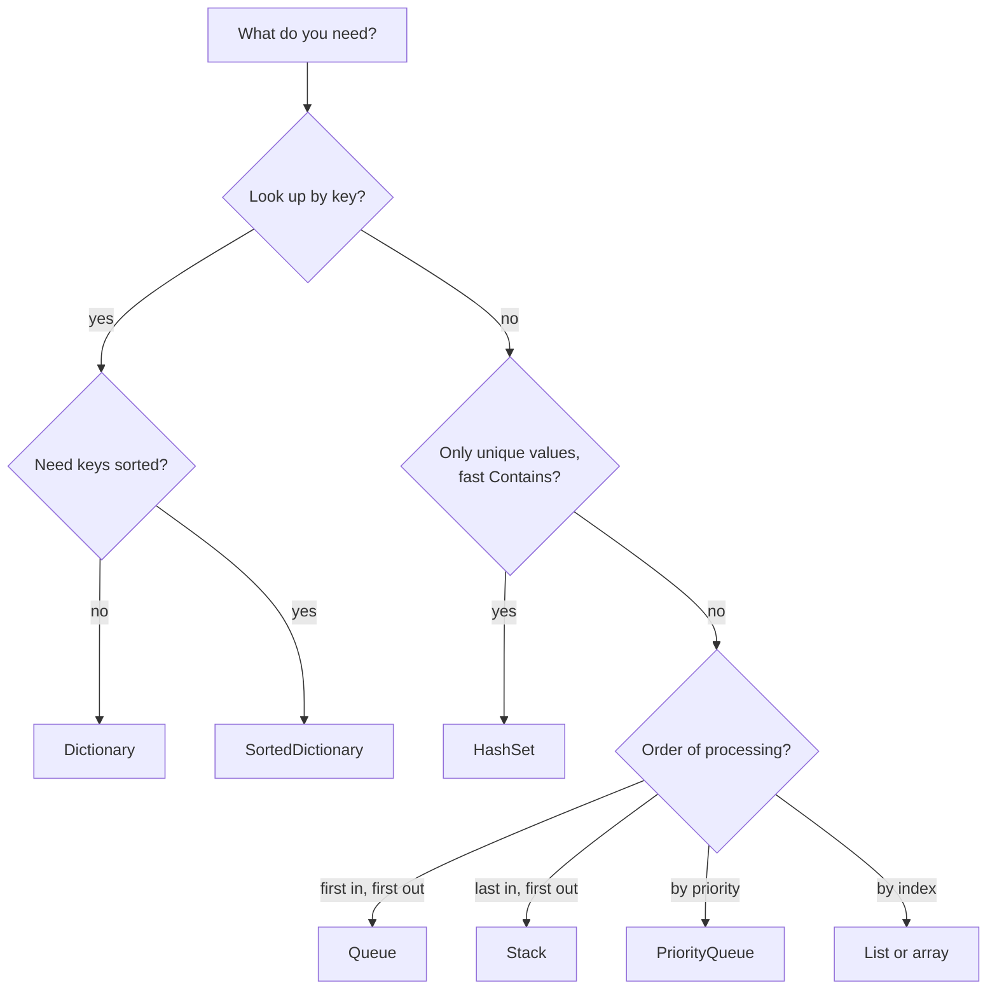
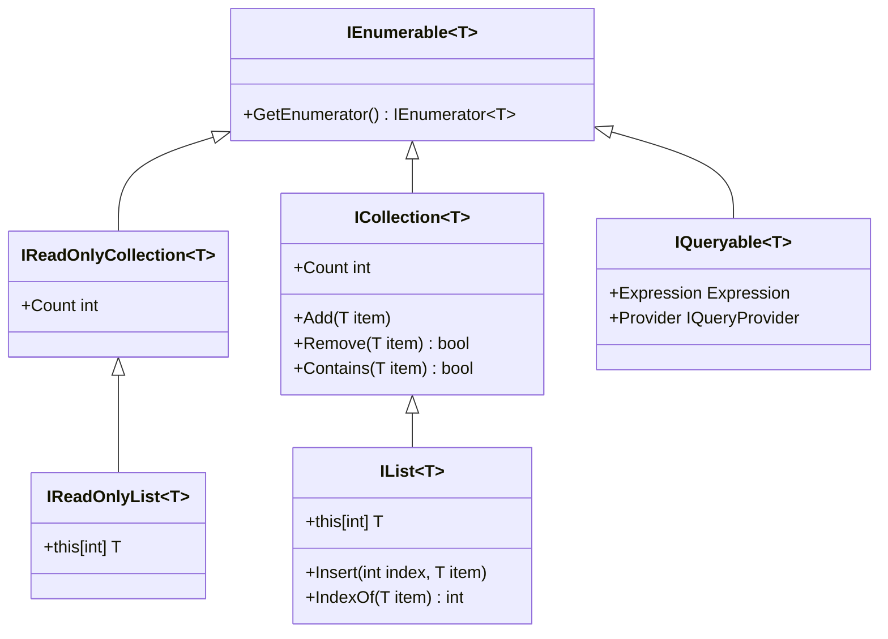
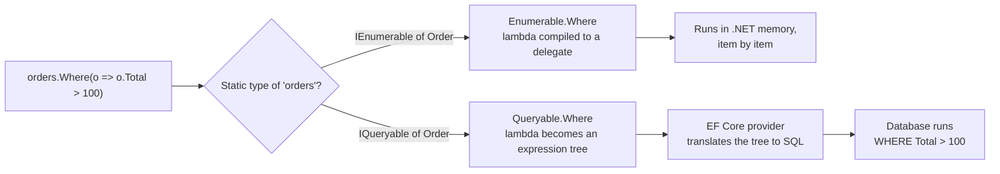

# Collections and LINQ

> In this document you will learn the main .NET collections (`List<T>`, `Dictionary<TKey,TValue>`, `HashSet<T>`, queues, stacks, sorted, immutable, frozen and concurrent collections), their time complexity, the collection interfaces, `yield return` and deferred execution, and LINQ from basics to the newest .NET 9 and .NET 10 methods. Interviewers test choosing the right collection, `IEnumerable` vs `IQueryable`, `First` vs `Single`, and "how many times does this run?" questions. All outputs here were checked on .NET 10.

**Before this:** [C# fundamentals and the type system](01-csharp-fundamentals-and-type-system.md) · [Data structures and Big O](../01-cs-and-web-fundamentals/02-data-structures-and-big-o.md) · [JavaScript array methods](../02-javascript/10-arrays-and-array-methods.md) · **Interview questions:** [jump to the interview section](#interview-questions)

## Table of contents

1. [The big picture](#the-big-picture)
2. [Arrays and List](#arrays-and-list)
3. [Dictionary](#dictionary)
4. [HashSet](#hashset)
5. [Queue, Stack, LinkedList and PriorityQueue](#queue-stack-linkedlist-and-priorityqueue)
6. [Sorted collections](#sorted-collections)
7. [Read-only, immutable and frozen collections](#read-only-immutable-and-frozen-collections)
8. [Concurrent collections](#concurrent-collections)
9. [Complexity cheat sheet](#complexity-cheat-sheet)
10. [Collection interfaces](#collection-interfaces)
11. [yield return and deferred execution](#yield-return-and-deferred-execution)
12. [LINQ basics](#linq-basics)
13. [The most important LINQ operators](#the-most-important-linq-operators)
14. [First, Single, FirstOrDefault and friends](#first-single-firstordefault-and-friends)
15. [New LINQ methods in .NET 9 and .NET 10](#new-linq-methods-in-net-9-and-net-10)
16. [LINQ to Objects vs LINQ to Entities](#linq-to-objects-vs-linq-to-entities)
17. [Performance pitfalls](#performance-pitfalls)
18. [Common mistakes](#common-mistakes)
19. [Best practices](#best-practices)
20. [How to explain this in an interview](#how-to-explain-this-in-an-interview)
21. [Interview questions](#interview-questions)
22. [Summary](#summary)
23. [References](#references)

---

## The big picture

The collections live in these namespaces:

| Namespace | What is inside |
| --- | --- |
| `System.Collections.Generic` | `List<T>`, `Dictionary<K,V>`, `HashSet<T>`, `Queue<T>`, `Stack<T>`, `LinkedList<T>`, `SortedDictionary<K,V>`, `PriorityQueue<T,P>` |
| `System.Collections.Concurrent` | Thread-safe: `ConcurrentDictionary`, `ConcurrentQueue`, `BlockingCollection` |
| `System.Collections.Immutable` | `ImmutableList<T>`, `ImmutableDictionary<K,V>`, `ImmutableArray<T>` |
| `System.Collections.Frozen` | `FrozenDictionary<K,V>`, `FrozenSet<T>` (.NET 8) |
| `System.Collections` | Old non-generic `ArrayList`, `Hashtable`. **Do not use in new code** (boxing, no type safety) |

**If you know JavaScript:** `List<T>` is like an array, `Dictionary<K,V>` is like `Map`, and `HashSet<T>` is like `Set`. The difference is that C# collections are typed, and you choose a specific data structure for each job instead of using one array for everything. See [Map, Set, WeakMap and WeakSet](../02-javascript/12-map-set-weakmap-weakset.md) for the JS side.

How to choose quickly:



## Arrays and List

### Arrays

An **array** has a fixed length. It is the fastest and simplest collection.

```csharp
int[] scores = [5, 3, 8];          // collection expression (C# 12)
Array.Sort(scores);
Console.WriteLine($"{string.Join(",", scores)} len={scores.Length}"); // 3,5,8 len=3

int[,] grid = new int[2, 3];       // multi-dimensional (rectangular) array
Console.WriteLine($"{grid.GetLength(0)}x{grid.GetLength(1)} rank={grid.Rank}"); // 2x3 rank=2

int[][] jagged = [[1], [2, 3]];    // array of arrays (rows can differ in length)
```

Use arrays for fixed-size data, for performance-critical code, and for APIs that return a final result.

### List&lt;T&gt;

A **`List<T>`** is a growable array. Inside, it keeps an array and a count. When the array is full, it allocates a new array of **double** the size and copies the items.

```csharp
var cart = new List<string> { "pen", "book" };
cart.Add("bag");
cart.Insert(0, "cap");
cart.Remove("book");
Console.WriteLine($"{string.Join(",", cart)} count={cart.Count} idx={cart.IndexOf("bag")}");
// cap,pen,bag count=3 idx=2

var numbers = new List<int>();
Console.WriteLine(numbers.Capacity);   // 0
for (int i = 0; i < 5; i++) numbers.Add(i);
Console.WriteLine(numbers.Capacity);   // 8   (grew 0 -> 4 -> 8)
```

- `Add` is **amortized O(1)**: usually instant, sometimes it copies everything.
- `Insert(0, x)` and `Remove(x)` are **O(n)**: items after the position shift.
- `Contains` and `IndexOf` are **O(n)**: linear search.
- If you know the size, pass it: `new List<Order>(expectedCount)`. This avoids repeated resizing.

### Modifying a list while looping

```csharp
var nums = new List<int> { 1, 2, 3 };
// ❌ Wrong: throws InvalidOperationException ("Collection was modified")
foreach (var n in nums) if (n == 2) nums.Remove(n);

// ✅ Correct
var nums2 = new List<int> { 1, 2, 3, 4 };
nums2.RemoveAll(n => n % 2 == 0);
Console.WriteLine(string.Join(",", nums2)); // 1,3
```

The `foreach` enumerator checks a version number. Any `Add` or `Remove` changes it, and the next step throws. Use `RemoveAll`, loop backwards with `for`, or build a new list.

## Dictionary

### What it is

A **`Dictionary<TKey, TValue>`** maps keys to values using a **hash table**. Lookups, inserts and removes are **O(1) on average**.

### How it works inside

1. It calls `key.GetHashCode()` to get a number.
2. It turns the number into a **bucket** index.
3. Inside the bucket, it compares keys with `Equals`.

This is why the [`GetHashCode` contract](01-csharp-fundamentals-and-type-system.md#the-gethashcode-contract) matters: wrong hash codes break lookups. And never change a key object's hashed fields while it is in the dictionary.

### Example

```csharp
var stock = new Dictionary<string, int> { ["pen"] = 10, ["book"] = 2 };
stock["pen"] = 12;       // indexer set: add or overwrite
stock["bag"] = 1;
Console.WriteLine(stock["pen"]);                                    // 12
Console.WriteLine(stock.ContainsKey("cap"));                        // False
Console.WriteLine(stock.TryGetValue("book", out var b) + " " + b);  // True 2

var x = stock["cap"];    // throws KeyNotFoundException
stock.Add("pen", 1);     // throws ArgumentException (duplicate key)
Console.WriteLine(stock.TryAdd("pen", 1)); // False (no exception)
```

| Method | Key missing | Key exists |
| --- | --- | --- |
| `dict[key]` (get) | Throws `KeyNotFoundException` | Returns value |
| `dict[key] = v` (set) | Adds | Overwrites |
| `Add(key, v)` | Adds | Throws `ArgumentException` |
| `TryAdd(key, v)` | Adds, returns `true` | Returns `false` |
| `TryGetValue(key, out v)` | Returns `false` | Returns `true` and the value |
| `GetValueOrDefault(key)` | Returns `default` | Returns value |

**Use `TryGetValue`** instead of `ContainsKey` followed by the indexer. The second pattern does two lookups.

### Realistic example: counting

```csharp
var wordCounts = new Dictionary<string, int>();
foreach (var w in "a b a c a b".Split(' '))
    wordCounts[w] = wordCounts.GetValueOrDefault(w) + 1;
Console.WriteLine(string.Join(" ", wordCounts.Select(kv => $"{kv.Key}={kv.Value}"))); // a=3 b=2 c=1
```

Or with LINQ in .NET 9+: `words.CountBy(w => w)` (see [New LINQ methods](#new-linq-methods-in-net-9-and-net-10)).

### Case-insensitive keys

```csharp
var headers = new Dictionary<string, string>(StringComparer.OrdinalIgnoreCase) { ["Content-Type"] = "json" };
Console.WriteLine(headers.ContainsKey("content-type")); // True
```

### Order

A `Dictionary` does **not guarantee** enumeration order. In practice, if you only add, items often come back in insertion order, but removes break this. Never depend on it. If you need insertion order, use `OrderedDictionary<TKey,TValue>`.

> **New in .NET 9:** a generic **`OrderedDictionary<TKey, TValue>`** keeps insertion order and allows access by index.

```csharp
var od = new OrderedDictionary<string, int> { ["b"] = 1, ["a"] = 2 };
od.Insert(0, "z", 9);
Console.WriteLine(string.Join(",", od.Keys)); // z,b,a
```

### Removing during enumeration

Since .NET Core 3.0, `Dictionary.Remove` during `foreach` over the same dictionary does **not** throw (removal does not change the version). Adding still throws. This differs from `List<T>`, and from .NET Framework. Do not depend on it in shared code; collect keys first if in doubt.

## HashSet

A **`HashSet<T>`** stores **unique** values with O(1) average `Add`, `Remove` and `Contains`. It uses the same hashing as `Dictionary`.

```csharp
var tags = new HashSet<string> { "sale", "new" };
Console.WriteLine(tags.Add("sale")); // False  (already there, nothing added)
Console.WriteLine(tags.Add("hot"));  // True
Console.WriteLine(tags.Count);       // 3
```

Set operations change the set in place:

```csharp
var a = new HashSet<int> { 1, 2, 3 };
var b = new HashSet<int> { 2, 3, 4 };
var inter = new HashSet<int>(a); inter.IntersectWith(b);   // 2,3
var union = new HashSet<int>(a); union.UnionWith(b);       // 1,2,3,4
var diff  = new HashSet<int>(a); diff.ExceptWith(b);       // 1
```

### Realistic example: the most common performance fix

```csharp
// ❌ Wrong: O(n * m). For each order, List.Contains scans the whole list
List<int> blockedCustomerIds = LoadBlockedIds();
var allowed = orders.Where(o => !blockedCustomerIds.Contains(o.CustomerId)).ToList();

// ✅ Correct: O(n + m). HashSet.Contains is O(1)
var blocked = new HashSet<int>(LoadBlockedIds());
var allowed2 = orders.Where(o => !blocked.Contains(o.CustomerId)).ToList();
```

With 100,000 orders and 10,000 blocked IDs, the first version does up to a billion comparisons. The second does about 110,000 operations.

## Queue, Stack, LinkedList and PriorityQueue

### Queue&lt;T&gt; (first in, first out)

```csharp
var jobs = new Queue<string>();
jobs.Enqueue("job1");
jobs.Enqueue("job2");
Console.WriteLine($"{jobs.Dequeue()} {jobs.Peek()} {jobs.Count}"); // job1 job2 1
Console.WriteLine(jobs.TryDequeue(out var j));                     // True  (j is "job2")
Console.WriteLine(jobs.TryDequeue(out var j2));                    // False (empty, no exception)
```

Used for BFS in graphs, processing work in arrival order, and simple in-memory buffers. `Dequeue` on an empty queue throws `InvalidOperationException`; `TryDequeue` does not.

### Stack&lt;T&gt; (last in, first out)

```csharp
var history = new Stack<string>();
history.Push("page1");
history.Push("page2");
Console.WriteLine($"{history.Pop()} {history.Peek()} {history.Count}"); // page2 page1 1
```

Used for undo, back navigation, DFS, and checking balanced brackets.

### LinkedList&lt;T&gt;

A doubly linked list. Insert and remove are O(1) **if you already have the node**. Finding a node is O(n).

```csharp
var list = new LinkedList<int>();
var node = list.AddLast(1);
list.AddLast(3);
list.AddAfter(node, 2);
list.AddFirst(0);
Console.WriteLine(string.Join(",", list)); // 0,1,2,3
```

In practice `List<T>` is faster for almost everything, because arrays are cache-friendly. `LinkedList<T>` is useful mainly for an **LRU cache** (a dictionary from key to node, plus a linked list for recency).

### PriorityQueue&lt;TElement, TPriority&gt; (.NET 6)

A **min-heap**: `Dequeue` returns the element with the **smallest** priority. `Enqueue` and `Dequeue` are O(log n).

```csharp
var pq = new PriorityQueue<string, int>();
pq.Enqueue("low", 5);
pq.Enqueue("urgent", 1);
pq.Enqueue("normal", 3);
while (pq.TryDequeue(out var item, out var priority)) Console.Write($"{item}({priority}) ");
// urgent(1) normal(3) low(5)
```

- For a max-heap, pass a reversed comparer: `new PriorityQueue<string, int>(Comparer<int>.Create((a, b) => b.CompareTo(a)))`.
- It is **not stable**: equal priorities can come out in any order.
- Enumerating it does **not** give sorted order.
- Used for Dijkstra, top-K problems, scheduling jobs by priority. See [Problem solving and complexity](../11-coding-interviews/02-problem-solving-and-complexity.md).

## Sorted collections

| Type | Inside | Operations |
| --- | --- | --- |
| `SortedDictionary<K,V>` | Red-black tree | O(log n) add, remove, lookup; keys always sorted |
| `SortedList<K,V>` | Two sorted arrays | O(log n) lookup, O(n) insert; less memory; index access |
| `SortedSet<T>` | Red-black tree | Unique sorted values; `Min`, `Max`, range views |

```csharp
var sd = new SortedDictionary<string, int> { ["zed"] = 1, ["amy"] = 2, ["bob"] = 3 };
Console.WriteLine(string.Join(",", sd.Keys));  // amy,bob,zed

var ss = new SortedSet<int> { 5, 1, 3 };
Console.WriteLine($"{string.Join(",", ss)} min={ss.Min} max={ss.Max}"); // 1,3,5 min=1 max=5
```

Choose `SortedList` when data is mostly loaded once and then read. Choose `SortedDictionary` when there are many inserts and removes.

## Read-only, immutable and frozen collections

These three are different, and interviewers like the difference.

| Kind | Can the owner change it? | Can you change it through this reference? | Example |
| --- | --- | --- | --- |
| **Read-only view** | Yes | No | `list.AsReadOnly()`, `IReadOnlyList<T>` |
| **Immutable** | No, never. "Changes" return a new collection | No | `ImmutableList<T>`, `ImmutableArray<T>` |
| **Frozen** (.NET 8) | No. Built once, optimized for fast reads | No | `FrozenDictionary<K,V>`, `FrozenSet<T>` |

```csharp
var source = new List<int> { 1 };
var view = source.AsReadOnly();
source.Add(2);
Console.WriteLine(view.Count);        // 2   (a view sees changes to the source)

var im = ImmutableList.Create(1, 2);
var im2 = im.Add(3);                  // returns a NEW list
Console.WriteLine($"{im.Count} {im2.Count}"); // 2 3

var taxRates = new Dictionary<string, decimal> { ["IN"] = 0.18m, ["US"] = 0.07m }.ToFrozenDictionary();
Console.WriteLine(taxRates["IN"]);    // 0.18
```

When to use each:

- **Return `IReadOnlyList<T>` or `IReadOnlyCollection<T>`** from methods so callers do not modify your internal list.
- **Immutable collections** are good for state that is shared across threads and updated by replacement (for example a configuration snapshot or Redux-like state). Each change shares most of the structure with the old version, but single operations are slower than `List<T>`.
- **Frozen collections** are for data created once at startup and read millions of times: lookup tables, feature flag sets, routing tables. Creating them is slower; reading is faster than `Dictionary`.

## Concurrent collections

Normal collections are **not thread-safe** for writes. If two threads add to a `Dictionary` at the same time, you can corrupt it (in the worst case, infinite loops or lost entries). Use concurrent collections or a lock.

```csharp
var hits = new ConcurrentDictionary<string, int>();
Parallel.For(0, 1000, i => hits.AddOrUpdate("hits", 1, (_, old) => old + 1));
Console.WriteLine(hits["hits"]);                    // 1000

var misses = hits.GetOrAdd("misses", _ => 0);
Console.WriteLine(misses);                          // 0
```

| Type | Use for |
| --- | --- |
| `ConcurrentDictionary<K,V>` | Shared caches and counters |
| `ConcurrentQueue<T>` / `ConcurrentStack<T>` | Lock-free FIFO / LIFO |
| `ConcurrentBag<T>` | Unordered items, same thread often adds and takes |
| `BlockingCollection<T>` | Producer/consumer with blocking (older; prefer `Channel<T>` in async code) |

One important gotcha: the `valueFactory` in `GetOrAdd(key, factory)` **can run more than once** when threads race. Only one result is stored, but the factory may execute twice. If the factory is expensive or has side effects, store a `Lazy<T>`: `GetOrAdd(key, k => new Lazy<Report>(() => Build(k))).Value`.

Thread safety in depth (locks, `Interlocked`, `Channel<T>`) is in [Async/await, tasks and threading](04-async-await-tasks-and-threading.md).

## Complexity cheat sheet

Average case. `n` is the number of items.

| Collection | Access by index | Search (`Contains`) | Add | Insert / remove middle | Notes |
| --- | --- | --- | --- | --- | --- |
| `T[]` | O(1) | O(n) | n/a (fixed) | n/a | Fastest, fixed size |
| `List<T>` | O(1) | O(n) | O(1) amortized | O(n) | Default choice |
| `LinkedList<T>` | O(n) | O(n) | O(1) at ends | O(1) with node | Poor cache locality |
| `Dictionary<K,V>` | O(1) by key | O(1) by key | O(1) | O(1) remove | Unordered |
| `HashSet<T>` | n/a | O(1) | O(1) | O(1) remove | Unique values |
| `SortedDictionary<K,V>` | O(log n) by key | O(log n) | O(log n) | O(log n) | Sorted keys |
| `SortedList<K,V>` | O(1) by index, O(log n) by key | O(log n) | O(n) | O(n) | Low memory |
| `Queue<T>` / `Stack<T>` | n/a | O(n) | O(1) | n/a | Ends only |
| `PriorityQueue<T,P>` | n/a | O(n) | O(log n) | n/a | Min-heap |

Hash-based worst case is O(n) when many keys collide, which is why a good `GetHashCode` matters.

## Collection interfaces

The interfaces form a hierarchy. Each one adds abilities.



| Interface | Gives you | Use it as a parameter when... |
| --- | --- | --- |
| `IEnumerable<T>` | `foreach` only | You only loop once, maybe lazily |
| `IReadOnlyCollection<T>` | + `Count` | You need the count without changing |
| `IReadOnlyList<T>` | + index access | You need random access without changing |
| `ICollection<T>` | + `Add`, `Remove`, `Contains`, `Count` | You add or remove |
| `IList<T>` | + index, `Insert`, `IndexOf` | You need list operations |
| `IQueryable<T>` | Query as an **expression tree** for a provider (EF Core) | You build a database query |

Practical rules:

- **Accept the smallest interface you need** in parameters (often `IEnumerable<T>` or `IReadOnlyCollection<T>`).
- **Return a specific, materialized type** (`IReadOnlyList<T>`, `List<T>` or an array) from methods. Returning a lazy `IEnumerable<T>` hides whether work has been done.

## yield return and deferred execution

### What it is

An **iterator** is a method that uses `yield return`. It produces values **one at a time, only when asked**. This is the C# version of a JavaScript generator function (`function*`). See [Iterators and generators](../02-javascript/13-iterators-and-generators.md).

### How it works inside

The compiler turns the method into a hidden class (a **state machine**) that implements `IEnumerable<T>` and `IEnumerator<T>`. Each call to `MoveNext()` runs the method body until the next `yield return`, then pauses. Nothing runs when you **call** the method. It runs when you **enumerate** it.

```csharp
static IEnumerable<int> Numbers()
{
    Console.WriteLine("start");
    yield return 1;
    Console.WriteLine("after 1");
    yield return 2;
    Console.WriteLine("after 2");
    yield return 3;
    Console.WriteLine("end");
}

foreach (var n in Numbers())
{
    Console.WriteLine($"got {n}");
    if (n == 2) break;
}
```

Output:

```text
start
got 1
after 1
got 2
```

Step by step:

1. `foreach` calls `GetEnumerator()` and then `MoveNext()`. The body runs until `yield return 1`. It prints `start`.
2. The loop body prints `got 1`.
3. `MoveNext()` resumes after the first `yield`. It prints `after 1` and stops at `yield return 2`.
4. The loop prints `got 2` and `break`s. `after 2` and `end` never print. (`break` calls `Dispose()` on the enumerator, which would run any `finally` blocks in the iterator.)

### Infinite sequences

Because iterators are lazy, they can be infinite:

```csharp
static IEnumerable<long> Fibonacci()
{
    long a = 0, b = 1;
    while (true) { yield return a; (a, b) = (b, a + b); }
}
Console.WriteLine(string.Join(",", Fibonacci().Take(8))); // 0,1,1,2,3,5,8,13
```

### The argument validation trap

```csharp
static IEnumerable<string> GetOrders(string customer)
{
    ArgumentNullException.ThrowIfNull(customer);
    yield return customer + "-1";
}

var bad = GetOrders(null!);       // no exception here!
Console.WriteLine("no exception yet");
bad.ToList();                     // ArgumentNullException is thrown here
```

The whole body is deferred, including the check. The error appears far from the bug. The fix is to split the method: a normal public method that validates, and a private iterator (or local function) that yields.

```csharp
public static IEnumerable<string> GetOrders(string customer)
{
    ArgumentNullException.ThrowIfNull(customer);   // runs immediately
    return Iterator();

    IEnumerable<string> Iterator() { yield return customer + "-1"; }
}
```

### Deferred execution in LINQ

Most LINQ operators are built the same way. A query is a **recipe**, not a result.

```csharp
var numbers = new List<int> { 1, 2, 3 };
var evens = numbers.Where(n => n % 2 == 0);   // nothing runs yet
numbers.Add(4);
Console.WriteLine(string.Join(",", evens));    // 2,4   (sees the 4 added after the query was defined)

var snapshot = numbers.Where(n => n % 2 == 0).ToList();   // runs now
numbers.Add(6);
Console.WriteLine($"{string.Join(",", snapshot)} vs {string.Join(",", evens)}"); // 2,4 vs 2,4,6
```

### Multiple enumeration

Every time you enumerate a deferred query, it runs **again**:

```csharp
int calls = 0;
var query = numbers.Select(n => { calls++; return n * 10; });   // numbers has 5 items now
Console.WriteLine(calls);  // 0
var count = query.Count(); // runs the Select for all 5 items
var first = query.First(); // runs again, for the first item only
Console.WriteLine(calls);  // 6
```

If the source is a database query or an HTTP call, multiple enumeration means multiple database round trips. Call `.ToList()` once when you need the results more than once. Tools like ReSharper and Rider warn about "possible multiple enumeration".

### Operators that run immediately vs lazily

| Deferred (lazy, streaming) | Deferred but buffering (reads all input when first enumerated) | Immediate (runs now) |
| --- | --- | --- |
| `Where`, `Select`, `SelectMany`, `Take`, `Skip`, `Concat`, `Zip`, `Distinct`, `Chunk` | `OrderBy`, `GroupBy`, `Reverse`, `Join` (inner side) | `ToList`, `ToArray`, `ToDictionary`, `Count`, `Sum`, `First`, `Any`, `Max`, `Aggregate`, `foreach` |

### Execution order: streaming

LINQ to Objects processes **one item at a time through the whole pipeline**, not one operator at a time:

```csharp
var result = new[] { 1, 2, 3, 4 }
    .Where(n => { Console.Write($"W{n} "); return n % 2 == 0; })
    .Select(n => { Console.Write($"S{n} "); return n * n; });

foreach (var x in result) Console.Write($"=> {x} ");
// W1 W2 S2 => 4 W3 W4 S4 => 16
```

But a buffering operator must read everything first:

```csharp
var ordered = new[] { 3, 1, 2 }
    .Select(n => { Console.Write($"S{n} "); return n; })
    .OrderBy(n => n)
    .Take(1);
foreach (var x in ordered) Console.Write($"=> {x} ");
// S3 S1 S2 => 1
```

`OrderBy` cannot know the smallest item until it has seen all of them.

## LINQ basics

**LINQ** (Language Integrated Query) is a set of methods for querying any data source with the same syntax: in-memory collections, databases (EF Core), XML. It is like JavaScript's `map`/`filter`/`reduce` but richer and lazy. The JS array methods are eager: `arr.filter(...)` returns a new array right away.

| JavaScript | LINQ |
| --- | --- |
| `filter` | `Where` |
| `map` | `Select` |
| `flatMap` | `SelectMany` |
| `reduce` | `Aggregate` (plus `Sum`, `Count`, `Max`...) |
| `find` | `FirstOrDefault` |
| `some` / `every` | `Any` / `All` |
| `sort` (mutates!) | `OrderBy` / `ThenBy` (returns a new sequence) |
| `slice` | `Skip` / `Take` |
| `[...new Set(arr)]` | `Distinct` |
| `Object.groupBy` | `GroupBy` / `ToLookup` |

### Sample data for the rest of this document

```csharp
record Order(int Id, string Customer, string Category, decimal Total, string[] Items);
record Customer(string Name, string City);

var orders = new List<Order>
{
    new(1, "Asha",  "Books", 250m, ["pen", "book"]),
    new(2, "Ravi",  "Toys",   80m, ["car"]),
    new(3, "Asha",  "Toys",  120m, ["ball", "kite"]),
    new(4, "Meera", "Books",  40m, ["notebook"]),
};
var customers = new List<Customer> { new("Asha", "Delhi"), new("Ravi", "Pune"), new("John", "Goa") };
```

### Method syntax vs query syntax

```csharp
// Method syntax (most common)
var big = orders.Where(o => o.Total > 100).Select(o => o.Id);       // 1,3

// Query syntax (SQL-like; the compiler turns it into method calls)
var q = from o in orders
        where o.Total > 100
        orderby o.Total descending
        select new { o.Id, o.Total };
// { Id = 1, Total = 250 },{ Id = 3, Total = 120 }
```

Both compile to the same thing. Method syntax is used more in real code. Query syntax is nicer for joins and `let` clauses. Some operators (`Take`, `Distinct`, `Count`) exist only as methods.

`new { o.Id, o.Total }` creates an **anonymous type**: a compiler-generated class with read-only properties and value equality. You can use it inside a method, but you cannot return it with a useful type. Use a record for that.

## The most important LINQ operators

### Filtering and projection

```csharp
orders.Where(o => o.Category == "Toys");            // filter
orders.Select(o => o.Total);                        // map each item
orders.Select((o, index) => $"{index}:{o.Id}");     // with index
orders.OfType<SpecialOrder>();                      // filter by type
```

### Sorting

```csharp
var sorted = orders.OrderBy(o => o.Category).ThenByDescending(o => o.Total).Select(o => $"{o.Category}:{o.Total}");
// Books:250 Books:40 Toys:120 Toys:80
```

`OrderBy` is a **stable** sort: equal items keep their original order. Calling `OrderBy` twice (instead of `ThenBy`) throws away the first sort.

### Grouping

```csharp
var byCustomer = orders
    .GroupBy(o => o.Customer)
    .Select(g => new { Customer = g.Key, Count = g.Count(), Sum = g.Sum(o => o.Total) });
// Asha 2 370
// Ravi 1 80
// Meera 1 40
```

Each group is an `IGrouping<TKey, TElement>`: a sequence with a `Key`. `ToLookup` is the **immediate** version that you can index: `lookup["Books"]` returns the items, and a missing key returns an empty sequence, not an exception.

### Joining

```csharp
var joined = orders.Join(customers,
    o => o.Customer,        // key from the outer sequence
    c => c.Name,            // key from the inner sequence
    (o, c) => $"{o.Id}-{c.City}");
// 1-Delhi,2-Pune,3-Delhi   (Meera has no customer row, so order 4 disappears: inner join)
```

The classic left join uses `GroupJoin` and `DefaultIfEmpty`:

```csharp
var leftJoin = from c in customers
               join o in orders on c.Name equals o.Customer into g
               from o in g.DefaultIfEmpty()
               select $"{c.Name}:{o?.Id.ToString() ?? "none"}";
// Asha:1,Asha:3,Ravi:2,John:none
```

In .NET 10 this becomes one method: `LeftJoin` (see below).

### Flattening with SelectMany

```csharp
var items = orders.SelectMany(o => o.Items);
// pen,book,car,ball,kite,notebook

var nested = orders.Select(o => o.Items);
Console.WriteLine($"{nested.Count()} vs {items.Count()}"); // 4 vs 6
```

`Select` gives a sequence of arrays (4 items). `SelectMany` flattens them into one sequence (6 items).

### Aggregation

```csharp
new[] { 1, 2, 3, 4 }.Aggregate((acc, n) => acc * n);              // 24
new[] { "a", "b", "c" }.Aggregate("", (acc, s) => acc + s.ToUpper()); // ABC
orders.Sum(o => o.Total);       // 490
orders.Average(o => o.Total);   // 122.5
orders.MaxBy(o => o.Total);     // order 1 (.NET 6: returns the item, not the value)
orders.MinBy(o => o.Total);     // order 4
```

`Max()` on an empty sequence of a value type throws `InvalidOperationException`. `Sum()` on an empty sequence returns `0`.

### Distinct, Any, All

```csharp
orders.Select(o => o.Customer).Distinct();   // Asha,Ravi,Meera
orders.DistinctBy(o => o.Category);          // first order of each category: 1,2  (.NET 6)
orders.Any(o => o.Total > 200);              // True
orders.All(o => o.Total > 50);               // False
new int[0].Any();                            // False
new int[0].All(x => x > 100);                // True  (vacuous truth: no item breaks the rule)
```

### Paging, chunking and zipping

```csharp
orders.OrderBy(o => o.Id).Skip(2).Take(2);                // ids 3,4  (page 2, size 2)
Enumerable.Range(1, 7).Chunk(3);                          // [1,2,3] [4,5,6] [7]  (.NET 6)
new[] { 1, 2 }.Zip(new[] { "a", "b" }, (n, s) => $"{n}{s}"); // 1a,2b
```

### Converting

```csharp
orders.ToList();
orders.ToArray();
orders.ToDictionary(o => o.Id);          // throws ArgumentException if a key repeats
orders.ToHashSet();
orders.ToLookup(o => o.Category);        // allows duplicate keys
```

`ToList` vs `ToArray`: both copy everything. `ToList` gives a resizable list; `ToArray` gives a fixed array, which can be slightly smaller in memory. In modern .NET both are fast; choose by what you need next. If the result will not change, an array or `IReadOnlyList<T>` communicates that well.

## First, Single, FirstOrDefault and friends

| Method | 0 matches | 1 match | 2+ matches |
| --- | --- | --- | --- |
| `First` | Throws | Returns it | Returns the first |
| `FirstOrDefault` | Returns `default` | Returns it | Returns the first |
| `Single` | Throws | Returns it | **Throws** |
| `SingleOrDefault` | Returns `default` | Returns it | **Throws** |
| `Last` / `LastOrDefault` | Like `First`, from the end | | |

```csharp
orders.First(o => o.Category == "Food");   // InvalidOperationException: Sequence contains no matching element
orders.Single(o => o.Category == "Toys");  // InvalidOperationException: Sequence contains more than one matching element
orders.Single(o => o.Id == 2);             // order 2 (Ravi)
orders.SingleOrDefault(o => o.Id == 99);   // null
new List<int>().FirstOrDefault();          // 0     (default of int, not null!)
new List<int>().FirstOrDefault(-1);        // -1    (custom default, .NET 6)
```

How to choose:

- Use **`Single`** when "more than one" would be a data bug (lookup by primary key, unique email). It documents and enforces the rule.
- Use **`First`** when many may match and you want any (or the first after sorting).
- Use the **`OrDefault`** versions when "none" is a normal case, and then handle `null`.
- Watch out: `FirstOrDefault` on value types returns `0` or `default(T)`, which can look like a real value.

Database note: in EF Core, `Single` makes the SQL fetch up to 2 rows (`TOP 2`) to detect duplicates; `First` fetches 1. EF Core's `Find` checks the change tracker first.

## New LINQ methods in .NET 9 and .NET 10

> **New in .NET 9:** `CountBy`, `AggregateBy` and `Index`.

```csharp
foreach (var kv in orders.CountBy(o => o.Category)) Console.Write($"{kv.Key}={kv.Value} ");
// Books=2 Toys=2

foreach (var kv in orders.AggregateBy(o => o.Customer, 0m, (sum, o) => sum + o.Total)) Console.Write($"{kv.Key}={kv.Value} ");
// Asha=370 Ravi=80 Meera=40

foreach (var (index, o) in orders.Take(2).Index()) Console.Write($"{index}:{o.Id} ");
// 0:1 1:2
```

- `CountBy` replaces `GroupBy(k).Select(g => (g.Key, g.Count()))` without creating group objects.
- `AggregateBy` replaces `GroupBy(k).Select(g => g.Aggregate(...))`, again without building the groups.
- `Index` gives `(int Index, T Item)` tuples, like `Select((x, i) => ...)` but easier to deconstruct.

> **New in .NET 10:** `LeftJoin` and `RightJoin` (in LINQ to Objects and in EF Core 10), plus `Shuffle` and `Sequence`.

```csharp
var left = customers.LeftJoin(orders, c => c.Name, o => o.Customer,
    (c, o) => $"{c.Name}:{o?.Id.ToString() ?? "none"}");
// Asha:1,Asha:3,Ravi:2,John:none

var right = customers.RightJoin(orders, c => c.Name, o => o.Customer,
    (c, o) => $"{c?.City ?? "?"}:{o.Id}");
// Delhi:1,Pune:2,Delhi:3,?:4

Enumerable.Range(1, 5).Shuffle();             // the same 5 numbers in random order
Enumerable.Sequence(0, 10, 5);                // 0,5,10  (start, end inclusive, step)
```

Before .NET 10, a left join needed the `GroupJoin` + `SelectMany` + `DefaultIfEmpty` combination shown earlier. If your company is on .NET 8, use that pattern.

## LINQ to Objects vs LINQ to Entities

This is the most important LINQ interview topic for backend roles.

### Two different engines with the same syntax

- **LINQ to Objects** works on `IEnumerable<T>`. Your lambdas are compiled **delegates** (`Func<T, bool>`). They run in your process, in C#.
- **LINQ to Entities** (EF Core) works on `IQueryable<T>`. Your lambdas are compiled into **expression trees** (`Expression<Func<T, bool>>`): data that describes the code. EF Core reads the tree and **translates it to SQL**. The database runs it.

### Expression trees

An **expression tree** is code stored as a data structure. You can inspect it, or compile it into a delegate.

```csharp
Func<Customer, bool> asDelegate = c => c.City == "Pune";                  // compiled code
Expression<Func<Customer, bool>> asTree = c => c.City == "Pune";          // data describing the code

Console.WriteLine(asTree.Body);                          // (c.City == "Pune")
Func<Customer, bool> compiled = asTree.Compile();
Console.WriteLine(compiled(new Customer("Ravi", "Pune"))); // True
```

The same lambda text becomes one or the other depending on the **target type**. `Enumerable.Where` takes a `Func`; `Queryable.Where` takes an `Expression<Func>`.



### The classic bug: switching to IEnumerable too early

```csharp
// ❌ Wrong: the method returns IEnumerable, so the filter runs in memory
IEnumerable<Order> GetOrders() => db.Orders;          // IQueryable hidden behind IEnumerable
var expensive = GetOrders().Where(o => o.Total > 100).ToList();
// SQL: SELECT * FROM Orders   -> loads the whole table, then filters in C#

// ✅ Correct: keep IQueryable until the query is complete
IQueryable<Order> QueryOrders() => db.Orders;
var expensive2 = QueryOrders().Where(o => o.Total > 100).ToList();
// SQL: SELECT ... FROM Orders WHERE Total > 100
```

The `Where` method is chosen at **compile time** from the static type. Once the static type is `IEnumerable<T>`, every later operator is LINQ to Objects. `AsEnumerable()` does this on purpose: everything after it runs in memory.

### What cannot be translated

EF Core can only translate methods it knows (`Contains`, `StartsWith`, `string.ToLower`, math functions, many date functions). If you call your own C# method inside the lambda, EF Core cannot turn it into SQL:

```csharp
// ❌ Throws InvalidOperationException at runtime: "could not be translated"
db.Orders.Where(o => IsVip(o.Customer)).ToList();
```

EF Core 3.0+ throws instead of silently running the filter in memory (older versions did client evaluation). The fix is to express the logic in translatable terms, or to filter in memory **after** narrowing down on the database. In a final `Select`, EF Core can call your method on the client for the projected values.

Full details on EF Core querying are in [Entity Framework Core and data access](10-entity-framework-core-and-data-access.md).

## Performance pitfalls

1. **`Count() > 0` instead of `Any()`.** On a lazy sequence, `Count()` walks everything. `Any()` stops at the first item. (For a `List<T>`, `Count()` uses the `Count` property, so it is cheap. Still, `Any()` states the intent.)
2. **`List.Contains` inside a loop or `Where`.** Use a `HashSet<T>`.
3. **Multiple enumeration** of an expensive query. Call `ToList()` once.
4. **`ToList()` too early**, especially on `IQueryable` before filtering. You load more data than needed.
5. **`OrderBy(...).First()`** sorts everything (O(n log n)). `MinBy`/`MaxBy` is O(n).
6. **Nested `Where(...).First()` lookups** in loops. Build a `Dictionary` or `ToLookup` once.
7. **LINQ in very hot paths.** LINQ allocates enumerators and delegates. In a tight loop that runs millions of times, a plain `for` loop can be much faster. Measure with BenchmarkDotNet before rewriting (see [Memory, GC and performance](05-memory-gc-and-performance.md)). Modern .NET versions optimize many LINQ methods heavily, especially on arrays and lists.
8. **`Cast<T>()` when types may differ.** It throws `InvalidCastException`. `OfType<T>()` filters instead.

```csharp
new object[] { 1, "a", 2 }.OfType<int>();     // 1,2
new object[] { 1, "a" }.Cast<int>().ToList(); // throws InvalidCastException
```

## Common mistakes

1. **Thinking a LINQ query stores results.** It stores a recipe. It runs when enumerated, every time.
2. **Validating arguments inside an iterator method.** The check runs late.
3. **Modifying a `List<T>` inside `foreach`.** Throws `InvalidOperationException`.
4. **Depending on `Dictionary` order.**
5. **Using `First` when the data must be unique.** Use `Single` to catch duplicates.
6. **Forgetting that `FirstOrDefault` returns `0` for `int`.**
7. **Returning `IEnumerable<T>` from a repository** that wraps `IQueryable<T>`, which forces filtering in memory.
8. **Writing to a normal `Dictionary` from multiple threads.**
9. **Using `GetOrAdd` with a factory that has side effects** and expecting it to run once.
10. **Using `ToDictionary` when keys can repeat.** It throws. Use `ToLookup` or `GroupBy`.

## Best practices

- **Default to `List<T>` and `Dictionary<K,V>`**; choose others for a specific reason.
- **Use `HashSet<T>` for membership tests** and `Dictionary` for lookups by key.
- **Pre-size collections** when you know the count.
- **Accept `IEnumerable<T>` or `IReadOnlyCollection<T>`; return `IReadOnlyList<T>` or concrete types.**
- **Materialize once** (`ToList`) when you will enumerate a query more than once.
- **Keep `IQueryable<T>` until the database query is complete**, then materialize.
- **Use `TryGetValue`, `TryAdd`, `TryDequeue`** instead of check-then-act.
- **Use frozen collections for startup lookup tables**, immutable collections for shared snapshots, and concurrent collections or locks for shared mutable data.
- **Prefer method syntax**, and query syntax for complex joins.
- **Use `MinBy`/`MaxBy`, `CountBy`, `AggregateBy`, `Chunk`, `DistinctBy`** instead of hand-written versions.

## How to explain this in an interview

**Topic: `IEnumerable<T>` vs `IQueryable<T>`**

1. **Define it:** "`IEnumerable<T>` is a sequence you can loop over in memory. `IQueryable<T>` is a query that a provider, like EF Core, can translate and run somewhere else, usually as SQL."
2. **Why it exists:** "So the same LINQ syntax can query objects in memory and also a database, without loading the whole table."
3. **How it works:** "LINQ methods on `IEnumerable` take delegates and run C# code. On `IQueryable`, the lambdas are compiled into expression trees, and the provider translates the tree into SQL when you enumerate."
4. **Small example:** "`db.Orders.Where(o => o.Total > 100)` as `IQueryable` becomes `WHERE Total > 100` in SQL. If I cast it to `IEnumerable` first, EF loads every order and filters in C#."
5. **Where it is useful:** "Repositories and query services in EF Core apps, filtering and paging on the database side."
6. **Trade-offs / gotchas:** "Not every C# method can be translated, so custom methods in `IQueryable` lambdas throw at runtime. And both are deferred: each enumeration runs the query again."

**Topic: deferred execution**

1. **Define it:** "Most LINQ operators do not run when you call them. They build a pipeline that runs when you enumerate it."
2. **Why it exists:** "It allows composing queries step by step, streaming large or infinite data, and for EF Core, sending one combined SQL query."
3. **How it works:** "Operators are iterators built with `yield return`. Each `MoveNext` pulls one item through the whole chain."
4. **Small example:** "If I define `evens = list.Where(isEven)`, then add 4 to the list, and then print `evens`, the 4 appears."
5. **Where it is useful:** "Building filters conditionally before hitting the database; processing big files line by line."
6. **Trade-offs / gotchas:** "Multiple enumeration repeats the work, exceptions appear late, and changes to the source between definition and enumeration change the result. I call `ToList()` when I want a snapshot."

## Interview questions

### Q1. When would you use `List<T>`, `Dictionary<TKey,TValue>` and `HashSet<T>`?

**What the interviewer is checking:** Choosing data structures by access pattern and complexity.

**Short spoken answer (30–60 seconds):**
> I use `List<T>` as the default ordered collection when I access items by index or just loop over them. Adding is amortized O(1), but `Contains` and removing from the middle are O(n). I use `Dictionary` when I need to look things up by a key, like orders by ID; lookups are O(1) on average because it is a hash table. I use `HashSet` when I only care whether a value exists, like a set of blocked user IDs, also O(1). A very common performance fix is replacing `list.Contains` inside a loop with a `HashSet`. Dictionary and HashSet depend on good `GetHashCode` and `Equals` implementations, and they do not guarantee order.

**Follow-up questions:**
- **How does `List<T>` grow?** — It doubles its internal array when full and copies the items. Pre-size it if you know the count.
- **What is the worst case of a Dictionary lookup?** — O(n), if many keys land in the same bucket due to bad hash codes.
- **Is `Dictionary` ordered?** — No guarantee. Use `SortedDictionary` for sorted keys or `OrderedDictionary<K,V>` (.NET 9) for insertion order.

**Common mistakes:** Using `List.Contains` for lookups in large data. Assuming dictionary order.

**Where this is used in real projects:** Caches, lookup tables, de-duplication, grouping results before returning an API response.

### Q2. What does this print?

```csharp
var numbers = new List<int> { 1, 2, 3 };
var evens = numbers.Where(n => n % 2 == 0);
numbers.Add(4);
Console.WriteLine(string.Join(",", evens));
```

**Answer:** `2,4`

**Step by step:**
1. `Where` only builds a query. It does not read the list yet.
2. `4` is added to the list.
3. `string.Join` enumerates the query now. It sees `1, 2, 3, 4` and keeps `2` and `4`.

**Follow-up:** with `.ToList()` at the end of the first line, the output would be `2`.

### Q3. What does this print?

```csharp
int calls = 0;
var query = new List<int> { 1, 2, 3, 4, 5 }.Select(n => { calls++; return n * 10; });
Console.WriteLine(calls);
var count = query.Count();
var first = query.First();
Console.WriteLine(calls);
```

**Answer:**

```text
0
6
```

**Step by step:**
1. Defining the query runs nothing: `0`.
2. `Count()` enumerates all 5 items, running the lambda 5 times. (`Count()` cannot use the list's `Count` property here, because `Select` with a side-effecting lambda must run.)
3. `First()` enumerates again, but stops after the first item: 1 more call.
4. Total: `6`. This is multiple enumeration. With a database query, it would be two round trips.

### Q4. What does this print?

```csharp
static IEnumerable<int> Numbers()
{
    Console.WriteLine("start");
    yield return 1;
    Console.WriteLine("after 1");
    yield return 2;
    Console.WriteLine("end");
}

var gen = Numbers();
Console.WriteLine("created");
Console.WriteLine(gen.First());
```

**Answer:**

```text
created
start
1
```

**Explanation:** Calling `Numbers()` only creates the iterator object. `First()` calls `MoveNext()` once, which runs until the first `yield return`, then stops and disposes the enumerator. `after 1` never runs.

### Q5. What is the difference between `IEnumerable<T>` and `IQueryable<T>`?

**What the interviewer is checking:** Understanding of expression trees, providers and where code runs.

**Short spoken answer (30–60 seconds):**
> Both represent sequences you can query with LINQ, but they run in different places. `IEnumerable<T>` is LINQ to Objects: the lambdas are compiled delegates, and the filtering happens in memory in my process. `IQueryable<T>` is for providers like EF Core: the lambdas become expression trees, which are data describing the code, and the provider translates them into SQL that runs in the database. So `db.Orders.Where(o => o.Total > 100)` as `IQueryable` filters in SQL. The trap is that the method is chosen by the static type, so if a repository returns `IEnumerable`, all later filters run in memory after loading the whole table. Also, only translatable expressions work in `IQueryable`.

**Follow-up questions:**
- **What does `AsEnumerable()` do?** — It changes the static type to `IEnumerable<T>`, so all following operators run in memory. Useful to deliberately run untranslatable logic after the database part.
- **What is an expression tree?** — A data structure (`Expression<Func<T, bool>>`) that represents code. It can be inspected, translated, or compiled with `.Compile()`.
- **Is `IQueryable` also deferred?** — Yes. The SQL runs when you enumerate: `ToList`, `First`, `Count`, `foreach`.

**Common mistakes:** Saying `IQueryable` "is faster". It is about where the query runs. Returning `IEnumerable` from repositories.

**Where this is used in real projects:** EF Core data access, building dynamic filters for search and paging endpoints.

### Q6. What is the difference between `First`, `FirstOrDefault`, `Single` and `SingleOrDefault`?

**What the interviewer is checking:** Precise semantics and choosing based on data rules.

**Short spoken answer (30–60 seconds):**
> `First` returns the first match and throws if there is none. `FirstOrDefault` returns the default value, usually null, if there is none. `Single` expects exactly one match: it throws if there are none or if there are two or more. `SingleOrDefault` allows zero but still throws on two or more. I use `Single` when duplicates would be a data bug, like looking up by a unique email, because it fails loudly instead of hiding the problem. I use `First` when many can match and I want one, usually after `OrderBy`. One gotcha: for value types, `FirstOrDefault` returns zero, which can look like a real result.

**Follow-up questions:**
- **Which is faster in EF Core?** — `First` fetches one row (`TOP 1`). `Single` fetches up to two rows (`TOP 2`) so it can detect duplicates. The difference is usually tiny.
- **How do you return a custom default?** — `.FirstOrDefault(defaultValue)` since .NET 6.

### Q7. What does this print?

```csharp
var result = new[] { 1, 2, 3, 4 }
    .Where(n => { Console.Write($"W{n} "); return n % 2 == 0; })
    .Select(n => { Console.Write($"S{n} "); return n * n; });

foreach (var x in result) Console.Write($"=> {x} ");
```

**Answer:** `W1 W2 S2 => 4 W3 W4 S4 => 16 `

**Step by step:**
1. `foreach` asks `Select` for an item. `Select` asks `Where`. `Where` reads `1`, prints `W1`, rejects it.
2. `Where` reads `2`, prints `W2`, accepts it. `Select` prints `S2` and returns `4`. The loop prints `=> 4`.
3. The same happens for `3` (rejected) and `4` (accepted).

LINQ to Objects streams each item through the entire pipeline. It does not run all `Where` calls first. (JavaScript's eager `filter().map()` would print all `W`s first.)

### Q8. Explain `yield return`. What is the trap with argument validation?

**Short spoken answer (30–60 seconds):**
> `yield return` makes a method an iterator. The compiler generates a state machine class, and the method body runs lazily: each `MoveNext` runs until the next `yield return` and pauses. It is the C# version of a JavaScript generator. It is great for streaming data and infinite sequences. The trap is that the whole body is deferred, including argument checks. If I call `GetOrders(null)`, nothing throws until somebody enumerates the result, maybe in a different layer. The fix is to validate in a normal method and return a private iterator or local function that does the yielding.

**Follow-up questions:**
- **Can an iterator have `try/finally`?** — Yes. The `finally` runs when the iteration completes or when the enumerator is disposed, for example by `break` in a `foreach`.
- **Can you use `yield` in an async method?** — Yes, with `IAsyncEnumerable<T>` and `await foreach` (C# 8). See [Async/await, tasks and threading](04-async-await-tasks-and-threading.md).

### Q9. What is wrong with this code, and how do you fix it?

```csharp
var blockedIds = GetBlockedCustomerIds();   // List<int> with 50,000 items
var allowed = orders.Where(o => !blockedIds.Contains(o.CustomerId)).ToList();   // 200,000 orders
```

**Answer:** `List.Contains` is O(n), so this is O(orders × blocked), up to 10 billion comparisons. Convert to a `HashSet<int>` first: `var blocked = GetBlockedCustomerIds().ToHashSet();`. Each lookup becomes O(1), so the whole filter is about O(orders + blocked). If this runs against EF Core, `Contains` on a local collection is translated into SQL `IN (...)` or a parameter (strategy depends on the EF Core version and provider), so the issue is different there.

### Q10. What is the difference between read-only, immutable and frozen collections?

**What the interviewer is checking:** Precise vocabulary and use-case thinking.

**Short spoken answer (30–60 seconds):**
> A read-only collection is just a view: I cannot change it through that reference, but the owner can change the underlying list, and I will see the changes. An immutable collection, like `ImmutableList<T>`, can never change; methods like `Add` return a new collection that shares most of the old structure, which is great for thread-safe snapshots. Frozen collections, added in .NET 8, are also unchangeable, but they are optimized for read speed: they take longer to build and then lookups are faster than a normal dictionary. I use frozen collections for lookup tables built at startup, and read-only interfaces for return types.

**Follow-up questions:**
- **What does this print: create a list, wrap it in `AsReadOnly()`, then add to the list and print the view's count?** — The new count, because the view reflects the source.
- **Is `IReadOnlyList<T>` a guarantee?** — No. The caller could cast it back to `List<T>`. It is a contract, not a security boundary.

### Q11. Why is `ConcurrentDictionary.GetOrAdd` not "run once"?

**Short answer:** `GetOrAdd(key, factory)` is thread-safe for the dictionary, but when two threads miss the key at the same time, **both** may run the factory. Only one value is stored and returned to both, but side effects happen twice. If the factory is expensive (a database call) or must run once, store `Lazy<T>` values: `dict.GetOrAdd(key, k => new Lazy<T>(() => Load(k))).Value`. `Lazy<T>` with the default thread-safety mode guarantees one execution.

### Q12. How does a `Dictionary` work internally?

**Short spoken answer (30–60 seconds):**
> A dictionary is a hash table. When I add a key, it calls `GetHashCode` on the key, maps the hash to a bucket, and stores the entry there. When I look up, it computes the hash again, goes to the bucket, and compares keys with `Equals`. That is why lookups are O(1) on average. If many keys collide in one bucket, it degrades toward O(n). That is why equal objects must have the same hash code, and why a key's hashed fields must not change while it is in the dictionary. When it fills up, it resizes to a larger prime-sized table and rehashes everything.

**Follow-up questions:**
- **Can the key be null?** — No. `Dictionary` throws `ArgumentNullException` for a null key.
- **What happens if you mutate a key object after adding it?** — Its hash changes, so lookups go to the wrong bucket and fail, even though the entry is still there.

### Q13. What does this print?

```csharp
Console.WriteLine(new int[0].Any());
Console.WriteLine(new int[0].All(x => x > 100));
Console.WriteLine(new List<int>().FirstOrDefault());
Console.WriteLine(new int[0].Sum());
```

**Answer:**

```text
False
True
0
0
```

**Explanation:** An empty sequence has no items, so `Any` is false and `All` is true (no item breaks the rule). `FirstOrDefault` returns `default(int)`, which is `0`. `Sum` of nothing is `0`. (`Max()` or `Average()` on an empty `int[]` would throw `InvalidOperationException`.)

### Q14. `Select` vs `SelectMany`?

**Short answer:** `Select` maps each item to exactly one result. If each result is itself a collection, you get a sequence of collections. `SelectMany` maps each item to a collection and **flattens** all of them into one sequence. With 4 orders that have 6 items in total, `orders.Select(o => o.Items).Count()` is `4`, and `orders.SelectMany(o => o.Items).Count()` is `6`. It is JavaScript's `flatMap`.

### Q15. How do you do a left join in LINQ?

**Short answer:** In .NET 10, use `LeftJoin(inner, outerKey, innerKey, resultSelector)`; the inner item is `null` when there is no match (`default`, for example `0`, for value types). Before .NET 10 (for example on .NET 8), use `GroupJoin` and then `SelectMany(... .DefaultIfEmpty())`, or in query syntax `join ... into g from x in g.DefaultIfEmpty()`. EF Core translates both forms to SQL `LEFT JOIN`.

### Q16. What are the new LINQ methods in .NET 9 and .NET 10?

**Short answer:** .NET 9 added `CountBy` (count per key), `AggregateBy` (aggregate per key) and `Index` (pairs each item with its position). They avoid building `GroupBy` groups, so they allocate less. .NET 10 added `LeftJoin` and `RightJoin`, plus `Shuffle` and `Sequence`. Earlier, .NET 6 added `Chunk`, `DistinctBy`, `MinBy`, `MaxBy`, `ExceptBy`, `IntersectBy`, `UnionBy`, and `FirstOrDefault(defaultValue)`.

### Q17. Debugging: this endpoint is slow and uses a lot of memory. Why?

```csharp
public IEnumerable<Order> GetAll() => _db.Orders;    // repository

// in the controller
var page = _repo.GetAll()
    .Where(o => o.CustomerId == customerId)
    .OrderByDescending(o => o.CreatedAt)
    .Skip(pageIndex * 20).Take(20)
    .ToList();
```

**Answer:** The repository returns `IEnumerable<Order>`. Because the static type is `IEnumerable`, `Where`, `OrderByDescending`, `Skip` and `Take` are LINQ to Objects. EF Core runs `SELECT * FROM Orders` and streams **every order** into memory, and then C# filters, sorts and pages. Fix: return `IQueryable<Order>` (or, better, put the filtering and paging inside the repository method and return a materialized `IReadOnlyList<OrderDto>`). Then the SQL contains `WHERE`, `ORDER BY` and `OFFSET/FETCH`. Also project to a DTO with `Select` so only needed columns are read, and add `AsNoTracking()` for read-only queries.

### Q18. When is LINQ the wrong tool?

**Short spoken answer (30–60 seconds):**
> LINQ is great for readability, and in modern .NET it is well optimized, so it is my default. I avoid it in very hot paths, like code that runs millions of times per second, because each query allocates an enumerator and delegates, and closures capture variables. I also avoid side effects inside LINQ lambdas, because deferred execution makes the timing and count of those side effects hard to predict. And I am careful with LINQ on `IQueryable` when the logic cannot be translated. If performance matters, I measure with BenchmarkDotNet before rewriting a query as a loop.

## Summary

- Default to `List<T>` for sequences, `Dictionary<K,V>` for lookups by key and `HashSet<T>` for membership; know their complexity.
- `Queue`, `Stack`, `PriorityQueue` (min-heap), sorted collections and `LinkedList` each fit specific access patterns.
- Read-only views reflect source changes; immutable collections never change; frozen collections (.NET 8) are built once for fast reads.
- Normal collections are not thread-safe for writes; `ConcurrentDictionary.GetOrAdd` may run its factory more than once.
- Accept small interfaces (`IEnumerable<T>`, `IReadOnlyCollection<T>`), return materialized results.
- `yield return` builds lazy iterators; argument checks inside them run late.
- LINQ queries are deferred recipes: they see later source changes and re-run on every enumeration. Items stream through the pipeline one by one, except buffering operators like `OrderBy`.
- `First` vs `Single`: use `Single` when duplicates are a bug; `FirstOrDefault` returns `0` for `int`.
- `IEnumerable<T>` runs delegates in memory; `IQueryable<T>` uses expression trees translated by EF Core into SQL. Do not switch to `IEnumerable` before the query is complete.
- .NET 9 added `CountBy`, `AggregateBy`, `Index`; .NET 10 added `LeftJoin`, `RightJoin`, `Shuffle`, `Sequence`.

## References

- [Collections and data structures — .NET](https://learn.microsoft.com/en-us/dotnet/standard/collections/)
- [Selecting a collection class](https://learn.microsoft.com/en-us/dotnet/standard/collections/selecting-a-collection-class)
- [Thread-safe collections](https://learn.microsoft.com/en-us/dotnet/standard/collections/thread-safe/)
- [System.Collections.Frozen namespace](https://learn.microsoft.com/en-us/dotnet/api/system.collections.frozen)
- [Language Integrated Query (LINQ) overview](https://learn.microsoft.com/en-us/dotnet/csharp/linq/)
- [Classification of standard query operators by manner of execution](https://learn.microsoft.com/en-us/dotnet/csharp/linq/get-started/introduction-to-linq-queries#classification-of-standard-query-operators-by-manner-of-execution)
- [Iterators (C#)](https://learn.microsoft.com/en-us/dotnet/csharp/iterators)
- [Expression trees](https://learn.microsoft.com/en-us/dotnet/csharp/advanced-topics/expression-trees/)
- [What's new in .NET 9 libraries (LINQ)](https://learn.microsoft.com/en-us/dotnet/core/whats-new/dotnet-9/libraries)
- [What's new in .NET 10 libraries](https://learn.microsoft.com/en-us/dotnet/core/whats-new/dotnet-10/libraries)
- [EF Core: client vs server evaluation](https://learn.microsoft.com/en-us/ef/core/querying/client-eval)
