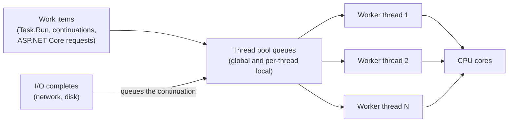
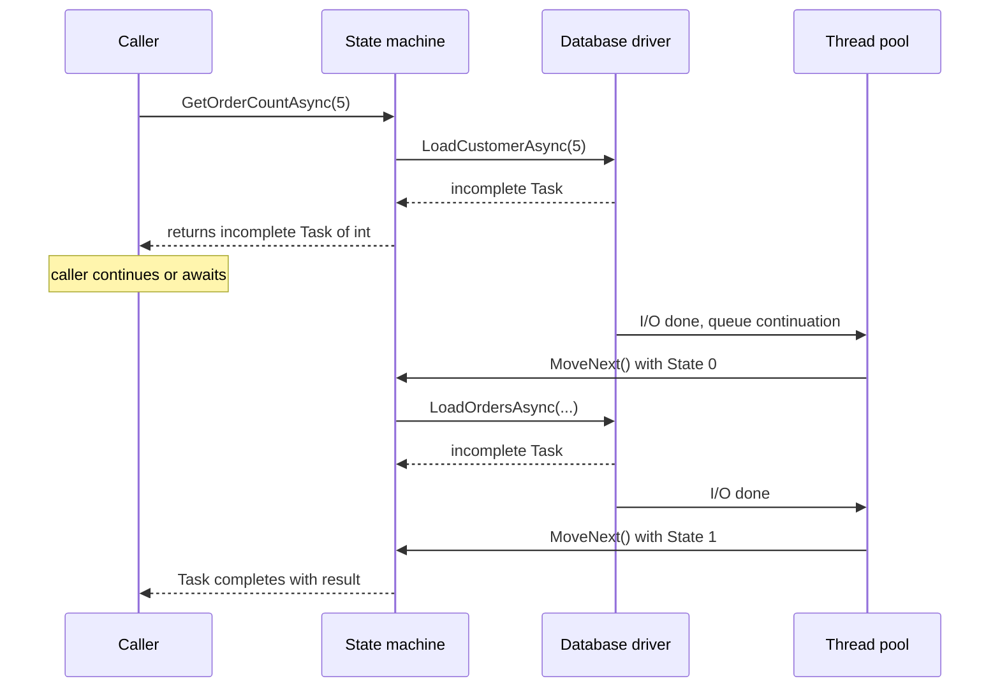
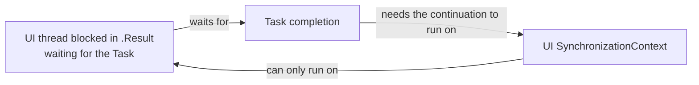
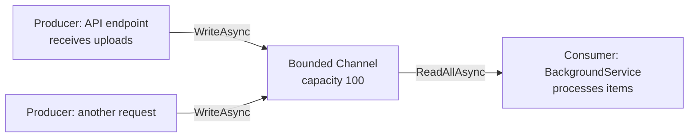

# Async/Await, Tasks and Threading

> In this document you will learn how .NET runs concurrent code: threads, the thread pool, `Task`, how `async`/`await` really works (the compiler state machine), `SynchronizationContext` and `ConfigureAwait(false)`, deadlocks from `.Result`, `Task.WhenAll`/`WhenAny`, cancellation, `ValueTask`, `async void`, async exceptions, `IAsyncEnumerable`, parallel loops, locks and `Channel<T>`. This is one of the most important .NET interview topics, and it is very different from the JavaScript event loop. Every ordering and output example was run on .NET 10.

**Before this:** [JavaScript event loop](../02-javascript/16-event-loop.md) · [JavaScript async/await](../02-javascript/18-async-await.md) · [Node.js runtime and architecture](../07-nodejs-backend/01-nodejs-runtime-and-architecture.md) · [Processes, threads and memory](../01-cs-and-web-fundamentals/03-operating-systems-processes-threads-memory.md) · **Interview questions:** [jump to the interview section](#interview-questions)

## Table of contents

1. [JavaScript vs .NET: the key difference](#javascript-vs-net-the-key-difference)
2. [Threads and the thread pool](#threads-and-the-thread-pool)
3. [Task vs Thread](#task-vs-thread)
4. [async and await basics](#async-and-await-basics)
5. [How await works inside: the state machine](#how-await-works-inside-the-state-machine)
6. [SynchronizationContext and ConfigureAwait](#synchronizationcontext-and-configureawait)
7. [Deadlocks from Result and Wait](#deadlocks-from-result-and-wait)
8. [Running tasks concurrently: WhenAll and WhenAny](#running-tasks-concurrently-whenall-and-whenany)
9. [Exceptions in async code](#exceptions-in-async-code)
10. [Cancellation with CancellationToken](#cancellation-with-cancellationtoken)
11. [async void](#async-void)
12. [Task.Run and CPU-bound work in ASP.NET Core](#taskrun-and-cpu-bound-work-in-aspnet-core)
13. [ValueTask](#valuetask)
14. [TaskCompletionSource](#taskcompletionsource)
15. [IAsyncEnumerable and await foreach](#iasyncenumerable-and-await-foreach)
16. [Parallel loops and PLINQ](#parallel-loops-and-plinq)
17. [Thread safety and synchronization](#thread-safety-and-synchronization)
18. [Channels: producer and consumer](#channels-producer-and-consumer)
19. [Common mistakes](#common-mistakes)
20. [Best practices](#best-practices)
21. [How to explain this in an interview](#how-to-explain-this-in-an-interview)
22. [Interview questions](#interview-questions)
23. [Summary](#summary)
24. [References](#references)

---

## JavaScript vs .NET: the key difference

You already know JavaScript's model from the [event loop document](../02-javascript/16-event-loop.md):

- JavaScript runs your code on **one thread**. Only one piece of your code runs at a time.
- `await` pauses a function. Its continuation is queued as a **microtask** and runs later on the **same** thread.
- Two callbacks never run at the same moment, so you rarely need locks.

.NET is different:

- A .NET process has **many threads**. Your code can truly run in parallel on several CPU cores.
- `await` also pauses a method, but its continuation can run on **any thread-pool thread** (unless a `SynchronizationContext` says otherwise).
- Shared data can be read and written by two threads at the same instant, so you **need thread safety**: locks, `Interlocked`, concurrent collections.

| Topic | JavaScript / Node.js | .NET |
| --- | --- | --- |
| Threads running your code | One main thread (plus workers, which do not share memory by default) | Many threads that share memory |
| What `await` waits for | A `Promise` | A `Task` (or any "awaitable") |
| Where the code after `await` runs | Same thread, as a microtask | A thread-pool thread, or the captured context |
| Blocking the thread | Freezes the whole app | Blocks one thread; the pool can add threads, but slowly |
| CPU-heavy work | Must move to a worker thread | Can run on the thread pool or `Parallel` |
| Race conditions on shared data | Rare (only across `await`s) | Common; need locks or atomic operations |
| Promise starts when | Created (eager) | `Task` from an async method also starts immediately (eager) |

If you know Node.js: in Node, I/O happens in libuv and your JavaScript callbacks run on one thread. In ASP.NET Core, each request runs on a thread-pool thread, and many requests run **in parallel** on different threads. `async`/`await` frees the thread while waiting for I/O, so a small number of threads can serve thousands of concurrent requests.

## Threads and the thread pool

### What a thread is

A **thread** is an independent path of execution inside a process. Each thread has its own call stack, but all threads in a process share the same heap memory. The operating system decides which thread runs on which CPU core and when.

Creating an OS thread is expensive: it needs memory for its stack (often 1 MB reserved on Windows) and time to start. Switching between threads (a **context switch**) also costs time.

```csharp
var th = new Thread(() =>
    Console.WriteLine($"dedicated thread IsThreadPool={Thread.CurrentThread.IsThreadPoolThread}"));
th.Start();
th.Join();   // wait for it to finish
// dedicated thread IsThreadPool=False
```

You rarely create threads directly in modern code. One valid case: a long-running loop that blocks forever (for example a legacy blocking reader). Even then, `Task.Factory.StartNew(..., TaskCreationOptions.LongRunning)` is usually used.

### The thread pool

The **thread pool** is a set of reusable worker threads managed by .NET. Instead of creating a thread for each job, you queue work, and a free pool thread runs it.

```csharp
await Task.Run(() =>
    Console.WriteLine($"Task.Run IsThreadPool={Thread.CurrentThread.IsThreadPoolThread}"));
// Task.Run IsThreadPool=True
```

Important facts:

- The pool starts with about as many threads as CPU cores (the minimum).
- If all threads are busy and work is waiting, the pool **injects new threads slowly** (the "hill climbing" algorithm adds threads gradually, roughly one or two per second once above the minimum).
- So if your code **blocks** pool threads (for example `Thread.Sleep` or `.Result` on I/O), new requests wait in the queue. This is called **thread pool starvation**. In a web server it looks like "the app is slow, but CPU is low".



## Task vs Thread

A **`Task`** represents **an operation that will complete in the future**. It is the .NET equivalent of a JavaScript `Promise`. `Task<T>` is an operation that will produce a `T`.

A `Task` is **not** a thread. Many tasks use no thread at all while they wait.

| | `Thread` | `Task` |
| --- | --- | --- |
| What it is | An OS execution unit | A promise of a future result |
| Cost | Expensive (stack memory, OS object) | Cheap object |
| Uses a thread while waiting for I/O? | Yes, blocked | No |
| Returns a value | No (you must share state) | `Task<T>.Result` / `await` |
| Exceptions | Unhandled exception crashes the process | Stored in the task, rethrown on `await` |
| Composition | Manual (`Join`) | `await`, `WhenAll`, `WhenAny`, continuations |
| Cancellation | Manual | `CancellationToken` built into APIs |

There are two kinds of tasks:

- **I/O-bound** (waiting for a network call, a database, a file). Example: `httpClient.GetStringAsync(url)`. While waiting, **no thread is used**. The OS notifies .NET when the data arrives, and only then a pool thread runs the continuation. This is how one server handles thousands of concurrent requests.
- **CPU-bound** (calculating). Example: `Task.Run(() => ResizeImage(bytes))`. This occupies a pool thread for the whole time.

Stephen Cleary's well-known phrase: **"There is no thread"** waiting for an I/O operation.

## async and await basics

### The rules

- An `async` method can use `await`. It returns `Task`, `Task<T>`, `ValueTask`, `ValueTask<T>`, `IAsyncEnumerable<T>` or `void` (avoid `void`).
- `await task` means: "if the task is done, continue now with its result; otherwise, return to my caller and continue this method later, when the task completes".
- The method runs **synchronously until the first `await` of an incomplete task**. This is the same as JavaScript.

```csharp
static async Task<decimal> GetPriceAsync(string sku)
{
    using var http = new HttpClient();   // (in real apps use IHttpClientFactory)
    string json = await http.GetStringAsync($"https://api.example.com/prices/{sku}");
    return decimal.Parse(json);
}
```

**Naming:** methods that return a task end with `Async` (`GetPriceAsync`).

### Example 1: execution order

```csharp
Console.WriteLine("1. Main start");
Task t = DoWorkAsync();
Console.WriteLine("3. Main continues");
await t;
Console.WriteLine("6. Main end");

static async Task DoWorkAsync()
{
    Console.WriteLine("2. DoWork before await");
    await Task.Delay(100);
    Console.WriteLine("4. DoWork after await");
    await Task.Yield();
    Console.WriteLine("5. DoWork end");
}
```

Output:

```text
1. Main start
2. DoWork before await
3. Main continues
4. DoWork after await
5. DoWork end
6. Main end
```

Step by step:

1. `Main` prints line 1.
2. `DoWorkAsync()` starts **synchronously**, on the same thread. It prints line 2.
3. It reaches `await Task.Delay(100)`. The delay is not finished, so the method returns an incomplete `Task` to `Main`.
4. `Main` prints line 3, then awaits `t` (not done), so `Main` also pauses.
5. After 100 ms a timer fires. A pool thread runs the rest of `DoWorkAsync`: line 4.
6. `Task.Yield()` forces a real pause; the rest runs as a new work item: line 5.
7. `DoWorkAsync`'s task completes, so `Main` resumes: line 6.

### Example 2: no await inside means fully synchronous

```csharp
var task = NoAwaitInsideAsync();
Console.WriteLine($"B returned, completed={task.IsCompleted}");

static async Task NoAwaitInsideAsync()
{
    Console.WriteLine("A inside, runs synchronously");
    Thread.Sleep(100);              // blocks the caller's thread
    await Task.CompletedTask;       // already complete: no pause
}
// A inside, runs synchronously
// B returned, completed=True
```

`async` does **not** make code run in the background. It only lets the method pause at an `await` of an incomplete task. The compiler even warns (CS1998) if an `async` method has no `await` at all.

### Example 3: sequential vs concurrent

```csharp
// Sequential: about 600 ms
await FakeIo("a", 300);
await FakeIo("b", 300);

// Concurrent: about 300 ms (both delays run at the same time)
await Task.WhenAll(FakeIo("a", 300), FakeIo("b", 300));

static async Task FakeIo(string name, int ms) => await Task.Delay(ms);
```

Measured on .NET 10: sequential ~600 ms, `WhenAll` ~300 ms. Calling an async method **starts** it. If you start two and then await both, they overlap.

## How await works inside: the state machine

### What the compiler does

The compiler rewrites every `async` method into a **state machine**: a hidden struct that stores the local variables as fields and remembers which `await` it stopped at (the **state** number).

Take this method:

```csharp
public async Task<int> GetOrderCountAsync(int customerId)
{
    var customer = await _db.LoadCustomerAsync(customerId);   // await #1
    var orders = await _db.LoadOrdersAsync(customer.Id);       // await #2
    return orders.Count;
}
```

The compiler produces something like this (simplified):

```csharp
struct GetOrderCountStateMachine : IAsyncStateMachine
{
    public int State;                                   // -1 = running, 0 = at await #1, 1 = at await #2
    public AsyncTaskMethodBuilder<int> Builder;         // creates and completes the returned Task
    public int CustomerId;                              // parameters and locals become fields
    private Customer _customer;
    private TaskAwaiter<Customer> _awaiter1;
    private TaskAwaiter<List<Order>> _awaiter2;

    public void MoveNext()
    {
        try
        {
            if (State == 0) goto ResumeAfterAwait1;
            if (State == 1) goto ResumeAfterAwait2;

            _awaiter1 = _db.LoadCustomerAsync(CustomerId).GetAwaiter();
            if (!_awaiter1.IsCompleted)
            {
                State = 0;
                Builder.AwaitUnsafeOnCompleted(ref _awaiter1, ref this);  // "call MoveNext again when done"
                return;                                                    // give the thread back
            }
        ResumeAfterAwait1:
            _customer = _awaiter1.GetResult();                             // result or rethrow exception

            _awaiter2 = _db.LoadOrdersAsync(_customer.Id).GetAwaiter();
            if (!_awaiter2.IsCompleted)
            {
                State = 1;
                Builder.AwaitUnsafeOnCompleted(ref _awaiter2, ref this);
                return;
            }
        ResumeAfterAwait2:
            var orders = _awaiter2.GetResult();
            Builder.SetResult(orders.Count);                               // complete the Task<int>
        }
        catch (Exception ex)
        {
            Builder.SetException(ex);                                      // fault the Task
        }
    }
}
```

Key points:

1. **The original method** creates the state machine, calls `MoveNext()` once, and returns `Builder.Task`.
2. **The fast path:** if the awaited task is already complete, the code continues immediately with no pause and no thread switch.
3. **The slow path:** if not complete, the method registers `MoveNext` as the continuation and **returns**. The thread is free.
4. **When the awaited task completes**, `MoveNext` runs again (on a pool thread or the captured context), jumps to the saved state, and continues.
5. **Exceptions** are caught and stored in the returned task. They are rethrown when someone awaits it.
6. In Release builds the state machine is a **struct**. It is copied to the heap ("boxed") only when the method actually pauses. So a method that completes synchronously allocates very little.



### Async in .NET 10 and the future

> **Note:** the .NET team is experimenting with "runtime async", where the runtime itself handles async methods instead of compiler-generated state machines. It is a preview experiment, not the default in .NET 10. The state machine model above is what you should explain in interviews.

### The thread can change after await

```csharp
int before = Environment.CurrentManagedThreadId;
await Task.Delay(10);
int after = Environment.CurrentManagedThreadId;   // may be a different thread
```

In a console app or ASP.NET Core, there is no special context, so the continuation runs on whatever pool thread is free. Never use thread-bound state (like `[ThreadStatic]` fields or thread-affine locks such as `Monitor`) across an `await`. Use `AsyncLocal<T>` for "ambient" data that should flow with the async call (this is how `HttpContextAccessor` and logging scopes flow).

## SynchronizationContext and ConfigureAwait

### What a SynchronizationContext is

A **`SynchronizationContext`** is an object that decides **where continuations run**. When you `await` a task, by default the state machine captures the current context (if there is one) and posts the continuation back to it.

| Environment | `SynchronizationContext.Current` | Where code after `await` runs |
| --- | --- | --- |
| WPF / WinForms / MAUI UI thread | UI context | Back on the UI thread (so you can update controls) |
| Old ASP.NET (.NET Framework) | `AspNetSynchronizationContext` | One request at a time, inside the request context |
| **ASP.NET Core** | **`null`** | Any thread-pool thread |
| Console app, worker service | `null` | Any thread-pool thread |
| xUnit tests | xUnit sets its own context (it limits parallelism) | Through that context |

```csharp
Console.WriteLine(SynchronizationContext.Current is null); // True (console app)
```

### ConfigureAwait(false)

`await task.ConfigureAwait(false)` means: **"do not post the continuation back to the captured context; any thread is fine"**.

Why it existed:

1. **Performance:** posting back to a UI thread or to the old ASP.NET context costs time.
2. **Deadlock prevention:** if someone blocks on the task (see the next section), the continuation does not need the blocked thread.

### Does it matter in ASP.NET Core?

ASP.NET Core has **no** `SynchronizationContext`. So in **application code** in ASP.NET Core, `ConfigureAwait(false)` has almost no effect, and Microsoft's ASP.NET Core team does not require it. Many teams leave it out of controllers and services.

But it still matters in **library code** (NuGet packages, shared libraries) because you do not know who will call it. A WPF app or a .NET Framework ASP.NET app might call your library and block on it. The common guidance:

- **Libraries:** use `ConfigureAwait(false)` on every `await`.
- **UI apps:** do **not** use it in code that needs to touch UI controls after the `await`.
- **ASP.NET Core apps:** optional. It does not hurt, but it is not needed for correctness.

> **Newer .NET (8+):** `ConfigureAwait` also accepts `ConfigureAwaitOptions`, for example `await task.ConfigureAwait(ConfigureAwaitOptions.SuppressThrowing)` to wait for a task without rethrowing its exception, or `ForceYielding` to always continue asynchronously.

## Deadlocks from Result and Wait

### The classic deadlock

This is the most famous async bug in .NET. It happens when **sync code blocks on async code** in an environment with a single-threaded `SynchronizationContext` (UI apps, old ASP.NET).

```csharp
// In a WPF button click handler or an old ASP.NET MVC action:
public string GetData()
{
    return GetDataAsync().Result;   // ❌ blocks the UI thread
}

private async Task<string> GetDataAsync()
{
    await Task.Delay(100);          // captures the UI context
    return "data";                  // wants to run on the UI thread... which is blocked
}
```

Step by step:

1. The UI thread calls `GetDataAsync()`. It starts the delay and captures the UI `SynchronizationContext`.
2. It returns an incomplete task. The UI thread calls `.Result` and **blocks**, waiting for the task.
3. After 100 ms, the delay completes. The continuation (`return "data"`) must be posted to the UI context.
4. The UI context only runs on the UI thread. The UI thread is blocked in `.Result`.
5. The task waits for the UI thread; the UI thread waits for the task. **Deadlock.** The app freezes forever.



I reproduced this in a console app with a custom single-threaded `SynchronizationContext` (similar to a UI thread). The version with `.Result` timed out (deadlock). The same code with `ConfigureAwait(false)` inside `GetDataAsync` completed, because the continuation no longer needed the blocked thread.

### Fixes, from best to worst

1. **Async all the way.** Make the caller `async` and `await` the task. This is the real fix.
2. `ConfigureAwait(false)` on **every** await inside the async code (all the way down, including libraries). Fragile: one missed `await` brings the deadlock back.
3. As a last resort in legacy code: `Task.Run(() => GetDataAsync()).GetAwaiter().GetResult()`. It runs the async method on a pool thread with no context. It still blocks a thread.

### Does this deadlock in ASP.NET Core?

No, not in this classic form, because ASP.NET Core has no `SynchronizationContext`. **But blocking is still bad there.** `.Result` and `.Wait()` hold a pool thread while waiting. Under load, many blocked threads cause **thread pool starvation**: the pool grows slowly, requests queue up, latency explodes. So the rule is the same everywhere: **do not block on async code.**

### Result vs GetAwaiter().GetResult()

```csharp
try { Fail("sync-wait", 10).Wait(); }
catch (Exception ex) { Console.WriteLine($"{ex.GetType().Name} inner={ex.InnerException!.Message}"); }
// AggregateException inner=sync-wait

try { Fail("getawaiter", 10).GetAwaiter().GetResult(); }
catch (Exception ex) { Console.WriteLine($"{ex.GetType().Name} {ex.Message}"); }
// InvalidOperationException getawaiter
```

`.Result` and `.Wait()` wrap exceptions in `AggregateException`. `GetAwaiter().GetResult()` throws the original exception, like `await`. Both still block.

## Running tasks concurrently: WhenAll and WhenAny

### Task.WhenAll

`Task.WhenAll` returns a task that completes when **all** the given tasks complete. With `Task<T>`, it returns `T[]` in the **same order** as the input.

```csharp
var results = await Task.WhenAll(GetPrice("pen", 10), GetPrice("book", 20));
Console.WriteLine(string.Join(",", results)); // 10,20

static async Task<decimal> GetPrice(string item, decimal price) { await Task.Delay(50); return price; }
```

It is like `Promise.all`, with one difference: `Promise.all` rejects as soon as **one** promise rejects. `Task.WhenAll` waits until **all** tasks finish (success or failure), then completes as faulted if any failed.

Realistic example: loading a dashboard.

```csharp
public async Task<DashboardDto> GetDashboardAsync(int userId, CancellationToken ct)
{
    Task<UserDto> userTask = _users.GetAsync(userId, ct);
    Task<IReadOnlyList<OrderDto>> ordersTask = _orders.GetRecentAsync(userId, ct);
    Task<int> unreadTask = _notifications.CountUnreadAsync(userId, ct);

    await Task.WhenAll(userTask, ordersTask, unreadTask);

    return new DashboardDto(userTask.Result, ordersTask.Result, unreadTask.Result);  // safe: all are complete
}
```

Using `.Result` after `WhenAll` is fine, because the tasks are already complete. Nothing blocks. (`await userTask` also works and reads the same way.)

**Warning:** do not run several queries on the **same EF Core `DbContext`** concurrently. A `DbContext` is not thread-safe and throws if two operations overlap. Use separate contexts (for example `IDbContextFactory<T>`) for parallel queries. See [Entity Framework Core and data access](10-entity-framework-core-and-data-access.md).

### Task.WhenAny

`Task.WhenAny` completes when the **first** task completes. It returns that task (not its result). It never throws by itself; you must await the returned task to see its result or exception.

```csharp
var slow = FakeIo("slow", 2000);
var winner = await Task.WhenAny(slow, Task.Delay(200));
Console.WriteLine(winner == slow ? "slow finished" : "timeout"); // timeout
```

Important: `WhenAny` does **not** cancel the other tasks. `slow` keeps running in the background. Use a `CancellationToken` to really stop it.

Since .NET 6 there is a simpler timeout tool:

```csharp
try { await FakeIo("slow2", 2000).WaitAsync(TimeSpan.FromMilliseconds(100)); }
catch (TimeoutException) { Console.WriteLine("WaitAsync TimeoutException"); }
```

`WaitAsync` stops **waiting**; it does not stop the operation. Again, pass a token to the operation if you want it to stop.

> **New in .NET 9:** `Task.WhenEach` returns an `IAsyncEnumerable<Task<T>>` that yields tasks **in the order they complete**: `await foreach (var t in Task.WhenEach(tasks)) Console.WriteLine(await t);`.

### Throttling concurrency

`WhenAll` over 10,000 tasks starts 10,000 operations at once. That can overload a database or an external API. Limit concurrency with `SemaphoreSlim` or `Parallel.ForEachAsync` (see [Parallel loops](#parallel-loops-and-plinq)).

```csharp
var gate = new SemaphoreSlim(2);         // at most 2 at a time
var jobs = Enumerable.Range(1, 6).Select(async i =>
{
    await gate.WaitAsync();
    try { await Task.Delay(50); }
    finally { gate.Release(); }
});
await Task.WhenAll(jobs);                // measured: max concurrent 2
```

## Exceptions in async code

### Exceptions are stored in the task

An exception inside an async method does not throw at the call. It is stored in the returned task. It is thrown when you **await** the task.

```csharp
Task faulty = Fail("lazy", 0);
Console.WriteLine($"no throw yet, IsFaulted={faulty.IsFaulted}"); // no throw yet, IsFaulted=True
try { await faulty; }
catch (InvalidOperationException ex) { Console.WriteLine($"thrown at await: {ex.Message}"); } // thrown at await: lazy

static async Task Fail(string message, int ms) { await Task.Delay(ms); throw new InvalidOperationException(message); }
```

(Even with `ms = 0`, `Task.Delay(0)` completes immediately, the method throws synchronously inside the state machine, and the exception is still captured into the task.)

### WhenAll and multiple exceptions

```csharp
Task all = Task.WhenAll(Fail("first", 100), Fail("second", 50));
try { await all; }
catch (Exception ex)
{
    Console.WriteLine($"caught {ex.GetType().Name}: {ex.Message}");      // caught InvalidOperationException: second
    Console.WriteLine($"inner count {all.Exception!.InnerExceptions.Count}"); // inner count 2
}
```

- `await` on a faulted `WhenAll` task throws **only one** exception (the first one in its list), not an `AggregateException`.
- The task's `Exception` property is an `AggregateException` with **all** of them.
- On .NET 10, in my runs the list was in the order the tasks **failed** (here, "second" failed first after 50 ms). Do not depend on which one you get. If you need all errors, read `all.Exception.InnerExceptions`.

### Unobserved exceptions

If a task faults and nobody ever awaits it or reads its `Exception`, the exception is "unobserved". Since .NET 4.5 this does **not** crash the process; the `TaskScheduler.UnobservedTaskException` event fires when the task is garbage collected. The danger is silence: the error is lost. That is why "fire and forget" without error handling is a bug.

### Exceptions and finally

```csharp
try { Console.WriteLine("try"); await Task.Delay(10); throw new Exception("x"); }
catch (Exception) { Console.WriteLine("catch"); await Task.Delay(10); }
finally { Console.WriteLine("finally"); }
// try
// catch
// finally
```

`try`/`catch`/`finally` works normally across `await`. You can `await` inside `catch` and `finally` (since C# 6).

## Cancellation with CancellationToken

### What it is

.NET uses **cooperative cancellation**. A **`CancellationTokenSource`** (CTS) creates a **`CancellationToken`**. You pass the token down to every async method. When someone calls `cts.Cancel()`, the token is marked as cancelled. Code that checks the token stops and throws `OperationCanceledException`.

Nothing is forcibly killed. Code must check the token. The idea is like `AbortController` and `AbortSignal` in JavaScript (`fetch(url, { signal })`).

### Example

```csharp
using var cts = new CancellationTokenSource(TimeSpan.FromMilliseconds(150));   // auto-cancel after 150 ms
try { await ProcessItemsAsync(10, cts.Token); }
catch (OperationCanceledException ex) { Console.WriteLine($"cancelled: {ex.GetType().Name}"); }

static async Task ProcessItemsAsync(int count, CancellationToken ct)
{
    for (int i = 1; i <= count; i++)
    {
        ct.ThrowIfCancellationRequested();   // check at safe points
        await Task.Delay(50, ct);            // pass the token to every async call
        Console.WriteLine($"processed {i}");
    }
}
```

Output:

```text
processed 1
processed 2
cancelled: TaskCanceledException
```

`TaskCanceledException` is a subclass of `OperationCanceledException`. **Always catch `OperationCanceledException`**, which covers both. A cancelled task has `Status == TaskStatus.Canceled` (not `Faulted`).

### Linked tokens

Combine a user's cancellation with a timeout:

```csharp
using var userCts = new CancellationTokenSource();
using var timeoutCts = new CancellationTokenSource(TimeSpan.FromMilliseconds(50));
using var linked = CancellationTokenSource.CreateLinkedTokenSource(userCts.Token, timeoutCts.Token);
try { await Task.Delay(1000, linked.Token); }
catch (OperationCanceledException)
{
    Console.WriteLine($"timeout={timeoutCts.IsCancellationRequested} user={userCts.IsCancellationRequested}");
}
// timeout=True user=False
```

### Cancellation in ASP.NET Core

ASP.NET Core gives you `HttpContext.RequestAborted`, a token that is cancelled when the **client disconnects**. In minimal APIs and controllers, you can simply add a `CancellationToken` parameter and it is bound to that token.

```csharp
app.MapGet("/reports/{id}", async (int id, IReportService reports, CancellationToken ct) =>
{
    var report = await reports.BuildAsync(id, ct);   // pass it all the way down: EF Core, HttpClient...
    return Results.Ok(report);
});
```

If the user closes the browser tab, the database query is cancelled and the server stops wasting work.

Best practices:

- Accept `CancellationToken ct = default` as the **last parameter** of public async methods.
- Pass it to **every** async call (EF Core `ToListAsync(ct)`, `HttpClient.GetAsync(url, ct)`, `Task.Delay(ms, ct)`).
- Do not cancel work that must finish once started (for example after money has been charged). Pass `CancellationToken.None` for the critical part.
- Dispose `CancellationTokenSource` objects you create (they may hold timers).

## async void

`async void` methods cannot be awaited and have no task to store exceptions. **Exceptions thrown inside them are raised directly on the `SynchronizationContext`** that was active when the method started, or on the thread pool if there was none. On the thread pool, an unhandled exception **crashes the process**.

```csharp
try { FireAndForgetVoid(); }
catch { Console.WriteLine("never caught here"); }   // this catch can never catch the async part

static async void FireAndForgetVoid()
{
    await Task.Yield();
    throw new InvalidOperationException("boom");    // crashes the process in a console app or ASP.NET Core
}
```

Problems with `async void`:

1. The caller cannot catch its exceptions.
2. The caller cannot know when it finishes.
3. It is hard to test.

**The only valid use: event handlers** in UI frameworks (`async void Button_Click(object sender, EventArgs e)`), because the event signature requires `void`. Even there, wrap the body in `try/catch`.

Watch out for lambdas: passing an async lambda to a parameter of type `Action` creates an `async void` lambda.

```csharp
// ❌ Wrong: List<T>.ForEach takes Action<T>, so this lambda is async void. Nothing waits for it.
orders.ForEach(async o => await SendEmailAsync(o));

// ✅ Correct
foreach (var o in orders) await SendEmailAsync(o);
// or, concurrently with a limit:
await Parallel.ForEachAsync(orders, new ParallelOptions { MaxDegreeOfParallelism = 4 },
    async (o, ct) => await SendEmailAsync(o, ct));
```

## Task.Run and CPU-bound work in ASP.NET Core

`Task.Run` queues work to the thread pool. It is the right tool to move **CPU-bound** work off a **UI thread**, so the window stays responsive.

In **ASP.NET Core**, the request is already running on a pool thread. Wrapping code in `Task.Run` and immediately awaiting it just moves the work from one pool thread to another. It adds overhead and gives no benefit.

```csharp
// ❌ Wrong in ASP.NET Core: pointless thread hop
app.MapGet("/orders", async (IOrderService s) => await Task.Run(() => s.GetOrders()));

// ✅ Correct: use the real async API
app.MapGet("/orders", async (IOrderService s, CancellationToken ct) => await s.GetOrdersAsync(ct));
```

More `Task.Run` mistakes:

- **"Fake async"**: wrapping a blocking call (`Task.Run(() => File.ReadAllText(path))`) in a library to make it look async. It still blocks a pool thread. Use the real async API (`File.ReadAllTextAsync`).
- **Fire-and-forget in a request**: `_ = Task.Run(() => SendEmail(order));` keeps running after the response, uses scoped services that may already be disposed, and loses exceptions. Use a background queue with a `BackgroundService` instead. See [Caching, background jobs and messaging](12-caching-background-jobs-and-messaging.md).
- **Long-running loops on the pool**: an endless loop on a pool thread reduces the pool for everyone. Use a `BackgroundService` or `TaskCreationOptions.LongRunning`.

`Task.Run` vs `Task.Factory.StartNew`: `Task.Run` understands async lambdas and unwraps them. `StartNew` with an async lambda returns a `Task<Task<T>>`:

```csharp
var outer = Task.Factory.StartNew(async () => { await Task.Delay(100); return 7; });
Console.WriteLine(outer.GetType().GetGenericArguments()[0].Name); // Task`1  (a Task<Task<int>>)
Console.WriteLine(await outer.Unwrap());                          // 7
Console.WriteLine(await Task.Run(async () => { await Task.Delay(10); return 8; })); // 8
```

Awaiting `outer` once gives you the inner task, not the number, and it completes as soon as the inner task **starts**, not when it finishes. Prefer `Task.Run`.

When CPU-bound work in ASP.NET Core is truly heavy (image processing, report generation), do it in a background worker or a separate service so it does not compete with request handling.

## ValueTask

### What it is

**`ValueTask<T>`** is a struct that can hold **either** a ready result **or** a `Task<T>`. It exists to avoid allocating a `Task` object when a method usually completes synchronously.

```csharp
class PriceCache
{
    private readonly Dictionary<string, decimal> _cache = new();

    public async ValueTask<decimal> GetAsync(string key)
    {
        if (_cache.TryGetValue(key, out var v)) return v;   // common path: no Task allocation
        await Task.Delay(20);                               // rare path: really async
        return _cache[key] = 9.99m;
    }
}
```

The first call misses (async), the second hits (synchronous, no allocation).

### Rules (important)

A `ValueTask` must be consumed **exactly once**:

- ❌ Do not await the same `ValueTask` twice.
- ❌ Do not call `.Result` / `.GetAwaiter().GetResult()` before it completes.
- ❌ Do not await it concurrently from two places.
- ✅ If you need any of that, call `.AsTask()` once and use the `Task`.

These rules exist because a `ValueTask` can be backed by a **pooled, reusable object** (`IValueTaskSource`). After the first await, that object may be reused for another operation.

### When to use

- Use `Task`/`Task<T>` by default.
- Use `ValueTask<T>` for **hot paths that often complete synchronously** (caches, buffered streams: `Stream.ReadAsync(Memory<byte>)` returns `ValueTask<int>`).
- Interface methods that implementers may complete synchronously (like `IAsyncDisposable.DisposeAsync` returning `ValueTask`).

Note: completed `Task` objects for common values are cached by the runtime (`Task.CompletedTask`, and for some results like `true`/`false`), so `ValueTask` helps most for `Task<T>` with varying results.

## TaskCompletionSource

**`TaskCompletionSource<T>`** lets you create a task and complete it **manually**. It turns callback-based or event-based APIs into awaitable tasks. It is like `new Promise((resolve, reject) => ...)` in JavaScript.

```csharp
static Task<string> WaitForEventAsync()
{
    var tcs = new TaskCompletionSource<string>(TaskCreationOptions.RunContinuationsAsynchronously);
    var timer = new System.Timers.Timer(50) { AutoReset = false };
    timer.Elapsed += (_, _) => { tcs.TrySetResult("event fired"); timer.Dispose(); };
    timer.Start();
    return tcs.Task;
}
Console.WriteLine(await WaitForEventAsync()); // event fired
```

- `TrySetResult`, `TrySetException`, `TrySetCanceled` complete the task (the `Try` versions do not throw if it is already completed).
- **Always use `TaskCreationOptions.RunContinuationsAsynchronously`.** Without it, the code awaiting the task runs **synchronously inside** `TrySetResult`, on the thread of whoever completes it. That can cause surprising reentrancy, stack dives and deadlocks (for example when completing the task while holding a lock).

## IAsyncEnumerable and await foreach

**`IAsyncEnumerable<T>`** (C# 8, .NET Core 3.0) is an async stream: a sequence where getting each next item may need to await. It combines `yield return` with `await`. It is like an async generator (`async function*`) with `for await...of` in JavaScript.

```csharp
static async IAsyncEnumerable<int> GetPagesAsync(int count,
    [EnumeratorCancellation] CancellationToken ct = default)
{
    for (int i = 1; i <= count; i++)
    {
        await Task.Delay(20, ct);   // for example, fetch the next page from an API
        yield return i;
    }
}

await foreach (var page in GetPagesAsync(3))
    Console.WriteLine($"page {page}");
// page 1
// page 2
// page 3
```

### Cancellation

The `[EnumeratorCancellation]` attribute connects a token passed with `.WithCancellation(token)` to the method's parameter.

```csharp
using var cts = new CancellationTokenSource();
try
{
    await foreach (var page in GetPagesAsync(10).WithCancellation(cts.Token))
    {
        Console.WriteLine($"page {page}");
        if (page == 2) cts.Cancel();
    }
}
catch (OperationCanceledException) { Console.WriteLine("stream cancelled"); }
// page 1
// page 2
// stream cancelled
```

### Real-world usage

- EF Core: `await foreach (var order in db.Orders.AsAsyncEnumerable())` streams rows without loading all of them into memory.
- ASP.NET Core can return `IAsyncEnumerable<T>` from an endpoint; `System.Text.Json` streams the JSON array to the client as items arrive.
- Reading paged APIs, message streams, or large files.

## Parallel loops and PLINQ

**Concurrency** means several operations are in progress at the same time (they may be waiting). **Parallelism** means several operations are **executing** at the same instant on different cores. `async`/`await` gives concurrency for I/O. `Parallel` and PLINQ give parallelism for CPU work.

### Parallel.For and Parallel.ForEach (CPU-bound)

```csharp
Parallel.ForEach(images, new ParallelOptions { MaxDegreeOfParallelism = Environment.ProcessorCount },
    image => Resize(image));    // runs on several pool threads; blocks the caller until all are done
```

- Use for **CPU-bound** work on independent items.
- The calling thread blocks until all items are done.
- The body must be thread-safe (no unsynchronized shared state).
- Do **not** pass an async lambda to `Parallel.ForEach`. It becomes `async void`; the loop "finishes" before the work does.

### Parallel.ForEachAsync (.NET 6, I/O-bound with a limit)

```csharp
await Parallel.ForEachAsync(Enumerable.Range(1, 8),
    new ParallelOptions { MaxDegreeOfParallelism = 3 },
    async (i, ct) =>
    {
        await Task.Delay(30, ct);      // for example, call an API for item i
    });
// measured: at most 3 items in progress at the same time
```

This is the cleanest way to say "process these 1,000 items, at most 10 at a time".

### PLINQ

**PLINQ** (Parallel LINQ) runs a LINQ query on several cores with `.AsParallel()`:

```csharp
var squares = Enumerable.Range(1, 10).AsParallel()
    .Where(n => n % 2 == 0)
    .Select(n => n * n)
    .OrderBy(n => n);        // without OrderBy (or AsOrdered), result order is not guaranteed
Console.WriteLine(string.Join(",", squares)); // 4,16,36,64,100
```

PLINQ helps only when each item has **significant CPU work**. For tiny work like this example, the overhead makes it slower than normal LINQ. Never use PLINQ for I/O.

### Choosing

| Work type | Tool |
| --- | --- |
| A few independent I/O calls | Start them, then `await Task.WhenAll(...)` |
| Many I/O calls with a concurrency limit | `Parallel.ForEachAsync` or `SemaphoreSlim` + `WhenAll` |
| CPU-heavy work on a collection | `Parallel.ForEach` or PLINQ |
| Producer/consumer pipeline | `Channel<T>` |
| One CPU-heavy job off the UI thread | `await Task.Run(...)` |

## Thread safety and synchronization

### The problem: race conditions

A **race condition** happens when the result depends on the timing of threads. The classic example is `count++`. It looks like one step, but it is three: read `count`, add 1, write it back. Two threads can read the same old value, and one increment is lost.

```csharp
int unsafeCount = 0, safeCount = 0, lockedCount = 0;
var gate = new Lock();   // .NET 9+; on .NET 8 use: var gate = new object();

Parallel.For(0, 100_000, _ =>
{
    unsafeCount++;                          // ❌ race: increments get lost
    Interlocked.Increment(ref safeCount);   // ✅ atomic
    lock (gate) { lockedCount++; }          // ✅ mutual exclusion
});

Console.WriteLine($"unsafe<100000={unsafeCount < 100_000} interlocked={safeCount} locked={lockedCount}");
// unsafe<100000=True interlocked=100000 locked=100000
```

In my run, the unsafe counter ended below 100,000. The exact number changes every run, which is what makes race bugs so hard to reproduce.

In JavaScript this example cannot fail, because only one callback runs at a time. In .NET, any shared mutable state used by more than one thread needs protection: singleton services, static fields, caches, and objects shared between parallel tasks.

### lock and Monitor

`lock (obj) { ... }` lets only **one thread at a time** enter the block for that object. With a normal object, the compiler turns it into `Monitor.Enter` / `Monitor.Exit` inside `try/finally`, so the lock is released even if the block throws.

```csharp
public sealed class InventoryService
{
    private readonly Lock _gate = new();
    private readonly Dictionary<string, int> _stock = new();

    public bool TryReserve(string sku, int qty)
    {
        lock (_gate)                                    // check-and-update must be one atomic step
        {
            if (_stock.GetValueOrDefault(sku) < qty) return false;
            _stock[sku] -= qty;
            return true;
        }
    }
}
```

> **New in .NET 9 / C# 13:** the **`System.Threading.Lock`** type. When you `lock` on a `Lock` object, the compiler uses its faster, dedicated API (`EnterScope`) instead of `Monitor`. On .NET 8, lock on a `private readonly object _gate = new();`.

Rules for `lock`:

- Lock on a **private, readonly** object. Never `lock (this)`, `lock (typeof(X))` or `lock ("text")`; other code could lock the same object and cause deadlocks.
- Keep the locked block **short**. No I/O inside a lock.
- **You cannot `await` inside a `lock` block.** The compiler gives error CS1996. The reason: `Monitor` is **thread-affine** (the same thread must release it), but after `await` you may be on a different thread. Use `SemaphoreSlim` for async code.
- Always take multiple locks **in the same order** everywhere, or you can deadlock (thread A holds lock 1 and waits for lock 2; thread B holds lock 2 and waits for lock 1).

### Interlocked

`Interlocked` provides **atomic** operations on single variables, using special CPU instructions. No lock needed.

```csharp
Interlocked.Increment(ref _requestCount);
Interlocked.Add(ref _bytesSent, chunk.Length);
var old = Interlocked.Exchange(ref _current, newValue);
Interlocked.CompareExchange(ref _state, newState, expectedState);   // set only if still the expected value
```

`CompareExchange` is the building block of lock-free code. For example, a thread-safe "max" update:

```csharp
static void InterlockedMax(ref int target, int value)
{
    int current;
    do
    {
        current = target;
        if (value <= current) return;
    }
    while (Interlocked.CompareExchange(ref target, value, current) != current);  // retry if someone changed it
}
```

Use `Interlocked` for counters and flags. Use a lock when several values must change together.

### SemaphoreSlim: the async lock

A **semaphore** allows **up to N** callers into a section at once. `SemaphoreSlim(1, 1)` acts as an **async-compatible lock**, because it has `WaitAsync()` and is not thread-affine.

```csharp
public sealed class TokenProvider
{
    private readonly SemaphoreSlim _refreshGate = new(1, 1);
    private string? _token;
    private DateTimeOffset _expiresAt;

    public async Task<string> GetTokenAsync(CancellationToken ct)
    {
        if (_token is not null && _expiresAt > DateTimeOffset.UtcNow) return _token;

        await _refreshGate.WaitAsync(ct);
        try
        {
            // double-check: another caller may have refreshed while we waited
            if (_token is null || _expiresAt <= DateTimeOffset.UtcNow)
                (_token, _expiresAt) = await FetchNewTokenAsync(ct);
            return _token;
        }
        finally
        {
            _refreshGate.Release();   // always release in finally
        }
    }
}
```

This prevents 50 concurrent requests from all refreshing the token at once. `SemaphoreSlim(N)` is also the classic way to **throttle** concurrent calls to an API.

`SemaphoreSlim` is not reentrant: if the same flow calls `WaitAsync` twice without releasing, it waits for itself forever.

### Other tools (brief)

| Tool | Use for |
| --- | --- |
| `ReaderWriterLockSlim` | Many readers, few writers (sync code only) |
| `ManualResetEventSlim`, `CountdownEvent`, `Barrier` | Signaling between threads (sync code) |
| `volatile` / `Volatile.Read` | Make sure a flag written by one thread is seen by another (no atomic read-modify-write) |
| `Lazy<T>` | Thread-safe one-time initialization |
| `ConcurrentDictionary`, `ConcurrentQueue` | Shared collections (see [Collections and LINQ](03-collections-and-linq.md#concurrent-collections)) |
| Immutable data | No locks needed if nothing changes |

### Which instance is shared in ASP.NET Core?

A **singleton** service is used by all requests at the same time, on many threads. It must be thread-safe. A **scoped** service is created per request and normally used by one flow at a time, so it usually does not need locks (unless you start parallel tasks inside one request). See [Dependency injection in ASP.NET Core](08-dependency-injection-in-aspnet-core.md).

## Channels: producer and consumer

### What it is

**`System.Threading.Channels.Channel<T>`** is a thread-safe, async-friendly queue for passing data from **producers** to **consumers**. It is built into .NET (since .NET Core 3.0). Think of it as an in-memory async pipe, like a channel in Go.

- **Unbounded** channel: no size limit. Writers never wait. Risk: memory grows if consumers are slow.
- **Bounded** channel: a maximum size. When full, writers **wait** (`WriteAsync` pauses) or items are dropped, depending on `FullMode`. This gives **backpressure**: fast producers slow down to match consumers.

### Example

```csharp
using System.Threading.Channels;

var channel = Channel.CreateBounded<int>(new BoundedChannelOptions(2)
{
    FullMode = BoundedChannelFullMode.Wait     // writers wait when 2 items are queued
});

var producer = Task.Run(async () =>
{
    for (int i = 1; i <= 5; i++) await channel.Writer.WriteAsync(i);
    channel.Writer.Complete();                  // no more items: lets the consumer loop end
});

var consumed = new List<int>();
await foreach (var item in channel.Reader.ReadAllAsync())
    consumed.Add(item * 10);
await producer;

Console.WriteLine(string.Join(",", consumed)); // 10,20,30,40,50
```

Step by step:

1. The producer writes 1 and 2. The channel is full.
2. `WriteAsync(3)` waits (without blocking a thread) until the consumer reads.
3. The consumer reads items as they come; each read frees a slot.
4. `Complete()` marks the end. `ReadAllAsync` finishes after the last item.



### Real-world usage

A common ASP.NET Core pattern: an endpoint writes a job into a channel and returns `202 Accepted` immediately; a `BackgroundService` reads the channel and processes jobs (sending emails, generating thumbnails). This is an in-process queue: if the process restarts, queued items are lost. For durable work, use a real message broker. See [Caching, background jobs and messaging](12-caching-background-jobs-and-messaging.md).

Channels vs `BlockingCollection<T>`: `BlockingCollection` blocks threads; channels are async. Prefer channels in modern code.

## Common mistakes

1. **Blocking on async code** with `.Result`, `.Wait()` or `GetAwaiter().GetResult()`. Deadlocks in UI and old ASP.NET; thread pool starvation in ASP.NET Core.
2. **`async void`** outside event handlers. Exceptions crash the process.
3. **Async lambdas passed as `Action`** (`List.ForEach`, `Parallel.ForEach`, timers). They become `async void`.
4. **Forgetting to `await`** a task. The work runs unobserved, exceptions are lost, and the compiler warning CS4014 is easy to ignore.
5. **Awaiting in a loop when calls are independent.** Start them all, then `WhenAll` (with a limit if there are many).
6. **Starting thousands of tasks at once** with `WhenAll` and overwhelming a dependency.
7. **`Task.Run` in ASP.NET Core** to "make things async". It only adds a thread hop.
8. **Using the same `DbContext` from parallel tasks.**
9. **Not passing `CancellationToken`** down the call chain.
10. **Catching `TaskCanceledException` only.** Catch `OperationCanceledException`.
11. **Awaiting a `ValueTask` twice.**
12. **`lock` around `await`** (does not compile), or using thread-affine state across `await`.
13. **Shared mutable state in singletons without synchronization.**
14. **Thinking `WhenAny` or `WaitAsync` cancels the other work.** It only stops waiting.

## Best practices

- **Async all the way**: from the endpoint down to the database and HTTP calls. Do not mix sync and async.
- **Return `Task`, not `void`**, from async methods. Use `async void` only for event handlers.
- **Accept and pass `CancellationToken`** in every async API. In ASP.NET Core, bind it from the request.
- **Use `Task.WhenAll` for independent I/O**, and limit concurrency with `Parallel.ForEachAsync` or `SemaphoreSlim`.
- **Use `ConfigureAwait(false)` in libraries**; it is optional in ASP.NET Core application code.
- **Use `Task.Run` only to move CPU work off a UI thread**, not to wrap I/O or in ASP.NET Core request code.
- **Prefer `Task<T>`**; use `ValueTask<T>` only on measured hot paths that often complete synchronously.
- **Use `RunContinuationsAsynchronously`** with `TaskCompletionSource`.
- **Protect shared state**: immutable data first, then `Interlocked`, then `lock` (`Lock` on .NET 9+), and `SemaphoreSlim` when you must await inside the critical section.
- **Use `Channel<T>`** for in-process producer/consumer pipelines, and a bounded channel for backpressure.
- **Never fire-and-forget without handling errors.** Use a background service or queue.

## How to explain this in an interview

**Topic: how async/await works in .NET**

1. **Define it:** "`async`/`await` lets a method pause while waiting for an operation, usually I/O, without blocking a thread, and continue later when the operation completes."
2. **Why it exists:** "Threads are expensive. In a web server, if each request blocked a thread while waiting for the database, we would run out of threads under load. With async, a few threads can serve thousands of concurrent requests."
3. **How it works:** "The compiler rewrites the method into a state machine. At each `await`, if the task is not complete, it saves the state, registers a continuation, and returns the thread to the pool. When the I/O completes, a thread-pool thread calls `MoveNext`, which resumes after the `await`. Exceptions are stored in the task and rethrown at `await`."
4. **Small example:** "In `var user = await db.Users.FindAsync(id);` the request thread is freed during the database round trip. Another request can use it. When the result arrives, the method continues, possibly on a different thread."
5. **Where it is useful:** "Every ASP.NET Core endpoint that calls a database, another HTTP API, a file or a queue."
6. **Trade-offs / gotchas:** "It does not make CPU work faster. Blocking with `.Result` can deadlock in UI apps and causes thread pool starvation in ASP.NET Core. `async void` loses exceptions. And unlike JavaScript, continuations can run on different threads in parallel, so shared state needs locks."

**Topic: the `.Result` deadlock**

1. **Define it:** "It is a deadlock where a thread blocks waiting for a task, while the task's continuation needs that same thread."
2. **Why it happens:** "`await` captures the `SynchronizationContext`. In a UI app that context is the single UI thread."
3. **How it works:** "The UI thread calls `.Result` and blocks. The awaited I/O finishes and wants to resume on the UI thread. It cannot, because the UI thread is blocked. Both wait forever."
4. **Small example:** "A button handler that calls `GetDataAsync().Result` freezes the window."
5. **Where it matters:** "WPF, WinForms, MAUI and old ASP.NET on .NET Framework. ASP.NET Core has no `SynchronizationContext`, so it does not deadlock the same way, but blocking still starves the thread pool."
6. **Trade-offs / fixes:** "The real fix is async all the way. `ConfigureAwait(false)` in libraries avoids capturing the context, but it is fragile as a deadlock fix because every await must have it."

## Interview questions

### Q1. What is the difference between a Task and a Thread?

**What the interviewer is checking:** Whether you understand that a task is a promise of work, not a thread, and the I/O vs CPU distinction.

**Short spoken answer (30–60 seconds):**
> A thread is an operating system execution unit with its own stack. It is expensive to create and it is blocked while it waits. A `Task` is an object that represents an operation that will complete in the future, like a JavaScript promise. A task does not own a thread. CPU-bound tasks, for example from `Task.Run`, run on a thread-pool thread. But I/O-bound tasks, like an HTTP call or a database query, use no thread while they wait; the OS signals completion and then a pool thread runs the continuation. Tasks also give me composition with `await`, `WhenAll` and `WhenAny`, a result value, exception propagation and cancellation. So in modern code I almost never create threads directly.

**Follow-up questions:**
- **When would you still create a dedicated thread?** — For a long-running blocking loop that would otherwise hold a pool thread forever, or when you need a specific apartment state or priority. Usually `TaskCreationOptions.LongRunning` is enough.
- **What happens with an unhandled exception on a dedicated thread?** — It crashes the process. In a task, it is stored and rethrown at `await`.
- **What is thread pool starvation?** — All pool threads are blocked, work queues up, and the pool adds new threads only slowly. Requests get slow while CPU stays low.

**Common mistakes:** "A task is a lightweight thread." "Async methods run on a new thread."

**Where this is used in real projects:** Every ASP.NET Core request, background services, parallel processing jobs.

### Q2. What does this print?

```csharp
Console.WriteLine("1. Main start");
Task t = DoWorkAsync();
Console.WriteLine("3. Main continues");
await t;
Console.WriteLine("6. Main end");

static async Task DoWorkAsync()
{
    Console.WriteLine("2. DoWork before await");
    await Task.Delay(100);
    Console.WriteLine("4. DoWork after await");
    await Task.Yield();
    Console.WriteLine("5. DoWork end");
}
```

**Answer:**

```text
1. Main start
2. DoWork before await
3. Main continues
4. DoWork after await
5. DoWork end
6. Main end
```

**Step by step:**
1. `DoWorkAsync` runs synchronously until its first `await` of an incomplete task, so line 2 prints before `Main` continues.
2. At `await Task.Delay(100)` the method returns an incomplete task. `Main` prints line 3 and then waits at `await t`.
3. After 100 ms the rest of `DoWorkAsync` runs on a pool thread: lines 4 and 5.
4. When `DoWorkAsync`'s task completes, `Main` resumes: line 6.

### Q3. Explain how async/await works under the hood.

**What the interviewer is checking:** The state machine, continuations, and the fast path.

**Short spoken answer (30–60 seconds):**
> The compiler turns an async method into a state machine struct. Local variables and parameters become fields, and there is a state field that remembers which `await` we are at. The method body becomes a `MoveNext` method. At each `await`, it gets the awaiter and checks `IsCompleted`. If the task is already complete, it just continues synchronously, which is the fast path. If not, it stores the state, registers `MoveNext` as the continuation, and returns, so the thread is free. When the task completes, the continuation is scheduled on the captured `SynchronizationContext` if there is one, or on the thread pool, and `MoveNext` jumps back to the right state. The result or exception is placed into the returned task by an `AsyncTaskMethodBuilder`.

**Follow-up questions:**
- **Does every async method allocate?** — The state machine is a struct; it is moved to the heap only if the method actually pauses. A method that completes synchronously may still allocate a `Task<T>` for the result, unless it is a cached task or a `ValueTask`.
- **What can you `await`?** — Any type with a `GetAwaiter()` method that returns an awaiter with `IsCompleted`, `OnCompleted` and `GetResult`. It is pattern-based, like `foreach`.
- **Why is the exception not thrown at the call site?** — The state machine catches it and calls `SetException` on the builder. It appears when the task is awaited.

**Common mistakes:** "await creates a new thread." "The method blocks at await."

### Q4. What is `SynchronizationContext`, and why does `ConfigureAwait(false)` matter less in ASP.NET Core?

**What the interviewer is checking:** Where continuations run, and the difference between UI apps, old ASP.NET and ASP.NET Core.

**Short spoken answer (30–60 seconds):**
> A `SynchronizationContext` decides where the code after an `await` runs. By default `await` captures the current context and posts the continuation back to it. In WPF or WinForms that means back to the UI thread, which is what lets you update controls after an await. In old ASP.NET on .NET Framework there was a request context too. `ConfigureAwait(false)` says "don't come back to the context; any pool thread is fine", which is faster and avoids deadlocks if someone blocks. ASP.NET Core has no `SynchronizationContext` at all, so continuations already run on any pool thread, and `ConfigureAwait(false)` makes almost no difference in app code. I still use it in reusable libraries, because a UI app or legacy app might call them.

**Follow-up questions:**
- **Should you use `ConfigureAwait(false)` in a WPF view model?** — Not on awaits after which you touch UI-bound properties; you need to be back on the UI thread there.
- **What is `ConfigureAwaitOptions` (.NET 8)?** — Flags for `ConfigureAwait`, such as `SuppressThrowing` (wait without rethrowing) and `ForceYielding` (always continue asynchronously).
- **Can you use `HttpContext` after `await` in ASP.NET Core?** — Yes, it is still available. But it is not thread-safe, so do not use it from parallel tasks.

### Q5. Why does `.Result` deadlock, and how do you fix it?

**What the interviewer is checking:** The classic deadlock mechanism and the right fix.

**Short spoken answer (30–60 seconds):**
> It happens when a thread that belongs to a single-threaded context blocks on a task whose continuation needs that same context. For example, a WPF button handler calls `GetDataAsync().Result`. Inside, `await` captured the UI context. The UI thread now blocks in `.Result`. When the I/O finishes, the continuation must run on the UI thread, but that thread is blocked waiting for the task. Each waits for the other forever. The real fix is async all the way: make the handler async and await. `ConfigureAwait(false)` inside the library also avoids it, but only if every await in the chain has it. In ASP.NET Core there is no context, so it does not deadlock this way, but blocking still wastes pool threads and can starve the pool under load.

**Code:** see [Deadlocks from Result and Wait](#deadlocks-from-result-and-wait).

**Follow-up questions:**
- **What is the difference between `.Result` and `.GetAwaiter().GetResult()`?** — Both block. `.Result` wraps exceptions in `AggregateException`; `GetAwaiter().GetResult()` throws the original exception.
- **How can you call async code from `Main` or a constructor?** — Use `async Task Main` (C# 7.1), or top-level statements with `await`. For constructors, use an async factory method (`static async Task<Foo> CreateAsync()`) or initialize lazily.
- **How do you detect thread pool starvation?** — `dotnet-counters` shows a growing thread pool queue length and a slowly rising thread count while CPU is low; request latency rises.

### Q6. What does this print?

```csharp
var all = Task.WhenAll(Fail("first", 100), Fail("second", 50));
try { await all; }
catch (Exception ex) { Console.WriteLine($"{ex.GetType().Name}: {ex.Message}"); }
Console.WriteLine(all.Exception!.InnerExceptions.Count);

static async Task Fail(string m, int ms) { await Task.Delay(ms); throw new InvalidOperationException(m); }
```

**Answer (on .NET 10):**

```text
InvalidOperationException: second
2
```

**Step by step:**
1. `WhenAll` waits for **both** tasks, even after the first fails.
2. Both fail. The `WhenAll` task is faulted with an `AggregateException` holding 2 exceptions.
3. `await` unwraps and throws only the first exception in that list. In my .NET 10 runs, that was the one that failed first in time (`second`, after 50 ms). Do not rely on which one it is.
4. `all.Exception.InnerExceptions` contains both.

**Follow-up questions:**
- **How do you log all failures?** — Catch, then read `all.Exception?.InnerExceptions`, or inspect each task's `Exception` after `WhenAll`.
- **How is this different from `Promise.all`?** — `Promise.all` rejects immediately on the first rejection. `Task.WhenAll` waits for all tasks to finish. The JS equivalent of waiting for all is `Promise.allSettled`.

### Q7. When do you use `Task.WhenAll` vs awaiting one by one?

**Short spoken answer (30–60 seconds):**
> If the operations are independent, I start them all and then `await Task.WhenAll`, so they run concurrently and the total time is about the slowest one, not the sum. For example, loading a user, their orders and their notifications for a dashboard. If an operation needs the result of the previous one, I await them in sequence. Two warnings: don't run concurrent queries on the same EF Core `DbContext`, because it is not thread-safe, and don't start thousands of tasks at once; I limit concurrency with `Parallel.ForEachAsync` or a `SemaphoreSlim`.

### Q8. How does cancellation work in .NET?

**What the interviewer is checking:** Cooperative cancellation and propagation in a web app.

**Short spoken answer (30–60 seconds):**
> .NET uses cooperative cancellation. A `CancellationTokenSource` creates a `CancellationToken`, and I pass the token down through every async method. When someone calls `Cancel`, or a timeout expires, the token is marked. Code checks it with `ThrowIfCancellationRequested`, and async APIs like EF Core, `HttpClient` and `Task.Delay` watch it themselves and throw `OperationCanceledException`. Nothing is killed forcibly. In ASP.NET Core I add a `CancellationToken` parameter to the endpoint; it is bound to `RequestAborted`, so if the client disconnects, the database query is cancelled too. I can combine tokens, for example a user token and a timeout, with `CreateLinkedTokenSource`.

**Follow-up questions:**
- **`TaskCanceledException` vs `OperationCanceledException`?** — `TaskCanceledException` derives from `OperationCanceledException`. Catch the base type.
- **What status does a cancelled task have?** — `TaskStatus.Canceled`, not `Faulted`.
- **Should every operation be cancellable?** — No. After a point of no return, like charging a card, finish the work. Pass `CancellationToken.None` there.
- **How is this like JavaScript?** — It matches `AbortController`/`AbortSignal` with `fetch`.

### Q9. Why is `async void` dangerous?

**What the interviewer is checking:** Exception flow and the one valid use.

**Short spoken answer (30–60 seconds):**
> An `async void` method has no task, so the caller cannot await it, cannot know when it finishes, and cannot catch its exceptions. If it throws after an await, the exception is raised on the `SynchronizationContext` or directly on the thread pool, and on the thread pool an unhandled exception crashes the whole process. I tested this in a console app and the process terminated. The only valid use is event handlers, where the signature must return void, and even then I wrap the body in try-catch. A sneaky case is passing an async lambda to something that takes `Action`, like `List.ForEach` or `Parallel.ForEach`; that lambda becomes `async void`.

**Follow-up questions:**
- **How do you fix `list.ForEach(async x => await SendAsync(x))`?** — Use `foreach` with `await`, or `Parallel.ForEachAsync`, or `await Task.WhenAll(list.Select(SendAsync))`.
- **How do you test an `async void` method?** — You practically cannot wait for it. Change it to return `Task`.

### Q10. Is using `Task.Run` in an ASP.NET Core controller a good idea?

**What the interviewer is checking:** Understanding of the thread pool in server apps.

**Short spoken answer (30–60 seconds):**
> Usually not. The request already runs on a thread-pool thread. `await Task.Run(() => DoWork())` just moves the work to another pool thread and waits for it, so it adds a context switch and helps nothing. For I/O, I should call the real async API instead. Wrapping a blocking call in `Task.Run` is "fake async": it still blocks a pool thread. `Task.Run` is useful in UI apps, to keep the UI thread responsive during CPU work. In ASP.NET Core, heavy CPU work or work that should continue after the response belongs in a background service with a queue, not in fire-and-forget `Task.Run`.

**Follow-up questions:**
- **What is wrong with `_ = Task.Run(() => SendEmail(order));` in a request?** — Exceptions are lost, the app may shut down mid-work, and scoped services like `DbContext` may already be disposed when it runs.
- **When is `Task.Run` justified on the server?** — Rarely: for example, to run a few independent CPU-heavy computations in parallel within one request when you have measured the benefit.

### Q11. What is `ValueTask`, and when should you use it?

**Short spoken answer (30–60 seconds):**
> `ValueTask<T>` is a struct that holds either an already available result or a task. It avoids allocating a `Task<T>` when a method usually completes synchronously, like a cache lookup that is mostly a hit, or a buffered stream read. The rules are strict: consume it exactly once. Don't await it twice, don't await it concurrently, and don't read `.Result` before it completes, because it may be backed by a pooled object that gets reused. If I need to do those things, I call `.AsTask()` once. My default is `Task<T>`; I use `ValueTask<T>` only on hot paths where I have measured allocations.

**Follow-up questions:**
- **Why does `IAsyncDisposable.DisposeAsync` return `ValueTask`?** — Many implementations finish synchronously, so it avoids allocations on a very common call.
- **Is `ValueTask` always faster?** — No. It is a larger struct, and if the method is usually async, `Task` is just as good and simpler.

### Q12. What is `IAsyncEnumerable<T>`?

**Short answer:** An async stream: a sequence where each `MoveNextAsync` can await. You produce it with an `async` iterator method (`async IAsyncEnumerable<T>` with `yield return`) and consume it with `await foreach`. It is like a JavaScript async generator with `for await...of`. Use it to stream database rows (`AsAsyncEnumerable()` in EF Core), read paged APIs or return a streaming JSON response from ASP.NET Core without loading everything into memory. Pass cancellation with `.WithCancellation(ct)` and the `[EnumeratorCancellation]` attribute.

### Q13. What does this print?

```csharp
int unsafeCount = 0, safeCount = 0;
Parallel.For(0, 100_000, _ =>
{
    unsafeCount++;
    Interlocked.Increment(ref safeCount);
});
Console.WriteLine(unsafeCount == 100_000);
Console.WriteLine(safeCount);
```

**Answer:** Usually `False`, and always `100000`. (In my run, `unsafeCount` was below 100,000. The exact value differs every time.)

**Explanation:** `unsafeCount++` is read, add, write. Two threads can read the same value and both write the same result, losing an increment. `Interlocked.Increment` performs the whole read-modify-write as one atomic CPU operation.

### Q14. Why can't you `await` inside a `lock`, and what do you use instead?

**What the interviewer is checking:** Thread affinity and async synchronization.

**Short spoken answer (30–60 seconds):**
> The compiler forbids it with error CS1996. A `lock` uses `Monitor`, which is thread-affine: the thread that entered must be the one that exits. After an `await`, the method can continue on a different thread, which would try to release a lock it does not own. Also, holding a lock across an I/O wait would block other threads for a long time. For async code I use `SemaphoreSlim(1, 1)` with `await WaitAsync()` and `Release()` in a `finally`. It is not thread-affine, and waiting does not block a thread. I keep the critical section small, and if the protected thing is just a counter, I use `Interlocked` instead.

**Follow-up questions:**
- **What is the new `Lock` type in .NET 9?** — `System.Threading.Lock`, a dedicated lock object. `lock` on it uses a faster API than `Monitor`. It still cannot be held across `await`.
- **Is `SemaphoreSlim` reentrant?** — No. Calling `WaitAsync` again in the same flow before releasing deadlocks.

### Q15. How would you process 10,000 items by calling an external API, at most 20 at a time?

**What the interviewer is checking:** Practical concurrency control.

**Short spoken answer (30–60 seconds):**
> I would use `Parallel.ForEachAsync` with `MaxDegreeOfParallelism = 20`, passing the cancellation token through to the HTTP calls. It keeps 20 operations in flight and starts the next one as soon as one finishes. Before .NET 6 I would use a `SemaphoreSlim(20)` around each call and `Task.WhenAll`. I would also add retries with backoff for transient failures, a timeout per call, and handle failures per item, so one bad item does not stop the whole batch. If the job is long and must survive restarts, I would put the items in a durable queue instead of doing it in memory.

**Code:**

```csharp
await Parallel.ForEachAsync(items, new ParallelOptions { MaxDegreeOfParallelism = 20, CancellationToken = ct },
    async (item, token) =>
    {
        try { await _client.SyncAsync(item, token); }
        catch (HttpRequestException ex) { _logger.LogWarning(ex, "Sync failed for {ItemId}", item.Id); }
    });
```

### Q16. What is `Channel<T>`, and when would you use it?

**Short spoken answer (30–60 seconds):**
> `Channel<T>` is a built-in, thread-safe, async queue for producer-consumer scenarios. Producers call `WriteAsync`, consumers use `ReadAllAsync` with `await foreach`. A bounded channel has a capacity, and when it is full, writers wait, which gives natural backpressure. I use it for in-process pipelines, like an API endpoint that accepts work and returns 202, while a `BackgroundService` reads the channel and processes jobs. The limitation is that it is in memory: if the process restarts, queued items are lost, so for durable work I use a message broker.

### Q17. Debugging: the API becomes very slow under load, but CPU is low. What do you check?

**What the interviewer is checking:** Real-world diagnosis of thread pool starvation.

**Short spoken answer (30–60 seconds):**
> Low CPU plus high latency under load is a classic sign of thread pool starvation, usually caused by blocking: `.Result`, `.Wait()`, `Thread.Sleep`, synchronous I/O like sync database calls or `File.ReadAllText`, or sync-over-async inside some library. I would run `dotnet-counters` and look at the thread pool thread count and queue length: if the queue keeps growing and the thread count slowly climbs, that confirms it. Then I take a dump with `dotnet-dump` or a trace and look at what the pool threads are stuck on. The fix is making the call chain async all the way. Raising the minimum thread count with `ThreadPool.SetMinThreads` can be a temporary mitigation, not a fix. I would also check connection pool limits, for example the database pool, which can look similar.

### Q18. Code review: what is wrong here?

```csharp
public class ReportController : ControllerBase
{
    private static List<string> _log = new();

    [HttpGet("reports")]
    public IActionResult Get()
    {
        var data = _service.LoadAsync().Result;                     // 1
        Task.Run(() => _email.SendAsync("admin@x.com", "done"));    // 2
        _log.Add($"report at {DateTime.Now}");                       // 3
        data.ForEach(async d => await _audit.WriteAsync(d));        // 4
        return Ok(data);
    }
}
```

**Answer:**
1. **Sync over async.** `.Result` blocks a pool thread; under load this causes starvation. Make the action `async Task<IActionResult>` and `await` it, with a `CancellationToken` parameter passed down.
2. **Fire-and-forget.** The task is not awaited; exceptions are lost; scoped services may be disposed; work can be cut off at shutdown. Await it, or enqueue it to a background service.
3. **Static `List<T>` shared by all requests.** It is not thread-safe and grows forever (memory leak). Use `ILogger`.
4. **Async lambda in `List.ForEach`.** It is `async void`: nothing waits, and exceptions crash the process. Use `foreach` with `await`, or `Task.WhenAll` with a limit.

### Q19. What is the difference between concurrency and parallelism?

**Short answer:** **Concurrency** is having several tasks in progress at the same time; they may be waiting, interleaved on one thread. **Parallelism** is several tasks executing at the same instant on different CPU cores. `async`/`await` gives concurrency for I/O (one thread can handle many waiting requests). `Parallel.ForEach` and PLINQ give parallelism for CPU work. Node.js gives concurrency on one thread; .NET can do both.

### Q20. What is `TaskCompletionSource`, and why use `RunContinuationsAsynchronously`?

**Short answer:** `TaskCompletionSource<T>` creates a task that you complete manually with `TrySetResult`, `TrySetException` or `TrySetCanceled`. It wraps event- or callback-based APIs into awaitable tasks, like `new Promise(resolve => ...)`. Without `TaskCreationOptions.RunContinuationsAsynchronously`, the awaiting code runs synchronously inside `TrySetResult`, on the completing thread. If that thread holds a lock or is a special thread (an I/O callback, a timer), you get reentrancy bugs or deadlocks. The option forces continuations to be queued instead.

## Summary

- .NET runs your code on many threads that share memory; JavaScript runs it on one. In .NET, `await` continuations can run on any pool thread, so shared state needs protection.
- A `Task` is a promise of a result, not a thread. I/O-bound tasks use no thread while waiting ("there is no thread").
- `async` methods run synchronously until the first `await` of an incomplete task. The compiler builds a state machine; exceptions are stored in the task and rethrown at `await`.
- `SynchronizationContext` decides where continuations run. UI apps have one; ASP.NET Core does not. Use `ConfigureAwait(false)` in libraries.
- Blocking with `.Result`/`.Wait()` deadlocks in UI and old ASP.NET, and starves the thread pool in ASP.NET Core. Go async all the way.
- `Task.WhenAll` runs independent work concurrently and waits for all; `await` throws one exception, `task.Exception` holds all. `WhenAny` and `WaitAsync` do not cancel anything.
- Cancellation is cooperative: pass `CancellationToken` everywhere; catch `OperationCanceledException`.
- Avoid `async void` (except event handlers) and `Task.Run` in ASP.NET Core request code.
- `ValueTask<T>` avoids allocations on mostly-synchronous hot paths, but must be awaited exactly once.
- `IAsyncEnumerable<T>` with `await foreach` streams async data.
- Use `Parallel.ForEach`/PLINQ for CPU work, `Parallel.ForEachAsync` or `SemaphoreSlim` to limit I/O concurrency, `Interlocked`/`lock`/`Lock` (.NET 9) for shared state, and `Channel<T>` for producer/consumer.

## References

- [Asynchronous programming with async and await](https://learn.microsoft.com/en-us/dotnet/csharp/asynchronous-programming/)
- [Task-based asynchronous pattern (TAP)](https://learn.microsoft.com/en-us/dotnet/standard/asynchronous-programming-patterns/task-based-asynchronous-pattern-tap)
- [ConfigureAwait FAQ — .NET Blog (Stephen Toub)](https://devblogs.microsoft.com/dotnet/configureawait-faq/)
- [How async/await really works in C# — .NET Blog](https://devblogs.microsoft.com/dotnet/how-async-await-really-works/)
- [Understanding the whys, whats, and whens of ValueTask — .NET Blog](https://devblogs.microsoft.com/dotnet/understanding-the-whys-whats-and-whens-of-valuetask/)
- [ASP.NET Core best practices (avoid blocking calls)](https://learn.microsoft.com/en-us/aspnet/core/fundamentals/best-practices)
- [Cancellation in managed threads](https://learn.microsoft.com/en-us/dotnet/standard/threading/cancellation-in-managed-threads)
- [The managed thread pool](https://learn.microsoft.com/en-us/dotnet/standard/threading/the-managed-thread-pool)
- [Parallel programming in .NET](https://learn.microsoft.com/en-us/dotnet/standard/parallel-programming/)
- [System.Threading.Channels](https://learn.microsoft.com/en-us/dotnet/core/extensions/channels)
- [The lock statement and System.Threading.Lock](https://learn.microsoft.com/en-us/dotnet/csharp/language-reference/statements/lock)
- [Debug thread pool starvation](https://learn.microsoft.com/en-us/dotnet/core/diagnostics/debug-threadpool-starvation)
- [There Is No Thread — Stephen Cleary](https://blog.stephencleary.com/2013/11/there-is-no-thread.html)
