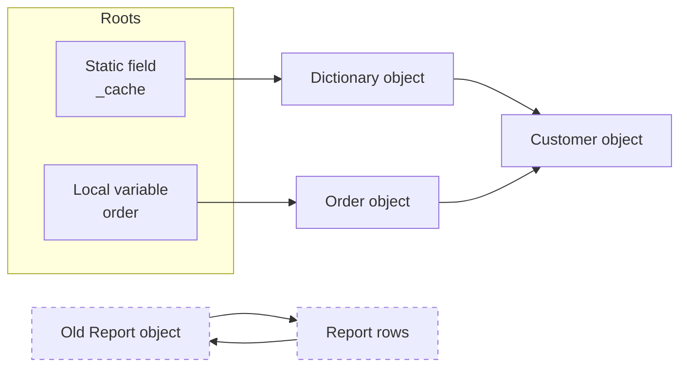
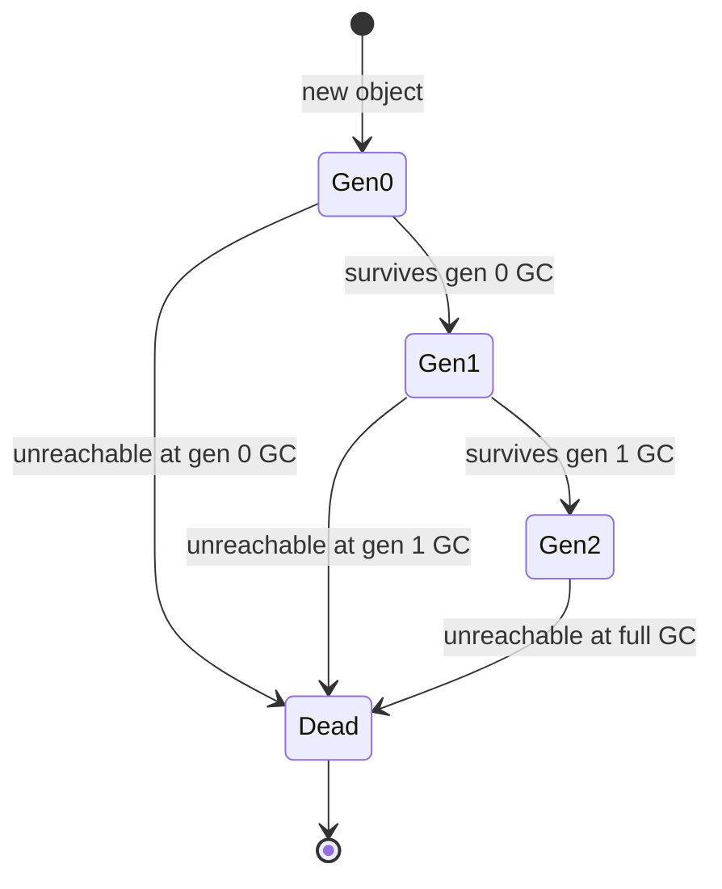
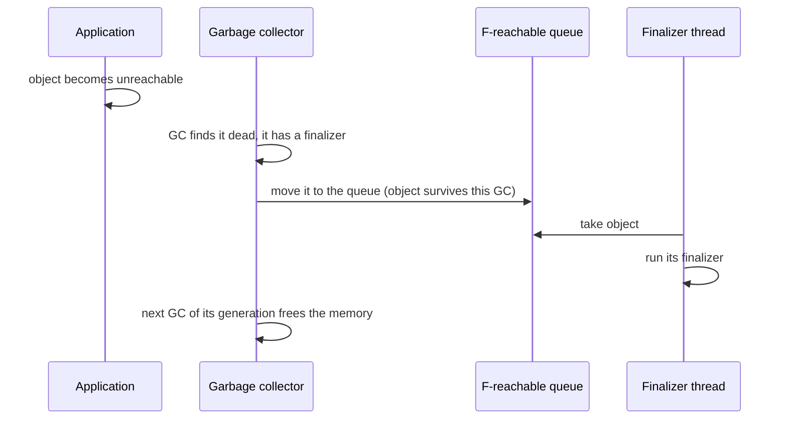

# Memory, Garbage Collection and Performance

> In this document you will learn how .NET manages memory: the managed heap, generations, the large and pinned object heaps, GC modes (workstation, server, background, DATAS), finalizers and `IDisposable`, common memory leaks, `Span<T>` and `Memory<T>`, pooling, allocation tips, diagnostics tools, and how JIT, ReadyToRun and Native AOT affect performance. Interviewers ask "how does the GC work?", "dispose vs finalize" and "how would you find a memory leak?". Outputs here were checked on .NET 10.

**Before this:** [C# fundamentals and the type system](01-csharp-fundamentals-and-type-system.md) · [JavaScript memory management and GC](../02-javascript/19-memory-management-and-garbage-collection.md) · [Processes, threads and memory](../01-cs-and-web-fundamentals/03-operating-systems-processes-threads-memory.md) · **Interview questions:** [jump to the interview section](#interview-questions)

## Table of contents

1. [The managed heap](#the-managed-heap)
2. [How the garbage collector works](#how-the-garbage-collector-works)
3. [Generations 0, 1 and 2](#generations-0-1-and-2)
4. [The large object heap and pinned object heap](#the-large-object-heap-and-pinned-object-heap)
5. [GC modes: workstation, server, background and DATAS](#gc-modes-workstation-server-background-and-datas)
6. [Finalizers vs IDisposable](#finalizers-vs-idisposable)
7. [using statements and declarations](#using-statements-and-declarations)
8. [IAsyncDisposable](#iasyncdisposable)
9. [The dispose pattern](#the-dispose-pattern)
10. [Memory leaks in .NET](#memory-leaks-in-net)
11. [Span, Memory and ref struct](#span-memory-and-ref-struct)
12. [stackalloc and ArrayPool](#stackalloc-and-arraypool)
13. [Reducing allocations: strings, boxing, collections](#reducing-allocations-strings-boxing-collections)
14. [Measuring: BenchmarkDotNet](#measuring-benchmarkdotnet)
15. [Diagnostics tools](#diagnostics-tools)
16. [JIT, tiered compilation, ReadyToRun and Native AOT](#jit-tiered-compilation-readytorun-and-native-aot)
17. [Common mistakes](#common-mistakes)
18. [Best practices](#best-practices)
19. [How to explain this in an interview](#how-to-explain-this-in-an-interview)
20. [Interview questions](#interview-questions)
21. [Summary](#summary)
22. [References](#references)

---

## The managed heap

When you write `new Order()`, the runtime allocates memory for the object on the **managed heap**. "Managed" means the runtime tracks the object and frees it automatically when nothing uses it anymore. You never call `free` or `delete`.

Allocation in .NET is very fast. The heap keeps an **allocation pointer**. A new object is placed at the pointer, and the pointer moves forward. This is called **bump-pointer allocation**. It is much cheaper than a C `malloc`, which must search for a free block.

The cost comes later: the **garbage collector (GC)** must eventually find dead objects and reclaim their memory. So in .NET, performance work is mostly about **allocating less**, not about making allocation itself faster.

**If you know JavaScript:** V8 also has a generational GC with a young generation (scavenger) and an old generation (mark-sweep-compact). The ideas below will feel familiar. See [JavaScript memory management and GC](../02-javascript/19-memory-management-and-garbage-collection.md). The main differences in .NET are value types (which avoid heap allocations), deterministic cleanup with `IDisposable`, and more control over GC modes.

What lives where (a reminder from [the type system document](01-csharp-fundamentals-and-type-system.md#value-types-and-reference-types)):

- Objects of **reference types** (classes, arrays, strings, delegates, boxes) live on the heap.
- **Value types** live inline wherever they are declared: in a local variable (stack or register), inside an object, or inside an array.

## How the garbage collector works

### The mark phase: who is alive?

The GC does not count references. It finds **live** objects by starting from **roots** and following references:

- **Roots** are: local variables and parameters of running methods (on each thread's stack and in registers), static fields, GC handles (for example pinned handles), and the finalization queue.
- Every object reachable from a root, directly or through other objects, is **alive**.
- Everything else is **garbage**, even if objects reference each other in a cycle.



In this picture, `Old Report` and `Report rows` reference each other, but no root reaches them. Both are garbage. Reference cycles are not a problem for the .NET GC.

### The sweep and compact phases

After marking, the GC reclaims the dead objects' memory. For the small object heap, it usually **compacts**: it moves live objects together, removing the gaps, and updates every reference to them. Compaction keeps the allocation pointer simple and avoids fragmentation. Moving objects requires that managed threads are paused (or at least safely coordinated) while references are updated.

### When does a GC happen?

- When the allocation budget for generation 0 is used up (the most common trigger).
- When the system reports low memory.
- When code calls `GC.Collect()` (avoid this in production code).

### Stop-the-world pauses

During parts of a collection, managed threads are **suspended**. A gen 0 collection is usually very short (often well under a millisecond to a few milliseconds, depending on how much survives). A full gen 2 collection can take much longer on a big heap. **Background GC** (see below) does most of the gen 2 work while your threads keep running.

## Generations 0, 1 and 2

### The idea: most objects die young

The GC is **generational**, based on an observation called the **generational hypothesis**: most objects die very young (a temporary string, a DTO for one request), and objects that survive a while tend to live long (caches, singletons).

So the heap is split into generations:

| Generation | Contains | Collected |
| --- | --- | --- |
| **Gen 0** | Newly allocated small objects | Very often, very fast |
| **Gen 1** | Objects that survived one gen 0 collection; a buffer between young and old | Often |
| **Gen 2** | Long-lived objects (survived gen 1), plus the LOH and POH | Rarely; a "full GC" |

When an object survives a collection of its generation, it is **promoted** to the next one.

```csharp
var order = new object();
Console.WriteLine(GC.GetGeneration(order)); // 0
GC.Collect();
Console.WriteLine(GC.GetGeneration(order)); // 1
GC.Collect();
Console.WriteLine(GC.GetGeneration(order)); // 2
Console.WriteLine(GC.MaxGeneration);        // 2
```

(`GC.Collect()` here is only for the demonstration. `order` stays alive because the local variable is still used afterwards.)

A collection of generation N also collects all younger generations. A gen 1 GC collects gen 0 and gen 1. A gen 2 GC collects everything: this is a **full GC**.



### Why this is fast

A gen 0 collection only has to look at young objects. But what if an old gen 2 object references a young gen 0 object? The GC would have to scan all of gen 2 to find that reference. To avoid this, the runtime uses a **write barrier** and a **card table**: every time you store a reference into an object field, a tiny bit of extra code marks that memory region as "dirty". During a gen 0 GC, only dirty regions of older generations are scanned.

### The mid-life crisis

The worst pattern for the GC is objects that live **just long enough** to be promoted to gen 2, then die soon after. Examples: a cache with a short expiry, or objects held for a few seconds by a slow request. They fill gen 2, and gen 2 collections are expensive. Objects should either die very young or live for the whole app.

## The large object heap and pinned object heap

### LOH

Objects of **85,000 bytes or more** go on the **large object heap (LOH)**. Copying such big objects during compaction would be expensive, so by default the LOH is **swept but not compacted**. The LOH is logically part of gen 2: large objects are collected only during full GCs.

```csharp
var small = new byte[84_000];
var large = new byte[85_000];
Console.WriteLine(GC.GetGeneration(small)); // 0
Console.WriteLine(GC.GetGeneration(large)); // 2  (LOH objects report generation 2)
```

Problems:

- Allocating many short-lived large arrays (for example a new 1 MB buffer per request) triggers **expensive gen 2 collections**.
- Because the LOH is not compacted by default, it can become **fragmented**: free gaps that are too small for new large objects, so the heap grows.

Fixes: reuse buffers with `ArrayPool<T>`, stream data instead of loading it all, or as a last resort compact the LOH once with `GCSettings.LargeObjectHeapCompactionMode = GCLargeObjectHeapCompactionMode.CompactOnce`.

### POH

**Pinning** an object means telling the GC "do not move this object", usually because native code (for example the OS network stack) holds a pointer to it. Pinned objects in the middle of the small object heap block compaction and cause fragmentation.

Since .NET 5, there is a **pinned object heap (POH)** for objects that you know will be pinned for a long time:

```csharp
byte[] buffer = GC.AllocateArray<byte>(1024, pinned: true);   // allocated on the POH
Console.WriteLine(GC.GetGeneration(buffer)); // 2
```

You rarely need this in application code. Networking libraries (like Kestrel's socket buffers) use it internally.

## GC modes: workstation, server, background and DATAS

### Workstation vs server GC

| | Workstation GC | Server GC |
| --- | --- | --- |
| Heaps | One heap | One heap **per logical CPU core** (by default) |
| GC threads | The thread that triggered GC (plus a background thread) | A dedicated GC thread per heap, running in parallel |
| Goal | Low memory use, responsiveness | Maximum throughput |
| Memory use | Lower | Higher (larger gen 0 budgets per heap) |
| Default for | Console apps, desktop apps, services | **ASP.NET Core apps** (the Web SDK turns it on) |

```csharp
Console.WriteLine(System.Runtime.GCSettings.IsServerGC); // False in a console app
```

Set it in the project file:

```xml
<PropertyGroup>
  <ServerGarbageCollection>true</ServerGarbageCollection>
  <ConcurrentGarbageCollection>true</ConcurrentGarbageCollection>  <!-- background GC, default true -->
</PropertyGroup>
```

### Background GC

**Background GC** (the default; controlled by `ConcurrentGarbageCollection`) runs **gen 2** collections on a background thread while your application threads continue to run and allocate. Gen 0 and gen 1 collections can still happen during a background gen 2 collection. This greatly reduces long pauses.

### DATAS

> **New in .NET 9:** **DATAS** (Dynamic Adaptation To Application Sizes) is **enabled by default for server GC**. It was an opt-in feature in .NET 8.

The problem DATAS solves: classic server GC creates one heap per core and grows aggressively. On a 32-core machine, a small service might use far more memory than it needs. In containers, that is wasteful and can hit memory limits.

What DATAS does:

- Starts with **one heap** and adds or removes heaps based on load.
- Sizes the gen 0 budget based on the amount of **long-lived data**, so the heap stays roughly proportional to what the app really needs.
- Shrinks the heap when the workload gets lighter.

Microsoft's published TechEmpower benchmark results showed a large working-set reduction with a small throughput cost. If throughput drops for your app, you can disable it: `<GarbageCollectionAdaptationMode>0</GarbageCollectionAdaptationMode>` in the project file, or the environment variable `DOTNET_GCDynamicAdaptationMode=0`.

**Interview takeaway:** on .NET 8, ASP.NET Core uses classic server GC by default. On .NET 9 and .NET 10, it uses server GC with DATAS, which adapts memory use to the load.

### Containers

The GC respects container memory limits (cgroups). If a container has a 512 MB limit, the GC sets its heap hard limit to a percentage of that (75% by default). You can tune it with `GCHeapHardLimit` or `GCHeapHardLimitPercent`. With server GC, also consider that the number of heaps follows the CPU limit.

## Finalizers vs IDisposable

The GC manages **memory**. But objects often hold **unmanaged resources** too: file handles, sockets, database connections, OS handles, native memory. The GC does not know when you are done with those, and it may not run for a long time. So .NET has two mechanisms.

### IDisposable: deterministic cleanup

`IDisposable` has one method, `Dispose()`. You call it (usually through `using`) when you are done. Cleanup happens **right now**, at a known point.

```csharp
public sealed class ReportFile : IDisposable
{
    private readonly FileStream _stream;
    private bool _disposed;

    public ReportFile(string path) => _stream = File.OpenWrite(path);

    public void Write(byte[] data)
    {
        ObjectDisposedException.ThrowIf(_disposed, this);   // .NET 7+
        _stream.Write(data);
    }

    public void Dispose()
    {
        if (_disposed) return;     // Dispose must be safe to call many times
        _disposed = true;
        _stream.Dispose();         // release the file handle now
    }
}
```

`Dispose` does **not** free the object's memory. The GC still does that later. `Dispose` releases the **other** resources the object holds.

### Finalizers: the safety net

A **finalizer** (`~ClassName()`) is a method the GC calls **before reclaiming** an object. It is the last chance to release unmanaged resources if someone forgot to call `Dispose`.

```csharp
class WithFinalizer
{
    ~WithFinalizer() => Console.WriteLine("finalizer ran");
}

_ = new WithFinalizer();
GC.Collect();
GC.WaitForPendingFinalizers();
Console.WriteLine("after finalizers");
// finalizer ran
// after finalizers
```

Why finalizers are expensive and unreliable:

1. **You do not know when they run.** Maybe seconds later, maybe never (they are not guaranteed to run at process exit on .NET Core / .NET 5+).
2. **Objects with finalizers survive an extra GC.** When the GC finds a dead finalizable object, it cannot free it yet. It moves it to the **f-reachable queue**, a single **finalizer thread** runs the finalizer, and only the **next** GC frees the memory. The object is usually promoted to an older generation in the meantime.
3. **They run on one dedicated thread.** A slow or blocking finalizer delays all others, and memory builds up.
4. **They are risky.** The objects they reference may already be finalized. Exceptions in finalizers crash the process.



| | `Dispose()` | Finalizer |
| --- | --- | --- |
| Who calls it | Your code (`using`) | The GC's finalizer thread |
| When | Exactly when you decide | Unknown, maybe never |
| Cost | Cheap | Extra GC survival, finalizer thread work |
| Use for | All cleanup | Safety net for **directly owned unmanaged** resources only |

**Rule:** almost no application class needs a finalizer. Wrap unmanaged handles in a **`SafeHandle`** subclass (it already has a correct, critical finalizer), and implement only `IDisposable` in your class.

## using statements and declarations

`using` guarantees `Dispose()` is called, even if an exception happens. The compiler turns it into `try/finally`.

### using statement (block)

```csharp
using (var a = new Resource("A"))
using (var b = new Resource("B"))
{
    Console.WriteLine("work");
}
// work
// dispose B
// dispose A      (disposed in reverse order)
```

### using declaration (C# 8)

```csharp
static void UsingDeclaration()
{
    using var c = new Resource("X");     // disposed at the end of the enclosing scope
    Console.WriteLine("method body");
}
// method body
// dispose X
```

With an exception:

```csharp
try
{
    using var c = new Resource("C");
    throw new InvalidOperationException("fail");
}
catch (InvalidOperationException) { Console.WriteLine("caught after dispose"); }
// dispose C
// caught after dispose
```

`Dispose` runs during the unwinding, **before** the `catch` block runs.

### After Dispose

```csharp
var r = new Resource("D");
r.Dispose();
r.Dispose();      // second call must be harmless: prints "D already disposed"
r.DoWork();       // throws ObjectDisposedException
```

### Who should dispose?

- **The owner disposes.** If your code created the object with `new`, you dispose it.
- If an object was **injected by the DI container**, the **container** disposes it at the end of its lifetime (end of request for scoped services, app shutdown for singletons). Do not dispose injected services yourself. See [Dependency injection in ASP.NET Core](08-dependency-injection-in-aspnet-core.md).
- `HttpClient` is a special case: do not create and dispose one per request. Use `IHttpClientFactory`. (Disposing it often can exhaust sockets.)

## IAsyncDisposable

Some cleanup needs I/O, like flushing a buffer to the network or closing a database connection gracefully. `IAsyncDisposable` has `ValueTask DisposeAsync()`. Use it with `await using`.

```csharp
class AsyncResource(string name) : IAsyncDisposable
{
    public async ValueTask DisposeAsync()
    {
        await Task.Delay(10);                     // for example, flush to the network
        Console.WriteLine($"async dispose {name}");
    }
}

await using (var conn = new AsyncResource("db"))
{
    Console.WriteLine("query");
}
// query
// async dispose db
```

Examples in .NET: `DbContext`, `DbConnection`, `Stream`, `Utf8JsonWriter`. Many types implement both interfaces. In async code, prefer `await using`.

## The dispose pattern

The full **dispose pattern** is for **unsealed** classes that may be inherited, or classes that directly own unmanaged resources.

```csharp
public class NativeBuffer : IDisposable
{
    private IntPtr _memory;                 // unmanaged resource owned directly
    private readonly Stream _log;           // managed IDisposable resource
    private bool _disposed;

    public NativeBuffer(int size, Stream log)
    {
        _memory = System.Runtime.InteropServices.Marshal.AllocHGlobal(size);
        _log = log;
    }

    public void Dispose()
    {
        Dispose(disposing: true);
        GC.SuppressFinalize(this);          // no need for the finalizer anymore
    }

    protected virtual void Dispose(bool disposing)
    {
        if (_disposed) return;
        if (disposing)
        {
            _log.Dispose();                 // managed resources: only when called from Dispose()
        }
        System.Runtime.InteropServices.Marshal.FreeHGlobal(_memory);   // unmanaged: always
        _memory = IntPtr.Zero;
        _disposed = true;
    }

    ~NativeBuffer() => Dispose(disposing: false);   // safety net only
}
```

Why the `disposing` flag? When called from the **finalizer**, other managed objects (like `_log`) may already be finalized, so you must not touch them. You only release your own unmanaged resources.

For a **sealed** class with only managed resources (the common case), this pattern is unnecessary. Just implement `Dispose()` and dispose your fields, as in `ReportFile` above.

## Memory leaks in .NET

The GC prevents classic leaks (forgetting `free`). But you can still leak memory by **keeping references you no longer need**. The GC will not collect anything a root can reach.

### 1. Event handlers

A publisher holds strong references to its subscribers. A long-lived publisher keeps short-lived subscribers alive.

```csharp
class PriceFeed { public event EventHandler<decimal>? PriceChanged; }      // long-lived (singleton)
class PriceScreen
{
    private readonly byte[] _bigData = new byte[1000];
    public void OnPriceChanged(object? s, decimal p) { }
}

static WeakReference Subscribe(PriceFeed feed)
{
    var screen = new PriceScreen();
    feed.PriceChanged += screen.OnPriceChanged;   // feed -> delegate -> screen
    return new WeakReference(screen);
}

var feed = new PriceFeed();
var weak = Subscribe(feed);
GC.Collect(); GC.WaitForPendingFinalizers(); GC.Collect();
Console.WriteLine(weak.IsAlive);   // True  (leak: the screen is still reachable through the event)
```

With `feed.PriceChanged -= screen.OnPriceChanged;` before returning, `IsAlive` became `False` in the same test. Fix: unsubscribe in `Dispose`, or use a design without long-lived strong references.

### 2. Static collections and caches without limits

```csharp
// ❌ Wrong: grows forever, never released
public static class RequestLog
{
    public static readonly List<string> Entries = new();
}
```

Also common: a `ConcurrentDictionary` used as a cache with no expiry, keyed by user ID or URL. Use `IMemoryCache` with size limits and expirations instead. See [Caching, background jobs and messaging](12-caching-background-jobs-and-messaging.md).

### 3. Captured closures

A lambda keeps alive everything it captures. Capturing `this` keeps the whole object alive.

```csharp
public class ReportPage
{
    private readonly byte[] _pdf = new byte[10_000_000];
    public void Register(Scheduler scheduler) =>
        scheduler.Every(TimeSpan.FromMinutes(1), () => Refresh());   // captures 'this' -> keeps _pdf alive
    private void Refresh() { }
}
```

### 4. Timers

A `System.Threading.Timer` or `System.Timers.Timer` that is never disposed keeps its callback (and everything the callback captures) alive and keeps firing.

### 5. Captive dependencies and scoped services in singletons

A singleton that holds a scoped `DbContext` keeps it (and all tracked entities) alive forever. This is both a memory leak and a correctness bug. See [Dependency injection in ASP.NET Core](08-dependency-injection-in-aspnet-core.md).

### 6. EF Core change tracker

A long-lived `DbContext` that loads many entities keeps all of them in its change tracker. Keep contexts short-lived (one per request or unit of work) and use `AsNoTracking()` for read-only queries.

### 7. Not disposing unmanaged resources

Forgetting `Dispose` on streams, `Bitmap`s or native wrappers holds native memory until the finalizer runs, which might be much later.

### How to find a leak

1. **Watch the trend.** With `dotnet-counters`, watch "GC Heap Size" and "Gen 2 Size" over time under steady load. A leak looks like a heap that only grows, even after full GCs.
2. **Take two memory dumps** some minutes apart (`dotnet-dump collect` or `dotnet-gcdump collect`).
3. **Compare object counts** by type (Visual Studio, PerfView, `dotnet-dump analyze` with `dumpheap -stat`). Find the type whose count keeps growing.
4. **Find the root path** (`gcroot <address>` in `dotnet-dump`, or "paths to root" in Visual Studio). It shows which static field, event or cache keeps the objects alive.
5. Fix, and confirm the heap now reaches a stable level.

## Span, Memory and ref struct

### The problem

Many operations on strings and arrays create **copies**: `Substring`, `Split`, `ToArray`, slicing with LINQ. In a hot path, like parsing HTTP headers or CSV lines, these copies create lots of garbage.

### Span&lt;T&gt;

**`Span<T>`** is a view over a contiguous region of memory. It can point into an array, a string (as `ReadOnlySpan<char>`), stack memory, or native memory. Slicing a span creates **no copy and no allocation**. It is just a pointer and a length.

```csharp
int[] numbers = [1, 2, 3, 4, 5, 6];
Span<int> middle = numbers.AsSpan(2, 3);   // view over elements 2..4
middle[0] = 99;                            // writes into the original array
Console.WriteLine(string.Join(",", numbers)); // 1,2,99,4,5,6
```

### Realistic example: parsing without allocating

```csharp
ReadOnlySpan<char> line = "GET /api/orders HTTP/1.1";

int firstSpace = line.IndexOf(' ');
ReadOnlySpan<char> method = line[..firstSpace];          // "GET"   (no new string)
ReadOnlySpan<char> rest = line[(firstSpace + 1)..];
ReadOnlySpan<char> path = rest[..rest.IndexOf(' ')];     // "/api/orders"
bool isGet = method.SequenceEqual("GET");

Console.WriteLine($"{method.ToString()} {path.ToString()} {isGet}"); // GET /api/orders True
```

I measured the parsing part with `GC.GetAllocatedBytesForCurrentThread()`: **0 bytes allocated**. The `Substring` version would allocate two new strings. (`ToString()` at the end allocates, but only for printing.)

Many .NET APIs accept spans directly:

```csharp
int id = int.Parse("id=42".AsSpan(3));     // 42, no "42" substring allocated

var csv = "10,20,30";
int sum = 0;
foreach (Range range in csv.AsSpan().Split(','))   // .NET 9: span Split returns ranges, no string[]
    sum += int.Parse(csv.AsSpan()[range]);
Console.WriteLine(sum); // 60
```

### ref struct: why Span has limits

`Span<T>` is a **`ref struct`**. A `ref struct` can **only live on the stack**. That is what makes it safe to point at stack memory. As a result:

- It **cannot be a field** of a class or a normal struct.
- It **cannot be boxed** or stored as `object` or an interface (before C# 13).
- It **cannot be captured** by a lambda.
- It **cannot be used across `await`** in an async method, or across `yield return` in an iterator. (Since C# 13, you can declare `ref struct` locals in async methods and iterators, as long as they are not used across an `await` or `yield`.)

> **New in C# 13:** `ref struct` types can implement interfaces, and generics can accept them with the `allows ref struct` anti-constraint.

> **New in C# 14:** implicit conversions to spans. For example, an array can be passed directly where a `ReadOnlySpan<T>` is expected in more situations, including extension method receivers.

### Memory&lt;T&gt;

**`Memory<T>`** is like `Span<T>`, but it is a normal struct, so it **can** be stored in fields and used across `await`. When you need to work with the data, get a span from it with `.Span`.

```csharp
Memory<int> mem = numbers.AsMemory(0, 2);
Console.WriteLine(await SumLaterAsync(mem)); // 3

static async Task<int> SumLaterAsync(Memory<int> m)
{
    await Task.Delay(1);                  // Span<int> could not be used across this await
    int total = 0;
    foreach (var x in m.Span) total += x;
    return total;
}
```

| | `Span<T>` | `Memory<T>` |
| --- | --- | --- |
| Kind | `ref struct` (stack only) | Normal struct |
| Can point to stack memory | Yes | No |
| Field of a class, across `await` | No | Yes |
| Speed | Fastest | Slightly slower (get `.Span` to work with it) |
| Typical use | Synchronous parsing and processing | Async I/O buffers (`Stream.ReadAsync(Memory<byte>)`) |

## stackalloc and ArrayPool

### stackalloc

`stackalloc` allocates a small buffer **on the stack**. It is freed automatically when the method returns. No GC involvement at all.

```csharp
Span<byte> buffer = stackalloc byte[16];
buffer.Fill(7);
Console.WriteLine(Sum(buffer)); // 112

static int Sum(ReadOnlySpan<byte> data) { int t = 0; foreach (var b in data) t += b; return t; }
```

Rules:

- Only for **small** buffers (a common rule is up to a few hundred bytes, often 256 or 512 bytes). The stack is small (often 1 MB). A large `stackalloc` can cause a `StackOverflowException`, which **cannot be caught** and kills the process.
- Never `stackalloc` a size that comes from user input without a limit.

A common pattern: stack for small sizes, pool for large sizes.

```csharp
const int StackLimit = 256;
byte[]? rented = null;
Span<byte> buf = length <= StackLimit
    ? stackalloc byte[StackLimit]
    : (rented = ArrayPool<byte>.Shared.Rent(length));
try
{
    buf = buf[..length];
    // ... use buf ...
}
finally
{
    if (rented is not null) ArrayPool<byte>.Shared.Return(rented);
}
```

### ArrayPool&lt;T&gt;

**`ArrayPool<T>.Shared`** keeps a pool of arrays you can **rent** and **return** instead of allocating new ones. This is especially valuable for large buffers that would otherwise go to the LOH.

```csharp
var pool = ArrayPool<byte>.Shared;
byte[] rented = pool.Rent(1000);
Console.WriteLine(rented.Length);           // 1024  (at least what you asked for, often a power of 2)
pool.Return(rented);

byte[] again = pool.Rent(1000);
Console.WriteLine(ReferenceEquals(rented, again)); // True (same array reused in this run)
pool.Return(again, clearArray: true);
```

Rules:

- The array can be **bigger** than requested. Always track the real length you use.
- The array is **not cleared** by default. It may contain old data. Use `clearArray: true` when returning if it held sensitive data.
- **Always return** it (in `finally`), and **never use it after returning**. Another caller may already have it. This is like a use-after-free bug.
- Do not return the same array twice.

Related: `MemoryPool<T>`, and `ObjectPool<T>` (from `Microsoft.Extensions.ObjectPool`) for reusing expensive objects like `StringBuilder`. ASP.NET Core and Kestrel use pooling heavily inside.

## Reducing allocations: strings, boxing, collections

I measured these with `GC.GetAllocatedBytesForCurrentThread()` on .NET 10:

| Code | Allocated |
| --- | --- |
| `int` sum loop, 1,000 iterations | 0 bytes |
| Same loop but the total is an `object` (boxing every iteration) | about 24 KB (one box per iteration) |
| `s += "x"` 1,000 times | about 1 MB (each new string copies the old one) |
| `StringBuilder.Append('x')` 1,000 times + `ToString()` | about 4 KB |
| `List<int>` growing to 100,000 items | about 1 MB (repeated resize copies) |
| `new List<int>(100_000)` then adding 100,000 items | about 400 KB (one array, no resizing) |

### Strings

- Use `StringBuilder` or `string.Join`/`string.Concat` for building strings in loops.
- Use interpolated strings; modern C# compiles them with **interpolated string handlers**, which avoid boxing and intermediate strings.
- Use `ReadOnlySpan<char>` APIs (`AsSpan`, `int.Parse(span)`, `span.Split`) for parsing.
- Use `StringComparison.OrdinalIgnoreCase` instead of `ToLower()` before comparing.
- Use `string.Create` for building a string of known length directly in its final memory.
- Use `CompositeFormat` (.NET 8) for a format string used many times.

### Boxing

- Use generic collections and generic methods with constraints (no boxing) instead of `object` or non-generic interfaces.
- Implement `IEquatable<T>` on structs used as dictionary keys.
- Structured logging: `logger.LogInformation("Order {Id}", id)` boxes `id` for each call. For hot paths, the `[LoggerMessage]` source generator creates strongly typed logging methods without boxing.

```csharp
public static partial class Log
{
    [LoggerMessage(Level = LogLevel.Information, Message = "Order {OrderId} shipped")]
    public static partial void OrderShipped(ILogger logger, int orderId);
}
```

> **Note on .NET 9 and .NET 10:** the JIT has started using **escape analysis** to put some objects on the stack when it can prove they never leave the method (.NET 9: some boxes; .NET 10: also small arrays and some delegates). In my Release-mode test on .NET 10, boxing a struct into a local interface variable allocated 0 bytes, while in Debug mode it allocated. This is an optimization you can benefit from, not something to depend on in your design.

### Collections

- Pre-size `List<T>`, `Dictionary<K,V>`, `StringBuilder` when you know the size.
- Avoid LINQ in very hot loops; prefer `for`/`foreach` over arrays and spans there.
- Return arrays or `IReadOnlyList<T>` rather than re-enumerating lazy queries.
- Use `FrozenDictionary` for read-only lookup tables.

### Struct vs class for performance

Small, short-lived values as `readonly struct` avoid heap allocations. But large structs are expensive to copy. Pass them with `in` or keep them small. See [the type system document](01-csharp-fundamentals-and-type-system.md#struct-class-record-and-record-struct).

## Measuring: BenchmarkDotNet

**Never optimize without measuring.** `Stopwatch` loops are misleading: they include JIT warm-up, tiered compilation changes, and noise. **BenchmarkDotNet** is the standard .NET micro-benchmarking library. It runs warm-up, many iterations, statistics, and with `[MemoryDiagnoser]` it reports allocations per operation.

Not run here (it needs the NuGet package `BenchmarkDotNet`):

```csharp
using BenchmarkDotNet.Attributes;
using BenchmarkDotNet.Running;

[MemoryDiagnoser]
public class ParseBenchmarks
{
    private const string Line = "GET /api/orders HTTP/1.1";

    [Benchmark(Baseline = true)]
    public string WithSubstring() => Line.Substring(4, Line.IndexOf(' ', 4) - 4);

    [Benchmark]
    public int WithSpan()
    {
        ReadOnlySpan<char> s = Line;
        return s[4..].IndexOf(' ');
    }
}

public static class Program
{
    public static void Main() => BenchmarkRunner.Run<ParseBenchmarks>();
}
```

Run it in **Release** mode (`dotnet run -c Release`). The result table shows mean time, error, standard deviation, and an `Allocated` column (for example, the span version should show no allocation).

## Diagnostics tools

| Tool | What it does | When to use |
| --- | --- | --- |
| `dotnet-counters` | Live metrics: CPU, GC heap size, gen 0/1/2 counts, allocation rate, thread pool queue length, exceptions per second | First look at a running app: "is memory growing? is the pool starved?" |
| `dotnet-trace` | Records an event trace (CPU sampling, GC events, allocations) to a `.nettrace` file | CPU hotspots, GC pause analysis; open in Visual Studio, PerfView or speedscope |
| `dotnet-dump` | Captures and analyzes a full process memory dump (`dumpheap -stat`, `gcroot`) | Memory leaks, hangs, deadlocks (see all thread stacks) |
| `dotnet-gcdump` | Captures a smaller heap snapshot (object graph only) | Comparing heap contents over time |
| Visual Studio profiler / diagnostic tools | CPU usage, memory usage with snapshots and diffs, .NET object allocation tracking | Local development investigations |
| PerfView | Free, very powerful trace analysis tool from Microsoft | Deep GC and CPU analysis |
| JetBrains dotMemory / dotTrace | Commercial memory and performance profilers | Same, with a friendlier UI |
| OpenTelemetry metrics | `System.Runtime` metrics exported to Prometheus, Azure Monitor and others | Production dashboards and alerts |

Install the global tools with `dotnet tool install --global dotnet-counters` (and similarly for the others). Example:

```bash
dotnet-counters monitor --process-id 12345 --counters System.Runtime
dotnet-dump collect --process-id 12345
dotnet-dump analyze ./dump_20261023.dmp
```

Inside `dotnet-dump analyze`, `dumpheap -stat` lists object counts and sizes by type, and `gcroot <address>` shows why an object is alive.

Production monitoring of these metrics (dashboards, alerts) is covered in [Production, architecture and performance](14-production-architecture-and-performance.md).

## JIT, tiered compilation, ReadyToRun and Native AOT

C# is compiled to **IL** (intermediate language). At runtime, the **JIT** (just-in-time compiler) turns IL into machine code, method by method, the first time each method runs. The full picture of CLR, IL and assemblies is in [.NET runtime, SDK and project structure](06-dotnet-runtime-sdk-and-project-structure.md). Here we focus on performance.

How the three modes work (tier 0 and tier 1, on-stack replacement, ReadyToRun files, the Native AOT build and its linker requirements) is explained in [JIT tiers, ReadyToRun and Native AOT](06-dotnet-runtime-sdk-and-project-structure.md#jit-tiers-readytorun-and-native-aot). A short reminder, from the performance side:

- **Tiered compilation:** the JIT first compiles each method quickly (tier 0). Methods that are called often (around 30 calls), or long-running loops, are recompiled with full optimizations (tier 1). **Dynamic PGO** (on by default since .NET 8) uses data collected at tier 0, for example to **devirtualize** an interface call when one type is almost always used. This is why the first requests to a fresh ASP.NET Core app are slower ("cold start"), and why benchmarks need warm-up.
- **ReadyToRun** (`-p:PublishReadyToRun=true`) pre-compiles code at publish time for faster startup; hot methods can still be re-JITed to tier 1.
- **Native AOT** (`<PublishAot>true</PublishAot>`) compiles the whole app to one native executable with no JIT at runtime.

How they compare:

| | JIT (normal) | ReadyToRun | Native AOT |
| --- | --- | --- | --- |
| Startup time | Slower | Faster | Fastest |
| Memory use | Higher (JIT, metadata) | Medium | Lowest |
| Peak throughput | Excellent (dynamic PGO, tier 1) | Excellent (re-JITs hot code) | Good, sometimes lower (no runtime profile data) |
| Size | Small app + shared runtime | Larger | Single native file, trimmed |
| Reflection, dynamic code | Full | Full | **Limited**: no `Reflection.Emit`, limited dynamic loading; trimming removes unused code |
| Compatibility | Everything | Everything | Libraries must be AOT/trim compatible |

Native AOT limitations to know:

- **Trimming** removes code that is not statically referenced. Code that uses reflection to find types at runtime may break. The compiler gives warnings, for example `IL2026` and `IL3050` for code that uses `dynamic`.
- `System.Text.Json` needs **source-generated** serializers (`JsonSerializerContext`) instead of reflection.
- ASP.NET Core supports Native AOT for **minimal APIs** (with `WebApplication.CreateSlimBuilder`). MVC controllers, Razor and some features are not supported. EF Core has only partial/experimental AOT support.

When to choose Native AOT: serverless functions and containers that scale to zero (cold start matters), CLI tools, small microservices with tight memory limits. For a large traditional API with heavy reflection, normal JIT (optionally with ReadyToRun) is usually better.

## Common mistakes

1. **Calling `GC.Collect()` in production code** to "fix" memory. It promotes objects, causes long pauses, and hides the real problem.
2. **Adding finalizers to normal classes.** They make objects live longer and add work. Use `IDisposable` and `SafeHandle`.
3. **Forgetting `using`** on streams, connections, and other disposables.
4. **Disposing objects you do not own**, like DI-injected services.
5. **Not unsubscribing from events** of long-lived publishers.
6. **Unbounded static caches** and dictionaries.
7. **Allocating large temporary arrays per request.** They go to the LOH and trigger gen 2 GCs. Use `ArrayPool<T>` or streaming.
8. **Large or user-controlled `stackalloc`.** Stack overflow cannot be caught.
9. **Using a rented array after returning it**, or forgetting the array may be larger than requested.
10. **Micro-optimizing without measuring**, or measuring with `Stopwatch` in Debug mode.
11. **Choosing Native AOT for an app that depends on reflection** without checking trimming warnings.

## Best practices

- **Allocate less in hot paths**: spans for parsing, pooling for buffers, pre-sized collections, no boxing.
- **Keep objects short-lived or truly long-lived**; avoid the "mid-life" pattern that fills gen 2.
- **Implement `IDisposable` when you own disposable fields**; use `using`/`await using` everywhere you create disposables.
- **Do not write finalizers**; use `SafeHandle` for unmanaged handles.
- **Use `IMemoryCache` with limits and expirations** instead of static dictionaries.
- **Unsubscribe events and dispose timers** in `Dispose`.
- **Use `ArrayPool<T>` for large temporary buffers**, always returning in `finally`.
- **Measure with BenchmarkDotNet** (Release, `[MemoryDiagnoser]`) and monitor with `dotnet-counters` and OpenTelemetry in production.
- **Know your GC mode**: server GC for ASP.NET Core; on .NET 9+ DATAS adapts heap size; set container memory limits.
- **Consider ReadyToRun or Native AOT** when startup time and memory matter more than maximum flexibility.

## How to explain this in an interview

**Topic: how the .NET garbage collector works**

1. **Define it:** "The GC automatically frees heap memory for objects that are no longer reachable from any root."
2. **Why it exists:** "So developers do not have to free memory by hand, which removes whole classes of bugs like use-after-free and double free."
3. **How it works:** "It marks live objects by following references from roots: stack variables, statics and handles. Then it reclaims the rest and usually compacts the heap. It is generational: new objects go to gen 0, which is collected often and quickly; survivors are promoted to gen 1 and then gen 2, which is collected rarely. Objects of 85,000 bytes or more go to the large object heap, which is collected with gen 2 and not compacted by default."
4. **Small example:** "A DTO created for one request dies in gen 0 almost for free. A singleton cache ends up in gen 2 and stays there."
5. **Where it is useful:** "Understanding it explains why allocation-heavy code is slow, why a per-request 1 MB buffer hurts, and why ASP.NET Core uses server GC, which on .NET 9 and later uses DATAS to adapt the heap size."
6. **Trade-offs / gotchas:** "The GC only manages memory, not files or connections, so we still need `IDisposable`. You can still leak by holding references, for example through events or static caches. And full GCs can cause pauses, which background GC reduces."

**Topic: Dispose vs finalizer**

1. **Define it:** "`Dispose` is deterministic cleanup that my code calls, usually through `using`. A finalizer is a method the GC calls at some unknown time before freeing the object."
2. **Why it exists:** "The GC manages memory, but not handles, sockets or connections. Those must be released promptly."
3. **How it works:** "`using` compiles to try/finally calling `Dispose`. A finalizable object survives an extra GC: it goes to a queue, a single finalizer thread runs it, and the next GC frees it."
4. **Small example:** "`using var stream = File.OpenRead(path);` closes the file at the end of the scope."
5. **Where it is useful:** "Streams, `DbContext`, `HttpResponseMessage`, timers, anything holding OS resources."
6. **Trade-offs / gotchas:** "Finalizers are slow, unpredictable and may not run at exit, so I avoid writing them and use `SafeHandle`. If a class has a finalizer, `Dispose` should call `GC.SuppressFinalize(this)`."

## Interview questions

### Q1. How does the .NET garbage collector decide what to collect?

**What the interviewer is checking:** Reachability from roots vs reference counting, and cycles.

**Short spoken answer (30–60 seconds):**
> The .NET GC uses tracing, not reference counting. It starts from roots, which are local variables and parameters on thread stacks, static fields, and GC handles, and it follows every reference to mark the objects that are reachable. Anything not marked is garbage, even if those objects reference each other in a cycle. After marking, it reclaims the dead objects and usually compacts the live ones together, updating references. So a cycle like a parent and child pointing at each other is not a leak; the leak happens only when something reachable, like a static dictionary or an event, still holds a reference.

**Follow-up questions:**
- **When does a GC run?** — Mostly when the gen 0 allocation budget is exhausted; also on low memory or an explicit `GC.Collect()`.
- **Do threads stop during GC?** — For parts of it, yes. Gen 0/1 collections pause threads briefly. Background GC does most gen 2 work concurrently.
- **Does the GC free unmanaged memory?** — No. Only managed objects. Native memory and handles need `Dispose` or a finalizer/`SafeHandle`.

**Common mistakes:** "The GC uses reference counting." "Cycles cause leaks."

**Where this is used in real projects:** Diagnosing memory growth, reasoning about caches and event subscriptions.

### Q2. What are GC generations, and why do they exist?

**What the interviewer is checking:** The generational hypothesis and its performance implications.

**Short spoken answer (30–60 seconds):**
> The heap is split into generation 0, 1 and 2 because most objects die young. New small objects go into gen 0, which is collected very often and very cheaply, because only a small part of the heap is scanned and most objects are already dead. Objects that survive are promoted to gen 1, which acts as a buffer, and then to gen 2 for long-lived data. A gen 2 collection is a full GC and is the most expensive. To collect gen 0 without scanning gen 2, the runtime uses a write barrier and card table to track references from old objects to young ones. The practical lesson is: short-lived objects are cheap, long-lived objects are fine, but objects that live just long enough to reach gen 2 and then die are the worst case.

**Follow-up questions:**
- **What does this print: allocate an object, then `GC.Collect()` twice, printing `GC.GetGeneration` each time?** — `0`, `1`, `2` (while the object stays reachable).
- **Where are large objects?** — On the LOH, which is logically part of gen 2.

### Q3. What is the large object heap, and what problems can it cause?

**Short spoken answer (30–60 seconds):**
> Objects of 85,000 bytes or more, usually big arrays or strings, are allocated on the large object heap. Because copying them would be expensive, the LOH is swept but not compacted by default, and it is collected only with gen 2. Two problems follow. First, allocating many short-lived large buffers, like a new 1 MB array per request, triggers frequent full GCs. Second, the LOH can fragment, so memory grows even though there is free space. The fixes are pooling with `ArrayPool<T>`, streaming instead of loading whole payloads, and in rare cases requesting a one-time LOH compaction.

**Follow-up questions:**
- **What does `GC.GetGeneration(new byte[85_000])` return?** — `2`. A `new byte[84_000]` returns `0`.
- **What is the POH?** — The pinned object heap (.NET 5) for objects that will be pinned long-term, so they do not fragment the normal heap. Allocated with `GC.AllocateArray<T>(length, pinned: true)`.

### Q4. Workstation vs server GC, and what is DATAS?

**What the interviewer is checking:** Awareness of GC configuration for servers and recent changes.

**Short spoken answer (30–60 seconds):**
> Workstation GC uses a single heap and is tuned for low memory and responsiveness; it is the default for console and desktop apps. Server GC creates a heap and a GC thread per core and collects in parallel, which gives higher throughput but uses more memory; ASP.NET Core uses it by default. The issue with classic server GC is that on a big machine, even a small service could use a lot of memory. DATAS, enabled by default for server GC since .NET 9, starts with one heap, adds or removes heaps based on load, and sizes the heap relative to the live data, so memory use adapts to the workload. Benchmarks from Microsoft show a big working-set reduction with a small throughput cost. Background GC, which is on by default in both modes, runs gen 2 collections concurrently.

**Follow-up questions:**
- **How do you turn server GC on or off?** — `<ServerGarbageCollection>true|false</ServerGarbageCollection>` in the project file, or `runtimeconfig.json`/environment variables.
- **How do you disable DATAS?** — `<GarbageCollectionAdaptationMode>0</GarbageCollectionAdaptationMode>` or `DOTNET_GCDynamicAdaptationMode=0`.
- **Does the GC respect container limits?** — Yes. By default the heap hard limit is 75% of the container memory limit.

### Q5. What is the difference between `Dispose` and a finalizer?

**What the interviewer is checking:** Deterministic vs non-deterministic cleanup, and the cost of finalizers.

**Short spoken answer (30–60 seconds):**
> `Dispose` comes from `IDisposable`, and my code calls it, usually through a `using` statement, at a precise moment, to release resources like files, sockets or database connections. It does not free the object's memory; the GC does that later. A finalizer is a method the GC calls at an unknown time before it frees the object. It is only a safety net in case someone forgets to dispose. Finalizers are expensive: the object survives an extra collection, it is queued for a single finalizer thread, and finalizers are not guaranteed to run at process exit. So I almost never write finalizers. I wrap native handles in `SafeHandle` and implement `IDisposable`. If a class does have a finalizer, `Dispose` calls `GC.SuppressFinalize(this)` so the GC can skip it.

**Follow-up questions:**
- **Why does `Dispose(bool disposing)` exist?** — When called from the finalizer, other managed objects may already be finalized, so only unmanaged resources are released. When called from `Dispose()`, both are released.
- **Should `Dispose` be safe to call twice?** — Yes. It must be idempotent. After disposal, other members should throw `ObjectDisposedException`.
- **Who disposes services from the DI container?** — The container, at the end of the scope or at shutdown. Do not dispose injected services yourself.

**Common mistakes:** "Dispose frees memory." "Finalizers run when the variable goes out of scope."

### Q6. What does this print?

```csharp
using (var a = new Resource("A"))
using (var b = new Resource("B"))
{
    Console.WriteLine("work");
}
try
{
    using var c = new Resource("C");
    throw new InvalidOperationException("fail");
}
catch (InvalidOperationException) { Console.WriteLine("caught"); }
// Resource.Dispose prints "dispose {name}"
```

**Answer:**

```text
work
dispose B
dispose A
dispose C
caught
```

**Step by step:**
1. Nested `using` blocks dispose in **reverse** order of creation: `B` first, then `A`.
2. A `using` declaration is disposed when its scope ends. The exception leaves the `try` block, so `Dispose` runs during unwinding (in the generated `finally`), **before** the `catch` block runs.

### Q7. Can you have a memory leak in .NET? Give examples.

**What the interviewer is checking:** Practical experience with real leaks.

**Short spoken answer (30–60 seconds):**
> Yes. The GC frees unreachable objects, so a .NET leak means something still references objects that I no longer need. The most common cases I know are event handlers, where a long-lived publisher like a singleton keeps every subscriber alive until it unsubscribes; static collections or caches without size limits or expiry; lambdas and timers that capture `this` or large objects; a singleton that captures a scoped service like a `DbContext`, which then keeps all its tracked entities; and undisposed unmanaged resources. In one test, I subscribed a short-lived object to a long-lived event and it was still alive after a full GC; after unsubscribing, it was collected.

**Follow-up questions:**
- **How do you find the leak?** — Watch GC heap size with `dotnet-counters`, take two dumps a few minutes apart, compare object counts by type, then use `gcroot` to find what keeps the growing objects alive.
- **How do you fix event leaks?** — Unsubscribe in `Dispose`, use shorter-lived publishers, or a weak event pattern.

### Q8. What is `Span<T>`, and why is it a `ref struct`?

**What the interviewer is checking:** Modern high-performance C#.

**Short spoken answer (30–60 seconds):**
> `Span<T>` is a lightweight view over contiguous memory: an array, part of a string, stack memory from `stackalloc`, or native memory. Slicing it creates no copy and no allocation, so I can parse a string or a buffer without creating substrings. For example, parsing an HTTP request line with spans allocated zero bytes in my test. It is a `ref struct` so it can only live on the stack. That is what makes it safe to point to stack memory, because it can never outlive the stack frame. The cost is restrictions: it cannot be a field of a class, cannot be boxed, cannot be captured in a lambda, and cannot be used across an `await`. When I need those things, I use `Memory<T>` and get a span from it when I process the data.

**Follow-up questions:**
- **`Span<T>` vs `Memory<T>`?** — `Memory<T>` is a normal struct that can be stored in fields and used in async methods; `Span<T>` is faster and stack-only.
- **What is `ReadOnlySpan<char>` used for?** — Parsing and slicing strings without allocation: `int.Parse(text.AsSpan(3))`, `span.Split(',')`, `span.Trim()`.
- **What changed in C# 13 and 14?** — C# 13 lets `ref struct` types implement interfaces and be used as generic arguments with `allows ref struct`. C# 14 adds more implicit conversions to spans.

### Q9. What is `ArrayPool<T>`, and what are the rules for using it?

**Short spoken answer (30–60 seconds):**
> `ArrayPool<T>.Shared` lets me rent an array and return it later instead of allocating a new one every time. It is very useful for temporary buffers, especially large ones that would otherwise land on the large object heap. The rules: the array can be larger than I asked for, so I track the real length; it is not cleared, so it may contain old data; I must return it in a `finally`; and I must never touch it after returning it, because another caller may already be using it. If it held sensitive data, I return it with `clearArray: true`.

### Q10. When would you use `stackalloc`, and what is the danger?

**Short answer:** For small, short-lived buffers inside one method, usually as `Span<T> buf = stackalloc T[n]`. It allocates on the stack, so there is no GC work at all. The danger is size: the stack is small, and a `StackOverflowException` cannot be caught and kills the process. Keep it to a small constant limit (a few hundred bytes) and fall back to `ArrayPool<T>` for larger sizes. Never use an unchecked user-provided size.

### Q11. What does this print?

```csharp
var small = new byte[84_000];
var large = new byte[85_000];
Console.WriteLine(GC.GetGeneration(small));
Console.WriteLine(GC.GetGeneration(large));
```

**Answer:**

```text
0
2
```

**Explanation:** The array object for 85,000 bytes (plus its header) is over the 85,000-byte LOH threshold, so it goes to the large object heap, which reports generation 2. The 84,000-byte array is a normal small object in gen 0.

### Q12. Why should you not call `GC.Collect()`?

**Short spoken answer (30–60 seconds):**
> The GC tunes itself based on allocation patterns, and forcing a collection usually makes things worse. A forced full GC pauses the app, and objects that were about to die get promoted to older generations, so they become more expensive to collect later. It also hides the real problem: if memory grows, something is holding references, and `GC.Collect` will not release those. The rare valid uses are tests and diagnostics, like checking that an object is collectable, or after a one-time huge cleanup in a batch tool, and even then I would measure first.

### Q13. How does tiered compilation work, and how is it different from ReadyToRun and Native AOT?

**What the interviewer is checking:** Startup vs throughput trade-offs.

**Short spoken answer (30–60 seconds):**
> Normally the JIT compiles IL to machine code at runtime. With tiered compilation, it first compiles each method quickly with few optimizations, tier 0, so startup is fast. Methods that are called often get recompiled in the background with full optimizations, tier 1, and dynamic PGO uses data collected at tier 0, like which concrete types appear at interface calls, to optimize further. ReadyToRun pre-compiles code at publish time, so startup skips most JIT work, but it is still a normal .NET app and hot methods can still be re-JITed. Native AOT compiles the whole app to a native executable with no JIT at all: the fastest startup and lowest memory, but with limits on reflection and dynamic code, and libraries must be trim and AOT compatible. In ASP.NET Core, Native AOT works for minimal APIs, not MVC.

**Follow-up questions:**
- **When would you choose Native AOT?** — Serverless and scale-to-zero containers, CLI tools, small services with tight memory, where cold start matters.
- **Why might Native AOT have lower peak throughput?** — It cannot use runtime profile data (dynamic PGO) to re-optimize hot code.
- **What breaks with trimming?** — Code that finds types or members by reflection at runtime, reflection-based serializers, `dynamic`. Use source generators instead (for example for `System.Text.Json`).

### Q14. How would you investigate a memory leak in a production ASP.NET Core service?

**What the interviewer is checking:** A structured, tool-based approach.

**Short spoken answer (30–60 seconds):**
> First I confirm it is a leak and not normal behavior: I watch GC heap size and gen 2 size with `dotnet-counters` or our OpenTelemetry dashboards under steady load. If the heap keeps growing after full GCs, it is likely a leak. Then I take two memory dumps a few minutes apart with `dotnet-dump` or `dotnet-gcdump`, and compare object counts by type to find what is growing. For a growing type, I use `gcroot` or the "paths to root" view in Visual Studio to see which static field, event, cache or singleton holds it. Common culprits are unbounded caches, event subscriptions from singletons, and captured scoped services. After fixing, I verify that memory becomes stable under the same load.

### Q15. How do you reduce allocations in a hot code path?

**Short spoken answer (30–60 seconds):**
> First I measure, with BenchmarkDotNet and `[MemoryDiagnoser]`, or with an allocation profile, so I know where the allocations come from. Then the usual techniques: use `ReadOnlySpan<char>` and span-based APIs instead of `Substring` and `Split`; build strings with `StringBuilder` or `string.Create`; avoid boxing by using generics and `IEquatable<T>`; pre-size lists and dictionaries; rent large buffers from `ArrayPool<T>`; avoid LINQ and closures in the tightest loops; and use the `LoggerMessage` source generator for high-volume logging. I only do this in code that really is hot, because readable code matters more elsewhere.

### Q16. What happens to an object with a finalizer when it becomes unreachable?

**Short answer:** When the object is created, the runtime registers it in the finalization queue. When a GC finds it unreachable, it cannot free it yet: it moves it to the f-reachable queue, which makes it reachable again (so it survives and is usually promoted). The finalizer thread then runs the finalizer. Only a later GC of that generation frees the memory. If `Dispose` called `GC.SuppressFinalize(this)`, this whole process is skipped.

### Q17. Code review: what is wrong?

```csharp
public class ImageService
{
    private static readonly Dictionary<string, byte[]> _cache = new();     // 1

    public byte[] Resize(string url)
    {
        if (_cache.TryGetValue(url, out var cached)) return cached;
        var buffer = new byte[5_000_000];                                    // 2
        var stream = new FileStream(url, FileMode.Open);                     // 3
        stream.Read(buffer, 0, buffer.Length);
        GC.Collect();                                                         // 4
        _cache[url] = buffer;
        return buffer;
    }
    ~ImageService() { _cache.Clear(); }                                      // 5
}
```

**Answer:**
1. **Static unbounded cache** keyed by URL: grows forever (leak), and a plain `Dictionary` is not thread-safe for concurrent writes. Use `IMemoryCache` with size limits and expiry.
2. **5 MB allocation per call** goes to the LOH and triggers gen 2 GCs. Rent from `ArrayPool<byte>` for temporary buffers, or stream the data.
3. **`FileStream` is never disposed**: the file handle leaks until a finalizer runs. Use `using var stream = ...`. Also use async I/O in a web app (`await stream.ReadAsync(...)`), and note that `Read` may return fewer bytes than requested.
4. **`GC.Collect()`** in a request path causes pauses and does not fix anything.
5. **A finalizer with no unmanaged resources** is pointless and makes every instance more expensive. It also touches a shared static from the finalizer thread. Remove it.

### Q18. Is allocation in .NET expensive?

**Short answer:** Allocating a small object is very cheap: the runtime bumps a pointer in a per-thread allocation context. The real cost is **later**: more allocations mean more frequent GCs, more objects promoted, and more pause time, plus CPU cache pressure. So "allocation is cheap, but garbage is not". Reducing allocations in hot paths improves throughput and tail latency, especially in high-traffic services.

## Summary

- .NET allocates objects on the managed heap with fast bump-pointer allocation; the cost is paid later by the GC, so performance work means allocating less.
- The GC traces from roots (stacks, statics, handles); unreachable objects are garbage, even in cycles. It usually compacts the small object heap.
- Generations 0, 1 and 2 exploit "most objects die young". Gen 0 is cheap; gen 2 (full GC) is expensive; avoid objects that die right after reaching gen 2.
- Objects of 85,000 bytes or more go to the LOH (collected with gen 2, not compacted by default). The POH holds long-term pinned objects.
- ASP.NET Core uses server GC; .NET 9+ enables DATAS by default for server GC to adapt heap size to load. Background GC reduces gen 2 pauses.
- `Dispose` (via `using`/`await using`) releases resources deterministically; finalizers are a slow, unpredictable safety net. Use `SafeHandle` and `GC.SuppressFinalize`.
- .NET leaks come from references you keep: events, static caches, closures, timers, captive scoped services, long-lived `DbContext`s.
- `Span<T>` is a stack-only view for zero-copy slicing; `Memory<T>` works in fields and async code; `stackalloc` is for small buffers; `ArrayPool<T>` reuses large ones.
- Measure with BenchmarkDotNet; diagnose with `dotnet-counters`, `dotnet-trace`, `dotnet-dump` and profilers.
- Tiered JIT plus dynamic PGO gives fast startup and strong peak performance; ReadyToRun improves startup; Native AOT gives the fastest startup and smallest memory with reflection and compatibility limits.

## References

- [Fundamentals of garbage collection](https://learn.microsoft.com/en-us/dotnet/standard/garbage-collection/fundamentals)
- [Workstation and server garbage collection](https://learn.microsoft.com/en-us/dotnet/standard/garbage-collection/workstation-server-gc)
- [Background garbage collection](https://learn.microsoft.com/en-us/dotnet/standard/garbage-collection/background-gc)
- [Dynamic adaptation to application sizes (DATAS)](https://learn.microsoft.com/en-us/dotnet/standard/garbage-collection/datas)
- [The large object heap](https://learn.microsoft.com/en-us/dotnet/standard/garbage-collection/large-object-heap)
- [Runtime configuration options for garbage collection](https://learn.microsoft.com/en-us/dotnet/core/runtime-config/garbage-collector)
- [Implement a Dispose method](https://learn.microsoft.com/en-us/dotnet/standard/garbage-collection/implementing-dispose)
- [Implement a DisposeAsync method](https://learn.microsoft.com/en-us/dotnet/standard/garbage-collection/implementing-disposeasync)
- [Memory and span-related types](https://learn.microsoft.com/en-us/dotnet/standard/memory-and-spans/)
- [ArrayPool&lt;T&gt; class](https://learn.microsoft.com/en-us/dotnet/api/system.buffers.arraypool-1)
- [What's new in .NET 10 runtime (stack allocation, escape analysis)](https://learn.microsoft.com/en-us/dotnet/core/whats-new/dotnet-10/runtime)
- [.NET diagnostic tools overview](https://learn.microsoft.com/en-us/dotnet/core/diagnostics/tools-overview)
- [Debug a memory leak in .NET](https://learn.microsoft.com/en-us/dotnet/core/diagnostics/debug-memory-leak)
- [Tiered compilation](https://learn.microsoft.com/en-us/dotnet/core/runtime-config/compilation)
- [ReadyToRun compilation](https://learn.microsoft.com/en-us/dotnet/core/deploying/ready-to-run)
- [Native AOT deployment](https://learn.microsoft.com/en-us/dotnet/core/deploying/native-aot/)
- [ASP.NET Core support for Native AOT](https://learn.microsoft.com/en-us/aspnet/core/fundamentals/native-aot)
- [BenchmarkDotNet documentation](https://benchmarkdotnet.org/articles/overview.html)
