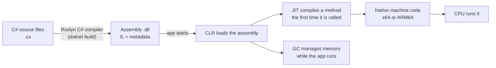
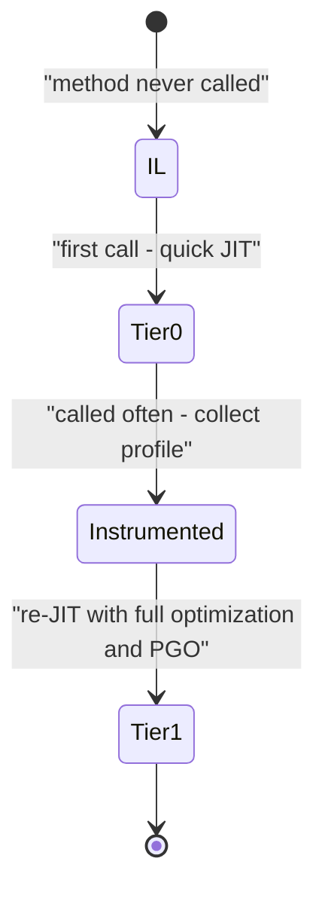
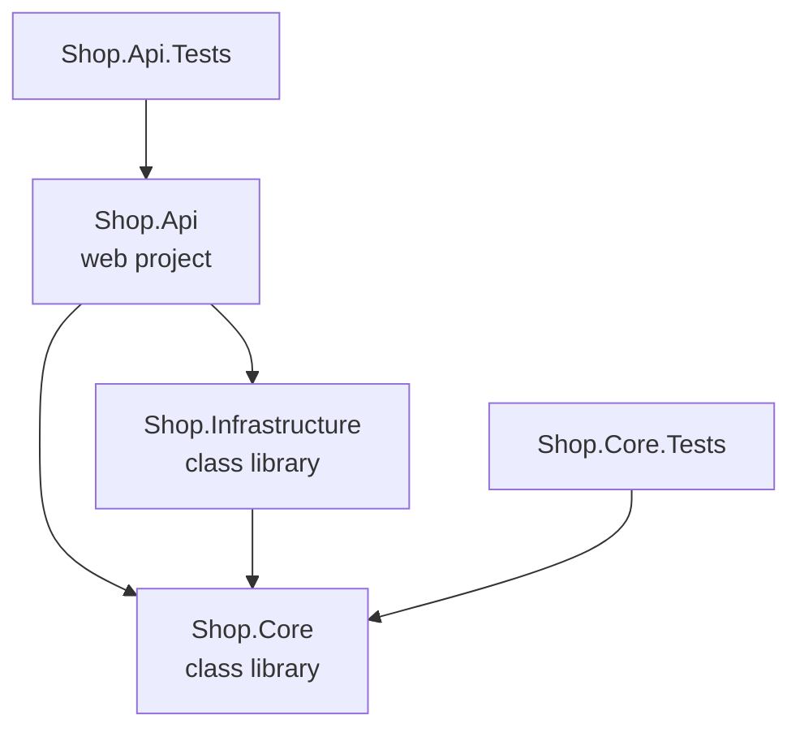
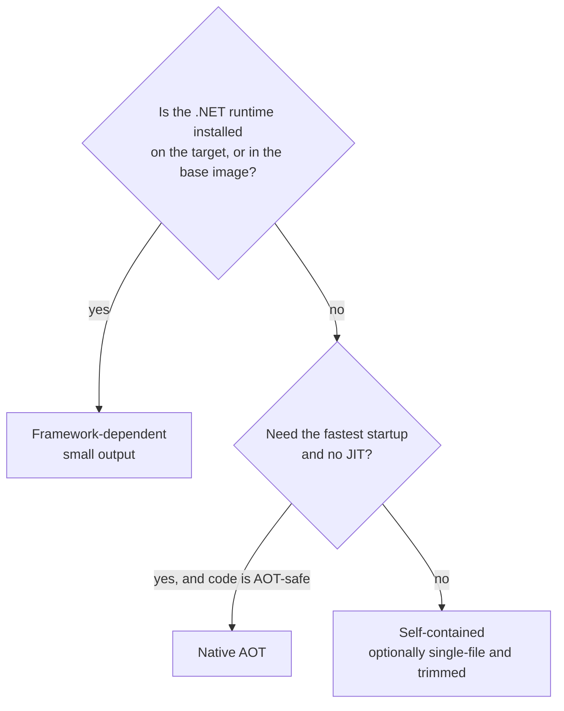

# .NET Runtime, SDK and Project Structure

> In this document you will learn what ".NET" really is: the runtime that runs your code (CLR, IL, JIT), the SDK and the `dotnet` command line, the `.csproj` and solution files, NuGet packages, `Program.cs`, file-based apps and the different ways to publish an app. Interviews often start with "What is the CLR?" or "What is the difference between .NET Framework and .NET?" — and many developers who use .NET every day cannot explain it clearly. After this document you can.

**Before this:** [C# fundamentals and the type system](01-csharp-fundamentals-and-type-system.md) · [Node.js runtime and architecture](../07-nodejs-backend/01-nodejs-runtime-and-architecture.md) (useful for comparison) · **Interview questions:** [jump to the interview section](#interview-questions)

## Table of contents

1. [The .NET family: Framework, Core and modern .NET](#the-net-family-framework-core-and-modern-net)
2. [Release cadence: LTS and STS](#release-cadence-lts-and-sts)
3. [How your C# code runs: compiler, IL, CLR and JIT](#how-your-c-code-runs-compiler-il-clr-and-jit)
4. [Assemblies and the base class library](#assemblies-and-the-base-class-library)
5. [JIT tiers, ReadyToRun and Native AOT](#jit-tiers-readytorun-and-native-aot)
6. [SDK vs runtime](#sdk-vs-runtime)
7. [The dotnet CLI](#the-dotnet-cli)
8. [The SDK-style project file](#the-sdk-style-project-file)
9. [Solutions and the slnx format](#solutions-and-the-slnx-format)
10. [NuGet packages and PackageReference](#nuget-packages-and-packagereference)
11. [Directory.Build.props and Central Package Management](#directorybuildprops-and-central-package-management)
12. [Program.cs and top-level statements](#programcs-and-top-level-statements)
13. [File-based apps in .NET 10](#file-based-apps-in-net-10)
14. [A realistic solution layout](#a-realistic-solution-layout)
15. [Publishing: framework-dependent, self-contained, single-file and Native AOT](#publishing-framework-dependent-self-contained-single-file-and-native-aot)
16. [Configuration files you will see](#configuration-files-you-will-see)
17. [Common mistakes](#common-mistakes)
18. [Best practices](#best-practices)
19. [How to explain this in an interview](#how-to-explain-this-in-an-interview)
20. [Interview questions](#interview-questions)
21. [Summary](#summary)
22. [References](#references)

---

## The .NET family: Framework, Core and modern .NET

The word ".NET" has meant different things over the years. This confuses many people, so let us fix it first.

| Name | Years | Runs on | Status today |
| --- | --- | --- | --- |
| **.NET Framework** (1.0 to 4.8.1) | 2002 to 2022 | Windows only | Still supported as part of Windows, but gets no new features |
| **.NET Core** (1.0 to 3.1) | 2016 to 2019 | Windows, Linux, macOS | Out of support |
| **.NET 5 and later** (5, 6, 7, 8, 9, 10...) | 2020 onward | Windows, Linux, macOS | This is "modern .NET". .NET 10 is the current LTS |

Simple story:

1. **.NET Framework** was the original platform. It is Windows-only and closed in design (it is part of Windows). Big old enterprise apps (ASP.NET Web Forms, WCF services, old ASP.NET MVC 5) still run on it.
2. Microsoft wanted a cross-platform, open-source, fast platform for the cloud and containers. They built **.NET Core** from scratch.
3. In 2020 they dropped the word "Core" and called the next version **.NET 5**. They skipped the number 4 so nobody would confuse it with .NET Framework 4.x. From then on, there is just ".NET".

So when a job post says ".NET 8" or ".NET 10", it means modern .NET (the Core line). When it says ".NET Framework 4.8", it means the old Windows-only platform.

**Analogy:** .NET Framework is an old house that you can still live in, but nobody builds new rooms on it. Modern .NET is the new house, built with a better foundation, and it gets a new floor every year.

### What about ASP.NET and ASP.NET Core?

The same split exists for the web framework:

- **ASP.NET** (MVC 5, Web API 2, Web Forms) runs on .NET Framework.
- **ASP.NET Core** runs on modern .NET. It is a full rewrite: built-in dependency injection, a middleware pipeline, the Kestrel web server, and it runs on Linux and in containers.

Note that the "Core" name stayed for ASP.NET Core and Entity Framework Core, even though the runtime dropped it.

### What is .NET Standard?

**.NET Standard** is not a runtime. It is a *list of APIs* (a contract). A library that targets `netstandard2.0` can be used by .NET Framework 4.6.1+ and by modern .NET. It was the bridge between the two worlds.

Today:

- New apps target a modern version like `net10.0`.
- A library that must still work on .NET Framework can target `netstandard2.0`, or **multi-target** (for example `net48;net8.0`).
- There will be no new .NET Standard versions. Modern `netX.0` target frameworks replaced the idea.

### If you know Node.js

| Node.js world | .NET world |
| --- | --- |
| V8 engine + libuv | CLR (runtime with JIT and GC) |
| `node` executable | `dotnet` host (and the app's own `.exe` launcher) |
| npm CLI | `dotnet` CLI + NuGet |
| `package.json` | `.csproj` (SDK-style project file) |
| `package-lock.json` | `packages.lock.json` (optional) |
| `node_modules/` | Global packages folder (`~/.nuget/packages`), shared by all projects |
| Node LTS lines (even numbers) | .NET LTS releases (even numbers) |
| Monorepo with workspaces | Solution file (`.sln` / `.slnx`) with many projects |

One big difference: JavaScript is compiled by V8 *at runtime* from source text. C# is compiled *ahead of time* by the C# compiler into IL, and IL is compiled to machine code at runtime by the JIT. You will see this in the next sections.

---

## Release cadence: LTS and STS

A new major version of .NET ships **every November**.

- **Even numbers** (6, 8, 10) are **LTS** — Long Term Support. They get **3 years** of free support and patches.
- **Odd numbers** (7, 9, 11) are **STS** — Standard Term Support. They get **2 years** of free support.

> **Changed in 2025:** STS support used to be 18 months. In 2025 Microsoft extended STS to 24 months, starting with .NET 9. Because of this, .NET 8 (LTS) and .NET 9 (STS) end support on the same day.

Support status as of October 2026 (from the official support policy page):

| Version | Type | Released | End of support |
| --- | --- | --- | --- |
| .NET 10 | LTS | November 11, 2025 | November 14, 2028 |
| .NET 9 | STS | November 12, 2024 | November 10, 2026 |
| .NET 8 | LTS | November 14, 2023 | November 10, 2026 |
| .NET 7 | STS | November 8, 2022 | Ended May 14, 2024 |
| .NET 6 | LTS | November 8, 2021 | Ended November 12, 2024 |

So in October 2026, **.NET 8 and .NET 9 are a few weeks from end of support**. Teams on .NET 8 should be upgrading to .NET 10 now. .NET 11 (STS) is planned for November 2026.

Two more facts that come up in interviews:

- **Patch releases** come out about once a month ("Patch Tuesday"), for example 10.0.1, 10.0.2 and so on. You must stay on the latest patch to stay supported.
- The last 6 months of a version's support are **maintenance only**: security fixes, no other changes.

**Which one should a company choose?** Most companies choose LTS for production because they upgrade less often. STS is fine if the team upgrades every year anyway and wants new features early. With 24-month STS support, the gap between the two is smaller than before.

---

## How your C# code runs: compiler, IL, CLR and JIT

This is the most important section of this document.

### The pipeline



Step by step:

1. You write C# in `.cs` files.
2. `dotnet build` runs the **C# compiler** (called **Roslyn**). It does not produce machine code. It produces **IL**.
3. **IL** (Intermediate Language, also called CIL or MSIL) is a CPU-independent instruction set. Think of it as "assembly language for a virtual machine". It is stored in a `.dll` file together with **metadata** (a description of every type, method and field).
4. When you start the app, the **CLR** (Common Language Runtime) loads the `.dll`.
5. The first time a method is called, the **JIT compiler** (Just-In-Time) turns that method's IL into real machine code for the current CPU (x64, ARM64...). The machine code is kept in memory, so the next call is fast.
6. While the app runs, the CLR also manages memory with the **garbage collector** (GC), checks types, handles exceptions and manages threads.

### What the CLR does

The **CLR** is the virtual machine of .NET. (In modern .NET the implementation is called **CoreCLR**.) Its jobs:

| Job | What it means |
| --- | --- |
| Loading | Finds and loads assemblies (`.dll` files) |
| JIT compilation | Turns IL into machine code, method by method |
| Memory management | Allocates objects on the managed heap; the GC frees unused objects ([details](05-memory-gc-and-performance.md)) |
| Type safety | Checks casts and array bounds; you cannot read random memory in safe code |
| Exceptions | Unwinds the stack and finds `catch` blocks |
| Threading | Manages threads and the thread pool ([details](04-async-await-tasks-and-threading.md)) |
| Interop | Lets managed code call native libraries (P/Invoke) |

Code that runs under the CLR is called **managed code**. Code like C or C++ that runs directly on the operating system is **unmanaged** or **native code**.

### Seeing real IL

Here is a tiny method:

```csharp
public static class Calculator
{
    public static int Add(int a, int b) => a + b;
}
```

In a Release build, its IL is four instructions. We can read the raw IL bytes with reflection:

```csharp
var il = typeof(Calculator).GetMethod("Add")!.GetMethodBody()!.GetILAsByteArray()!;
Console.WriteLine(BitConverter.ToString(il)); // 02-03-58-2A
```

Those bytes mean:

```text
02  ldarg.0   // push argument a onto the evaluation stack
03  ldarg.1   // push argument b
58  add       // pop two values, push their sum
2A  ret       // return the value on top of the stack
```

IL is a **stack machine**: instructions push and pop values on an evaluation stack. The JIT later turns these four instructions into one or two real CPU instructions (for x64, roughly a `lea` or `add` plus `ret`).

### Why use IL instead of compiling straight to machine code?

- **One build runs everywhere.** The same `.dll` runs on Windows x64, Linux ARM64 and macOS. The JIT on each machine produces the right machine code.
- **Language independence.** C#, F# and VB.NET all compile to IL. A C# project can use an F# library.
- **Rich metadata.** Reflection, serializers and DI containers read metadata at runtime.
- **Runtime optimizations.** The JIT knows the exact CPU (for example, which vector instructions exist) and can watch how the code behaves while it runs.

The cost: the JIT needs time at startup. The next sections show how .NET reduces that cost.

---

## Assemblies and the base class library

An **assembly** is the unit of deployment in .NET. In practice it is a `.dll` file that contains:

- **IL code** for your methods.
- **Metadata**: every type, method, property and their attributes.
- A **manifest**: the assembly's name, version and the other assemblies it depends on.

Each project you build produces one assembly. A solution with `Shop.Api`, `Shop.Core` and `Shop.Infrastructure` produces three `.dll` files.

What about `.exe`? When you build a console or web app, the SDK produces `MyApp.dll` (your real code) **and** a small native launcher `MyApp.exe` (called the **apphost**) on Windows. The launcher just starts the runtime and loads `MyApp.dll`. You can also start the app with `dotnet MyApp.dll`.

Here is the build output of a small console app that references a class library:

```text
bin/Release/net10.0/
  app1.dll                  <- your code (IL)
  app1.exe                  <- native launcher (apphost)
  app1.pdb                  <- debug symbols (line numbers for stack traces)
  app1.deps.json            <- list of dependencies
  app1.runtimeconfig.json   <- which runtime version to use
  Shop.Core.dll             <- the referenced class library
  Shop.Core.pdb
```

### The base class library (BCL)

The **BCL** is the set of standard libraries that ship with .NET: `System.String`, `List<T>`, `Dictionary<TKey,TValue>`, `System.IO`, `System.Net.Http.HttpClient`, `System.Text.Json`, `System.Linq` and much more. It is like the Node.js core modules plus a large standard library.

You can see where types live:

```csharp
Console.WriteLine(typeof(string).Assembly.GetName().Name);    // System.Private.CoreLib
Console.WriteLine(typeof(List<int>).Assembly.GetName().Name); // System.Private.CoreLib
Console.WriteLine(typeof(System.Text.Json.JsonSerializer).Assembly.GetName().Name); // System.Text.Json
```

`System.Private.CoreLib` is the core assembly that is tightly coupled to the runtime. You never reference it directly; the SDK handles that.

### Namespaces are not assemblies

A **namespace** (like `System.Collections.Generic`) is a naming scope in code. An **assembly** is a file. One assembly can contain many namespaces, and one namespace can be spread over many assemblies. `using System.Text.Json;` only shortens names; it does not load anything.

---

## JIT tiers, ReadyToRun and Native AOT

Startup time and peak speed pull in different directions. .NET gives you three tools.

### Tiered compilation

By default, the JIT compiles each method in **tiers**:

1. **Tier 0:** The first call compiles the method quickly with few optimizations. Startup is fast.
2. The runtime counts calls. When a method is called many times (it is "hot"), the JIT compiles it again at **Tier 1** with full optimizations, in the background.
3. **Dynamic PGO** (Profile-Guided Optimization, on by default since .NET 8) records what really happens at Tier 0 — for example, which concrete class an interface call usually hits — and uses that to produce better Tier 1 code.
4. **OSR** (On-Stack Replacement) lets a long-running loop switch from Tier 0 code to optimized code while it is still running.



This is why a .NET service is often a bit slower in the first seconds after start ("warm-up") and then gets faster.

### ReadyToRun (R2R)

**ReadyToRun** compiles IL to native code **at publish time** and stores it in the assembly, next to the IL. At startup the runtime uses the precompiled code, so it JITs much less.

```xml
<PropertyGroup>
  <PublishReadyToRun>true</PublishReadyToRun>
</PropertyGroup>
```

- Faster startup.
- Bigger files (both IL and native code are inside).
- The JIT still exists. Hot methods can still be re-compiled at Tier 1 for peak speed.
- You must publish for a specific runtime identifier (for example `-r linux-x64`).

### Native AOT

**Native AOT** (Ahead-Of-Time) compiles the whole app to a single native executable at publish time. At runtime there is **no JIT at all**.

```xml
<PropertyGroup>
  <PublishAot>true</PublishAot>
</PropertyGroup>
```

| Benefit | Cost |
| --- | --- |
| Very fast startup (good for serverless, CLI tools, scale-to-zero containers) | Code that generates code at runtime does not work (`Reflection.Emit`, loading plugins with `Assembly.LoadFrom`) |
| Smaller memory use | Reflection is limited; the app is **trimmed**, so unused code is removed |
| No .NET runtime needed on the machine | Some libraries are not compatible; you get trim/AOT warnings |
| Single native file | Build is slower and needs the platform's native linker |

On Windows, Native AOT needs the Visual Studio "Desktop development with C++" workload, because it uses the native linker. On a machine without it, publish fails with an error like:

```text
error : Platform linker not found. Ensure you have all the required prerequisites
documented at https://aka.ms/nativeaot-prerequisites ...
```

ASP.NET Core supports Native AOT for minimal APIs (since .NET 8), with a `webapiaot` template and `WebApplication.CreateSlimBuilder`. MVC controllers and many reflection-heavy libraries are not supported with Native AOT. More on performance in [Memory, GC and performance](05-memory-gc-and-performance.md).

### Which one to use?

| Situation | Choice |
| --- | --- |
| Normal long-running web API | Default JIT (maybe ReadyToRun for faster start) |
| Many container instances that scale up fast | ReadyToRun or Native AOT |
| Small CLI tool, serverless function | Native AOT |
| App that loads plugins or uses heavy reflection | Default JIT |

---

## SDK vs runtime

These two are often confused.

| | Runtime | SDK |
| --- | --- | --- |
| What it is | What you need to **run** an app | What you need to **build** an app |
| Contains | CLR + base libraries (a "shared framework") | The runtime(s) **plus** compilers (Roslyn), MSBuild, NuGet, templates and the `dotnet` CLI commands |
| Where | Production servers, user machines | Developer machines and CI build agents |
| Version example | 10.0.13 | 10.0.402 |

There are three **shared frameworks** (runtimes) you can install:

- `Microsoft.NETCore.App` — the base runtime. Console apps and libraries need only this.
- `Microsoft.AspNetCore.App` — ASP.NET Core (web apps, APIs).
- `Microsoft.WindowsDesktop.App` — WinForms and WPF (Windows only).

You can see what is installed:

```bash
dotnet --list-sdks
# 10.0.303 [C:\Program Files\dotnet\sdk]
# 10.0.402 [C:\Program Files\dotnet\sdk]

dotnet --list-runtimes
# Microsoft.AspNetCore.App 8.0.32 [...]
# Microsoft.AspNetCore.App 10.0.13 [...]
# Microsoft.NETCore.App 8.0.32 [...]
# Microsoft.NETCore.App 10.0.13 [...]
```

Many versions can be installed **side by side**. An app built for .NET 8 uses the 8.0 runtime; an app built for .NET 10 uses the 10.0 runtime.

### Version numbers

- **Runtime version:** `10.0.13` = major 10, minor 0, patch 13.
- **SDK version:** `10.0.402` = SDK for .NET 10, **feature band** 4xx, patch 02. SDK feature bands (100, 200, 300, 400) add tooling features during the year. That is why `#:include` in file-based apps needs SDK 10.0.300 or later, even though the runtime is still 10.0.

### Roll forward

The `runtimeconfig.json` file says which runtime an app wants:

```json
{
  "runtimeOptions": {
    "tfm": "net10.0",
    "framework": {
      "name": "Microsoft.NETCore.App",
      "version": "10.0.0"
    }
  }
}
```

It asks for `10.0.0`, but the app runs on the **latest installed patch** of 10.0. On the test machine above, the app printed `.NET 10.0.13`. This is **roll forward**: by default, the app always uses the newest patch, so security fixes apply without rebuilding. It will not jump to a new major version (11) unless you configure `RollForward`.

### global.json pins the SDK

If a team wants everybody (and CI) to build with the same SDK, they add a `global.json` at the repository root:

```json
{
  "sdk": {
    "version": "10.0.400",
    "rollForward": "latestFeature"
  }
}
```

This means "use SDK 10.0.400 or a newer 10.0.4xx/5xx... feature band". Without `global.json`, the `dotnet` command uses the newest installed SDK. Create one with `dotnet new globaljson`.

---

## The dotnet CLI

The `dotnet` command is both the **host** that runs apps and the **CLI** for the SDK. Here are the commands you will use every day.

| Command | What it does | npm comparison |
| --- | --- | --- |
| `dotnet new <template>` | Creates a project from a template | `npm init`, `npx create-...` |
| `dotnet restore` | Downloads NuGet packages (usually automatic) | `npm install` |
| `dotnet build` | Compiles to IL | `tsc` / `npm run build` |
| `dotnet run` | Builds and runs | `npm start` |
| `dotnet watch` | Runs and reloads on file changes (Hot Reload) | `nodemon` |
| `dotnet test` | Runs unit tests | `npm test` |
| `dotnet publish` | Produces deployable output | `npm run build` for production |
| `dotnet pack` | Creates a NuGet package (`.nupkg`) | `npm pack` |
| `dotnet add package <id>` | Adds a NuGet package reference | `npm install <pkg>` |
| `dotnet add reference <path>` | References another project | workspace dependency |
| `dotnet sln add <path>` | Adds a project to the solution | add to workspaces |
| `dotnet format` | Formats code using `.editorconfig` | `prettier` |
| `dotnet tool install` | Installs a .NET tool (like `dotnet-ef`) | `npm install -g` |
| `dotnet user-secrets` | Stores development secrets outside the repo | `.env` that is not committed |

> **New in .NET 10:** The SDK also accepts **noun-first** forms, which read more naturally: `dotnet package add`, `dotnet package list`, `dotnet package remove`, `dotnet reference add`. The old forms (`dotnet add package`) still work.

### Common templates

```bash
dotnet new console -o Shop.Cli        # console app
dotnet new classlib -o Shop.Core      # class library
dotnet new web -o Shop.Web            # empty ASP.NET Core app (minimal API)
dotnet new webapi -o Shop.Api         # Web API with OpenAPI (add --use-controllers for controllers)
dotnet new worker -o Shop.Worker      # background worker service
dotnet new xunit -o Shop.Tests        # xUnit test project
dotnet new sln -n Shop                # solution file
dotnet new gitignore                  # .gitignore for .NET
dotnet new editorconfig               # .editorconfig
```

### A first session

```bash
dotnet new console -o HelloShop
cd HelloShop
dotnet run
# Hello, World!
```

`dotnet run` does three things: restore (if needed), build, then start the app. In CI you usually split them:

```bash
dotnet restore
dotnet build --no-restore -c Release
dotnet test --no-build -c Release
dotnet publish src/Shop.Api -c Release -o ./publish --no-build
```

`-c Release` selects the **Release configuration** (optimizations on, no debug-only code). The default is `Debug`.

---

## The SDK-style project file

A `.csproj` file is an **MSBuild** file. MSBuild is the build engine of .NET. Modern projects use the short **SDK-style** format.

Here is what `dotnet new console` creates with the .NET 10 SDK:

```xml
<Project Sdk="Microsoft.NET.Sdk">

  <PropertyGroup>
    <OutputType>Exe</OutputType>
    <TargetFramework>net10.0</TargetFramework>
    <ImplicitUsings>enable</ImplicitUsings>
    <Nullable>enable</Nullable>
  </PropertyGroup>

</Project>
```

That is the whole file. Line by line:

- `Sdk="Microsoft.NET.Sdk"` — imports all the default build logic. Web projects use `Microsoft.NET.Sdk.Web`, which adds ASP.NET Core, `appsettings.json` handling and more.
- `OutputType` `Exe` — build an executable. A class library leaves this out (default is `Library`).
- `TargetFramework` `net10.0` — the **TFM** (target framework moniker). It decides which APIs you can use and which runtime you need. Examples: `net8.0`, `net10.0`, `netstandard2.0`, `net48`.
- `ImplicitUsings` — adds common `using` lines for you (see below).
- `Nullable` — turns on **nullable reference types**: the compiler warns when you might use `null` by mistake ([details](01-csharp-fundamentals-and-type-system.md)).

### Things you do not see

The old (.NET Framework) project format listed every `.cs` file. SDK-style projects use **default globbing**: every `**/*.cs` file under the project folder is compiled automatically. You add a file to the folder, and it is part of the project.

The C# **language version** comes from the target framework. `net10.0` uses C# 14 by default, `net8.0` uses C# 12. You rarely set `LangVersion` yourself.

### Implicit usings

With `ImplicitUsings` enabled, the SDK generates a file in `obj/` that contains global usings. For a console project it looks like this:

```csharp
// <auto-generated/>
global using System;
global using System.Collections.Generic;
global using System.IO;
global using System.Linq;
global using System.Net.Http;
global using System.Threading;
global using System.Threading.Tasks;
```

Web projects get extra ones, like `Microsoft.AspNetCore.Builder` and `Microsoft.Extensions.DependencyInjection`. That is why `WebApplication` works in `Program.cs` without any `using` line.

You can add your own global usings in the project file:

```xml
<ItemGroup>
  <Using Include="Shop.Core.Orders" />
</ItemGroup>
```

### A realistic project file

```xml
<Project Sdk="Microsoft.NET.Sdk.Web">

  <PropertyGroup>
    <TargetFramework>net10.0</TargetFramework>
    <Nullable>enable</Nullable>
    <ImplicitUsings>enable</ImplicitUsings>
    <RootNamespace>Shop.Api</RootNamespace>
    <TreatWarningsAsErrors>true</TreatWarningsAsErrors>
    <InvariantGlobalization>true</InvariantGlobalization>
    <UserSecretsId>shop-api-3f2c</UserSecretsId>
  </PropertyGroup>

  <ItemGroup>
    <PackageReference Include="Microsoft.AspNetCore.OpenApi" Version="10.0.13" />
  </ItemGroup>

  <ItemGroup>
    <ProjectReference Include="..\Shop.Core\Shop.Core.csproj" />
    <ProjectReference Include="..\Shop.Infrastructure\Shop.Infrastructure.csproj" />
  </ItemGroup>

</Project>
```

- `PropertyGroup` holds settings (properties).
- `ItemGroup` holds lists of items: package references, project references, files.
- `TreatWarningsAsErrors` makes nullable warnings fail the build. Many teams do this so null bugs cannot slip in.
- `InvariantGlobalization` removes the dependency on ICU culture data (smaller containers). Only use it if the app does not need culture-specific formatting.

### Nullable warnings: compile time, not runtime

```csharp
string? name = null;
Console.WriteLine(name.Length);
```

- The build succeeds with `warning CS8602: Dereference of a possibly null reference.`
- At runtime it still throws `NullReferenceException`.

Nullable reference types are a **compile-time** check only, just like TypeScript's `strictNullChecks`. If you add `<WarningsAsErrors>Nullable</WarningsAsErrors>`, the same line becomes `error CS8602` and the build fails.

### Multi-targeting

A library can build for several frameworks at once. Note the plural `TargetFrameworks`:

```xml
<PropertyGroup>
  <TargetFrameworks>net8.0;net10.0</TargetFrameworks>
</PropertyGroup>
```

This produces two `.dll` files, one per framework. You can use `#if NET10_0_OR_GREATER` to use newer APIs only where they exist.

---

## Solutions and the slnx format

A **solution** groups many projects so you can build, test and open them together. It is like a monorepo workspace file.

The classic format is `.sln`. It is a text file, but hard to read and full of GUIDs. Merge conflicts in `.sln` files are common.

The newer **`.slnx`** format is simple XML:

```xml
<Solution>
  <Project Path="src/Shop.Api/Shop.Api.csproj" />
  <Project Path="src/Shop.Core/Shop.Core.csproj" />
  <Project Path="tests/Shop.Tests/Shop.Tests.csproj" />
</Solution>
```

> **New in .NET 10:** `dotnet new sln` creates a `.slnx` file by default. The .NET 9 SDK (from feature band 9.0.200) added support for reading `.slnx` and the command `dotnet sln migrate`, which converts an existing `.sln` to `.slnx`. Recent versions of Visual Studio, Rider and the VS Code C# Dev Kit can open `.slnx`.

Working with solutions:

```bash
dotnet new sln -n Shop                       # creates Shop.slnx (.NET 10 SDK)
dotnet sln add src/Shop.Api/Shop.Api.csproj  # adds a project
dotnet sln list                              # lists projects
dotnet sln migrate                           # converts Shop.sln to Shop.slnx
dotnet build Shop.slnx                       # builds every project
```

If a team still uses an older SDK or older tools in CI, they keep `.sln` until every tool supports `.slnx`.

---

## NuGet packages and PackageReference

**NuGet** is the package manager for .NET. **nuget.org** is the public registry, like npmjs.com. A package is a `.nupkg` file (a zip) that contains assemblies for one or more target frameworks plus metadata.

### Adding a package

```bash
dotnet add package Serilog.AspNetCore
# or, .NET 10 noun-first form:
dotnet package add Serilog.AspNetCore
```

This adds a line to the `.csproj`:

```xml
<ItemGroup>
  <PackageReference Include="Serilog.AspNetCore" Version="9.0.0" />
</ItemGroup>
```

### How restore works

1. `dotnet restore` reads every `PackageReference`.
2. It resolves the full graph, including **transitive** dependencies (packages that your packages need).
3. It downloads missing packages into the **global packages folder** (`~/.nuget/packages` on Linux/macOS, `%UserProfile%\.nuget\packages` on Windows).
4. It writes `obj/project.assets.json`, which tells the build exactly which `.dll` to use.

Unlike `node_modules`, packages are **not copied into each project**. Every project on the machine shares the global folder. On build, the needed `.dll` files are copied to `bin/`.

### Version resolution

`Version="9.0.0"` in NuGet means **"9.0.0 or higher"** (minimum version), not "exactly 9.0.0". When two packages need different versions of the same dependency, NuGet picks the **lowest version that satisfies all requirements**. This is different from npm, which can install several copies of the same package.

If you want reproducible restores, enable a lock file:

```xml
<PropertyGroup>
  <RestorePackagesWithLockFile>true</RestorePackagesWithLockFile>
</PropertyGroup>
```

This creates `packages.lock.json` (like `package-lock.json`). In CI, `dotnet restore --locked-mode` fails if the lock file does not match.

### nuget.config and private feeds

Companies often host private packages (in Azure Artifacts, GitHub Packages or similar). The sources are listed in a `nuget.config` file:

```xml
<?xml version="1.0" encoding="utf-8"?>
<configuration>
  <packageSources>
    <clear />
    <add key="nuget.org" value="https://api.nuget.org/v3/index.json" />
    <add key="company" value="https://pkgs.dev.azure.com/acme/_packaging/internal/nuget/v3/index.json" />
  </packageSources>
</configuration>
```

`<clear />` removes sources inherited from the user or machine config, so the build only uses what this file lists. A very common real problem: a developer's machine has a private feed in its user-level config, the credentials expire, and **every restore** fails with `NU1301: Unable to load the service index for source ...` and `401 (Unauthorized)` — even for projects that do not use private packages. The fix is to refresh the credentials, or add a `nuget.config` with `<clear />` to the project.

### Security: NuGet audit

Since the .NET 8 SDK, restore checks packages against a database of known vulnerabilities and shows warnings like `NU1901`–`NU1904`. Recent SDKs also check transitive packages. Treat these warnings seriously and update the package.

---

## Directory.Build.props and Central Package Management

In a solution with 20 projects, repeating the same settings in every `.csproj` is painful.

### Directory.Build.props

MSBuild automatically imports a file named **`Directory.Build.props`** from the project's folder or any parent folder. Put shared settings there:

```xml
<!-- Directory.Build.props at the repository root -->
<Project>
  <PropertyGroup>
    <TargetFramework>net10.0</TargetFramework>
    <Nullable>enable</Nullable>
    <ImplicitUsings>enable</ImplicitUsings>
    <TreatWarningsAsErrors>true</TreatWarningsAsErrors>
    <LangVersion>latest</LangVersion>
  </PropertyGroup>
</Project>
```

Now each `.csproj` only contains what is special about that project.

### Central Package Management (CPM)

Without CPM, project A can use `Serilog 3.1` and project B `Serilog 4.0`. That causes confusing bugs. **Central Package Management** puts all versions in one file, **`Directory.Packages.props`**:

```xml
<!-- Directory.Packages.props at the repository root -->
<Project>
  <PropertyGroup>
    <ManagePackageVersionsCentrally>true</ManagePackageVersionsCentrally>
  </PropertyGroup>
  <ItemGroup>
    <PackageVersion Include="Serilog.AspNetCore" Version="9.0.0" />
    <PackageVersion Include="xunit" Version="2.9.3" />
  </ItemGroup>
</Project>
```

Projects then reference packages **without a version**:

```xml
<ItemGroup>
  <PackageReference Include="Serilog.AspNetCore" />
</ItemGroup>
```

Benefits: one place to upgrade, every project uses the same version, smaller diffs. Create the file with `dotnet new packagesprops`. (The package versions in these examples are illustrative; check nuget.org for current versions.)

---

## Program.cs and top-level statements

Every app needs an **entry point**: the first method that runs. In classic C#, it is a `static void Main(string[] args)` method in a class:

```csharp
namespace HelloShop;

internal class Program
{
    private static void Main(string[] args)
    {
        Console.WriteLine("Hello, World!");
    }
}
```

Since C# 9, you can use **top-level statements** and write the code directly:

```csharp
Console.WriteLine("Hello, World!");
```

The compiler generates the class and the `Main` method for you. You can even see the generated name in a stack trace: `at Program.<Main>$(String[] args)`.

Rules for top-level statements:

- Only **one file** in a project can have them.
- `args` is available automatically (the command-line arguments).
- You can use `await` directly; the compiler then creates an `async Task Main`.
- You can `return` an `int`; it becomes the **process exit code**.
- Local functions and types can be declared in the same file. **Types must come after the statements.**

### Example: everything in one file

```csharp
Console.WriteLine(Greet("Asha"));  // Hi Asha
Console.WriteLine(Counter.Next()); // 1
Console.WriteLine(Counter.Next()); // 2
Console.WriteLine(args.Length);    // 0 (when run with no arguments)
return args.Length == 0 ? 0 : 2;   // exit code

string Greet(string name) => $"Hi {name}";   // local function

static class Counter
{
    private static int _count;
    public static int Next() => ++_count;
}
```

Running it with `-- a b` prints `2` for `args.Length` and the process exits with code `2`. Exit codes matter for scripts and CI: `0` means success, anything else means failure.

### Program.cs in ASP.NET Core

In a web app, `Program.cs` is where you configure everything. This is called the **composition root**:

```csharp
var builder = WebApplication.CreateBuilder(args);   // 1. create the host builder

builder.Services.AddOpenApi();                      // 2. register services (DI)

var app = builder.Build();                          // 3. build the app

if (app.Environment.IsDevelopment())
{
    app.MapOpenApi();                               // 4. configure middleware and endpoints
}

app.UseHttpsRedirection();
app.MapGet("/health", () => "OK");

app.Run();                                          // 5. start the web server and block
```

Each step is explained in depth in [ASP.NET Core fundamentals and middleware](07-aspnet-core-fundamentals-and-middleware.md).

---

## File-based apps in .NET 10

> **New in .NET 10:** You can run a single `.cs` file without any project file: `dotnet run app.cs`.

This is like running `node script.js`. It is great for scripts, small tools, learning and quick experiments.

```csharp
// hello.cs
var name = args.Length > 0 ? args[0] : "world";
Console.WriteLine($"Hello, {name}!");
```

```bash
dotnet run hello.cs -- Asha
# Hello, Asha!

dotnet hello.cs          # shorter form, same thing
```

### How it works

The SDK creates a **virtual project** behind the scenes and builds it into a cache folder under the system temp directory (`<temp>/dotnet/runfile/...`). The next run of the same unchanged file reuses the cached build, so it starts much faster.

### Directives

You configure the virtual project with `#:` lines at the top of the file:

| Directive | Example | Meaning |
| --- | --- | --- |
| `#:package` | `#:package Humanizer@2.14.1` | Add a NuGet package |
| `#:sdk` | `#:sdk Microsoft.NET.Sdk.Web` | Use a different SDK (for example, web) |
| `#:property` | `#:property PublishAot=false` | Set an MSBuild property |
| `#:project` | `#:project ../Shop.Core/Shop.Core.csproj` | Reference a project |
| `#:include` | `#:include helpers.cs` | Include another file (SDK 10.0.300 and later) |

A whole web API in one file:

```csharp
#:sdk Microsoft.NET.Sdk.Web

var app = WebApplication.Create(args);
app.MapGet("/", () => "hi from file-based web app");
app.Run();
```

```bash
dotnet run web.cs
curl http://localhost:5000/
# hi from file-based web app
```

On Linux and macOS, you can add a shebang line `#!/usr/bin/env -S dotnet --` as the first line and run the file directly like a shell script (`chmod +x app.cs` then `./app.cs`).

### Important details

- `dotnet publish app.cs` uses **Native AOT by default** for file-based apps. Add `#:property PublishAot=false` to turn it off.
- File-based apps still read `Directory.Build.props`, `global.json` and `nuget.config` from parent folders. Keep scripts outside your project folders, or they may pick up surprising settings.
- When the script grows, convert it: `dotnet project convert app.cs` creates a normal `.csproj` project next to it.

---

## A realistic solution layout

Here is a common layout for a backend service:

```text
Shop/
  Shop.slnx
  global.json
  nuget.config
  Directory.Build.props
  Directory.Packages.props
  .editorconfig
  src/
    Shop.Api/                 <- ASP.NET Core app (Microsoft.NET.Sdk.Web)
      Program.cs
      appsettings.json
      appsettings.Development.json
      Properties/launchSettings.json
      Endpoints/
    Shop.Core/                <- domain and use cases (class library, no web dependencies)
    Shop.Infrastructure/      <- EF Core, external APIs, email (class library)
  tests/
    Shop.Core.Tests/          <- unit tests
    Shop.Api.Tests/           <- integration tests
```



- Arrows are `ProjectReference`s. `Shop.Core` depends on nothing. This keeps business rules free of web and database code.
- Project references are checked by the compiler. If `Shop.Core` tries to use a class from `Shop.Infrastructure`, it does not compile. This is a strong, cheap way to enforce architecture.
- The architecture trade-offs (layered, Clean Architecture, vertical slices) are covered in [Production, architecture and performance](14-production-architecture-and-performance.md).

Commands to create it:

```bash
dotnet new sln -n Shop
dotnet new web -o src/Shop.Api
dotnet new classlib -o src/Shop.Core
dotnet new classlib -o src/Shop.Infrastructure
dotnet new xunit -o tests/Shop.Core.Tests
dotnet sln add src/Shop.Api src/Shop.Core src/Shop.Infrastructure tests/Shop.Core.Tests
dotnet add src/Shop.Api reference src/Shop.Core src/Shop.Infrastructure
dotnet add src/Shop.Infrastructure reference src/Shop.Core
dotnet add tests/Shop.Core.Tests reference src/Shop.Core
```

---

## Publishing: framework-dependent, self-contained, single-file and Native AOT

`dotnet build` is for development. `dotnet publish` creates the folder you deploy. The main choice is: **does the target machine already have the .NET runtime?**



Here are real measurements from publishing the same tiny "Hello" console app on Windows x64 with the .NET 10 SDK:

| Mode | Command | Output |
| --- | --- | --- |
| Framework-dependent | `dotnet publish -c Release` | 5 files, about 186 KB |
| Self-contained | `dotnet publish -c Release -r win-x64 --self-contained` | 192 files, about 78 MB |
| Self-contained single-file | add `-p:PublishSingleFile=true` | 1 exe (+ pdb), about 71 MB |
| Single-file + trimmed | add `-p:PublishTrimmed=true` | 1 exe (+ pdb), about 13 MB |
| Native AOT | `-p:PublishAot=true` | 1 native exe; needs the C++ linker on Windows |

### Framework-dependent

- The output contains only your code and your packages.
- The machine must have the right runtime (for a web app, `Microsoft.AspNetCore.App`).
- The app gets runtime security patches when the machine's runtime is updated.
- This is the default, and the usual choice for Docker images based on `mcr.microsoft.com/dotnet/aspnet`, because the runtime is already in the base image.

### Self-contained

- The output contains your code **plus a full copy of the runtime**.
- You must choose a **runtime identifier (RID)**: `win-x64`, `linux-x64`, `linux-arm64`, `linux-musl-x64` (Alpine), `osx-arm64`.
- No runtime is needed on the machine. Good for desktop apps or servers you do not control.
- Downside: it is large, and **you** must republish to get runtime security fixes.

### Single-file

`PublishSingleFile` bundles everything into one executable. It is easier to copy around. It still uses the JIT. Some code that reads `Assembly.Location` behaves differently, because the assemblies are inside the bundle, not on disk.

### Trimming

`PublishTrimmed` removes code that the app never uses. It can make output much smaller. The risk: code that is only used through **reflection** may be removed, because the trimmer cannot see it. The SDK shows trim warnings (`IL2026` and similar); take them seriously. Trimming requires self-contained.

### Native AOT

Described [above](#native-aot). It implies trimming. Choose it when startup time and memory matter more than flexibility, and when all your libraries are AOT-compatible.

### Containers without a Dockerfile

The SDK can also build a container image directly:

```bash
dotnet publish src/Shop.Api -c Release /t:PublishContainer
```

It uses the official .NET base images and produces an image in your local Docker or a registry. Dockerfiles and container best practices are covered in [Production, architecture and performance](14-production-architecture-and-performance.md).

---

## Configuration files you will see

| File | Purpose | Deployed? |
| --- | --- | --- |
| `*.csproj` | Project settings, packages, references | No (used at build) |
| `*.sln` / `*.slnx` | Groups projects | No |
| `global.json` | Pins the SDK version | No |
| `nuget.config` | Package sources | No |
| `Directory.Build.props` | Shared MSBuild properties | No |
| `Directory.Packages.props` | Central package versions | No |
| `.editorconfig` | Code style and analyzer severity | No |
| `appsettings.json` | App configuration for all environments | Yes |
| `appsettings.Development.json` | Overrides for the Development environment | Yes (only used when the environment is Development) |
| `Properties/launchSettings.json` | Local run profiles: URLs, environment variables | **No** — local development only |
| `*.runtimeconfig.json` | Which runtime to use and runtime settings (generated) | Yes |
| `*.deps.json` | List of dependencies (generated) | Yes |
| `*.http` | Sample HTTP requests you can send from the IDE | No |

Two points that confuse beginners:

1. **`launchSettings.json` is not used in production.** It only affects `dotnet run` and the IDE. If you set `ASPNETCORE_ENVIRONMENT=Development` there, production does not see it. In production, the environment comes from real environment variables. With no setting, the environment is `Production`.
2. **`appsettings.json` is not for secrets.** It is committed to git. Use user secrets in development and a secret store (for example Azure Key Vault) or environment variables in production. Details in [ASP.NET Core fundamentals](07-aspnet-core-fundamentals-and-middleware.md#configuration) and [Authentication and authorization](11-authentication-and-authorization.md).

The launch profile that `dotnet new web` creates looks like this:

```json
{
  "profiles": {
    "http": {
      "commandName": "Project",
      "launchBrowser": true,
      "applicationUrl": "http://localhost:5001",
      "environmentVariables": {
        "ASPNETCORE_ENVIRONMENT": "Development"
      }
    }
  }
}
```

(The template picks the port number when it creates the project.)

---

## Common mistakes

1. **Treating ".NET Core" and ".NET Framework" as the same thing.** They are different platforms. Modern .NET (5+) continues .NET Core, not .NET Framework.
2. **Thinking C# compiles to machine code.** Normally it compiles to IL; the JIT makes machine code at runtime. Only Native AOT (and partly ReadyToRun) compiles to native code at publish time.
3. **Installing the SDK on production servers.** Production needs only the runtime (or nothing, for self-contained). The SDK is bigger and adds attack surface.
4. **Staying on an out-of-support version.** No security patches means real risk. In October 2026, .NET 8 and 9 have only weeks left.
5. **Committing `bin/` and `obj/`.** They are build output. Use `dotnet new gitignore`.
6. **Putting secrets in `appsettings.json` or `launchSettings.json`.** Both are usually committed.
7. **Mixing package versions across projects.** Use Central Package Management.
8. **Ignoring nullable and trimming warnings.** They predict real runtime crashes.
9. **Enabling Native AOT without checking libraries.** Reflection-heavy libraries can fail at runtime or produce warnings you must fix.
10. **Expecting `Version="1.2.0"` to mean "exactly 1.2.0".** In NuGet it means "1.2.0 or higher"; use `[1.2.0]` for an exact version (rarely needed).

---

## Best practices

- **Target the current LTS (.NET 10)** for new production work, because it has the longest support window.
- **Pin the SDK with `global.json`** so local machines and CI build the same way.
- **Use `Directory.Build.props` and `Directory.Packages.props`** to keep project files small and versions consistent.
- **Enable `Nullable` and treat warnings as errors** (at least nullable warnings), because null bugs become build errors instead of production incidents.
- **Keep the domain project free of web and database packages**, so project references enforce your architecture.
- **Use framework-dependent publish in containers** with the official ASP.NET Core base image, because the image already has a patched runtime.
- **Use `dotnet restore --locked-mode` in CI** if you use lock files, so a build cannot silently pick up a new package version.
- **Keep the runtime patched** — rebuild images or update servers monthly, because patch releases contain security fixes.
- **Use file-based apps for scripts and experiments**, and convert them to projects when they grow.

---

## How to explain this in an interview

**Question: "What happens when you build and run a .NET app?"**

1. **Define it:** "The C# compiler, Roslyn, compiles my code into IL — an intermediate, CPU-independent language — and stores it in an assembly, a `.dll` with metadata."
2. **Why it exists:** "IL means one build runs on any OS and CPU, and other .NET languages can share libraries. Metadata powers reflection and serialization."
3. **How it works:** "At runtime the CLR loads the assembly. The JIT compiles each method to machine code on its first call. Tiered compilation starts with quick code and recompiles hot methods with full optimizations and dynamic PGO. The GC manages memory."
4. **Small example:** "A method `Add(a, b)` becomes four IL instructions: load a, load b, add, return. The JIT turns that into one or two x64 instructions."
5. **Where it is useful:** "For APIs this gives good peak performance. For fast startup, like serverless or containers that scale up quickly, I can use ReadyToRun or Native AOT."
6. **Trade-offs / gotchas:** "JIT has a warm-up cost. Native AOT removes it but limits reflection and dynamic code loading, and trims unused code, so libraries must be AOT-compatible."

---

## Interview questions

### Q1. What is the difference between .NET Framework, .NET Core and .NET 5+?

**What the interviewer is checking:** Whether you understand the platform history and can choose correctly for a project.

**Short spoken answer (30–60 seconds):**
> .NET Framework is the original platform from 2002. It is Windows-only, and version 4.8.1 is the last one — it still gets security fixes as part of Windows, but no new features. .NET Core was a rewrite from 2016: cross-platform, open source, faster, and designed for the cloud and containers. In 2020 Microsoft dropped the "Core" name, so .NET 5, 6, 7 and so on are the continuation of .NET Core. Today, "modern .NET" means .NET 8 or .NET 10. For any new project I would pick modern .NET. I would only touch .NET Framework to maintain legacy apps, like WCF services or Web Forms.

**Detailed explanation:** The two platforms share the C# language and many API names, but they are separate runtimes. ASP.NET Core and EF Core are built for modern .NET. Libraries that must work on both can target `netstandard2.0` or multi-target.

**Follow-up questions:**
- **Why was version 4 skipped?** — To avoid confusion with .NET Framework 4.x. Going straight to 5 showed it was the one main line from then on.
- **Can a modern .NET app reference a .NET Framework library?** — Sometimes it loads through a compatibility shim, but it fails at runtime if the library uses APIs that do not exist in modern .NET (for example `System.Web`). The safe path is to retarget the library to `netstandard2.0` or modern .NET.
- **How would you migrate a .NET Framework app?** — Start with class libraries (move them to `netstandard2.0` or multi-target), use the .NET Upgrade Assistant and API analyzers, replace unsupported technologies (WCF server → gRPC or CoreWCF, Web Forms → Razor Pages or Blazor), and migrate the web layer last, possibly gradually behind a reverse proxy.

**Common mistakes:** Saying ".NET Core is a lighter version of .NET Framework" (it is a separate implementation). Saying .NET Framework is "unsupported" (it is supported, just frozen).

**Where this is used in real projects:** Migration projects, choosing a target framework for a new service, explaining why an old library does not work.

### Q2. What is the CLR, and what does it do?

**What the interviewer is checking:** Runtime fundamentals, not just C# syntax.

**Short spoken answer (30–60 seconds):**
> The CLR, the Common Language Runtime, is the virtual machine that runs .NET code. It loads assemblies, JIT-compiles IL into machine code, manages memory with the garbage collector, enforces type safety, handles exceptions, and manages threads and the thread pool. Code that runs under the CLR is called managed code. In Node.js terms, the CLR plays the role of V8 plus part of libuv — but it starts from compiled IL, not from source text.

**Detailed explanation:** See [How your C# code runs](#how-your-c-code-runs-compiler-il-clr-and-jit). The modern implementation is CoreCLR. Mono is another implementation, used historically for mobile and WebAssembly.

**Follow-up questions:**
- **What is managed vs unmanaged code?** — Managed code runs under the CLR, with GC and type safety. Unmanaged code (C/C++, OS APIs) runs directly; .NET calls it through P/Invoke. Unmanaged resources (file handles, sockets) are not freed by the GC automatically, which is why `IDisposable` exists.
- **What is the CTS?** — The Common Type System: the type rules all .NET languages share, so a C# class can be used from F#.
- **Is the GC part of the CLR?** — Yes. It is a core runtime component ([GC details](05-memory-gc-and-performance.md)).

**Common mistakes:** Mixing up the CLR (runtime) with the BCL (libraries) or the SDK (tools).

**Where this is used in real projects:** Understanding warm-up, memory usage and crash dumps; choosing between JIT and AOT.

### Q3. What is IL, and why does .NET use it?

**What the interviewer is checking:** Understanding of the compile pipeline and its trade-offs.

**Short spoken answer (30–60 seconds):**
> IL, Intermediate Language, is what the C# compiler produces. It is a CPU-independent, stack-based instruction set, stored in an assembly together with metadata about all types and methods. At runtime the JIT turns IL into machine code for the actual CPU. Using IL means one build runs on Windows, Linux and macOS, on x64 and ARM; several languages can share libraries; reflection works because of the metadata; and the JIT can optimize for the exact machine. The cost is JIT time at startup.

**Code:** `Add(a, b) => a + b` compiles to `ldarg.0`, `ldarg.1`, `add`, `ret` (bytes `02-03-58-2A`, verified with `GetILAsByteArray()` on a Release build).

**Follow-up questions:**
- **Can you decompile IL back to C#?** — Yes, quite accurately, with tools like ILSpy. That is one reason you never put secrets in code. Obfuscators make it harder, not impossible.
- **Where is IL stored?** — In the `.dll` (a PE file) together with metadata and the assembly manifest.

**Common mistakes:** Calling IL "bytecode that is interpreted". CoreCLR does not interpret IL; it JIT-compiles it (or uses precompiled code).

**Where this is used in real projects:** Debugging with decompilers, choosing source generators over reflection, AOT planning.

### Q4. What is tiered compilation, and why might a .NET API be slower right after it starts?

**What the interviewer is checking:** Practical performance knowledge.

**Short spoken answer (30–60 seconds):**
> With tiered compilation, the JIT first compiles each method quickly with few optimizations — Tier 0 — so the app starts fast. The runtime counts calls, and hot methods get recompiled in the background at Tier 1 with full optimizations. Since .NET 8, dynamic PGO is on by default: Tier 0 code collects profile data, like which concrete type an interface call usually sees, and Tier 1 uses it. So for the first seconds, requests run less optimized code and the JIT is busy. That is warm-up. To reduce it, I can use ReadyToRun, send warm-up requests before taking traffic, or use Native AOT.

**Follow-up questions:**
- **What is OSR?** — On-Stack Replacement: a method stuck in a long loop at Tier 0 can switch to optimized code in the middle of the loop.
- **Can you turn tiering off?** — Yes (`TieredCompilation` false), but then startup is slower because everything is fully optimized at first call. Usually not worth it.
- **How do readiness probes relate to this?** — A readiness probe can keep traffic away until the app has warmed up, so the first real users do not get slow responses.

**Common mistakes:** Benchmarking only the first few calls. Tools like BenchmarkDotNet run warm-up iterations for this reason.

**Where this is used in real projects:** Autoscaling services, latency-sensitive APIs, serverless functions.

### Q5. Compare framework-dependent, self-contained, single-file, ReadyToRun and Native AOT publishing.

**What the interviewer is checking:** Deployment decision-making.

**Short spoken answer (30–60 seconds):**
> Framework-dependent is the default: the output has only my app, so it is tiny, and the machine or base image must have the runtime. Self-contained includes the whole runtime, so it runs anywhere for that RID, but it is large and I must republish to get runtime patches. Single-file packs it into one executable, and trimming removes unused code. ReadyToRun precompiles IL to native code to improve startup but keeps the JIT. Native AOT compiles everything to native code with no JIT at all: fastest startup and low memory, but it implies trimming and restricts reflection and dynamic code. For a typical API in Docker, I use framework-dependent with the official ASP.NET Core image.

**Detailed explanation:** See [Publishing](#publishing-framework-dependent-self-contained-single-file-and-native-aot) and the measured size table there (186 KB vs 78 MB vs 13 MB trimmed).

**Follow-up questions:**
- **What is a RID?** — A runtime identifier like `linux-x64` or `linux-musl-x64`. Self-contained and AOT builds are per RID because they contain native code.
- **Why can trimming break an app?** — The trimmer removes code it cannot see being used. Code reached only by reflection (for example a serializer creating types by name) gets removed. Source generators (like `System.Text.Json` source generation) fix this.
- **Does Native AOT make code faster at peak?** — Not necessarily. The JIT with dynamic PGO can produce faster steady-state code. AOT mainly wins on startup and memory.

**Common mistakes:** Choosing self-contained for Docker images that already contain the runtime (bigger images for no benefit).

**Where this is used in real projects:** Dockerfiles, desktop app installers, CLI tools, serverless functions.

### Q6. What is the difference between the .NET SDK and the .NET runtime?

**Short answer:** The runtime runs apps: the CLR plus the base libraries, in shared frameworks like `Microsoft.NETCore.App` and `Microsoft.AspNetCore.App`. The SDK builds apps: it contains the runtime plus Roslyn, MSBuild, NuGet, templates and the CLI commands. Developer machines and CI need the SDK; production needs only the runtime (or nothing with self-contained publish). Their version numbers differ too: runtime 10.0.13 vs SDK 10.0.402, where `4xx` is the SDK feature band.

**Follow-up questions:**
- **How do you make CI use the same SDK as developers?** — Add `global.json` with a version and a `rollForward` policy.
- **Can several runtimes be installed at once?** — Yes, side by side. Each app picks its major version from `runtimeconfig.json`.

### Q7. An app was built for .NET 10. The server has runtimes 8.0.32, 10.0.11 and 10.0.13 installed. Which runtime does it use?

**What the interviewer is checking:** Roll-forward behavior.

**Answer:** It runs on **10.0.13**. The `runtimeconfig.json` asks for `Microsoft.NETCore.App` version `10.0.0`, and by default the host picks the **latest installed patch** of that major.minor. It never falls back to 8.0, and it does not jump to a newer major (like 11) unless `RollForward` is set to `Major` or `LatestMajor`.

**Step by step:**
1. The host reads `app.runtimeconfig.json`: framework `Microsoft.NETCore.App`, version `10.0.0`.
2. It looks for installed 10.0.x runtimes and finds 10.0.11 and 10.0.13.
3. It chooses the highest patch, 10.0.13. A test app printed `.NET 10.0.13` in exactly this setup.

**Follow-up questions:**
- **What if no 10.x runtime is installed?** — Startup fails with a "framework not found" message and a download link.
- **Why is rolling to the latest patch the default?** — So security patches apply without rebuilding apps.

### Q8. What is in an SDK-style `.csproj`, and how is it different from the old format?

**What the interviewer is checking:** Hands-on experience with projects.

**Short spoken answer (30–60 seconds):**
> An SDK-style project starts with `Project Sdk="Microsoft.NET.Sdk"` — or `Microsoft.NET.Sdk.Web` for ASP.NET Core — which imports all the default build logic. Then a PropertyGroup with settings like `TargetFramework`, `Nullable` and `ImplicitUsings`, and ItemGroups for `PackageReference` and `ProjectReference`. The old .NET Framework format listed every file, had hundreds of lines and often used `packages.config`. The SDK style includes all `.cs` files by default, so it is short and merge-friendly, and it supports multi-targeting with `TargetFrameworks`.

**Follow-up questions:**
- **What does `ImplicitUsings` do?** — It generates `global using` lines in `obj/` for common namespaces (`System`, `System.Linq`, `System.Threading.Tasks`...), with extra ones for web projects.
- **What decides the C# language version?** — The target framework: `net10.0` uses C# 14 and `net8.0` uses C# 12 by default.
- **How do you share settings across 20 projects?** — `Directory.Build.props` at the root, which MSBuild imports automatically.

**Common mistakes:** Editing generated files in `obj/`. Raising `LangVersion` on an old target framework and then hitting features that need newer runtime support.

**Where this is used in real projects:** Every .NET repository.

### Q9. What is Central Package Management, and why use it?

**Short answer:** CPM puts every package version in one `Directory.Packages.props` file, with `ManagePackageVersionsCentrally` set to `true` and `PackageVersion` items. Projects use `PackageReference` without a `Version`. It stops different projects from using different versions of the same package, gives one place to upgrade, and makes security updates easy.

**Follow-up questions:**
- **Can one project use a different version?** — Yes, with `VersionOverride` on its `PackageReference`, but it should be rare and documented.
- **Can file-based apps use it?** — Yes. A `#:package Name` directive without a version takes the version from `Directory.Packages.props`.

### Q10. What does NuGet do on restore, and how is it different from npm?

**What the interviewer is checking:** Dependency management understanding and debugging skill.

**Short spoken answer (30–60 seconds):**
> Restore reads all PackageReferences, resolves the full dependency graph including transitive packages, downloads missing packages into the global packages folder in the user profile, and writes `project.assets.json` in `obj`. The build then copies the right DLLs into `bin`. Compared to npm, there is no `node_modules` per project; the cache is shared by all projects. A version like `1.2.0` means "1.2.0 or higher", and NuGet picks one version per package — the lowest that satisfies the requirements — instead of installing several copies.

**Follow-up questions:**
- **Restore fails with `NU1301 ... 401 (Unauthorized)`. What do you check?** — A package source in a `nuget.config` (project, user or machine level) needs credentials that are missing or expired. Refresh the credential provider token, or add a project `nuget.config` with `<clear />` and only the needed sources.
- **How do you get reproducible restores?** — `RestorePackagesWithLockFile` and `dotnet restore --locked-mode` in CI, plus Central Package Management.
- **What is NuGet audit?** — Restore checks packages against a database of known vulnerabilities and warns (`NU1901`–`NU1904`).

**Common mistakes:** Not knowing that the user-level `nuget.config` affects every project on the machine.

**Where this is used in real projects:** CI pipelines, private feeds, security scanning.

### Q11. What does this program print, and what is its exit code when run as `dotnet run top.cs -- a b`?

```csharp
Console.WriteLine(Greet("Asha"));
Console.WriteLine(Counter.Next());
Console.WriteLine(Counter.Next());
Console.WriteLine(args.Length);
return args.Length == 0 ? 0 : 2;

string Greet(string name) => $"Hi {name}";

static class Counter
{
    private static int _count;
    public static int Next() => ++_count;
}
```

**Answer:**

```text
Hi Asha
1
2
2
```

The exit code is `2`.

**Step by step:**
1. Top-level statements become the body of a generated `Main` method; `args` holds `["a", "b"]`.
2. `Greet` is a local function, so it can be called before its declaration line.
3. `Counter._count` starts at `0`. `++_count` increments first and then returns the new value, so the calls return `1` and `2`.
4. `args.Length` is `2`.
5. `return 2` becomes the process exit code. With no arguments, the last line is `0` and the exit code is `0`.

(Verified by running with the .NET 10 SDK.)

**Follow-up questions:**
- **Can you put the `Counter` class above the statements?** — No. In a file with top-level statements, type declarations must come after the statements, or you get a compile error.
- **Can two files have top-level statements?** — No, only one file per project.

### Q12. This code builds successfully. What happens when it runs?

```csharp
string? name = null;
Console.WriteLine(name.Length);
```

**Answer:** The build shows `warning CS8602: Dereference of a possibly null reference.`, but it succeeds. At runtime the second line throws `NullReferenceException`. Nullable reference types are only compile-time analysis, like TypeScript's strict null checks; they do not change runtime behavior. Setting `<WarningsAsErrors>Nullable</WarningsAsErrors>` turns this into `error CS8602` and the build fails. (Both verified with the .NET 10 SDK.)

**Follow-up questions:**
- **Why not make all warnings errors?** — Many teams do (`TreatWarningsAsErrors`). Some make only nullable warnings errors, so that an SDK upgrade with new low-value warnings does not break every build.

### Q13. What is Native AOT, and when would you not use it?

**What the interviewer is checking:** Modern .NET knowledge and trade-off thinking.

**Short spoken answer (30–60 seconds):**
> Native AOT compiles the whole app, including the parts of the runtime it needs, into one native executable at publish time. There is no JIT at runtime, so startup is very fast and memory is lower, and the machine does not need .NET installed. It is great for CLI tools, serverless functions and containers that scale from zero. I would not use it when the app relies on runtime code generation or heavy reflection — for example plugins loaded at runtime, libraries without source generators, or MVC controllers, which ASP.NET Core does not support with AOT. I would also skip it if startup time does not matter, because the JIT with dynamic PGO is just as fast at steady state, and AOT builds are slower.

**Follow-up questions:**
- **How do you find out if your code is AOT-safe?** — Set `PublishAot` and fix the trim and AOT analyzer warnings (`IL2xxx`, `IL3xxx`). Libraries can declare themselves trimmable and AOT-compatible.
- **What is needed to build it?** — The platform's native toolchain. On Windows that is the C++ build tools; without them publish fails with "Platform linker not found".
- **How does ASP.NET Core support it?** — The `webapiaot` template, `WebApplication.CreateSlimBuilder`, minimal APIs with source-generated request delegates, and `System.Text.Json` source generation.

**Common mistakes:** Thinking AOT is "always faster".

**Where this is used in real projects:** Serverless cold starts, command-line tools, small sidecar containers.

### Q14. What are file-based apps in .NET 10, and what are they good for?

**Short answer:** Since .NET 10 you can run a single `.cs` file with `dotnet run app.cs` (or `dotnet app.cs`) without a project file. The SDK creates a virtual project and caches the build. You configure it with directives: `#:package Name@version`, `#:sdk Microsoft.NET.Sdk.Web`, `#:property Name=Value`, `#:project path`, and (SDK 10.0.300+) `#:include`. They are good for scripts, quick experiments, learning and small tools. `dotnet publish app.cs` uses Native AOT by default, and `dotnet project convert app.cs` turns the file into a normal project when it grows.

**Follow-up questions:**
- **How is it different from C# scripting (`.csx`)?** — `.csx` needed separate tools (like `dotnet-script`) and a slightly different dialect. File-based apps are normal C# built by the normal SDK, so they convert cleanly into projects.
- **Any gotcha?** — They still read `Directory.Build.props`, `global.json` and `nuget.config` from parent folders, which can change how they build.

### Q15. You join a team. Different projects use different Serilog versions, CI sometimes builds with a different SDK than developers, restore is slow and flaky, and 40 `.csproj` files repeat the same 10 properties. What do you change?

**What the interviewer is checking:** Practical build hygiene and senior ownership.

**Short spoken answer (30–60 seconds):**
> I would fix it in small steps. First, add a `global.json` to pin the SDK feature band, so CI and developers match. Second, move the shared properties — target framework, nullable, implicit usings, warnings as errors — into a `Directory.Build.props` at the root. Third, turn on Central Package Management with `Directory.Packages.props` so every package has one version, and settle on one Serilog version. Fourth, add a repository `nuget.config` with `<clear />` and only the needed sources, which makes restore faster and more predictable, plus a lock file and locked-mode restore in CI. Finally, I would consider migrating the `.sln` to `.slnx` once all our tools support it, to reduce merge conflicts.

**Follow-up questions:**
- **How do you roll this out safely?** — One change per pull request, each with a green CI build, starting with the least risky (`global.json`, then props, then CPM).
- **What could break when you unify package versions?** — A project that depended on the behavior of an older version. Run the full test suite and read the package's release notes for breaking changes.

**Where this is used in real projects:** Any repository with more than a handful of projects.

---

## Summary

- **.NET Framework** is the old Windows-only platform (frozen at 4.8.1). **Modern .NET** (5 and later) continues **.NET Core**: cross-platform and open source.
- A new major version ships every November. **LTS** (even numbers) gets 3 years, **STS** (odd numbers) gets 2 years since 2025. .NET 10 is LTS until November 2028; .NET 8 and 9 end on November 10, 2026.
- The C# compiler (Roslyn) produces **IL + metadata** in an **assembly** (`.dll`). The **CLR** loads it, the **JIT** compiles methods to machine code on first call, and the **GC** manages memory.
- **Tiered compilation** and **dynamic PGO** give fast startup and fast steady state, so warm-up is real. **ReadyToRun** precompiles to cut startup; **Native AOT** removes the JIT but limits reflection and dynamic code.
- The **runtime** runs apps; the **SDK** builds them. Apps roll forward to the latest installed **patch**. `global.json` pins the SDK.
- SDK-style `.csproj` files are short: `Sdk`, `TargetFramework`, `Nullable`, `ImplicitUsings`, `PackageReference`, `ProjectReference`. All `.cs` files are included by default.
- `.slnx` is the readable XML solution format and the default for `dotnet new sln` in .NET 10.
- **NuGet** restores into a shared global folder; versions are minimums; use **Central Package Management**, lock files and a clean `nuget.config`.
- **Top-level statements** generate `Main` for you; a returned `int` is the exit code.
- **File-based apps** (`dotnet run app.cs`) are new in .NET 10 and are configured with `#:` directives.
- **Publish modes:** framework-dependent (small, needs a runtime), self-contained (big, includes the runtime), single-file, trimmed, Native AOT.
- `launchSettings.json` is for local development only; secrets never go in committed config files.

## References

- [.NET and .NET Core support policy](https://dotnet.microsoft.com/en-us/platform/support/policy/dotnet-core) — release types, dates and end of support.
- [Introduction to .NET](https://learn.microsoft.com/en-us/dotnet/core/introduction)
- [Common Language Runtime (CLR) overview](https://learn.microsoft.com/en-us/dotnet/standard/clr)
- [Managed execution process](https://learn.microsoft.com/en-us/dotnet/standard/managed-execution-process)
- [Runtime configuration options for compilation (tiered compilation, PGO)](https://learn.microsoft.com/en-us/dotnet/core/runtime-config/compilation)
- [ReadyToRun compilation](https://learn.microsoft.com/en-us/dotnet/core/deploying/ready-to-run)
- [Native AOT deployment](https://learn.microsoft.com/en-us/dotnet/core/deploying/native-aot/)
- [.NET application publishing overview](https://learn.microsoft.com/en-us/dotnet/core/deploying/)
- [.NET CLI overview](https://learn.microsoft.com/en-us/dotnet/core/tools/)
- [MSBuild reference for .NET SDK projects](https://learn.microsoft.com/en-us/dotnet/core/project-sdk/msbuild-props)
- [Select the .NET version to use (global.json, roll forward)](https://learn.microsoft.com/en-us/dotnet/core/versions/selection)
- [File-based apps](https://learn.microsoft.com/en-us/dotnet/core/sdk/file-based-apps)
- [Top-level statements](https://learn.microsoft.com/en-us/dotnet/csharp/fundamentals/program-structure/top-level-statements)
- [Central Package Management](https://learn.microsoft.com/en-us/nuget/consume-packages/central-package-management)
- [Auditing package dependencies for security vulnerabilities](https://learn.microsoft.com/en-us/nuget/concepts/auditing-packages)
- [.NET Standard](https://learn.microsoft.com/en-us/dotnet/standard/net-standard)
