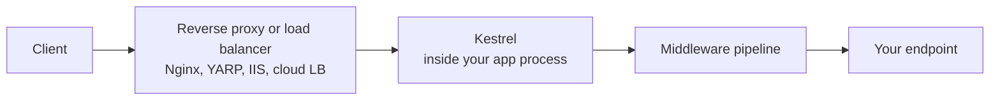
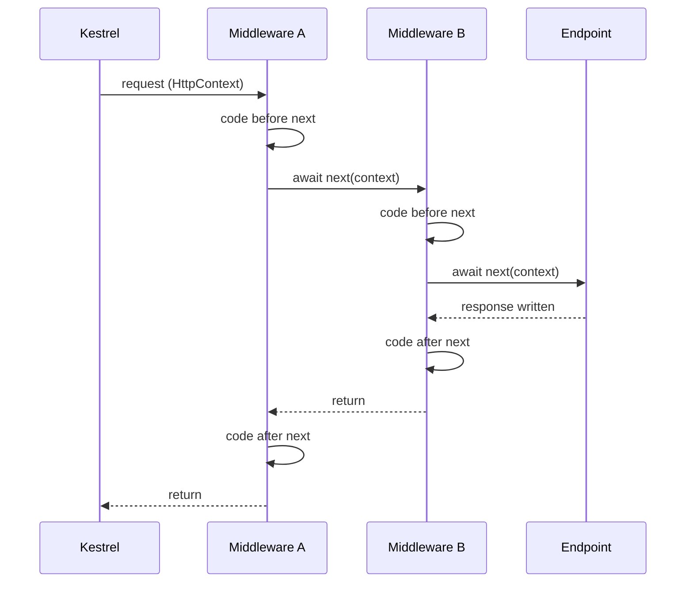
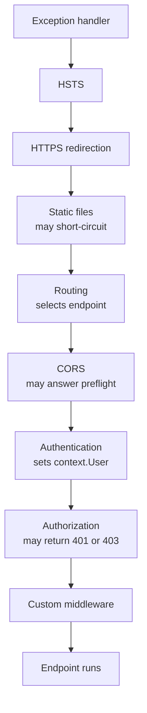
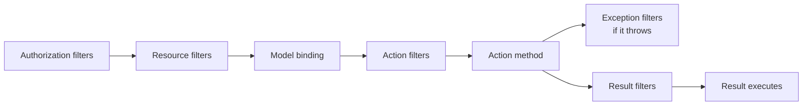

# ASP.NET Core Fundamentals and Middleware

> In this document you will learn how an ASP.NET Core app starts, how a request travels through the middleware pipeline, how routing picks an endpoint, how minimal APIs and controllers bind data and return results, and how configuration, the Options pattern and logging work. These are the core of every .NET backend interview: "What is middleware?", "Why does the order matter?", "Minimal APIs or controllers?", "IOptions vs IOptionsSnapshot vs IOptionsMonitor?". Every example here was run with the .NET 10 SDK.

**Before this:** [.NET runtime, SDK and project structure](06-dotnet-runtime-sdk-and-project-structure.md) · [HTTP servers and Express](../07-nodejs-backend/06-http-servers-and-express.md) (for comparison) · **Interview questions:** [jump to the interview section](#interview-questions)

## Table of contents

1. [What ASP.NET Core is](#what-aspnet-core-is)
2. [The hosting model: WebApplication, the generic host and Kestrel](#the-hosting-model-webapplication-the-generic-host-and-kestrel)
3. [The request pipeline and middleware](#the-request-pipeline-and-middleware)
4. [Use, Run and Map](#use-run-and-map)
5. [Writing custom middleware](#writing-custom-middleware)
6. [Middleware order in a real app](#middleware-order-in-a-real-app)
7. [Routing](#routing)
8. [Minimal APIs vs controllers](#minimal-apis-vs-controllers)
9. [Model binding](#model-binding)
10. [Returning results: Results and TypedResults](#returning-results-results-and-typedresults)
11. [Endpoint filters, MVC filters and middleware](#endpoint-filters-mvc-filters-and-middleware)
12. [Configuration](#configuration)
13. [The Options pattern](#the-options-pattern)
14. [Logging with ILogger](#logging-with-ilogger)
15. [Static files](#static-files)
16. [CORS](#cors)
17. [Error handling basics](#error-handling-basics)
18. [Common mistakes](#common-mistakes)
19. [Best practices](#best-practices)
20. [How to explain this in an interview](#how-to-explain-this-in-an-interview)
21. [Interview questions](#interview-questions)
22. [Summary](#summary)
23. [References](#references)

---

## What ASP.NET Core is

**ASP.NET Core** is the web framework of modern .NET. You use it to build REST APIs, web apps (Razor Pages, MVC, Blazor), real-time apps (SignalR) and gRPC services.

It gives you, out of the box:

- A fast web server (**Kestrel**).
- A **middleware pipeline** to process every request.
- **Routing** to map URLs to code.
- **Dependency injection** built in ([details](08-dependency-injection-in-aspnet-core.md)).
- **Configuration**, **logging** and **options** systems.
- Two ways to write endpoints: **minimal APIs** and **controllers**.

### If you know Express

| Express (Node.js) | ASP.NET Core |
| --- | --- |
| `const app = express()` | `var builder = WebApplication.CreateBuilder(args); var app = builder.Build();` |
| `app.use((req, res, next) => ...)` | `app.Use(async (context, next) => ...)` |
| `req` and `res` objects | One `HttpContext` with `context.Request` and `context.Response` |
| `next()` is a callback | `await next(context)` returns a `Task`, so code **after** it runs on the way back (like Koa) |
| `app.get('/orders/:id', ...)` | `app.MapGet("/orders/{id:int}", ...)` |
| `express.Router()` | `app.MapGroup("/api/orders")` or controllers |
| Error middleware with 4 arguments | `UseExceptionHandler` at the start of the pipeline |
| `process.env.PORT` | Configuration system: JSON files, env vars, command line |
| You choose and add a DI library | DI is built in |
| One JavaScript thread + event loop | A thread pool; many requests run in parallel on different threads |

The last row is important. In Node.js, one thread runs all your JavaScript. In ASP.NET Core, requests run on **thread pool threads**, truly in parallel. So shared state (static fields, singletons) must be **thread-safe** ([details](04-async-await-tasks-and-threading.md)).

### The smallest app

```csharp
var builder = WebApplication.CreateBuilder(args);
var app = builder.Build();

app.MapGet("/", () => "Hello World!");

app.Run();
```

This is the full `Program.cs` that `dotnet new web` creates. Run it with `dotnet run` and open the URL it prints.

---

## The hosting model: WebApplication, the generic host and Kestrel

### What happens in those four lines

```csharp
var builder = WebApplication.CreateBuilder(args);  // 1
var app = builder.Build();                         // 2
app.MapGet("/", () => "Hello World!");             // 3
app.Run();                                         // 4
```

1. **`CreateBuilder`** creates a builder with sensible defaults:
   - **Configuration** from `appsettings.json`, `appsettings.{Environment}.json`, user secrets (in Development), environment variables and command-line arguments.
   - **Logging** to the console and debug output, configured from the `Logging` section.
   - **Dependency injection** container (`builder.Services`).
   - **Kestrel** as the web server.
   - The **environment** name from `ASPNETCORE_ENVIRONMENT` (or `DOTNET_ENVIRONMENT`); `Production` if not set.
2. **`Build`** freezes the service registrations and creates the `WebApplication`. After this line you cannot add services anymore.
3. **`MapGet`** adds an **endpoint**: a route plus a handler.
4. **`Run`** builds the middleware pipeline, starts Kestrel, and blocks until the app shuts down (for example on Ctrl+C or a `SIGTERM` from Docker or Kubernetes).

So there are two phases:

- **Before `Build()`:** configure *services* (`builder.Services.Add...`).
- **After `Build()`:** configure the *pipeline* and *endpoints* (`app.Use...`, `app.Map...`).

### The generic host

Under the hood, `WebApplication` sits on the **.NET generic host**. A **host** is an object that owns the app's resources: the DI container, configuration, logging, and the **hosted services** that run for the app's lifetime. The web server is one hosted service. Background workers are others ([details](12-caching-background-jobs-and-messaging.md)).

The same host is used by non-web apps:

```csharp
// A worker service (dotnet new worker) uses the same host, without a web server.
var builder = Host.CreateApplicationBuilder(args);
builder.Services.AddHostedService<Worker>();
builder.Build().Run();
```

> **Older style (before .NET 6):** Apps had a `Program.cs` that called `Host.CreateDefaultBuilder(args).ConfigureWebHostDefaults(...)` and a separate `Startup` class with `ConfigureServices` and `Configure` methods. You will still see this in older projects. It works the same way; .NET 6 merged it into the shorter "minimal hosting" model.

### Graceful shutdown

When the host receives a stop signal, it:

1. Stops accepting new connections.
2. Lets in-flight requests finish, up to `HostOptions.ShutdownTimeout` (default 30 seconds).
3. Calls `StopAsync` on hosted services, and triggers `IHostApplicationLifetime.ApplicationStopping`.
4. Disposes the DI container (which disposes singletons).

This matters for deployments: a rolling update sends `SIGTERM`, and you want current requests to complete.

### Kestrel

**Kestrel** is the cross-platform web server built into ASP.NET Core. It listens on sockets, parses HTTP/1.1, HTTP/2 and (when enabled) HTTP/3, handles TLS, and hands each request to your pipeline.

Where Kestrel sits in production:



- Kestrel can face the internet directly, but often sits **behind a reverse proxy** that does TLS termination, load balancing and request limits.
- Behind a proxy, use the **Forwarded Headers middleware** (`UseForwardedHeaders`) so the app sees the real client IP and scheme from `X-Forwarded-For` and `X-Forwarded-Proto`.
- On Windows with **IIS**, the ASP.NET Core Module runs the app either **in-process** (inside the IIS worker process, the default and faster) or **out-of-process** (IIS forwards to Kestrel).
- Choosing URLs: `--urls http://localhost:5000`, the `ASPNETCORE_URLS` variable, or `launchSettings.json` locally. Without any setting, the app listens on `http://localhost:5000`. The official .NET 8+ container images set the port to **8080** through `ASPNETCORE_HTTP_PORTS`.

### HttpContext

For each request, Kestrel creates one **`HttpContext`**. It holds everything about the request and response:

| Property | What it holds |
| --- | --- |
| `context.Request` | Method, path, query, headers, body stream |
| `context.Response` | Status code, headers, body stream |
| `context.User` | The authenticated user (`ClaimsPrincipal`) |
| `context.RequestServices` | The DI scope for this request |
| `context.RequestAborted` | A `CancellationToken` that fires when the client disconnects |
| `context.Items` | A dictionary to share data between middleware for this request |
| `context.TraceIdentifier` | An ID for this request, useful in logs |

`HttpContext` is **not thread-safe** and is only valid during the request. Never store it in a field or use it in a background task after the request ends.

---

## The request pipeline and middleware

### What it is

**Middleware** is a piece of code that sits in the request pipeline. Each middleware:

1. Receives the `HttpContext`.
2. Can do work **before** the next middleware.
3. Decides whether to call the **next** middleware.
4. Can do work **after** the next middleware returns (the response is on its way back).

The **pipeline** is the chain of all middleware, in the order you add them.

### Why it exists

Many concerns apply to all (or many) requests: error handling, HTTPS redirection, logging, authentication, CORS, compression. Putting them in middleware keeps them out of every endpoint. This is the **Chain of Responsibility** pattern ([behavioral patterns](../04-oop-solid-design-patterns/08-behavioral-patterns.md)).

### Analogy

Think of an airport. A passenger (the request) goes through check-in, security, passport control, then reaches the gate (the endpoint). Each desk can stop the passenger (security says no: short-circuit). When the plane comes back (the response), the passenger walks back through some of the same desks in reverse order. The analogy breaks down a little: in ASP.NET Core, the "way back" is the code after `await next(context)` in the same middleware, not a separate desk.

### How it works inside

At startup, ASP.NET Core takes every middleware you registered and wraps them, last to first, into one function of type **`RequestDelegate`** (`Task RequestDelegate(HttpContext context)`). Each middleware gets a reference to the *next* delegate. The result is like nested function calls:

```text
A(context) {
    before A
    B(context) {
        before B
        Endpoint(context)
        after B
    }
    after A
}
```



### A runnable example

```csharp
var builder = WebApplication.CreateBuilder(args);
var app = builder.Build();

app.MapGet("/hello", () =>
{
    Console.WriteLine("3. endpoint runs");
    return "Hello";
});

app.Use(async (context, next) =>
{
    Console.WriteLine($"1. A before (endpoint = {context.GetEndpoint()?.DisplayName ?? "none"})");
    await next(context);
    Console.WriteLine("5. A after");
});

app.Use(async (context, next) =>
{
    Console.WriteLine("2. B before");
    await next(context);
    Console.WriteLine("4. B after");
});

app.Run();
```

`GET /hello` prints:

```text
1. A before (endpoint = HTTP: GET /hello)
2. B before
3. endpoint runs
4. B after
5. A after
```

Step by step:

1. Kestrel calls the first middleware, A. It prints line 1.
2. Interesting detail: A already knows the endpoint (`HTTP: GET /hello`). `WebApplication` adds the **routing middleware** at the start of the pipeline automatically, so routing has already *selected* the endpoint. The endpoint has not *run* yet.
3. A calls `await next(context)`, which runs B. B prints line 2.
4. B calls next. There is no more custom middleware, so the **endpoint middleware** (added automatically at the end) runs the handler. Line 3.
5. The handler returns; B continues after its `await` and prints line 4.
6. B returns; A continues and prints line 5.

Also notice: `MapGet` was written **before** the two `Use` calls, but the middleware still ran first. **Endpoints always run at the end of the pipeline**, no matter where `MapGet` appears in `Program.cs`. Only the order of `Use...` calls matters for middleware.

For a URL with no endpoint (`GET /missing`), A and B still run (with `endpoint = none`), and the response is `404`.

---

## Use, Run and Map

There are three basic ways to add middleware:

| Method | What it does |
| --- | --- |
| `app.Use(...)` | Adds middleware that can call `next` |
| `app.Run(...)` | Adds **terminal** middleware: it never calls next; nothing after it runs |
| `app.Map("/path", branch => ...)` | Creates a **branch**: requests whose path starts with `/path` go into a separate pipeline |

(Do not confuse `app.Run(handler)` — terminal middleware — with `app.Run()` with no arguments, which starts the app.)

### Short-circuiting with Use

```csharp
app.Use(async (context, next) =>
{
    if (context.Request.Path == "/blocked")
    {
        context.Response.StatusCode = 403;
        await context.Response.WriteAsync("Blocked");
        return;                 // do NOT call next: short-circuit
    }
    await next(context);
});
```

`GET /blocked` returns `403 Blocked`. No later middleware and no endpoint run. Authentication, rate limiting, static files and CORS preflight all short-circuit like this.

### Branching with Map

```csharp
app.Map("/admin", admin =>
{
    admin.Run(async ctx =>
        await ctx.Response.WriteAsync($"Admin area, path={ctx.Request.Path}, base={ctx.Request.PathBase}"));
});
```

`GET /admin/users` returns:

```text
Admin area, path=/users, base=/admin
```

Inside the branch, `/admin` moves from `Path` to `PathBase`. Branches are useful to give a part of the app different middleware. There is also `MapWhen(predicate, ...)` for branching on any condition, and `UseWhen(...)`, which branches but **rejoins** the main pipeline afterwards.

> **Map vs MapGet:** `app.Map("/admin", branch => ...)` creates a middleware branch. `app.MapGet("/admin", handler)` creates an endpoint. Most of the time you want endpoints.

### Express comparison

```js
// Express
app.use((req, res, next) => {
  console.log('before');
  next();
  console.log('after'); // runs right after next() returns, NOT after the response is done
});
```

In Express, `next()` does not return a promise you can wait for, so "after" code does not reliably run after the rest of the pipeline. In ASP.NET Core, `await next(context)` completes only when everything downstream has finished. That makes timing, logging and error-catching middleware natural.

---

## Writing custom middleware

There are three styles.

### 1. Inline (lambda)

Good for small, one-off logic, as shown above.

### 2. Convention-based class

A class with:

- A constructor that takes `RequestDelegate next` (plus singleton-safe services).
- A public method `Invoke` or `InvokeAsync` that takes `HttpContext` (plus any services, including scoped ones) and returns `Task`.

```csharp
using System.Diagnostics;

public class RequestTimingMiddleware(RequestDelegate next)
{
    public async Task InvokeAsync(HttpContext context)
    {
        var stopwatch = Stopwatch.StartNew();

        // Headers must be set before the response starts, so use OnStarting.
        context.Response.OnStarting(() =>
        {
            context.Response.Headers["X-Elapsed-Ms"] = stopwatch.ElapsedMilliseconds.ToString();
            return Task.CompletedTask;
        });

        await next(context);

        Console.WriteLine($"{context.Request.Method} {context.Request.Path} -> {context.Response.StatusCode}");
    }
}
```

Register it:

```csharp
app.UseMiddleware<RequestTimingMiddleware>();
```

The output for some requests:

```text
GET /orders/42 -> 200
GET /api/products/99 -> 404
POST /api/products -> 201
```

**Key rule:** a convention-based middleware is created **once**, when the pipeline is built. It lives for the whole app, like a singleton. So:

- Constructor parameters must be **singleton-safe** (`ILogger<T>`, `IOptions<T>`, other singletons).
- **Scoped** services (like a `DbContext` or a per-request context object) must be parameters of `InvokeAsync`, which ASP.NET Core resolves **per request**.

```csharp
public class RequestContext { public string CorrelationId { get; set; } = ""; }

public class CorrelationIdMiddleware(RequestDelegate next)
{
    // RequestContext is registered as Scoped, so it is a method parameter.
    public async Task InvokeAsync(HttpContext context, RequestContext requestContext)
    {
        var id = context.Request.Headers["X-Correlation-Id"].FirstOrDefault()
                 ?? Guid.NewGuid().ToString("N")[..8];
        requestContext.CorrelationId = id;
        context.Response.Headers["X-Correlation-Id"] = id;
        await next(context);
    }
}

// Program.cs
builder.Services.AddScoped<RequestContext>();
app.UseMiddleware<CorrelationIdMiddleware>();
app.MapGet("/whoami", (RequestContext rc) => $"corr={rc.CorrelationId}");
```

```bash
curl -H "X-Correlation-Id: abc123" http://localhost:5000/whoami
# corr=abc123      (and the response has the header X-Correlation-Id: abc123)
```

The endpoint gets the **same** `RequestContext` instance as the middleware, because both are in the same request scope.

What happens if you put a scoped service in the **constructor** instead?

```csharp
// ❌ Wrong: scoped service in the constructor of convention-based middleware
public class BadMiddleware(RequestDelegate next, RequestContext rc)
{
    public Task InvokeAsync(HttpContext context) => next(context);
}
```

- In **Development**, the app crashes at startup: `InvalidOperationException: Cannot resolve scoped service 'RequestContext' from root provider.` This check is called **scope validation** ([details](08-dependency-injection-in-aspnet-core.md)).
- In **Production**, scope validation is off by default, so the app starts — and one `RequestContext` instance is shared by **all requests** forever. That is a real data-leak bug between users.

### 3. Factory-based: IMiddleware

Implement `IMiddleware` and register the class in DI. ASP.NET Core then **resolves it from the request scope for every request**, so constructor injection of scoped services is fine.

```csharp
public class TenantContext { public string Tenant { get; set; } = "none"; }

public class TenantMiddleware(TenantContext tenantContext) : IMiddleware
{
    public async Task InvokeAsync(HttpContext context, RequestDelegate next)
    {
        tenantContext.Tenant = context.Request.Headers["X-Tenant"].FirstOrDefault() ?? "default";
        await next(context);
    }
}

// Program.cs
builder.Services.AddScoped<TenantContext>();
builder.Services.AddTransient<TenantMiddleware>(); // must be registered
app.UseMiddleware<TenantMiddleware>();
app.MapGet("/", (TenantContext tc) => $"tenant={tc.Tenant}");
```

```bash
curl -H "X-Tenant: acme" http://localhost:5000/
# tenant=acme
```

| | Convention-based | `IMiddleware` |
| --- | --- | --- |
| Created | Once, at startup | Per request, from DI |
| Scoped services | Only as `InvokeAsync` parameters | In the constructor |
| Needs DI registration | No | Yes |
| Strongly typed | No (found by method name) | Yes (interface) |

### Extension method convention

Libraries usually add a small extension method so `Program.cs` reads nicely:

```csharp
public static class RequestTimingExtensions
{
    public static IApplicationBuilder UseRequestTiming(this IApplicationBuilder app)
        => app.UseMiddleware<RequestTimingMiddleware>();
}

app.UseRequestTiming();
```

### The "response has already started" rule

Once the first byte of the response body is sent, the status code and headers are already on the wire. You cannot change them.

```csharp
app.Use(async (ctx, next) =>
{
    await next(ctx);
    ctx.Response.Headers["X-Too-Late"] = "1"; // ❌ throws if the response has started
});
```

This throws `InvalidOperationException: Headers are read-only, response has already started.` Fix it by setting headers **before** calling next, or with `context.Response.OnStarting(...)` as in the timing middleware. You can check `context.Response.HasStarted` before writing.

---

## Middleware order in a real app

Order matters because each middleware only sees what earlier middleware allowed through. Here is the order recommended by the ASP.NET Core documentation for a typical API:

```csharp
builder.Services.AddProblemDetails(); // needed by UseExceptionHandler() without arguments
var app = builder.Build();

if (app.Environment.IsDevelopment())
{
    // The developer exception page is added automatically in Development.
}
else
{
    app.UseExceptionHandler();      // 1. catch exceptions from everything below
    app.UseHsts();                  // 2. tell browsers to use HTTPS only
}

app.UseHttpsRedirection();          // 3. redirect HTTP to HTTPS
app.UseStaticFiles();               // 4. serve wwwroot files and short-circuit (if you have any)
app.UseRouting();                   // 5. select the endpoint (optional to call; added automatically)
app.UseCors("Frontend");            // 6. CORS, after routing, before auth
app.UseAuthentication();            // 7. who is the user?
app.UseAuthorization();             // 8. is the user allowed to use this endpoint?
app.UseRateLimiter();               // 9. rate limits (after routing for per-endpoint policies)
app.UseMiddleware<RequestTimingMiddleware>(); // 10. your own middleware

app.MapControllers();               // endpoints run at the end
app.MapGet("/health", () => "OK");

app.Run();
```



Why this order:

- **Exception handler first**, so it can catch exceptions thrown anywhere after it. If you add it last, it catches nothing.
- **Static files early**, so file requests return quickly without running auth (unless your files need auth).
- **Routing before CORS and authorization**, because they need to know the selected endpoint and its metadata (`[Authorize]`, CORS policy).
- **Authentication before authorization.** Authorization asks "is `context.User` allowed?". If authentication has not run, `User` is empty and every protected request fails with 401.

Classic bug:

```csharp
// ❌ Wrong: authorization runs before authentication
app.UseAuthorization();
app.UseAuthentication();
```

Every request to an `[Authorize]` endpoint gets `401`, even with a valid token, because authorization checks an anonymous user. Details in [Authentication and authorization](11-authentication-and-authorization.md).

---

## Routing

**Routing** matches the request's URL and method to an **endpoint**. ASP.NET Core uses **endpoint routing**: all endpoints (minimal APIs, controllers, Razor Pages, SignalR hubs, health checks) live in one routing table.

Routing has two steps:

1. **Routing middleware** (`UseRouting`) *selects* the endpoint and stores it on the `HttpContext` (`context.GetEndpoint()`).
2. **Endpoint middleware** (at the end) *executes* it.

Between them, other middleware (CORS, authorization, rate limiting) can read the endpoint's **metadata** — for example "this endpoint requires the Admin policy".

### Route templates

```csharp
app.MapGet("/orders/{id:int}", (int id) => $"order {id}");
app.MapGet("/orders/{code}", (string code) => $"order code {code}");
app.MapGet("/files/{**path}", (string path) => $"file path = {path}");
app.MapGet("/search", (string? q, int page = 1) => $"q={q ?? "(none)"} page={page}");
```

Real results:

| Request | Response |
| --- | --- |
| `GET /orders/42` | `order 42` (matches the `int` constraint) |
| `GET /orders/ABC` | `order code ABC` (not an int, so the second route matches) |
| `GET /files/docs/2026/report.pdf` | `file path = docs/2026/report.pdf` (catch-all) |
| `GET /search?q=phone` | `q=phone page=1` |
| `GET /search` | `q=(none) page=1` |
| `GET /search?page=abc` | `400 Bad Request` (cannot convert `abc` to `int`) |

Template parts:

| Syntax | Meaning |
| --- | --- |
| `{id}` | Route parameter |
| `{id:int}` | With a **constraint**: only matches integers |
| `{id?}` | Optional parameter |
| `{page=1}` | Default value |
| `{**path}` | Catch-all: the rest of the path, including slashes |
| `{slug:minlength(3)}`, `{id:guid}`, `{n:range(1,100)}`, `{code:regex(^[A-Z]{{3}}$)}` | More constraints |

When two routes could match, routing picks the **most specific** one (literal segments beat parameters, constrained parameters beat unconstrained). That is why `/orders/42` goes to the `int` route.

> **Constraints are for routing, not validation.** If `{id:int}` does not match, the client gets `404` (no route), not `400`. Use constraints to choose between routes; use [validation](09-web-apis-validation-and-error-handling.md) to reject bad input with a clear `400`.

### Route groups

`MapGroup` (since .NET 7) shares a prefix and settings among endpoints, like an Express `Router`:

```csharp
var products = app.MapGroup("/api/products")
    .RequireAuthorization()          // applies to every endpoint in the group
    .WithTags("Products");           // OpenAPI grouping

products.MapGet("/", GetAll);
products.MapGet("/{id:int}", GetById);
products.MapPost("/", Create);
```

### Attribute routing for controllers

```csharp
[ApiController]
[Route("api/[controller]")]          // [controller] = "Customers"
public class CustomersController : ControllerBase
{
    [HttpGet("{id:int}")]            // GET api/customers/5
    public ActionResult<CustomerDto> Get(int id) { /* ... */ }
}
```

### Short-circuit routing

> **New in .NET 8:** `.ShortCircuit()` on an endpoint makes it run right after routing and skip the rest of the middleware. Useful for things like `/robots.txt` or health checks that do not need auth or logging.

```csharp
app.MapGet("/robots.txt", () => "User-agent: *\nDisallow: /").ShortCircuit();
```

---

## Minimal APIs vs controllers

ASP.NET Core has two main styles for HTTP APIs. Both use the same routing, DI, middleware, model binding and authorization.

### Minimal APIs

Handlers are lambdas or methods mapped directly with `MapGet`, `MapPost`, `MapPut`, `MapDelete`, `MapPatch`:

```csharp
var products = app.MapGroup("/api/products");

products.MapGet("/", (ProductStore store) => TypedResults.Ok(store.All()));

products.MapGet("/{id:int}", Results<Ok<Product>, NotFound> (int id, ProductStore store) =>
    store.Find(id) is { } p ? TypedResults.Ok(p) : TypedResults.NotFound());

products.MapPost("/", (CreateProduct input, ProductStore store) =>
{
    var p = store.Add(input.Name, input.Price);
    return TypedResults.Created($"/api/products/{p.Id}", p);
});

public record Product(int Id, string Name, decimal Price);
public record CreateProduct(string Name, decimal Price);
```

Real responses:

```text
GET  /api/products        -> 200 [{"id":1,"name":"Keyboard","price":49.99},{"id":2,"name":"Mouse","price":19.50}]
GET  /api/products/2      -> 200 {"id":2,"name":"Mouse","price":19.50}
GET  /api/products/99     -> 404 (empty body)
POST /api/products {"name":"Monitor","price":199}
                          -> 201, Location: /api/products/3, body {"id":3,"name":"Monitor","price":199}
```

Note that JSON uses **camelCase** names by default (`name`, not `Name`), through `System.Text.Json`.

For bigger apps, do not put everything in `Program.cs`. Group endpoints in static classes with extension methods:

```csharp
public static class ProductEndpoints
{
    public static RouteGroupBuilder MapProductEndpoints(this IEndpointRouteBuilder app)
    {
        var group = app.MapGroup("/api/products").WithTags("Products");
        group.MapGet("/", GetAll);
        group.MapGet("/{id:int}", GetById);
        return group;
    }

    private static Ok<IReadOnlyList<Product>> GetAll(ProductStore store) => TypedResults.Ok(store.All());

    private static Results<Ok<Product>, NotFound> GetById(int id, ProductStore store) =>
        store.Find(id) is { } p ? TypedResults.Ok(p) : TypedResults.NotFound();
}

// Program.cs
app.MapProductEndpoints();
```

Named methods like `GetById` are also easy to unit test.

### Controllers

Classes that inherit from `ControllerBase`, with attributes for routes and HTTP methods:

```csharp
using System.ComponentModel.DataAnnotations;
using Microsoft.AspNetCore.Mvc;

[ApiController]
[Route("api/[controller]")]
public class CustomersController : ControllerBase
{
    [HttpGet("{id:int}")]
    public ActionResult<object> Get(int id) =>
        id == 1 ? Ok(new { id, name = "Asha" }) : NotFound();

    [HttpPost]
    public IActionResult Create(CreateCustomer input) =>
        CreatedAtAction(nameof(Get), new { id = 7 }, new { id = 7, input.Name });
}

public class CreateCustomer
{
    [Required] public string? Name { get; set; }
    [EmailAddress] public string? Email { get; set; }
}

// Program.cs
builder.Services.AddControllers();
// ...
app.MapControllers();
```

`[ApiController]` adds API-friendly behavior:

- **Automatic 400** when model validation fails, with a ProblemDetails body.
- Attribute routing is required.
- Binding source inference (complex types from the body, and so on).
- Error status codes (like `NotFound()`) produce ProblemDetails bodies.

Real responses:

```text
GET /api/customers/5 -> 404
{"type":"https://tools.ietf.org/html/rfc9110#section-15.5.5","title":"Not Found","status":404,"traceId":"..."}

POST /api/customers {"email":"bad"} -> 400
{"type":"https://tools.ietf.org/html/rfc9110#section-15.5.1","title":"One or more validation errors occurred.",
 "status":400,"errors":{"Name":["The Name field is required."],"Email":["The Email field is not a valid e-mail address."]},"traceId":"..."}
```

Notice that the controller did not contain any validation code. `[ApiController]` checked the DataAnnotations before the action ran.

### How to choose

| | Minimal APIs | Controllers |
| --- | --- | --- |
| Code style | Functions; small, explicit | Classes; conventions and attributes |
| Ceremony | Low | Higher |
| Performance | Slightly faster, less overhead | Very good, but a bit more work per request |
| Native AOT | Supported | Not supported |
| Filters | Endpoint filters | Rich MVC filter pipeline (action, result, exception, resource filters) |
| Validation | Endpoint filters, or built-in validation in .NET 10 | Automatic with `[ApiController]` |
| Features | Most API needs | Also: model binding to complex forms, content negotiation formatters, views (MVC), `JsonPatch` |
| Team familiarity | Newer | Very common in existing codebases |

What Microsoft recommends today: **minimal APIs for new APIs**; controllers remain fully supported. A reasonable interview answer:

- New service, small or medium API, or AOT needed → **minimal APIs**, organized with route groups and endpoint classes.
- Existing controller codebase, or you rely on MVC filters, conventions and features → **controllers**.
- Both can live in the same app.

> **New in .NET 10:** Minimal APIs get built-in validation with `builder.Services.AddValidation()`, which validates DataAnnotations on parameters and returns a 400 ProblemDetails automatically. Covered in [Web APIs, validation and error handling](09-web-apis-validation-and-error-handling.md).

---

## Model binding

**Model binding** turns parts of the HTTP request into the parameters of your handler. You declare what you need; ASP.NET Core fills it.

### Binding sources

| Source | Attribute | Example |
| --- | --- | --- |
| Route values | `[FromRoute]` | `/orders/{id}` → `int id` |
| Query string | `[FromQuery]` | `?page=2` → `int page` |
| Headers | `[FromHeader]` | `X-User` header → `string user` |
| Body (JSON) | `[FromBody]` | `{ "name": "..." }` → `CreateProduct input` |
| Form | `[FromForm]` | HTML form fields, `IFormFile` uploads |
| DI services | `[FromServices]` | `ProductStore store` |
| Special types | none needed | `HttpContext`, `HttpRequest`, `HttpResponse`, `CancellationToken`, `ClaimsPrincipal` |

In minimal APIs, attributes are usually optional because the framework **infers** the source:

1. If the name matches a route parameter → route.
2. If the type is registered in DI → service.
3. Special types (`HttpContext`, `CancellationToken`...) → special binding.
4. Simple types (`int`, `string`, `Guid`, `DateTime`...) → query string.
5. Complex types (classes, records) → JSON body.

An example with several sources:

```csharp
app.MapGet("/whoami", ([FromHeader(Name = "X-User")] string? user, RequestContext rc) =>
    $"user={user ?? "anonymous"} corr={rc.CorrelationId}");
```

```bash
curl -H "X-User: ravi" -H "X-Correlation-Id: abc123" http://localhost:5000/whoami
# user=ravi corr=abc123
```

`user` came from a header (we had to say so, because the header name differs from the parameter name). `rc` came from DI.

### Grouping parameters with AsParameters

When an endpoint has many query parameters, put them in a record and use `[AsParameters]` (since .NET 7):

```csharp
public record PageQuery(int Page = 1, int Size = 20, string? Sort = null);

app.MapGet("/paged", ([AsParameters] PageQuery q) => $"page={q.Page} size={q.Size} sort={q.Sort}");
```

```bash
curl "http://localhost:5000/paged?page=3&sort=name"
# page=3 size=20 sort=name
```

### Nullability and defaults matter

- `string? q` → optional. If missing, `q` is `null`.
- `string q` (non-nullable, with `Nullable` enabled) → **required**. If missing, the response is `400`.
- `int page = 1` → optional with a default.
- `int page` and the value is `abc` → `400` (conversion fails).

In Production, these 400 responses have an empty body. In Development, the exception details are logged and shown, which helps you find which parameter failed.

### Always accept a CancellationToken for slow work

```csharp
app.MapGet("/reports/{id}", async (int id, ReportService reports, CancellationToken ct) =>
    await reports.BuildAsync(id, ct));
```

The `CancellationToken` is `HttpContext.RequestAborted`. If the client disconnects, the token fires and your database call can stop early instead of wasting resources ([cancellation details](04-async-await-tasks-and-threading.md)).

---

## Returning results: Results and TypedResults

A handler can return:

1. A **string** → `200` with `text/plain`.
2. Any other **object** → `200` with JSON.
3. An **`IResult`** → full control over status code, headers and body.

`Results` and `TypedResults` are two factories for `IResult`:

```csharp
// Results.* returns the IResult interface
app.MapGet("/a/{id}", (int id) => id > 0 ? Results.Ok(new { id }) : Results.NotFound());

// TypedResults.* returns concrete types like Ok<T> and NotFound
app.MapGet("/b/{id}", Results<Ok<Product>, NotFound> (int id, ProductStore store) =>
    store.Find(id) is { } p ? TypedResults.Ok(p) : TypedResults.NotFound());
```

Why prefer **`TypedResults`**:

- The return type `Results<Ok<Product>, NotFound>` documents every possible response. **OpenAPI** generation reads it automatically, so you do not need `.Produces<Product>(200)` annotations.
- **Unit tests** can check the concrete type: `Assert.IsType<Ok<Product>>(result)`.
- The compiler checks that you only return the declared result types.

Common results:

| Method | Status |
| --- | --- |
| `TypedResults.Ok(value)` | 200 |
| `TypedResults.Created(uri, value)` | 201 + `Location` header |
| `TypedResults.NoContent()` | 204 |
| `TypedResults.BadRequest(error)` | 400 |
| `TypedResults.ValidationProblem(errors)` | 400 with ProblemDetails `errors` |
| `TypedResults.Unauthorized()` / `Forbid()` | 401 / 403 |
| `TypedResults.NotFound()` | 404 |
| `TypedResults.Conflict()` | 409 |
| `TypedResults.Problem(...)` | Any status, ProblemDetails body |
| `TypedResults.File(...)`, `Stream(...)` | File downloads and streams |

In controllers, the equivalents are methods on `ControllerBase`: `Ok()`, `CreatedAtAction()`, `NotFound()`, `BadRequest()`, `Problem()`, returned as `IActionResult` or `ActionResult<T>`.

---

## Endpoint filters, MVC filters and middleware

All three let you run code around your endpoint. The difference is **what they know** and **where they run**.

### Endpoint filters (minimal APIs)

An **endpoint filter** (since .NET 7) runs around a specific endpoint or group, **after** routing and model binding. It can read the bound arguments and change or replace the result.

```csharp
products.MapPost("/", (CreateProduct input, ProductStore store) =>
{
    var p = store.Add(input.Name, input.Price);
    return TypedResults.Created($"/api/products/{p.Id}", p);
})
.AddEndpointFilter(async (context, next) =>
{
    var input = context.GetArgument<CreateProduct>(0);    // the bound argument
    if (string.IsNullOrWhiteSpace(input.Name))
    {
        return TypedResults.ValidationProblem(new Dictionary<string, string[]>
        {
            ["Name"] = ["Name is required."]
        });
    }
    return await next(context);                            // run the handler
});
```

```bash
curl -X POST -H "Content-Type: application/json" -d '{"name":"","price":1}' http://localhost:5000/api/products
# 400  {"type":"https://tools.ietf.org/html/rfc9110#section-15.5.1",
#       "title":"One or more validation errors occurred.","status":400,
#       "errors":{"Name":["Name is required."]}}
```

Filters can be put on a group too. A group filter wraps every endpoint's own filters, like nested middleware:

```text
group filter before -> endpoint filter -> handler -> endpoint filter returns -> group filter after
```

You can also write a reusable filter class that implements `IEndpointFilter`.

### MVC filters (controllers)

Controllers have a richer **filter pipeline**:



- **Authorization filters** run first and can short-circuit.
- **Resource filters** run before model binding (good for caching).
- **Action filters** run before and after the action, with access to arguments and `ModelState`. `[ApiController]`'s automatic 400 is implemented as an action filter.
- **Exception filters** handle exceptions thrown by the action.
- **Result filters** run around the result execution.

```csharp
public class AuditActionFilter(ILogger<AuditActionFilter> logger) : IAsyncActionFilter
{
    public async Task OnActionExecutionAsync(ActionExecutingContext context, ActionExecutionDelegate next)
    {
        logger.LogInformation("Calling {Action}", context.ActionDescriptor.DisplayName);
        var executed = await next();
        logger.LogInformation("Finished {Action} with {Status}",
            context.ActionDescriptor.DisplayName, context.HttpContext.Response.StatusCode);
    }
}

// Register globally:
builder.Services.AddControllers(o => o.Filters.Add<AuditActionFilter>());
```

### When to use which

| Need | Use |
| --- | --- |
| Something for **every** request (static files too): logging, correlation IDs, exception handling, security headers | **Middleware** |
| Logic for some endpoints that needs the **bound arguments** or the **result** (validation, auditing, mapping) | **Endpoint filter** (minimal APIs) or **action filter** (controllers) |
| Handling exceptions only from controller actions, with MVC context | Exception filter (but global middleware with `IExceptionHandler` is usually better) |
| Rules about users | Authorization policies ([details](11-authentication-and-authorization.md)) |

Rule of thumb: middleware knows about **HTTP**; filters know about **your endpoint** and its parameters.

---

## Configuration

**Configuration** is the system that gives your app settings: connection strings, feature flags, URLs of other services, limits.

### Sources and precedence

`WebApplication.CreateBuilder` reads these sources, in this order. **Later sources override earlier ones:**

1. `appsettings.json`
2. `appsettings.{Environment}.json` (for example `appsettings.Development.json`)
3. **User secrets** (only in the Development environment)
4. **Environment variables**
5. **Command-line arguments**

All sources are merged into one key-value store. Nested JSON keys are joined with `:`.

```json
// appsettings.json
{
  "Shipping": { "FreeShippingThreshold": 50, "Carrier": "DHL" },
  "Greeting": "from appsettings.json"
}
```

```json
// appsettings.Development.json
{ "Greeting": "from appsettings.Development.json" }
```

```csharp
Console.WriteLine($"Environment: {app.Environment.EnvironmentName}");
Console.WriteLine($"Greeting: {app.Configuration["Greeting"]}");
Console.WriteLine($"Carrier: {app.Configuration["Shipping:Carrier"]}");
```

Real results:

| How it was started | Environment | Greeting | Carrier |
| --- | --- | --- | --- |
| `dotnet run` (no environment set) | Production | from appsettings.json | DHL |
| `ASPNETCORE_ENVIRONMENT=Development` | Development | from appsettings.Development.json | DHL |
| Development + env vars `Greeting="from env var"` and `Shipping__Carrier=FedEx` | Development | from env var | FedEx |
| Env var `Greeting="from env var"` + argument `--Greeting "from command line"` | Production | from command line | DHL |

Things to notice:

- In **environment variables**, use a **double underscore** `__` instead of `:` (`Shipping__Carrier`), because `:` does not work in variable names on all platforms.
- The command line beats environment variables; environment variables beat JSON files.
- With no environment variable, the environment is **Production**. This is a safe default.

### Environments

```csharp
if (app.Environment.IsDevelopment()) { /* dev-only tools */ }
if (app.Environment.IsProduction()) { /* ... */ }
if (app.Environment.IsEnvironment("Staging")) { /* ... */ }
```

Common names: `Development`, `Staging`, `Production`. Locally, `launchSettings.json` sets `ASPNETCORE_ENVIRONMENT=Development`. In production, the hosting platform sets it (or leaves it unset, which means Production).

### User secrets

**User secrets** store development-only secrets outside the project folder, so they are never committed:

```bash
dotnet user-secrets init
dotnet user-secrets set "Payments:ApiKey" "test-key-for-local-dev"
```

They are stored in your user profile as plain JSON. They are **not encrypted** and **not for production**. In production, use environment variables injected by the platform or a secret store such as Azure Key Vault ([details](11-authentication-and-authorization.md)).

### Reading configuration

```csharp
string? greeting = builder.Configuration["Greeting"];
int threshold = builder.Configuration.GetValue<int>("Shipping:FreeShippingThreshold");
string? conn = builder.Configuration.GetConnectionString("Shop"); // reads ConnectionStrings:Shop
```

Reading strings by key everywhere is fragile: typos compile fine and fail at runtime. For anything bigger than one value, use the Options pattern.

---

## The Options pattern

The **Options pattern** binds a configuration section to a **strongly typed class**, validates it, and injects it through DI.

### Define, bind, validate

```csharp
using System.ComponentModel.DataAnnotations;

public class ShippingOptions
{
    public const string SectionName = "Shipping";

    [Range(0, 1000)]
    public decimal FreeShippingThreshold { get; set; }

    [Required]
    public string Carrier { get; set; } = "";
}

// Program.cs
builder.Services.AddOptions<ShippingOptions>()
    .BindConfiguration(ShippingOptions.SectionName)  // bind the "Shipping" section
    .ValidateDataAnnotations()                        // check [Range], [Required]
    .ValidateOnStart();                               // fail at startup, not on first use
```

If someone deploys with `Shipping__FreeShippingThreshold=5000`, the app **refuses to start**:

```text
Unhandled exception. Microsoft.Extensions.Options.OptionsValidationException:
DataAnnotation validation failed for 'ShippingOptions' members: 'FreeShippingThreshold'
with the error: 'The field FreeShippingThreshold must be between 0 and 1000.'.
```

Failing fast at startup is much better than failing at 3 a.m. on the first order. Without `ValidateOnStart`, validation runs the first time someone reads `.Value`.

### IOptions, IOptionsSnapshot, IOptionsMonitor

You inject one of three interfaces:

| Interface | Lifetime | Sees changes to config files? | Named options | Typical use |
| --- | --- | --- | --- | --- |
| `IOptions<T>` | Singleton | **No** — value is read once | No | Settings that never change while running |
| `IOptionsSnapshot<T>` | **Scoped** | **Yes**, recomputed **per request** | Yes | Per-request consistent value that can change between requests |
| `IOptionsMonitor<T>` | Singleton | **Yes**, `CurrentValue` is always the latest; `OnChange` callback | Yes | Singletons and background services that must see updates |

Real test. The endpoint injects all three:

```csharp
app.MapGet("/options", (IOptions<ShippingOptions> o,
                        IOptionsSnapshot<ShippingOptions> s,
                        IOptionsMonitor<ShippingOptions> m) =>
    $"IOptions={o.Value.FreeShippingThreshold} Snapshot={s.Value.FreeShippingThreshold} Monitor={m.CurrentValue.FreeShippingThreshold}");
```

1. Start the app and call `/options`:

   ```text
   IOptions=50 Snapshot=50 Monitor=50
   ```

2. While the app runs, edit `appsettings.json` and change `FreeShippingThreshold` from `50` to `75`. (JSON files are loaded with `reloadOnChange: true` by default.)
3. Call `/options` again:

   ```text
   IOptions=50 Snapshot=75 Monitor=75
   ```

`IOptions<T>` keeps the old value forever. The other two see the new value.

**Important lifetime rule:** `IOptionsSnapshot<T>` is **scoped**, so you cannot inject it into a singleton (you get a scope validation error in Development). In a singleton, use `IOptionsMonitor<T>`.

### Named options

When you need several configurations of the same type:

```csharp
builder.Services.Configure<StorageOptions>("Images", builder.Configuration.GetSection("Storage:Images"));
builder.Services.Configure<StorageOptions>("Invoices", builder.Configuration.GetSection("Storage:Invoices"));

public class FileService(IOptionsMonitor<StorageOptions> options)
{
    public string ImagesContainer => options.Get("Images").Container;
}
```

### If you know Angular

This is like Angular's `InjectionToken` for configuration (`APP_CONFIG`), but with automatic binding from many sources, validation and live reload.

---

## Logging with ILogger

ASP.NET Core has a built-in logging API: `ILogger<T>`. You inject it and write log messages. **Providers** decide where they go: console, debug, EventLog, or third-party sinks (Serilog, OpenTelemetry exporters).

### Structured logging

The most important idea: use **message templates** with named placeholders, not string interpolation.

```csharp
app.MapPost("/orders", (OrderRequest req, ILogger<Program> logger) =>
{
    // ✅ Correct: message template with named placeholders
    logger.LogInformation("Order placed for {ItemCount} items, total {Total}", req.Items, req.Total);

    // ❌ Wrong: string interpolation loses the structure
    // logger.LogInformation($"Order placed for {req.Items} items, total {req.Total}");

    return Results.Ok(new { status = "placed" });
});
```

With the JSON console formatter, the real log line looks like this (shortened):

```json
{
  "EventId": 0,
  "LogLevel": "Information",
  "Category": "Program",
  "Message": "Order placed for 3 items, total 120.5",
  "State": {
    "ItemCount": 3,
    "Total": 120.5,
    "{OriginalFormat}": "Order placed for {ItemCount} items, total {Total}"
  }
}
```

`ItemCount` and `Total` are stored as **separate fields**. A log system (Seq, Elasticsearch, Application Insights, Grafana Loki) can now search "all orders where `Total` > 100". With interpolation, you only have one string. Interpolation also builds the string even when the log level is turned off, which wastes CPU.

### Log levels

| Level | Use for |
| --- | --- |
| `Trace` | Very detailed, maybe sensitive; off in production |
| `Debug` | Developer diagnostics |
| `Information` | Normal events: request handled, order placed |
| `Warning` | Something unexpected but handled: retry, slow call |
| `Error` | A failure of the current operation |
| `Critical` | The app or a major part is down |

Configure levels per **category** (usually the namespace or class name) in `appsettings.json`:

```json
{
  "Logging": {
    "LogLevel": {
      "Default": "Information",
      "Microsoft.AspNetCore": "Warning"
    }
  }
}
```

### Scopes

A **scope** adds properties to every log written inside it:

```csharp
using (logger.BeginScope(new Dictionary<string, object> { ["CustomerId"] = req.CustomerId }))
{
    logger.LogInformation("Order placed for {ItemCount} items", req.Items);
}
```

With scopes enabled, each log line also carries `"CustomerId": "C-17"`. ASP.NET Core automatically adds scopes like `RequestPath`, `RequestId`, `TraceId` and `SpanId`, so you can find all logs of one request.

### High-performance logging with source generators

For hot paths, the `[LoggerMessage]` attribute generates efficient logging code at compile time:

```csharp
public static partial class Log
{
    [LoggerMessage(EventId = 1001, Level = LogLevel.Information,
                   Message = "Order with {ItemCount} items placed")]
    public static partial void OrderPlaced(ILogger logger, int itemCount);
}

// usage
Log.OrderPlaced(logger, req.Items);
```

It avoids boxing and parsing the template on every call, and it checks the level first.

Production logging with Serilog and OpenTelemetry is covered in [Production, architecture and performance](14-production-architecture-and-performance.md).

---

## Static files

ASP.NET Core can serve files from the **`wwwroot`** folder (for example a built Angular app, images, or a favicon).

```csharp
app.UseStaticFiles();     // serves wwwroot/css/site.css at /css/site.css
```

- Static file middleware **short-circuits**: if a file matches, it returns it and nothing after it runs.
- By default it does **not** check authorization. Do not put private files in `wwwroot`.
- `app.UseDefaultFiles()` (before `UseStaticFiles`) serves `index.html` for `/`.
- For a single-page app (Angular, React), add `app.MapFallbackToFile("index.html")` so client-side routes like `/orders/42` return the SPA.

> **New in .NET 9:** `app.MapStaticAssets()` is an optimized replacement for `UseStaticFiles` for files known at build time. It compresses files at build time (gzip and Brotli), adds strong ETags and fingerprinted URLs for long caching. The .NET 9+ templates for Razor Pages, MVC and Blazor use it. `UseStaticFiles` is still needed for files that are not known at build time (for example user uploads served from disk).

In many production setups, static files are served by a CDN instead, and the ASP.NET Core app only serves the API.

---

## CORS

**CORS** (Cross-Origin Resource Sharing) lets a browser app on one origin (like `http://localhost:4200`, your Angular dev server) call an API on another origin (`http://localhost:5000`). The browser enforces it; the server only says which origins are allowed. Background on origins and the same-origin policy: [browser storage and web security basics](../01-cs-and-web-fundamentals/08-browser-storage-and-web-security-basics.md).

```csharp
builder.Services.AddCors(options =>
{
    options.AddPolicy("Frontend", policy => policy
        .WithOrigins("http://localhost:4200")
        .WithMethods("GET", "POST")
        .WithHeaders("Content-Type", "Authorization"));
});

var app = builder.Build();
app.UseCors("Frontend");
```

Real responses to a **preflight** request (the `OPTIONS` request a browser sends before a cross-origin `POST` with JSON):

```text
OPTIONS /orders   Origin: http://localhost:4200
-> 204 No Content
   Access-Control-Allow-Origin: http://localhost:4200
   Access-Control-Allow-Methods: GET,POST
   Access-Control-Allow-Headers: Content-Type,Authorization

OPTIONS /orders   Origin: http://evil.example
-> 204 No Content
   (no Access-Control-Allow-* headers, so the browser blocks the real request)
```

Rules:

- Place `UseCors` **after** `UseRouting` (if you call it) and **before** `UseAuthentication`/`UseAuthorization`, so preflight requests are answered before auth rejects them.
- You can apply policies per endpoint: `.RequireCors("Frontend")` or `[EnableCors("Frontend")]`.
- CORS is **not** a security wall for your API. Credentialed CORS (cookies), the `AllowAnyOrigin()` + `AllowCredentials()` trap and other security mistakes are covered in [CORS in ASP.NET Core](11-authentication-and-authorization.md#cors-in-aspnet-core).

---

## Error handling basics

If an endpoint throws and nothing handles it:

- **Development:** the **developer exception page** (added automatically) shows the exception and stack trace.
- **Production:** the client gets a `500` with an **empty body**, and Kestrel logs the exception. We saw this: `GET /boom` → `500 Internal Server Error`, `Content-Length: 0`.

For APIs, return consistent **ProblemDetails** JSON instead:

```csharp
builder.Services.AddProblemDetails();

var app = builder.Build();
app.UseExceptionHandler();   // catches exceptions, returns ProblemDetails
app.UseStatusCodePages();    // gives empty 4xx/5xx responses a ProblemDetails body
```

Real results:

```text
GET /boom    -> 500  application/problem+json
{"type":"https://tools.ietf.org/html/rfc9110#section-15.6.1","title":"An error occurred while processing your request.","status":500,"traceId":"..."}

GET /missing -> 404  application/problem+json
{"type":"https://tools.ietf.org/html/rfc9110#section-15.5.5","title":"Not Found","status":404,"traceId":"..."}
```

Note that the exception message ("Database is down") is **not** sent to the client. That is correct: internal details help attackers. The `traceId` lets you find the full error in your logs.

Custom exception mapping with `IExceptionHandler` (.NET 8), domain errors and validation responses are covered in depth in [Web APIs, validation and error handling](09-web-apis-validation-and-error-handling.md).

---

## Common mistakes

1. **Wrong middleware order:** `UseAuthorization` before `UseAuthentication`, `UseExceptionHandler` at the end, `UseCors` after authorization. Each one silently breaks something.
2. **Scoped services in a convention-based middleware constructor.** The instance becomes shared by every request. Inject scoped services into `InvokeAsync`, or use `IMiddleware`.
3. **Setting headers after `await next()`.** Throws "Headers are read-only, response has already started". Use `OnStarting` or set headers before `next`.
4. **Forgetting to call `next`.** The request stops at your middleware. Sometimes intended (short-circuit), often a bug.
5. **Calling `next` and also writing a full response.** Two components write the body; you get corrupt responses or exceptions.
6. **Storing `HttpContext` in a singleton or using it from a background task.** It is per request and not thread-safe.
7. **String interpolation in log calls.** You lose structured fields and pay for formatting even when the level is off.
8. **Using `IOptions<T>` and expecting reloads**, or injecting `IOptionsSnapshot<T>` into a singleton.
9. **Secrets in `appsettings.json`.** Use user secrets locally and environment variables or a vault in production.
10. **Using route constraints as validation.** They give 404 instead of a helpful 400.
11. **Blocking calls (`.Result`, `.Wait()`) in handlers.** They waste thread-pool threads and can starve the server under load ([details](04-async-await-tasks-and-threading.md)).
12. **`AllowAnyOrigin` in production CORS** "to make it work". It lets any website call your API from a user's browser.

---

## Best practices

- **Keep `Program.cs` readable:** group service registration and endpoint mapping into extension methods (`builder.Services.AddOrdering()`, `app.MapOrderEndpoints()`).
- **Follow the documented middleware order**, and put the exception handler first, because order defines behavior.
- **Prefer minimal APIs with `TypedResults` for new APIs**, because they are lean, testable and produce accurate OpenAPI metadata.
- **Accept `CancellationToken` in async handlers** and pass it down, so work stops when clients disconnect.
- **Use the Options pattern with `ValidateOnStart`**, so bad configuration fails the deployment instead of a request.
- **Use structured logging with message templates**, and `[LoggerMessage]` on hot paths.
- **Return ProblemDetails for errors**, and never leak exception messages or stack traces in production.
- **Configure Forwarded Headers behind a proxy**, so `Request.Scheme`, redirects and client IPs are correct.
- **Make shared state thread-safe**, because requests run in parallel on many threads.
- **Keep CORS origins explicit** and per environment, read from configuration.

---

## How to explain this in an interview

**Question: "What is middleware in ASP.NET Core, and why does order matter?"**

1. **Define it:** "Middleware is a component in the request pipeline. Each one gets the HttpContext, can do work, calls the next one with `await next(context)`, and can do more work when the response comes back."
2. **Why it exists:** "It handles cross-cutting concerns — exception handling, HTTPS, CORS, authentication, logging — once, instead of in every endpoint."
3. **How it works:** "At startup, the framework chains all middleware into one RequestDelegate. A request goes through them in registration order, the endpoint runs at the end, and the response flows back in reverse. Any middleware can short-circuit by not calling next."
4. **Small example:** "If I register A then B, a request prints 'A before, B before, endpoint, B after, A after'. A timing middleware starts a stopwatch before next and logs after."
5. **Where it is useful:** "Exception handling must be first so it catches everything. Authentication must come before authorization, otherwise authorization sees an anonymous user and returns 401. Static files come early to skip unnecessary work."
6. **Trade-offs / gotchas:** "Convention-based middleware is created once, so scoped services must go into InvokeAsync, not the constructor. You cannot change headers after the response has started. And for logic that needs the endpoint's arguments, an endpoint filter or action filter is a better fit than middleware."

---

## Interview questions

### Q1. What is middleware, and how is ASP.NET Core middleware different from Express middleware?

**What the interviewer is checking:** The pipeline mental model and whether you understand `await next()`.

**Short spoken answer (30–60 seconds):**
> Middleware is a function in the request pipeline that receives the HttpContext, can do some work, and then either calls the next middleware or short-circuits and writes the response itself. In ASP.NET Core, `next` returns a Task, so I await it, and the code after the await runs when everything downstream is finished — the response comes back through the middleware in reverse order. That makes things like timing, logging and exception catching very natural. In Express, `next()` is a plain callback, so code after it does not wait for the rest of the pipeline, and errors are handled by special four-argument middleware. Another difference: ASP.NET Core runs requests in parallel on thread-pool threads, so middleware state must be thread-safe.

**Detailed explanation:** See [The request pipeline and middleware](#the-request-pipeline-and-middleware) and [Use, Run and Map](#use-run-and-map).

**Follow-up questions:**
- **What is a terminal middleware?** — One that never calls next, like `app.Run(handler)` or the endpoint middleware. Nothing registered after it runs.
- **How is the pipeline built internally?** — Each `Use` adds a `Func<RequestDelegate, RequestDelegate>`. At startup they are composed from last to first, so each middleware holds a reference to the next delegate.
- **Is middleware per request or per app?** — Convention-based middleware instances are created once per app. `IMiddleware` implementations are resolved from DI per request.

**Common mistakes:** Saying middleware "runs in parallel" or that the response order is the same as the request order.

**Where this is used in real projects:** Correlation IDs, request logging, tenant resolution, security headers, global error handling.

### Q2. What does this print for `GET /hello`?

```csharp
app.MapGet("/hello", () => { Console.WriteLine("3. endpoint"); return "Hello"; });

app.Use(async (context, next) =>
{
    Console.WriteLine($"1. A before, endpoint = {context.GetEndpoint()?.DisplayName ?? "none"}");
    await next(context);
    Console.WriteLine("5. A after");
});

app.Use(async (context, next) =>
{
    Console.WriteLine("2. B before");
    await next(context);
    Console.WriteLine("4. B after");
});
```

**Answer:**

```text
1. A before, endpoint = HTTP: GET /hello
2. B before
3. endpoint
4. B after
5. A after
```

**Step by step:**
1. `MapGet` only registers an endpoint. Endpoints always execute at the **end** of the pipeline, so its position in the file does not matter.
2. `WebApplication` adds routing at the start of the pipeline automatically, so by the time A runs, the endpoint is already **selected** (but not executed). That is why A can print its display name.
3. A awaits next → B runs → B awaits next → the endpoint runs.
4. The calls unwind: B's code after `await` runs, then A's.

(Verified with the .NET 10 SDK.)

**Follow-up questions:**
- **What does A print for `GET /missing`?** — `endpoint = none`; the request passes through A and B, and the response is 404.
- **If you call `app.UseRouting()` explicitly after A, what changes?** — Then A runs before routing, so `GetEndpoint()` is null in A; middleware after `UseRouting` sees the endpoint.

### Q3. What does `GET /x` return, and what is printed?

```csharp
app.Use(async (ctx, next) =>
{
    Console.WriteLine("A");
    await next(ctx);
    try { ctx.Response.Headers["X-Too-Late"] = "1"; }
    catch (Exception ex) { Console.WriteLine($"{ex.GetType().Name}: {ex.Message}"); }
});
app.Run(async ctx =>
{
    Console.WriteLine("B");
    await ctx.Response.WriteAsync("from Run");
});
app.Use(async (ctx, next) => { Console.WriteLine("C"); await next(ctx); });
app.MapGet("/x", () => "endpoint");
```

**Answer:** The response is `200` with body `from Run`. The console prints:

```text
A
B
InvalidOperationException: Headers are read-only, response has already started.
```

**Step by step:**
1. A runs and calls next.
2. `app.Run(handler)` is **terminal**. It writes `from Run` and does not call next. So C and the `/x` endpoint **never run**.
3. Back in A, the body has already been sent, so the headers were sent too. Changing them throws `InvalidOperationException`.

(Verified with the .NET 10 SDK.)

**Follow-up questions:**
- **How do you add a header that depends on work done later?** — Register `context.Response.OnStarting(...)` before calling next; it runs just before headers are sent.
- **How can you check if the response started?** — `context.Response.HasStarted`.

### Q4. What is the correct order of the built-in middleware, and what breaks if it is wrong?

**What the interviewer is checking:** Real-world experience with the pipeline.

**Short spoken answer (30–60 seconds):**
> The usual order is: exception handler first, then HSTS, HTTPS redirection, static files, routing, CORS, authentication, authorization, then rate limiting and my own middleware, and finally the endpoints. Exception handling goes first because it can only catch exceptions from middleware after it. Static files go early so file requests short-circuit quickly. CORS must come before authorization so preflight requests get answered. And authentication must come before authorization — if it is the other way around, authorization sees an anonymous user and every protected endpoint returns 401 even with a valid token.

**Detailed explanation:** See [Middleware order in a real app](#middleware-order-in-a-real-app).

**Follow-up questions:**
- **Do you need to call `UseRouting` in .NET 6+?** — No. `WebApplication` adds it automatically at the start. You call it explicitly only when some middleware must run before routing.
- **Where does response compression go?** — Early, before middleware that writes responses you want compressed (for example before static files).
- **Where do you put `UseForwardedHeaders`?** — Very early, before anything that reads the scheme or client IP (HTTPS redirection, auth, logging).

**Common mistakes:** Memorizing the list without the reasons.

**Where this is used in real projects:** Every production `Program.cs`; many "it works locally but not behind the load balancer" bugs.

### Q5. What is the difference between `Use`, `Run`, `Map` and `MapGet`?

**Short answer:** `Use` adds middleware that can call next. `Run(handler)` adds terminal middleware that never calls next. `Map("/path", branch => ...)` creates a separate middleware branch for paths starting with `/path` (and moves that prefix to `PathBase`). `MapGet("/path", handler)` registers an **endpoint** in endpoint routing; it is not middleware, it runs at the end of the pipeline when routing selects it. `MapWhen` branches on a condition; `UseWhen` branches and then rejoins the main pipeline.

**Follow-up questions:**
- **Which one should you use for API routes?** — Endpoints (`MapGet`, `MapPost`, `MapGroup`, controllers), because they get routing metadata, authorization, CORS, OpenAPI and filters. `Map` branches are for different middleware stacks.

### Q6. How do you write custom middleware, and where do you inject scoped services?

**What the interviewer is checking:** Middleware lifetime and DI understanding.

**Short spoken answer (30–60 seconds):**
> I can write it inline with `app.Use`, as a convention-based class, or as a class that implements `IMiddleware`. A convention-based class has a constructor that takes `RequestDelegate next` and an `InvokeAsync(HttpContext)` method. It is created once when the pipeline is built, so it behaves like a singleton: only singleton-safe services go in the constructor, and scoped services, like a DbContext, go as extra parameters of `InvokeAsync`, which are resolved per request. If I want constructor injection of scoped services, I implement `IMiddleware` and register the class in DI; then it is resolved from the request scope each time.

**Code:** See [Writing custom middleware](#writing-custom-middleware).

**Follow-up questions:**
- **What happens if you put a scoped service in the constructor?** — In Development, startup fails: "Cannot resolve scoped service ... from root provider". In Production (no scope validation by default), it starts and one instance is shared by all requests — a concurrency and data-leak bug. (Both verified.)
- **Why do libraries add `UseXyz()` extension methods?** — Readability and to hide registration details.

**Common mistakes:** Storing per-request data in middleware fields.

**Where this is used in real projects:** Tenant resolution, request context, correlation IDs, audit logging.

### Q7. Minimal APIs or controllers — how do you choose?

**What the interviewer is checking:** Up-to-date knowledge and pragmatic judgment.

**Short spoken answer (30–60 seconds):**
> Both run on the same routing, DI, model binding and auth, so it is mostly about structure and features. Minimal APIs are lighter: handlers are functions, there is less ceremony, slightly better performance, and they support Native AOT. With route groups, endpoint classes, TypedResults, endpoint filters and, since .NET 10, built-in validation, they scale well to large APIs. Controllers give a richer filter pipeline, automatic model-state validation with `[ApiController]`, and conventions that big teams know well. For a new service I would choose minimal APIs; in an existing controller-based codebase I would stay consistent. They can also live together in one app.

**Follow-up questions:**
- **How do you keep a big minimal API organized?** — One static class per feature with a `MapXyzEndpoints` extension method, route groups per resource, named handler methods instead of big lambdas.
- **What does `[ApiController]` do?** — Automatic 400 on invalid model state, required attribute routing, binding source inference, and ProblemDetails for error status codes.

**Common mistakes:** Saying minimal APIs are "only for small demos" — that was the impression in .NET 6, but it is no longer true.

**Where this is used in real projects:** Choosing the style for a new microservice; migrating parts of an old MVC app.

### Q8. How does model binding decide where a parameter comes from in a minimal API?

**What the interviewer is checking:** Detailed framework knowledge that prevents bugs.

**Short spoken answer (30–60 seconds):**
> If there is an explicit attribute like FromRoute, FromQuery, FromHeader, FromBody or FromServices, it uses that. Otherwise it infers: a parameter whose name matches a route parameter binds from the route; a type registered in DI comes from services; special types like HttpContext, CancellationToken or ClaimsPrincipal are bound automatically; simple types like int or string come from the query string; and complex types come from the JSON body. Nullability matters: a non-nullable string that is missing gives a 400, a nullable one is just null, and a default value makes it optional. For many query parameters I group them into a record with AsParameters.

**Follow-up questions:**
- **`GET /search?page=abc` for `int page` — what happens?** — 400 Bad Request, because the conversion fails. (Verified.)
- **How do you bind a header with a different name?** — `[FromHeader(Name = "X-User")] string? user`.
- **Can you read the body twice?** — Not by default; the body is a forward-only stream. Call `Request.EnableBuffering()` first if middleware must read it and let the endpoint read it again.

### Q9. Why prefer `TypedResults` over `Results`?

**Short answer:** `Results.Ok()` returns the `IResult` interface; `TypedResults.Ok()` returns the concrete type `Ok<T>`. With a return type like `Results<Ok<Product>, NotFound>`, the compiler checks your returns, OpenAPI documents every response automatically, and unit tests can assert the exact type without running HTTP. The runtime behavior (status and body) is the same.

**Follow-up questions:**
- **When is `Results` still useful?** — For quick handlers where you do not need OpenAPI metadata or typed tests, or when you return many different result types dynamically.

### Q10. What is the difference between middleware, endpoint filters and MVC action filters?

**What the interviewer is checking:** Choosing the right extension point.

**Short spoken answer (30–60 seconds):**
> Middleware runs for every request in the pipeline and only knows about HTTP — the HttpContext. It runs before the endpoint executes, and for requests that do not even match an endpoint. Endpoint filters, for minimal APIs, wrap a specific endpoint or group after routing and model binding, so they can read the bound arguments and change the result — good for validation or auditing. MVC action filters are the controller equivalent, part of a richer filter pipeline with authorization, resource, action, exception and result filters, and they can see ModelState. So: cross-cutting HTTP concerns in middleware; endpoint-specific logic that needs arguments or results in filters.

**Follow-up questions:**
- **In what order do group and endpoint filters run?** — Group filters wrap endpoint filters: the outer group filter runs first on the way in and last on the way out.
- **How do you short-circuit from an endpoint filter?** — Return a result (for example `TypedResults.ValidationProblem(...)`) without calling `next`. (Verified: the handler did not run and the client got the 400 ProblemDetails.)

### Q11. Explain configuration precedence. A value is in `appsettings.json`, `appsettings.Production.json`, an environment variable and a command-line argument. Which one wins?

**Answer:** The **command-line argument** wins. The default order is `appsettings.json` → `appsettings.{Environment}.json` → user secrets (Development only) → environment variables → command line, and later sources override earlier ones. Environment variables use `__` for nesting (`Shipping__Carrier`). In the test above, `--Greeting "from command line"` beat an environment variable with the same key. (Verified.)

**Follow-up questions:**
- **Which environment does the app run in if nothing is set?** — Production.
- **Is `launchSettings.json` used in production?** — No, only by `dotnet run` and IDEs locally.
- **How do you add another source, like Azure Key Vault or AWS Parameter Store?** — Add a configuration provider to `builder.Configuration` (for example `AddAzureKeyVault(...)` from its NuGet package). Sources added later override earlier ones.

### Q12. `IOptions`, `IOptionsSnapshot` and `IOptionsMonitor` — what is the difference? What does this print after editing the file?

**What the interviewer is checking:** One of the most common .NET configuration questions.

**Short spoken answer (30–60 seconds):**
> All three give me a strongly typed options object bound from configuration. `IOptions<T>` is a singleton and reads the value once — it never sees changes. `IOptionsSnapshot<T>` is scoped: it is recomputed per request, so each request sees a consistent value, and new requests see updated config. It also supports named options. `IOptionsMonitor<T>` is a singleton that always returns the latest value through `CurrentValue` and has an `OnChange` callback, so it is the right choice inside singletons and background services. I usually add `ValidateDataAnnotations` and `ValidateOnStart` so wrong config fails at startup.

**Code:** An endpoint prints all three. Threshold is 50, then `appsettings.json` is edited to 75 while the app runs:

```text
before edit: IOptions=50 Snapshot=50 Monitor=50
after edit:  IOptions=50 Snapshot=75 Monitor=75
```

(Verified with the .NET 10 SDK.)

**Follow-up questions:**
- **Can you inject `IOptionsSnapshot<T>` into a singleton?** — No; it is scoped. In Development you get a scope validation error. Use `IOptionsMonitor<T>`.
- **Why does the file change get picked up at all?** — JSON configuration files are added with `reloadOnChange: true` by default; a file watcher reloads them.
- **Does reloading work for environment variables?** — No. Environment variables are read at startup; changing them needs a restart.

**Common mistakes:** Thinking `IOptions<T>` reloads; using `IOptionsMonitor` everywhere without need.

**Where this is used in real projects:** Feature flags, rate limits and timeouts that ops can change without redeploying.

### Q13. What is structured logging, and why is `logger.LogInformation($"User {id} logged in")` a problem?

**Short spoken answer (30–60 seconds):**
> Structured logging means each log entry stores named fields, not just a string. In .NET I write a message template like `"User {UserId} logged in"` and pass the value as an argument. The provider keeps `UserId` as a separate property, so in Seq, Elastic or Application Insights I can filter by it. With string interpolation, the value is baked into the text, so I lose the field, every message has a different template so grouping does not work, and the string is built even if the level is disabled. For hot paths I use the `[LoggerMessage]` source generator, which is even faster.

**Follow-up questions:**
- **What is a log scope?** — `BeginScope` attaches properties (like `OrderId`) to every log inside it; ASP.NET Core adds `RequestId`, `TraceId` and `SpanId` scopes automatically.
- **How do you reduce noise from the framework?** — Set `"Microsoft.AspNetCore": "Warning"` in the `Logging:LogLevel` section.

### Q14. A request to an `[Authorize]` endpoint always returns 401 even with a valid JWT. What do you check?

**What the interviewer is checking:** Debugging the pipeline.

**Short spoken answer (30–60 seconds):**
> First the middleware order: `UseAuthentication` must come before `UseAuthorization`, and both after routing. If authorization runs first, it sees an anonymous user. Then I check that `AddAuthentication` is configured with the JWT bearer scheme as the default, or that the endpoint names the scheme. Then the token itself: issuer, audience, signing key and expiry must match the validation parameters — I would turn on debug logging for `Microsoft.AspNetCore.Authentication` to see the exact reason. Finally, behind a proxy, I check that the `Authorization` header is actually forwarded.

**Follow-up questions:**
- **401 vs 403?** — 401 means "not authenticated" (no or invalid credentials). 403 means "authenticated, but not allowed".

Details in [Authentication and authorization](11-authentication-and-authorization.md).

### Q15. Your Angular app on `http://localhost:4200` gets a CORS error calling your API. How do you fix it correctly?

**Short spoken answer (30–60 seconds):**
> The browser blocks the call because the API does not return the right `Access-Control-Allow-*` headers. I add a named CORS policy with `AddCors` that allows the exact origin `http://localhost:4200`, the methods and headers the app uses, and `AllowCredentials` only if I send cookies. I call `UseCors` after routing and before authorization, so the preflight OPTIONS request is answered before auth rejects it. The allowed origins come from configuration per environment. I would not use `AllowAnyOrigin`, and it cannot be combined with credentials anyway.

**Follow-up questions:**
- **Does CORS protect your API from attackers?** — No. It only tells browsers what to allow. Non-browser clients ignore it. You still need authentication and authorization.
- **Alternative for local development?** — Use the Angular dev server proxy (`proxy.conf.json`) so the browser sees one origin; then CORS is not needed locally.

### Q16. An unhandled exception in production returns an empty 500. How do you return consistent error responses without leaking details?

**Short answer:** Register `builder.Services.AddProblemDetails()`, add `app.UseExceptionHandler()` as the first middleware, and `app.UseStatusCodePages()` for empty 4xx responses. Exceptions then produce `application/problem+json` with a generic title, the status and a `traceId`, and the full exception goes only to the logs. For mapping domain exceptions (like `NotFoundException` → 404), implement `IExceptionHandler` (.NET 8) — see [Web APIs, validation and error handling](09-web-apis-validation-and-error-handling.md). (Verified: `GET /boom` returned a 500 ProblemDetails without the exception message.)

### Q17. What is Kestrel, and why put a reverse proxy in front of it?

**Short spoken answer (30–60 seconds):**
> Kestrel is the cross-platform web server built into ASP.NET Core. It runs inside the app process, handles HTTP/1.1, HTTP/2 and optionally HTTP/3, and TLS, and it is very fast. It can be exposed directly, but in production we usually put a reverse proxy or load balancer in front — Nginx, YARP, IIS, or a cloud load balancer — to terminate TLS centrally, spread load across instances, add request limits and protection, and allow zero-downtime deployments. Then I configure the Forwarded Headers middleware so the app knows the original scheme and client IP.

**Follow-up questions:**
- **IIS in-process vs out-of-process?** — In-process runs the app inside the IIS worker process (default, faster). Out-of-process uses IIS as a reverse proxy to Kestrel.
- **Which port do the official containers listen on?** — 8080 by default since .NET 8 (`ASPNETCORE_HTTP_PORTS`), so the container does not need root.

### Q18. How does the generic host shut down an ASP.NET Core app, and why does it matter?

**Short answer:** On Ctrl+C or `SIGTERM`, the host triggers `ApplicationStopping`, Kestrel stops accepting connections and lets in-flight requests finish, hosted services get `StopAsync` with a cancellation token, and finally the DI container disposes services. Everything must finish within `HostOptions.ShutdownTimeout` (30 seconds by default). It matters for rolling deployments in Kubernetes or App Service: without graceful shutdown, users get errors during every deploy, and background jobs can stop half-way.

**Follow-up questions:**
- **How do you make a background job stop cleanly?** — Honor the `stoppingToken` in `BackgroundService.ExecuteAsync` and pass it to every async call ([details](12-caching-background-jobs-and-messaging.md)).

---

## Summary

- **ASP.NET Core** = Kestrel web server + middleware pipeline + endpoint routing + built-in DI, configuration and logging, on the **generic host**.
- `CreateBuilder` → register **services**; `Build` → configure **middleware and endpoints**; `Run` → start and block.
- **Middleware** gets the `HttpContext`, can work before and after `await next(context)`, and can **short-circuit**. The response flows back in reverse order.
- **Order matters:** exception handler → HSTS → HTTPS → static files → routing → CORS → authentication → authorization → custom → endpoints.
- `Use` can call next; `Run(handler)` is terminal; `Map` branches; `MapGet` creates an **endpoint**, which always runs at the end.
- Convention-based middleware is created **once**: scoped services go into `InvokeAsync`, or use `IMiddleware`.
- **Routing** selects the endpoint early and executes it at the end; templates support constraints, defaults, optional and catch-all parameters; `MapGroup` shares prefixes and settings.
- **Minimal APIs** are the modern default (lean, AOT-ready, `TypedResults`, endpoint filters, .NET 10 validation); **controllers** offer `[ApiController]` and rich MVC filters.
- **Model binding** reads route, query, header, body, form and DI; nullability and defaults decide what is required.
- **Configuration** precedence: JSON → environment JSON → user secrets → environment variables (`__`) → command line.
- **Options:** `IOptions` (singleton, no reload), `IOptionsSnapshot` (scoped, per request), `IOptionsMonitor` (singleton, live). Validate with `ValidateOnStart`.
- **Structured logging** with message templates, scopes and `[LoggerMessage]`; return **ProblemDetails** for errors and never leak exception details.

## References

- [ASP.NET Core fundamentals overview](https://learn.microsoft.com/en-us/aspnet/core/fundamentals/)
- [ASP.NET Core middleware (including middleware order)](https://learn.microsoft.com/en-us/aspnet/core/fundamentals/middleware/)
- [Write custom ASP.NET Core middleware](https://learn.microsoft.com/en-us/aspnet/core/fundamentals/middleware/write)
- [Factory-based middleware activation (IMiddleware)](https://learn.microsoft.com/en-us/aspnet/core/fundamentals/middleware/extensibility)
- [Routing in ASP.NET Core](https://learn.microsoft.com/en-us/aspnet/core/fundamentals/routing)
- [Minimal APIs overview](https://learn.microsoft.com/en-us/aspnet/core/fundamentals/minimal-apis/overview)
- [Choose between controller-based APIs and minimal APIs](https://learn.microsoft.com/en-us/aspnet/core/fundamentals/apis)
- [Parameter binding in minimal APIs](https://learn.microsoft.com/en-us/aspnet/core/fundamentals/minimal-apis/parameter-binding)
- [Create responses in minimal API applications (TypedResults)](https://learn.microsoft.com/en-us/aspnet/core/fundamentals/minimal-apis/responses)
- [Filters in minimal API apps](https://learn.microsoft.com/en-us/aspnet/core/fundamentals/minimal-apis/min-api-filters)
- [Filters in ASP.NET Core MVC](https://learn.microsoft.com/en-us/aspnet/core/mvc/controllers/filters)
- [Configuration in ASP.NET Core](https://learn.microsoft.com/en-us/aspnet/core/fundamentals/configuration/)
- [Options pattern in ASP.NET Core](https://learn.microsoft.com/en-us/aspnet/core/fundamentals/configuration/options)
- [Safe storage of app secrets in development](https://learn.microsoft.com/en-us/aspnet/core/security/app-secrets)
- [Logging in .NET and ASP.NET Core](https://learn.microsoft.com/en-us/aspnet/core/fundamentals/logging/)
- [Compile-time logging source generation](https://learn.microsoft.com/en-us/dotnet/core/extensions/logger-message-generator)
- [Static files in ASP.NET Core (MapStaticAssets)](https://learn.microsoft.com/en-us/aspnet/core/fundamentals/static-files)
- [Enable CORS in ASP.NET Core](https://learn.microsoft.com/en-us/aspnet/core/security/cors)
- [Handle errors in ASP.NET Core](https://learn.microsoft.com/en-us/aspnet/core/fundamentals/error-handling)
- [Kestrel web server](https://learn.microsoft.com/en-us/aspnet/core/fundamentals/servers/kestrel)
- [.NET generic host](https://learn.microsoft.com/en-us/aspnet/core/fundamentals/host/generic-host)
