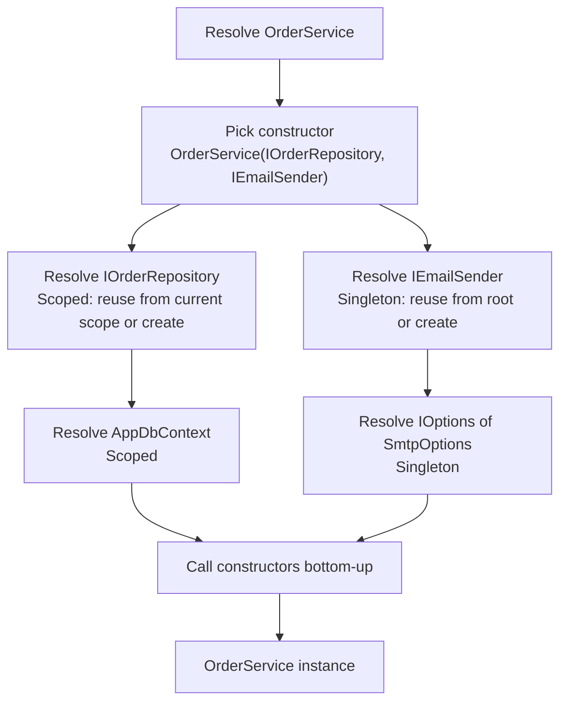
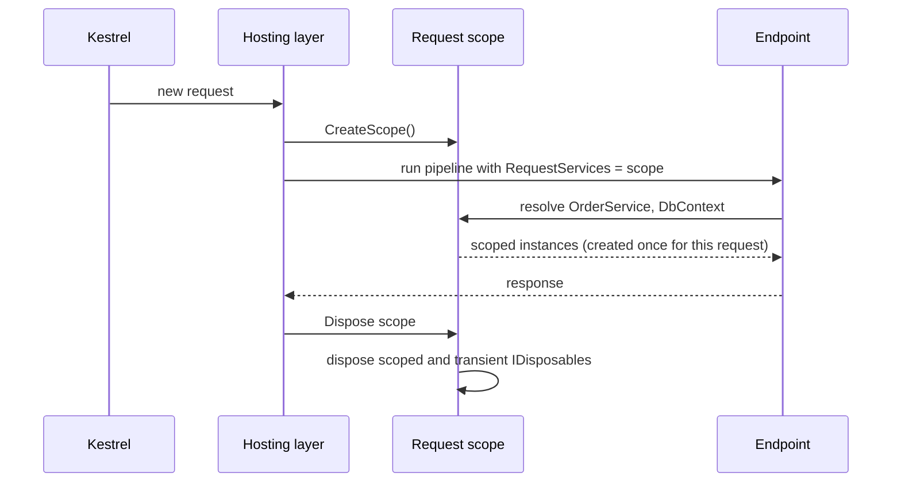

# Dependency Injection in ASP.NET Core

> In this document you will learn how the built-in .NET dependency injection container works: registering services, the three lifetimes (singleton, scoped, transient) and what they mean per request, the captive dependency bug and scope validation, using scoped services from singletons and background services, multiple registrations, keyed services, factories, `IHttpClientFactory`, and when a third-party container helps. DI is one of the most tested ASP.NET Core topics, and questions like "which instance do I get?" separate people who memorized definitions from people who understand them. Every output in this document was produced by running the code with the .NET 10 SDK.

**Before this:** [Dependency inversion and injection (concepts)](../04-oop-solid-design-patterns/05-dependency-inversion-and-injection.md) · [ASP.NET Core fundamentals and middleware](07-aspnet-core-fundamentals-and-middleware.md) · **Interview questions:** [jump to the interview section](#interview-questions)

## Table of contents

1. [Quick refresher: what DI is](#quick-refresher-what-di-is)
2. [The built-in container: IServiceCollection and IServiceProvider](#the-built-in-container-iservicecollection-and-iserviceprovider)
3. [Registering services](#registering-services)
4. [Injecting services](#injecting-services)
5. [Lifetimes: singleton, scoped and transient](#lifetimes-singleton-scoped-and-transient)
6. [Which instance do I get? A runnable experiment](#which-instance-do-i-get-a-runnable-experiment)
7. [Captive dependencies and scope validation](#captive-dependencies-and-scope-validation)
8. [Using scoped services from singletons and background services](#using-scoped-services-from-singletons-and-background-services)
9. [Disposal: who disposes what, and when](#disposal-who-disposes-what-and-when)
10. [Multiple registrations, IEnumerable and TryAdd](#multiple-registrations-ienumerable-and-tryadd)
11. [Keyed services](#keyed-services)
12. [Factory registrations, open generics and forwarding](#factory-registrations-open-generics-and-forwarding)
13. [IHttpClientFactory](#ihttpclientfactory)
14. [Organizing registrations](#organizing-registrations)
15. [Third-party containers: Autofac and Scrutor](#third-party-containers-autofac-and-scrutor)
16. [Comparison with Angular DI](#comparison-with-angular-di)
17. [Common mistakes](#common-mistakes)
18. [Best practices](#best-practices)
19. [How to explain this in an interview](#how-to-explain-this-in-an-interview)
20. [Interview questions](#interview-questions)
21. [Summary](#summary)
22. [References](#references)

---

## Quick refresher: what DI is

**Dependency injection** means a class does not create the objects it depends on. It receives them from outside, usually through its constructor. A **DI container** is the piece of code that creates objects and passes in their dependencies for you.

```csharp
// ❌ Without DI: the class creates its own dependency
public class OrderService
{
    private readonly SmtpEmailSender _email = new SmtpEmailSender("smtp.company.com");
}

// ✅ With DI: the class asks for an abstraction; the container provides it
public class OrderService(IEmailSender email)
{
    public Task PlaceAsync(Order order) => email.SendAsync(order.CustomerEmail, "Order placed");
}
```

Benefits: you can swap implementations (fake sender in tests, real sender in production), classes are loosely coupled, and object lifetimes are managed in one place. The general concepts — DIP vs DI vs IoC, composition root, service locator — are explained in [Dependency inversion and injection](../04-oop-solid-design-patterns/05-dependency-inversion-and-injection.md). This document focuses on how .NET does it.

---

## The built-in container: IServiceCollection and IServiceProvider

ASP.NET Core has a DI container built in (the `Microsoft.Extensions.DependencyInjection` library). The whole framework uses it: logging, configuration, options, routing, EF Core, authentication.

There are two main types:

| Type | Role | When |
| --- | --- | --- |
| **`IServiceCollection`** | A list of **registrations** ("when someone asks for X, give them Y with lifetime Z") | Startup, before `builder.Build()` |
| **`IServiceProvider`** | The built container that **creates** (resolves) objects | After `Build()`, while the app runs |

```csharp
var builder = WebApplication.CreateBuilder(args);

// IServiceCollection: register
builder.Services.AddScoped<IOrderRepository, SqlOrderRepository>();
builder.Services.AddSingleton<TimeProvider>(TimeProvider.System);

var app = builder.Build();   // the IServiceCollection becomes an IServiceProvider (app.Services)
```

Each registration is a **`ServiceDescriptor`** with three parts:

1. **Service type** — what consumers ask for (`IOrderRepository`).
2. **Implementation** — a type, a factory function, or an existing instance (`SqlOrderRepository`).
3. **Lifetime** — `Singleton`, `Scoped` or `Transient`.

### How resolution works inside

When the container must create `OrderService`:

1. It finds the registration for `OrderService`.
2. It looks at the public constructors and picks the one with the **most parameters it can resolve**.
3. For each parameter, it resolves that service the same way (recursively).
4. It calls the constructor, and stores the instance if the lifetime says so (singleton: in the root; scoped: in the current scope).



The container builds this "call site" plan once per service type and caches it, so later resolutions are fast.

If a dependency is missing, you get a clear error. With validation enabled:

```text
Unable to resolve service for type 'IEmailSender' while attempting to activate 'OrderService'.
```

---

## Registering services

### The three basic methods

```csharp
builder.Services.AddSingleton<IClock, SystemClock>();             // one instance for the app
builder.Services.AddScoped<IOrderRepository, SqlOrderRepository>(); // one instance per request
builder.Services.AddTransient<IPriceCalculator, PriceCalculator>();  // new instance every time
```

### Other forms

```csharp
// Concrete class registered as itself
builder.Services.AddScoped<CheckoutService>();

// An existing instance (always singleton)
builder.Services.AddSingleton(TimeProvider.System);

// A factory function (gets the IServiceProvider)
builder.Services.AddSingleton<IBlobStorage>(sp =>
{
    var options = sp.GetRequiredService<IOptions<StorageOptions>>().Value;
    return new AzureBlobStorage(options.ConnectionString);
});
```

### Framework registrations

Most framework features register many services in one call:

```csharp
builder.Services.AddControllers();          // MVC services
builder.Services.AddProblemDetails();
builder.Services.AddDbContext<ShopDbContext>(o => o.UseSqlServer(conn)); // EF Core: DbContext as Scoped
builder.Services.AddHttpClient<GitHubClient>();
builder.Services.AddAuthentication().AddJwtBearer();
```

---

## Injecting services

### Constructor injection (the default)

```csharp
public class OrderService
{
    private readonly IOrderRepository _orders;
    private readonly ILogger<OrderService> _logger;

    public OrderService(IOrderRepository orders, ILogger<OrderService> logger)
    {
        _orders = orders;
        _logger = logger;
    }
}
```

### Primary constructors (C# 12)

> **C# 12 (.NET 8) and later:** A **primary constructor** puts the parameters on the class line. It removes the boilerplate fields.

```csharp
public class OrderService(IOrderRepository orders, ILogger<OrderService> logger)
{
    public async Task<Order?> GetAsync(int id)
    {
        logger.LogInformation("Loading order {OrderId}", id);
        return await orders.FindAsync(id);
    }
}
```

One detail: primary constructor parameters are **not `readonly`**. Code inside the class could accidentally assign `orders = null!;`. Some teams still prefer explicit `private readonly` fields for this reason, or assign the parameter to a readonly field: `private readonly IOrderRepository _orders = orders;`.

### Minimal API handler parameters

In minimal APIs, any parameter whose type is registered in DI is injected automatically:

```csharp
app.MapGet("/orders/{id:int}", async (int id, OrderService service) =>
    await service.GetAsync(id) is { } order ? Results.Ok(order) : Results.NotFound());
```

You can be explicit with `[FromServices]`. This is useful when a type could be confused with a body parameter.

### Controller action injection with [FromServices]

```csharp
[HttpPost("{id:int}/invoice")]
public async Task<IActionResult> SendInvoice(int id, [FromServices] IInvoiceSender sender)
{
    await sender.SendAsync(id);
    return Accepted();
}
```

Use this for a dependency that only **one** action needs, so the controller's constructor does not grow. Since .NET 7, API controllers also infer services for action parameters, so the attribute is optional for registered types.

### Avoid: the service locator

```csharp
// ❌ Wrong: hides dependencies and makes testing harder
public class OrderService(IServiceProvider provider)
{
    public void Place() => provider.GetRequiredService<IEmailSender>().Send("...");
}
```

Injecting `IServiceProvider` and pulling services manually is the **service locator** anti-pattern: the class's real dependencies are hidden, and missing registrations fail late at runtime. Legitimate exceptions are infrastructure code: factories, middleware, and singletons that create scopes (covered below).

---

## Lifetimes: singleton, scoped and transient

The **lifetime** decides how long an instance lives and who shares it.

| Lifetime | Created | Shared by | Disposed | Typical use |
| --- | --- | --- | --- | --- |
| **Singleton** | Once, the first time it is requested (or when you register an instance) | Everyone, all requests, all threads | When the app shuts down | Caches, configuration, `HttpClient` handlers, stateless services, `TimeProvider` |
| **Scoped** | Once per **scope**. In ASP.NET Core, a scope = **one HTTP request** | Everything resolved in the same request | At the end of the request | `DbContext`, unit of work, current-user context, per-request state |
| **Transient** | **Every time** it is requested | Nobody; each consumer gets its own | When its scope ends (or the app ends, if resolved from root) | Lightweight, stateless helpers |

### Analogy

Think of a hotel:

- **Singleton** is the hotel's front desk. There is one, and every guest uses it. It must handle many guests at the same time (thread-safe).
- **Scoped** is your room key card. You get one at check-in (the request starts), you use the same card for everything during your stay, and it is deactivated at check-out (the request ends). Another guest has a different card.
- **Transient** is a paper cup at the water machine. Every time you want water, you take a new one.

### Thread safety follows from lifetime

- **Singletons are used by many requests at the same time**, on different threads. They must be **thread-safe**: no unprotected mutable fields. Use `ConcurrentDictionary`, `Interlocked`, locks, or make them stateless.
- **Scoped services** are used by one request. Usually only one thread uses them at a time (if you `await` properly). That is why `DbContext` is scoped: it is **not thread-safe**.
- **Transient services** are not shared, so they have no sharing problems — but see the captive dependency section.

### How a scope is created per request

ASP.NET Core creates a **scope** at the start of each request and stores it in `HttpContext.RequestServices`. Everything resolved for that request (endpoint parameters, controller constructors, `InvokeAsync` parameters of middleware) comes from that scope. At the end of the request, the scope is disposed.



---

## Which instance do I get? A runnable experiment

This minimal API registers one service of each lifetime. Each instance gets a number from a shared counter when it is created.

```csharp
var builder = WebApplication.CreateBuilder(args);
builder.Services.AddTransient<TransientService>();
builder.Services.AddScoped<ScopedService>();
builder.Services.AddSingleton<SingletonService>();
builder.Services.AddScoped<OrderHandler>();
var app = builder.Build();

app.MapGet("/ids", (TransientService t1, TransientService t2,
                    ScopedService s1, ScopedService s2,
                    SingletonService g, OrderHandler h) =>
    $"transient: {t1.Id} {t2.Id} | scoped: {s1.Id} {s2.Id} | singleton: {g.Id} | " +
    $"handler sees scoped {h.Scoped.Id}, transient {h.Transient.Id}");

app.Run();

public abstract class Service
{
    private static int _counter;
    public int Id { get; } = Interlocked.Increment(ref _counter); // 1, 2, 3... in creation order
}
public class TransientService : Service;
public class ScopedService : Service;
public class SingletonService : Service;

public class OrderHandler(ScopedService scoped, TransientService transient)
{
    public ScopedService Scoped => scoped;
    public TransientService Transient => transient;
}
```

Calling `/ids` twice gives:

```text
Request 1: transient: 1 2 | scoped: 3 3 | singleton: 4 | handler sees scoped 3, transient 5
Request 2: transient: 6 7 | scoped: 8 8 | singleton: 4 | handler sees scoped 8, transient 9
```

Step by step for request 1:

1. A new request scope is created.
2. `t1` and `t2`: transient → two **different** new instances (1 and 2).
3. `s1`: scoped → first request for it in this scope → new instance 3. `s2`: same scope → **the same** instance 3.
4. `g`: singleton → first time ever → instance 4.
5. `h` (`OrderHandler`, scoped) needs a `ScopedService` → gets the **same** instance 3 from this scope, and a `TransientService` → a **new** instance 5.

Request 2:

- Transients are new again (6, 7, and 9 inside the handler).
- A new scope means a **new** scoped instance (8), shared inside request 2.
- The singleton is **still 4**.

This one experiment shows every rule:

- Transient: new for every injection, even within one request and one object graph.
- Scoped: one per request, shared by everyone in that request.
- Singleton: one forever.

---

## Captive dependencies and scope validation

### What a captive dependency is

A **captive dependency** happens when a service with a **longer** lifetime holds a service with a **shorter** lifetime. The short-lived service is "captured" and lives as long as its owner.

The dangerous case: a **singleton depends on a scoped service**.

```csharp
builder.Services.AddScoped<CartService>();
builder.Services.AddSingleton<PriceCache>();

public class PriceCache(CartService cart) { /* ... */ }   // ❌ singleton holds a scoped service
```

`PriceCache` is created once. It gets **one** `CartService` and keeps it forever. Every request then uses the same "per-request" cart. If `CartService` were a `DbContext`, many threads would use one `DbContext` at the same time, and you get random exceptions and wrong data.

Real test with validation **off** (the Production default):

```text
no validation: cache.Cart.Id=1, scope1 cart=2, scope2 cart=3
```

Each request scope gets its own fresh cart (2, 3), but the singleton is stuck with cart 1 forever.

### Lifetime rules

| Consumer ↓ / Dependency → | Singleton | Scoped | Transient |
| --- | --- | --- | --- |
| **Singleton** | OK | **Error** (captive) | Allowed, but the transient becomes effectively a singleton |
| **Scoped** | OK | OK | OK |
| **Transient** | OK | OK (inside a scope) | OK |

Simple rule: **a service should only depend on services that live at least as long as it does.**

### Transient inside a singleton

This one does not cause an error, but it surprises people:

```csharp
builder.Services.AddTransient<Clock>();
builder.Services.AddSingleton<ReportService>();

public class ReportService(Clock clock) { public int ClockId => clock.Id; }
```

```text
transient in singleton: 4 4, new transient: 5
```

Both resolutions of `ReportService` return the same singleton, so they share the **same** `Clock` (4). The transient was created once, when the singleton was created. Only a direct new resolution gets a new one (5). This is fine for stateless helpers, but wrong if the transient was meant to be fresh each time (for example, something that holds per-operation state).

### Scope validation

The container can detect captive dependencies for you. Two options:

- **`ValidateScopes`** — throws if a scoped service is resolved from the **root** provider, or injected into a singleton.
- **`ValidateOnBuild`** — checks every registration when the container is built, so missing registrations and captive dependencies fail at startup.

**In the Development environment, `WebApplication` turns both on automatically.** The same app with the `PriceCache` bug fails at startup:

```text
Unhandled exception. System.AggregateException: Some services are not able to be constructed
(Error while validating the service descriptor 'ServiceType: BadCache Lifetime: Singleton
ImplementationType: BadCache': Cannot consume scoped service 'IOrderRepository' from singleton 'BadCache'.)
```

In **Production**, both are off by default, to save startup time. That is why a captive dependency can "work on my machine in Production mode" and only cause rare, random bugs under load. Some teams turn validation on everywhere:

```csharp
builder.Host.UseDefaultServiceProvider(options =>
{
    options.ValidateScopes = true;
    options.ValidateOnBuild = true;
});
```

The cost is a slightly slower startup. For most APIs it is worth it, or at least run your integration tests in Development mode so the check runs in CI.

### Resolving scoped services from the root

The root `IServiceProvider` (`app.Services`) has no request scope. Resolving a scoped service from it is a bug:

```text
Without validation:  scoped from root, same? True   (it silently behaves like a singleton)
With validation:     Cannot resolve scoped service 'ScopedThing' from root provider.
```

So, outside a request, always create a scope yourself — next section.

---

## Using scoped services from singletons and background services

Background services (`BackgroundService`, `IHostedService`) are **singletons**. They often need scoped services such as a `DbContext` or a repository. You cannot inject those into the constructor (captive dependency). Instead, inject **`IServiceScopeFactory`** and create a scope for each unit of work.

```csharp
public class OrderCleanupWorker(IServiceScopeFactory scopeFactory, ILogger<OrderCleanupWorker> logger)
    : BackgroundService
{
    protected override async Task ExecuteAsync(CancellationToken stoppingToken)
    {
        using var timer = new PeriodicTimer(TimeSpan.FromMinutes(5));
        while (await timer.WaitForNextTickAsync(stoppingToken))
        {
            // One scope per run: fresh DbContext, disposed at the end of the block
            await using var scope = scopeFactory.CreateAsyncScope();
            var repo = scope.ServiceProvider.GetRequiredService<IOrderRepository>();
            var deleted = repo.DeleteExpired();
            logger.LogInformation("Deleted {Count} expired orders", deleted);
        }
    }
}

// Program.cs
builder.Services.AddScoped<IOrderRepository, InMemoryOrderRepository>();
builder.Services.AddHostedService<OrderCleanupWorker>();
```

A real run (with a 1-second timer and a repository that logs when it is disposed):

```text
worker deleted 2 expired orders
repository disposed
worker deleted 2 expired orders
repository disposed
```

Each loop iteration gets a new scope, uses a new repository, and disposes it. That is exactly what a request does for you automatically.

Why one scope **per unit of work**, not one scope for the whole worker? Because a scope that lives forever is just a singleton with extra steps: the `DbContext` inside would track more and more entities and keep growing in memory.

Notes:

- Use `CreateAsyncScope()` with `await using` when services implement `IAsyncDisposable` (EF Core's `DbContext` does).
- The same pattern works in any singleton that occasionally needs scoped work (for example, a message consumer that handles one message per scope).
- More on background services in [Caching, background jobs and messaging](12-caching-background-jobs-and-messaging.md).

---

## Disposal: who disposes what, and when

The container **disposes the services it creates** if they implement `IDisposable` or `IAsyncDisposable`.

```csharp
builder.Services.AddScoped<DbConnectionLike>();  // disposable
builder.Services.AddTransient<TempFile>();       // disposable
builder.Services.AddSingleton<AppCache>();       // disposable
```

```csharp
using (var scope = root.CreateScope())
{
    scope.ServiceProvider.GetRequiredService<DbConnectionLike>();
    scope.ServiceProvider.GetRequiredService<TempFile>();
    root.GetRequiredService<AppCache>();
    Console.WriteLine("end of scope");
}
Console.WriteLine("disposing root");
root.Dispose();
```

Output:

```text
end of scope
TempFile disposed
DbConnectionLike disposed
disposing root
AppCache disposed
```

Rules shown here:

1. **Scoped and transient** disposables resolved from a scope are disposed **when the scope ends**, in **reverse order of creation** (`TempFile` was created last, disposed first).
2. **Singletons** are disposed when the **root** container is disposed (app shutdown).
3. The container does **not** dispose instances you created yourself and registered with `AddSingleton(instance)`. You own those.

Important trap: **a transient `IDisposable` resolved from the root provider** is kept by the root until the app shuts down, so the container can dispose it later. If you resolve such transients from the root in a loop, memory grows forever. Resolve them inside a scope, or do not make them transient.

Also, never call `Dispose()` yourself on an injected service. The container owns it, and other consumers in the same scope may still use it.

---

## Multiple registrations, IEnumerable and TryAdd

### Last registration wins for a single resolve

```csharp
services.AddSingleton<INotifier, EmailNotifier>();
services.AddSingleton<INotifier, SmsNotifier>();
services.TryAddSingleton<INotifier, PushNotifier>();   // ignored: INotifier is already registered
```

```text
single: Sms
all: Email, Sms
```

- Injecting `INotifier` gives the **last** registration (`Sms`).
- Injecting **`IEnumerable<INotifier>`** gives **all** registrations, in registration order (`Email, Sms`).
- `TryAddSingleton` adds only if **no** registration for that service type exists yet, so `Push` was not added.

### Using all implementations

This is a clean way to build plug-in style features (the strategy or composite pattern):

```csharp
public class OrderNotifier(IEnumerable<INotifier> notifiers)
{
    public async Task NotifyAsync(Order order)
    {
        foreach (var notifier in notifiers)
            await notifier.SendAsync(order);
    }
}
```

Adding a new channel means adding one registration; `OrderNotifier` does not change (open/closed principle, see [SOLID](../04-oop-solid-design-patterns/03-solid-principles.md)).

### TryAdd for libraries

Library authors use `TryAdd*` so that the application can register its own implementation **before** calling the library, and the library will not overwrite it:

```csharp
public static IServiceCollection AddShopPayments(this IServiceCollection services)
{
    services.TryAddSingleton<IClock, SystemClock>();   // keep the app's IClock if it registered one
    services.AddScoped<PaymentService>();
    return services;
}
```

`TryAddEnumerable` is the multi-registration version. It skips a registration only if the **same service type and implementation type** pair already exists:

```text
TryAddEnumerable (Email, Email, Sms) -> Email, Sms
```

### Replacing a registration

In tests or special setups you can replace a registration: `services.Replace(ServiceDescriptor.Singleton<IClock, FakeClock>())` or `services.RemoveAll<IClock>()` then add. This is common in integration tests with `WebApplicationFactory` ([details](13-testing-dotnet-applications.md)).

---

## Keyed services

> **New in .NET 8:** **Keyed services** let you register several implementations of the same interface under different **keys**, and ask for one by key.

```csharp
builder.Services.AddKeyedSingleton<IPaymentGateway, StripeGateway>("stripe");
builder.Services.AddKeyedSingleton<IPaymentGateway, PayPalGateway>("paypal");

// Constructor injection by key
public class CheckoutService([FromKeyedServices("stripe")] IPaymentGateway gateway)
{
    public string GatewayName => gateway.Name;
}

// Minimal API parameter by key
app.MapPost("/refunds", ([FromKeyedServices("paypal")] IPaymentGateway gateway) => gateway.Name);

// Manual resolution by key (for example in a factory)
var gateway = serviceProvider.GetRequiredKeyedService<IPaymentGateway>("paypal");
```

Real results:

```text
keyed: PayPal
checkout uses: Stripe
non-keyed resolve: null
```

Notice the last line: keyed registrations are **not** returned when you ask for the service **without** a key.

When to use keyed services:

- Several implementations, and the consumer knows which one it needs at compile time (`"primary"` vs `"replica"` database, `"fast"` vs `"cheap"` storage).

When not to:

- If the choice depends on **runtime data** (for example, the customer's selected payment method), a small factory or a dictionary built from `IEnumerable<IPaymentGateway>` is clearer:

```csharp
public class PaymentGatewayResolver(IEnumerable<IPaymentGateway> gateways)
{
    private readonly Dictionary<string, IPaymentGateway> _byName =
        gateways.ToDictionary(g => g.Name, StringComparer.OrdinalIgnoreCase);

    public IPaymentGateway For(string method) =>
        _byName.TryGetValue(method, out var g) ? g : throw new NotSupportedException(method);
}
```

Before .NET 8, people did this with factories or used Autofac's named services.

---

## Factory registrations, open generics and forwarding

### Factory registrations

Use a factory when construction needs logic or values that are not services:

```csharp
builder.Services.AddSingleton<ISettings>(sp => new Settings("from factory"));

builder.Services.AddScoped<ITenantDatabase>(sp =>
{
    var tenant = sp.GetRequiredService<ITenantContext>();   // scoped: the current request's tenant
    return new TenantDatabase(tenant.ConnectionString);
});
```

The factory runs according to the lifetime: once for singleton, once per scope for scoped, every time for transient.

### ActivatorUtilities

Sometimes you need an object that takes **some** parameters from DI and **some** from you:

```csharp
public class ReportBuilder(ILogSink sink, string quarter)
{
    public string Describe() => $"report {quarter} with {sink.GetType().Name}";
}

var report = ActivatorUtilities.CreateInstance<ReportBuilder>(serviceProvider, "Q3-2026");
Console.WriteLine(report.Describe()); // report Q3-2026 with ConsoleSink
```

`ActivatorUtilities.CreateInstance` resolves `ILogSink` from DI and uses the extra argument `"Q3-2026"` for `quarter`. `ReportBuilder` itself does not need to be registered.

### Open generic registrations

Register a generic type once for all type arguments:

```csharp
builder.Services.AddScoped(typeof(IRepository<>), typeof(InMemoryRepository<>));

// Now IRepository<Order>, IRepository<Customer>, ... all resolve
var repo = scope.ServiceProvider.GetRequiredService<IRepository<Order>>();
Console.WriteLine(repo.GetType().Name); // InMemoryRepository`1
```

`ILogger<T>` and `IOptions<T>` work exactly this way.

### One instance for two interfaces

A common trap:

```csharp
// ❌ Two registrations = two different singleton instances
services.AddSingleton<IReader, FileStore>();
services.AddSingleton<IWriter, FileStore>();
// same instance? False

// ✅ Register the class once, then forward both interfaces to it
services.AddSingleton<FileStore>();
services.AddSingleton<IReader>(sp => sp.GetRequiredService<FileStore>());
services.AddSingleton<IWriter>(sp => sp.GetRequiredService<FileStore>());
// same instance? True
```

The container's "singleton" means one instance **per registration**, not one per class.

### Constructor selection

If a class has several constructors, the container uses the one with the **most parameters it can resolve**:

```csharp
public class Greeter
{
    public Greeter() { /* ... */ }
    public Greeter(ILogSink sink) { /* ... */ }   // chosen when ILogSink is registered
}
```

```text
constructor used: with ILogSink
```

If two constructors are equally good, the container throws an "ambiguous constructors" error. Best practice: give DI-created classes **one** public constructor.

---

## IHttpClientFactory

### The problem with `new HttpClient()`

`HttpClient` looks like something you create and dispose per call. That is wrong.

```csharp
// ❌ Wrong: a new HttpClient for every request
public async Task<decimal> GetRateAsync(string currency)
{
    using var client = new HttpClient();
    var dto = await client.GetFromJsonAsync<RateDto>($"https://rates.example.com/{currency}");
    return dto!.Rate;
}
```

Two problems:

1. **Socket exhaustion.** Each `HttpClient` has its own connection pool. When you dispose it, its TCP connections close, and the operating system keeps closed sockets in the `TIME_WAIT` state for a while (often up to a few minutes). Under load, you create sockets faster than the OS releases them, and you run out: `SocketException`, failed calls.
2. Every call pays for a new TCP connection and TLS handshake — slow.

The opposite approach, **one static `HttpClient` forever**, fixes sockets but has another problem:

3. **Stale DNS.** A long-lived connection keeps talking to the IP address it resolved at the start. If the service's DNS changes (blue/green deployment, failover), your app keeps calling the old address.

### The two correct solutions

**Option A: `IHttpClientFactory`** (the usual choice in ASP.NET Core). The factory **pools and reuses** the underlying `HttpMessageHandler` (which owns the connections) and **recycles** it periodically (by default every **2 minutes**), so connections are reused but DNS changes are picked up. The `HttpClient` objects themselves are cheap.

**Option B: a long-lived `HttpClient` with `SocketsHttpHandler.PooledConnectionLifetime`** set (for example 2–15 minutes). This limits how long a connection lives, so DNS is refreshed. This works well in apps without DI or for very simple cases.

```csharp
// Option B
private static readonly HttpClient SharedClient = new(new SocketsHttpHandler
{
    PooledConnectionLifetime = TimeSpan.FromMinutes(2)
});
```

### Typed clients (recommended)

A **typed client** is a class that receives a configured `HttpClient` in its constructor:

```csharp
public class ExchangeRateClient(HttpClient http)
{
    public async Task<decimal> GetRateAsync(string currency, CancellationToken ct)
    {
        var dto = await http.GetFromJsonAsync<RateDto>($"rates/{currency}", ct);
        return dto!.Rate;
    }

    private record RateDto(string Currency, decimal Rate);
}

// Program.cs
builder.Services.AddHttpClient<ExchangeRateClient>(client =>
{
    client.BaseAddress = new Uri("https://rates.example.com/");
    client.Timeout = TimeSpan.FromSeconds(5);
});

app.MapGet("/convert", async (decimal amount, string to, ExchangeRateClient rates, CancellationToken ct) =>
    $"{amount} USD = {amount * await rates.GetRateAsync(to, ct)} {to}");
```

In the test app, the rates endpoint was served by the same app on localhost:

```bash
curl "http://localhost:5331/convert?amount=100&to=EUR"
# 100 USD = 92.00 EUR
```

### Named clients

```csharp
builder.Services.AddHttpClient("github", c => c.BaseAddress = new Uri("https://api.github.com/"));

public class RepoService(IHttpClientFactory factory)
{
    public Task<string> GetAsync(string path) => factory.CreateClient("github").GetStringAsync(path);
}
```

Typed clients are usually nicer: strongly typed, one place for the API's logic, easy to mock behind an interface (`AddHttpClient<IExchangeRateClient, ExchangeRateClient>()`).

### Handler pipeline

`AddHttpClient` returns a builder where you can add **delegating handlers** — middleware for outgoing calls:

```csharp
builder.Services.AddTransient<CorrelationIdHandler>();
builder.Services.AddHttpClient<ExchangeRateClient>(c => c.BaseAddress = new Uri("https://rates.example.com/"))
    .AddHttpMessageHandler<CorrelationIdHandler>();      // adds a header to every outgoing request
    // .AddStandardResilienceHandler();                  // retries, timeouts, circuit breaker
```

`AddStandardResilienceHandler` comes from the `Microsoft.Extensions.Http.Resilience` package (not run here) and is covered in [Production, architecture and performance](14-production-architecture-and-performance.md).

### The typed-client lifetime trap

Typed clients are registered as **transient**. If you inject a typed client into a **singleton**, the singleton keeps one `HttpClient` (and its handler) forever, so the handler is never recycled and DNS changes are missed again.

```csharp
// ❌ Singleton captures a typed client
builder.Services.AddSingleton<RatesCache>();   // RatesCache(ExchangeRateClient client)
```

Fixes: make the consumer scoped or transient, inject `IHttpClientFactory` and call `CreateClient` when needed, or configure `PooledConnectionLifetime` on the primary handler.

---

## Organizing registrations

In a real app, `Program.cs` should not have 200 `Add...` lines. Group registrations into extension methods per feature or layer:

```csharp
// Shop.Infrastructure/DependencyInjection.cs
public static class InfrastructureServiceCollectionExtensions
{
    public static IServiceCollection AddInfrastructure(this IServiceCollection services, IConfiguration config)
    {
        services.AddDbContext<ShopDbContext>(o => o.UseSqlServer(config.GetConnectionString("Shop")));
        services.AddScoped<IOrderRepository, SqlOrderRepository>();
        services.AddHttpClient<ExchangeRateClient>(c => c.BaseAddress = new Uri(config["Rates:BaseUrl"]!));
        return services;
    }
}

// Program.cs
builder.Services
    .AddApplication()
    .AddInfrastructure(builder.Configuration);
```

This keeps the **composition root** (`Program.cs`) short, and each layer owns its registrations.

---

## Third-party containers: Autofac and Scrutor

The built-in container is intentionally simple. It covers most apps. It does **not** have:

- **Assembly scanning** ("register every class that implements `IHandler<T>`").
- **Decorators** ("wrap every `IOrderRepository` with a caching decorator").
- **Property injection**.
- **Child containers** with their own registrations, interception (AOP), or advanced conventions.

Options:

- **Scrutor** (NuGet package, not run here) adds scanning and decoration **on top of** the built-in container:

  ```csharp
  builder.Services.Scan(scan => scan
      .FromAssemblyOf<PlaceOrderHandler>()
      .AddClasses(c => c.AssignableTo(typeof(ICommandHandler<>)))
      .AsImplementedInterfaces()
      .WithScopedLifetime());

  builder.Services.Decorate<IOrderRepository, CachedOrderRepository>();
  ```

- **Autofac** (NuGet package, not run here) **replaces** the container. It offers modules, named and keyed services (older than .NET 8's keyed services), decorators, property injection and nested lifetime scopes. You plug it in with `builder.Host.UseServiceProviderFactory(new AutofacServiceProviderFactory())`.

When to choose them: large codebases with conventions (many handlers, plug-ins), or when migrating from .NET Framework apps that already used Autofac. Otherwise, stay with the built-in container: fewer dependencies, best performance, and every library supports it.

---

## Comparison with Angular DI

If you know [Angular DI](../06-angular-16/05-dependency-injection.md):

| Angular | ASP.NET Core |
| --- | --- |
| `@Injectable({ providedIn: 'root' })` | `AddSingleton` |
| Component-level `providers: [...]` → new instance per component | No direct equivalent; the closest idea is a **scope** (per request) |
| Hierarchical injectors (element → module → root) | Flat container + scopes (root and per-request scopes) |
| No built-in "transient" — each injector caches one instance | `AddTransient` creates a new instance every time |
| `InjectionToken` for non-class values | Register an interface or options class; or keyed services |
| `multi: true` providers | Multiple registrations + `IEnumerable<T>` |
| `useFactory`, `useValue`, `useExisting` | Factory registration, instance registration, forwarding registration |
| `inject()` function (Angular 14+) | No equivalent in normal classes; constructor (or primary constructor) injection |
| Errors at runtime when a provider is missing | `ValidateOnBuild` can catch missing registrations at startup |

The big conceptual difference: Angular's hierarchy follows the **component tree**; .NET's scopes follow **units of work** (usually HTTP requests).

---

## Common mistakes

1. **Singleton depends on scoped** (captive dependency) — for example a singleton cache holding a `DbContext`. Causes concurrency bugs and stale data.
2. **Mutable state in singletons without thread safety.** Many requests run at once.
3. **Making everything a singleton "for performance".** Object creation is cheap; shared mutable state is expensive to debug.
4. **Injecting scoped services into a `BackgroundService` constructor.** Use `IServiceScopeFactory` and a scope per unit of work.
5. **Resolving services from `app.Services` (the root) at runtime.** Scoped services become singletons; transient disposables leak.
6. **Using `new HttpClient()` per call.** Socket exhaustion. Use `IHttpClientFactory`.
7. **Injecting a typed `HttpClient` into a singleton.** The handler is never recycled.
8. **Service locator:** injecting `IServiceProvider` everywhere.
9. **Registering one class under two interfaces with two `AddSingleton` calls** and expecting one instance.
10. **Disposing injected services manually.** The container owns them.
11. **Turning off validation and never noticing.** Run tests in Development or enable `ValidateOnBuild` in CI.
12. **Constructor over-injection** (10+ parameters). It usually means the class has too many responsibilities ([SOLID](../04-oop-solid-design-patterns/03-solid-principles.md)).

---

## Best practices

- **Depend on abstractions at boundaries** (repositories, external APIs, clock, email), because that is where you swap implementations and fake them in tests. Do not create an interface for every class "just because".
- **Choose the longest safe lifetime for stateless services, and scoped for anything per request**, because it matches how the object is really used.
- **Use `DbContext` as scoped** (the default with `AddDbContext`), because it is not thread-safe and tracks changes per unit of work.
- **Keep validation on** (`ValidateScopes`, `ValidateOnBuild`) at least in Development and CI, so lifetime bugs fail fast.
- **Create one scope per unit of work** in background services and message handlers.
- **Use `IHttpClientFactory` with typed clients**, and add resilience handlers for external calls.
- **Use `TryAdd*` in library registration methods**, so applications can override defaults.
- **Group registrations in `AddXyz()` extension methods** per feature or layer.
- **Prefer one public constructor** in DI-created classes, to avoid ambiguous constructor selection.
- **Inject `TimeProvider`** instead of using `DateTime.UtcNow` directly, so time can be faked in tests (.NET 8+).

---

## How to explain this in an interview

**Question: "Explain the service lifetimes in ASP.NET Core."**

1. **Define it:** "The built-in container has three lifetimes. Singleton: one instance for the whole app. Scoped: one instance per scope, and in ASP.NET Core a scope is one HTTP request. Transient: a new instance every time it is resolved."
2. **Why it exists:** "Different objects have different natural lifetimes. A cache should be shared; a DbContext should belong to one request because it is not thread-safe and tracks changes; a small stateless helper can just be created each time."
3. **How it works:** "ASP.NET Core creates a scope at the start of each request. Everything resolved for that request comes from that scope, so scoped services are shared inside the request. At the end, the scope is disposed, which disposes scoped and transient disposables. Singletons live in the root and are disposed at shutdown."
4. **Small example:** "If an endpoint injects the same transient twice, it gets two instances; the same scoped service twice, one instance; and the next request gets a new scoped instance but the same singleton."
5. **Where it is useful:** "DbContext and current-user context are scoped; HttpClient handlers, caches and configuration are singletons; validators or mappers can be transient."
6. **Trade-offs / gotchas:** "The big trap is a captive dependency — a singleton that depends on a scoped service keeps one instance forever. Scope validation catches it in Development. In singletons and background services I inject IServiceScopeFactory and create a scope per unit of work. And singletons must be thread-safe."

---

## Interview questions

### Q1. What are the three service lifetimes, and when do you use each?

**What the interviewer is checking:** The core DI concept and practical judgment.

**Short spoken answer (30–60 seconds):**
> Singleton means one instance for the whole application, created the first time it is needed and shared by all requests and threads — so it must be thread-safe. I use it for caches, configuration wrappers, and stateless services. Scoped means one instance per scope, and in ASP.NET Core every HTTP request is a scope — so everything in one request shares it. DbContext is the classic scoped service, and so is a "current user" or unit-of-work object. Transient means a new instance every time it is resolved; I use it for lightweight, stateless helpers. The rule I follow is that a service should only depend on services that live at least as long as it does.

**Detailed explanation:** See [Lifetimes](#lifetimes-singleton-scoped-and-transient) and the [runnable experiment](#which-instance-do-i-get-a-runnable-experiment).

**Follow-up questions:**
- **What is a scope outside of a web request?** — Whatever you create with `IServiceScopeFactory.CreateScope()` — for example one per background job run or per queue message.
- **Is a scoped service thread-safe?** — Not automatically. It is safe because normally one request uses it on one logical flow. If you start parallel tasks inside a request that share a scoped `DbContext`, you get errors.
- **Is transient always the safest?** — No. Transient disposables resolved from the root are kept until shutdown, and a transient injected into a singleton lives as long as the singleton.

**Common mistakes:** Saying scoped means "per session" or "per user". It is per request (per scope).

**Where this is used in real projects:** Every service registration you write.

### Q2. What does the `/ids` endpoint return for two requests?

```csharp
builder.Services.AddTransient<TransientService>();
builder.Services.AddScoped<ScopedService>();
builder.Services.AddSingleton<SingletonService>();
builder.Services.AddScoped<OrderHandler>();   // OrderHandler(ScopedService scoped, TransientService transient)

app.MapGet("/ids", (TransientService t1, TransientService t2,
                    ScopedService s1, ScopedService s2,
                    SingletonService g, OrderHandler h) =>
    $"transient: {t1.Id} {t2.Id} | scoped: {s1.Id} {s2.Id} | singleton: {g.Id} | " +
    $"handler sees scoped {h.Scoped.Id}, transient {h.Transient.Id}");
// Each service gets Id = 1, 2, 3... from one shared counter, in creation order.
```

**Answer:**

```text
Request 1: transient: 1 2 | scoped: 3 3 | singleton: 4 | handler sees scoped 3, transient 5
Request 2: transient: 6 7 | scoped: 8 8 | singleton: 4 | handler sees scoped 8, transient 9
```

**Step by step:**
1. Parameters are resolved in order. `t1` and `t2` are two new transients (1, 2).
2. `s1` creates the scoped instance for this request (3); `s2` reuses it (3).
3. `g` creates the singleton (4) the first time.
4. `h` reuses the request's scoped instance (3) and gets a brand-new transient (5).
5. Request 2 has a new scope: new transients (6, 7, 9), a new scoped instance (8), the same singleton (4).

(Verified by running with the .NET 10 SDK. The exact numbers depend on creation order; the patterns — equal or different — are what matter.)

**Follow-up questions:**
- **What if `OrderHandler` were a singleton?** — In Development, startup fails because a singleton cannot consume the scoped `ScopedService`. With validation off, the handler would keep request 1's scoped instance forever.

### Q3. What is a captive dependency, and how does ASP.NET Core protect you from it?

**What the interviewer is checking:** A common production bug and its root cause.

**Short spoken answer (30–60 seconds):**
> A captive dependency is when a longer-lived service holds a shorter-lived one, so the short-lived one gets "captured" and lives too long. The dangerous case is a singleton that takes a scoped service, like a DbContext, in its constructor. The singleton is created once, so it keeps that one DbContext forever, and every request and thread uses it at the same time — that causes concurrency exceptions, stale data and memory growth. ASP.NET Core has scope validation: in the Development environment it turns on ValidateScopes and ValidateOnBuild, and the app fails at startup with "Cannot consume scoped service from singleton". In Production it is off by default, so I either enable it or make sure tests run in Development mode.

**Code:** Real output with validation off: `cache.Cart.Id=1, scope1 cart=2, scope2 cart=3` — the singleton is stuck with cart 1. With validation on: `Cannot consume scoped service 'CartService' from singleton 'PriceCache'.`

**Follow-up questions:**
- **How do you fix it?** — Make the consumer scoped, or inject `IServiceScopeFactory` and create a scope when the scoped service is needed, or rethink the design so the singleton does not need per-request data.
- **Is a singleton depending on a transient a captive dependency?** — Technically yes: the transient lives as long as the singleton. The container allows it. It is fine for stateless transients and a bug for stateful ones.
- **Why is validation off in Production?** — It costs startup time to check every registration. Many teams accept that cost and turn it on.

**Common mistakes:** Thinking the framework always prevents it (it does only when validation is on).

**Where this is used in real projects:** Caches holding repositories; singletons holding `DbContext`; hosted services with scoped constructor parameters.

### Q4. How do you use a `DbContext` inside a `BackgroundService`?

**What the interviewer is checking:** Correct scope handling outside requests.

**Short spoken answer (30–60 seconds):**
> A BackgroundService is registered as a singleton, and DbContext is scoped, so I cannot inject the DbContext directly — that would be a captive dependency and validation would fail in Development. Instead I inject IServiceScopeFactory. In each iteration of the loop, or for each message I process, I create a scope with `CreateAsyncScope`, resolve the DbContext or repository from `scope.ServiceProvider`, do the work, and dispose the scope with `await using`. That gives me a fresh DbContext per unit of work, exactly like a request does, and its change tracker does not grow forever.

**Code:** See [Using scoped services from singletons and background services](#using-scoped-services-from-singletons-and-background-services). The real run printed `worker deleted 2 expired orders` then `repository disposed` for each iteration.

**Follow-up questions:**
- **Why not one scope for the whole service lifetime?** — Then the DbContext lives forever: it tracks more and more entities, holds a connection longer than needed, and never sees fresh data unless you reload.
- **Alternative for EF Core?** — `IDbContextFactory<T>` (registered with `AddDbContextFactory`) lets a singleton create short-lived DbContexts directly ([details](10-entity-framework-core-and-data-access.md)).

**Where this is used in real projects:** Scheduled cleanups, outbox processors, queue consumers.

### Q5. When are services disposed, and what is the leak with transient disposables?

**Short spoken answer (30–60 seconds):**
> The container disposes what it creates. Scoped and transient services resolved from a scope are disposed when that scope ends — for a web request, at the end of the request — in reverse order of creation. Singletons are disposed when the root container is disposed at shutdown. Instances I create myself and register with `AddSingleton(instance)` are not disposed by the container. The leak: if I resolve a transient that implements IDisposable from the root provider, the root has to keep a reference so it can dispose it at shutdown, so in a loop memory grows forever. So I resolve such services inside a scope.

**Code:** Real output: `end of scope`, `TempFile disposed`, `DbConnectionLike disposed`, `disposing root`, `AppCache disposed`.

**Follow-up questions:**
- **What about `IAsyncDisposable`?** — Use `CreateAsyncScope()` and `await using`, so async disposal runs. Disposing synchronously a scope that contains a service implementing only `IAsyncDisposable` throws.

### Q6. You register two implementations of `INotifier`. What do you get when you inject `INotifier`, and `IEnumerable<INotifier>`?

**Answer:** `INotifier` gives the **last** registration. `IEnumerable<INotifier>` gives **all** registrations in registration order. `TryAddSingleton<INotifier, PushNotifier>()` after them is ignored because `INotifier` is already registered. Real output: `single: Sms`, `all: Email, Sms`.

**Follow-up questions:**
- **What does `TryAddEnumerable` do differently?** — It skips only if the same service and implementation pair exists, so it prevents duplicate implementations in an `IEnumerable` but still allows different ones (`Email, Email, Sms` → `Email, Sms`).
- **Why do libraries use `TryAdd`?** — So an application can register its own implementation first and the library will not overwrite it.

### Q7. What are keyed services, and when would you use them instead of a factory?

**What the interviewer is checking:** Knowledge of .NET 8 features and design judgment.

**Short spoken answer (30–60 seconds):**
> Keyed services, added in .NET 8, let me register several implementations of one interface under different keys — like `AddKeyedSingleton<IPaymentGateway, StripeGateway>("stripe")` — and inject one with `[FromKeyedServices("stripe")]`, or resolve it with `GetRequiredKeyedService`. I use them when the consumer knows at compile time which implementation it needs, like a primary versus replica connection, or two different storage accounts. If the choice depends on runtime data, like the customer's selected payment method, I prefer a small resolver that takes `IEnumerable<IPaymentGateway>` and builds a dictionary, because the decision logic is explicit and testable.

**Follow-up questions:**
- **Does a keyed registration show up when you resolve without a key?** — No. In the test, `GetService<IPaymentGateway>()` returned `null` with only keyed registrations.
- **What did people do before .NET 8?** — Factories, `IEnumerable<T>` plus a name property, or Autofac's keyed/named services.

### Q8. Why is `new HttpClient()` per request bad, and what does `IHttpClientFactory` do?

**What the interviewer is checking:** A classic .NET production issue.

**Short spoken answer (30–60 seconds):**
> HttpClient is designed to be reused. If I create and dispose one per request, each one opens new TCP connections, and after disposal the OS keeps those sockets in TIME_WAIT for a while. Under load, the app runs out of sockets and calls start failing — socket exhaustion — and every call also pays for a new connection and TLS handshake. But one static HttpClient forever has the opposite problem: connections stay open and do not see DNS changes. IHttpClientFactory solves both: it pools the HttpMessageHandlers, which own the connections, reuses them, and recycles them periodically — every two minutes by default — so DNS changes are picked up. On top of that it gives central configuration, typed clients, and a handler pipeline for things like correlation headers and resilience.

**Follow-up questions:**
- **Is a static HttpClient ever OK?** — Yes, if you set `SocketsHttpHandler.PooledConnectionLifetime` so connections are recycled. That is a recommended option outside DI.
- **What is the difference between named and typed clients?** — Named: `factory.CreateClient("github")` with config by name. Typed: a class that takes `HttpClient` in its constructor, registered with `AddHttpClient<T>()`; it is strongly typed and holds the API logic.
- **Can you inject a typed client into a singleton?** — Avoid it. Typed clients are transient; a singleton would keep one handler forever and miss DNS changes.

**Common mistakes:** "`HttpClient` implements `IDisposable`, so I must use `using`."

**Where this is used in real projects:** Every service that calls other HTTP APIs.

### Q9. What is wrong with this registration?

```csharp
services.AddSingleton<IReader, FileStore>();
services.AddSingleton<IWriter, FileStore>();
```

**Answer:** It creates **two** `FileStore` instances — one per registration — so data written through `IWriter` is not visible through `IReader`. Real output: `same instance? False`. Fix: register the class once and forward both interfaces:

```csharp
services.AddSingleton<FileStore>();
services.AddSingleton<IReader>(sp => sp.GetRequiredService<FileStore>());
services.AddSingleton<IWriter>(sp => sp.GetRequiredService<FileStore>());
// same instance? True
```

### Q10. What is the difference between constructor injection, `[FromServices]` and `IServiceProvider.GetService`?

**Short answer:** Constructor injection (including C# 12 primary constructors) is the default: dependencies are explicit and checked by validation. `[FromServices]` injects into one controller action or minimal API handler, useful when only that action needs the service. `IServiceProvider.GetService` is manual resolution — the service locator — which hides dependencies and fails late; use it only in infrastructure code like factories, middleware or scope-creating singletons. `GetService` returns `null` when missing; `GetRequiredService` throws, which is usually what you want.

### Q11. Primary constructors for DI — any downsides?

**Short answer:** They remove boilerplate (`public class OrderService(IOrderRepository orders)`), but the parameters are **not readonly** — code in the class could reassign them — and they are captured as hidden fields, so you cannot add validation in a constructor body without extra code. Some teams assign them to explicit `private readonly` fields. Functionally, DI works the same.

### Q12. How would you add caching to an `IOrderRepository` without changing its callers?

**What the interviewer is checking:** The decorator pattern with DI.

**Short spoken answer (30–60 seconds):**
> I would write a `CachedOrderRepository` that implements `IOrderRepository`, takes the real repository and an `IMemoryCache` in its constructor, and checks the cache before calling the inner repository. Then I register it so that `IOrderRepository` resolves to the cached version wrapping the real one. With the built-in container I do that with a factory: register `SqlOrderRepository` as itself, then register `IOrderRepository` with a factory that creates `CachedOrderRepository` around it. With Scrutor it is one line: `services.Decorate<IOrderRepository, CachedOrderRepository>()`. Callers do not change at all.

**Code:**

```csharp
builder.Services.AddScoped<SqlOrderRepository>();
builder.Services.AddScoped<IOrderRepository>(sp =>
    new CachedOrderRepository(
        sp.GetRequiredService<SqlOrderRepository>(),
        sp.GetRequiredService<IMemoryCache>()));
```

**Follow-up questions:**
- **Lifetime of the decorator?** — The same as or shorter than the inner service; here both are scoped. The cache itself (`IMemoryCache`) is a singleton, which is fine to depend on.

### Q13. How does .NET DI compare to Angular DI?

**Short spoken answer (30–60 seconds):**
> Both use constructor injection and tokens. Angular has hierarchical injectors that follow the component tree: `providedIn: 'root'` is like a singleton, and providing a service in a component gives a new instance for that component subtree. .NET has a flat container with scopes: singleton in the root, scoped per request, and also a true transient lifetime, which Angular does not have by default. Angular's multi providers are like registering several implementations and injecting `IEnumerable<T>`. Angular's `useFactory`, `useValue` and `useExisting` map to factory, instance and forwarding registrations. A practical difference: .NET can validate the whole graph at startup with `ValidateOnBuild`.

**Follow-up questions:**
- **Is there an Angular equivalent of a captive dependency?** — Yes, in spirit: a root service holding a reference to a component-level service instance would keep it alive past the component's life.

### Q14. When would you replace the built-in container with Autofac?

**Short answer:** When you need features it does not have: assembly scanning with conventions, decorators, property injection, child lifetime scopes with extra registrations, or interception — or when an existing codebase already uses Autofac modules. For scanning and decorators alone, **Scrutor** on top of the built-in container is a lighter choice. Otherwise, the built-in container is simpler, faster and supported by every library. (Autofac and Scrutor are NuGet packages, not run here.)

### Q15. A singleton `ReportService` takes a transient `Clock`. You resolve `ReportService` twice. Do the two `ReportService`s see the same `Clock`?

**Answer:** Yes. `ReportService` is a singleton, so both resolutions return the **same** `ReportService`, which was constructed **once** with **one** `Clock`. Resolving `Clock` directly still gives a new instance each time. Real output: `transient in singleton: 4 4, new transient: 5`. This is allowed (no validation error) but means the transient behaves like a singleton inside that object.

### Q16. Your API works in Development but in Production users sometimes see each other's data. Where do you look first?

**What the interviewer is checking:** Connecting DI lifetimes to real bugs.

**Short spoken answer (30–60 seconds):**
> I would suspect shared state across requests. First, singletons with mutable fields — for example a singleton service that stores "current user" or "current tenant" in a field. Second, captive dependencies: a singleton holding a scoped service, which is not caught in Production because scope validation is off by default. Third, convention-based middleware with a scoped service in its constructor, which also becomes app-wide. Fourth, static fields and caches keyed incorrectly, for example missing the user ID in the cache key. I would turn on ValidateScopes and ValidateOnBuild, review the singleton registrations, and reproduce with parallel requests in a load test.

**Follow-up questions:**
- **Why does it work in Development?** — With one developer, requests rarely overlap; and Development validation would have crashed on captive dependencies, so it is likely plain shared mutable state in a singleton or static field.

---

## Summary

- The built-in container: register in **`IServiceCollection`** before `Build()`, resolve from **`IServiceProvider`** after.
- **Singleton** = one per app (must be thread-safe); **Scoped** = one per request; **Transient** = new every resolution.
- ASP.NET Core creates a **scope per request** (`HttpContext.RequestServices`) and disposes it at the end, disposing scoped and transient disposables in reverse creation order.
- **Captive dependency:** a longer-lived service holding a shorter-lived one. Singleton → scoped is a bug; **scope validation** catches it in Development (`ValidateScopes`, `ValidateOnBuild`), but it is off in Production by default.
- In singletons and **background services**, inject **`IServiceScopeFactory`** and create **one scope per unit of work**.
- Multiple registrations: the **last one wins** for single resolution; **`IEnumerable<T>`** returns all; **`TryAdd*`** adds only if missing.
- **Keyed services** (.NET 8): `AddKeyed*`, `[FromKeyedServices]`, `GetRequiredKeyedService`; use a resolver when the choice depends on runtime data.
- Factories, **open generics**, `ActivatorUtilities`, and **forwarding** registrations cover most advanced needs. One registration = one singleton instance.
- **Never `new HttpClient()` per call** (socket exhaustion); a forever-static client misses DNS changes. Use **`IHttpClientFactory`** (pooled, recycled handlers, typed clients) or `PooledConnectionLifetime`.
- Avoid the **service locator**; keep `Program.cs` clean with `AddXyz()` extension methods.
- Use **Scrutor** or **Autofac** only when you need scanning, decorators or advanced features.

## References

- [Dependency injection in ASP.NET Core](https://learn.microsoft.com/en-us/aspnet/core/fundamentals/dependency-injection)
- [Dependency injection in .NET](https://learn.microsoft.com/en-us/dotnet/core/extensions/dependency-injection)
- [Dependency injection guidelines (including disposal and anti-patterns)](https://learn.microsoft.com/en-us/dotnet/core/extensions/dependency-injection-guidelines)
- [Service lifetimes and scope validation](https://learn.microsoft.com/en-us/dotnet/core/extensions/dependency-injection#service-lifetimes)
- [Keyed services](https://learn.microsoft.com/en-us/dotnet/core/extensions/dependency-injection#keyed-services)
- [Use scoped services within a BackgroundService](https://learn.microsoft.com/en-us/dotnet/core/extensions/scoped-service)
- [Make HTTP requests using IHttpClientFactory in ASP.NET Core](https://learn.microsoft.com/en-us/aspnet/core/fundamentals/http-requests)
- [HttpClient guidelines for .NET (socket exhaustion and DNS)](https://learn.microsoft.com/en-us/dotnet/fundamentals/networking/http/httpclient-guidelines)
- [Primary constructors (C# 12)](https://learn.microsoft.com/en-us/dotnet/csharp/whats-new/tutorials/primary-constructors)
- [Scrutor on GitHub](https://github.com/khellang/Scrutor)
- [Autofac ASP.NET Core integration](https://autofac.readthedocs.io/en/latest/integration/aspnetcore.html)
