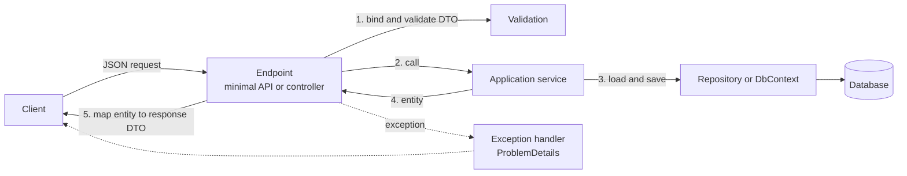

# Web APIs, Validation and Error Handling

> In this document you will build production-style REST APIs with ASP.NET Core: DTOs and mapping, JSON settings, validation (DataAnnotations, `[ApiController]`, the new built-in minimal API validation in .NET 10, FluentValidation), consistent errors with ProblemDetails and `IExceptionHandler`, API versioning, OpenAPI documents, rate limiting, output caching, pagination and idempotency. Interviewers use these topics to check whether you have shipped real APIs, not just tutorials. The examples were run with the .NET 10 SDK unless marked otherwise.

**Before this:** [REST API design](../07-nodejs-backend/07-rest-api-design.md) (principles, status codes, pagination styles) · [ASP.NET Core fundamentals and middleware](07-aspnet-core-fundamentals-and-middleware.md) · **Interview questions:** [jump to the interview section](#interview-questions)

## Table of contents

1. [A REST API in ASP.NET Core](#a-rest-api-in-aspnet-core)
2. [DTOs vs entities](#dtos-vs-entities)
3. [Mapping: manual, Mapperly, Mapster and AutoMapper](#mapping-manual-mapperly-mapster-and-automapper)
4. [JSON serialization settings](#json-serialization-settings)
5. [Validation](#validation)
6. [ProblemDetails: one error format](#problemdetails-one-error-format)
7. [Global error handling with IExceptionHandler](#global-error-handling-with-iexceptionhandler)
8. [Exceptions or result objects](#exceptions-or-result-objects)
9. [API versioning](#api-versioning)
10. [OpenAPI documents and UI](#openapi-documents-and-ui)
11. [Rate limiting](#rate-limiting)
12. [Output caching vs response caching](#output-caching-vs-response-caching)
13. [Pagination and filtering](#pagination-and-filtering)
14. [Idempotency](#idempotency)
15. [Common mistakes](#common-mistakes)
16. [Best practices](#best-practices)
17. [How to explain this in an interview](#how-to-explain-this-in-an-interview)
18. [Interview questions](#interview-questions)
19. [Summary](#summary)
20. [References](#references)

---

## A REST API in ASP.NET Core

The REST principles — resources, HTTP methods, status codes, safety and idempotency — are the same in every language. They are explained in [REST API design](../07-nodejs-backend/07-rest-api-design.md). This document shows how to implement them well in ASP.NET Core.

A typical feature looks like this:



Here is a compact orders API that we will use through this document. It runs as is:

```csharp
var orders = app.MapGroup("/api/orders").WithTags("Orders");

orders.MapGet("/", (OrderStore store, int page = 1, int pageSize = 2, string? status = null) =>
{
    pageSize = Math.Clamp(pageSize, 1, 100);                 // never trust the client's page size
    var query = store.All().AsEnumerable();
    if (status is not null)
        query = query.Where(o => o.Status.Equals(status, StringComparison.OrdinalIgnoreCase));

    var total = query.Count();
    var items = query.OrderBy(o => o.Id).Skip((page - 1) * pageSize).Take(pageSize).ToList();
    return TypedResults.Ok(new PagedResponse<OrderDto>(items, page, pageSize, total));
});

orders.MapGet("/{id:int}", (int id, OrderStore store) => TypedResults.Ok(store.Get(id)));

orders.MapPost("/{id:int}/cancel", (int id, OrderStore store) =>
{
    store.Cancel(id);
    return TypedResults.NoContent();
});

public record OrderDto(int Id, string Customer, string Status, decimal Total);

public record PagedResponse<T>(IReadOnlyList<T> Items, int Page, int PageSize, int TotalCount)
{
    public int TotalPages => (int)Math.Ceiling(TotalCount / (double)PageSize);
}
```

Real responses (five sample orders in memory):

```text
GET /api/orders?page=2&pageSize=2
200 {"items":[{"id":3,"customer":"Meera","status":"Paid","total":45},
              {"id":4,"customer":"John","status":"Cancelled","total":60}],
     "page":2,"pageSize":2,"totalCount":5,"totalPages":3}

GET /api/orders?status=paid&pageSize=10
200 {"items":[...3 paid orders...],"page":1,"pageSize":10,"totalCount":3,"totalPages":1}

POST /api/orders/1/cancel
204 No Content
```

`store.Get(id)` throws a `NotFoundException` when the order does not exist, and `Cancel` throws a `ConflictException` when the order is already shipped. We will turn those into proper `404` and `409` responses in the [error handling section](#global-error-handling-with-iexceptionhandler).

The same endpoints as a controller:

```csharp
[ApiController]
[Route("api/orders")]
public class OrdersController(OrderStore store) : ControllerBase
{
    [HttpGet("{id:int}")]
    [ProducesResponseType<OrderDto>(StatusCodes.Status200OK)]
    [ProducesResponseType(StatusCodes.Status404NotFound)]
    public ActionResult<OrderDto> Get(int id) => store.Get(id);

    [HttpPost("{id:int}/cancel")]
    public IActionResult Cancel(int id)
    {
        store.Cancel(id);
        return NoContent();
    }
}
```

`ActionResult<T>` lets you return either a `T` (becomes `200`) or another result such as `NotFound()`. `[ProducesResponseType]` documents responses for OpenAPI; with minimal APIs, `TypedResults` does that for you.

---

## DTOs vs entities

### What they are

- An **entity** is your domain or database model: `Order` with all its fields, navigation properties, internal state and rules. EF Core maps it to tables.
- A **DTO** (Data Transfer Object) is a simple shape for crossing a boundary: what the client **sends** (request DTO) or **receives** (response DTO).

### Why not return entities directly?

```csharp
// ❌ Wrong: the entity is the API contract
app.MapGet("/api/users/{id}", async (int id, ShopDbContext db) => await db.Users.FindAsync(id));
// Response includes PasswordHash, IsAdmin, internal flags...

// ❌ Wrong: binding a request directly to an entity
app.MapPut("/api/users/{id}", async (int id, User input, ShopDbContext db) => { /* ... */ });
// A client can send "isAdmin": true  -> over-posting (mass assignment)
```

Problems with exposing entities:

1. **Data leaks:** fields like `PasswordHash` or `InternalNotes` are serialized.
2. **Over-posting (mass assignment):** the client sets fields it should not (`IsAdmin`, `Balance`). This is an OWASP API security risk.
3. **Tight coupling:** renaming a database column breaks every client.
4. **Serialization problems:** navigation properties create cycles (`Order.Customer.Orders...`) and can trigger lazy loading of half the database.
5. **Different shapes per use case:** a list needs 4 fields; a detail page needs 20.

### The fix: request and response DTOs

```csharp
// Request: only what the client may set
public record CreateOrderRequest(int CustomerId, List<OrderLineRequest> Lines);
public record OrderLineRequest(int ProductId, int Quantity);

// Response: only what the client should see
public record OrderResponse(int Id, string Status, decimal Total, DateTimeOffset CreatedAt);
```

Records are a great fit for DTOs: short, immutable, with value equality ([records](01-csharp-fundamentals-and-type-system.md)).

### If you know TypeScript

This is the same idea as having separate `CreateOrderDto` and `OrderResponse` interfaces in a NestJS or Express API, instead of returning your Prisma or TypeORM model.

---

## Mapping: manual, Mapperly, Mapster and AutoMapper

**Mapping** means copying data from an entity to a DTO (or back). Options:

### 1. Manual mapping (simple and explicit)

```csharp
public static class OrderMappings
{
    public static OrderResponse ToResponse(this Order order) =>
        new(order.Id, order.Status.ToString(), order.Lines.Sum(l => l.Price * l.Quantity), order.CreatedAt);
}

// usage
return TypedResults.Ok(order.ToResponse());
```

- Fast, no reflection, easy to debug, the compiler catches renamed properties.
- More typing for large models.

With EF Core, map **inside the query** with `Select`, so the database returns only needed columns ([details](10-entity-framework-core-and-data-access.md)):

```csharp
var page = await db.Orders
    .Where(o => o.CustomerId == customerId)
    .Select(o => new OrderResponse(o.Id, o.Status.ToString(), o.Lines.Sum(l => l.Price * l.Quantity), o.CreatedAt))
    .ToListAsync(ct);
```

### 2. Source-generated mappers: Mapperly

**Mapperly** (MIT license, NuGet package, not run here) generates mapping code at compile time:

```csharp
[Mapper]
public partial class OrderMapper
{
    public partial OrderResponse ToResponse(Order order);
}
```

You get the speed and debuggability of manual code with less typing. It also works with trimming and Native AOT, because there is no runtime reflection.

### 3. Runtime mappers: Mapster and AutoMapper

**Mapster** (MIT, not run here) and **AutoMapper** map by convention at runtime (with optional code generation in Mapster):

```csharp
// Mapster
var dto = order.Adapt<OrderResponse>();

// AutoMapper
var dto = mapper.Map<OrderResponse>(order);
```

> **Licensing change (2025):** AutoMapper moved to a commercial model in July 2025 (Lucky Penny Software). Versions up to **14.0.0** remain MIT. Versions **15 and later** are dual-licensed (RPL-1.5 or a commercial license), with a free community edition for smaller companies and some other cases; check the current terms before using it. Some teams stayed on 14.x, some bought licenses, and some switched to manual mapping, Mapperly or Mapster.

### How to choose

| Option | Good for | Watch out for |
| --- | --- | --- |
| Manual | Most APIs; clear code | Repetition for big models |
| Mapperly | Large models, AOT, performance | Learning its attributes |
| Mapster | Quick convention mapping | Errors appear at runtime |
| AutoMapper | Existing codebases | License; "magic" mappings hide logic; runtime errors |

A common senior opinion: mapping logic is business logic in disguise (formatting, calculations, nulls). Making it explicit usually pays off.

---

## JSON serialization settings

ASP.NET Core uses **System.Text.Json**. The web defaults are:

- **camelCase** property names (`customerId`).
- **Case-insensitive** property matching when reading.
- **Numbers can be read from strings** (`"price": "12.5"` is accepted).

You change them for minimal APIs with `ConfigureHttpJsonOptions` (controllers use `AddControllers().AddJsonOptions(...)`):

```csharp
using System.Text.Json.Serialization;

builder.Services.ConfigureHttpJsonOptions(o =>
{
    o.SerializerOptions.Converters.Add(new JsonStringEnumConverter());               // enums as text
    o.SerializerOptions.DefaultIgnoreCondition = JsonIgnoreCondition.WhenWritingNull; // skip nulls
});

app.MapGet("/status", () => new { Status = OrderStatus.Shipped, Note = (string?)null });

public enum OrderStatus { Pending, Paid, Shipped }
```

Response:

```json
{"status":"Shipped"}
```

Without the converter, the enum would be `2`, which is fragile (reordering the enum changes the API). Without the ignore condition, you would also see `"note":null`.

---

## Validation

Validation means rejecting bad input **before** it reaches your business logic, with a clear `400` response. The general strategy (validation layers, parse don't validate) is in [Node.js validation and error handling](../07-nodejs-backend/08-validation-and-error-handling.md). Here are the .NET tools.

### Layers of validation

| Layer | Example | Tool |
| --- | --- | --- |
| **Shape and types** | `price` must be a number | JSON deserialization, model binding |
| **Simple rules on one field** | `Name` required, max 100 chars | DataAnnotations, FluentValidation |
| **Rules across fields** | `EndDate` after `StartDate` | `IValidatableObject`, FluentValidation |
| **Business rules** | Product exists, stock is available, customer is not blocked | Application/domain code (needs the database) |
| **Database constraints** | Unique email, foreign keys | Database (last line of defense) |

Input validation should stay **cheap and stateless**. Rules that need the database belong in your service, which returns a domain error (for example `409 Conflict`).

### DataAnnotations

Attributes from `System.ComponentModel.DataAnnotations`:

```csharp
using System.ComponentModel.DataAnnotations;

public record CreateProductRequest(
    [Required, StringLength(100)] string Name,
    [Range(0.01, 100000)] decimal Price,
    [Required] AddressDto? Warehouse) : IValidatableObject
{
    // Cross-field rule
    public IEnumerable<ValidationResult> Validate(ValidationContext context)
    {
        if (Name == "free" && Price > 0)
            yield return new ValidationResult("Free products must have price 0.", [nameof(Price)]);
    }
}

public record AddressDto([Required] string City);
```

Common attributes: `[Required]`, `[StringLength]`, `[MinLength]`, `[MaxLength]`, `[Range]`, `[EmailAddress]`, `[Phone]`, `[Url]`, `[RegularExpression]`, `[Compare]`. You can write your own by inheriting from `ValidationAttribute`.

### Controllers: automatic 400 with [ApiController]

With `[ApiController]`, model validation runs **before** your action. If it fails, the framework returns a `400` ValidationProblemDetails response automatically. You saw this in [the fundamentals document](07-aspnet-core-fundamentals-and-middleware.md#minimal-apis-vs-controllers):

```text
POST /api/customers {"email":"bad"}
400 {"title":"One or more validation errors occurred.","status":400,
     "errors":{"Name":["The Name field is required."],"Email":["The Email field is not a valid e-mail address."]}}
```

Without `[ApiController]`, you must check `ModelState.IsValid` yourself in every action.

You can customize the automatic response:

```csharp
builder.Services.AddControllers()
    .ConfigureApiBehaviorOptions(o =>
    {
        o.InvalidModelStateResponseFactory = context =>
            new BadRequestObjectResult(new ValidationProblemDetails(context.ModelState)
            {
                Title = "Invalid request",
                Type = "https://api.example.com/errors/validation"
            });
    });
```

### Minimal APIs: built-in validation in .NET 10

> **New in .NET 10:** Minimal APIs can validate DataAnnotations automatically. Call `builder.Services.AddValidation()`. Before .NET 10, minimal APIs did **not** validate DataAnnotations; you needed an endpoint filter or a library.

```csharp
builder.Services.AddValidation();
builder.Services.AddProblemDetails();   // makes the 400 body a full ProblemDetails

app.MapPost("/products", (CreateProductRequest req) => TypedResults.Created("/products/1", req));

app.MapGet("/products", ([Range(1, 100)] int pageSize = 20) => $"pageSize={pageSize}");

app.MapPost("/raw", (CreateProductRequest req) => "no validation").DisableValidation();
```

Real responses:

```text
POST /products {"name":"","price":0,"warehouse":{"city":""}}
400 application/problem+json
{"type":"https://tools.ietf.org/html/rfc9110#section-15.5.1","title":"One or more validation errors occurred.",
 "status":400,"errors":{"Name":["The Name field is required."],
                        "Price":["The field Price must be between 0.01 and 100000."],
                        "Warehouse.City":["The City field is required."]},"traceId":"..."}

POST /products {"name":"free","price":5,"warehouse":{"city":"Pune"}}
400 ... "errors":{"Price":["Free products must have price 0."]}        <- IValidatableObject

POST /products {"name":"Desk","price":5}
400 ... "errors":{"Warehouse":["The Warehouse field is required."]}

GET /products?pageSize=500
400 ... "errors":{"pageSize":["The field pageSize must be between 1 and 100."]}  <- parameter attribute

POST /products {"name":"Desk","price":120,"warehouse":{"city":"Pune"}}
201 Created

POST /raw {"name":"","price":0}
200 no validation                                                       <- DisableValidation()

POST /products {bad json
400 (empty body)                                                         <- JSON parse failure
```

What we learn from this:

- It validates **nested objects** (`Warehouse.City`), **parameters** (`pageSize`) and **`IValidatableObject`**.
- `IValidatableObject.Validate` ran only after the attribute rules passed (the "free" request had valid attributes).
- `.DisableValidation()` turns it off for one endpoint.
- Without `AddProblemDetails()`, the 400 body is a smaller JSON object (`title` and `errors`, content type `application/json`). With it, you get the full `application/problem+json` format.
- Invalid JSON never reaches validation; it fails earlier with a `400`.

It uses a **source generator** to discover the types to validate at compile time, so the types should be declared in your API project.

### FluentValidation

**FluentValidation** (Apache 2.0 license, NuGet package, not run here) defines rules in code instead of attributes:

```csharp
using FluentValidation;

public class CreateOrderRequestValidator : AbstractValidator<CreateOrderRequest>
{
    public CreateOrderRequestValidator()
    {
        RuleFor(x => x.CustomerId).GreaterThan(0);
        RuleFor(x => x.Lines).NotEmpty().WithMessage("An order needs at least one line.");
        RuleForEach(x => x.Lines).ChildRules(line =>
        {
            line.RuleFor(l => l.ProductId).GreaterThan(0);
            line.RuleFor(l => l.Quantity).InclusiveBetween(1, 100);
        });
    }
}

// Registration
builder.Services.AddValidatorsFromAssemblyContaining<CreateOrderRequestValidator>();
```

A reusable endpoint filter that runs it (the pattern is the same as the endpoint filter in [the fundamentals document](07-aspnet-core-fundamentals-and-middleware.md#endpoint-filters-mvc-filters-and-middleware)):

```csharp
public class ValidationFilter<T>(IValidator<T> validator) : IEndpointFilter
{
    public async ValueTask<object?> InvokeAsync(EndpointFilterInvocationContext context, EndpointFilterDelegate next)
    {
        var argument = context.Arguments.OfType<T>().FirstOrDefault();
        if (argument is null) return await next(context);

        var result = await validator.ValidateAsync(argument, context.HttpContext.RequestAborted);
        return result.IsValid
            ? await next(context)
            : TypedResults.ValidationProblem(result.ToDictionary());
    }
}

app.MapPost("/api/orders", CreateOrder).AddEndpointFilter<ValidationFilter<CreateOrderRequest>>();
```

DataAnnotations vs FluentValidation:

| | DataAnnotations | FluentValidation |
| --- | --- | --- |
| Where rules live | Attributes on the DTO | Separate validator class |
| Complex and conditional rules | Harder (`IValidatableObject`, custom attributes) | Easy (`When`, `Must`, child rules, collections) |
| Async rules | No | Yes (`MustAsync`) — but keep database checks in services |
| Built in | Yes (and automatic in .NET 10 minimal APIs, and with `[ApiController]`) | No, external package |
| Testability | Through the framework | Unit test the validator directly |

Both are fine. Many teams use DataAnnotations for simple DTOs and FluentValidation when rules get complex.

---

## ProblemDetails: one error format

**ProblemDetails** is a standard JSON format for HTTP API errors, defined in **RFC 9457** (which replaced RFC 7807 in 2023). Content type: `application/problem+json`. Details of the format are in [REST API design](../07-nodejs-backend/07-rest-api-design.md#error-format-with-rfc-9457-problem-details).

```json
{
  "type": "https://tools.ietf.org/html/rfc9110#section-15.5.5",
  "title": "Resource not found",
  "status": 404,
  "detail": "Order 42 does not exist.",
  "traceId": "0HNPGGJKCTT9R:00000001",
  "requestId": "0HNPGGJKCTT9R:00000001"
}
```

| Field | Meaning |
| --- | --- |
| `type` | A URI that identifies the error type (documentation link) |
| `title` | Short, human-readable summary; same for every occurrence of this type |
| `status` | The HTTP status code |
| `detail` | Explanation for this specific occurrence |
| `instance` | URI of this specific occurrence (optional) |
| extensions | Any extra fields: `errors`, `traceId`, `requestId`... |

### Turning it on

```csharp
builder.Services.AddProblemDetails(options =>
{
    // Add fields to every ProblemDetails response
    options.CustomizeProblemDetails = ctx =>
        ctx.ProblemDetails.Extensions["requestId"] = ctx.HttpContext.TraceIdentifier;
});

var app = builder.Build();
app.UseExceptionHandler();   // unhandled exceptions -> ProblemDetails
app.UseStatusCodePages();    // empty 4xx/5xx responses -> ProblemDetails
```

`AddProblemDetails` registers `IProblemDetailsService`. The exception handler, status code pages, the developer exception page, validation and `TypedResults.Problem(...)` all use it, so every error has the same shape. The `requestId` field in the example above came from `CustomizeProblemDetails`.

Clients (like an Angular `HttpInterceptor`) can then handle every error in one place: read `status`, show `title`, and map `errors` to form fields.

---

## Global error handling with IExceptionHandler

### The default

With `UseExceptionHandler()` and `AddProblemDetails()`, any unhandled exception becomes a `500`:

```text
GET /crash      (the code throws InvalidOperationException("secret connection string here"))
500 {"type":"https://tools.ietf.org/html/rfc9110#section-15.6.1",
     "title":"An error occurred while processing your request.","status":500,"traceId":"...","requestId":"..."}
```

The exception message is **not** sent. Good: messages often contain internal details. The full exception is logged on the server.

### Mapping your own exceptions: IExceptionHandler

> **New in .NET 8:** `IExceptionHandler` is a clean way to map exception types to responses.

```csharp
using Microsoft.AspNetCore.Diagnostics;

public class NotFoundException(string message) : Exception(message);
public class ConflictException(string message) : Exception(message);

public class DomainExceptionHandler(IProblemDetailsService problemDetails, ILogger<DomainExceptionHandler> logger)
    : IExceptionHandler
{
    public async ValueTask<bool> TryHandleAsync(HttpContext httpContext, Exception exception, CancellationToken ct)
    {
        var (status, title) = exception switch
        {
            NotFoundException => (StatusCodes.Status404NotFound, "Resource not found"),
            ConflictException => (StatusCodes.Status409Conflict, "Conflict"),
            _ => (0, "")
        };

        if (status == 0) return false;   // not ours: let the next handler (or the default 500) deal with it

        logger.LogWarning(exception, "Domain error");
        httpContext.Response.StatusCode = status;
        return await problemDetails.TryWriteAsync(new ProblemDetailsContext
        {
            HttpContext = httpContext,
            Exception = exception,
            ProblemDetails = { Status = status, Title = title, Detail = exception.Message }
        });
    }
}

// Program.cs
builder.Services.AddProblemDetails();
builder.Services.AddExceptionHandler<DomainExceptionHandler>();
// ...
app.UseExceptionHandler();
```

Real responses:

```text
GET  /api/orders/42          -> 404 {"title":"Resource not found","status":404,"detail":"Order 42 does not exist.",...}
POST /api/orders/2/cancel    -> 409 {"title":"Conflict","status":409,"detail":"Order 2 is already shipped.",...}
GET  /crash                  -> 500 {"title":"An error occurred while processing your request.","status":500,...}
```

How it works:

1. `UseExceptionHandler` wraps the rest of the pipeline in a try/catch.
2. When an exception is caught, it calls each registered `IExceptionHandler` **in registration order**.
3. The first one that returns `true` wins. If all return `false`, the default ProblemDetails 500 is written.

For domain exceptions it is fine to show `detail` (we wrote those messages for clients). For unknown exceptions, never.

### If you know Express

`IExceptionHandler` is like an Express error middleware `(err, req, res, next)` that checks `err instanceof NotFoundError`. The difference: in ASP.NET Core, async exceptions are caught automatically, because the whole pipeline is awaited.

### Exception filters in MVC

Controllers can also use **exception filters** (`IExceptionFilter`). They only see exceptions from controller actions, not from middleware or minimal APIs. Today, `IExceptionHandler` is the better default because it covers everything.

---

## Exceptions or result objects

Throwing `NotFoundException` is simple. But some teams prefer **result objects**: a method returns success or a typed error instead of throwing.

```csharp
public abstract record CancelResult
{
    public sealed record Success : CancelResult;
    public sealed record NotFound(int OrderId) : CancelResult;
    public sealed record AlreadyShipped(int OrderId) : CancelResult;
}

public CancelResult Cancel(int id) => /* ... returns one of the cases ... */;

app.MapPost("/api/orders/{id:int}/cancel", Results<NoContent, NotFound, Conflict<string>> (int id, OrderService service) =>
    service.Cancel(id) switch
    {
        CancelResult.Success => TypedResults.NoContent(),
        CancelResult.NotFound => TypedResults.NotFound(),
        CancelResult.AlreadyShipped s => TypedResults.Conflict($"Order {s.OrderId} is already shipped."),
        _ => throw new UnreachableException()
    });
```

| | Exceptions | Result objects |
| --- | --- | --- |
| Code | Short; errors bubble up automatically | More code; every caller handles errors |
| Visibility | Errors are hidden in the method signature | Errors are visible in the return type |
| Performance | Throwing is relatively expensive (stack trace) | Cheap |
| Best for | Truly exceptional cases, and simple apps | Expected outcomes (not found, validation, conflict) in larger domains |

A balanced rule: use exceptions for unexpected failures (database down, bugs) and consider result objects for **expected** business outcomes. Do not use exceptions for normal control flow in hot paths.

---

## API versioning

When you must make a **breaking change** (rename a field, change a type, remove an endpoint), you keep old clients working by versioning. Strategies (URL, query string, header, media type) are compared in [REST API design](../07-nodejs-backend/07-rest-api-design.md#versioning-and-evolving-an-api).

In ASP.NET Core, the standard library is **Asp.Versioning** (`Asp.Versioning.Http` for minimal APIs, `Asp.Versioning.Mvc` for controllers). It is maintained by the .NET Foundation community, not part of the shared framework. (This example was run with a locally cached `Asp.Versioning.Http` 8.1.0 package.)

```csharp
using Asp.Versioning;

builder.Services.AddApiVersioning(options =>
{
    options.DefaultApiVersion = new ApiVersion(1, 0);
    options.AssumeDefaultVersionWhenUnspecified = true;
    options.ReportApiVersions = true;                       // adds api-supported-versions header
    options.ApiVersionReader = ApiVersionReader.Combine(
        new UrlSegmentApiVersionReader(),                    // /api/v2/...
        new HeaderApiVersionReader("X-Api-Version"));        // or a header
});

var app = builder.Build();

var versions = app.NewApiVersionSet()
    .HasApiVersion(new ApiVersion(1, 0))
    .HasApiVersion(new ApiVersion(2, 0))
    .ReportApiVersions()
    .Build();

var products = app.MapGroup("/api/v{version:apiVersion}/products").WithApiVersionSet(versions);

products.MapGet("/", () => new[] { new { id = 1, name = "Desk" } })
        .MapToApiVersion(1, 0);

products.MapGet("/", () => new[] { new { id = 1, name = "Desk", price = new { amount = 120m, currency = "EUR" } } })
        .MapToApiVersion(2, 0);
```

Real responses:

```text
GET /api/v1/products -> 200, api-supported-versions: 1.0, 2.0
[{"id":1,"name":"Desk"}]

GET /api/v2/products -> 200, api-supported-versions: 1.0, 2.0
[{"id":1,"name":"Desk","price":{"amount":120,"currency":"EUR"}}]

GET /api/v3/products -> 404
```

Practical advice:

- Most changes do **not** need a new version. Adding an optional field or a new endpoint is backward compatible.
- Version only for breaking changes, and support old versions for a published period. Use `.HasDeprecatedApiVersion(...)` to signal deprecation.

---

## OpenAPI documents and UI

**OpenAPI** is a standard JSON/YAML description of your API: endpoints, parameters, request and response schemas. Tools use it to show interactive docs, generate client code (for example a TypeScript client for Angular), and test contracts.

> **Changed in .NET 9:** ASP.NET Core has built-in OpenAPI document generation in the `Microsoft.AspNetCore.OpenApi` package, and the `webapi` template **no longer includes Swashbuckle**. **New in .NET 10:** the generated document uses **OpenAPI 3.1** by default.

The `dotnet new webapi` template already contains this:

```csharp
builder.Services.AddOpenApi();

var app = builder.Build();

if (app.Environment.IsDevelopment())
{
    app.MapOpenApi();               // serves /openapi/v1.json
}
```

An endpoint with metadata:

```csharp
app.MapGet("/api/products/{id:int}", Results<Ok<ProductDto>, NotFound> (int id) =>
        id == 1 ? TypedResults.Ok(new ProductDto(1, "Desk", 120m)) : TypedResults.NotFound())
   .WithName("GetProduct")
   .WithSummary("Get one product")
   .WithTags("Products");
```

Part of the real generated `/openapi/v1.json` (run with a locally cached `Microsoft.AspNetCore.OpenApi` 10.0.7 package):

```json
{
  "openapi": "3.1.1",
  "paths": {
    "/api/products/{id}": {
      "get": {
        "tags": ["Products"],
        "summary": "Get one product",
        "operationId": "GetProduct",
        "parameters": [{ "name": "id", "in": "path", "required": true,
                         "schema": { "type": "integer", "format": "int32" } }],
        "responses": {
          "200": { "description": "OK",
                   "content": { "application/json": { "schema": { "$ref": "#/components/schemas/ProductDto" } } } },
          "404": { "description": "Not Found" }
        }
      }
    }
  }
}
```

Notice that both responses, `200` with `ProductDto` and `404`, came from the `Results<Ok<ProductDto>, NotFound>` return type. No extra attributes were needed. (The real schema also shows numbers as `"type": ["integer", "string"]`, because the web JSON defaults accept numbers written as strings.)

### A UI for the document

The built-in package generates the **document** only. For an interactive page, add one of:

- **Scalar** (`Scalar.AspNetCore` package): `app.MapScalarApiReference();`
- **Swagger UI** (`Swashbuckle.AspNetCore.SwaggerUi` package) pointed at `/openapi/v1.json`.
- **NSwag** or **Swashbuckle** can still generate documents too; existing projects often keep Swashbuckle.

(These UI packages are not run here.)

Only expose docs in production if the API is public. For internal APIs, keep `MapOpenApi()` inside `IsDevelopment()` or protect it with authorization.

---

## Rate limiting

**Rate limiting** limits how many requests a client can make in a period. It protects your API from abuse, bugs in clients (infinite retry loops), and expensive endpoints being overloaded.

> **Since .NET 7:** Rate limiting middleware is built in (`Microsoft.AspNetCore.RateLimiting`).

### Algorithms

| Limiter | How it works | Good for |
| --- | --- | --- |
| **Fixed window** | N requests per fixed time window (for example 100 per minute) | Simple limits |
| **Sliding window** | Window split into segments; smooths the burst at window edges | Fairer limits |
| **Token bucket** | Tokens refill at a steady rate; each request takes one; allows short bursts | APIs that allow bursts |
| **Concurrency** | At most N requests **at the same time** | Protecting expensive endpoints (reports, exports) |

### A basic policy

```csharp
using System.Threading.RateLimiting;
using Microsoft.AspNetCore.RateLimiting;

builder.Services.AddRateLimiter(options =>
{
    options.RejectionStatusCode = StatusCodes.Status429TooManyRequests;   // default is 503!
    options.AddFixedWindowLimiter("per-client", o =>
    {
        o.PermitLimit = 3;
        o.Window = TimeSpan.FromSeconds(10);
        o.QueueLimit = 0;        // do not queue extra requests, reject them
    });
});

var app = builder.Build();
app.UseRateLimiter();

app.MapGet("/limited", () => "ok").RequireRateLimiting("per-client");
```

Four quick calls: `200 200 200 429`.

Important: the default `RejectionStatusCode` is **503 Service Unavailable**. Set it to **429 Too Many Requests**, which is the correct status for "you are sending too many requests".

### Partitioning: a limit per user or per IP

The policy above is **one shared limit for everyone** — one noisy client blocks all others. Real APIs partition the limit:

```csharp
builder.Services.AddRateLimiter(options =>
{
    options.RejectionStatusCode = StatusCodes.Status429TooManyRequests;

    options.OnRejected = (context, ct) =>
    {
        // Tell the client when to retry
        if (context.Lease.TryGetMetadata(MetadataName.RetryAfter, out var retryAfter))
            context.HttpContext.Response.Headers.RetryAfter = ((int)retryAfter.TotalSeconds).ToString();
        return ValueTask.CompletedTask;
    };

    options.AddPolicy("per-user", httpContext =>
        RateLimitPartition.GetFixedWindowLimiter(
            partitionKey: httpContext.User.Identity?.Name                    // logged-in user
                          ?? httpContext.Connection.RemoteIpAddress?.ToString() // or IP
                          ?? "anonymous",
            factory: _ => new FixedWindowRateLimiterOptions
            {
                PermitLimit = 2,
                Window = TimeSpan.FromSeconds(30)
            }));
});
```

Three calls from the same client: `200`, `200`, then `429` with header `Retry-After: 30`.

Things to know:

- The built-in limiter keeps counters **in memory, per app instance**. With 4 instances behind a load balancer, each client effectively gets 4× the limit. For a strict global limit, use the API gateway (Azure API Management, an Nginx or YARP gateway) or a distributed limiter backed by Redis.
- Behind a proxy, `RemoteIpAddress` is the proxy's IP unless you configure **Forwarded Headers**. Otherwise all clients share one partition.
- Use `UseRateLimiter` after `UseRouting` when you use endpoint-specific policies (with `WebApplication`, routing runs first automatically).

---

## Output caching vs response caching

Both store responses, but they work very differently.

### Output caching (server-side, .NET 7+)

The **server** stores the response and serves it again without running the endpoint. The server decides; clients cannot bypass it by sending `Cache-Control: no-cache`.

```csharp
builder.Services.AddOutputCache(o => o.AddBasePolicy(b => b.Expire(TimeSpan.FromSeconds(30))));

var app = builder.Build();
app.UseOutputCache();

app.MapGet("/time", () => DateTime.UtcNow.ToString("HH:mm:ss.fff")).CacheOutput();
```

Two calls in a row return the **same** time (`21:39:15.146` both times); the second response also had an `Age` header, showing it came from the cache.

Note: `AddBasePolicy` applies to **all** endpoints, not only the ones with `.CacheOutput()`. In our test, the `GET /api/orders` responses also came back with an `Age` header. Use named policies (`AddPolicy("Products", ...)` and `.CacheOutput("Products")`) when only some endpoints should be cached.

Features:

- By default it caches only `GET`/`HEAD` with status `200`, and does **not** cache responses for authenticated requests or responses that set cookies. This prevents leaking one user's data to another.
- Vary by query, header or route value: `b.SetVaryByQuery("page", "pageSize")`.
- **Tag-based invalidation:** `b.Tag("products")`, then `await outputCacheStore.EvictByTagAsync("products", ct)` after a product changes.
- Stored in memory by default; a Redis store is available (`Microsoft.AspNetCore.OutputCaching.StackExchangeRedis` package) to share across instances.
- Protects against **cache stampede** with resource locking: concurrent requests for the same missing entry wait for one execution.

### Response caching (HTTP headers)

The older **response caching** middleware (`AddResponseCaching`, `UseResponseCaching`) follows **HTTP caching rules**. It sets and respects `Cache-Control` headers, so browsers and proxies can cache. Clients **can** bypass it with `Cache-Control: no-cache`. It is useful for public, HTTP-cacheable content; for server-side caching of API results, output caching is the better tool.

| | Output caching | Response caching |
| --- | --- | --- |
| Who decides | Server configuration | HTTP headers (client can bypass) |
| Invalidation | Tags, eviction API | Only expiry |
| Storage | Memory or Redis | Memory |
| Stampede protection | Yes | No |
| Typical use | Expensive GET endpoints | Public, cacheable resources; browser and CDN caching |

Data caching inside your code (`IMemoryCache`, `HybridCache`, Redis) is covered in [Caching, background jobs and messaging](12-caching-background-jobs-and-messaging.md).

---

## Pagination and filtering

Never return an unbounded list. A table that has 100 rows today has 10 million next year.

### Offset pagination

```text
GET /api/orders?page=2&pageSize=20
```

- Easy, supports "jump to page 7" and total counts.
- Slow on big tables (`OFFSET 1000000` still scans those rows) and unstable when rows are inserted while paging.

### Keyset (cursor) pagination

```text
GET /api/orders?after=1250&limit=20      -> WHERE Id > 1250 ORDER BY Id LIMIT 20
```

- Fast at any depth (uses the index), stable.
- No "jump to page N"; the cursor is usually opaque (base64 of the last sort key).

Both styles, with SQL, are explained in [REST API design](../07-nodejs-backend/07-rest-api-design.md#pagination).

### Implementation rules in ASP.NET Core

```csharp
public record OrderQuery(int Page = 1, int PageSize = 20, string? Status = null, string? Sort = "createdAt");

app.MapGet("/api/orders", async ([AsParameters] OrderQuery q, ShopDbContext db, CancellationToken ct) =>
{
    var pageSize = Math.Clamp(q.PageSize, 1, 100);            // 1. cap the page size
    var page = Math.Max(q.Page, 1);

    IQueryable<Order> query = db.Orders.AsNoTracking();       // 2. build the query in the database
    if (q.Status is not null) query = query.Where(o => o.Status == q.Status);

    query = q.Sort switch                                     // 3. whitelist sort fields
    {
        "total" => query.OrderBy(o => o.Total),
        "-total" => query.OrderByDescending(o => o.Total),
        _ => query.OrderByDescending(o => o.CreatedAt)
    };

    var total = await query.CountAsync(ct);
    var items = await query
        .Skip((page - 1) * pageSize).Take(pageSize)           // 4. stable ordering before Skip/Take
        .Select(o => new OrderDto(o.Id, o.CustomerName, o.Status, o.Total))  // 5. project to DTO
        .ToListAsync(ct);

    return TypedResults.Ok(new PagedResponse<OrderDto>(items, page, pageSize, total));
});
```

(This version uses EF Core and is not run here; the in-memory version at the top of this document was run.)

1. **Cap** the page size, or a client asks for `pageSize=1000000`.
2. Keep it an **`IQueryable`** until the end, so filtering, sorting and paging happen in SQL, not in memory ([IEnumerable vs IQueryable](03-collections-and-linq.md)).
3. **Whitelist** sort fields. Never build `ORDER BY` from raw user input.
4. Always **order** before `Skip`/`Take`, or pages are not deterministic.
5. **Project** with `Select` to fetch only the needed columns.

---

## Idempotency

An operation is **idempotent** if doing it twice has the same effect as doing it once. `GET`, `PUT` and `DELETE` are idempotent by definition; `POST` is not. That is a problem when a client sends "create order", the network times out, and the client retries: you may create **two** orders and charge twice.

The common fix is an **`Idempotency-Key`** header: the client generates a unique key (a UUID) per logical operation and sends the same key on retries. The server stores the key with the result and, on a repeat, returns the stored result instead of doing the work again. The full design is in [REST API design](../07-nodejs-backend/07-rest-api-design.md#idempotency-keys-for-safe-retries).

A small in-memory demo:

```csharp
orders.MapPost("/", Results<Created<OrderDto>, Ok<OrderDto>, BadRequest<string>> (
    CreateOrder input, [FromHeader(Name = "Idempotency-Key")] string? key, OrderStore store) =>
{
    if (string.IsNullOrWhiteSpace(key))
        return TypedResults.BadRequest("Idempotency-Key header is required.");

    var (order, created) = store.CreateOnce(key, input);
    return created
        ? TypedResults.Created($"/api/orders/{order.Id}", order)
        : TypedResults.Ok(order);              // replay: same order, nothing new created
});
```

Real responses:

```text
POST /api/orders  Idempotency-Key: k-123  {"customer":"Zoe","total":10}
201 Created, Location: /api/orders/6   {"id":6,"customer":"Zoe","status":"Pending","total":10}

POST /api/orders  Idempotency-Key: k-123  (same request again)
200 OK                                 {"id":6,"customer":"Zoe","status":"Pending","total":10}

POST /api/orders  (no key)
400 "Idempotency-Key header is required."
```

In production:

- Store keys in the **database** (or Redis) with a **unique constraint**, in the **same transaction** as the order. An in-memory dictionary is lost on restart and not shared between instances. (Also, `ConcurrentDictionary.GetOrAdd` can run its factory more than once under concurrency, so it is not a safe "exactly once" guard by itself.)
- Store a hash of the request body; if the same key comes with a **different** body, return `422` or `409`.
- Expire keys after a period (for example 24 hours).
- Handle two concurrent requests with the same key: the second should wait or get `409`, not run the work.

---

## Common mistakes

1. **Returning EF entities from endpoints** — data leaks, over-posting, lazy-loading surprises, cycles.
2. **Binding request bodies directly to entities** — clients can set fields like `IsAdmin`.
3. **Expecting DataAnnotations to run in minimal APIs before .NET 10** (or without `AddValidation()`). They are just attributes until something runs them.
4. **Validation in many places with different formats.** Use ProblemDetails everywhere.
5. **Leaking exception messages and stack traces** in production responses.
6. **Using `try/catch` in every endpoint** instead of one global exception handler.
7. **Using exceptions for normal flow in hot paths** (for example "user not found" on every login attempt).
8. **Forgetting `RejectionStatusCode = 429`** — the default is 503, which looks like an outage to monitoring and clients.
9. **One global rate limit for all clients**, or a per-IP limit behind a proxy without Forwarded Headers.
10. **Caching authenticated responses** with a custom output cache policy that removes the default protections.
11. **Unbounded lists and unlimited `pageSize`.**
12. **Building sort or filter SQL from raw strings.** Whitelist fields.
13. **Breaking clients without a version** — renaming fields or changing types in place.
14. **Exposing OpenAPI and docs UI publicly** for internal APIs.

---

## Best practices

- **Separate request DTOs, response DTOs and entities**, because each has a different job and changes for different reasons.
- **Prefer explicit mapping** (manual or source-generated) and project with `Select` in database queries.
- **Validate at the edge** with DataAnnotations or FluentValidation, and keep database-dependent rules in services.
- **Return ProblemDetails for every error** (`AddProblemDetails`, `UseExceptionHandler`, `UseStatusCodePages`), with a `traceId` that support can search in logs.
- **Map domain exceptions in one `IExceptionHandler`**, and never expose details of unknown exceptions.
- **Use `TypedResults`** so OpenAPI is accurate without extra attributes.
- **Generate a TypeScript client from OpenAPI** for Angular frontends, so contracts stay in sync.
- **Add rate limits per user or client**, with 429 and `Retry-After`, and enforce global limits at the gateway.
- **Cache expensive GET endpoints with output caching and tags**, and invalidate on writes.
- **Cap page sizes, whitelist sorts, and order before paging.**
- **Require `Idempotency-Key` on payment-like POSTs**, stored transactionally.
- **Version only for breaking changes**, and announce deprecation early.

---

## How to explain this in an interview

**Question: "How do you handle validation and errors in an ASP.NET Core API?"**

1. **Define it:** "I validate input at the edge and return all errors in one standard format, ProblemDetails from RFC 9457."
2. **Why it exists:** "Clients — like an Angular app — need predictable errors they can handle in one interceptor, and the server must never leak internal details."
3. **How it works:** "Request DTOs have DataAnnotations or FluentValidation rules. Controllers with `[ApiController]` return a 400 automatically; for minimal APIs in .NET 10 I call `AddValidation()`, or use an endpoint filter on older versions. For exceptions, I register `AddProblemDetails`, `UseExceptionHandler` first in the pipeline, and an `IExceptionHandler` that maps domain exceptions like NotFound to 404 and Conflict to 409. Unknown exceptions become a generic 500 with a traceId."
4. **Small example:** "A POST with an empty name returns 400 with `errors: { Name: ['The Name field is required.'] }`. Cancelling a shipped order returns 409 with a detail message. A database crash returns 500 with only a traceId."
5. **Where it is useful:** "Every public or internal API; the frontend maps `errors` to form fields and shows `title` for the rest; support finds the full exception in logs by traceId."
6. **Trade-offs / gotchas:** "Business rules that need the database belong in services, not validators. Exceptions are fine for unexpected failures, but for expected outcomes in a big domain I may prefer result objects, because throwing is expensive and hides the error paths."

---

## Interview questions

### Q1. Why use DTOs instead of returning EF Core entities?

**What the interviewer is checking:** API boundary design and security awareness.

**Short spoken answer (30–60 seconds):**
> Entities are my internal model; DTOs are my public contract. If I return entities, I can leak fields like password hashes or internal flags, and I tie every client to my database schema, so a column rename becomes a breaking API change. Navigation properties can create cycles or trigger lazy loading. On the input side, binding a request directly to an entity allows over-posting — a client could set `IsAdmin` to true. So I use request DTOs with only the fields a client may set, and response DTOs shaped for each use case. With EF Core I project straight into the response DTO with `Select`, so I only fetch the columns I need.

**Follow-up questions:**
- **Isn't that a lot of duplicate classes?** — Some, yes. Records keep them short, and the duplication is intentional: the API and the database change for different reasons.
- **How do you map?** — Manual extension methods or a source generator like Mapperly. AutoMapper is dual-licensed (RPL-1.5 or commercial) from version 15 (2025), and convention-based mapping hides logic and fails at runtime.

**Common mistakes:** "DTOs are only for performance."

**Where this is used in real projects:** Every API that is used by a frontend or other teams.

### Q2. How does validation work for controllers vs minimal APIs, and what changed in .NET 10?

**What the interviewer is checking:** Up-to-date framework knowledge.

**Short spoken answer (30–60 seconds):**
> With controllers, `[ApiController]` runs DataAnnotations validation during model binding and, if ModelState is invalid, returns a 400 ValidationProblemDetails before my action runs. Minimal APIs did not do that before .NET 10 — the attributes were ignored unless I added an endpoint filter or a library like FluentValidation. In .NET 10, I call `builder.Services.AddValidation()` and minimal APIs validate parameters and bound objects automatically, including nested objects and `IValidatableObject`, and return a 400 ProblemDetails. I can opt out per endpoint with `DisableValidation()`.

**Code:** See [Minimal APIs: built-in validation in .NET 10](#minimal-apis-built-in-validation-in-net-10) for the real responses (`Warehouse.City` nested error, `pageSize` parameter error, `IValidatableObject` error).

**Follow-up questions:**
- **When does `IValidatableObject.Validate` run?** — After the attribute rules pass; in the test, the cross-field error appeared only for a request whose fields were otherwise valid.
- **What about invalid JSON?** — It fails during body reading with a 400 before validation runs.
- **What do you do on .NET 8?** — An endpoint filter that runs FluentValidation or `Validator.TryValidateObject`, applied to a route group.

### Q3. DataAnnotations or FluentValidation?

**Short spoken answer (30–60 seconds):**
> DataAnnotations are built in, simple, and run automatically with `[ApiController]` or .NET 10 minimal API validation — great for required fields, lengths and ranges. FluentValidation puts rules in a separate validator class with a fluent API, which is much better for conditional rules, collections and cross-field logic, and validators are easy to unit test. It is an extra package and needs a small filter or integration to run automatically. I use DataAnnotations for simple DTOs and switch to FluentValidation when rules get complex. In both cases, rules that need the database — like "email already exists" — go in the service layer, and the database unique constraint is the final guard.

### Q4. What is ProblemDetails, and how do you make every error use it?

**What the interviewer is checking:** Standards and consistency.

**Short spoken answer (30–60 seconds):**
> ProblemDetails is the standard JSON error format from RFC 9457, with `type`, `title`, `status`, `detail`, `instance` and extension fields, served as `application/problem+json`. In ASP.NET Core I call `AddProblemDetails()`, which registers `IProblemDetailsService`. Then `UseExceptionHandler()` turns unhandled exceptions into ProblemDetails, `UseStatusCodePages()` fills empty 4xx responses, validation uses ValidationProblemDetails with an `errors` dictionary, and I can return `TypedResults.Problem(...)` myself. With `CustomizeProblemDetails` I add fields like a request ID to every error. The client then handles all errors in one place.

**Follow-up questions:**
- **What is the difference between `title` and `detail`?** — `title` is the same for every occurrence of that error type; `detail` explains this specific occurrence.
- **RFC 7807 vs 9457?** — 9457 (2023) replaced 7807 with clarifications, for example about multiple problems and a registry of common types. The format is compatible.

### Q5. How does `IExceptionHandler` work? What happens when two handlers are registered?

**Short answer:** `UseExceptionHandler` catches exceptions from the rest of the pipeline and calls each registered `IExceptionHandler` in **registration order**. Each one's `TryHandleAsync` returns `true` if it wrote a response, `false` to pass. The first `true` stops the chain; if none handles it, the default ProblemDetails 500 is written. So register specific handlers (domain exceptions, validation exceptions) before general ones. (Verified: `NotFoundException` → 404, `ConflictException` → 409, other exceptions → generic 500 without the message.)

**Follow-up questions:**
- **Where must `UseExceptionHandler` be in the pipeline?** — First (or very early), because it only catches exceptions from middleware registered after it.
- **What if the response has already started when the exception happens?** — The handler cannot change status or headers anymore; the connection is usually aborted. Streaming endpoints need their own error handling.

### Q6. This endpoint throws `InvalidOperationException("secret connection string here")`. What does the client receive with `AddProblemDetails()` and `UseExceptionHandler()`?

**Answer:**

```text
500 Internal Server Error
Content-Type: application/problem+json
{"type":"https://tools.ietf.org/html/rfc9110#section-15.6.1",
 "title":"An error occurred while processing your request.","status":500,"traceId":"..."}
```

The exception message is **not** included. Without those two lines, in Production, the client gets a `500` with an empty body. In Development, the developer exception page shows the full exception. (Verified with the .NET 10 SDK.)

### Q7. Exceptions or result objects for "order not found"?

**Short spoken answer (30–60 seconds):**
> Both work. Exceptions keep code short, and a global handler maps them to status codes, so for many apps I throw a `NotFoundException` and let `IExceptionHandler` turn it into a 404. But throwing is relatively expensive and the possible errors are invisible in method signatures. For expected outcomes in a larger domain — not found, already shipped, insufficient stock — I prefer a result type, like a small discriminated union of records, and the endpoint maps each case with a switch expression to `TypedResults`. Unexpected failures, like the database being down, stay exceptions.

### Q8. How do you version an ASP.NET Core API?

**Short spoken answer (30–60 seconds):**
> First, I avoid versions when I can: adding optional fields or new endpoints is not breaking. For real breaking changes I use the Asp.Versioning library — `Asp.Versioning.Http` for minimal APIs or `.Mvc` for controllers. I configure a default version and readers — usually a URL segment like `/api/v2/`, sometimes a header — and map endpoints to versions with an API version set. `ReportApiVersions` adds an `api-supported-versions` header so clients can discover versions, and I mark old versions as deprecated with a published sunset date. Each version gets its own OpenAPI document.

**Follow-up questions:**
- **URL vs header versioning?** — URL is visible, cacheable and easy to test in a browser; headers keep URLs clean but are less visible. Both are fine; consistency matters most.

### Q9. What changed with OpenAPI in .NET 9 and .NET 10?

**Short answer:** Since .NET 9, ASP.NET Core generates OpenAPI documents with its own `Microsoft.AspNetCore.OpenApi` package (`AddOpenApi()` + `MapOpenApi()`, served at `/openapi/v1.json`), and the `webapi` template no longer includes Swashbuckle. .NET 10 generates **OpenAPI 3.1** by default. The built-in package produces only the document; for a UI you add Scalar or Swagger UI. Response types come from `TypedResults`/`Results<...>` return types or `Produces` metadata. Swashbuckle and NSwag remain options, especially in existing projects.

**Follow-up questions:**
- **Why does OpenAPI matter for an Angular team?** — You can generate a typed TypeScript client from it, so a backend change shows up as a compile error in the frontend instead of a runtime bug.

### Q10. How do you add rate limiting, and what are the traps?

**What the interviewer is checking:** Production thinking.

**Short spoken answer (30–60 seconds):**
> ASP.NET Core has a built-in rate limiter since .NET 7. I call `AddRateLimiter`, define policies — fixed window, sliding window, token bucket or concurrency — and apply them with `RequireRateLimiting` on endpoints or groups, plus `UseRateLimiter` in the pipeline. The traps: the default rejection status is 503, so I set 429 and add a `Retry-After` header in `OnRejected`. A simple policy is one shared limit for everyone, so I partition by user ID or API key, falling back to IP. Behind a proxy I need Forwarded Headers or every client has the proxy's IP. And the counters are in memory per instance, so with several instances the real limit multiplies; strict global limits belong in the API gateway or a Redis-backed limiter.

**Code:** Four calls to a 3-per-10-seconds policy returned `200 200 200 429`; the partitioned policy returned `429` with `Retry-After: 30`. (Verified.)

### Q11. Output caching vs response caching?

**Short answer:** **Output caching** (.NET 7+) stores responses on the server under server-defined policies; clients cannot bypass it; it supports tags for invalidation, vary-by rules, Redis storage and stampede protection; by default it skips authenticated requests and responses with cookies. **Response caching** follows HTTP `Cache-Control` rules, so browsers and proxies can cache and clients can bypass it with `no-cache`; it has no invalidation except expiry. For API result caching, use output caching; for public HTTP-cacheable content, set cache headers (and possibly response caching or a CDN).

**Follow-up questions:**
- **Trap?** — `AddBasePolicy` applies to every endpoint, not only those with `.CacheOutput()`. In the test, list endpoints also came back with an `Age` header. Use named policies for selective caching.

### Q12. Design pagination for an orders endpoint with 50 million rows.

**Short spoken answer (30–60 seconds):**
> I would use keyset, or cursor, pagination for the main list: the client passes an opaque cursor built from the last row's sort key — say `createdAt` and `id` — and I query `WHERE (CreatedAt, Id) < (cursor) ORDER BY CreatedAt DESC, Id DESC LIMIT n`, which uses an index and stays fast at any depth. Offset pagination with `Skip` gets slower the deeper you go and skips or repeats rows when new orders arrive. I cap the page size, whitelist filter and sort fields, keep the query as IQueryable so it runs in SQL, project to a DTO, and avoid an exact total count on huge tables — or cache it — because `COUNT(*)` can be expensive. If the UI really needs page numbers for admins, offset is fine on filtered, smaller result sets.

### Q13. A mobile client retries `POST /payments` after a timeout and customers are charged twice. How do you fix it?

**What the interviewer is checking:** Idempotency and distributed-systems thinking.

**Short spoken answer (30–60 seconds):**
> POST is not idempotent, so a retry after a timeout can repeat the side effect. I would require an `Idempotency-Key` header — a UUID the client generates once per payment and reuses on retries. On the server, in the same database transaction as the payment, I insert the key with a unique constraint and store the response. If the key already exists with the same request hash, I return the stored response instead of charging again; if the body differs, I return 409 or 422. Concurrent requests with the same key wait or get 409. Keys expire after a day or so. I would also pass the key to the payment provider, since most providers support idempotency keys themselves.

**Code:** See [Idempotency](#idempotency): the second POST with `Idempotency-Key: k-123` returned `200` with the same order ID instead of creating a new one.

### Q14. Why do enums show as numbers in your JSON, and how do you change it?

**Short answer:** System.Text.Json serializes enums as their integer values by default. Add `JsonStringEnumConverter` with `builder.Services.ConfigureHttpJsonOptions(o => o.SerializerOptions.Converters.Add(new JsonStringEnumConverter()))` for minimal APIs, or `AddControllers().AddJsonOptions(...)` for controllers. Strings are safer for public APIs because reordering enum members does not change the contract. (Verified: `{"status":"Shipped"}`.)

### Q15. Code review: what is wrong with this endpoint?

```csharp
app.MapGet("/api/users", async (ShopDbContext db, string? sort, int pageSize) =>
{
    var users = await db.Users.ToListAsync();
    return users
        .OrderBy(u => typeof(User).GetProperty(sort ?? "Id")!.GetValue(u))
        .Take(pageSize);
});
```

**Answer:**
1. `ToListAsync()` loads **every user** into memory before sorting and paging. Filtering, sorting and `Take` should happen in the database on an `IQueryable`.
2. It returns **entities** — likely including sensitive fields like password hashes. Project to a DTO.
3. `pageSize` has **no cap and no default**: a missing value fails binding with 400, a huge value returns everything. Use a default and `Math.Clamp`.
4. Sorting by a **user-supplied property name** via reflection is fragile (a wrong name throws `NullReferenceException` → 500) and lets clients sort by any field, including hidden ones. Whitelist sort fields.
5. No **stable ordering** guarantee and no page parameter, so clients cannot get the next page.
6. No **`CancellationToken`** and no `AsNoTracking()` for a read-only query.

### Q16. How would you structure error handling for an Angular frontend calling this API?

**Short answer:** The API returns ProblemDetails for every error, with `errors` for validation and a `traceId`. In Angular, one `HttpInterceptor` handles them: 400 with `errors` → map to form controls; 401 → redirect to login or refresh the token; 403 → "not allowed" message; 404/409 → show `detail`; 5xx → generic message with the `traceId` for support. Because the format is the same everywhere, this works for every endpoint. See [Angular HttpClient and interceptors](../06-angular-16/08-httpclient-and-interceptors.md).

---

## Summary

- Implement REST principles with **route groups, `TypedResults`** (minimal APIs) or **`[ApiController]` and `ActionResult<T>`** (controllers).
- Use **request and response DTOs**; never expose or bind EF entities. Map explicitly (manual or Mapperly); **AutoMapper 15+ is dual-licensed (RPL-1.5 or commercial)** since 2025.
- **System.Text.Json** web defaults: camelCase, case-insensitive reads; add `JsonStringEnumConverter` for enums as strings.
- **Validation:** DataAnnotations or FluentValidation at the edge; `[ApiController]` gives automatic 400; **.NET 10 `AddValidation()`** validates minimal API parameters, nested objects and `IValidatableObject`.
- **ProblemDetails (RFC 9457)** for every error: `AddProblemDetails`, `UseExceptionHandler`, `UseStatusCodePages`, `CustomizeProblemDetails`.
- **`IExceptionHandler`** (.NET 8) maps domain exceptions to 404/409; handlers run in order; unknown exceptions become a generic 500 without leaking details.
- Use **result objects** for expected outcomes in larger domains; exceptions for unexpected failures.
- **Asp.Versioning** for breaking changes only; report supported versions; deprecate with notice.
- **Built-in OpenAPI** since .NET 9 (no Swashbuckle in templates), **OpenAPI 3.1** in .NET 10; add Scalar or Swagger UI for a UI.
- **Rate limiting** (.NET 7): set **429** (default is 503), partition per user, mind multiple instances and proxies.
- **Output caching** = server-side with tags and stampede protection; **response caching** = HTTP header rules.
- **Pagination:** cap sizes, whitelist sorts, order before paging, prefer keyset for big tables. **Idempotency keys** make POST retries safe.

## References

- [Create web APIs with ASP.NET Core](https://learn.microsoft.com/en-us/aspnet/core/web-api/)
- [Minimal APIs quick reference](https://learn.microsoft.com/en-us/aspnet/core/fundamentals/minimal-apis)
- [Validation in ASP.NET Core (Microsoft.Extensions.Validation, .NET 10)](https://learn.microsoft.com/en-us/aspnet/core/validation/overview)
- [Model validation in ASP.NET Core MVC](https://learn.microsoft.com/en-us/aspnet/core/mvc/models/validation)
- [What's new in ASP.NET Core in .NET 10](https://learn.microsoft.com/en-us/aspnet/core/release-notes/aspnetcore-10.0)
- [Handle errors in ASP.NET Core APIs (ProblemDetails, IExceptionHandler)](https://learn.microsoft.com/en-us/aspnet/core/fundamentals/error-handling-api)
- [RFC 9457: Problem Details for HTTP APIs](https://www.rfc-editor.org/rfc/rfc9457)
- [Generate OpenAPI documents in ASP.NET Core](https://learn.microsoft.com/en-us/aspnet/core/fundamentals/openapi/aspnetcore-openapi)
- [Rate limiting middleware in ASP.NET Core](https://learn.microsoft.com/en-us/aspnet/core/performance/rate-limit)
- [Output caching middleware in ASP.NET Core](https://learn.microsoft.com/en-us/aspnet/core/performance/caching/output)
- [Response caching in ASP.NET Core](https://learn.microsoft.com/en-us/aspnet/core/performance/caching/response)
- [Configure JSON options in minimal APIs](https://learn.microsoft.com/en-us/aspnet/core/fundamentals/minimal-apis/responses#configure-json-serialization-options)
- [ASP.NET API Versioning (Asp.Versioning) on GitHub](https://github.com/dotnet/aspnet-api-versioning)
- [FluentValidation documentation](https://docs.fluentvalidation.net/)
- [Mapperly documentation](https://mapperly.riok.app/)
- [AutoMapper and MediatR commercial editions announcement (Jimmy Bogard, July 2025)](https://www.jimmybogard.com/automapper-and-mediatr-commercial-editions-launch-today/)
- [OWASP API Security Top 10 (mass assignment / property-level authorization)](https://owasp.org/API-Security/)
