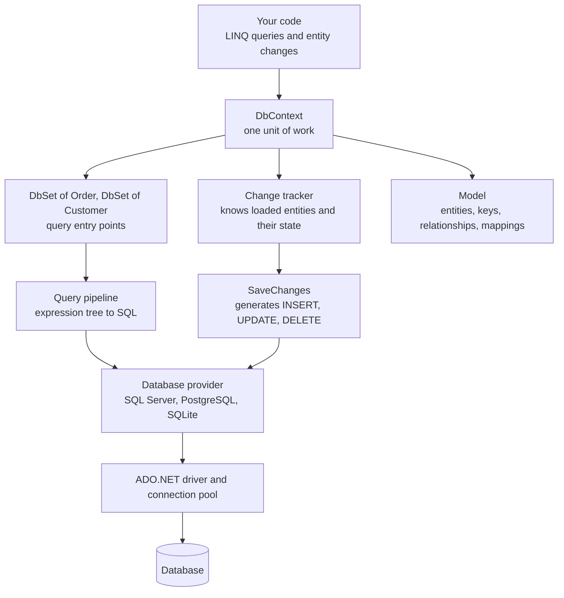
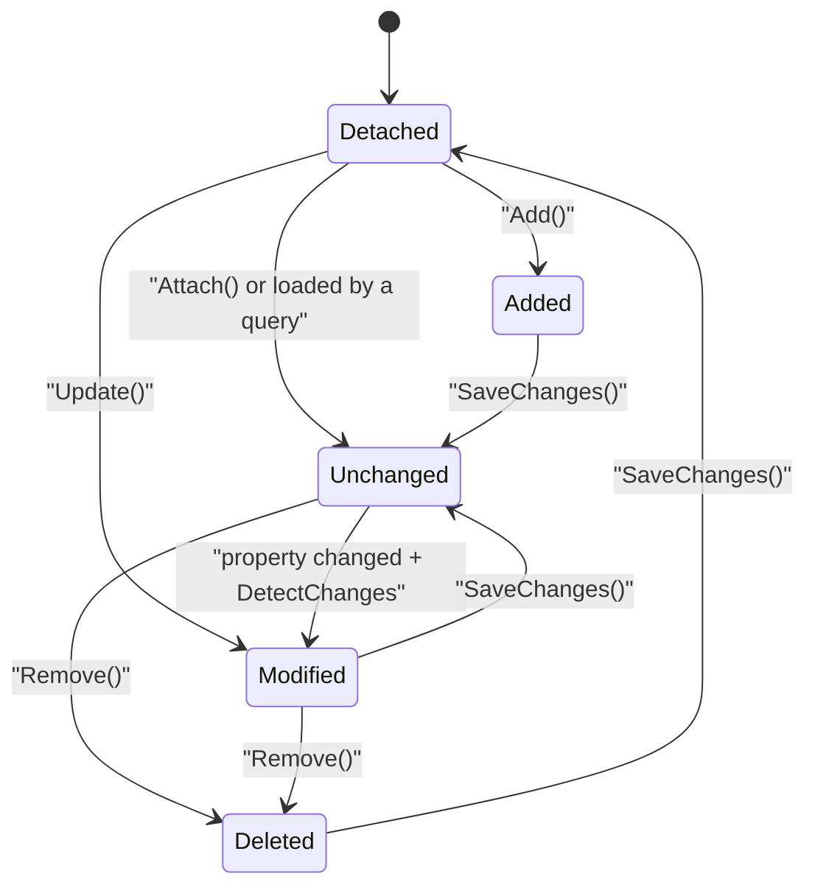
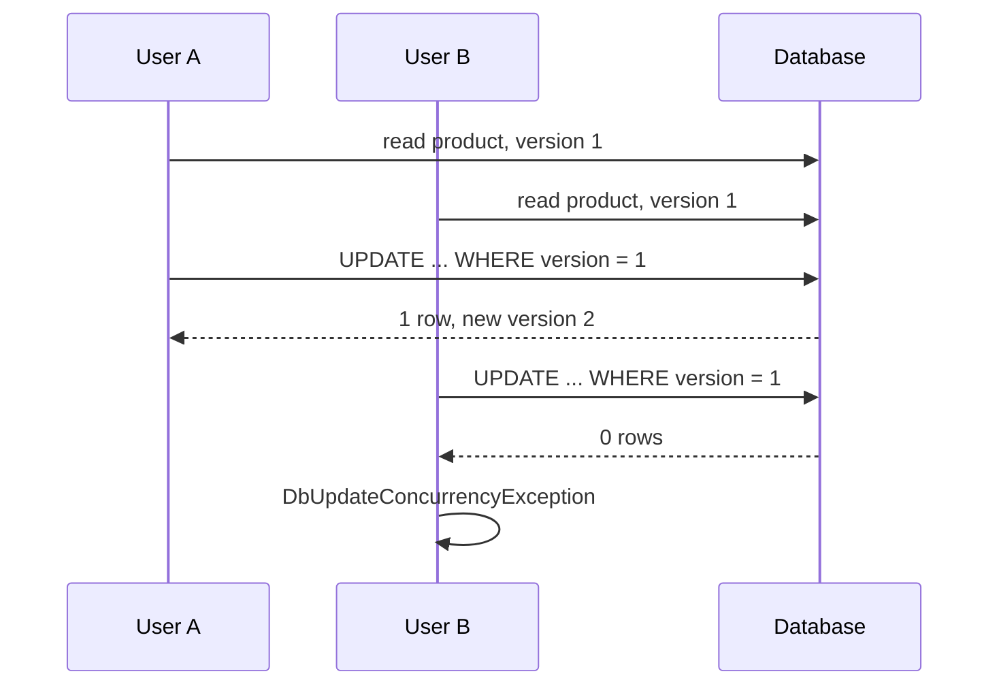

# Entity Framework Core and Data Access

> In this document you will learn how Entity Framework Core (EF Core) works: the `DbContext`, `DbSet` and change tracker, modeling and migrations, how LINQ becomes SQL, tracking vs no-tracking queries, loading related data and the N+1 problem, split queries, `SaveChanges` and transactions, optimistic concurrency, bulk updates, raw SQL without SQL injection, `DbContext` lifetime and pooling, compiled queries, and when to choose Dapper instead. EF Core is in almost every .NET backend, and interviewers love to ask about tracking, N+1 and concurrency.

**Before this:** [Databases (SQL, indexes, transactions, N+1)](../07-nodejs-backend/10-databases.md) · [Collections and LINQ](03-collections-and-linq.md) · [Dependency injection in ASP.NET Core](08-dependency-injection-in-aspnet-core.md) · **Interview questions:** [jump to the interview section](#interview-questions)

> **About the examples:** EF Core is a NuGet package, so the database examples here are written from the official documentation and are **not run against a database**. The generated SQL shown in this document is **real**: it was produced with `ToQueryString()` using a locally cached EF Core 9.0.6 SQL Server provider (no database needed). EF Core 10 produces the same shape of SQL with shorter parameter names (for example `@p` instead of `@__p_0`). The change-tracker state outputs were also produced by running EF Core without a database.

## Table of contents

1. [What EF Core is](#what-ef-core-is)
2. [Architecture: DbContext, DbSet, change tracker and providers](#architecture-dbcontext-dbset-change-tracker-and-providers)
3. [Setting up EF Core in ASP.NET Core](#setting-up-ef-core-in-aspnet-core)
4. [Code-first vs database-first](#code-first-vs-database-first)
5. [Modeling: conventions, attributes and the Fluent API](#modeling-conventions-attributes-and-the-fluent-api)
6. [Relationships](#relationships)
7. [Migrations](#migrations)
8. [Querying: how LINQ becomes SQL](#querying-how-linq-becomes-sql)
9. [The change tracker and tracking vs no-tracking](#the-change-tracker-and-tracking-vs-no-tracking)
10. [Loading related data and the N+1 problem](#loading-related-data-and-the-n1-problem)
11. [Split queries and cartesian explosion](#split-queries-and-cartesian-explosion)
12. [SaveChanges and transactions](#savechanges-and-transactions)
13. [Optimistic concurrency](#optimistic-concurrency)
14. [Bulk updates: ExecuteUpdate and ExecuteDelete](#bulk-updates-executeupdate-and-executedelete)
15. [Raw SQL without SQL injection](#raw-sql-without-sql-injection)
16. [DbContext lifetime, thread safety and pooling](#dbcontext-lifetime-thread-safety-and-pooling)
17. [Performance tools](#performance-tools)
18. [Global query filters](#global-query-filters)
19. [Dapper vs EF Core](#dapper-vs-ef-core)
20. [The repository and unit of work debate](#the-repository-and-unit-of-work-debate)
21. [Common mistakes](#common-mistakes)
22. [Best practices](#best-practices)
23. [How to explain this in an interview](#how-to-explain-this-in-an-interview)
24. [Interview questions](#interview-questions)
25. [Summary](#summary)
26. [References](#references)

---

## What EF Core is

**EF Core** is Microsoft's **ORM** (Object-Relational Mapper) for .NET. An ORM maps **classes** in your code to **tables** in a database. You write C# and LINQ; EF Core writes and runs the SQL, and turns result rows back into objects.

```csharp
// You write this:
var paidOrders = await db.Orders
    .Where(o => o.Status == "Paid")
    .OrderByDescending(o => o.CreatedAt)
    .Take(10)
    .ToListAsync();
```

```sql
-- EF Core generates this (real output, SQL Server provider):
SELECT TOP(@__p_0) [o].[Id], [o].[CreatedAt], [o].[CustomerId], [o].[Status]
FROM [Orders] AS [o]
WHERE [o].[Status] = N'Paid'
ORDER BY [o].[CreatedAt] DESC
```

Why it exists:

- Less repetitive data-access code (no manual `SqlCommand`, readers and mapping).
- Type-safe queries: renaming a property is a compile error, not a broken string.
- **Change tracking**: load objects, change them, call `SaveChanges`, and EF Core works out the `UPDATE` statements.
- **Migrations**: the database schema evolves together with your code.
- One API for many databases (SQL Server, PostgreSQL, SQLite, MySQL, Cosmos DB...).

The cost: an abstraction between you and SQL. If you do not understand what SQL it generates, you will write slow code. This document focuses on exactly that.

### Versions

> **EF Core 10** shipped with .NET 10 in November 2025. It is an **LTS** release supported until November 2028, together with .NET 10, and it requires .NET 10. Teams on .NET 8 use **EF Core 8** (LTS) or EF Core 9 (which also targets .NET 8); both reach end of support on November 10, 2026. EF Core does not run on .NET Framework (the old **EF6** does).

### If you know Node.js

EF Core plays the role of Prisma or TypeORM. LINQ queries are like Prisma's query API, but they are **expression trees** that EF Core translates to SQL ([IQueryable and expression trees](03-collections-and-linq.md)). Dapper (covered later) is closer to a thin query helper like `pg` with mapping.

---

## Architecture: DbContext, DbSet, change tracker and providers



| Part | What it does |
| --- | --- |
| **`DbContext`** | Your session with the database. It holds the change tracker, gives you `DbSet`s, and saves changes. Represents one **unit of work**. |
| **`DbSet<T>`** | A queryable collection for one entity type (`db.Orders`). It is an `IQueryable<T>`: queries on it become SQL. |
| **Model** | EF Core's description of your entities: tables, columns, keys, relationships. Built once from conventions, attributes and Fluent API, then cached. |
| **Change tracker** | Remembers every entity the context loaded or was given, with a **state** (Added, Unchanged, Modified, Deleted) and the original values. |
| **Query pipeline** | Translates LINQ expression trees into SQL, runs them, and **materializes** rows into objects. Translations are cached. |
| **Provider** | Database-specific package (`Microsoft.EntityFrameworkCore.SqlServer`, `Npgsql.EntityFrameworkCore.PostgreSQL`, `Microsoft.EntityFrameworkCore.Sqlite`). It knows the SQL dialect. |
| **ADO.NET** | The low-level .NET database API underneath. Connection pooling happens here. |

A minimal context:

```csharp
using Microsoft.EntityFrameworkCore;

public class ShopDbContext(DbContextOptions<ShopDbContext> options) : DbContext(options)
{
    public DbSet<Customer> Customers => Set<Customer>();
    public DbSet<Order> Orders => Set<Order>();
    public DbSet<Product> Products => Set<Product>();

    protected override void OnModelCreating(ModelBuilder modelBuilder)
    {
        modelBuilder.ApplyConfigurationsFromAssembly(typeof(ShopDbContext).Assembly);
    }
}

public class Customer
{
    public int Id { get; set; }
    public string Name { get; set; } = "";
    public string Email { get; set; } = "";
    public List<Order> Orders { get; set; } = [];
}

public class Order
{
    public int Id { get; set; }
    public int CustomerId { get; set; }              // foreign key
    public Customer Customer { get; set; } = null!;  // navigation property
    public string Status { get; set; } = "Pending";
    public DateTime CreatedAt { get; set; }
    public List<OrderLine> Lines { get; set; } = [];
}

public class OrderLine
{
    public int Id { get; set; }
    public int OrderId { get; set; }
    public int ProductId { get; set; }
    public int Quantity { get; set; }
    public decimal UnitPrice { get; set; }
}
```

A **navigation property** (`Order.Customer`, `Customer.Orders`) lets you move between related entities in code. EF Core uses it to build joins.

---

## Setting up EF Core in ASP.NET Core

Packages (not run here):

```bash
dotnet add package Microsoft.EntityFrameworkCore.SqlServer   # or Npgsql.EntityFrameworkCore.PostgreSQL
dotnet add package Microsoft.EntityFrameworkCore.Design      # needed by the migrations tool
dotnet tool install --global dotnet-ef                       # the 'dotnet ef' command
```

Registration:

```csharp
builder.Services.AddDbContext<ShopDbContext>(options =>
    options.UseSqlServer(builder.Configuration.GetConnectionString("Shop")));
```

```json
// appsettings.Development.json (never put production passwords in committed files)
{
  "ConnectionStrings": {
    "Shop": "Server=localhost;Database=Shop;Trusted_Connection=True;TrustServerCertificate=True"
  }
}
```

`AddDbContext` registers `ShopDbContext` as **scoped**: one instance per HTTP request ([lifetimes](08-dependency-injection-in-aspnet-core.md#lifetimes-singleton-scoped-and-transient)). Use it from an endpoint:

```csharp
app.MapGet("/api/customers/{id:int}", async (int id, ShopDbContext db, CancellationToken ct) =>
    await db.Customers.AsNoTracking()
        .Where(c => c.Id == id)
        .Select(c => new CustomerDto(c.Id, c.Name, c.Email))
        .FirstOrDefaultAsync(ct)
    is { } dto ? Results.Ok(dto) : Results.NotFound());
```

Always use the **async** methods (`ToListAsync`, `FirstOrDefaultAsync`, `SaveChangesAsync`) in web apps, and pass the `CancellationToken`. Sync calls block a thread-pool thread while waiting for the database ([async details](04-async-await-tasks-and-threading.md)).

---

## Code-first vs database-first

| | Code-first | Database-first |
| --- | --- | --- |
| Source of truth | C# classes and configuration | The existing database |
| Schema changes | Migrations generated from model changes | DBA changes the database; you re-scaffold |
| Tooling | `dotnet ef migrations add` | `dotnet ef dbcontext scaffold` |
| Good for | New apps, teams that own their database | Legacy databases, databases shared by many apps, DBA-owned schemas |

Scaffolding an existing database (not run here):

```bash
dotnet ef dbcontext scaffold "Server=.;Database=LegacyShop;Trusted_Connection=True;TrustServerCertificate=True" \
    Microsoft.EntityFrameworkCore.SqlServer --output-dir Data/Entities --context LegacyShopContext
```

This generates entity classes and a `DbContext` with Fluent API configuration. Re-running it overwrites generated files, so keep your custom code in **partial classes**.

---

## Modeling: conventions, attributes and the Fluent API

EF Core builds the model in three layers. Later layers override earlier ones:

1. **Conventions** — sensible defaults.
2. **Data annotations** — attributes on the entity classes.
3. **Fluent API** — code in `OnModelCreating` or `IEntityTypeConfiguration<T>` classes.

### Conventions

- A property named `Id` or `<TypeName>Id` is the **primary key**. An `int` key becomes an identity (auto-increment) column.
- `CustomerId` next to a `Customer` navigation is the **foreign key**.
- `DbSet` property names become **table names** (`Orders`). Types without a `DbSet` use the class name (`OrderLine` — you saw `[OrderLine]` in the SQL above).
- Nullable reference types decide nullability: `string Name` → `NOT NULL`; `string? Notes` → `NULL`.

### Attributes vs Fluent API

```csharp
// Attributes
public class Product
{
    public int Id { get; set; }

    [Required, MaxLength(200)]
    public string Name { get; set; } = "";

    [Precision(18, 2)]
    public decimal Price { get; set; }
}
```

```csharp
// Fluent API in a configuration class (preferred for anything beyond trivial)
public class ProductConfiguration : IEntityTypeConfiguration<Product>
{
    public void Configure(EntityTypeBuilder<Product> builder)
    {
        builder.ToTable("Products");
        builder.Property(p => p.Name).IsRequired().HasMaxLength(200);
        builder.Property(p => p.Price).HasPrecision(18, 2);
        builder.HasIndex(p => p.Name);
        builder.Property(p => p.Category)    // an enum property
               .HasConversion<string>()      // store the enum as text, not a number
               .HasMaxLength(30);
    }
}
```

| | Attributes | Fluent API |
| --- | --- | --- |
| Where | On the entity | In configuration classes |
| Power | Basic: keys, lengths, required, precision, table/column names | Everything: indexes, relationships, conversions, owned/complex types, filters, seeding |
| Domain purity | Entities depend on persistence attributes | Entities stay plain classes |

Many teams use the Fluent API with one `IEntityTypeConfiguration<T>` per entity, loaded by `ApplyConfigurationsFromAssembly`. Remember that `[Required]` and `[MaxLength]` also act as validation attributes in ASP.NET Core, which can mix API validation with database mapping. Keeping validation on DTOs and mapping in the Fluent API avoids that.

### Value objects: complex types

A **complex type** is a value without its own identity, stored inside its owner's table (or as JSON):

```csharp
public record Address(string Street, string City, string PostalCode);

public class Customer
{
    public int Id { get; set; }
    public Address ShippingAddress { get; set; } = null!;
}

modelBuilder.Entity<Customer>().ComplexProperty(c => c.ShippingAddress);
// Columns: ShippingAddress_Street, ShippingAddress_City, ShippingAddress_PostalCode
```

> **EF Core 8** introduced complex types. **EF Core 10** adds optional complex types, mapping complex types to a **JSON column** (`.ToJson()`), and `ExecuteUpdate` support for JSON properties. Before this, people used **owned entity types** (`OwnsOne`) for the same job; EF Core 10 recommends complex types instead.

---

## Relationships

### One-to-many

A customer has many orders. Conventions find it from `Customer.Orders`, `Order.Customer` and `Order.CustomerId`. Explicit form:

```csharp
builder.HasOne(o => o.Customer)
       .WithMany(c => c.Orders)
       .HasForeignKey(o => o.CustomerId)
       .OnDelete(DeleteBehavior.Restrict);   // do not cascade-delete orders with the customer
```

### Many-to-many

```csharp
public class Product { public int Id { get; set; } public List<Tag> Tags { get; set; } = []; }
public class Tag { public int Id { get; set; } public string Name { get; set; } = ""; public List<Product> Products { get; set; } = []; }
```

EF Core creates the join table (`ProductTag`) automatically. If the join needs its own data (for example `AddedAt`), model the join entity explicitly.

### One-to-one

```csharp
builder.HasOne(c => c.Profile)
       .WithOne(p => p.Customer)
       .HasForeignKey<CustomerProfile>(p => p.CustomerId);
```

### Delete behavior

By default, a required relationship uses **cascade delete**: deleting a customer deletes its orders. That is often dangerous for business data. Choose explicitly (`Restrict`, `SetNull`, `Cascade`) and consider **soft delete** ([global query filters](#global-query-filters)) for important records.

The relational concepts themselves (keys, normalization, joins) are explained in [Databases](../07-nodejs-backend/10-databases.md).

---

## Migrations

A **migration** is a C# file that describes how to change the database schema from one version of the model to the next. The concept is the same as Knex or Prisma migrations ([migrations in general](../07-nodejs-backend/10-databases.md#migrations)).

### The workflow (not run here)

```bash
# 1. Change your entities or configuration, then:
dotnet ef migrations add AddOrderStatusIndex

# 2. Review the generated files in Migrations/ (Up and Down methods)

# 3. Apply to your local database:
dotnet ef database update

# 4. For production, generate a reviewed SQL script:
dotnet ef migrations script --idempotent --output migrate.sql

# or build a self-contained migration executable:
dotnet ef migrations bundle --output efbundle
```

A generated migration looks like this:

```csharp
public partial class AddOrderStatusIndex : Migration
{
    protected override void Up(MigrationBuilder migrationBuilder)
    {
        migrationBuilder.CreateIndex(
            name: "IX_Orders_Status",
            table: "Orders",
            column: "Status");
    }

    protected override void Down(MigrationBuilder migrationBuilder)
    {
        migrationBuilder.DropIndex(name: "IX_Orders_Status", table: "Orders");
    }
}
```

EF Core also keeps a **model snapshot** (`ShopDbContextModelSnapshot.cs`) to compare the current model with the last migration, and a **`__EFMigrationsHistory`** table in the database that records which migrations were applied.

### Applying migrations in production

| Approach | Pros | Cons |
| --- | --- | --- |
| `context.Database.Migrate()` at app startup | Simple | Several instances may migrate at once; the app needs schema-change permissions; a failed migration crashes startup |
| **Idempotent SQL script** in the deployment pipeline | Reviewable by DBAs; runs once; app needs fewer permissions | Extra pipeline step |
| **Migration bundle** (`efbundle`) run as a pipeline step or Kubernetes job | One executable, no SDK needed on the server | Extra artifact to manage |

The Microsoft docs recommend **not** applying migrations at startup in production. Use a script or bundle as a separate deployment step.

### Safe schema changes

- **Renames** can look like "drop column + add column" to EF Core → data loss. Check the generated code and use `RenameColumn`.
- For zero-downtime deployments, use **expand and contract**: add the new column (nullable), deploy code that writes both, backfill, switch reads, then drop the old column in a later release.
- Adding an index on a big table can lock it; on SQL Server, consider online index options and run it in a maintenance window.

---

## Querying: how LINQ becomes SQL

### IQueryable and expression trees

`db.Orders` is an `IQueryable<Order>`. When you write `.Where(o => o.Status == "Paid")`, the lambda is not compiled into a normal delegate. It becomes an **expression tree** — a data structure describing the code. EF Core reads that tree and translates it to SQL. Nothing runs until you **execute** the query with `ToListAsync`, `FirstOrDefaultAsync`, `CountAsync`, `foreach`, and so on (deferred execution, see [LINQ](03-collections-and-linq.md)).

You can always see the SQL with `ToQueryString()`:

```csharp
var query = db.Orders.Where(o => o.Status == "Paid").OrderByDescending(o => o.CreatedAt).Take(10);
Console.WriteLine(query.ToQueryString());
```

```sql
DECLARE @__p_0 int = 10;

SELECT TOP(@__p_0) [o].[Id], [o].[CreatedAt], [o].[CustomerId], [o].[Status]
FROM [Orders] AS [o]
WHERE [o].[Status] = N'Paid'
ORDER BY [o].[CreatedAt] DESC
```

Notice:

- `Take(10)` became `TOP(@__p_0)` with a **parameter**.
- The constant `"Paid"` was written inline as `N'Paid'`. Values from **variables** become **parameters**:

```csharp
var minTotal = 100m;
var ids = db.Orders.Where(o => o.Lines.Sum(l => l.UnitPrice * l.Quantity) > minTotal).Select(o => o.Id);
```

```sql
DECLARE @__minTotal_0 decimal(18,2) = 100.0;

SELECT [o].[Id]
FROM [Orders] AS [o]
WHERE (
    SELECT COALESCE(SUM([o0].[UnitPrice] * CAST([o0].[Quantity] AS decimal(18,2))), 0.0)
    FROM [OrderLine] AS [o0]
    WHERE [o].[Id] = [o0].[OrderId]) > @__minTotal_0
```

EF Core translated a navigation (`o.Lines`) and an aggregate (`Sum`) into a correlated subquery. Parameters are important: they keep the SQL text the same across calls (so the database can reuse its query plan) and they prevent SQL injection.

### What cannot be translated

If EF Core cannot turn your C# into SQL, it throws at runtime:

```csharp
public static class Rules
{
    public static bool IsVip(string status) => status.StartsWith("VIP");
}

db.Orders.Where(o => Rules.IsVip(o.Status)).ToQueryString();
```

```text
InvalidOperationException: The LINQ expression 'DbSet<Order>()
    .Where(o => Rules.IsVip(o.Status))' could not be translated. Additional information:
Translation of method 'Rules.IsVip' failed. ... Either rewrite the query in a form that can be
translated, or switch to client evaluation explicitly by inserting a call to 'AsEnumerable',
'AsAsyncEnumerable', 'ToList', or 'ToListAsync'.
```

The database does not know your C# method. Fixes:

- Write the condition inline so EF Core can translate it: `.Where(o => o.Status.StartsWith("VIP"))` becomes `LIKE N'VIP%'`.
- Filter as much as possible in SQL first, then call `AsEnumerable()` and apply the C# method in memory — only on a small result.

> **History:** EF Core 1 and 2 silently evaluated untranslatable parts **in memory** ("client evaluation"), which could load whole tables. Since EF Core 3.0, it throws instead (except in the final `Select`). This is a safety feature.

### The IEnumerable trap

```csharp
// ❌ Wrong: AsEnumerable() too early — loads ALL orders, then filters in memory
var recent = db.Orders.AsEnumerable().Where(o => o.CreatedAt > cutoff).ToList();

// ❌ Wrong: a method that takes IEnumerable<T> hides the IQueryable
IEnumerable<Order> FilterPaid(IEnumerable<Order> orders) => orders.Where(o => o.Status == "Paid");
var paid = FilterPaid(db.Orders).ToList();   // SELECT * FROM Orders, then filters in C#

// ✅ Correct: keep IQueryable<T> until the end
IQueryable<Order> FilterPaidQ(IQueryable<Order> orders) => orders.Where(o => o.Status == "Paid");
var paidQ = await FilterPaidQ(db.Orders).ToListAsync();
```

The `Where` method you call depends on the **static type**: `Queryable.Where` (builds SQL) for `IQueryable<T>`, `Enumerable.Where` (runs in memory) for `IEnumerable<T>`.

### Projection: select only what you need

```csharp
var summaries = db.Orders
    .Where(o => o.CustomerId == 7)
    .Select(o => new
    {
        o.Id,
        Total = o.Lines.Sum(l => l.UnitPrice * l.Quantity),
        LineCount = o.Lines.Count
    });
```

```sql
SELECT [o].[Id], (
    SELECT COALESCE(SUM([o0].[UnitPrice] * CAST([o0].[Quantity] AS decimal(18,2))), 0.0)
    FROM [OrderLine] AS [o0]
    WHERE [o].[Id] = [o0].[OrderId]) AS [Total], (
    SELECT COUNT(*)
    FROM [OrderLine] AS [o1]
    WHERE [o].[Id] = [o1].[OrderId]) AS [LineCount]
FROM [Orders] AS [o]
WHERE [o].[CustomerId] = 7
```

One query, only the needed columns, computed in the database, and **no tracking** (projections into non-entity types are never tracked). For read endpoints, projecting straight into a DTO is usually the fastest and simplest approach.

### Find vs FirstOrDefault vs Single

| Method | Behavior |
| --- | --- |
| `FindAsync(id)` | Looks in the **change tracker first**; queries the database only if the entity is not already loaded. Primary key only. |
| `FirstOrDefaultAsync(predicate)` | Always queries; returns the first match or `null`. Add an `OrderBy` if several rows can match. |
| `SingleOrDefaultAsync(predicate)` | Always queries; throws if **more than one** row matches (EF Core fetches up to 2 rows to check). |

### EF Core 10 query improvements worth knowing

- **`LeftJoin` and `RightJoin`** LINQ operators (new in .NET 10) are translated to `LEFT JOIN` / `RIGHT JOIN`, replacing the old `GroupJoin` + `SelectMany` + `DefaultIfEmpty` pattern.
- **Parameterized collections** (`ids.Contains(o.Id)`) are now translated to individual parameters (`IN (@ids1, @ids2, @ids3)`), padded to reduce plan-cache bloat.
- **Simpler parameter names** in SQL (`@city` instead of `@__city_0`).

---

## The change tracker and tracking vs no-tracking

### Entity states

The change tracker gives every entity it knows a **state**:

| State | Meaning | What `SaveChanges` does |
| --- | --- | --- |
| **Detached** | The context does not know this object | Nothing |
| **Added** | New; will be inserted | `INSERT` |
| **Unchanged** | Loaded or attached; no changes detected | Nothing |
| **Modified** | One or more properties changed | `UPDATE` (only the changed columns) |
| **Deleted** | Marked for deletion | `DELETE` |

Real output from running EF Core (no database needed for this part):

```csharp
var order = new Order { Status = "Pending", CustomerId = 1 };
db.Orders.Add(order);
Console.WriteLine(db.Entry(order).State);                    // Added

var existing = new Order { Id = 42, Status = "Paid", CustomerId = 1 };
db.Orders.Attach(existing);
Console.WriteLine(db.Entry(existing).State);                 // Unchanged

existing.Status = "Shipped";
db.ChangeTracker.DetectChanges();
Console.WriteLine(db.Entry(existing).State);                                   // Modified
Console.WriteLine(db.Entry(existing).Property(o => o.Status).IsModified);      // True
Console.WriteLine(db.Entry(existing).Property(o => o.CreatedAt).IsModified);   // False

db.Orders.Remove(existing);
Console.WriteLine(db.Entry(existing).State);                 // Deleted

var detached = new Order { Id = 99, Status = "Paid" };
Console.WriteLine(db.Entry(detached).State);                 // Detached
db.Orders.Update(detached);
Console.WriteLine(db.Entry(detached).State);                                   // Modified
Console.WriteLine(db.Entry(detached).Property(o => o.CreatedAt).IsModified);   // True
```



### How change detection works

When a tracked entity is loaded, EF Core keeps a **snapshot** of its original values. `DetectChanges` (called automatically by `SaveChanges` and some other methods) compares current values with the snapshot. Only changed columns go into the `UPDATE`:

```sql
UPDATE [Orders] SET [Status] = @p0 WHERE [Id] = @p1;
```

### Attach vs Update — an important difference

Look at the output above again:

- `Attach` + change one property → only **`Status`** is modified. The `UPDATE` sets one column.
- `Update` on a detached object → **every** property is marked modified (`CreatedAt modified: True`). The `UPDATE` sets **all** columns — including `CreatedAt`, which is `default(DateTime)` on our object. That overwrites real data with empty values.

So, for "edit" endpoints:

```csharp
// ✅ Load, change, save: only changed columns are updated
var order = await db.Orders.FindAsync([id], ct);
if (order is null) return Results.NotFound();
order.Status = request.Status;
await db.SaveChangesAsync(ct);

// ⚠️ Update(dto-built entity): sets every column from the object, including ones the client did not send
db.Orders.Update(new Order { Id = id, Status = request.Status });   // CreatedAt becomes 0001-01-01!
```

### Identity resolution

Within one context, a tracked entity with a given key exists **once**. If two queries return the order with `Id = 42`, you get the **same object** both times. This keeps the graph consistent, but also means a long-lived context keeps old values in memory (another reason contexts should be short-lived).

### No-tracking queries

For **read-only** queries, tracking is wasted work: snapshots, identity map, memory.

```csharp
var orders = await db.Orders.AsNoTracking().Where(o => o.CustomerId == 7).ToListAsync(ct);
```

- Faster and lighter.
- Changes to these objects are **not** saved by `SaveChanges`.
- No identity resolution: the same customer loaded through two orders becomes two objects. Use `AsNoTrackingWithIdentityResolution()` if you need one instance per key without tracking.
- You can make no-tracking the default for a context: `options.UseQueryTrackingBehavior(QueryTrackingBehavior.NoTracking)`, and opt in with `AsTracking()` where you update.

Rule of thumb: **reads with `AsNoTracking()` or projections; writes load tracked entities.**

---

## Loading related data and the N+1 problem

Entities have navigation properties (`order.Lines`, `order.Customer`). By default, EF Core does **not** load them. You choose how:

| Strategy | How | When the SQL runs |
| --- | --- | --- |
| **Eager loading** | `Include(o => o.Lines)` | In the same query (or split queries) |
| **Explicit loading** | `await db.Entry(order).Collection(o => o.Lines).LoadAsync()` | When you call `LoadAsync` |
| **Lazy loading** | Navigation is loaded automatically the first time you touch it | Hidden, on property access |
| **Projection** | `Select(o => new { o.Id, Lines = o.Lines.Select(...) })` | In the same query |

### Eager loading with Include

```csharp
var orders = await db.Orders
    .Include(o => o.Lines)
    .Where(o => o.CustomerId == 7)
    .ToListAsync(ct);
```

```sql
SELECT [o].[Id], [o].[CreatedAt], [o].[CustomerId], [o].[Status],
       [o0].[Id], [o0].[OrderId], [o0].[ProductId], [o0].[Quantity], [o0].[UnitPrice]
FROM [Orders] AS [o]
LEFT JOIN [OrderLine] AS [o0] ON [o].[Id] = [o0].[OrderId]
WHERE [o].[CustomerId] = 7
ORDER BY [o].[Id]
```

One round trip with a `LEFT JOIN`. More levels: `.Include(o => o.Lines).ThenInclude(l => l.Product)`. Filtered include (EF Core 5+): `.Include(o => o.Lines.Where(l => l.Quantity > 1))`.

### The N+1 problem

The **N+1 problem** is running **1** query for a list and then **N** more queries, one per item, to get related data. The general explanation is in [Databases](../07-nodejs-backend/10-databases.md#the-n1-query-problem). In EF Core it usually appears in two ways.

**Way 1: a loop with a query inside**

```csharp
// ❌ Wrong: 1 query for orders + 1 query per order for its lines
var orders = await db.Orders.Where(o => o.CustomerId == 7).ToListAsync(ct);
foreach (var order in orders)
{
    var lines = await db.Set<OrderLine>().Where(l => l.OrderId == order.Id).ToListAsync(ct);
    Console.WriteLine($"{order.Id}: {lines.Count} lines");
}
// 100 orders -> 101 round trips
```

**Way 2: lazy loading hides the queries**

With lazy loading turned on (`UseLazyLoadingProxies()` from the `Microsoft.EntityFrameworkCore.Proxies` package, and `virtual` navigations), this innocent code runs one query per order:

```csharp
var orders = await db.Orders.ToListAsync(ct);
foreach (var order in orders)
    Console.WriteLine(order.Lines.Count);   // each access to order.Lines runs a SELECT
```

Even worse: if you return entities from an API, the **JSON serializer** touches every navigation property, triggering lazy loads during serialization.

**Fixes:**

```csharp
// ✅ Fix 1: eager load
var orders = await db.Orders.Include(o => o.Lines).Where(o => o.CustomerId == 7).ToListAsync(ct);

// ✅ Fix 2 (often best): project only what you need, in one query
var summaries = await db.Orders
    .Where(o => o.CustomerId == 7)
    .Select(o => new { o.Id, LineCount = o.Lines.Count })
    .ToListAsync(ct);

// ✅ Fix 3: load related rows for all parents in one extra query
var orderIds = orders.Select(o => o.Id).ToList();
var lines = await db.Set<OrderLine>().Where(l => orderIds.Contains(l.OrderId)).ToListAsync(ct);
var linesByOrder = lines.ToLookup(l => l.OrderId);
```

**How to detect it:**

- Log SQL in development (`options.LogTo(Console.WriteLine, LogLevel.Information)`) and look for repeated, almost identical queries.
- Watch the number of database calls per request in your APM or OpenTelemetry traces ([production observability](14-production-architecture-and-performance.md)).
- Prefer to leave lazy loading **off** (the default) so data access stays explicit.

---

## Split queries and cartesian explosion

Eager loading **two collections** in one query multiplies rows:

```csharp
var customers = await db.Customers
    .Include(c => c.Orders)
    .Include(c => c.Addresses)
    .ToListAsync(ct);
```

A customer with 50 orders and 4 addresses comes back as 50 × 4 = **200 rows**, each repeating all the customer columns. This is called **cartesian explosion**. With more collections and more rows it becomes huge.

**Split queries** (EF Core 5+) load each collection in its own SQL query:

```csharp
var orders = await db.Orders
    .Include(o => o.Lines)
    .AsSplitQuery()
    .Where(o => o.CustomerId == 7)
    .ToListAsync(ct);
```

`ToQueryString()` shows the first query and a note:

```text
SELECT [o].[Id], [o].[CreatedAt], [o].[CustomerId], [o].[Status]
FROM [Orders] AS [o]
WHERE [o].[CustomerId] = 7
ORDER BY [o].[Id]

This LINQ query is being executed in split-query mode, and the SQL shown is for the first query
to be executed. Additional queries may also be executed depending on the results of the first query.
```

| | Single query (default) | Split query |
| --- | --- | --- |
| Round trips | 1 | 1 + one per included collection |
| Duplicate data | Can explode with several collections | None |
| Consistency | One snapshot | Data could change between the queries (unless you use a transaction with a suitable isolation level) |
| Paging with `Skip/Take` | Fine | Needs a unique, stable `OrderBy` (EF Core 10 improved ordering consistency) |

You can make split queries the default with `UseQuerySplittingBehavior(QuerySplittingBehavior.SplitQuery)` and opt back in with `AsSingleQuery()`. A good rule: single query by default; split query when you include **more than one collection** or a large one.

---

## SaveChanges and transactions

### SaveChanges is a unit of work

```csharp
var customer = await db.Customers.FirstAsync(c => c.Email == email, ct);
var order = new Order { CustomerId = customer.Id, Status = "Pending", CreatedAt = DateTime.UtcNow };
order.Lines.Add(new OrderLine { ProductId = 5, Quantity = 2, UnitPrice = 19.99m });
db.Orders.Add(order);

customer.Name = "Asha K.";   // also a change

await db.SaveChangesAsync(ct);   // INSERT order, INSERT line, UPDATE customer — in ONE transaction
Console.WriteLine(order.Id);     // the database-generated key is now filled in
```

What `SaveChanges` does:

1. Calls `DetectChanges`.
2. Orders the commands correctly (insert the order before its lines, so the foreign key exists).
3. **Batches** commands into as few round trips as possible.
4. Wraps them in a **transaction**: all succeed or all are rolled back.
5. Reads back generated values (identity keys, row versions) and sets entity states to `Unchanged`.

So for most use cases, you do **not** need an explicit transaction: one `SaveChanges` is atomic.

### Explicit transactions

You need one when several `SaveChanges` calls (or raw SQL plus `SaveChanges`) must succeed or fail together:

```csharp
await using var tx = await db.Database.BeginTransactionAsync(ct);
try
{
    db.Payments.Add(payment);
    await db.SaveChangesAsync(ct);

    await db.Database.ExecuteSqlAsync($"UPDATE Inventory SET Reserved = Reserved + {qty} WHERE ProductId = {productId}", ct);

    order.Status = "Paid";
    await db.SaveChangesAsync(ct);

    await tx.CommitAsync(ct);
}
catch
{
    await tx.RollbackAsync(ct);   // also happens automatically if tx is disposed without commit
    throw;
}
```

ACID and isolation levels are explained in [Databases](../07-nodejs-backend/10-databases.md#transactions-and-acid).

### Retries and execution strategies

Cloud databases have **transient failures** (short network blips, failovers). The SQL Server provider can retry automatically:

```csharp
options.UseSqlServer(connectionString, sql => sql.EnableRetryOnFailure());
```

With retries enabled, a manual transaction must run inside the **execution strategy**, so the whole block is retried together:

```csharp
var strategy = db.Database.CreateExecutionStrategy();
await strategy.ExecuteAsync(async () =>
{
    await using var tx = await db.Database.BeginTransactionAsync(ct);
    // ... work and SaveChangesAsync ...
    await tx.CommitAsync(ct);
});
```

Otherwise EF Core throws, because it cannot safely retry half a transaction.

### Transactions and external side effects

A database transaction cannot include sending an email or publishing to a message broker. If you `SaveChanges` and then publish an event, and the publish fails, the two are out of sync. The standard fix is the **outbox pattern**: save the event in an `Outbox` table in the same transaction, and a background worker publishes it ([details](12-caching-background-jobs-and-messaging.md)).

---

## Optimistic concurrency

Two users open the same product. Both change the price. Both save. Without protection, the **last write wins** and the first change is silently lost.

**Optimistic concurrency** detects this: each row has a version; an `UPDATE` only succeeds if the version is still the one you read. The general idea (and pessimistic locking) is explained in [Databases](../07-nodejs-backend/10-databases.md#optimistic-and-pessimistic-locking).

### With a SQL Server rowversion

```csharp
public class Product
{
    public int Id { get; set; }
    public string Name { get; set; } = "";
    public decimal Price { get; set; }

    [Timestamp]                         // SQL Server rowversion: changes automatically on every update
    public byte[] RowVersion { get; set; } = [];
}
```

EF Core now adds the version to the `WHERE` clause:

```sql
UPDATE [Products] SET [Price] = @p0
OUTPUT INSERTED.[RowVersion]
WHERE [Id] = @p1 AND [RowVersion] = @p2;
```

If another user changed the row in between, the `WHERE` matches **0 rows**, and EF Core throws **`DbUpdateConcurrencyException`**.



### Handling the conflict

```csharp
try
{
    await db.SaveChangesAsync(ct);
}
catch (DbUpdateConcurrencyException ex)
{
    var entry = ex.Entries.Single();
    var databaseValues = await entry.GetDatabaseValuesAsync(ct);
    if (databaseValues is null)
        return Results.NotFound();          // someone deleted it

    // Option 1: tell the client (most APIs do this)
    return Results.Conflict(new { message = "The product was changed by someone else. Reload and try again." });

    // Option 2: client wins — overwrite with our values
    // entry.OriginalValues.SetValues(databaseValues); await db.SaveChangesAsync(ct);

    // Option 3: merge field by field (business-specific)
}
```

### Across HTTP requests: send the version to the client

In a web API, the read and the update are **different requests** with different `DbContext`s. So the client must send back the version it read. Common approaches:

- Include `rowVersion` (base64) in the response DTO, and require it in the update request.
- Use HTTP **ETags**: return `ETag: "base64-rowversion"`, and require `If-Match` on `PUT`/`PATCH`; answer `412 Precondition Failed` on mismatch ([ETags in REST](../07-nodejs-backend/07-rest-api-design.md#concurrency-control-with-etags)).

Then set the original value before saving:

```csharp
db.Entry(product).Property(p => p.RowVersion).OriginalValue = Convert.FromBase64String(request.RowVersion);
```

On databases without `rowversion` (PostgreSQL, SQLite), use a regular property marked with `.IsConcurrencyToken()` that you change yourself (for example a `Guid Version` set to a new value on each update), or PostgreSQL's `xmin` system column with the Npgsql provider.

---

## Bulk updates: ExecuteUpdate and ExecuteDelete

Loading 10,000 entities to change one field each is slow: 10,000 objects in memory, tracking, and many `UPDATE` statements.

> **Since EF Core 7:** `ExecuteUpdateAsync` and `ExecuteDeleteAsync` run a **single SQL statement** directly, without loading or tracking entities.

```csharp
// Cancel all pending orders older than 30 days
var cutoff = DateTime.UtcNow.AddDays(-30);

int updated = await db.Orders
    .Where(o => o.Status == "Pending" && o.CreatedAt < cutoff)
    .ExecuteUpdateAsync(s => s
        .SetProperty(o => o.Status, "Cancelled")
        .SetProperty(o => o.UpdatedAt, DateTime.UtcNow), ct);

// Delete old audit rows
int deleted = await db.AuditEntries
    .Where(a => a.CreatedAt < DateTime.UtcNow.AddYears(-1))
    .ExecuteDeleteAsync(ct);
```

Generated SQL (shape):

```sql
UPDATE [o] SET [o].[Status] = N'Cancelled', [o].[UpdatedAt] = @p
FROM [Orders] AS [o]
WHERE [o].[Status] = N'Pending' AND [o].[CreatedAt] < @cutoff
```

> **New in EF Core 10:** `ExecuteUpdateAsync` accepts a **regular lambda** with statements, so you can add setters conditionally without building expression trees:

```csharp
await db.Products.Where(p => p.CategoryId == categoryId).ExecuteUpdateAsync(s =>
{
    s.SetProperty(p => p.Price, p => p.Price * 1.10m);
    if (markOnSale)
        s.SetProperty(p => p.OnSale, true);
}, ct);
```

Important caveats:

- They **bypass the change tracker**: entities already loaded in the context still have old values.
- They run **immediately**, not at `SaveChanges`, and are not part of `SaveChanges`' transaction unless you open an explicit transaction.
- No `SaveChanges` interceptors, no automatic concurrency tokens, no cascade behaviors handled by EF Core (the database's own cascades still apply).

---

## Raw SQL without SQL injection

Sometimes you need SQL that LINQ cannot express well (window functions, hints, a stored procedure). EF Core has safe and unsafe APIs. SQL injection itself is explained in [Databases](../07-nodejs-backend/10-databases.md#sql-injection-and-parameterized-queries).

### Safe: FromSql and ExecuteSql with interpolation

`FromSql` (EF Core 7+; older name `FromSqlInterpolated`) takes a **`FormattableString`**. Every `{value}` becomes a **parameter**, not text:

```csharp
var name = "Robert'); DROP TABLE Customers;--";
var customers = db.Customers.FromSql($"SELECT * FROM Customers WHERE Name = {name}");
```

Real SQL:

```sql
DECLARE @p0 nvarchar(4000) = N'Robert''); DROP TABLE Customers;--';

SELECT * FROM Customers WHERE Name = @p0
```

The malicious text is just a parameter value. Nothing is executed.

You can compose LINQ on top: `db.Customers.FromSql($"...").Where(c => c.IsActive).OrderBy(c => c.Name)`.

For commands: `await db.Database.ExecuteSqlAsync($"UPDATE Products SET Stock = Stock - {qty} WHERE Id = {id}", ct);`

For non-entity results (EF Core 8+): `db.Database.SqlQuery<int>($"SELECT COUNT(*) AS Value FROM Orders WHERE CustomerId = {id}")`.

### Unsafe: FromSqlRaw with string concatenation

```csharp
// ❌ Wrong: concatenating user input into SQL
var name = "x' OR 1=1 --";
var customers = db.Customers.FromSqlRaw("SELECT * FROM Customers WHERE Name = '" + name + "'");
```

Real SQL:

```sql
SELECT * FROM Customers WHERE Name = 'x' OR 1=1 --'
```

The input changed the query: `OR 1=1` returns **every customer**, and `--` comments out the rest. That is SQL injection.

`FromSqlRaw` is only safe with **placeholders and separate parameters**:

```csharp
// ✅ Correct with FromSqlRaw: {0} is a parameter placeholder, not string formatting
var customers = db.Customers.FromSqlRaw("SELECT * FROM Customers WHERE Name = {0}", name);
```

Use `FromSqlRaw` for **dynamic SQL structure** (for example a table or column name chosen from a **whitelist**), never for values.

A subtle trap: `FromSqlRaw($"... '{name}'")` — an **interpolated string passed to the raw method** — is formatted into plain text first, so it is **also** injectable (real SQL: `WHERE Name = 'x' OR 1=1 --'`). With `FromSql`, the same `$"..."` is safe. The method name matters. The compiler helps here: EF Core's analyzer reports **warning EF1002** ("Method 'FromSqlRaw' inserts interpolated strings directly into the SQL, without any protection against SQL injection"), and **EF Core 10** extends the analyzer to warn about string **concatenation** in raw SQL methods too. Treat these warnings as errors.

`FromSql` results are composable. This real example shows EF Core wrapping your SQL in a subquery and adding the LINQ parts:

```csharp
db.Customers.FromSql($"SELECT * FROM Customers").Where(c => c.Name.StartsWith("VIP")).OrderBy(c => c.Name);
```

```sql
SELECT [c].[Id], [c].[Name]
FROM (
    SELECT * FROM Customers
) AS [c]
WHERE [c].[Name] LIKE N'VIP%'
ORDER BY [c].[Name]
```

---

## DbContext lifetime, thread safety and pooling

### Short-lived and scoped

A `DbContext` should live for **one unit of work**: one HTTP request, one background job iteration, one message. Reasons:

- The change tracker grows with every loaded entity. A long-lived context gets slower and uses more memory.
- Tracked entities become **stale**: identity resolution returns the old object instead of fresh data.
- It holds a connection while a transaction is open.

`AddDbContext` registers it as **scoped**, which gives exactly one per request. In singletons and background services, create a scope or use a context factory ([details](08-dependency-injection-in-aspnet-core.md#using-scoped-services-from-singletons-and-background-services)).

### Not thread-safe

A `DbContext` must not be used by two operations at the same time:

```csharp
// ❌ Wrong: two queries in parallel on the same context
var ordersTask = db.Orders.ToListAsync(ct);
var customersTask = db.Customers.ToListAsync(ct);
await Task.WhenAll(ordersTask, customersTask);
```

```text
InvalidOperationException: A second operation was started on this context instance before a previous
operation completed. This is usually caused by different threads concurrently using the same instance of DbContext.
```

Fixes: `await` each query one after the other (usually fine — they are fast), or use **separate contexts** from an `IDbContextFactory<T>` when you really need parallel queries.

```csharp
builder.Services.AddDbContextFactory<ShopDbContext>(o => o.UseSqlServer(conn));

public class DashboardService(IDbContextFactory<ShopDbContext> factory)
{
    public async Task<(int Orders, int Customers)> GetCountsAsync(CancellationToken ct)
    {
        await using var db1 = await factory.CreateDbContextAsync(ct);
        await using var db2 = await factory.CreateDbContextAsync(ct);
        var t1 = db1.Orders.CountAsync(ct);
        var t2 = db2.Customers.CountAsync(ct);
        await Task.WhenAll(t1, t2);
        return (t1.Result, t2.Result);
    }
}
```

`AddDbContextFactory` also registers the factory as a singleton, so it is the clean way to use EF Core from singletons, Blazor Server components and parallel work.

### DbContext pooling

Creating a `DbContext` is cheap, but not free (setting up internal services). Under very high load, **pooling** reuses context instances:

```csharp
builder.Services.AddDbContextPool<ShopDbContext>(o => o.UseSqlServer(conn), poolSize: 1024);
// or a pooled factory:
builder.Services.AddPooledDbContextFactory<ShopDbContext>(o => o.UseSqlServer(conn));
```

When a request ends, the context is **reset** (change tracker cleared) and returned to the pool. Caveats:

- The context must not hold per-request state in its own fields (for example a tenant ID set in the constructor), because the instance is reused. There are documented patterns for that (setting state on rent).
- `OnConfiguring` runs once per instance, not per request.

Do not confuse this with **connection pooling**: ADO.NET already pools **database connections** by connection string, with or without `DbContext` pooling ([connection pooling](../07-nodejs-backend/10-databases.md#connection-pooling)).

---

## Performance tools

### Log the SQL

```csharp
builder.Services.AddDbContext<ShopDbContext>(o => o
    .UseSqlServer(conn)
    .LogTo(Console.WriteLine, LogLevel.Information)    // development only
    .EnableSensitiveDataLogging(builder.Environment.IsDevelopment())); // shows parameter values; never in production
```

In ASP.NET Core you can also set the `Microsoft.EntityFrameworkCore.Database.Command` log category to `Information`. EF Core 10 also **redacts inlined constants** in logs by default (shown as `?`) unless sensitive data logging is on.

### Indexes

EF Core does not make queries fast if the database lacks indexes. Add them in the model:

```csharp
builder.HasIndex(o => new { o.CustomerId, o.CreatedAt });   // composite index for "orders of a customer, newest first"
builder.HasIndex(c => c.Email).IsUnique();
```

Check the execution plan of slow queries ([indexes and EXPLAIN](../07-nodejs-backend/10-databases.md#indexes)).

### Compiled queries

EF Core caches query translations, but it still has to look up the cache by comparing expression trees. For very hot queries, a **compiled query** skips that work:

```csharp
private static readonly Func<ShopDbContext, int, CancellationToken, Task<Order?>> GetOrderById =
    EF.CompileAsyncQuery((ShopDbContext db, int id, CancellationToken ct) =>
        db.Orders.AsNoTracking().FirstOrDefault(o => o.Id == id));

var order = await GetOrderById(db, 42, ct);
```

The benefit is usually small; measure first. **Compiled models** (`dotnet ef dbcontext optimize`) help startup time for very large models.

### Other habits

- Project with `Select` instead of loading whole entities.
- `AsNoTracking()` for reads.
- Avoid `Count()` on huge tables for every page; use keyset pagination ([pagination](09-web-apis-validation-and-error-handling.md#pagination-and-filtering)).
- Use `Any()` instead of `Count() > 0` to check existence.
- Batch work with `ExecuteUpdate`/`ExecuteDelete`.
- `ids.Contains(x.Id)` with a big list: fine in EF Core 10 (parameter list with padding) or 8–9 (JSON parameter), but very long lists may still be slow; consider a temp table or a join.

---

## Global query filters

A **global query filter** adds a `WHERE` condition to **every** query for an entity type. Two classic uses: **soft delete** and **multi-tenancy**.

```csharp
public class ShopDbContext(DbContextOptions<ShopDbContext> options, ITenantContext tenant) : DbContext(options)
{
    protected override void OnModelCreating(ModelBuilder modelBuilder)
    {
        modelBuilder.Entity<Order>().HasQueryFilter(o => !o.IsDeleted && o.TenantId == tenant.TenantId);
    }
}

var orders = await db.Orders.ToListAsync(ct);                       // WHERE IsDeleted = 0 AND TenantId = @tenant
var all = await db.Orders.IgnoreQueryFilters().ToListAsync(ct);     // admin tools only
```

> **New in EF Core 10:** **named query filters** let you define several filters per entity and disable them one by one:

```csharp
modelBuilder.Entity<Order>()
    .HasQueryFilter("SoftDelete", o => !o.IsDeleted)
    .HasQueryFilter("Tenant", o => o.TenantId == tenant.TenantId);

var includingDeleted = await db.Orders.IgnoreQueryFilters(["SoftDelete"]).ToListAsync(ct); // tenant filter still applies
```

Before EF Core 10, there was only one filter per entity, and `IgnoreQueryFilters()` removed all of it — a risk in multi-tenant apps (removing soft delete also removed tenant isolation). Multi-tenancy design is covered in [Auth architecture and multi-tenancy](../09-system-design/06-auth-architecture-and-multi-tenancy.md).

---

## Dapper vs EF Core

**Dapper** (NuGet package, not run here) is a "micro-ORM": you write the SQL, and Dapper maps the results to objects. It adds extension methods to `IDbConnection`.

```csharp
using Dapper;
using Microsoft.Data.SqlClient;

await using var connection = new SqlConnection(connectionString);
var orders = await connection.QueryAsync<OrderDto>(
    "SELECT Id, Status, CreatedAt FROM Orders WHERE CustomerId = @CustomerId ORDER BY CreatedAt DESC",
    new { CustomerId = 7 });                 // parameters, not string concatenation
```

| | EF Core | Dapper |
| --- | --- | --- |
| Who writes SQL | EF Core (from LINQ) | You |
| Change tracking, `SaveChanges` | Yes | No — you write `INSERT`/`UPDATE` yourself |
| Migrations | Yes | No (use another tool, for example DbUp or plain SQL scripts) |
| Relationships, includes | Yes | Manual (multi-mapping) |
| Performance | Very good, especially with no-tracking and projections | Excellent; minimal overhead |
| Control over SQL | Good (`FromSql`, `ToQueryString`) | Total |
| Learning curve | Higher (tracking, loading, translation rules) | Low if you know SQL |
| Typical use | Most of the app: CRUD, business transactions | Complex reports, hand-tuned hot queries, legacy stored procedures |

Many teams use **both**: EF Core for writes and most reads, Dapper (or EF Core's `SqlQuery<T>`) for a few complex reporting queries, sharing the same connection string.

---

## The repository and unit of work debate

Many .NET codebases wrap EF Core in a **generic repository** and **unit of work**:

```csharp
public interface IRepository<T> where T : class
{
    Task<T?> GetByIdAsync(int id);
    Task<IReadOnlyList<T>> GetAllAsync();
    void Add(T entity);
    void Remove(T entity);
}

public interface IUnitOfWork { Task<int> SaveChangesAsync(CancellationToken ct = default); }
```

The argument:

- **`DbContext` is already a unit of work**, and **`DbSet<T>` is already a repository.** A generic wrapper on top often adds code without adding value.
- Generic repositories either **hide** EF Core's power (no `Include`, no projection, no `AsNoTracking`) or **leak** it by returning `IQueryable<T>` — then the abstraction protects nothing.
- `GetAllAsync()` style methods encourage loading too much data.

The case **for** an abstraction:

- **Specific** (not generic) repositories with intention-revealing methods: `IOrderRepository.GetOpenOrdersForCustomerAsync(customerId)`. They keep query logic in one place and make the domain layer independent of EF Core (common in Clean Architecture / DDD).
- Easier unit testing of business logic with fakes.

A balanced position that works well in interviews:

> "I don't build a generic repository over EF Core, because DbContext already is a unit of work and DbSet is a repository. In simple apps I use the DbContext directly in handlers or services. In a bigger domain with DDD, I use specific repositories per aggregate with meaningful methods, and the DbContext's SaveChanges as the unit of work. For tests I prefer real databases — SQLite or Testcontainers — over mocking EF Core."

Testing EF Core code (SQLite in-memory vs the InMemory provider vs Testcontainers) is covered in [Testing .NET applications](13-testing-dotnet-applications.md). Architecture choices are in [Production, architecture and performance](14-production-architecture-and-performance.md).

---

## Common mistakes

1. **N+1 queries** — loops with queries inside, or lazy loading during JSON serialization.
2. **Returning entities from APIs** — over-fetching, cycles, lazy loads, data leaks. Project to DTOs.
3. **Calling `ToList()` or `AsEnumerable()` too early** — filtering and paging then happen in memory.
4. **Passing `IQueryable` around as `IEnumerable`** — silently switches to in-memory LINQ.
5. **Tracking queries for read-only endpoints** — wasted CPU and memory. Use `AsNoTracking()` or projections.
6. **`Update()` on objects built from a request** — overwrites every column, including ones the client never sent.
7. **Long-lived or shared `DbContext`** — singleton contexts, static contexts, or one context for a whole background service.
8. **Parallel operations on one `DbContext`** — "A second operation was started on this context instance".
9. **Sync calls (`ToList`, `SaveChanges`) in web code** — blocks thread-pool threads.
10. **String-concatenated raw SQL** with `FromSqlRaw` or `ExecuteSqlRaw` — SQL injection.
11. **No concurrency token** on data edited by several users — lost updates.
12. **`Database.Migrate()` at startup in multi-instance production** — races and permission problems.
13. **Trusting generated migrations without reading them** — renames become drop-and-add.
14. **Cascade delete on important data** by accident.
15. **`Include` of several big collections in one query** — cartesian explosion; use split queries or projection.

---

## Best practices

- **Know your SQL:** use `ToQueryString()` and SQL logging in development, because the ORM does not remove the need to understand queries.
- **Read with projections or `AsNoTracking()`; write with tracked entities** loaded in the same request.
- **Keep the `DbContext` scoped and short-lived**; use `IDbContextFactory` for singletons, Blazor Server and parallel work.
- **Always use async methods with a `CancellationToken`.**
- **Configure with the Fluent API** in `IEntityTypeConfiguration<T>` classes; set string lengths, decimal precision and indexes explicitly.
- **Add a concurrency token** to entities that users edit concurrently, and send the version to the client.
- **Use `ExecuteUpdate`/`ExecuteDelete` for set-based changes**, remembering they bypass the change tracker.
- **Use `FromSql` / `ExecuteSql` with interpolation** for raw SQL; whitelist any dynamic identifiers.
- **Apply migrations with scripts or bundles** in the deployment pipeline, and review them.
- **Enable retry on failure** for cloud databases, and wrap manual transactions in the execution strategy.
- **Choose single vs split queries consciously**, and avoid lazy loading in web APIs.
- **Use the outbox pattern** when a database change must trigger a message.

---

## How to explain this in an interview

**Question: "How does EF Core work, and how do you avoid performance problems with it?"**

1. **Define it:** "EF Core is .NET's ORM. A DbContext represents a unit of work; DbSets are queryable entry points; the change tracker remembers loaded entities and their states; a provider turns everything into SQL for a specific database."
2. **Why it exists:** "It removes boilerplate data-access code, gives type-safe LINQ queries, tracks changes so SaveChanges can generate inserts and updates in one transaction, and manages schema changes with migrations."
3. **How it works:** "LINQ on a DbSet builds an expression tree; EF Core translates it to parameterized SQL when the query executes. Tracked entities are snapshotted; SaveChanges detects changes, batches commands, runs them in a transaction and updates generated keys."
4. **Small example:** "`db.Orders.Where(o => o.Status == "Paid").Take(10)` becomes `SELECT TOP(@p) ... WHERE Status = N'Paid'`. If I loop over orders and load lines inside the loop, I get N+1 queries; with `Include` or a `Select` projection it is one query."
5. **Where it is useful:** "Most CRUD and transactional business logic. For complex reports I may use raw SQL with `FromSql`, `SqlQuery`, or Dapper."
6. **Trade-offs / gotchas:** "You must watch the generated SQL: N+1, cartesian explosion with multiple includes, filtering in memory after `AsEnumerable`, tracking on read-only queries. The DbContext is not thread-safe and should be scoped. For concurrent edits I add a rowversion so I get a DbUpdateConcurrencyException instead of lost updates."

---

## Interview questions

### Q1. What are `DbContext`, `DbSet` and the change tracker?

**What the interviewer is checking:** EF Core fundamentals.

**Short spoken answer (30–60 seconds):**
> The DbContext is my session with the database — one unit of work. It knows the model, opens connections when needed, and owns the change tracker. A DbSet is a queryable collection for one entity type; it is an IQueryable, so LINQ on it becomes SQL. The change tracker keeps every entity the context loaded or was given, with a state — Added, Unchanged, Modified, Deleted — plus a snapshot of original values. When I call SaveChanges, it detects what changed and sends the right INSERT, UPDATE and DELETE statements in one transaction, then sets the entities back to Unchanged and fills generated keys.

**Follow-up questions:**
- **Why is the DbContext registered as scoped?** — It is not thread-safe and should live for one unit of work; one per request fits that.
- **What does `DetectChanges` do?** — Compares current property values with the snapshot to find modified properties; `SaveChanges` calls it automatically.
- **What is identity resolution?** — Within one context, each key maps to one tracked object, so two queries returning the same row give the same instance.

### Q2. When do you use `AsNoTracking()`?

**Short spoken answer (30–60 seconds):**
> For read-only queries — for example GET endpoints that return data to the client. Tracking costs CPU and memory: EF Core has to snapshot every entity and keep an identity map. With AsNoTracking, entities are just materialized and forgotten, which is faster, but SaveChanges will not see changes to them. Even better, for reads I often project with Select into a DTO, which is never tracked and fetches only the needed columns. For updates I load tracked entities in the same request, change them, and save. If I need no tracking but one instance per key, there is `AsNoTrackingWithIdentityResolution`.

### Q3. What is the N+1 problem in EF Core, and how do you fix it?

**What the interviewer is checking:** The most common ORM performance issue.

**Short spoken answer (30–60 seconds):**
> N+1 means one query to get a list and then one extra query per item to get related data — so 100 orders become 101 round trips. In EF Core it happens with a loop that queries inside, or with lazy loading, where touching `order.Lines` silently runs a query — and returning entities from an API makes the serializer trigger lazy loads for every navigation. I fix it by loading related data up front with `Include`, or better by projecting with Select into exactly the shape I need in one query, or by loading all children in one extra query with `Contains` and grouping in memory. I find it by logging SQL in development and looking at the number of database calls per request in traces.

**Code:** See [Loading related data and the N+1 problem](#loading-related-data-and-the-n1-problem).

**Follow-up questions:**
- **Is lazy loading on by default?** — No. You need the Proxies package with `UseLazyLoadingProxies()` and virtual navigations (or the `ILazyLoader` injection pattern).
- **Does `Include` always solve it?** — It solves N+1 but can cause cartesian explosion with several collections; then use split queries or projections.

### Q4. What is cartesian explosion, and what are split queries?

**Short answer:** When one query includes two or more collections, the SQL joins multiply rows: a customer with 50 orders and 4 addresses returns 200 rows, repeating customer data each time. `AsSplitQuery()` loads each included collection in a separate SQL query, avoiding duplication at the cost of more round trips and possible inconsistency if data changes between queries. Use single queries by default; split queries for multiple or large collection includes, always with a stable ordering when paging. (Real `ToQueryString()` output for a split query shows only the first SQL plus a note that more queries follow.)

### Q5. What happens in this code, and what SQL does it run?

```csharp
IEnumerable<Order> FilterPaid(IEnumerable<Order> orders) => orders.Where(o => o.Status == "Paid");

var paid = FilterPaid(db.Orders).Take(10).ToList();
```

**Answer:** It runs `SELECT ... FROM Orders` **with no WHERE and no TOP** — the whole table — and then filters and takes 10 in memory. Because the parameter type is `IEnumerable<Order>`, `Where` and `Take` bind to `Enumerable.Where`/`Enumerable.Take` (in-memory LINQ), not `Queryable.Where`. The fix is to accept and return `IQueryable<Order>` so the filter stays in the expression tree and becomes SQL.

**Follow-up questions:**
- **How do you prove it?** — Log SQL or call `ToQueryString()` on the query before materializing; with the `IEnumerable` version there is no query left to inspect after `Where`.

### Q6. What does this throw, and why?

```csharp
db.Orders.Where(o => Rules.IsVip(o.Status)).ToList();
```

**Answer:** `InvalidOperationException: The LINQ expression ... could not be translated. ... Translation of method 'Rules.IsVip' failed.` EF Core translates expression trees to SQL, and the database has no idea what your C# method does. Since EF Core 3.0, it throws instead of silently loading everything into memory. Rewrite the condition with translatable operations (`o.Status.StartsWith("VIP")` → `LIKE N'VIP%'`), map a database function, or filter in SQL first and apply the method in memory on a small result after `AsEnumerable()`. (Verified with EF Core and `ToQueryString()`.)

### Q7. `Attach` vs `Update` — what is the difference, and why does it matter for PUT endpoints?

**What the interviewer is checking:** Change tracking depth and real bugs.

**Short spoken answer (30–60 seconds):**
> Both start tracking a detached object. `Attach` marks it Unchanged, so only properties I change afterwards become modified, and the UPDATE contains only those columns. `Update` marks the entity Modified with every property modified, so the UPDATE writes every column from the object. If I build an entity from a request DTO and call Update, any property the client didn't send — like CreatedAt — is written as its default value, and real data is lost. For PUT or PATCH I prefer to load the tracked entity, apply the changes from the DTO, and call SaveChanges; then only changed columns are updated and I can check business rules and concurrency.

**Code:** Real output: after `Attach` and changing `Status`, `Status modified: True, CreatedAt modified: False`; after `Update` on a detached object, `CreatedAt modified: True`.

**Follow-up questions:**
- **Isn't loading first an extra query?** — Yes, one primary-key lookup. It is usually worth it. For hot paths, `ExecuteUpdate` can update specific columns without loading.

### Q8. Does `SaveChanges` use a transaction? When do you need an explicit one?

**Short answer:** Yes. One `SaveChanges` call wraps all its commands in a transaction, so it is atomic. You need an explicit `BeginTransactionAsync` when **several** `SaveChanges` calls, or raw SQL plus `SaveChanges`, must commit or roll back together. With `EnableRetryOnFailure`, run the transaction inside `CreateExecutionStrategy().ExecuteAsync(...)` so the whole block retries. A database transaction cannot cover external side effects like sending messages — use the outbox pattern.

### Q9. How do you prevent lost updates when two users edit the same record?

**What the interviewer is checking:** Concurrency control.

**Short spoken answer (30–60 seconds):**
> I use optimistic concurrency. On SQL Server I add a `[Timestamp]` rowversion property; on other databases, a property configured with IsConcurrencyToken that I change on each update. EF Core adds the original version to the UPDATE's WHERE clause. If someone else changed the row, zero rows match and EF Core throws DbUpdateConcurrencyException. In an API, the client must send back the version it read — as a field in the DTO or as an ETag in If-Match — and I set it as the original value before saving. When the exception happens, I usually return 409 Conflict or 412 Precondition Failed so the user can reload; sometimes I merge or let the client win, depending on the business.

**Follow-up questions:**
- **Why not pessimistic locking?** — Locks block other users and hold resources while someone thinks; optimistic works better for web apps where conflicts are rare. Pessimistic locks (`SELECT ... WITH (UPDLOCK)` via raw SQL) fit short, high-contention operations like reserving stock.
- **How do you detect a deleted row?** — `entry.GetDatabaseValuesAsync()` returns `null`.

### Q10. When would you use `ExecuteUpdate`/`ExecuteDelete`, and what are the gotchas?

**Short answer:** For set-based changes — "cancel all pending orders older than 30 days" — they run a single `UPDATE`/`DELETE` in the database without loading entities (EF Core 7+). EF Core 10 also accepts a normal lambda so you can add setters conditionally. Gotchas: they bypass the change tracker (already loaded entities keep stale values), execute immediately rather than at `SaveChanges`, are not in `SaveChanges`' transaction unless you open one, and skip EF-level interceptors, concurrency checks and cascade handling.

### Q11. Is this code safe from SQL injection?

```csharp
var a = db.Customers.FromSql($"SELECT * FROM Customers WHERE Name = {name}");
var b = db.Customers.FromSqlRaw($"SELECT * FROM Customers WHERE Name = '{name}'");
var c = db.Customers.FromSqlRaw("SELECT * FROM Customers WHERE Name = {0}", name);
```

**Answer:**
- **a — safe.** `FromSql` takes a `FormattableString`; `{name}` becomes a parameter. Real SQL: `SELECT * FROM Customers WHERE Name = @p0`, with the malicious text as the parameter value.
- **b — unsafe.** The interpolated string is converted to plain text **before** `FromSqlRaw` sees it, so input like `x' OR 1=1 --` changes the query (real SQL: `WHERE Name = 'x' OR 1=1 --'`).
- **c — safe.** `{0}` in `FromSqlRaw` is a parameter placeholder, and `name` is sent as a parameter.

Rule: values always as parameters; `FromSqlRaw` only for dynamic structure from a whitelist. EF Core 10 adds an analyzer warning for concatenation in raw SQL APIs.

### Q12. Why is `DbContext` not thread-safe, and how do you run queries in parallel?

**Short spoken answer (30–60 seconds):**
> A DbContext has one connection, one change tracker and internal state that is not designed for concurrent use. If two async operations overlap on the same instance, EF Core detects it and throws "A second operation was started on this context instance before a previous operation completed". Usually I just await queries one by one — they are fast. If I really need parallelism, I use `IDbContextFactory<T>` and create a separate context per parallel operation. The same applies to background services and singletons: create a context per unit of work from a factory or a scope.

### Q13. What is DbContext pooling, and how is it different from connection pooling?

**Short answer:** `AddDbContextPool` reuses `DbContext` instances: at the end of a request the context is reset and returned to a pool, saving the cost of setting up a new context under high load. Connection pooling is done by ADO.NET: physical database connections are reused per connection string, with or without DbContext pooling. Pooled contexts must not keep per-request state in their fields (like a tenant set in the constructor), because the instance is reused across requests.

### Q14. How do you apply migrations in production?

**Short spoken answer (30–60 seconds):**
> I don't call `Database.Migrate()` at app startup in production, because several instances could run it at the same time, a failure crashes startup, and the app would need permission to change the schema. Instead, the pipeline generates an idempotent SQL script with `dotnet ef migrations script --idempotent` or a migration bundle, someone reviews it, and it runs as a separate deployment step before the new code. For zero downtime I use expand and contract: add new columns first, deploy code that handles both, backfill, then remove old columns in a later release. I always read generated migrations, because a rename can show up as drop and add, which loses data.

### Q15. Should you wrap EF Core in a generic repository?

**Short spoken answer (30–60 seconds):**
> Usually not. DbContext already implements unit of work and DbSet already is a repository. A generic `IRepository<T>` with GetAll, Add and Remove either hides EF Core's useful features — projection, Include, AsNoTracking — or leaks IQueryable, which makes the abstraction pointless. In simple apps I use the DbContext directly in handlers. In a larger DDD-style domain, I use specific repositories per aggregate, with methods like `GetOpenOrdersForCustomerAsync`, and SaveChanges as the unit of work. For tests I prefer a real database with SQLite or Testcontainers over mocking EF Core.

### Q16. EF Core or Dapper?

**Short answer:** EF Core for most application code: LINQ, change tracking, migrations, relationships, transactions in one `SaveChanges`. Dapper when you want full control of hand-written SQL with minimal overhead — complex reports, tuned hot paths, stored procedures — and accept writing your own inserts/updates and migrations. Many teams combine them (or use EF Core's `SqlQuery<T>` for raw reads). With `AsNoTracking` and projections, EF Core's overhead is small for most queries; measure before switching.

### Q17. A GET endpoint returning 20 orders takes 3 seconds. How do you investigate?

**What the interviewer is checking:** Structured performance debugging.

**Short spoken answer (30–60 seconds):**
> First I look at the SQL: enable EF Core command logging or check traces to see how many queries run and how long each takes. If there are 21 similar queries, it is N+1 — fix with a projection or Include. If one query is slow, I copy it and check the execution plan: missing index on the filter or sort columns, or a scan because of a function on a column. If it returns far more rows than 20, maybe there is a ToList or AsEnumerable too early, so filtering or paging happens in memory, or multiple Includes cause cartesian explosion. Then I check for tracking on a read-only query, sync calls blocking threads, and the serializer lazy-loading navigations from returned entities. I fix one thing at a time and measure again.

---

## Summary

- **EF Core** is .NET's ORM: `DbContext` (unit of work), `DbSet<T>` (queryable entry point), **change tracker** (entity states and snapshots), **provider** (SQL dialect). EF Core 10 is LTS until November 2028.
- Configure with **conventions, attributes and the Fluent API** (`IEntityTypeConfiguration<T>`); set lengths, precision, indexes and delete behavior explicitly. Complex types model value objects (JSON support in EF Core 10).
- **Migrations** evolve the schema; review them and apply them in production with **idempotent scripts or bundles**, not at startup.
- LINQ on `IQueryable` becomes **parameterized SQL** at execution; check it with `ToQueryString()`. Untranslatable methods **throw**; `IEnumerable` silently switches to in-memory LINQ.
- **Reads:** `AsNoTracking()` or `Select` projections into DTOs. **Writes:** load tracked entities, change, `SaveChanges`. `Update()` marks **all** columns modified.
- **N+1:** avoid queries in loops and lazy loading; use `Include` or projections. **Cartesian explosion:** use `AsSplitQuery()` for multiple collections.
- **`SaveChanges`** is atomic; use explicit transactions for multi-step work, inside the **execution strategy** when retries are on; use the **outbox** for messages.
- **Optimistic concurrency** with rowversion or concurrency tokens → `DbUpdateConcurrencyException` → 409/412.
- **`ExecuteUpdate`/`ExecuteDelete`** for set-based changes; they bypass the change tracker.
- **Raw SQL:** `FromSql`/`ExecuteSql` with interpolation are parameterized; `FromSqlRaw` with concatenation or `$"..."` is **injectable**.
- **`DbContext`** is scoped, short-lived and **not thread-safe**; use `IDbContextFactory` for parallel work and singletons; pooling reuses contexts (different from connection pooling).
- Use Dapper for hand-tuned SQL; avoid generic repositories over EF Core; prefer specific repositories in rich domains.

## References

- [Entity Framework Core overview](https://learn.microsoft.com/en-us/ef/core/)
- [What's new in EF Core 10](https://learn.microsoft.com/en-us/ef/core/what-is-new/ef-core-10.0/whatsnew)
- [DbContext lifetime, configuration and initialization](https://learn.microsoft.com/en-us/ef/core/dbcontext-configuration/)
- [Creating and configuring a model](https://learn.microsoft.com/en-us/ef/core/modeling/)
- [Relationships](https://learn.microsoft.com/en-us/ef/core/modeling/relationships)
- [Complex types](https://learn.microsoft.com/en-us/ef/core/modeling/complex-types)
- [Migrations overview](https://learn.microsoft.com/en-us/ef/core/managing-schemas/migrations/)
- [Applying migrations (scripts, bundles, runtime)](https://learn.microsoft.com/en-us/ef/core/managing-schemas/migrations/applying)
- [How queries work](https://learn.microsoft.com/en-us/ef/core/querying/how-query-works)
- [Tracking vs. no-tracking queries](https://learn.microsoft.com/en-us/ef/core/querying/tracking)
- [Change tracking in EF Core](https://learn.microsoft.com/en-us/ef/core/change-tracking/)
- [Loading related data](https://learn.microsoft.com/en-us/ef/core/querying/related-data/)
- [Single vs. split queries](https://learn.microsoft.com/en-us/ef/core/querying/single-split-queries)
- [Transactions](https://learn.microsoft.com/en-us/ef/core/saving/transactions)
- [Connection resiliency (execution strategies)](https://learn.microsoft.com/en-us/ef/core/miscellaneous/connection-resiliency)
- [Handling concurrency conflicts](https://learn.microsoft.com/en-us/ef/core/saving/concurrency)
- [ExecuteUpdate and ExecuteDelete](https://learn.microsoft.com/en-us/ef/core/saving/execute-insert-update-delete)
- [SQL queries (FromSql, SqlQuery, ExecuteSql)](https://learn.microsoft.com/en-us/ef/core/querying/sql-queries)
- [Global query filters](https://learn.microsoft.com/en-us/ef/core/querying/filters)
- [Advanced performance topics (pooling, compiled queries)](https://learn.microsoft.com/en-us/ef/core/performance/advanced-performance-topics)
- [Efficient querying](https://learn.microsoft.com/en-us/ef/core/performance/efficient-querying)
- [Dapper on GitHub](https://github.com/DapperLib/Dapper)
