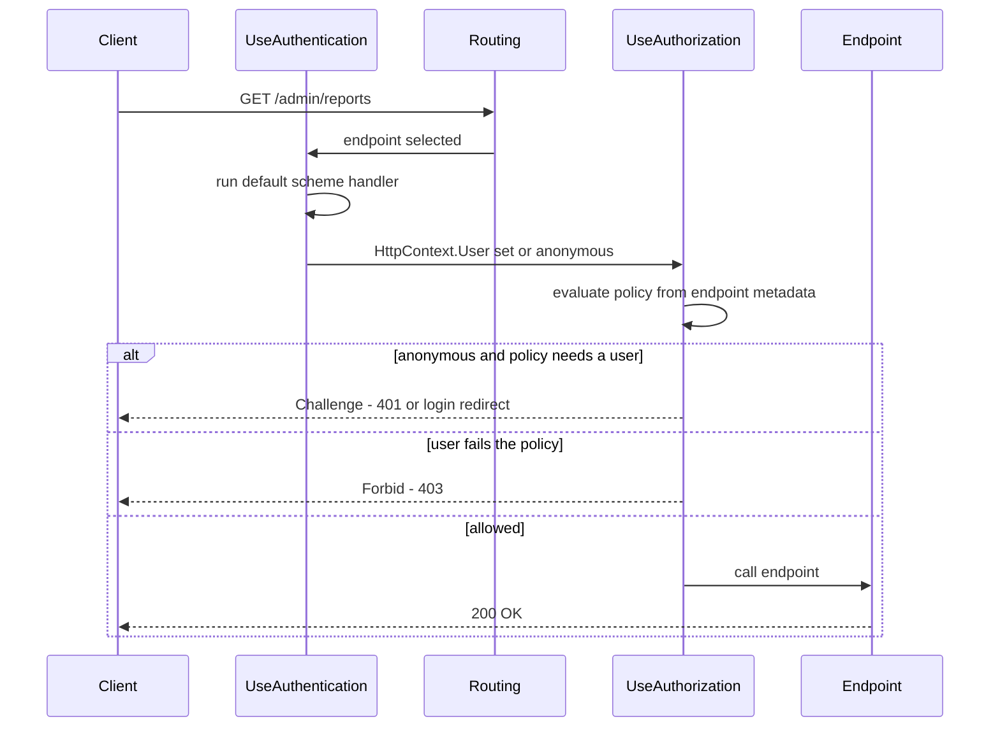
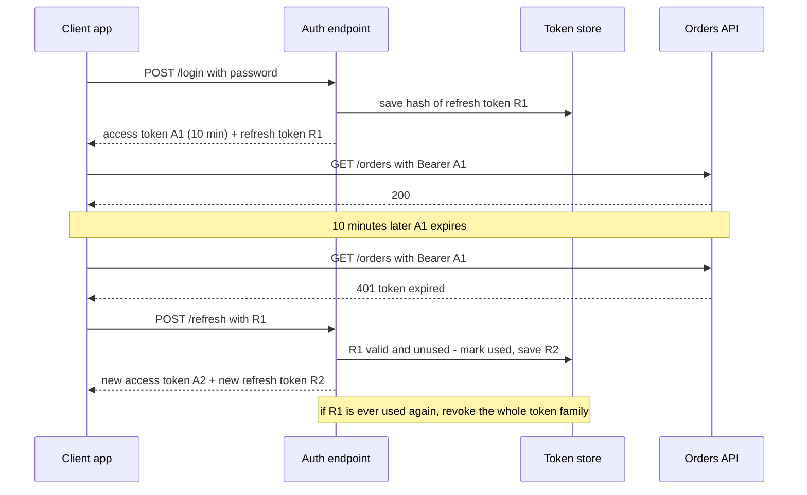
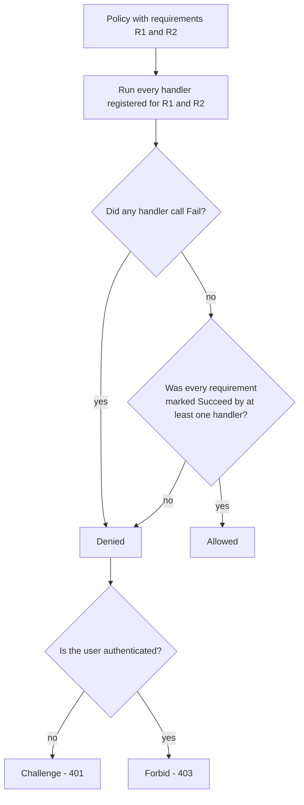

# Authentication and Authorization in ASP.NET Core

> In this document you will learn how ASP.NET Core proves who a caller is (authentication) and decides what the caller may do (authorization): schemes and handlers, cookies and JWT bearer tokens, refresh tokens, ASP.NET Core Identity, OpenID Connect, policies, requirements and resource-based checks, the Data Protection API, CORS, antiforgery and secret storage. Auth questions appear in almost every .NET backend interview, because a small mistake here becomes a security incident.

**Before this:** [ASP.NET Core fundamentals and middleware](07-aspnet-core-fundamentals-and-middleware.md) · [Dependency injection in ASP.NET Core](08-dependency-injection-in-aspnet-core.md) · [Authentication and authorization concepts (Node.js)](../07-nodejs-backend/09-authentication-and-authorization.md) · **Interview questions:** [jump to the interview section](#interview-questions)

## Table of contents

1. [Authentication vs authorization in ASP.NET Core](#authentication-vs-authorization-in-aspnet-core)
2. [Claims, identities and principals](#claims-identities-and-principals)
3. [Schemes and handlers](#schemes-and-handlers)
4. [Middleware order](#middleware-order)
5. [Cookie authentication](#cookie-authentication)
6. [JWT bearer authentication](#jwt-bearer-authentication)
7. [Issuing your own JWTs](#issuing-your-own-jwts)
8. [Refresh tokens](#refresh-tokens)
9. [Cookies or JWT: how to choose](#cookies-or-jwt-how-to-choose)
10. [ASP.NET Core Identity](#aspnet-core-identity)
11. [OpenID Connect with Entra ID and other providers](#openid-connect-with-entra-id-and-other-providers)
12. [A custom authentication handler](#a-custom-authentication-handler)
13. [Using several schemes in one app](#using-several-schemes-in-one-app)
14. [Authorization basics: Authorize, AllowAnonymous and fallback policies](#authorization-basics-authorize-allowanonymous-and-fallback-policies)
15. [Roles, claims and policies](#roles-claims-and-policies)
16. [Requirements and handlers](#requirements-and-handlers)
17. [Resource-based authorization](#resource-based-authorization)
18. [The Data Protection API](#the-data-protection-api)
19. [CORS in ASP.NET Core](#cors-in-aspnet-core)
20. [Antiforgery and CSRF](#antiforgery-and-csrf)
21. [Secrets: user secrets, environment variables and Key Vault](#secrets-user-secrets-environment-variables-and-key-vault)
22. [How to explain this in an interview](#how-to-explain-this-in-an-interview)
23. [Common mistakes](#common-mistakes)
24. [Best practices](#best-practices)
25. [Interview questions](#interview-questions)
26. [Summary](#summary)
27. [References](#references)

---

## Authentication vs authorization in ASP.NET Core

- **Authentication (AuthN)** answers "**who are you?**". The caller sends proof: a cookie, a bearer token, an API key or a client certificate. ASP.NET Core turns that proof into a user object.
- **Authorization (AuthZ)** answers "**what may you do?**". ASP.NET Core checks that user against a rule: a role, a claim, a policy, or a rule about a specific resource.

The general ideas (password hashing, sessions vs tokens, OAuth 2.0, OIDC, RBAC vs ABAC) are explained in the [Node.js authentication document](../07-nodejs-backend/09-authentication-and-authorization.md). This document focuses on how ASP.NET Core implements them.

| | Authentication | Authorization |
| --- | --- | --- |
| Question | Who is calling? | May this caller do this? |
| ASP.NET Core service | `AddAuthentication()` | `AddAuthorization()` |
| Middleware | `UseAuthentication()` | `UseAuthorization()` |
| Result | `HttpContext.User` (a `ClaimsPrincipal`) | Allow, or **challenge** (401) / **forbid** (403) |
| Example | Read the JWT and create a user with ID 42 | "Only admins can call `DELETE /products/{id}`" |

**Analogy:** An office building. At the entrance, security checks your badge and writes your name and department on a visitor sheet — that is authentication. Each door then has a rule: "only Finance", "only managers", "only the owner of this office" — that is authorization. If you have no badge, security sends you to the front desk (401, "please log in"). If you have a badge but the door is not for you, the door stays closed (403, "you are known, but not allowed").

**If you know Express:** In Express you write `authenticate` middleware that sets `req.user`, then permission middleware. ASP.NET Core gives you the same two steps as built-in middleware. `HttpContext.User` is the equivalent of `req.user`.

## Claims, identities and principals

ASP.NET Core does not use a "User" class for the current caller. It uses **claims**.

- A **claim** is one fact about the caller, as a type and a value. Example: `name = "nina"`, `role = "Admin"`, `tenant_id = "acme"`.
- A **`ClaimsIdentity`** is a set of claims that came from one source (one scheme). Example: "the claims we read from this cookie".
- A **`ClaimsPrincipal`** is the caller. It holds one or more identities. `HttpContext.User` is a `ClaimsPrincipal`.

```csharp
using System.Security.Claims;

var claims = new List<Claim>
{
    new(ClaimTypes.NameIdentifier, "42"),   // the user ID
    new(ClaimTypes.Name, "nina"),
    new(ClaimTypes.Role, "Admin"),
    new("tenant_id", "acme"),               // custom claim
};
var identity = new ClaimsIdentity(claims, authenticationType: "Cookies");
var user = new ClaimsPrincipal(identity);

Console.WriteLine(user.Identity!.IsAuthenticated);            // True
Console.WriteLine(user.Identity.Name);                        // nina
Console.WriteLine(user.IsInRole("Admin"));                    // True
Console.WriteLine(user.FindFirstValue("tenant_id"));          // acme
Console.WriteLine(user.FindFirstValue(ClaimTypes.NameIdentifier)); // 42
```

Two details that often cause bugs:

1. `IsAuthenticated` is `true` only when the identity has an **authentication type** (the second constructor argument). `new ClaimsIdentity(claims)` without it gives an identity that is **not** authenticated.
2. `ClaimTypes.Role` is a long URI (`http://schemas.microsoft.com/ws/2008/06/identity/claims/role`). `IsInRole` looks at the identity's `RoleClaimType`. If your token has a short `"role"` claim and nobody maps it, `IsInRole` returns `false`. You will see this again in the JWT section.

## Schemes and handlers

### What a scheme is

An **authentication scheme** is a named configuration of an **authentication handler**. The handler is the class that knows how to read one kind of proof.

| Scheme name (default) | Handler | Reads | Package |
| --- | --- | --- | --- |
| `Cookies` | `CookieAuthenticationHandler` | An encrypted auth cookie | Built in |
| `Bearer` | `JwtBearerHandler` | `Authorization: Bearer <JWT>` | `Microsoft.AspNetCore.Authentication.JwtBearer` |
| `OpenIdConnect` | `OpenIdConnectHandler` | Redirect login with an identity provider | `Microsoft.AspNetCore.Authentication.OpenIdConnect` |
| `BearerToken` | `BearerTokenHandler` (.NET 8+) | Opaque Identity API tokens | Built in |
| Your own name | Your `AuthenticationHandler<T>` | Anything (API key, header) | Built in base class |

### What a handler does

Every handler can do some of these **actions**:

| Action | Meaning | Cookie handler | JWT bearer handler |
| --- | --- | --- | --- |
| **Authenticate** | Read the request and build a `ClaimsPrincipal` | Decrypt the cookie | Validate the token |
| **Challenge** | "You are not logged in" | Redirect to the login page (or 401 for APIs) | 401 + `WWW-Authenticate: Bearer` |
| **Forbid** | "You are logged in, but not allowed" | Redirect to access denied (or 403 for APIs) | 403 |
| **Sign in** | Persist the identity | Write the cookie | Not supported (tokens come from elsewhere) |
| **Sign out** | Remove the identity | Delete the cookie | Not supported |

### Registering schemes

```csharp
var builder = WebApplication.CreateBuilder(args);

builder.Services
    .AddAuthentication(CookieAuthenticationDefaults.AuthenticationScheme) // default scheme
    .AddCookie();                 // registers the "Cookies" scheme

builder.Services.AddAuthorization();
```

The string passed to `AddAuthentication` is the **default scheme**. It is used when nothing else says which scheme to run. Since .NET 7, if you register exactly one scheme, it becomes the default automatically. With two or more schemes you must choose one, or the app throws "No authenticationScheme was specified" when a challenge happens.

### How it works inside

1. `UseAuthentication()` runs the **default authenticate scheme** for every request. If the proof is valid, it sets `HttpContext.User`. If there is no proof, the user stays anonymous. **Authentication middleware never rejects a request by itself.**
2. Routing has already chosen the endpoint, so `UseAuthorization()` can read the endpoint's metadata (`[Authorize]`, `RequireAuthorization("AdminOnly")`).
3. The authorization middleware evaluates the policy. If the user is anonymous and the policy needs a user, it calls **Challenge**. If the user is known but fails the policy, it calls **Forbid**.
4. If everything passes, the endpoint runs.



## Middleware order

Order matters because each middleware sees only what earlier middleware has prepared.

```csharp
var app = builder.Build();

app.UseExceptionHandler("/error");
app.UseHttpsRedirection();
app.UseStaticFiles();      // static files usually do not need auth
app.UseRouting();          // optional in minimal apps: WebApplication adds it for you
app.UseCors("Frontend");   // after routing, before auth
app.UseAuthentication();   // who is calling?
app.UseAuthorization();    // may they call this endpoint?
app.UseAntiforgery();      // after auth (.NET 8+)

app.MapControllers();
app.MapGet("/me", (ClaimsPrincipal user) => user.Identity!.Name).RequireAuthorization();
app.Run();
```

`WebApplication` (since .NET 7) adds `UseAuthentication` and `UseAuthorization` automatically when the services are registered and you did not call them yourself. Most real projects still call them explicitly, because it makes the order visible and lets you place CORS and other middleware correctly.

### Wrong order: an output example

This app signs in with a cookie, then calls a protected endpoint. The only change between the two runs is the order of the two middleware calls.

```csharp
if (wrongOrder) { app.UseAuthorization(); app.UseAuthentication(); } // ❌ Wrong
else            { app.UseAuthentication(); app.UseAuthorization(); } // ✅ Correct

app.MapPost("/login", async (HttpContext ctx) =>
{
    await ctx.SignInAsync(new ClaimsPrincipal(
        new ClaimsIdentity([new Claim(ClaimTypes.Name, "bob")], "Cookies")));
    return Results.Ok("ok");
});
app.MapGet("/me", (ClaimsPrincipal u) => Results.Ok(u.Identity!.Name)).RequireAuthorization();
```

Output (run with the .NET 10 SDK):

```text
Authentication then Authorization: GET /me -> 200 "bob"
Authorization before Authentication: GET /me -> 302
```

**Why:** in the wrong order, the authorization middleware runs while `HttpContext.User` is still anonymous, because the cookie has not been read yet. The policy needs a user, so it calls Challenge, and the cookie handler redirects to the login page. The cookie was valid all the time. This bug looks like "my login does not work" and wastes hours.

## Cookie authentication

### What it is

With **cookie authentication**, the server creates a `ClaimsPrincipal` at login, **encrypts** it with the Data Protection API, and stores it in a cookie. On each request, the cookie handler decrypts the cookie and rebuilds the user. The server does not need a session store, because the claims travel inside the encrypted cookie.

**If you know Express:** this is like `express-session` with a cookie store, except the ticket is encrypted and signed by ASP.NET Core. You can add a server-side `ITicketStore` if you want only a small ID in the cookie.

### Example: login, roles and policies

```csharp
using System.Security.Claims;
using Microsoft.AspNetCore.Authentication;
using Microsoft.AspNetCore.Authentication.Cookies;

var builder = WebApplication.CreateBuilder(args);

builder.Services.AddAuthentication(CookieAuthenticationDefaults.AuthenticationScheme)
    .AddCookie(o =>
    {
        o.Cookie.Name = "shop.auth";
        o.ExpireTimeSpan = TimeSpan.FromHours(8);
        o.SlidingExpiration = true;     // renew when more than half the time has passed
    });

builder.Services.AddAuthorizationBuilder()
    .AddPolicy("AdminOnly", p => p.RequireRole("Admin"))
    .AddPolicy("SupportStaff", p => p.RequireClaim("department", "Support", "Billing"));

var app = builder.Build();
app.UseAuthentication();
app.UseAuthorization();

app.MapPost("/login", async (HttpContext ctx, string user) =>
{
    // Demo only: a real app verifies a password first (see the Identity section).
    var claims = new List<Claim>
    {
        new(ClaimTypes.NameIdentifier, "42"),
        new(ClaimTypes.Name, user),
        new("department", "Support"),
    };
    if (user == "alice") claims.Add(new Claim(ClaimTypes.Role, "Admin"));

    var identity = new ClaimsIdentity(claims, CookieAuthenticationDefaults.AuthenticationScheme);
    await ctx.SignInAsync(new ClaimsPrincipal(identity));   // writes the cookie
    return Results.Ok(new { message = $"Signed in as {user}" });
});

app.MapGet("/me", (ClaimsPrincipal user) =>
        new { name = user.Identity!.Name, isAdmin = user.IsInRole("Admin") })
    .RequireAuthorization();
app.MapGet("/admin", () => new { secret = "admin data" }).RequireAuthorization("AdminOnly");
app.MapGet("/support", () => new { tickets = 3 }).RequireAuthorization("SupportStaff");
app.MapGet("/page", () => Results.Content("<h1>html page</h1>", "text/html")).RequireAuthorization();
app.MapPost("/logout", async (HttpContext ctx) => { await ctx.SignOutAsync(); return Results.NoContent(); });

app.Run();
```

A test client called each endpoint as an anonymous user, as `bob` and as `alice`. Output with .NET 10 (the client does not follow redirects; `Location` is shown when present):

```text
[anonymous] GET /me      -> 401
[anonymous] GET /admin   -> 401
[anonymous] GET /support -> 401
[anonymous] GET /page    -> 302 /Account/Login?ReturnUrl=%2Fpage
[bob] POST /login        -> 200 {"message":"Signed in as bob"}
[bob] GET /me            -> 200 {"name":"bob","isAdmin":false}
[bob] GET /admin         -> 403
[bob] GET /support       -> 200 {"tickets":3}
[bob] GET /page          -> 200 <h1>html page</h1>
[alice] POST /login      -> 200 {"message":"Signed in as alice"}
[alice] GET /me          -> 200 {"name":"alice","isAdmin":true}
[alice] GET /admin       -> 200 {"secret":"admin data"}
```

Step by step:

1. Anonymous calls: there is no cookie, so the user is anonymous and authorization calls **Challenge**. JSON endpoints get **401**; the HTML endpoint `/page` gets a **302 redirect** to the login page.
2. `bob` signs in. `SignInAsync` writes the encrypted `shop.auth` cookie, and the client sends it back on every request.
3. `bob` calls `/admin`. He is authenticated but not in the `Admin` role, so authorization calls **Forbid**: 403. He passes `SupportStaff` because his `department` claim is `Support`.
4. `alice` has the `Admin` role claim and passes every policy.

> **New in .NET 10:** For known **API endpoints**, cookie authentication returns 401 and 403 instead of redirecting to the login page. API endpoints are `[ApiController]` controllers, minimal APIs that read or write JSON, endpoints that return `TypedResults`, and SignalR hubs. In **.NET 8 and 9**, the cookie handler redirects every challenge with a 302, so SPAs and API clients saw an HTML login page instead of a 401. The old fix was to override `options.Events.OnRedirectToLogin` and `OnRedirectToAccessDenied` to set the status code. You will still see that code in many projects.

### Important cookie options

| Option | Default | What to do |
| --- | --- | --- |
| `Cookie.HttpOnly` | `true` | Keep it. JavaScript cannot read the cookie, so XSS cannot steal it. |
| `Cookie.SecurePolicy` | `SameAsRequest` | Set `Always` in production so the cookie is never sent over HTTP. |
| `Cookie.SameSite` | `Lax` | `Lax` blocks most cross-site POSTs. `Strict` is stronger. `None` needs `Secure` and is only for cross-site setups. |
| `ExpireTimeSpan` | 14 days | Shorten it for sensitive apps. |
| `SlidingExpiration` | `true` | Renews the cookie on activity. |
| `LoginPath`, `AccessDeniedPath` | `/Account/Login`, `/Account/AccessDenied` | Set them for MVC/Razor apps. |
| `Events.OnValidatePrincipal` | none | Re-check the user (for example "security stamp changed") so you can revoke cookies. |

**Revocation:** A cookie ticket is valid until it expires, even if you delete the user. To revoke early, either validate a **security stamp** in `OnValidatePrincipal` (ASP.NET Core Identity does this for you every 30 minutes by default), or store tickets on the server with `ITicketStore` and delete them.

**Several servers:** the cookie is encrypted with Data Protection keys. All servers must share the same key ring, or a cookie created on server A cannot be read on server B. See [the Data Protection API](#the-data-protection-api).

## JWT bearer authentication

### What it is

A **JWT** (JSON Web Token) is a string with three Base64Url parts: `header.payload.signature`. The payload holds claims. The signature proves that the token was created by someone with the signing key and was not changed. A JWT is **signed, not encrypted**: anyone with the token can read the payload.

The **JWT bearer handler** reads `Authorization: Bearer <token>`, validates the token and creates `HttpContext.User` from its claims. The theory of JWTs (algorithms, pitfalls, revocation) is in the [Node.js auth document](../07-nodejs-backend/09-authentication-and-authorization.md). Here is the ASP.NET Core side.

### A JWT by hand

This program builds an HS256 JWT with only the base class library, so you can see what the libraries do for you:

```csharp
using System.Security.Cryptography;
using System.Text;
using System.Text.Json;

static string B64(byte[] b) => Convert.ToBase64String(b).TrimEnd('=').Replace('+', '-').Replace('/', '_');

var key = RandomNumberGenerator.GetBytes(32);   // 256-bit secret for HS256
var header = B64(JsonSerializer.SerializeToUtf8Bytes(new { alg = "HS256", typ = "JWT" }));
var payload = B64(JsonSerializer.SerializeToUtf8Bytes(new
{
    sub = "42", name = "nina", role = "Customer",
    iss = "https://auth.shop.example", aud = "shop-api",
    exp = DateTimeOffset.UtcNow.AddMinutes(15).ToUnixTimeSeconds(),
}));
var signature = B64(HMACSHA256.HashData(key, Encoding.ASCII.GetBytes($"{header}.{payload}")));
var jwt = $"{header}.{payload}.{signature}";

Console.WriteLine(jwt.Split('.').Length);   // 3
Console.WriteLine(header);                  // eyJhbGciOiJIUzI1NiIsInR5cCI6IkpXVCJ9
// Decoding the payload needs no key: {"sub":"42","name":"nina","role":"Customer",...}
// Changing one character of the payload makes the signature check fail.
```

Output from the run: three parts, a readable payload, `Signature valid for original: True`, `Signature valid for tampered: False`. This is the whole point of a JWT: **integrity, not secrecy**. Never put passwords, card numbers or other secrets in a JWT.

### Configuring the JWT bearer handler

The handler is in the `Microsoft.AspNetCore.Authentication.JwtBearer` NuGet package (not run here).

**Case 1: tokens come from an identity provider** (Entra ID, Auth0, Keycloak, Duende IdentityServer). This is the normal case.

```csharp
builder.Services.AddAuthentication(JwtBearerDefaults.AuthenticationScheme)
    .AddJwtBearer(options =>
    {
        options.Authority = "https://login.example.com/tenant-id/v2.0"; // issuer base URL
        options.Audience = "api://shop-api";                            // this API
        // The handler downloads /.well-known/openid-configuration and the JWKS
        // (public signing keys) from the Authority, caches them and refreshes them.
        options.TokenValidationParameters = new TokenValidationParameters
        {
            ValidateIssuer = true,
            ValidateAudience = true,
            ValidateLifetime = true,
            ClockSkew = TimeSpan.FromSeconds(30),   // default is 5 minutes
            NameClaimType = "name",
            RoleClaimType = "roles",
        };
    });
```

**Case 2: your own service signs tokens with a symmetric key** (simple internal systems).

```csharp
var signingKey = new SymmetricSecurityKey(
    Convert.FromBase64String(builder.Configuration["Jwt:SigningKey"]!)); // from a secret store

builder.Services.AddAuthentication(JwtBearerDefaults.AuthenticationScheme)
    .AddJwtBearer(options =>
    {
        options.MapInboundClaims = false;   // keep "sub", "role" as they are in the token
        options.TokenValidationParameters = new TokenValidationParameters
        {
            ValidIssuer = "https://auth.shop.example",
            ValidAudience = "shop-api",
            IssuerSigningKey = signingKey,
            ValidAlgorithms = [SecurityAlgorithms.HmacSha256],  // algorithm allowlist
            ClockSkew = TimeSpan.FromSeconds(30),
            NameClaimType = "name",
            RoleClaimType = "role",
        };
    });
```

### TokenValidationParameters: what each check protects

| Setting | Protects against |
| --- | --- |
| `IssuerSigningKey(s)` or `Authority` (JWKS) | Forged tokens: the signature must match a trusted key |
| `ValidIssuer` / `ValidateIssuer` | Tokens from a different identity provider or tenant |
| `ValidAudience` / `ValidateAudience` | A token for another API being replayed against yours |
| `ValidateLifetime` + `ClockSkew` | Expired tokens (`exp`) and tokens not yet valid (`nbf`) |
| `ValidAlgorithms` | Algorithm confusion attacks (for example `none` or swapping RS256 for HS256) |
| `RequireSignedTokens` (default `true`) | Unsigned tokens |

**Clock skew:** servers' clocks are never exactly equal. `ClockSkew` adds tolerance when checking `exp` and `nbf`. The default is **5 minutes**, so a token with a 5-minute lifetime is really accepted for up to 10 minutes. Many teams lower it to 30–60 seconds.

**Claim mapping:** by default (`MapInboundClaims = true`), the handler renames short JWT claim names to long Microsoft URIs: `sub` becomes `ClaimTypes.NameIdentifier` and `role` becomes `ClaimTypes.Role`. This is confusing when you read `User.FindFirst("sub")` and get `null`. Either keep the mapping and use `ClaimTypes.*`, or set `MapInboundClaims = false` and set `NameClaimType` and `RoleClaimType` yourself. Pick one approach for the whole system.

> **New in .NET 8:** The JWT bearer handler uses `JsonWebTokenHandler` (from `Microsoft.IdentityModel.JsonWebTokens`) instead of the older `JwtSecurityTokenHandler`. It is faster. In event handlers, `context.SecurityToken` is now a `JsonWebToken`, not a `JwtSecurityToken`, which breaks old code that casts it.

### Symmetric vs asymmetric signing keys

| | Symmetric (HS256) | Asymmetric (RS256, ES256) |
| --- | --- | --- |
| Keys | One shared secret signs and verifies | Private key signs, public key verifies |
| Who can create tokens | Everyone who can verify | Only the holder of the private key |
| Key distribution | The secret must reach every API | Public keys are published as JWKS |
| Rotation | Hard: update every service at once | Easy: publish a new key with a new `kid`, keep the old one for a while |
| Use when | One service issues and checks its own tokens | Identity providers, many APIs, microservices |

### Local testing with dotnet user-jwts

Since .NET 7, the SDK has a tool that creates development tokens and writes the validation settings into your user secrets:

```bash
dotnet user-jwts create --name nina --role Admin --scope "orders:read"
# prints a token; the API project now accepts it in Development
curl -H "Authorization: Bearer <token>" https://localhost:5001/orders
```

The JWT bearer handler also reads settings from the configuration section `Authentication:Schemes:Bearer` (for example `ValidAudiences` and `ValidIssuer`), which is how `user-jwts` configures it.

## Issuing your own JWTs

Usually an identity provider issues tokens. Sometimes a small system issues its own, for example a mobile app backend without an external IdP. Then you write a token service (not run here; needs the `Microsoft.IdentityModel.JsonWebTokens` package):

```csharp
public sealed class TokenService(IOptions<JwtOptions> options, TimeProvider clock)
{
    private readonly JsonWebTokenHandler _handler = new();

    public string CreateAccessToken(AppUser user)
    {
        var o = options.Value;
        var now = clock.GetUtcNow().UtcDateTime;
        var descriptor = new SecurityTokenDescriptor
        {
            Issuer = o.Issuer,
            Audience = o.Audience,
            IssuedAt = now,
            NotBefore = now,
            Expires = now.AddMinutes(10),                  // short-lived access token
            Subject = new ClaimsIdentity(
            [
                new Claim("sub", user.Id),
                new Claim("name", user.UserName),
                new Claim("jti", Guid.NewGuid().ToString()),   // unique token ID
                .. user.Roles.Select(r => new Claim("role", r)),
            ]),
            SigningCredentials = new SigningCredentials(o.SigningKey, SecurityAlgorithms.HmacSha256),
        };
        return _handler.CreateToken(descriptor);
    }
}
```

Keep access tokens short (5–15 minutes), put only IDs and coarse roles in them, and load the signing key from a secret store. Prefer an identity provider when you need SSO, MFA, social login or many clients — a token server is security-critical work.

## Refresh tokens

A short access token is safer, but users do not want to log in every 10 minutes. A **refresh token** is a long-lived, random, single-use credential that the client exchanges for a new access token.



A minimal refresh endpoint (sketch; the EF Core store is not run here):

```csharp
app.MapPost("/auth/refresh", async (RefreshRequest req, AuthDbContext db, TokenService tokens, TimeProvider clock) =>
{
    var hash = Convert.ToHexString(SHA256.HashData(Encoding.UTF8.GetBytes(req.RefreshToken)));
    var stored = await db.RefreshTokens.Include(t => t.User).SingleOrDefaultAsync(t => t.TokenHash == hash);

    if (stored is null || stored.RevokedAt is not null || stored.ExpiresAt < clock.GetUtcNow())
        return Results.Unauthorized();           // unknown, revoked (family killed) or expired

    if (stored.UsedAt is not null)               // reuse = probably stolen
    {
        await db.RefreshTokens.Where(t => t.FamilyId == stored.FamilyId)
            .ExecuteUpdateAsync(s => s.SetProperty(t => t.RevokedAt, clock.GetUtcNow()));
        return Results.Unauthorized();
    }

    stored.UsedAt = clock.GetUtcNow();           // rotate: old token can never be used again
    var (newRefresh, newEntity) = tokens.CreateRefreshToken(stored.User, stored.FamilyId);
    db.RefreshTokens.Add(newEntity);
    await db.SaveChangesAsync();                 // add a concurrency token so two refreshes cannot both win

    return Results.Ok(new { accessToken = tokens.CreateAccessToken(stored.User), refreshToken = newRefresh });
});
```

Key points:

- Store only a **hash** of the refresh token, like a password. A database leak then does not leak usable tokens.
- **Rotate** on every use. **Reuse detection**: if an already-used token comes back, someone copied it, so revoke the whole family.
- For browser apps, keep the refresh token in an `HttpOnly`, `Secure`, `SameSite` cookie, or keep all tokens on the server with a BFF (next section).

## Cookies or JWT: how to choose

| Situation | Good choice | Why |
| --- | --- | --- |
| Server-rendered MVC/Razor app | Cookie auth | Browser sends cookies automatically, easy sign-out |
| SPA (Angular, React) on the **same site** as the API | Cookie auth (HttpOnly) + antiforgery | No token in JavaScript, so XSS cannot steal it |
| SPA with an external identity provider | **BFF**: the backend does OIDC and keeps tokens; the browser gets a cookie | Tokens never reach the browser |
| Mobile or desktop app | OIDC + JWT access tokens + refresh tokens | No browser cookie jar; standard flows (PKCE) |
| Service-to-service calls | JWT from client credentials flow, or mTLS | No user; machine identity |
| Third-party developers | API keys or OAuth client credentials | Simple to hand out, easy to rotate |

**BFF (Backend for Frontend):** the ASP.NET Core backend uses the OpenID Connect handler to log in, stores tokens server-side, and gives the browser only a cookie. It calls downstream APIs with the access token. The architecture is explained in [Auth architecture and multi-tenancy](../09-system-design/06-auth-architecture-and-multi-tenancy.md).

## ASP.NET Core Identity

### What it is

**ASP.NET Core Identity** is a membership system: users, password hashes, roles, claims, lockout, email confirmation, password reset, two-factor authentication and external logins. It stores data through stores, usually EF Core (`Microsoft.AspNetCore.Identity.EntityFrameworkCore`).

Important: Identity is **not** an identity provider like Entra ID. It is a user database plus sign-in logic inside your app. It signs users in with cookies (or, since .NET 8, opaque bearer tokens).

### Main services

| Service | Job |
| --- | --- |
| `UserManager<TUser>` | Create users, check passwords, manage roles, claims, tokens, lockout |
| `SignInManager<TUser>` | Password sign-in, 2FA sign-in, external sign-in, writes the cookie |
| `RoleManager<TRole>` | Manage roles |
| `IPasswordHasher<TUser>` | Hash and verify passwords |

### Password hashing

The default `PasswordHasher<TUser>` uses **PBKDF2 with HMAC-SHA512, 100,000 iterations and a random 128-bit salt** (the defaults since .NET 7). It is in the shared framework, so this runs without packages:

```csharp
using Microsoft.AspNetCore.Identity;

var hasher = new PasswordHasher<AppUser>();
var user = new AppUser("nina");

string hash = hasher.HashPassword(user, "Correct-Horse-9");
Console.WriteLine(hash[..10] + "...");   // AQAAAAIAAY... (84 characters)
Console.WriteLine(hash == hasher.HashPassword(user, "Correct-Horse-9")); // False - new salt each time
Console.WriteLine(hasher.VerifyHashedPassword(user, hash, "Correct-Horse-9")); // Success
Console.WriteLine(hasher.VerifyHashedPassword(user, hash, "wrong"));           // Failed

record AppUser(string UserName);
```

Output from the run: the hash starts with format byte `0x01` (version 3), `prf=2` (HMAC-SHA512), `iterations=100000`, `saltLen=16`. The same password gives a different hash each time because of the salt. `VerifyHashedPassword` can also return `SuccessRehashNeeded` when the stored hash uses old settings; `UserManager` then upgrades the hash automatically.

### Typical registration and login with Identity

```csharp
builder.Services.AddDbContext<AppDbContext>(o => o.UseSqlServer(connectionString));
builder.Services.AddIdentity<AppUser, IdentityRole>(o =>
    {
        o.Password.RequiredLength = 12;
        o.Lockout.MaxFailedAccessAttempts = 5;
        o.Lockout.DefaultLockoutTimeSpan = TimeSpan.FromMinutes(15);
        o.User.RequireUniqueEmail = true;
        o.SignIn.RequireConfirmedEmail = true;
    })
    .AddEntityFrameworkStores<AppDbContext>()
    .AddDefaultTokenProviders();   // email confirmation, password reset, 2FA tokens

// In an endpoint or controller:
var result = await signInManager.PasswordSignInAsync(email, password,
    isPersistent: false, lockoutOnFailure: true);
if (result.Succeeded)         return Results.Ok();
if (result.RequiresTwoFactor) return Results.Ok(new { requires2fa = true });
if (result.IsLockedOut)       return Results.Problem("Account locked. Try again later.", statusCode: 423);
return Results.Unauthorized();   // same message for "no such user" and "wrong password"
```

### Identity API endpoints (.NET 8+)

For SPAs and mobile apps, .NET 8 added ready-made JSON endpoints:

```csharp
builder.Services.AddAuthorization();
builder.Services.AddDbContext<AppDbContext>(o => o.UseSqlite("Data Source=app.db"));
builder.Services.AddIdentityApiEndpoints<IdentityUser>()
    .AddEntityFrameworkStores<AppDbContext>();

var app = builder.Build();
app.MapIdentityApi<IdentityUser>();   // adds the endpoints below
app.MapGet("/orders", () => "your orders").RequireAuthorization();
```

`MapIdentityApi` maps `POST /register`, `POST /login`, `POST /refresh`, `GET /confirmEmail`, `POST /resendConfirmationEmail`, `POST /forgotPassword`, `POST /resetPassword`, `POST /manage/2fa`, `GET /manage/info` and `POST /manage/info`.

- `POST /login?useCookies=true` signs in with a cookie (best for browser apps on the same site).
- `POST /login` without it returns `{ tokenType, accessToken, expiresIn, refreshToken }`.
- The tokens are **not JWTs**. They are opaque tokens protected by Data Protection, meant for simple first-party apps. Microsoft says this is not a full token server. For SSO, many clients or third-party APIs, use an OIDC provider.

> **New in .NET 10:** ASP.NET Core Identity supports **passkeys** (WebAuthn/FIDO2) for sign-in, and the Blazor Web App template includes passkey management. Passkeys are phishing-resistant because the browser binds them to the site's origin.

## OpenID Connect with Entra ID and other providers

**OpenID Connect (OIDC)** is a login protocol on top of OAuth 2.0. The user logs in at the identity provider; your app receives an **ID token** (who the user is) and an **access token** (what the app may call). The flow (authorization code + PKCE) is explained in [Auth architecture and multi-tenancy](../09-system-design/06-auth-architecture-and-multi-tenancy.md).

In ASP.NET Core, a web app (or a BFF) combines the OIDC handler for login with the cookie handler for the session (package `Microsoft.AspNetCore.Authentication.OpenIdConnect`, not run here):

```csharp
builder.Services.AddAuthentication(o =>
    {
        o.DefaultScheme = CookieAuthenticationDefaults.AuthenticationScheme;          // read the session cookie
        o.DefaultChallengeScheme = OpenIdConnectDefaults.AuthenticationScheme;         // not logged in: go to the IdP
    })
    .AddCookie(o => { o.Cookie.SameSite = SameSiteMode.Lax; o.Cookie.SecurePolicy = CookieSecurePolicy.Always; })
    .AddOpenIdConnect(o =>
    {
        o.Authority = "https://login.microsoftonline.com/<tenant-id>/v2.0";
        o.ClientId = builder.Configuration["Oidc:ClientId"];
        o.ClientSecret = builder.Configuration["Oidc:ClientSecret"];   // from a secret store
        o.ResponseType = "code";       // authorization code flow (PKCE is on by default)
        o.SaveTokens = true;           // keep tokens in the auth ticket for calling APIs
        o.Scope.Add("api://orders-api/orders.read");
        o.MapInboundClaims = false;
        o.TokenValidationParameters.NameClaimType = "name";
        o.TokenValidationParameters.RoleClaimType = "roles";
    });
```

How it works: an anonymous user hits a protected page, authorization challenges with the OIDC scheme, and the handler redirects to the IdP. After login, the IdP redirects back to `/signin-oidc` with a code. The handler exchanges the code for tokens, validates the ID token and signs the user in with the **cookie** scheme. From then on, only the cookie is used.

For Microsoft Entra ID, the `Microsoft.Identity.Web` library wraps this and adds token caching for calling downstream APIs (`AddMicrosoftIdentityWebApp`, `AddMicrosoftIdentityWebApi`). Social logins (Google, Microsoft account, GitHub) are separate handler packages such as `Microsoft.AspNetCore.Authentication.Google`.

## A custom authentication handler

When the built-in handlers do not fit (an API key header, a signed webhook, a legacy token), write your own handler by inheriting `AuthenticationHandler<TOptions>`.

```csharp
using System.Security.Claims;
using System.Text.Encodings.Web;
using Microsoft.AspNetCore.Authentication;
using Microsoft.Extensions.Options;

public class ApiKeyHandler(
    IOptionsMonitor<AuthenticationSchemeOptions> options,
    ILoggerFactory logger,
    UrlEncoder encoder,
    IApiKeyStore keys)                       // your service: looks up hashed keys
    : AuthenticationHandler<AuthenticationSchemeOptions>(options, logger, encoder)
{
    protected override async Task<AuthenticateResult> HandleAuthenticateAsync()
    {
        if (!Request.Headers.TryGetValue("X-Api-Key", out var key))
            return AuthenticateResult.NoResult();          // no proof: let other schemes or anonymous continue

        var client = await keys.FindByKeyAsync(key.ToString());
        if (client is null)
            return AuthenticateResult.Fail("Invalid API key"); // proof present but wrong

        var claims = new[]
        {
            new Claim(ClaimTypes.NameIdentifier, client.Id),
            new Claim(ClaimTypes.Name, client.Name),
            new Claim("account_created", client.CreatedAt.ToString("O")),
        };
        var principal = new ClaimsPrincipal(new ClaimsIdentity(claims, Scheme.Name));
        return AuthenticateResult.Success(new AuthenticationTicket(principal, Scheme.Name));
    }

    protected override Task HandleChallengeAsync(AuthenticationProperties properties)
    {
        Response.StatusCode = StatusCodes.Status401Unauthorized;
        Response.Headers.WWWAuthenticate = "ApiKey";
        return Task.CompletedTask;
    }
}

// Registration
builder.Services.AddAuthentication("ApiKey")
    .AddScheme<AuthenticationSchemeOptions, ApiKeyHandler>("ApiKey", null);
```

The three results of `HandleAuthenticateAsync`:

| Result | Meaning | Effect |
| --- | --- | --- |
| `NoResult()` | "This request has no proof for me" | User stays anonymous |
| `Fail("...")` | "Proof was sent, but it is invalid" | User stays anonymous; failure is logged |
| `Success(ticket)` | "Proof is valid" | `HttpContext.User` is set |

In a run (demo keys stored in a dictionary), the output was:

```text
GET /whoami key=none         -> 401  WWW-Authenticate: ApiKey
GET /whoami key=wrong        -> 401  WWW-Authenticate: ApiKey
GET /whoami key=key-new-user -> 200  nina via ApiKey
```

Note that `Fail` does **not** return 401 by itself. The 401 comes later, when authorization needs a user and calls Challenge. That is why a failed key on an `[AllowAnonymous]` endpoint still reaches the endpoint as anonymous.

**Real API keys:** generate them with `RandomNumberGenerator`, show them once, store only a hash (SHA-256 is fine for long random keys), keep a short prefix to find the record, and support rotation with two active keys.

## Using several schemes in one app

A real app often has more than one kind of caller: browsers with cookies, mobile apps with JWTs, partners with API keys.

**Option 1: choose the scheme per endpoint.**

```csharp
app.MapGet("/partner/orders", () => "...")
   .RequireAuthorization(new AuthorizeAttribute { AuthenticationSchemes = "ApiKey" });

[Authorize(AuthenticationSchemes = JwtBearerDefaults.AuthenticationScheme)]
public class MobileOrdersController : ControllerBase { }
```

**Option 2: a policy scheme that forwards based on the request.**

```csharp
builder.Services.AddAuthentication("Smart")
    .AddPolicyScheme("Smart", "Cookie or JWT", o =>
    {
        o.ForwardDefaultSelector = ctx =>
            ctx.Request.Headers.Authorization.ToString().StartsWith("Bearer ")
                ? JwtBearerDefaults.AuthenticationScheme
                : CookieAuthenticationDefaults.AuthenticationScheme;
    })
    .AddCookie()
    .AddJwtBearer();
```

**Option 3: a policy that accepts several schemes.**

```csharp
builder.Services.AddAuthorizationBuilder()
    .AddPolicy("ApiOrBrowser", p => p
        .AddAuthenticationSchemes(CookieAuthenticationDefaults.AuthenticationScheme, JwtBearerDefaults.AuthenticationScheme)
        .RequireAuthenticatedUser());
```

## Authorization basics: Authorize, AllowAnonymous and fallback policies

### Controllers and minimal APIs

```csharp
// Controllers
[ApiController]
[Route("api/orders")]
[Authorize]                                   // every action needs a logged-in user
public class OrdersController : ControllerBase
{
    [HttpGet] public IActionResult List() => Ok();

    [HttpDelete("{id:int}")]
    [Authorize(Roles = "Admin")]              // AND: logged in AND Admin
    public IActionResult Delete(int id) => NoContent();

    [HttpGet("public-stats")]
    [AllowAnonymous]                          // overrides [Authorize]
    public IActionResult Stats() => Ok();
}

// Minimal APIs
var orders = app.MapGroup("/api/orders").RequireAuthorization();       // whole group
orders.MapGet("/", () => "list");
orders.MapDelete("/{id:int}", (int id) => Results.NoContent()).RequireAuthorization("AdminOnly");
orders.MapGet("/public-stats", () => "stats").AllowAnonymous();
```

Rules to remember:

- Several `[Authorize]` attributes **combine with AND**. `[Authorize(Roles = "Admin")]` and `[Authorize(Policy = "EU")]` on the same endpoint means both must pass.
- Inside one attribute, `Roles = "Admin,Manager"` means **OR** (Admin or Manager).
- `[AllowAnonymous]` wins over every `[Authorize]`, even one on the controller. A misplaced `[AllowAnonymous]` opens an endpoint.

### Secure by default: the fallback policy

By default, an endpoint with no `[Authorize]` is public. Teams forget the attribute on new endpoints. The **fallback policy** applies to every endpoint that has no authorization metadata:

```csharp
builder.Services.AddAuthorizationBuilder()
    .SetFallbackPolicy(new AuthorizationPolicyBuilder()
        .RequireAuthenticatedUser()
        .Build());

// Now public endpoints must opt out explicitly:
app.MapGet("/health", () => "ok").AllowAnonymous();
```

The **default policy** is different: it is what a plain `[Authorize]` (with no policy name) uses. By default it is "require an authenticated user". You can change it with `SetDefaultPolicy`.

## Roles, claims and policies

### Role-based

```csharp
[Authorize(Roles = "Admin")]
app.MapGet("/admin", ...).RequireAuthorization(p => p.RequireRole("Admin"));
User.IsInRole("Admin");
```

Roles are simple but coarse. Many roles ("EuropeanBillingAdminReadOnly") is a sign that you need claims or permissions instead.

### Claim-based

```csharp
builder.Services.AddAuthorizationBuilder()
    .AddPolicy("EmployeesOnly", p => p.RequireClaim("employee_id"))                 // claim exists
    .AddPolicy("SupportStaff", p => p.RequireClaim("department", "Support", "Billing")) // value in list
    .AddPolicy("CanRefund", p => p.RequireClaim("permission", "orders.refund"));
```

### Policies

A **policy** is a named list of **requirements**. All requirements must pass. Endpoints refer to the policy by name, so the rule lives in one place:

```csharp
builder.Services.AddAuthorizationBuilder()
    .AddPolicy("EuAdmin", p => p
        .RequireAuthenticatedUser()
        .RequireRole("Admin")
        .RequireClaim("region", "EU")
        .RequireAssertion(ctx => ctx.User.HasClaim("mfa", "true")));   // inline rule
```

**Why policies are better than `[Authorize(Roles = ...)]` everywhere:** when the rule changes ("admins must now also use MFA"), you change one policy instead of 40 attributes.

## Requirements and handlers

For rules that need code, services or data, write a **requirement** (the data of the rule) and a **handler** (the logic).

```csharp
// The requirement: just data
public record MinimumAccountAgeRequirement(int Days) : IAuthorizationRequirement;

// The handler: logic, can use DI services
public class MinimumAccountAgeHandler(TimeProvider clock) : AuthorizationHandler<MinimumAccountAgeRequirement>
{
    protected override Task HandleRequirementAsync(
        AuthorizationHandlerContext context, MinimumAccountAgeRequirement requirement)
    {
        var claim = context.User.FindFirst("account_created");
        if (claim is not null &&
            DateTime.Parse(claim.Value).ToUniversalTime() <= clock.GetUtcNow().UtcDateTime.AddDays(-requirement.Days))
        {
            context.Succeed(requirement);
        }
        return Task.CompletedTask;   // not calling Succeed means "I could not approve"
    }
}

// Registration
builder.Services.AddSingleton(TimeProvider.System);
builder.Services.AddSingleton<IAuthorizationHandler, MinimumAccountAgeHandler>();
builder.Services.AddAuthorizationBuilder()
    .AddPolicy("TrustedCustomer", p => p.AddRequirements(new MinimumAccountAgeRequirement(30)));

app.MapGet("/coupons", () => "10% off").RequireAuthorization("TrustedCustomer");
```

Output from the run (API key users created 3 days ago and 400 days ago):

```text
GET /coupons key=key-new-user -> 403
GET /coupons key=key-old-user -> 200 10% off
```

### How handlers are evaluated



Rules:

- **All requirements** in a policy must succeed (AND).
- **Any one handler** succeeding for a requirement is enough (OR between handlers of the same requirement). This lets you write "owner OR admin" as two handlers.
- `context.Fail()` is a hard "no" that overrides other handlers' success. Use it only for real deny rules, such as "account is suspended".
- Handlers are usually registered as singletons. If a handler needs a scoped service (like a `DbContext`), register the handler as scoped.

## Resource-based authorization

### The problem

Policies on endpoints run **before** the endpoint loads data. But many rules depend on the data: "a user can edit a document only if they own it". This is the most common real API vulnerability, called **BOLA/IDOR** (Broken Object Level Authorization): user A changes the ID in the URL and sees user B's data.

### The solution: IAuthorizationService inside the endpoint

Load the resource, then ask the authorization service:

```csharp
public record Document(int Id, string Title, string OwnerId);
public class EditDocumentRequirement : IAuthorizationRequirement { }

public class DocumentOwnerHandler : AuthorizationHandler<EditDocumentRequirement, Document>
{
    protected override Task HandleRequirementAsync(
        AuthorizationHandlerContext context, EditDocumentRequirement requirement, Document doc)
    {
        if (context.User.FindFirstValue(ClaimTypes.NameIdentifier) == doc.OwnerId)
            context.Succeed(requirement);
        return Task.CompletedTask;
    }
}

public class DocumentAdminHandler : AuthorizationHandler<EditDocumentRequirement, Document>
{
    protected override Task HandleRequirementAsync(
        AuthorizationHandlerContext context, EditDocumentRequirement requirement, Document doc)
    {
        if (context.User.IsInRole("Admin")) context.Succeed(requirement);
        return Task.CompletedTask;
    }
}

builder.Services.AddSingleton<IAuthorizationHandler, DocumentOwnerHandler>();
builder.Services.AddSingleton<IAuthorizationHandler, DocumentAdminHandler>();
builder.Services.AddAuthorizationBuilder()
    .AddPolicy("CanEditDocument", p => p.AddRequirements(new EditDocumentRequirement()));

app.MapPut("/documents/{id:int}", async (int id, ClaimsPrincipal user, IAuthorizationService auth, IDocumentRepository docs) =>
{
    var doc = await docs.FindAsync(id);
    if (doc is null) return Results.NotFound();

    var result = await auth.AuthorizeAsync(user, doc, "CanEditDocument");
    if (!result.Succeeded) return Results.Forbid();   // or NotFound() to hide that it exists

    // ... apply the change
    return Results.Ok($"{user.Identity!.Name} edited '{doc.Title}'");
}).RequireAuthorization();
```

Output from the run (document 1 is owned by `u1` = nina, document 2 by `u2`; ada is an Admin):

```text
PUT /documents/1 key=key-new-user -> 200 "nina edited 'Q3 plan'"
PUT /documents/2 key=key-new-user -> 403
PUT /documents/2 key=key-admin    -> 200 "ada edited 'Salaries'"
```

Step by step for the second call:

1. Nina is authenticated, so `RequireAuthorization()` passes.
2. The endpoint loads document 2 (owner `u2`).
3. `AuthorizeAsync` runs both handlers. The owner handler does not succeed (`u1 != u2`). The admin handler does not succeed (nina is not an Admin).
4. The requirement has no success, so the result fails and the endpoint returns 403.

**Alternative for lists:** for queries, filter in the database instead of checking each item: `db.Documents.Where(d => d.OwnerId == userId)`. In multi-tenant apps, EF Core **global query filters** (`HasQueryFilter(d => d.TenantId == _tenantId)`) add the tenant filter to every query; see [EF Core and data access](10-entity-framework-core-and-data-access.md).

**403 or 404?** Returning 404 for "exists but not yours" hides which IDs exist. Many APIs do this for private resources.

## The Data Protection API

### What it is

The **Data Protection API** encrypts and signs small pieces of data, so that only your app can read them later and nobody can change them. ASP.NET Core uses it for auth cookies, antiforgery tokens, Identity tokens and TempData. You can use it too, for example for password reset links or "unsubscribe" links.

```csharp
using System.Security.Cryptography;
using Microsoft.AspNetCore.DataProtection;

var services = new ServiceCollection();
services.AddDataProtection().SetApplicationName("shop");
using var sp = services.BuildServiceProvider();

var provider = sp.GetRequiredService<IDataProtectionProvider>();
var protector = provider.CreateProtector("Shop.PasswordReset.v1");   // purpose string

string token = protector.Protect("user:42");
Console.WriteLine(token[..20] + "...");          // CfDJ8OMAQnCc-5tIr_WN... (different every run)
Console.WriteLine(protector.Unprotect(token));   // user:42

var other = provider.CreateProtector("Shop.EmailConfirm.v1");
try { other.Unprotect(token); }
catch (CryptographicException) { Console.WriteLine("Other purpose: CryptographicException"); }

var timed = protector.ToTimeLimitedDataProtector();
var shortLived = timed.Protect("user:42", TimeSpan.FromMilliseconds(200));
Console.WriteLine(timed.Unprotect(shortLived));  // user:42
Thread.Sleep(400);
try { timed.Unprotect(shortLived); }
catch (CryptographicException) { Console.WriteLine("Timed later: CryptographicException"); }
```

Output from the run:

```text
Protected looks like: CfDJ8OMAQnCc-5tIr_WN... (length 134)
Unprotect: user:42
Other purpose: CryptographicException
Timed now: user:42
Timed later: CryptographicException
```

- The **purpose string** isolates uses. A token made for password reset cannot be replayed as an email confirmation token.
- `ToTimeLimitedDataProtector()` adds an expiry.

### The key ring: the production trap

Data Protection keys live in a **key ring**. By default keys expire after **90 days** and are rotated automatically; old keys are kept so old data can still be read.

Where are the keys stored by default? In a local folder (for example `%LOCALAPPDATA%\ASP.NET\DataProtection-Keys` on Windows, `~/.aspnet/DataProtection-Keys` on Linux) or in memory when no folder is available. In **containers**, that folder disappears on every restart. Then:

- every user is logged out on each deployment;
- with several instances, a cookie written by instance A cannot be decrypted by instance B, so users are logged out randomly.

The fix is to store keys in a shared place and protect them:

```csharp
builder.Services.AddDataProtection()
    .SetApplicationName("shop")                                        // same name on all instances
    .PersistKeysToAzureBlobStorage(new Uri(blobUriWithSas))            // Azure.Extensions.AspNetCore.DataProtection.Blobs
    .ProtectKeysWithAzureKeyVault(new Uri(keyIdentifier), new DefaultAzureCredential()); // ...DataProtection.Keys
// Other options: PersistKeysToFileSystem(shared volume), PersistKeysToDbContext<T>(), PersistKeysToStackExchangeRedis(...)
```

**Data Protection is not for long-term storage.** Do not encrypt database columns with it if you might delete old keys. Use it for short-lived tokens and cookies.

## CORS in ASP.NET Core

### What it is

**CORS** (Cross-Origin Resource Sharing) lets a browser page from one origin (`https://shop.example.com`) call an API on another origin (`https://api.shop.example.com`). The same-origin policy and CORS basics are explained in [Browser storage and web security basics](../01-cs-and-web-fundamentals/08-browser-storage-and-web-security-basics.md).

The most important fact: **CORS is not security for your API.** It only tells browsers whether a page may read the response. `curl`, Postman and server-side code ignore CORS completely. Your API still needs authentication and authorization.

```csharp
builder.Services.AddCors(o => o.AddPolicy("Frontend", p => p
    .WithOrigins("https://shop.example.com")          // exact origins, no wildcard with credentials
    .WithMethods("GET", "POST")
    .WithHeaders("Content-Type", "X-XSRF-TOKEN")
    .AllowCredentials()));                            // allow cookies

var app = builder.Build();
app.UseCors("Frontend");      // after UseRouting, before UseAuthentication/UseAuthorization
```

A test sent two preflight requests (`OPTIONS` with `Access-Control-Request-Method: POST`):

```text
Preflight from https://shop.example.com -> 204 Allow-Origin=https://shop.example.com Allow-Credentials=true
Preflight from https://evil.example     -> 204 Allow-Origin=(none) Allow-Credentials=(none)
```

The server still answers 204 to the evil origin, but without the CORS headers. The **browser** then blocks the real request. That is how CORS works: the server gives permission headers, the browser enforces them.

Common CORS mistakes in .NET:

- `AllowAnyOrigin()` together with `AllowCredentials()` is not allowed by the CORS protocol; ASP.NET Core throws an `InvalidOperationException` when it builds that policy. Some people "fix" it with `SetIsOriginAllowed(_ => true)`, which allows every site to make credentialed requests. ❌ Never do this.
- Calling `UseCors` after `UseAuthorization`: preflight requests have no credentials, so authorization rejects them before CORS can answer.
- Expecting CORS to block attackers' scripts or bots. It does not.

## Antiforgery and CSRF

### The problem

**CSRF** (Cross-Site Request Forgery): an evil site makes the user's browser send a request to your site. If your site uses **cookies**, the browser attaches them automatically, so the request is authenticated. Example: a hidden form on `evil.example` that posts to `https://shop.example.com/profile/email`.

APIs that use only `Authorization: Bearer` headers are not exposed to classic CSRF, because the browser does not add that header automatically. **Cookie-authenticated** endpoints need protection.

### Defenses in ASP.NET Core

1. **SameSite cookies** (`Lax` is the default for the auth cookie). This blocks most cross-site POSTs in modern browsers. It is a strong first layer, but not complete (same-site subdomains, older browsers, GET endpoints that change data).
2. **Antiforgery tokens**: the server sets an antiforgery cookie and gives the page a matching request token. A state-changing request must include the request token in a form field or header. An evil site cannot read the token, so it cannot build a valid request.

```csharp
builder.Services.AddAntiforgery();          // MVC and Razor Pages register it automatically
var app = builder.Build();
app.UseAuthentication();
app.UseAuthorization();
app.UseAntiforgery();                       // .NET 8+: validates minimal API form posts

// A SPA asks for a token
app.MapGet("/antiforgery/token", (IAntiforgery af, HttpContext ctx) =>
{
    var tokens = af.GetAndStoreTokens(ctx);   // sets the antiforgery cookie
    return Results.Ok(new { token = tokens.RequestToken, field = tokens.FormFieldName });
});

// Form endpoint: validated automatically because it binds [FromForm]
app.MapPost("/profile", ([FromForm] string displayName) => Results.Ok($"Saved {displayName}"));

// JSON endpoint called by a SPA with a cookie: validate explicitly
app.MapPost("/api/orders", async (HttpContext ctx, IAntiforgery af) =>
{
    if (!await af.IsRequestValidAsync(ctx)) return Results.BadRequest("Invalid antiforgery token");
    return Results.Ok("order created");
});
```

Output from the run:

```text
Form POST without token -> 400
Cookies after GET token: .AspNetCore.Antiforgery... field=__RequestVerificationToken
Form POST with token -> 200 "Saved Nina"
JSON POST without header -> 400
JSON POST with RequestVerificationToken header -> 200 "order created"
```

Where antiforgery applies automatically:

| App type | Automatic validation |
| --- | --- |
| MVC with views | `[ValidateAntiForgeryToken]` or `[AutoValidateAntiforgeryToken]` filter; tag helpers add the hidden field |
| Razor Pages | Validated for unsafe methods by default |
| Minimal APIs (.NET 8+) | Endpoints that bind form data (`[FromForm]`, `IFormFile`) when `UseAntiforgery()` is in the pipeline |
| JSON APIs | Not automatic; call `IAntiforgery.IsRequestValidAsync` or use a filter |

**Angular note:** Angular's `HttpClient` reads a cookie named `XSRF-TOKEN` and sends it in the `X-XSRF-TOKEN` header for unsafe same-origin requests. To use that, set `options.HeaderName = "X-XSRF-TOKEN"` in `AddAntiforgery` and write the request token into a non-HttpOnly `XSRF-TOKEN` cookie. See [HttpClient and interceptors](../06-angular-16/08-httpclient-and-interceptors.md).

## Secrets: user secrets, environment variables and Key Vault

Secrets are signing keys, client secrets, connection strings and API keys. They must never be committed to source control.

| Environment | Where secrets live | How the app reads them |
| --- | --- | --- |
| Local development | **User secrets** (`dotnet user-secrets`) — a JSON file in your user profile, outside the repo | Loaded automatically in `Development` |
| CI | Pipeline secret variables | Environment variables |
| Containers / Kubernetes | Secret objects mounted as env vars or files | Environment variables, key-per-file provider |
| Azure | **Azure Key Vault** with **managed identity** | `AddAzureKeyVault` configuration provider |

```bash
dotnet user-secrets init
dotnet user-secrets set "Jwt:SigningKey" "base64-random-value"
dotnet user-secrets set "Oidc:ClientSecret" "dev-only-secret"
```

```csharp
// Environment variables use __ for nesting: Jwt__SigningKey=... maps to "Jwt:SigningKey"
var key = builder.Configuration["Jwt:SigningKey"];

// Azure Key Vault (package Azure.Extensions.AspNetCore.Configuration.Secrets, not run here)
if (builder.Environment.IsProduction())
{
    builder.Configuration.AddAzureKeyVault(
        new Uri("https://shop-prod-kv.vault.azure.net/"),
        new DefaultAzureCredential());   // managed identity in Azure, your login locally
}
```

- User secrets are **not encrypted**. They only keep secrets out of the repository. They are for development only.
- **Managed identity** means the app gets an identity from Azure, so you do not need a secret to reach the secret store.

Configuration sources and their order are explained in [ASP.NET Core fundamentals and middleware](07-aspnet-core-fundamentals-and-middleware.md).

---

## How to explain this in an interview

Use this for "How does authentication and authorization work in ASP.NET Core?"

1. **Define it:** "Authentication finds out who the caller is and builds `HttpContext.User`, a `ClaimsPrincipal` with claims. Authorization decides whether that user may run this endpoint or touch this resource."
2. **Why it exists:** "Every request must carry proof, and every action must be checked on the server. ASP.NET Core gives this as pluggable schemes and policies, so the rules are consistent and testable."
3. **How it works:** "I register schemes with `AddAuthentication` — cookies for browsers, JWT bearer for APIs. `UseAuthentication` runs the default scheme's handler and sets the user; it never rejects. `UseAuthorization` reads the endpoint's `[Authorize]` or `RequireAuthorization` metadata and evaluates the policy. Anonymous users get a challenge — 401 or a login redirect. Known users who fail get a forbid — 403."
4. **Small example:** "For `DELETE /documents/5`, the JWT bearer handler validates signature, issuer, audience and expiry. A `CanEditDocument` policy has an owner handler and an admin handler. The endpoint loads document 5 and calls `IAuthorizationService.AuthorizeAsync(user, doc, policy)`. If neither handler succeeds, I return 403 or 404."
5. **Where it is useful:** "Cookie auth plus antiforgery for same-site web apps, JWT bearer with an identity provider like Entra ID for APIs and mobile apps, a custom handler for API keys, and resource-based authorization to prevent IDOR."
6. **Trade-offs / gotchas:** "Middleware order — authentication before authorization, CORS before both. JWTs cannot be revoked easily, so keep them short with rotating refresh tokens. Share the Data Protection key ring across instances, or cookies break. And the most common real bug is a missing ownership check, not broken login."

---

## Common mistakes

| Mistake | What happens | Fix |
| --- | --- | --- |
| `UseAuthorization()` before `UseAuthentication()` | Valid users get 401 or a login redirect | Authentication first; CORS before both |
| No fallback policy, forgotten `[Authorize]` | New endpoints are public | `SetFallbackPolicy(RequireAuthenticatedUser)` and explicit `AllowAnonymous` |
| Only checking "logged in" on `/orders/{id}` | IDOR: users read others' data | Resource-based authorization or filtered queries |
| JWT validation without audience or issuer checks | Tokens for other APIs accepted | Set `Authority`/`Audience` or `ValidIssuer`/`ValidAudience` |
| Leaving `ClockSkew` at 5 minutes and thinking tokens last 5 minutes | Tokens live 10 minutes | Lower `ClockSkew` |
| Mixing mapped and unmapped claim names | `User.FindFirst("sub")` is null; `IsInRole` fails | Choose `MapInboundClaims` once; set `NameClaimType`/`RoleClaimType` |
| Signing key in `appsettings.json` in git | Anyone with repo access can forge tokens | Key Vault or other secret store; rotate |
| Data Protection keys not persisted in containers | Logouts after every deploy; random logouts with several instances | Shared key storage + `SetApplicationName` |
| `SetIsOriginAllowed(_ => true)` with credentials | Any site can make authenticated calls | Exact origin list |
| Cookie-authenticated JSON API without CSRF defense | Cross-site requests change data | SameSite + antiforgery header |

## Best practices

- **Deny by default.** Use a fallback policy and opt out with `AllowAnonymous` only where needed. It is safer to forget a public endpoint than a protected one.
- **Name your policies** (`"CanRefundOrders"`) and keep rules in handlers. Rules then change in one place and can be unit-tested.
- **Check ownership and tenant for every object.** Use `IAuthorizationService` with the resource, or filter queries by user and tenant.
- **Use an identity provider** (Entra ID, Auth0, Keycloak, Duende) for SSO, MFA and many clients. Use ASP.NET Core Identity for a single app with its own users.
- **Keep tokens out of the browser when you can:** same-site cookie auth or a BFF. If the SPA must hold tokens, keep them in memory and use short lifetimes.
- **Write tests for authorization:** call endpoints as anonymous, as a normal user, as another user and as an admin. See [Testing .NET applications](13-testing-dotnet-applications.md).
- **Log security events** (failed logins, forbids, token reuse) without logging tokens or passwords. .NET 10 also emits built-in authentication and authorization metrics.

---

## Interview questions

### Q1. What is the difference between authentication and authorization in ASP.NET Core?

**What the interviewer is checking:** That you know the two steps, which middleware and services do each, and the 401 vs 403 difference.

**Short spoken answer (30–60 seconds):**
> "Authentication answers 'who is calling'. A handler for a scheme, like cookies or JWT bearer, reads the proof from the request and builds `HttpContext.User`. That is a `ClaimsPrincipal` with claims like the user ID and roles. Authorization answers 'may this user do this'. The authorization middleware reads the endpoint's `[Authorize]` or `RequireAuthorization` metadata and evaluates a policy. If the user is anonymous and the policy needs a user, it challenges — that's a 401 or a login redirect. If the user is known but fails, it forbids — that's a 403. Authentication itself never rejects a request; it only sets the user."

**Follow-up questions:**
- **Why doesn't the authentication middleware return 401 for an invalid token?** — Because some endpoints are public. The middleware just leaves the user anonymous. Authorization decides later whether a user was needed.
- **What is a challenge vs a forbid?** — Challenge means "please authenticate" (401, or a redirect to login for cookies). Forbid means "you are authenticated but not allowed" (403, or a redirect to access denied).
- **Where does `User` come from in a controller?** — `ControllerBase.User` is the same `HttpContext.User`. In minimal APIs you can inject `ClaimsPrincipal` directly as a parameter.

**Common mistakes:** Saying "the authorization middleware checks the password"; returning 403 for a missing token; using the two words as if they mean the same thing.

**Where this is used in real projects:** Every protected API: one or more schemes, a fallback policy, named policies on endpoints, resource checks in handlers.

### Q2. What are authentication schemes and handlers? How do you use more than one?

**What the interviewer is checking:** Understanding of the pluggable design and practical multi-scheme setups.

**Short spoken answer:**
> "A scheme is a named configuration of a handler. The handler knows how to authenticate, challenge, forbid, and sometimes sign in and out. For example, the 'Cookies' scheme uses the cookie handler and the 'Bearer' scheme uses the JWT bearer handler. You set a default scheme in `AddAuthentication`. When an app has both browsers and mobile clients, I either pick the scheme per endpoint with `AuthenticationSchemes` on the policy or attribute, or I add a policy scheme with a `ForwardDefaultSelector`. It forwards to JWT when there is a Bearer header and to cookies otherwise."

**Follow-up questions:**
- **What is the difference between `NoResult` and `Fail`?** — `NoResult` means "no proof for this scheme". `Fail` means "proof was sent but it is invalid", and the failure is recorded. Both leave the user anonymous.

**Common mistakes:** Registering two schemes without a default and getting "No authenticationScheme was specified"; thinking every scheme runs on every request (only the default runs automatically).

**Where this is used in real projects:** A BFF with cookies + OIDC; an API that accepts user JWTs and partner API keys.

### Q3. What happens if you call UseAuthorization before UseAuthentication?

**What the interviewer is checking:** Pipeline order knowledge and debugging skill.

**Short spoken answer:**
> "The authorization middleware runs while `HttpContext.User` is still empty, because the cookie or token has not been read yet. So every protected endpoint treats the user as anonymous and challenges. With cookies you get a 302 to the login page; with JWT you get a 401 — even though the credentials are valid. I tested this: the same app returned 200 with the correct order and 302 with the wrong order. The correct order is routing, CORS, authentication, authorization, then antiforgery and the endpoints."

**Follow-up questions:**
- **Why must CORS come before authorization?** — Preflight `OPTIONS` requests carry no credentials. If authorization runs first, it rejects the preflight before CORS can answer.

**Common mistakes:** Debugging the token for hours when the problem is the order.

**Where this is used in real projects:** Every `Program.cs`; it is a common code review comment.

### Q4. Cookie authentication vs JWT bearer: how do you choose?

**What the interviewer is checking:** Practical trade-offs, not "JWT is modern".

**Short spoken answer:**
> "For a browser app on the same site as the API, I prefer cookie authentication. The cookie is HttpOnly, so XSS can't read it, and sign-out is easy. I add SameSite and antiforgery for CSRF. For mobile apps, desktop apps, service-to-service calls and APIs used by many clients, I use JWT bearer tokens from an identity provider. There is no cookie jar there, and the API can validate tokens without a session store. For a SPA with an external IdP, I like a BFF: the backend does OpenID Connect and the browser only gets a cookie. The main JWT trade-off is revocation — a token is valid until it expires — so I keep tokens short and use rotating refresh tokens."

**Follow-up questions:**
- **Is cookie auth stateful?** — Not necessarily. The ASP.NET Core auth cookie contains the encrypted ticket, so the server keeps no session. You can add an `ITicketStore` to keep tickets on the server.
- **Can you use both in one app?** — Yes, with two schemes and a policy scheme or per-endpoint scheme selection.

**Common mistakes:** "JWT is more secure"; storing JWTs in `localStorage` without discussing XSS; forgetting CSRF for cookies.

**Where this is used in real projects:** Admin portals (cookies or BFF), mobile backends (JWT), microservices (JWT from the client credentials flow).

### Q5. How do you validate JWTs in ASP.NET Core, and what does each TokenValidationParameters setting protect against?

**What the interviewer is checking:** Real token validation knowledge and awareness of defaults.

**Short spoken answer:**
> "I use `AddJwtBearer`. With an identity provider I set `Authority` and `Audience`. The handler downloads the OpenID configuration and the JWKS public keys, and refreshes them when keys rotate. It validates the signature, issuer, audience and lifetime. The issuer check stops tokens from another IdP or tenant. The audience check stops tokens made for a different API. The lifetime check rejects expired tokens, and an algorithm allowlist stops algorithm confusion. I also lower `ClockSkew`, because the default is five minutes. And I decide on claim mapping: either keep the default mapping and use `ClaimTypes`, or set `MapInboundClaims` to false and set the name and role claim types."

**Code:**

```csharp
builder.Services.AddAuthentication(JwtBearerDefaults.AuthenticationScheme)
    .AddJwtBearer(o =>
    {
        o.Authority = "https://login.example.com/tenant/v2.0";
        o.Audience = "api://orders";
        o.MapInboundClaims = false;
        o.TokenValidationParameters.ClockSkew = TimeSpan.FromSeconds(30);
        o.TokenValidationParameters.NameClaimType = "name";
        o.TokenValidationParameters.RoleClaimType = "roles";
    });
```

**Follow-up questions:**
- **Why does `User.FindFirst("sub")` return null?** — Inbound claim mapping renamed `sub` to `ClaimTypes.NameIdentifier`. Set `MapInboundClaims = false` or read the mapped type.
- **HS256 or RS256?** — HS256 uses one shared secret, so every service that verifies could also create tokens. RS256/ES256 lets only the IdP sign while APIs verify with public keys, and rotation works through `kid` and JWKS.
- **What changed in .NET 8?** — The handler uses `JsonWebTokenHandler` by default, and `SecurityToken` in events is a `JsonWebToken`.
- **How do you test locally?** — `dotnet user-jwts create --role Admin` creates a token and writes matching validation settings into user secrets.

**Common mistakes:** Turning off `ValidateAudience` "to make it work"; hard-coding the signing key; not knowing about the 5-minute skew.

**Where this is used in real projects:** Every API protected by Entra ID, Auth0, Keycloak or Duende IdentityServer.

### Q6. How would you implement refresh tokens safely?

**What the interviewer is checking:** Token lifecycle design and theft handling.

**Short spoken answer:**
> "The access token is short, about ten minutes. At login I also issue a random refresh token. I store only its hash, with the user, an expiry and a family ID. When the client calls refresh, I look up the hash, check expiry and revocation, mark it as used, and issue a new access token and a new refresh token — that's rotation. If a token that was already used comes back, someone copied it, so I revoke the whole family and force a new login. In browsers, the refresh token lives in an HttpOnly, Secure, SameSite cookie, or the BFF keeps it on the server."

**Follow-up questions:**
- **Two tabs refresh at the same time — what happens?** — One wins and the other looks like reuse. Use a short grace period, or a concurrency token that returns the already-issued pair for the same request, or make the client serialize refresh calls.
- **What happens on password change?** — Revoke all refresh token families and update the security stamp so cookies are invalidated too.
- **Why hash refresh tokens?** — A database leak would otherwise give attackers working long-lived credentials.

**Common mistakes:** Long-lived access tokens "so we don't need refresh"; refresh tokens that never rotate; storing them in plain text.

**Where this is used in real projects:** Mobile apps, SPAs without a BFF, the Identity API `/refresh` endpoint.

### Q7. What is ASP.NET Core Identity, and when would you not use it?

**What the interviewer is checking:** Knowing what Identity is (a membership library) and what it is not (an identity provider).

**Short spoken answer:**
> "Identity is a membership system inside your app. `UserManager` creates users, hashes passwords with PBKDF2, and manages roles, claims, lockout, email confirmation, password reset and 2FA. `SignInManager` checks passwords and writes the auth cookie. It stores data with EF Core. Since .NET 8 there are Identity API endpoints — `MapIdentityApi` — with register, login, refresh and more, for SPAs and mobile apps. I would not use it as the central login for many apps, for SSO, or to issue standard JWTs to third parties. For that I'd use Entra ID, Auth0, Keycloak or Duende IdentityServer. Identity's bearer tokens are opaque, not JWTs."

**Follow-up questions:**
- **How are passwords hashed?** — `PasswordHasher<TUser>` version 3 format: PBKDF2 with HMAC-SHA512, 100,000 iterations (since .NET 7) and a 128-bit salt. `VerifyHashedPassword` can return `SuccessRehashNeeded` so old hashes are upgraded.
- **How does Identity revoke cookies after a password change?** — It updates the user's security stamp. The cookie's `OnValidatePrincipal` checks the stamp (every 30 minutes by default) and signs the user out if it changed.
- **What's new in .NET 10?** — Passkey (WebAuthn) sign-in support in Identity.

**Common mistakes:** Calling Identity "an OAuth server"; revealing whether an email exists on login or password reset.

**Where this is used in real projects:** Single applications with their own users: internal tools, small SaaS products, B2C apps without SSO needs.

### Q8. Explain policy-based authorization with requirements and handlers.

**What the interviewer is checking:** Ability to model real rules cleanly.

**Short spoken answer:**
> "A policy is a named set of requirements. A requirement is a small class that holds the rule's data, like `MinimumAccountAgeRequirement(30)`. A handler inherits `AuthorizationHandler<TRequirement>`, gets the user and maybe services from DI, and calls `context.Succeed` when the rule passes. I register the handler and the policy, and put `RequireAuthorization("TrustedCustomer")` on endpoints. All requirements in a policy must pass. But for one requirement, any handler may succeed — so 'owner or admin' is two handlers for the same requirement. `context.Fail` is a hard deny that overrides other handlers."

**Code:**

```csharp
public record MinimumAccountAgeRequirement(int Days) : IAuthorizationRequirement;

public class MinimumAccountAgeHandler(TimeProvider clock) : AuthorizationHandler<MinimumAccountAgeRequirement>
{
    protected override Task HandleRequirementAsync(AuthorizationHandlerContext ctx, MinimumAccountAgeRequirement req)
    {
        var created = ctx.User.FindFirst("account_created");
        if (created is not null &&
            DateTime.Parse(created.Value).ToUniversalTime() <= clock.GetUtcNow().UtcDateTime.AddDays(-req.Days))
            ctx.Succeed(req);
        return Task.CompletedTask;
    }
}
```

**Follow-up questions:**
- **Can a handler use a `DbContext`?** — Yes. Register the handler as scoped. A singleton handler must not capture a scoped service.
- **How do you unit-test a handler?** — Create an `AuthorizationHandlerContext` with the requirement and a hand-made `ClaimsPrincipal`, call `HandleAsync`, and assert `context.HasSucceeded`. Injecting `TimeProvider` makes time-based rules testable.
- **Why not just check roles in the endpoint code?** — Rules spread across endpoints become inconsistent. Policies keep each rule in one place.

**Common mistakes:** Calling `Fail` when the rule simply "does not apply" (this blocks other handlers); forgetting to register the handler (the policy then always fails).

**Where this is used in real projects:** "Verified email", "MFA used", "subscription active", "within business hours", "same tenant".

### Q9. What is resource-based authorization, and how does it prevent IDOR?

**What the interviewer is checking:** Awareness of the top API vulnerability and the .NET solution.

**Short spoken answer:**
> "IDOR, or BOLA, means a user changes an ID in the URL and gets someone else's data, because the API only checked 'logged in'. Endpoint policies run before the data is loaded, so they can't check ownership. In ASP.NET Core I load the resource, then call `IAuthorizationService.AuthorizeAsync(User, document, "CanEditDocument")`. Handlers of type `AuthorizationHandler<TRequirement, Document>` receive the document and check the owner or the admin role. If it fails, I return 403, or 404 to hide that the resource exists. For lists, I filter the query by user or tenant instead."

**Follow-up questions:**
- **How do you make sure nobody forgets the check?** — Put the check in the service layer, use EF Core global query filters for tenant isolation, and write integration tests that call endpoints as another user.
- **403 or 404?** — 404 avoids revealing which IDs exist. 403 is clearer for shared resources the user already knows about.

**Common mistakes:** Relying on GUIDs being "unguessable"; checking ownership only in the frontend.

**Where this is used in real projects:** Orders, invoices, documents, tickets — anything with an owner or a tenant.

### Q10. Debugging: this endpoint is public by mistake. Why?

```csharp
[Authorize]
[AllowAnonymous]          // added "temporarily" for testing
public abstract class ApiControllerBase : ControllerBase { }

public class InvoicesController : ApiControllerBase
{
    [HttpGet("api/invoices/{id}")]
    [Authorize(Roles = "Accounting")]
    public IActionResult Get(int id) => Ok();
}
```

**Answer:** `[AllowAnonymous]` overrides every `[Authorize]`, including attributes on actions, and it is inherited from the base class. So `GET /api/invoices/5` is public for everyone, even though the action says `Roles = "Accounting"`.

**Fix:** Remove `[AllowAnonymous]` from the base class and put it only on specific public actions. Add a fallback policy so that forgetting `[Authorize]` is also safe. Add an integration test that calls the endpoint anonymously and expects 401.

### Q11. What is the Data Protection API, and why do users get logged out after every deployment?

**What the interviewer is checking:** Production knowledge of a hidden dependency of cookies.

**Short spoken answer:**
> "Data Protection is ASP.NET Core's built-in encryption for short-lived data. It encrypts and signs the auth cookie, antiforgery tokens, Identity tokens and TempData. You create a protector with a purpose string and call `Protect` and `Unprotect`. The keys are in a key ring that rotates every 90 days. By default the keys are stored on the local disk or in memory. In containers that storage disappears on restart, so after a deploy no instance can decrypt old cookies and everyone is logged out. With several instances, each one has its own keys, so users get logged out randomly. The fix is to persist keys in a shared store — Blob Storage, Redis, a database or a shared volume — protect them with Key Vault or a certificate, and set the same application name everywhere."

**Follow-up questions:**
- **What does the purpose string do?** — It derives separate keys per purpose, so a password-reset token cannot be used as an email-confirmation token. The run above showed a `CryptographicException` for the wrong purpose.
- **How do you make a time-limited token?** — `protector.ToTimeLimitedDataProtector().Protect(data, TimeSpan.FromMinutes(30))`.

**Common mistakes:** Not knowing that cookies depend on Data Protection; blaming the load balancer.

**Where this is used in real projects:** Every multi-instance ASP.NET Core app that uses cookies, Identity or antiforgery.

### Q12. How do you configure CORS in ASP.NET Core, and does it protect your API?

**What the interviewer is checking:** Correct understanding of what CORS is for.

**Short spoken answer:**
> "I add a named policy with exact origins, the methods and headers the frontend needs, and `AllowCredentials` only if the frontend sends cookies. I call `UseCors` after routing and before authentication and authorization, so preflights get answered. But CORS does not protect the API. It only tells browsers whether a page from another origin may read the response. Curl, Postman, bots and other servers ignore it. Protection comes from authentication, authorization, CSRF defenses and rate limiting."

**Follow-up questions:**
- **Why can't you use `AllowAnyOrigin` with `AllowCredentials`?** — The CORS protocol forbids it, and ASP.NET Core throws. Reflecting every origin with `SetIsOriginAllowed(_ => true)` is the dangerous workaround.

**Common mistakes:** "We enabled CORS, so the API is secure."

### Q13. What is CSRF, and how does ASP.NET Core protect against it?

**What the interviewer is checking:** When CSRF applies and which built-in defenses exist.

**Short spoken answer:**
> "CSRF is when another site makes the user's browser send a request to our site, and the browser attaches our cookies automatically. It only matters for cookie-based authentication. ASP.NET Core defends in layers. Auth cookies are SameSite Lax by default, which blocks most cross-site POSTs. The antiforgery system issues a cookie plus a request token, and the token must come back in a form field or header. MVC and Razor Pages validate automatically, and since .NET 8, `UseAntiforgery` validates minimal API form endpoints. For a SPA that calls JSON endpoints with cookies, I send the token in a header and validate it with `IAntiforgery`."

**Follow-up questions:**
- **Does a JWT API using the Authorization header need antiforgery?** — Not for classic CSRF, because the browser doesn't add that header automatically. XSS is then the bigger risk.
- **Is SameSite enough?** — It is strong but not complete. Same-site subdomains can still attack, and GET endpoints that change data are exposed. Use antiforgery for important state changes and never change state on GET.

**Common mistakes:** Thinking CORS prevents CSRF.

### Q14. How does OpenID Connect login work in an ASP.NET Core web app?

**What the interviewer is checking:** That you can connect protocol steps to handler configuration.

**Short spoken answer:**
> "I register two schemes: cookies as the default scheme and OpenID Connect as the default challenge scheme. When an anonymous user opens a protected page, authorization challenges, and the OIDC handler redirects to the identity provider with the client ID, scopes, state, nonce and a PKCE challenge. After login, the IdP redirects to `/signin-oidc` with a code. The handler exchanges the code for tokens, validates the ID token, builds the user and signs in with the cookie scheme. After that, the cookie authenticates every request. With `SaveTokens`, the access token is kept so the backend can call downstream APIs — that's the BFF pattern."

**Follow-up questions:**
- **ID token vs access token?** — The ID token tells the client who logged in. The access token is for calling APIs, and its audience is the API.
- **What does Microsoft.Identity.Web add for Entra ID?** — Simple setup methods, token acquisition and caching for downstream APIs, and support for Entra-specific features.

**Common mistakes:** Sending the ID token to APIs; implementing the code exchange by hand.

**Where this is used in real projects:** Enterprise apps with Entra ID single sign-on, B2B portals that use the customer's IdP.

### Q15. Where do you store secrets in a .NET application?

**Short answer:** Never in `appsettings.json` in git. Locally, use **user secrets** (a JSON file in your user profile, loaded only in Development — not encrypted, just outside the repo). In CI and containers, use environment variables or mounted secret files (`Jwt__SigningKey` maps to `Jwt:SigningKey`). In Azure, use **Key Vault** through the configuration provider, with a **managed identity**, so no secret is needed to reach the vault. If a secret was ever committed, rotate it immediately — deleting it from git history is not enough.

### Q16. Code review: what is wrong with this login endpoint?

```csharp
app.MapPost("/login", async (LoginDto dto, AppDbContext db, HttpContext ctx) =>
{
    var user = await db.Users.SingleOrDefaultAsync(u => u.Email == dto.Email);
    if (user is null) return Results.BadRequest("No account with this email");
    if (user.Password != dto.Password) return Results.BadRequest("Wrong password");

    var identity = new ClaimsIdentity([new Claim("email", user.Email), new Claim("password", user.Password)]);
    await ctx.SignInAsync(new ClaimsPrincipal(identity));
    return Results.Ok();
});
```

**Answer:**

1. Passwords are stored and compared in **plain text**. Use `PasswordHasher<TUser>` or ASP.NET Core Identity (PBKDF2), and check with `VerifyHashedPassword`.
2. Different messages for "no account" and "wrong password" allow **account enumeration**. Return one generic message.
3. There is **no lockout or rate limiting**, so brute force and credential stuffing are easy. Use `lockoutOnFailure: true` and the rate limiting middleware.
4. The **password is put into a claim**, so it ends up inside the cookie. Never put secrets in claims.
5. `new ClaimsIdentity(claims)` has **no authentication type**, so `IsAuthenticated` is `false` and protected endpoints still challenge. Pass the scheme name.
6. There is no user ID claim (`ClaimTypes.NameIdentifier`), so later ownership checks have nothing stable to use.
7. Failures should be 401, not 400, and should be logged as security events (without the password).

### Q17. Output prediction: which status codes does this produce?

```csharp
builder.Services.AddAuthentication("ApiKey")
    .AddScheme<AuthenticationSchemeOptions, ApiKeyHandler>("ApiKey", null); // the custom handler from above
builder.Services.AddAuthorizationBuilder()
    .AddPolicy("TrustedCustomer", p => p.AddRequirements(new MinimumAccountAgeRequirement(30)));

app.MapGet("/whoami", (ClaimsPrincipal u) => u.Identity!.Name).RequireAuthorization();
app.MapGet("/coupons", () => "10% off").RequireAuthorization("TrustedCustomer");

// 1. GET /whoami   (no X-Api-Key header)
// 2. GET /whoami   X-Api-Key: wrong
// 3. GET /coupons  X-Api-Key: key of a user created 3 days ago
// 4. GET /coupons  X-Api-Key: key of a user created 400 days ago
```

**Answer (verified by running with .NET 10):**

```text
1. 401  (WWW-Authenticate: ApiKey)
2. 401  (WWW-Authenticate: ApiKey)
3. 403
4. 200 10% off
```

**Why:**

1. No header: the handler returns `NoResult`. The user is anonymous, the endpoint needs a user, so authorization **challenges**. Our `HandleChallengeAsync` writes 401.
2. Wrong key: the handler returns `Fail`. The user is still anonymous, so the result is the same challenge. `Fail` alone never writes a response.
3. Valid key: the user is authenticated, but the age handler does not call `Succeed`, so authorization **forbids**: 403.
4. The handler calls `Succeed`: 200.

### Q18. How would you design authorization for a multi-tenant SaaS API in ASP.NET Core?

**What the interviewer is checking:** Senior-level design across layers.

**Short spoken answer:**
> "The tenant comes from the verified token — a `tenant_id` claim — never from the request body. A scoped `ITenantContext` reads it once per request. Endpoints use named policies for actions, like `CanManageUsers`, built from roles or permission claims. Data access uses EF Core global query filters on `TenantId`, so every query is tenant-scoped by default, and resource handlers check ownership for single objects. Caches, logs and rate limits include the tenant ID in their keys. For high-risk tenants I can add database-level isolation, like row-level security or a separate database. And I write integration tests that try to read another tenant's data."

**Follow-up questions:**
- **How do you handle a support admin who needs to see any tenant?** — A separate, audited impersonation flow with an explicit claim, a time limit and an audit log; never a silent bypass of the filters.
- **Where do permissions live?** — Coarse roles in the token; fine-grained permissions loaded on the server (and cached), so changes apply without issuing new tokens.

**Common mistakes:** Trusting a `tenantId` route parameter without comparing it to the token; forgetting background jobs, which have no HTTP user.

**Where this is used in real projects:** B2B SaaS platforms. The architecture is covered in [Auth architecture and multi-tenancy](../09-system-design/06-auth-architecture-and-multi-tenancy.md).

### Q19. How do you test authentication and authorization?

**Short answer:** Unit-test authorization handlers by building a `ClaimsPrincipal` and an `AuthorizationHandlerContext`, calling `HandleAsync` and checking `HasSucceeded`. Integration-test endpoints with `WebApplicationFactory`: replace the real scheme with a test authentication handler that builds a user from a test header. Then call each endpoint as anonymous (expect 401), as a user without permission (403), as another tenant's user (403 or 404) and as the right user (200). For JWT setups, use `dotnet user-jwts` locally. Details are in [Testing .NET applications](13-testing-dotnet-applications.md).

---

## Summary

- **Authentication** builds `HttpContext.User` (a `ClaimsPrincipal` made of claims); **authorization** evaluates policies. Anonymous + needs a user = **challenge** (401 or login redirect); known user + fails = **forbid** (403).
- A **scheme** names a **handler** (cookie, JWT bearer, OIDC, custom). `UseAuthentication` runs the default scheme and never rejects; `UseAuthorization` enforces endpoint metadata. Order: routing → CORS → authentication → authorization → antiforgery → endpoints.
- **Cookie auth** stores an encrypted ticket; harden it with HttpOnly, Secure and SameSite. In **.NET 10**, API endpoints get 401/403 instead of login redirects.
- **JWT bearer**: validate signature, issuer, audience, lifetime and algorithm; the default `ClockSkew` is 5 minutes; watch inbound claim mapping (`MapInboundClaims`). Prefer an IdP with JWKS (asymmetric keys) over hand-made tokens.
- **Refresh tokens** are random, hashed, rotated on every use, with reuse detection and family revocation.
- **ASP.NET Core Identity** is an in-app membership system (PBKDF2-SHA512 hashing, lockout, 2FA, passkeys in .NET 10). `MapIdentityApi` (.NET 8) gives JSON endpoints with opaque tokens — not a full token server.
- **OIDC** in web apps: cookies as the default scheme, OIDC as the challenge scheme. A BFF keeps tokens out of the browser.
- **Policies** group **requirements**; **handlers** implement them (requirements combine with AND, handlers of one requirement with OR). A **fallback policy** denies by default.
- **Resource-based authorization** (`IAuthorizationService.AuthorizeAsync(user, resource, policy)`) and filtered queries stop IDOR/BOLA.
- **Data Protection** encrypts cookies and tokens; persist and share the key ring in multi-instance and container deployments.
- **CORS** only controls browsers and is not API security. **Antiforgery** plus SameSite protect cookie-authenticated endpoints from CSRF.
- Keep **secrets** in user secrets (development), environment variables, or Key Vault with managed identity — never in git.

---

## References

- Overview of ASP.NET Core authentication — https://learn.microsoft.com/aspnet/core/security/authentication/
- Authorize with a specific scheme in ASP.NET Core — https://learn.microsoft.com/aspnet/core/security/authorization/limitingidentitybyscheme
- Use cookie authentication without ASP.NET Core Identity — https://learn.microsoft.com/aspnet/core/security/authentication/cookie
- Configure JWT bearer authentication in ASP.NET Core — https://learn.microsoft.com/aspnet/core/security/authentication/configure-jwt-bearer-authentication
- Manage JSON Web Tokens in development with dotnet user-jwts — https://learn.microsoft.com/aspnet/core/security/authentication/jwt-authn
- Introduction to Identity on ASP.NET Core — https://learn.microsoft.com/aspnet/core/security/authentication/identity
- Use Identity to secure a Web API backend for SPAs (Identity API endpoints) — https://learn.microsoft.com/aspnet/core/security/authentication/identity-api-authorization
- Policy-based authorization in ASP.NET Core — https://learn.microsoft.com/aspnet/core/security/authorization/policies
- Resource-based authorization in ASP.NET Core — https://learn.microsoft.com/aspnet/core/security/authorization/resourcebased
- ASP.NET Core Data Protection overview — https://learn.microsoft.com/aspnet/core/security/data-protection/introduction
- Configure ASP.NET Core Data Protection (key storage) — https://learn.microsoft.com/aspnet/core/security/data-protection/configuration/overview
- Enable Cross-Origin Requests (CORS) in ASP.NET Core — https://learn.microsoft.com/aspnet/core/security/cors
- Prevent Cross-Site Request Forgery (XSRF/CSRF) attacks in ASP.NET Core — https://learn.microsoft.com/aspnet/core/security/anti-request-forgery
- Safe storage of app secrets in development — https://learn.microsoft.com/aspnet/core/security/app-secrets
- Azure Key Vault configuration provider in ASP.NET Core — https://learn.microsoft.com/aspnet/core/security/key-vault-configuration
- What's new in ASP.NET Core in .NET 10 (API endpoints return 401/403, passkeys, auth metrics) — https://learn.microsoft.com/aspnet/core/release-notes/aspnetcore-10.0
- Microsoft Identity Web — https://learn.microsoft.com/entra/msal/dotnet/microsoft-identity-web/
- OWASP API Security Top 10 (2023), API1: Broken Object Level Authorization — https://owasp.org/API-Security/editions/2023/en/0xa1-broken-object-level-authorization/
- RFC 8725: JSON Web Token Best Current Practices — https://www.rfc-editor.org/rfc/rfc8725.html
- RFC 9700: Best Current Practice for OAuth 2.0 Security — https://www.rfc-editor.org/rfc/rfc9700.html
