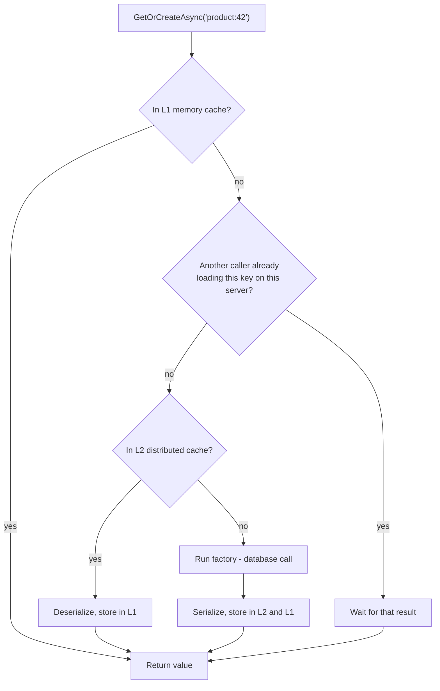
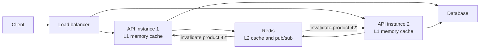
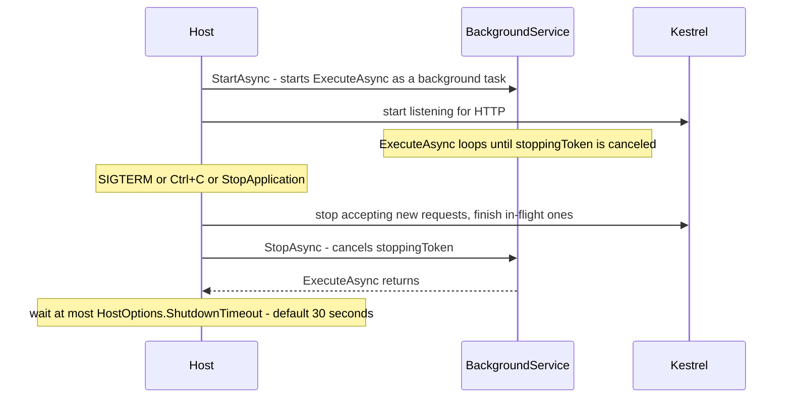
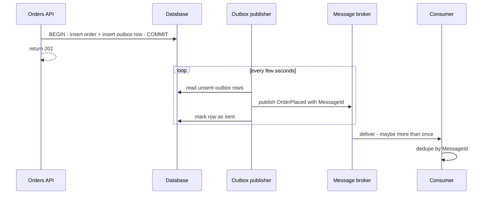

# Caching, Background Jobs and Messaging in .NET

> In this document you will learn how a .NET backend avoids repeated work and moves slow work out of the request: `IMemoryCache`, `IDistributedCache`, `HybridCache` and output caching; `IHostedService` and `BackgroundService`, scoped services in background code and graceful shutdown; `Channel<T>` queues; scheduled jobs with Hangfire and Quartz.NET; message brokers, the outbox pattern and idempotent consumers; and real-time updates with SignalR. Interviewers use these topics to see whether you can build a backend that stays fast and correct under load.

**Before this:** [Dependency injection in ASP.NET Core](08-dependency-injection-in-aspnet-core.md) · [Async/await, tasks and threading](04-async-await-tasks-and-threading.md) · [Caching concepts (Node.js)](../07-nodejs-backend/11-caching.md) · [Background jobs and queues (Node.js)](../07-nodejs-backend/13-background-jobs-and-queues.md) · **Interview questions:** [jump to the interview section](#interview-questions)

## Table of contents

1. [Caching options in .NET at a glance](#caching-options-in-net-at-a-glance)
2. [IMemoryCache](#imemorycache)
3. [Cache stampede in .NET and how to stop it](#cache-stampede-in-net-and-how-to-stop-it)
4. [IDistributedCache and Redis](#idistributedcache-and-redis)
5. [HybridCache](#hybridcache)
6. [Output caching](#output-caching)
7. [Invalidation in a multi-server .NET app](#invalidation-in-a-multi-server-net-app)
8. [Hosted services and BackgroundService](#hosted-services-and-backgroundservice)
9. [Scoped services inside background services](#scoped-services-inside-background-services)
10. [Graceful shutdown and failures](#graceful-shutdown-and-failures)
11. [In-process queues with Channel of T](#in-process-queues-with-channel-of-t)
12. [Scheduled jobs: Hangfire and Quartz.NET](#scheduled-jobs-hangfire-and-quartznet)
13. [Message brokers with .NET](#message-brokers-with-net)
14. [The outbox pattern](#the-outbox-pattern)
15. [Idempotent consumers](#idempotent-consumers)
16. [SignalR for real-time updates](#signalr-for-real-time-updates)
17. [How to explain this in an interview](#how-to-explain-this-in-an-interview)
18. [Common mistakes](#common-mistakes)
19. [Best practices](#best-practices)
20. [Interview questions](#interview-questions)
21. [Summary](#summary)
22. [References](#references)

---

## Caching options in .NET at a glance

A **cache** keeps a copy of data that is expensive to get (a database query, an HTTP call, a computed report), so the next request can reuse it. The general ideas — cache-aside, TTL, eviction, invalidation, stampede — are explained in [Caching (Node.js)](../07-nodejs-backend/11-caching.md) and, across all layers, in [Caching strategies and invalidation](../09-system-design/03-caching-strategies-and-invalidation.md). This document shows the .NET tools.

| Tool | Where data lives | Stores | Shared between servers | Stampede protection | Package |
| --- | --- | --- | --- | --- | --- |
| `IMemoryCache` | In the process memory | Live .NET objects | No | No | Built in |
| `IDistributedCache` | Redis, SQL Server, Postgres, ... | `byte[]` / strings | Yes | No | Built in interface; Redis provider is a package |
| `HybridCache` | Memory (L1) + optional distributed (L2) | Objects (serialized for L2) | Yes, through L2 | **Yes** | `Microsoft.Extensions.Caching.Hybrid` |
| Output caching | Memory (or Redis, .NET 8+) | Whole HTTP responses | Optional | Yes (request locking) | Built in middleware |
| Response caching | Browser, proxies, CDN | HTTP responses, by `Cache-Control` headers | n/a | n/a | Built in middleware |

**If you know Node.js:** `IMemoryCache` is like an in-process `Map` or `lru-cache`. `IDistributedCache` with Redis is like using `ioredis` directly. `HybridCache` combines both and adds stampede protection, which in Node you usually write yourself.

## IMemoryCache

### What it is

`IMemoryCache` stores **.NET objects in the memory of the current process**. Reads are very fast because nothing is serialized and nothing goes over the network. But each server has its own cache, and the cache is lost when the process restarts.

```csharp
builder.Services.AddMemoryCache();   // register it (some frameworks add it for you; be explicit)

public class ProductService(IMemoryCache cache, IProductRepository repo)
{
    public async Task<Product?> GetAsync(int id, CancellationToken ct)
    {
        return await cache.GetOrCreateAsync($"product:{id}", async entry =>
        {
            entry.AbsoluteExpirationRelativeToNow = TimeSpan.FromMinutes(5);  // max age
            entry.SlidingExpiration = TimeSpan.FromMinutes(1);                // removed if unused for 1 min
            return await repo.FindAsync(id, ct);
        });
    }
}
```

### Expiration options

| Option | Meaning | Use it for |
| --- | --- | --- |
| `AbsoluteExpirationRelativeToNow` / `AbsoluteExpiration` | Remove after a fixed time | Data that must not be older than X |
| `SlidingExpiration` | Remove if not read for X | Keeping hot items, dropping cold ones |
| Both together | Sliding, but never longer than the absolute limit | The usual safe combination |
| `Priority` | Which entries go first when the cache compacts (for example when `SizeLimit` is reached) | `NeverRemove` for small, critical entries |
| `Size` (with `SizeLimit`) | Your own "cost" units | Bounding the cache size |
| Expiration tokens | Remove when a token fires | Group invalidation, file changes |

❌ **Sliding expiration alone** can keep a popular entry forever, so it never refreshes. Always add an absolute limit.

### Example: what really happens

This program was run with the .NET 10 SDK:

```csharp
var cache = new MemoryCache(new MemoryCacheOptions());
int dbCalls = 0;
async Task<Product> LoadProductFromDb(int id)
{
    Interlocked.Increment(ref dbCalls);
    await Task.Delay(100);                         // pretend database latency
    return new Product(id, $"Product {id}", 9.99m);
}

var p1 = await cache.GetOrCreateAsync("product:1", async e =>
{
    e.AbsoluteExpirationRelativeToNow = TimeSpan.FromMinutes(5);
    return await LoadProductFromDb(1);
});
var p1again = await cache.GetOrCreateAsync("product:1", async e => await LoadProductFromDb(1));
Console.WriteLine($"Same object? {ReferenceEquals(p1, p1again)}, db calls = {dbCalls}");
// Same object? True, db calls = 1

// The mutation trap
var cached = cache.Get<Product>("product:1")!;
cached.Name = "CHANGED BY A CALLER";
Console.WriteLine(cache.Get<Product>("product:1")!.Name);
// CHANGED BY A CALLER
```

Two important facts from the output:

1. The second call returned the **same object instance**. `IMemoryCache` stores a reference, not a copy.
2. So if any caller **changes** the cached object, every later reader sees the change. This is a real bug source: one request applies a discount to `product.Price` for its own response, and every user now sees the discounted price.

✅ Cache **immutable** objects (records with `init` properties, read-only collections), or copy before changing.

### Size limits

By default, `IMemoryCache` has **no size limit**. It does not watch the GC or free memory by itself. It only removes entries when they expire, when an expiration token fires, or when you call `Compact()`. If you cache by user input (search text, IDs from the URL), the cache can grow until the process runs out of memory.

```csharp
var limited = new MemoryCache(new MemoryCacheOptions { SizeLimit = 2 });
limited.Set("a", 1, new MemoryCacheEntryOptions { Size = 1 });
limited.Set("b", 2, new MemoryCacheEntryOptions { Size = 1 });
limited.Set("c", 3, new MemoryCacheEntryOptions { Size = 1 });
Console.WriteLine($"a={limited.Get("a")}, b={limited.Get("b")}, c={limited.Get("c") ?? "(not stored)"}");
// a=1, b=2, c=(not stored)

limited.Set("d", 4);   // no Size given
// InvalidOperationException: Cache entry must specify a value for Size when SizeLimit is set.
```

Notice that when the cache is full, the **new** entry is not stored; old entries are not evicted immediately (compaction runs in the background). The `Size` unit is yours: "1 per entry", "approximate bytes", whatever you choose. If `SizeLimit` is set, **every** entry must have a `Size`.

> In ASP.NET Core, the `IMemoryCache` from `AddMemoryCache()` is a shared singleton. Setting `SizeLimit` on it affects every library that uses it. For a bounded cache, create your own `MemoryCache` instance for that feature.

### Expiration tokens for group invalidation

```csharp
var catalogReset = new CancellationTokenSource();
cache.Set("catalog:menu", menu, new MemoryCacheEntryOptions()
    .AddExpirationToken(new CancellationChangeToken(catalogReset.Token)));

catalogReset.Cancel();                       // removes every entry linked to this token
Console.WriteLine(cache.Get("catalog:menu") ?? "(evicted)");   // (evicted)
```

## Cache stampede in .NET and how to stop it

A **cache stampede** happens when a popular key is missing (cold start or just expired) and many requests try to load it at the same time. They all miss, and they all hit the database.

**Important:** `IMemoryCache.GetOrCreateAsync` does **not** protect you. It is "check, then create", not a lock.

```csharp
await Task.WhenAll(Enumerable.Range(0, 50).Select(_ => Task.Run(() =>
    cache.GetOrCreateAsync("p:1", async e =>
    {
        e.AbsoluteExpirationRelativeToNow = TimeSpan.FromMinutes(5);
        return await Load(1);
    }))));
Console.WriteLine($"Plain GetOrCreateAsync, 50 parallel callers -> db calls = {dbCalls}");
// Plain GetOrCreateAsync, 50 parallel callers -> db calls = 50
```

All 50 callers ran the factory. With a slow query and thousands of users, this can take the database down right after a deploy.

### Fix 1: one in-flight load per key

```csharp
public sealed class SingleFlightCache(IMemoryCache cache)
{
    private readonly ConcurrentDictionary<string, Lazy<Task<object?>>> _inFlight = new();

    public async Task<T> GetOrCreateAsync<T>(string key, Func<Task<T>> factory, TimeSpan ttl)
    {
        if (cache.TryGetValue(key, out T? cached)) return cached!;          // fast path: hit

        var lazy = _inFlight.GetOrAdd(key, k => new Lazy<Task<object?>>(async () =>
        {
            try
            {
                if (cache.TryGetValue(key, out T? existing)) return existing;  // filled while we waited
                T value = await factory();                                     // only ONE caller runs this
                cache.Set(key, value, ttl);
                return value;
            }
            finally { _inFlight.TryRemove(key, out _); }                       // failures are not cached
        }));
        return (T)(await lazy.Value)!;
    }
}
```

Output from the run:

```text
SingleFlightCache, 50 parallel callers -> db calls = 1, all got 'Product 2'
Later call (cache hit) -> db calls = 1
First call failed: db timeout
Second call: ok, db calls = 2
```

How it works:

1. `ConcurrentDictionary.GetOrAdd` makes sure all callers for one key get the **same** `Lazy`. (`GetOrAdd` may create extra `Lazy` objects in a race, but only one is stored and returned to everyone, and an unused `Lazy` never runs.)
2. `Lazy<Task>` runs the factory only once. Every caller awaits the same `Task`.
3. The `finally` removes the in-flight entry, so a **failed** load is not remembered and the next caller retries.

### Fix 2: use HybridCache

`HybridCache` has this protection built in (next sections). For most new code, that is simpler than writing your own.

### Other stampede tools

- **TTL jitter:** add a random 0–10% to TTLs so thousands of keys do not expire in the same second.
- **Refresh ahead:** a background job reloads hot keys before they expire.
- **Serve stale while refreshing:** keep the old value for a short time while one caller refreshes.

## IDistributedCache and Redis

### What it is

`IDistributedCache` is an interface for a cache **outside** the process, shared by all servers. It stores `byte[]` values (with string helpers). Implementations:

| Implementation | Package |
| --- | --- |
| In-memory (for development and tests only — not shared) | Built in: `AddDistributedMemoryCache()` |
| Redis | `Microsoft.Extensions.Caching.StackExchangeRedis` |
| SQL Server | `Microsoft.Extensions.Caching.SqlServer` |
| PostgreSQL | `Microsoft.Extensions.Caching.Postgres` |

```csharp
// Redis registration (package, not run here)
builder.Services.AddStackExchangeRedisCache(o =>
{
    o.Configuration = builder.Configuration.GetConnectionString("Redis");
    o.InstanceName = "shop:";          // key prefix
});
```

### Using it

The in-memory implementation has the same API as Redis, so this ran without packages:

```csharp
var dist = sp.GetRequiredService<IDistributedCache>();

await dist.SetStringAsync("cart:42",
    JsonSerializer.Serialize(new Product(5, "Mouse", 20m)),
    new DistributedCacheEntryOptions { AbsoluteExpirationRelativeToNow = TimeSpan.FromMinutes(30) });

var json = await dist.GetStringAsync("cart:42");
Console.WriteLine(json);                      // {"Id":5,"Name":"Mouse","Price":20}

var copy = JsonSerializer.Deserialize<Product>(json!)!;
copy.Name = "changed";
var again = JsonSerializer.Deserialize<Product>((await dist.GetStringAsync("cart:42"))!)!;
Console.WriteLine(again.Name);                // Mouse - every read is a new copy
```

### Trade-offs

| | `IMemoryCache` | `IDistributedCache` (Redis) |
| --- | --- | --- |
| Speed | Nanoseconds | Network round trip (~0.2–2 ms) |
| Serialization | None | Every read and write |
| Shared across servers | No | Yes |
| Survives app restart | No | Yes |
| Object safety | Shared instance (mutation risk) | Each read is a fresh copy |
| Stampede protection | No | No |
| Failure mode | Cannot fail separately | Redis down: calls throw, so wrap and fall back |

The interface is deliberately small: no tags, no "get or create", no bulk operations. You write cache-aside code around it yourself:

```csharp
public async Task<Product?> GetProductAsync(int id, CancellationToken ct)
{
    var key = $"product:{id}";
    try
    {
        var bytes = await _cache.GetAsync(key, ct);
        if (bytes is not null) return JsonSerializer.Deserialize<Product>(bytes);
    }
    catch (Exception ex) { _logger.LogWarning(ex, "Cache read failed for {Key}", key); } // cache is optional

    var product = await _repo.FindAsync(id, ct);
    if (product is not null)
    {
        try
        {
            await _cache.SetAsync(key, JsonSerializer.SerializeToUtf8Bytes(product),
                new DistributedCacheEntryOptions { AbsoluteExpirationRelativeToNow = TimeSpan.FromMinutes(10) }, ct);
        }
        catch (Exception ex) { _logger.LogWarning(ex, "Cache write failed for {Key}", key); }
    }
    return product;
}
```

For Redis features beyond get/set (counters, sets, pub/sub, Lua scripts), use `StackExchange.Redis` (`IConnectionMultiplexer`) directly. Register the multiplexer **once as a singleton**; it is designed to be shared and is thread-safe.

## HybridCache

### What it is

`HybridCache` is a newer caching API from Microsoft that combines:

- **L1:** an in-memory cache in each server (fast, object reuse optional);
- **L2:** an optional `IDistributedCache` (Redis, SQL Server, Postgres), shared by all servers;
- **stampede protection:** for one key, only one caller runs the factory; the others wait for its result;
- **serialization** (System.Text.Json by default, pluggable);
- **tags** for invalidating groups of entries.

**Status (verified October 2026):** `HybridCache` became **generally available in March 2025** in the `Microsoft.Extensions.Caching.Hybrid` package (version 9.3.0). The abstract `HybridCache` class lives in `Microsoft.Extensions.Caching.Abstractions`. The package is not part of the ASP.NET Core shared framework, so you add it as a NuGet package. It supports older targets too, down to .NET Standard 2.0 and .NET Framework 4.7.2, so you can use it on .NET 8.

```csharp
// Package Microsoft.Extensions.Caching.Hybrid (not run here)
builder.Services.AddStackExchangeRedisCache(o => o.Configuration = redisConnection);  // optional L2
builder.Services.AddHybridCache(o =>
{
    o.MaximumPayloadBytes = 1024 * 1024;      // default 1 MB; bigger values are not cached
    o.MaximumKeyLength = 1024;                // default 1024 characters
    o.DefaultEntryOptions = new HybridCacheEntryOptions
    {
        Expiration = TimeSpan.FromMinutes(10),            // L2 (and overall) lifetime
        LocalCacheExpiration = TimeSpan.FromMinutes(2),   // L1 lifetime: shorter, to limit staleness
    };
});

public class ProductService(HybridCache cache, IProductRepository repo)
{
    public async Task<ProductDto> GetAsync(int id, CancellationToken ct = default) =>
        await cache.GetOrCreateAsync(
            $"product:{id}",                                      // key
            async cancel => await repo.GetDtoAsync(id, cancel),   // factory: runs once per key at a time
            tags: ["products", $"product:{id}"],
            cancellationToken: ct);

    public async Task UpdatePriceAsync(int id, decimal price, CancellationToken ct = default)
    {
        await repo.UpdatePriceAsync(id, price, ct);
        await cache.RemoveAsync($"product:{id}", ct);             // remove one key (L1 here + L2)
    }

    public Task ReloadCatalogAsync(CancellationToken ct = default) =>
        cache.RemoveByTagAsync("products", ct).AsTask();          // logical invalidation of a group
}
```

### How it works inside



Details that matter in interviews and production:

- **Stampede protection is per server.** Two servers can still both run the factory for the same key. The database sees at most one call per server, not one per request.
- **Tag removal is logical.** `RemoveByTagAsync` does not delete entries. It records "ignore entries with this tag created before now". Old values stay until they expire. `RemoveByTagAsync("*")` invalidates everything.
- **Other servers' L1 caches are not cleared** by `RemoveAsync` or `RemoveByTagAsync`. Only the current server's L1 and the shared L2 are updated. That is why `LocalCacheExpiration` should be short, or you add your own pub/sub to clear L1 on other servers (see the next sections).
- **Object reuse:** by default each caller gets a fresh deserialized object, like `IDistributedCache`, so mutation is safe. If your type is `sealed` and marked `[ImmutableObject(true)]`, `HybridCache` can reuse one instance.
- With only `AddDistributedMemoryCache()` registered, `HybridCache` does **not** use it as L2 (it would only duplicate L1).
- Keys must be built from **trusted** values (IDs, enums), not raw user text, to avoid cache flooding.

## Output caching

**Output caching** (.NET 7+) caches whole HTTP responses **on the server**. The server decides what to cache, not the client's headers. It is covered with response caching and HTTP caching in [Web APIs, validation and error handling](09-web-apis-validation-and-error-handling.md). Here is the short version, because it is a cache you will combine with the others.

```csharp
builder.Services.AddOutputCache(o =>
{
    o.AddBasePolicy(b => b.Expire(TimeSpan.FromSeconds(10)));
    o.AddPolicy("Products", b => b.Expire(TimeSpan.FromMinutes(5)).SetVaryByQuery("page").Tag("products"));
});
var app = builder.Build();
app.UseOutputCache();          // after UseCors and UseRouting, before the endpoints

int renders = 0;
app.MapGet("/products", (int page) => $"page {page} rendered #{Interlocked.Increment(ref renders)}")
   .CacheOutput("Products");
app.MapPost("/products", async (IOutputCacheStore store, CancellationToken ct) =>
{
    await store.EvictByTagAsync("products", ct);     // invalidate all cached product pages
    return Results.Ok("created, cache evicted");
});
app.MapGet("/me", () => $"render #{Interlocked.Increment(ref renders)}").CacheOutput();
```

Output from the run:

```text
page 1 rendered #1
page 1 rendered #1          <- served from the output cache
page 2 rendered #2          <- different query value, different entry
"created, cache evicted"
page 1 rendered #3          <- tag eviction worked
with Authorization header: render #4
with Authorization header: render #5   <- authenticated requests are not cached by default
```

The last two lines show the safety default: requests with an `Authorization` header are not cached, so one user's private response is never served to another user. The full list of defaults, the Redis store for sharing across servers, and the comparison with response caching are in [Output caching vs response caching](09-web-apis-validation-and-error-handling.md#output-caching-vs-response-caching).

## Invalidation in a multi-server .NET app

A typical production API runs several instances behind a load balancer. Combining the tools above:



Practical rules:

1. **Write to the database first, then invalidate** (delete the cache key). Do not update the cache with the new value from the write path; deleting is simpler and avoids race conditions where an older value overwrites a newer one.
2. **Short L1 TTLs** (seconds to a couple of minutes) limit how stale one server can be.
3. **Broadcast invalidations** when staleness matters: publish the key on a Redis channel; every instance removes it from its own L1.
4. **Version keys** for big groups: store `catalog:version = 17` and build keys like `catalog:v17:product:42`. Bumping the version makes all old keys unreachable at once.
5. **Include everything that changes the result in the key:** tenant, language, user role. A key without the tenant ID is a data leak waiting to happen.

## Hosted services and BackgroundService

### What they are

A **hosted service** is a class that the .NET Generic Host starts when the app starts and stops when the app stops. It runs alongside the web server in the same process. Use it for work that is not tied to one HTTP request: processing a queue, polling, cleaning up, warming caches.

- `IHostedService` is the basic interface: `StartAsync(CancellationToken)` and `StopAsync(CancellationToken)`.
- `BackgroundService` is an abstract base class that implements `IHostedService` for long-running loops. You override one method: `ExecuteAsync(CancellationToken stoppingToken)`.
- `IHostedLifecycleService` (.NET 8+) adds `StartingAsync`, `StartedAsync`, `StoppingAsync` and `StoppedAsync` hooks.

**If you know Node.js:** in Node you might start a `setInterval` or a queue consumer next to Express in the same process. A hosted service is the structured .NET version: the host starts it, gives it DI services and a cancellation token, and waits for it on shutdown.

```csharp
public class CleanupWorker(ILogger<CleanupWorker> logger) : BackgroundService
{
    protected override async Task ExecuteAsync(CancellationToken stoppingToken)
    {
        using var timer = new PeriodicTimer(TimeSpan.FromMinutes(5));
        try
        {
            while (await timer.WaitForNextTickAsync(stoppingToken))
            {
                logger.LogInformation("Cleaning expired carts");
                // ... do the work, pass stoppingToken to every async call
            }
        }
        catch (OperationCanceledException) { /* normal shutdown */ }
    }
}

builder.Services.AddHostedService<CleanupWorker>();   // registered as a singleton
```

`PeriodicTimer` (.NET 6+) is the modern way to run a loop on an interval. It does not overlap ticks: if one run takes longer than the period, the next tick waits. That is usually what you want, unlike `System.Threading.Timer`, whose callbacks can overlap.

### Lifecycle



> **New in .NET 10:** `BackgroundService` now runs **all** of `ExecuteAsync` on a background thread. In **.NET 8 and 9**, the code **before the first `await`** in `ExecuteAsync` ran synchronously during startup, so slow synchronous code there (for example `Thread.Sleep` or a blocking database call) delayed the start of the whole app. In a .NET 10 run, a worker with `Thread.Sleep(1000)` before any `await` did not delay `StartAsync` (it returned after about 10 ms). If you need code to finish **before** the app starts serving, put it in an overridden `StartAsync` (call `base.StartAsync` after it) or in `IHostedLifecycleService.StartingAsync` — do not rely on the synchronous part of `ExecuteAsync`.

### IHostedService vs BackgroundService

| | `IHostedService` | `BackgroundService` |
| --- | --- | --- |
| You implement | `StartAsync` and `StopAsync` | `ExecuteAsync` |
| Best for | Short start/stop work: open a connection, register a subscription, warm a cache | Long-running loops: queue consumers, polling, timers |
| Startup blocking | `StartAsync` runs during startup and **does** delay it | `ExecuteAsync` runs in the background |
| Stop | You write the stop logic | Base class cancels the token and waits for `ExecuteAsync` |

Hosted services start **in registration order** by default. Since .NET 8 you can set `HostOptions.ServicesStartConcurrently` and `ServicesStopConcurrently` to start or stop them in parallel.

## Scoped services inside background services

### The problem

`AddHostedService<T>()` registers the worker as a **singleton**. A `DbContext` is registered as **scoped** (one per request). If you inject `AppDbContext` into a worker's constructor, the container either throws (scope validation in Development) or, worse, gives the singleton one `DbContext` forever: it is not thread-safe, its change tracker grows without limit, and its connection may break. This is the **captive dependency** problem from [Dependency injection in ASP.NET Core](08-dependency-injection-in-aspnet-core.md).

### The solution: create a scope per unit of work

```csharp
public class EmailWorker(Channel<EmailJob> queue, IServiceScopeFactory scopes, ILogger<EmailWorker> logger)
    : BackgroundService
{
    protected override async Task ExecuteAsync(CancellationToken stoppingToken)
    {
        await foreach (var job in queue.Reader.ReadAllAsync(stoppingToken))
        {
            try
            {
                using var scope = scopes.CreateScope();              // ✅ new scope per job
                var sender = scope.ServiceProvider.GetRequiredService<IEmailSender>(); // scoped service
                await sender.SendAsync(job, stoppingToken);
            }                                                          // scope disposed: DbContext etc. released
            catch (Exception ex) when (ex is not OperationCanceledException)
            {
                logger.LogError(ex, "Email for order {OrderId} failed", job.OrderId); // one bad job must not stop the loop
            }
        }
    }
}
```

Use `await using var scope = scopes.CreateAsyncScope();` when scoped services implement `IAsyncDisposable` (for example a `DbContext`).

In the full run below, each job got a **new** `IEmailSender` instance and it was disposed right after the job (`sender instance #1`, `#2`, `#3`, each followed by `Scope disposed`).

## Graceful shutdown and failures

### Graceful shutdown

When the host stops (a deployment, `docker stop`, Kubernetes sending SIGTERM):

1. Kestrel stops accepting new connections and lets in-flight requests finish.
2. The host calls `StopAsync` on hosted services in **reverse** registration order. `BackgroundService` cancels `stoppingToken`.
3. The host waits up to **`HostOptions.ShutdownTimeout`**, which is **30 seconds** by default (the run printed `ShutdownTimeout default = 00:00:30`). After that, it stops waiting and the process exits.

Rules for workers:

- Pass `stoppingToken` to every async call (`Task.Delay`, database calls, `ReadAllAsync`), so they stop quickly.
- Finish or abandon the **current** item cleanly. Do not start new items after cancellation.
- Make work **resumable**: anything in memory is lost when the process exits. Durable work belongs in a durable queue.
- Make sure the platform waits long enough: Kubernetes `terminationGracePeriodSeconds` (default 30 s) must be longer than your shutdown timeout plus pre-stop delays.

```csharp
builder.Services.Configure<HostOptions>(o => o.ShutdownTimeout = TimeSpan.FromSeconds(45));
```

### What happens when a background service throws

Since .NET 6, an unhandled exception in `ExecuteAsync` **stops the whole host** by default (`BackgroundServiceExceptionBehavior.StopHost`). The run:

```csharp
class CrashingWorker : BackgroundService
{
    protected override async Task ExecuteAsync(CancellationToken ct)
    {
        await Task.Delay(300, ct);
        throw new InvalidOperationException("Queue connection lost");
    }
}
```

```text
[6 ms] StartAsync returned
[314 ms] mode=crash: host stopping requested = True
[1532 ms] mode=ignore: host stopping requested = False
```

- With the default, the app **shut down** about 300 ms after start. In a container, the orchestrator restarts it, which is often what you want: a crash is visible.
- With `BackgroundServiceExceptionBehavior.Ignore` (the .NET 5 behavior), the worker silently died and the web app kept running **without** its worker. Nothing processed the queue, and health checks still said "healthy". This is worse.

✅ Catch exceptions **per item** inside the loop (log, retry, dead-letter), and let only truly fatal errors escape. Report worker health in a health check (see [Production, architecture and performance](14-production-architecture-and-performance.md)).

## In-process queues with Channel of T

### What it is

`System.Threading.Channels.Channel<T>` is a fast, thread-safe, async **producer/consumer queue** inside one process. Producers `WriteAsync`; consumers `ReadAsync` or `ReadAllAsync`. It is the standard way to hand work from HTTP requests to a background worker. The concurrency details are in [Async/await, tasks and threading](04-async-await-tasks-and-threading.md).

### Full example: queue an email after an order

```csharp
using System.Threading.Channels;

var builder = WebApplication.CreateBuilder(args);
builder.Services.AddSingleton(Channel.CreateBounded<EmailJob>(new BoundedChannelOptions(100)
{
    FullMode = BoundedChannelFullMode.Wait,    // producers wait when the queue is full (backpressure)
    SingleReader = true,                       // one consumer: enables optimizations
}));
builder.Services.AddScoped<IEmailSender, SmtpEmailSender>();
builder.Services.AddHostedService<EmailWorker>();     // the worker from the previous section
var app = builder.Build();

app.MapPost("/orders/{id:int}", async (int id, Channel<EmailJob> queue, CancellationToken ct) =>
{
    // ... save the order first
    await queue.Writer.WriteAsync(new EmailJob(id, $"customer{id}@example.com"), ct);
    return Results.Accepted();      // 202: accepted, the email will be sent soon
});

app.Run();
public record EmailJob(int OrderId, string To);
```

Output from the run (times in milliseconds since start; a fake sender takes 150 ms per email):

```text
  166 ms  API: order 1 accepted, email queued
  180 ms  Client: POST /orders/1 -> 202
  184 ms  API: order 2 accepted, email queued
  185 ms  Client: POST /orders/2 -> 202
  187 ms  API: order 3 accepted, email queued
  188 ms  Client: POST /orders/3 -> 202
  320 ms  Worker: sent email for order 1 (sender instance #1)
  320 ms  Scope disposed sender #1
  474 ms  Worker: sent email for order 2 (sender instance #2)
  474 ms  Scope disposed sender #2
  630 ms  Worker: sent email for order 3 (sender instance #3)
  630 ms  Scope disposed sender #3
 1397 ms  Stopping host
 1455 ms  Cleanup: stopping gracefully
 1457 ms  Host stopped
```

Step by step:

1. Each `POST` writes a job to the channel and returns **202** in a few milliseconds. The client does not wait for the email.
2. The single worker reads jobs **in order**, one at a time, each in its own DI scope.
3. On stop, the `PeriodicTimer` worker sees the canceled token and exits; the host stops cleanly.

### Bounded vs unbounded

| | `CreateBounded(capacity)` | `CreateUnbounded()` |
| --- | --- | --- |
| Memory | Limited | Grows without limit if consumers are slow |
| When full | `Wait` (backpressure), `DropOldest`, `DropNewest`, `DropWrite` | Never full |
| Use | Almost always in servers | Only when producers are naturally limited |

### The big limitation

A channel lives **in memory**. If the process crashes or is redeployed, queued items are **lost**. And each server has its own channel. Use a channel for work you can afford to lose or recreate (cache warming, metrics, best-effort notifications). For work that must happen (payments, order emails, invoices), use a **durable** queue: a message broker, a database-backed job system like Hangfire, or the outbox pattern.

## Scheduled jobs: Hangfire and Quartz.NET

`PeriodicTimer` in a `BackgroundService` is fine for simple intervals in one instance. But with **three instances**, the job runs three times. And you get no history, no retries, no dashboard. Two popular libraries solve this (both packages, not run here).

### Hangfire

Hangfire stores jobs in a database (SQL Server, PostgreSQL, Redis and others), so jobs survive restarts and only one server picks up each job.

```csharp
builder.Services.AddHangfire(c => c.UseSqlServerStorage(builder.Configuration.GetConnectionString("Jobs")));
builder.Services.AddHangfireServer();                 // the background processing server

var app = builder.Build();
app.UseHangfireDashboard("/jobs");                   // protect it with authorization in production

// Fire-and-forget, persisted, retried automatically on failure
BackgroundJob.Enqueue<IInvoiceService>(s => s.SendInvoiceAsync(orderId, CancellationToken.None));

// Delayed
BackgroundJob.Schedule<ICartService>(s => s.SendAbandonedCartReminderAsync(cartId), TimeSpan.FromHours(2));

// Recurring (cron), runs once per schedule across all servers
RecurringJob.AddOrUpdate<IReportService>("daily-sales-report", s => s.BuildDailyReportAsync(), Cron.Daily(2, 0));
```

How it works: `Enqueue` serializes the **method call and its arguments** into the job storage. A worker on any server fetches the job, resolves `IInvoiceService` from DI, and calls the method. Pass **IDs, not objects** as arguments: the object may change before the job runs.

### Quartz.NET

Quartz.NET is a scheduler with rich triggers (cron, calendars, misfire rules). Jobs implement `IJob`.

```csharp
builder.Services.AddQuartz(q =>
{
    var key = new JobKey("nightly-cleanup");
    q.AddJob<NightlyCleanupJob>(o => o.WithIdentity(key));
    q.AddTrigger(t => t.ForJob(key).WithCronSchedule("0 0 3 * * ?"));   // 03:00 every day
    // q.UsePersistentStore(...) for clustering across servers
});
builder.Services.AddQuartzHostedService(o => o.WaitForJobsToComplete = true);

[DisallowConcurrentExecution]
public class NightlyCleanupJob(AppDbContext db) : IJob   // Quartz creates a scope per job execution
{
    public async Task Execute(IJobExecutionContext context) =>
        await db.Carts.Where(c => c.ExpiresAt < DateTime.UtcNow).ExecuteDeleteAsync(context.CancellationToken);
}
```

### Comparison

| | `BackgroundService` + `PeriodicTimer` | Hangfire | Quartz.NET | Platform scheduler |
| --- | --- | --- | --- | --- |
| Persistence | None | Database | Optional (ADO.NET job store) | Platform |
| Runs once across many instances | No (you add a distributed lock) | Yes | Yes, with clustering | Yes |
| Fire-and-forget jobs with retries | No | Yes | Possible, less natural | Depends |
| Dashboard | No | Yes (built in) | No built-in UI | Platform UI |
| Scheduling power | Fixed interval | Cron | Cron, calendars, misfire policies | Cron |
| License | MIT (.NET) | LGPL-3.0 core, paid Pro features | Apache 2.0 | n/a |

"Platform scheduler" means Kubernetes CronJobs, Azure Functions timer triggers or Azure Container Apps jobs: the platform starts a process on a schedule. It keeps the web app simple, which is often the best choice in the cloud.

## Message brokers with .NET

### Why a broker

A **message broker** is a separate server that stores messages durably and delivers them to consumers. It decouples services: the order service publishes `OrderPlaced`, and the email, inventory and analytics services each consume it at their own speed. The concepts (queues vs topics, at-least-once delivery, retries, dead-letter queues, Kafka vs RabbitMQ) are explained in [Background jobs and queues (Node.js)](../07-nodejs-backend/13-background-jobs-and-queues.md).

| Broker | Typical .NET client | Notes |
| --- | --- | --- |
| Azure Service Bus | `Azure.Messaging.ServiceBus` | Queues, topics with subscriptions, sessions (ordered per key), duplicate detection, dead-letter queue |
| RabbitMQ | `RabbitMQ.Client` (v7 is fully async) | Exchanges and queues, flexible routing, self-hosted or managed |
| Apache Kafka | `Confluent.Kafka` | Partitioned log, replay, very high throughput, consumer groups |
| Amazon SQS/SNS | `AWSSDK.SQS`, `AWSSDK.SimpleNotificationService` | Managed on AWS |

### Consuming Azure Service Bus in a BackgroundService

(Package `Azure.Messaging.ServiceBus`, not run here.)

```csharp
public class OrderPlacedConsumer(ServiceBusClient client, IServiceScopeFactory scopes, ILogger<OrderPlacedConsumer> logger)
    : BackgroundService
{
    protected override async Task ExecuteAsync(CancellationToken stoppingToken)
    {
        await using var processor = client.CreateProcessor("order-placed", new ServiceBusProcessorOptions
        {
            AutoCompleteMessages = false,     // complete only after our work is saved
            MaxConcurrentCalls = 8,           // default is 1
            PrefetchCount = 20,
        });

        processor.ProcessMessageAsync += async args =>
        {
            var evt = args.Message.Body.ToObjectFromJson<OrderPlaced>()!;
            await using var scope = scopes.CreateAsyncScope();
            var handler = scope.ServiceProvider.GetRequiredService<OrderPlacedHandler>();
            await handler.HandleAsync(evt, args.Message.MessageId, args.CancellationToken);
            await args.CompleteMessageAsync(args.Message, args.CancellationToken);   // remove from queue
        };
        processor.ProcessErrorAsync += args =>
        {
            logger.LogError(args.Exception, "Service Bus error from {Source}", args.ErrorSource);
            return Task.CompletedTask;
        };

        await processor.StartProcessingAsync(stoppingToken);
        try { await Task.Delay(Timeout.Infinite, stoppingToken); }
        catch (OperationCanceledException) { }
        await processor.StopProcessingAsync();
    }
}
```

How delivery works (**peek-lock** mode, the default):

1. The broker **locks** a message and gives it to the consumer. Other consumers cannot see it while locked.
2. If the handler succeeds, `CompleteMessageAsync` deletes the message.
3. If the handler throws or the process dies, the lock expires and the message is delivered **again**. After `MaxDeliveryCount` attempts (10 by default), it moves to the **dead-letter queue** for inspection.

So delivery is **at-least-once**: your handler must be safe to run twice (see [Idempotent consumers](#idempotent-consumers)).

Register `ServiceBusClient` **once as a singleton**. It manages connections and is designed to be shared.

### Messaging frameworks and their licenses

Many teams use a framework on top of the raw client. It adds consumer classes, retries, the outbox, sagas and testing helpers.

| Framework | What it gives | License status (verified October 2026) |
| --- | --- | --- |
| **MassTransit** | Abstraction over RabbitMQ, Azure Service Bus, Amazon SQS and others; outbox; sagas | **v9 is commercial** (announced 2025). **v8 stays open source** (Apache 2.0), with support announced through the end of 2026. |
| **NServiceBus** | Mature enterprise messaging, outbox, sagas, monitoring | Commercial |
| **Wolverine** | Messaging + mediator, built-in outbox with Marten/EF Core | Open source (MIT) |
| **Rebus** | Lightweight service bus | Open source (MIT), paid extras |

When you choose a library, check its license and support terms for your company. This became an important topic in the .NET ecosystem in 2025, when MassTransit, MediatR, AutoMapper and FluentAssertions moved new major versions to commercial or dual (open source plus commercial) licenses.

## The outbox pattern

### The problem: dual writes

```csharp
// ❌ Wrong: two separate systems, no shared transaction
await db.SaveChangesAsync();                              // 1. order saved
await bus.PublishAsync(new OrderPlaced(order.Id));        // 2. process crashes here -> event lost
```

If the process crashes between the two lines, the order exists but no event is ever sent: no confirmation email, no stock reservation. If you publish first and the database save fails, consumers act on an order that does not exist.

### The solution

Save the event in the **same database transaction** as the business data, in an **outbox** table. A separate background process reads the outbox and publishes to the broker.



With EF Core (not run here):

```csharp
public class OutboxMessage
{
    public Guid Id { get; set; } = Guid.NewGuid();         // also the MessageId consumers dedupe on
    public string Type { get; set; } = "";
    public string Payload { get; set; } = "";
    public DateTime CreatedAt { get; set; } = DateTime.UtcNow;
    public DateTime? SentAt { get; set; }
}

// In the command handler: one SaveChanges = one transaction
db.Orders.Add(order);
db.OutboxMessages.Add(new OutboxMessage
{
    Type = nameof(OrderPlaced),
    Payload = JsonSerializer.Serialize(new OrderPlaced(order.Id, order.CustomerId, order.Total)),
});
await db.SaveChangesAsync(ct);

// The publisher
public class OutboxPublisher(IServiceScopeFactory scopes, IMessagePublisher bus) : BackgroundService
{
    protected override async Task ExecuteAsync(CancellationToken stoppingToken)
    {
        using var timer = new PeriodicTimer(TimeSpan.FromSeconds(2));
        while (await timer.WaitForNextTickAsync(stoppingToken))
        {
            await using var scope = scopes.CreateAsyncScope();
            var db = scope.ServiceProvider.GetRequiredService<AppDbContext>();
            var batch = await db.OutboxMessages.Where(m => m.SentAt == null)
                .OrderBy(m => m.CreatedAt).Take(50).ToListAsync(stoppingToken);

            foreach (var msg in batch)
            {
                await bus.PublishAsync(msg.Type, msg.Payload, messageId: msg.Id, stoppingToken);
                msg.SentAt = DateTime.UtcNow;
                await db.SaveChangesAsync(stoppingToken);   // if we crash before this, the message is sent again
            }
        }
    }
}
```

Notes:

- The outbox gives **at-least-once** publishing. A crash after publishing but before `SentAt` is saved causes a duplicate. Consumers must be idempotent.
- With several publisher instances, prevent double processing with row locking (`SELECT ... FOR UPDATE SKIP LOCKED` in PostgreSQL, `UPDLOCK, READPAST` hints in SQL Server) or a single active publisher.
- Delete or archive old sent rows, or the table grows forever.
- MassTransit, NServiceBus and Wolverine include ready-made EF Core outboxes. Writing your own is fine for simple cases.

## Idempotent consumers

An operation is **idempotent** if running it twice has the same effect as running it once. Because brokers deliver at least once, every consumer must handle duplicates.

This simulation delivers the same `PaymentCaptured` message twice (as happens when an acknowledgement is lost). It was run with the .NET 10 SDK:

```csharp
var db = new FakeDatabase();
var handler = new PaymentCapturedHandler(db);
var msg = new PaymentCaptured(Guid.Parse("7f1c0000-0000-0000-0000-000000000001"), OrderId: 42, Amount: 99.90m);

await handler.HandleAsync(msg);   // first delivery
await handler.HandleAsync(msg);   // redelivery
Console.WriteLine($"Order 42 paid amount = {db.PaidAmounts[42]}, loyalty points = {db.LoyaltyPoints[42]}");

record PaymentCaptured(Guid MessageId, int OrderId, decimal Amount);

class FakeDatabase
{
    public HashSet<Guid> ProcessedMessages { get; } = [];          // a unique index in a real database
    public Dictionary<int, decimal> PaidAmounts { get; } = [];
    public Dictionary<int, int> LoyaltyPoints { get; } = [];
    private readonly Lock _tx = new();                             // .NET 9 Lock type
    public void InTransaction(Action work) { lock (_tx) work(); }   // stands in for a DB transaction
}

class PaymentCapturedHandler(FakeDatabase db)
{
    public Task HandleAsync(PaymentCaptured m)
    {
        db.InTransaction(() =>
        {
            if (!db.ProcessedMessages.Add(m.MessageId))            // INSERT fails on duplicate key
            {
                Console.WriteLine($"Message {m.MessageId.ToString()[..8]} already processed - skipped");
                return;
            }
            db.PaidAmounts[m.OrderId] = m.Amount;
            db.LoyaltyPoints[m.OrderId] = db.LoyaltyPoints.GetValueOrDefault(m.OrderId) + (int)m.Amount;
            Console.WriteLine($"Message {m.MessageId.ToString()[..8]} processed");
        });
        return Task.CompletedTask;
    }
}
```

Output:

```text
Message 7f1c0000 processed
Message 7f1c0000 already processed - skipped
Order 42 paid amount = 99.90, loyalty points = 99
```

Without the dedup check, the customer would get 198 loyalty points. Setting `PaidAmounts[42]` is naturally idempotent (setting the same value twice is harmless), but **adding** points is not.

Ways to make consumers idempotent:

| Technique | Example |
| --- | --- |
| **Processed-messages table** with a unique key on `MessageId`, written in the same transaction as the change | The simulation above |
| **Natural idempotency** | `UPDATE orders SET status = 'Paid' WHERE id = 42` |
| **Conditional updates / version checks** | `... WHERE id = 42 AND status = 'Pending'` |
| **Idempotency keys for external calls** | Pass the message ID as the payment provider's idempotency key |

The key point: the dedup record and the business change must be in **one transaction**. If you mark the message as processed first and then crash, the change is lost; if you change first and crash before marking, you process it twice.

## SignalR for real-time updates

### What it is

**SignalR** is ASP.NET Core's library for **real-time, two-way** communication between server and clients. The server can push messages to browsers, mobile apps or .NET clients. SignalR picks the best transport: **WebSockets**, then Server-Sent Events, then long polling. The server part is in the shared framework; clients are packages (`@microsoft/signalr` for JavaScript, `Microsoft.AspNetCore.SignalR.Client` for .NET). Real-time design at system level is covered in [Real-time chat and notifications](../09-system-design/10-case-study-real-time-chat-and-notifications.md).

**If you know Node.js:** SignalR is similar to Socket.IO: hubs instead of namespaces, groups instead of rooms, its own protocol on top of WebSockets with fallbacks.

### Hubs, typed clients and groups

```csharp
builder.Services.AddSignalR();
var app = builder.Build();
app.MapHub<OrderHub>("/hubs/orders");

// Push from anywhere in the app (an endpoint, a background service, a message consumer)
app.MapPost("/orders/{id:int}/ship", async (int id, IHubContext<OrderHub, IOrderClient> hub) =>
{
    await hub.Clients.Group($"order-{id}").OrderStatusChanged(id, "Shipped");
    return Results.Ok();
});

public interface IOrderClient                                  // methods the CLIENT implements
{
    Task OrderStatusChanged(int orderId, string status);
}

public class OrderHub : Hub<IOrderClient>                      // methods clients can CALL
{
    public async Task WatchOrder(int orderId) =>
        await Groups.AddToGroupAsync(Context.ConnectionId, $"order-{orderId}");
}
```

The JavaScript client in an Angular app would look like this (not run here):

```js
const connection = new signalR.HubConnectionBuilder()
  .withUrl('/hubs/orders', { accessTokenFactory: () => auth.getAccessToken() })
  .withAutomaticReconnect()
  .build();
connection.on('OrderStatusChanged', (orderId, status) => store.updateStatus(orderId, status));
await connection.start();
await connection.invoke('WatchOrder', 42);
```

A test client spoke the SignalR JSON protocol over a raw WebSocket (no client package). Nina watched order 42 and Omar watched order 7; then `POST /orders/42/ship` was called:

```text
nina handshake: {}
omar handshake: {}
nina WatchOrder(42) completion: {"type":3,"invocationId":"1","result":null}
omar WatchOrder(7) completion: {"type":3,"invocationId":"1","result":null}
nina receives: {"type":1,"target":"OrderStatusChanged","arguments":[42,"Shipped"]}
omar receives nothing (not in group order-42)
```

What the output shows: `type 1` is an invocation (server calling a client method), `type 3` is a completion (the result of a client's call), and messages are sent only to the group's members. (The run also showed that the typed-client interface must be **public**; with an internal interface, SignalR could not generate the proxy and threw a `TypeLoadException`.)

### Key facts

| Topic | What to know |
| --- | --- |
| Hub lifetime | A hub instance is **transient**: created for each call. Do not store state in hub fields. |
| Connection state | Keep it in a singleton service or a store (Redis), keyed by user or connection ID. |
| Clients | `Clients.All`, `Clients.Caller`, `Clients.Others`, `Clients.Group(name)`, `Clients.User(userId)` (all connections of one user) |
| Groups | Not persistent: a reconnected client must join again. Membership is per connection. |
| Auth | `[Authorize]` on the hub. Browsers cannot set headers on WebSockets, so the JS client sends the token as the `access_token` query string; configure `JwtBearerEvents.OnMessageReceived` to read it for hub paths. |
| Delivery | No guarantee: a disconnected client misses messages. Treat SignalR as a notification channel and let clients reload state from the API after reconnecting. |

### Scale-out

Each server knows only its own connections. If a user is connected to server A and the event is processed on server B, B cannot reach the user. Options:

- **Redis backplane** (`Microsoft.AspNetCore.SignalR.StackExchangeRedis`): every server publishes messages through Redis pub/sub, so all servers can deliver them. Needs **sticky sessions** unless all clients use WebSockets with `SkipNegotiation`.
- **Azure SignalR Service**: a managed service holds the client connections; your servers only send messages to it. No sticky sessions, scales to many connections.

---

## How to explain this in an interview

Use this for "How do you run background work in ASP.NET Core?" or "How would you send emails after an order without slowing the API?"

1. **Define it:** "Background work is work that should not run inside the HTTP request. In .NET I run it in hosted services — usually a `BackgroundService` — that the host starts and stops with the app, or in a durable job system or message broker."
2. **Why it exists:** "Slow or unreliable work — emails, PDFs, calls to third parties — would make requests slow and fail with them. Moving it out gives fast responses, retries and backpressure."
3. **How it works:** "The endpoint saves the order and writes a job. For best-effort work, a bounded `Channel<T>` and a `BackgroundService` that reads with `ReadAllAsync`, creating a DI scope per job because the worker is a singleton. For work that must not be lost, I save an outbox row in the same transaction and a publisher sends it to Service Bus or RabbitMQ, where consumers process it at least once and dedupe by message ID."
4. **Small example:** "`POST /orders` saves the order plus an `OrderPlaced` outbox row and returns 201. The publisher sends the event; the email consumer checks a processed-messages table with a unique key, sends the email with the message ID as idempotency key, and completes the message."
5. **Where it is useful:** "Order processing, notifications, report generation, imports, cache warming, scheduled cleanups — with Hangfire or Quartz when jobs must run once across instances, or a platform scheduler."
6. **Trade-offs / gotchas:** "In-memory channels lose work on restart. Unhandled exceptions in `BackgroundService` stop the host by default since .NET 6. Shutdown waits only 30 seconds by default. Never inject a `DbContext` into a singleton worker. And at-least-once delivery means every consumer must be idempotent."

---

## Common mistakes

| Mistake | What happens | Fix |
| --- | --- | --- |
| Mutating objects taken from `IMemoryCache` | Other requests see the change | Cache immutable objects or copy |
| `IMemoryCache` keyed by user input, no size limit | Memory grows until the process crashes | Own `MemoryCache` with `SizeLimit`; trusted keys |
| Relying on `GetOrCreateAsync` to prevent stampedes | Hundreds of identical DB queries after expiry | `HybridCache` or a single-flight wrapper; TTL jitter |
| Only sliding expiration | Hot entries never refresh | Add absolute expiration |
| Cache keys without tenant or user scope | Data shown to the wrong customer | Put every varying input in the key |
| Expecting `HybridCache.RemoveAsync` to clear other servers' L1 | Stale data on other instances | Short `LocalCacheExpiration`, pub/sub invalidation |
| Injecting `DbContext` into a hosted service constructor | Captive dependency, thread-safety bugs, memory growth | `IServiceScopeFactory.CreateAsyncScope()` per unit of work |
| No try/catch per item in a worker loop | One bad message stops the host (or kills the worker) | Catch per item; dead-letter |
| Ignoring `stoppingToken` | Shutdown hangs for 30 s, then work is cut off | Pass the token everywhere |
| `Task.Run` fire-and-forget from controllers | Work lost on restart, exceptions unobserved, no scope | Channel + `BackgroundService`, or a durable queue |
| `PeriodicTimer` job on 3 instances | Job runs 3 times | Hangfire/Quartz clustering, distributed lock, or platform scheduler |
| Save to DB, then publish to broker | Lost or phantom events | Outbox pattern |
| Non-idempotent consumers | Double charges, double emails | Dedup table, conditional updates, idempotency keys |
| Storing state in SignalR hub fields | State disappears (hubs are transient) | Singleton service or external store |

## Best practices

- **Pick the cache by data shape:** `IMemoryCache` for small, hot, per-server data; `HybridCache` for most application caching across servers; output caching for whole public responses.
- **Always bound caches** (size, TTL) and add **jitter** to TTLs of popular keys.
- **Treat the distributed cache as optional:** catch and log cache errors, fall back to the database, and alert on high error rates.
- **Invalidate on write** by deleting keys or tags; keep L1 lifetimes short in multi-server apps.
- **Keep request handlers fast:** save, enqueue, return 202 or 201; do slow work in the background.
- **Use durable queues for important work** and in-memory channels only for best-effort work.
- **Create a DI scope per job or message** in background code.
- **Design for at-least-once:** outbox for publishing, idempotent consumers for handling, dead-letter queues for poison messages.
- **Make shutdown graceful:** respect `stoppingToken`, configure `ShutdownTimeout` and the orchestrator grace period together.
- **Make workers observable:** log per item with correlation IDs, export queue length and processing time as metrics, and include worker health in readiness checks.
- **Check licenses** of messaging and job libraries before adopting a new major version.

---

## Interview questions

### Q1. IMemoryCache vs IDistributedCache vs HybridCache — when do you use each?

**What the interviewer is checking:** Knowing the trade-offs, not just the names.

**Short spoken answer (30–60 seconds):**
> "`IMemoryCache` keeps live objects in the process. It's the fastest, but every server has its own copy, it's lost on restart, and callers share the same instance, so mutation is dangerous. `IDistributedCache` is an interface for an external cache like Redis. All servers share it and it survives restarts, but every read is a network call plus serialization, and it's a very small API. `HybridCache`, which went GA in 2025, combines both: an in-memory L1, an optional distributed L2, built-in stampede protection and tag invalidation. For new application caching across several servers I'd pick `HybridCache`. I'd use `IMemoryCache` for small per-server data like configuration lookups, and raw Redis for things that aren't really caching — counters, locks, pub/sub."

**Follow-up questions:**
- **Does `HybridCache` invalidate other servers' memory?** — No. `RemoveAsync` and `RemoveByTagAsync` update the current server's L1 and the shared L2. Other servers keep their L1 entry until `LocalCacheExpiration`. Keep that short or broadcast invalidations.
- **Is `AddDistributedMemoryCache` a distributed cache?** — No. It implements the interface in memory, for development and tests.
- **What does `HybridCache` do with tags?** — Tag removal is logical: entries created before the removal are treated as misses. They stay in storage until they expire.

**Common mistakes:** Saying Redis is "always faster than the database" without counting the network; caching mutable objects in `IMemoryCache`.

**Where this is used in real projects:** Product catalogs, permission lookups, feature flags, exchange rates.

### Q2. What is a cache stampede, and does IMemoryCache.GetOrCreateAsync protect you?

**What the interviewer is checking:** Knowing a subtle default that causes real outages.

**Short spoken answer:**
> "A stampede is when a hot key expires and many requests miss at the same time, so they all run the same expensive query. `GetOrCreateAsync` does not protect you: it checks the cache, and if the key is missing, every caller runs the factory. I measured it: 50 parallel callers caused 50 database calls. The fixes are `HybridCache`, which lets only one caller per key run the factory, or a small single-flight wrapper with a `ConcurrentDictionary` of `Lazy<Task>`. I also add TTL jitter so many keys don't expire together, and for very hot keys I refresh in the background before expiry."

**Code:** see [Cache stampede in .NET and how to stop it](#cache-stampede-in-net-and-how-to-stop-it) — the single-flight wrapper reduced 50 calls to 1.

**Follow-up questions:**
- **Why `Lazy<Task>` and not just `Task` in the dictionary?** — `GetOrAdd` can call its value factory more than once in a race. With `Lazy`, an extra object may be created, but only the stored one is ever started.
- **Should a failed load be cached?** — Usually not (remove the in-flight entry in `finally`). For "not found" results, caching a short negative result protects against cache penetration.
- **Is this protection global?** — Per process. Across servers you need a distributed lock or accept one load per server.

**Common mistakes:** Wrapping the whole cache in one global `lock` (serializes all keys); using `lock` around `await` (does not compile).

**Where this is used in real projects:** Home page data, configuration, anything read on every request.

### Q3. Output prediction: what does this print?

```csharp
var cache = new MemoryCache(new MemoryCacheOptions());
var cart = new Cart { Items = ["mouse"] };
cache.Set("cart:7", cart, TimeSpan.FromMinutes(5));

var fromCache = cache.Get<Cart>("cart:7")!;
fromCache.Items.Add("keyboard");

Console.WriteLine(cache.Get<Cart>("cart:7")!.Items.Count);
Console.WriteLine(ReferenceEquals(cart, fromCache));

class Cart { public List<string> Items { get; set; } = []; }
```

**Answer:**

```text
2
True
```

**Why:** `IMemoryCache` stores the reference you gave it. `Get` returns that same object, so `fromCache`, `cart` and the cached entry are one object. Adding `"keyboard"` changes the cached value for everyone. With `IDistributedCache` or `HybridCache` (default settings), each read deserializes a new copy, so the count would stay 1. (Verified by running with .NET 10.)

### Q4. IHostedService vs BackgroundService — what is the difference, and what changed in .NET 10?

**What the interviewer is checking:** Lifecycle knowledge and version awareness.

**Short spoken answer:**
> "`IHostedService` has `StartAsync` and `StopAsync`, and the host calls them on startup and shutdown. `StartAsync` blocks startup until it finishes, so it's good for short setup work. `BackgroundService` is a base class for long-running loops: I override `ExecuteAsync`, the base class runs it in the background, cancels the stopping token on shutdown and waits for it. Before .NET 10, the code before the first `await` in `ExecuteAsync` ran synchronously during startup, so blocking code there delayed the whole app. Since .NET 10, all of `ExecuteAsync` runs on a background thread. If something must finish before the app serves traffic, I put it in `StartAsync` or use `IHostedLifecycleService`."

**Follow-up questions:**
- **What lifetime does `AddHostedService` use?** — Singleton.
- **In what order do hosted services start and stop?** — Start in registration order, stop in reverse order. Since .NET 8, `HostOptions.ServicesStartConcurrently` can start them in parallel.
- **When would you use `IHostedLifecycleService`?** — When you need hooks like `StartingAsync` (before all services start) or `StoppedAsync` (after all have stopped), for example to warm caches before Kestrel accepts requests.

**Common mistakes:** Long blocking work in `StartAsync`; forgetting the token in `ExecuteAsync`.

**Where this is used in real projects:** Queue consumers, outbox publishers, periodic cleanups, cache warmers.

### Q5. How do you use a scoped service like DbContext inside a BackgroundService?

**What the interviewer is checking:** The captive dependency problem.

**Short spoken answer:**
> "A hosted service is a singleton, and `DbContext` is scoped, so I must not inject it in the constructor. That would be a captive dependency: one `DbContext` for the whole life of the app, not thread-safe, with an ever-growing change tracker. In Development, scope validation even throws at startup. Instead I inject `IServiceScopeFactory` and create a scope for each unit of work — each message, each job, or each timer tick — resolve the `DbContext` from that scope, and dispose the scope when the work is done. I use `CreateAsyncScope` with `await using` because `DbContext` is async-disposable."

**Code:**

```csharp
await using var scope = scopes.CreateAsyncScope();
var db = scope.ServiceProvider.GetRequiredService<AppDbContext>();
// ... work with db
```

**Follow-up questions:**
- **Can you create one scope for the whole worker loop?** — It compiles, but you get the same problems slowly: a long-lived `DbContext` and growing tracked entities. Use one scope per unit of work.
- **What about `IDbContextFactory<T>`?** — Also good: inject the factory (a singleton) and call `CreateDbContextAsync()` per unit of work.

**Common mistakes:** Resolving from the root provider (`app.Services.GetService<AppDbContext>()`) — this creates scoped services in the root scope and they are never disposed.

**Where this is used in real projects:** Every worker that touches the database.

### Q6. What happens when an exception escapes ExecuteAsync?

**What the interviewer is checking:** Failure behavior and operational thinking.

**Short spoken answer:**
> "Since .NET 6, the default `BackgroundServiceExceptionBehavior` is `StopHost`: the exception is logged and the whole application shuts down. I tested it: a worker that threw after 300 milliseconds stopped the host. In a container, the orchestrator then restarts the app, so the failure is visible. The old behavior, `Ignore`, kept the web app running with a dead worker, which is worse because nothing processes the queue and health checks look fine. So I catch exceptions per item inside the loop — log, retry or dead-letter — and only let truly fatal errors escape. I also expose worker health in readiness checks."

**Follow-up questions:**
- **How would you notice a stuck (not crashed) worker?** — Record a "last successful iteration" timestamp in a singleton, and make a health check fail if it is older than a threshold. Also alert on queue length.

**Common mistakes:** Wrapping the whole loop in a try/catch that swallows everything and exits.

**Where this is used in real projects:** Any queue consumer; a classic production incident.

### Q7. How does graceful shutdown work for ASP.NET Core and background services?

**What the interviewer is checking:** Deployment safety.

**Short spoken answer:**
> "When the process gets SIGTERM — for example from Kubernetes during a deployment — the host triggers `ApplicationStopping`. Kestrel stops accepting new connections and lets in-flight requests finish. Then hosted services are stopped in reverse order; `BackgroundService` cancels its stopping token and waits for `ExecuteAsync` to return. The host waits at most `HostOptions.ShutdownTimeout`, which is 30 seconds by default. So workers must pass the token to every async call and stop picking up new items. And the orchestrator's grace period must be longer than the shutdown timeout, or the process is killed mid-work."

**Follow-up questions:**
- **What about messages being processed when the timeout hits?** — With a broker in peek-lock mode, an uncompleted message's lock expires and it is redelivered. That's another reason consumers must be idempotent.
- **What about a load balancer still sending traffic?** — Readiness should fail on `ApplicationStopping`, and a short pre-stop delay lets the load balancer remove the pod before Kestrel stops.

**Common mistakes:** `Task.Delay(TimeSpan.FromMinutes(5))` without the token; assuming in-memory channel items survive.

**Where this is used in real projects:** Rolling deployments, autoscaling down.

### Q8. Design: after an order is placed, send a confirmation email without slowing the API. What are your options?

**What the interviewer is checking:** Choosing between in-memory, durable jobs and messaging.

**Short spoken answer:**
> "The API should save the order and return quickly; the email goes to the background. There are three levels. First, an in-memory `Channel<T>` with a `BackgroundService` — simple and fast, but jobs are lost on restart, so it's only OK for best-effort work. Second, a persistent job system like Hangfire: `BackgroundJob.Enqueue` stores the job in the database with retries and a dashboard. Third, an event: I save an `OrderPlaced` row in an outbox table in the same transaction as the order, a publisher sends it to Service Bus or RabbitMQ, and an email consumer handles it idempotently. For an order email I'd choose the outbox or Hangfire, because losing it is not acceptable. If other services also care about orders, the event approach scales better."

**Follow-up questions:**
- **Why not `Task.Run` in the controller?** — No DI scope, exceptions are unobserved, the work dies with the process, and nothing limits concurrency.
- **How do you avoid sending the email twice?** — Dedupe by message ID in the consumer, and pass an idempotency key to the email provider if it supports one.

**Common mistakes:** Saving the order and publishing to the broker as two separate steps; ignoring retries.

**Where this is used in real projects:** E-commerce, SaaS sign-up flows, invoice generation.

### Q9. What is the outbox pattern, and why do you need it?

**What the interviewer is checking:** Understanding the dual-write problem.

**Short spoken answer:**
> "If I save to the database and then publish to a broker, those are two systems without a shared transaction. A crash in between loses the event, and if I publish first and the save fails, I've announced something that doesn't exist. The outbox pattern writes the event into an outbox table in the same database transaction as the business data. A background publisher reads unsent rows, publishes them and marks them sent. That guarantees the event is published at least once if and only if the data was committed. Because a crash after publishing but before marking causes a resend, consumers must be idempotent."

**Follow-up questions:**
- **How do you run several publishers safely?** — Lock rows while reading (`FOR UPDATE SKIP LOCKED` in PostgreSQL, `UPDLOCK, READPAST` in SQL Server) or have one active publisher.
- **What is the inbox pattern?** — The consumer-side version: record received message IDs in the same transaction as processing, to dedupe.
- **Do libraries do this?** — Yes: MassTransit, NServiceBus and Wolverine have EF Core outboxes.

**Common mistakes:** Thinking a `TransactionScope` around EF Core and the broker solves it (distributed transactions are generally not available with modern brokers).

**Where this is used in real projects:** Order, payment and inventory events in microservices.

### Q10. How do you make a message consumer idempotent?

**What the interviewer is checking:** Correctness under at-least-once delivery.

**Short spoken answer:**
> "Brokers deliver at least once, so the same message can arrive twice — for example when the acknowledgement is lost. I give every message a stable ID and keep a processed-messages table with a unique key on that ID. Inside one database transaction I insert the ID and apply the change; if the insert fails because of the unique key, it's a duplicate and I skip it. Where possible I also make operations naturally idempotent — set the status to Paid instead of adding to a balance — or use conditional updates with a version or status check. For external calls like payments, I pass the message ID as the provider's idempotency key."

**Follow-up questions:**
- **Why must the dedup insert and the change be in one transaction?** — Otherwise a crash between them either loses the change (marked but not applied) or applies it twice (applied but not marked).
- **How long do you keep processed IDs?** — Longer than the broker's maximum redelivery window; then clean up old rows.

**Common mistakes:** Checking "already processed?" with a SELECT and then inserting later (race condition between two consumers).

**Where this is used in real projects:** Payments, loyalty points, stock updates.

### Q11. When would you use Channel of T, and what are its limits?

**What the interviewer is checking:** Practical in-process concurrency.

**Short spoken answer:**
> "`Channel<T>` is an async, thread-safe producer-consumer queue inside one process. HTTP handlers write to it and a `BackgroundService` reads with `ReadAllAsync`. I use a bounded channel so memory is limited, with `FullMode.Wait` for backpressure, or a drop mode for telemetry. It's great for best-effort work — audit events, cache warming, batching writes. The limits: it lives in memory, so everything in it is lost on restart or crash, and each server has its own queue. For important work I use a durable queue."

**Follow-up questions:**
- **How do you process items in parallel?** — Start several reader tasks on the same channel, or use `Parallel.ForEachAsync(channel.Reader.ReadAllAsync(ct), new ParallelOptions { MaxDegreeOfParallelism = 4 }, ...)`.
- **What does `SingleReader = true` do?** — It promises one consumer, so the channel can use a faster implementation.

**Common mistakes:** Unbounded channels in servers; forgetting that a request's `CancellationToken` is canceled when the request ends, so do not pass it into the background work itself.

**Where this is used in real projects:** Log shipping, metrics batching, webhook fan-out in small systems.

### Q12. Hangfire vs Quartz.NET vs a BackgroundService with a timer?

**What the interviewer is checking:** Choosing scheduling tools for multi-instance apps.

**Short spoken answer:**
> "A `BackgroundService` with `PeriodicTimer` is enough for simple intervals in a single instance, but with three instances the job runs three times, and there's no history or retry. Hangfire stores jobs in a database: fire-and-forget, delayed and recurring jobs, automatic retries, and a dashboard; only one server runs each job. Quartz.NET is a scheduler with powerful triggers — cron, calendars, misfire handling — and clustering with a database job store. I'd pick Hangfire for background jobs plus simple schedules, Quartz for complex scheduling, and in the cloud I often prefer a platform scheduler like a Kubernetes CronJob or an Azure Functions timer, which keeps the web app simpler."

**Follow-up questions:**
- **What should Hangfire job arguments be?** — Small, serializable values like IDs, because the job is serialized and may run much later.
- **Licensing?** — Hangfire core is LGPL-3.0 with paid Pro features; Quartz.NET is Apache 2.0.

**Common mistakes:** Leaving the Hangfire dashboard public; running cron jobs in every instance.

**Where this is used in real projects:** Nightly reports, reminder emails, data cleanup, retries of failed integrations.

### Q13. What are SignalR hubs and groups, and how do you scale SignalR?

**What the interviewer is checking:** Real-time design in .NET.

**Short spoken answer:**
> "A hub is a class that clients connect to. Clients call hub methods, and the server calls client methods — with a typed hub, `Hub<IOrderClient>`, those calls are compile-time checked. Groups are named sets of connections, like 'order-42', and I add connections with `Groups.AddToGroupAsync`. From anywhere in the app I inject `IHubContext<OrderHub, IOrderClient>` to push messages. Hubs are transient, so no state in fields, and groups are per connection, so clients rejoin after reconnecting. To scale out, each server only knows its own connections, so I add a Redis backplane, which needs sticky sessions unless clients use WebSockets only, or I use Azure SignalR Service, which holds the connections for me."

**Follow-up questions:**
- **How do you authenticate a SignalR connection with JWT?** — Put `[Authorize]` on the hub. Browsers can't add headers to WebSockets, so the client sends `access_token` in the query string; read it in `JwtBearerEvents.OnMessageReceived` for the hub path.
- **Is delivery guaranteed?** — No. A disconnected client misses messages. Clients should reload state from the API after reconnecting.

**Common mistakes:** Storing user-to-connection maps in hub fields; using SignalR as a reliable queue.

**Where this is used in real projects:** Order tracking, dashboards, chat, notifications, collaborative editing.

### Q14. Debugging: after scaling to three instances, users sometimes see old product prices for up to an hour. Why?

**Answer:** Each instance has its own in-memory cache (`IMemoryCache`, or `HybridCache` L1). The price update ran on instance A, which removed its own entry (and maybe the Redis entry), but instances B and C still serve their L1 copy until it expires — here after an hour. Fixes:

1. Shorten the local lifetime (`LocalCacheExpiration` of seconds or a few minutes) and keep the longer TTL only in the shared L2.
2. Broadcast invalidations: publish the changed key on a Redis channel or a message topic; every instance removes it from its own L1.
3. For prices specifically, consider not caching locally at all, or using version keys (`price:v{n}`).

Also check that the update path really invalidates and does not *write* the new value into the cache from a stale read.

### Q15. Code review: what is wrong with this worker?

```csharp
public class InvoiceWorker(AppDbContext db, IEmailSender email) : BackgroundService
{
    protected override async Task ExecuteAsync(CancellationToken stoppingToken)
    {
        while (true)
        {
            var invoices = await db.Invoices.Where(i => !i.Sent).ToListAsync();
            foreach (var invoice in invoices)
            {
                await email.SendAsync(invoice.CustomerEmail, invoice.Pdf);
                invoice.Sent = true;
            }
            await db.SaveChangesAsync();
            await Task.Delay(TimeSpan.FromMinutes(1));
        }
    }
}
```

**Answer:**

1. **Captive dependency:** `AppDbContext` (scoped) is injected into a singleton. Use `IServiceScopeFactory` and a scope per iteration.
2. **Ignores `stoppingToken`:** `while (true)`, `ToListAsync()`, `SendAsync` and `Task.Delay` have no token, so shutdown hangs until the timeout. Use `while (!stoppingToken.IsCancellationRequested)` or `PeriodicTimer.WaitForNextTickAsync(stoppingToken)`.
3. **No error handling per item:** one failed email throws out of `ExecuteAsync` and stops the host (default since .NET 6).
4. **Saves only after the whole batch:** if the 50th email fails or the app stops, the first 49 are sent again next time. Save after each email (or mark as "sending" first), and make sending idempotent.
5. **Loads all unsent invoices with PDFs into memory:** use paging (`Take(50)`) and project only needed columns.
6. **Runs on every instance:** with several instances, invoices may be sent several times. Use a job system, a lock, or claim rows with an atomic update.

### Q16. How would you cache data per tenant in a multi-tenant .NET API?

**Short answer:** Put the tenant ID (and anything else that changes the result, such as language or role) **in every key**: `tenant:{tenantId}:product:{id}`. Take the tenant from the authenticated user, never from the request body. Use tags per tenant (`tenant:{tenantId}`) with `HybridCache` so you can invalidate one tenant's data. Bound memory per tenant if tenants differ a lot in size. For output caching, vary by the tenant header or claim, or do not output-cache tenant data at all. A missing tenant in a cache key is a data leak, so cover it with a test that reads the same resource as two tenants.

---

## Summary

- **`IMemoryCache`**: fastest, per-process, stores references (do not mutate), no size limit by default, **no stampede protection** — 50 parallel misses gave 50 database calls.
- **`IDistributedCache`**: shared, survives restarts, stores bytes; every read is a network call and a fresh copy; treat it as optional and handle failures.
- **`HybridCache`** (GA March 2025, `Microsoft.Extensions.Caching.Hybrid`): L1 + optional L2, per-server stampede protection, logical tag invalidation; other servers' L1 is not cleared, so keep `LocalCacheExpiration` short.
- **Output caching** stores whole responses on the server; it skips authenticated requests by default and supports tag eviction.
- **`BackgroundService`** runs long loops; **`IHostedService.StartAsync`** blocks startup. In **.NET 10**, all of `ExecuteAsync` runs in the background.
- Hosted services are **singletons**: create a **DI scope per unit of work** for `DbContext` and other scoped services.
- Unhandled worker exceptions **stop the host** by default (.NET 6+); catch per item. Shutdown waits **30 seconds** by default; pass `stoppingToken` everywhere.
- **`Channel<T>`** is a bounded, async in-process queue for best-effort work; it loses items on restart.
- **Hangfire** (persistent jobs, retries, dashboard) and **Quartz.NET** (rich scheduling, clustering) run jobs once across instances; platform schedulers are often simpler.
- Brokers deliver **at least once**: use the **outbox** for publishing and **idempotent consumers** (dedup in the same transaction) for handling. MassTransit v9 is commercial; v8 remains open source.
- **SignalR**: transient hubs, typed clients, groups per connection, `IHubContext` for pushes; scale out with a Redis backplane or Azure SignalR Service.

---

## References

- Caching in ASP.NET Core overview — https://learn.microsoft.com/aspnet/core/performance/caching/overview
- Cache in-memory in ASP.NET Core (`IMemoryCache`) — https://learn.microsoft.com/aspnet/core/performance/caching/memory
- Distributed caching in ASP.NET Core — https://learn.microsoft.com/aspnet/core/performance/caching/distributed
- HybridCache library in ASP.NET Core — https://learn.microsoft.com/aspnet/core/performance/caching/hybrid
- Hybrid Cache is now GA (.NET Blog, March 2025) — https://devblogs.microsoft.com/dotnet/hybrid-cache-is-now-ga/
- Output caching middleware in ASP.NET Core — https://learn.microsoft.com/aspnet/core/performance/caching/output
- Background tasks with hosted services in ASP.NET Core — https://learn.microsoft.com/aspnet/core/fundamentals/host/hosted-services
- Worker services in .NET — https://learn.microsoft.com/dotnet/core/extensions/workers
- .NET Generic Host (HostOptions, shutdown) — https://learn.microsoft.com/dotnet/core/extensions/generic-host
- Breaking change in .NET 10: BackgroundService runs all of ExecuteAsync as a Task — https://learn.microsoft.com/dotnet/core/compatibility/extensions/10.0/backgroundservice-executeasync-task
- Unhandled exceptions from a BackgroundService (.NET 6 breaking change) — https://learn.microsoft.com/dotnet/core/compatibility/core-libraries/6.0/hosting-exception-handling
- System.Threading.Channels — https://learn.microsoft.com/dotnet/core/extensions/channels
- Azure Service Bus client library for .NET — https://learn.microsoft.com/dotnet/api/overview/azure/messaging.servicebus-readme
- Transactional outbox pattern (Azure Architecture Center) — https://learn.microsoft.com/azure/architecture/databases/guide/transactional-outbox-cosmos
- Announcing MassTransit v9 (licensing) — https://masstransit.io/introduction/v9-announcement
- Hangfire documentation — https://docs.hangfire.io/
- Quartz.NET documentation — https://www.quartz-scheduler.net/documentation/
- Overview of ASP.NET Core SignalR — https://learn.microsoft.com/aspnet/core/signalr/introduction
- SignalR hubs and `IHubContext` — https://learn.microsoft.com/aspnet/core/signalr/hubs
- SignalR authentication and authorization — https://learn.microsoft.com/aspnet/core/signalr/authn-and-authz
- SignalR scale-out (Redis backplane, Azure SignalR Service) — https://learn.microsoft.com/aspnet/core/signalr/scale
