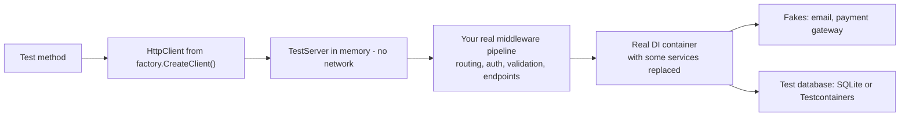

# Testing .NET Applications

> In this document you will learn how to test C# and ASP.NET Core code: the three test frameworks (xUnit, NUnit, MSTest), test structure with `[Fact]` and `[Theory]`, assertions, mocking with Moq and NSubstitute, designing code so it is easy to test, controlling time with `TimeProvider`, integration tests with `WebApplicationFactory`, database tests with SQLite and Testcontainers, and code coverage. Interviewers ask about testing to see whether your code can be changed safely — and whether you know which tests give real confidence.

**Before this:** [Dependency injection in ASP.NET Core](08-dependency-injection-in-aspnet-core.md) · [Web APIs, validation and error handling](09-web-apis-validation-and-error-handling.md) · [Angular testing](../06-angular-16/14-testing.md) (for the frontend side) · **Interview questions:** [jump to the interview section](#interview-questions)

## Table of contents

1. [What to test in a .NET backend](#what-to-test-in-a-net-backend)
2. [Test frameworks: xUnit, NUnit and MSTest](#test-frameworks-xunit-nunit-and-mstest)
3. [Test projects and dotnet test](#test-projects-and-dotnet-test)
4. [Writing tests with xUnit](#writing-tests-with-xunit)
5. [Setup, fixtures and parallel tests](#setup-fixtures-and-parallel-tests)
6. [Assertions and assertion libraries](#assertions-and-assertion-libraries)
7. [Test doubles: fakes, stubs and mocks](#test-doubles-fakes-stubs-and-mocks)
8. [Moq and NSubstitute](#moq-and-nsubstitute)
9. [Designing code for testability](#designing-code-for-testability)
10. [Testing time with TimeProvider](#testing-time-with-timeprovider)
11. [Testing HttpClient code](#testing-httpclient-code)
12. [Integration tests with WebApplicationFactory](#integration-tests-with-webapplicationfactory)
13. [Testing authentication and authorization](#testing-authentication-and-authorization)
14. [Testing with a database](#testing-with-a-database)
15. [Code coverage](#code-coverage)
16. [How to explain this in an interview](#how-to-explain-this-in-an-interview)
17. [Common mistakes](#common-mistakes)
18. [Best practices](#best-practices)
19. [Interview questions](#interview-questions)
20. [Summary](#summary)
21. [References](#references)

> **Note about running the examples:** test frameworks, mocking libraries, `WebApplicationFactory` and Testcontainers are NuGet packages. The code that uses them is written from the official documentation and marked "not run here". The production code under test, the hand-written fakes, the `TimeProvider` example and a package-free integration test were run with the .NET 10 SDK through a small hand-made runner that prints `PASS`/`FAIL`.

---

## What to test in a .NET backend

A **test** is code that runs your code and checks the result automatically. Tests let you change code without fear: if you break something, a test fails before your users notice.

| Kind | What it checks | Speed | Typical tools in .NET |
| --- | --- | --- | --- |
| **Unit test** | One class or function, with its dependencies replaced | Milliseconds | xUnit/NUnit/MSTest + fakes or mocks |
| **Integration test** | Several real parts together: HTTP pipeline, DI, serialization, database | Tens to hundreds of ms | `WebApplicationFactory`, SQLite, Testcontainers |
| **End-to-end (E2E) test** | The deployed system through its real UI or API | Seconds | Playwright, API smoke tests |
| **Contract test** | That two services agree on the message or API shape | Fast | Pact, schema checks |

**The test pyramid** says: many unit tests, fewer integration tests, very few E2E tests. In ASP.NET Core APIs many teams use more of a "**test trophy**": a strong layer of integration tests through `WebApplicationFactory`, because they are still fast and they catch the bugs that unit tests miss — wrong routes, missing DI registrations, validation, JSON shape, authorization rules and real SQL.

What is worth testing:

- **Business rules** (prices, discounts, state changes) → unit tests.
- **Endpoints**: status codes, validation errors (ProblemDetails), JSON shape, authorization → integration tests.
- **Data access**: queries, constraints, migrations → integration tests against a real database engine.
- **Edge cases and bugs you have fixed** → a test per bug, so it never returns.

What is usually not worth testing: framework code (that `[Required]` works), trivial properties, and private methods directly (test them through the public method that uses them).

## Test frameworks: xUnit, NUnit and MSTest

All three are mature and free. They run with `dotnet test`, in Visual Studio, Rider and VS Code.

| | xUnit | NUnit | MSTest |
| --- | --- | --- | --- |
| Test attribute | `[Fact]` | `[Test]` | `[TestMethod]` |
| Parameterized test | `[Theory]` + `[InlineData]`, `[MemberData]`, `[ClassData]` | `[TestCase]`, `[TestCaseSource]` | `[DataRow]`, `[DynamicData]` |
| Class marker | none | `[TestFixture]` (optional) | `[TestClass]` |
| Setup per test | Constructor (+ `Dispose`/`IAsyncLifetime`) | `[SetUp]` / `[TearDown]` | `[TestInitialize]` / `[TestCleanup]` |
| Shared setup | `IClassFixture<T>`, `ICollectionFixture<T>` | `[OneTimeSetUp]` | `[ClassInitialize]` |
| New class instance per test | Yes | No (one instance per fixture by default) | Yes |
| Owner | .NET Foundation community | Community | Microsoft |
| Used by | ASP.NET Core team's docs samples, many OSS projects | Many enterprise codebases | Microsoft products, Visual Studio-centric teams |

### Versions you will meet (checked October 2026)

- **xUnit v2** (`xunit` 2.9.x) is still what `dotnet new xunit` creates in the .NET 10 SDK (the SDK 10.0.402 template references `xunit` 2.9.3, `xunit.runner.visualstudio` 3.1.4, `Microsoft.NET.Test.Sdk` and `coverlet.collector`).
- **xUnit v3** (`xunit.v3`, version 1.0 released December 2024) is the new major version. Test projects become **executables**, it supports the new **Microsoft.Testing.Platform** runner, and it adds `TestContext.Current` (for example `TestContext.Current.CancellationToken`), `Assert.Skip` and explicit tests. Install its templates with `dotnet new install xunit.v3.templates` and create projects with `dotnet new xunit3`.
- **MSTest** 4.x (`dotnet new mstest` in SDK 10.0.402 references `MSTest` 4.0.2) uses the MSTest SDK/metapackage and Microsoft.Testing.Platform.
- **NUnit** 4.x (`dotnet new nunit` references `NUnit` 4.3.2).

> **New in .NET 10:** `dotnet test` can run on **Microsoft.Testing.Platform (MTP)** natively, instead of the older VSTest engine. You opt in by adding `"test": { "runner": "Microsoft.Testing.Platform" }` to `global.json`. In .NET 8 and 9, MTP projects could only run through a VSTest compatibility mode.

**Which one should you pick?** For a new project, any of the three is fine; consistency with your team matters more. This document uses xUnit because it is the most common in modern ASP.NET Core code and Microsoft's integration-test docs.

**If you know Jest or Vitest:** `[Fact]` is `it(...)`, a test class is a `describe` block, `[Theory]` + `[InlineData]` is `it.each`, the constructor is `beforeEach`, `IClassFixture` is `beforeAll`, and Moq/NSubstitute replace `jest.fn()` and `jest.mock()`.

## Test projects and dotnet test

Tests live in a **separate project** that references the project under test.

```text
Shop.sln
  src/Shop.Api/Shop.Api.csproj
  src/Shop.Domain/Shop.Domain.csproj
  tests/Shop.Domain.Tests/Shop.Domain.Tests.csproj        (unit tests)
  tests/Shop.Api.IntegrationTests/Shop.Api.IntegrationTests.csproj
```

```bash
dotnet new xunit -o tests/Shop.Domain.Tests
dotnet add tests/Shop.Domain.Tests reference src/Shop.Domain
dotnet sln add tests/Shop.Domain.Tests

dotnet test                                          # build and run all tests
dotnet test --filter "FullyQualifiedName~Orders"     # tests whose name contains "Orders"
dotnet test --filter "Category=Integration"          # xUnit [Trait("Category", "Integration")]
dotnet test --logger "trx" --results-directory ./TestResults
```

The project file created by the template (SDK 10.0.402):

```xml
<Project Sdk="Microsoft.NET.Sdk">
  <PropertyGroup>
    <TargetFramework>net10.0</TargetFramework>
    <ImplicitUsings>enable</ImplicitUsings>
    <Nullable>enable</Nullable>
    <IsPackable>false</IsPackable>
  </PropertyGroup>
  <ItemGroup>
    <PackageReference Include="coverlet.collector" Version="6.0.4" />
    <PackageReference Include="Microsoft.NET.Test.Sdk" Version="17.14.1" />
    <PackageReference Include="xunit" Version="2.9.3" />
    <PackageReference Include="xunit.runner.visualstudio" Version="3.1.4" />
  </ItemGroup>
  <ItemGroup>
    <Using Include="Xunit" />
  </ItemGroup>
</Project>
```

**Testing `internal` classes:** add `<InternalsVisibleTo Include="Shop.Domain.Tests" />` to the production project. Use it for real internal logic, not as an excuse to test private details.

## Writing tests with xUnit

### Arrange, Act, Assert

Every good test has three parts:

1. **Arrange:** create the object under test and its inputs.
2. **Act:** call the one method you are testing.
3. **Assert:** check the result.

```csharp
public class DiscountCalculatorTests
{
    [Fact]
    public void Gold_customer_gets_10_percent_off()
    {
        // Arrange
        var calculator = new DiscountCalculator();

        // Act
        decimal total = calculator.Apply(subtotal: 200m, CustomerTier.Gold);

        // Assert
        Assert.Equal(180m, total);
    }
}

public enum CustomerTier { Regular, Silver, Gold }

public class DiscountCalculator
{
    public decimal Apply(decimal subtotal, CustomerTier tier)
    {
        ArgumentOutOfRangeException.ThrowIfNegative(subtotal);
        decimal rate = tier switch { CustomerTier.Gold => 0.10m, CustomerTier.Silver => 0.05m, _ => 0m };
        return subtotal - subtotal * rate;
    }
}
```

**Naming:** the test name should say the rule, not the method: `Gold_customer_gets_10_percent_off`, or the pattern `Method_State_ExpectedResult` (`Apply_GoldTier_Returns90Percent`). When it fails in CI, the name alone should tell you what broke.

### Theories: one test, many inputs

```csharp
[Theory]
[InlineData(100, CustomerTier.Regular, 100)]
[InlineData(100, CustomerTier.Silver, 95)]
[InlineData(100, CustomerTier.Gold, 90)]
[InlineData(0, CustomerTier.Gold, 0)]
public void Apply_returns_discounted_total(int subtotal, CustomerTier tier, int expected)
{
    var total = new DiscountCalculator().Apply(subtotal, tier);   // int converts to decimal implicitly
    Assert.Equal(expected, total);
}

[Fact]
public void Apply_rejects_negative_subtotal()
{
    var calculator = new DiscountCalculator();
    Assert.Throws<ArgumentOutOfRangeException>(() => calculator.Apply(-1m, CustomerTier.Gold));
}
```

Each `[InlineData]` row shows up as a separate test result. For data that cannot be written as attribute constants (objects, dates, `decimal` with many digits), use `[MemberData]`:

```csharp
public static TheoryData<Order, bool> ShippingCases => new()
{
    { new Order(Total: 49.99m, Country: "DE"), false },
    { new Order(Total: 50.00m, Country: "DE"), true },
    { new Order(Total: 500m,   Country: "US"), false },   // free shipping is EU only
};

[Theory]
[MemberData(nameof(ShippingCases))]
public void Free_shipping_rule(Order order, bool expected) =>
    Assert.Equal(expected, ShippingPolicy.IsFree(order));
```

(C# attributes cannot hold `decimal` constants. That is why the theory above takes `int` values, and why `decimal` test data belongs in `TheoryData`.)

### Async tests

```csharp
[Fact]
public async Task PlaceAsync_saves_order_and_sends_email()
{
    var repo = new InMemoryOrderRepository();
    var email = new RecordingEmailSender();
    var service = new OrderService(repo, email, TimeProvider.System);

    var order = await service.PlaceAsync(customerId: 7, total: 120m);

    Assert.Single(repo.Saved);
    Assert.Equal(7, email.Sent.Single().CustomerId);
}

[Fact]
public async Task PlaceAsync_rejects_zero_total() =>
    await Assert.ThrowsAsync<ArgumentOutOfRangeException>(() => new OrderService(new InMemoryOrderRepository(), new RecordingEmailSender(), TimeProvider.System).PlaceAsync(7, 0m));
```

❌ Never write `async void` tests. The framework cannot await them, so failures may be lost. Always return `Task`.

❌ Never use `.Result` or `.Wait()` in tests. Use `await` with `Assert.ThrowsAsync`.

## Setup, fixtures and parallel tests

### Per-test setup

xUnit creates a **new instance of the test class for every test**. So the constructor is your "before each" and `Dispose` (or `IAsyncLifetime.DisposeAsync`) is your "after each". Fields are never shared between tests, which prevents tests from affecting each other.

```csharp
public class CartTests : IDisposable
{
    private readonly Cart _cart;
    public CartTests() => _cart = new Cart();         // runs before EACH test
    public void Dispose() { /* runs after each test */ }

    [Fact] public void New_cart_is_empty() => Assert.Empty(_cart.Items);
    [Fact] public void Adding_item_increases_count() { _cart.Add("mouse"); Assert.Single(_cart.Items); }
}
```

### Expensive shared setup: fixtures

Some setup is too expensive per test: starting a test server, starting a database container. Fixtures create it **once**.

```csharp
// Shared by all tests in ONE class
public class ProductApiTests(ShopApiFactory factory) : IClassFixture<ShopApiFactory>
{
    [Fact]
    public async Task Get_products_returns_200()
    {
        var client = factory.CreateClient();
        var response = await client.GetAsync("/api/products");
        response.EnsureSuccessStatusCode();
    }
}

// Shared by MANY classes: a collection
[CollectionDefinition("Database")]
public class DatabaseCollection : ICollectionFixture<PostgresFixture> { }

[Collection("Database")]
public class OrderRepositoryTests(PostgresFixture db) { /* ... */ }

[Collection("Database")]
public class InvoiceRepositoryTests(PostgresFixture db) { /* ... */ }
```

For async setup (start a container, run migrations), implement `IAsyncLifetime` with `InitializeAsync` and `DisposeAsync` on the fixture.

### Parallelization

By default, xUnit runs **test collections in parallel**. Each test class is its own collection unless you group classes with `[Collection]`. Tests **inside** one class run one after another.

This matters when tests share something global: a static field, a file, an environment variable, or one database. Two classes that both clean the same table will randomly break each other. Fix it by putting them in the same collection (they then run sequentially), by giving each test its own data (unique IDs, separate schemas), or by avoiding shared static state.

## Assertions and assertion libraries

### Built-in xUnit assertions

```csharp
Assert.Equal(180m, total);
Assert.NotNull(order);
Assert.True(result.IsSuccess);
Assert.Empty(cart.Items);
Assert.Single(repo.Saved);
Assert.Contains("mouse", cart.Items);
Assert.Equivalent(new { Id = 7, Status = "Paid" }, order);      // structural comparison
var ex = Assert.Throws<InvalidOperationException>(() => order.Ship());
Assert.Equal("Order is not paid.", ex.Message);
Assert.IsType<NotFound>(result);                                 // minimal API typed result
```

### Fluent assertion libraries

Fluent libraries read like sentences and give richer failure messages, especially for collections and object graphs:

```csharp
// FluentAssertions / AwesomeAssertions style (not run here)
order.Status.Should().Be(OrderStatus.Paid);
orders.Should().HaveCount(3).And.OnlyContain(o => o.CustomerId == 7);
response.StatusCode.Should().Be(HttpStatusCode.Created);
dto.Should().BeEquivalentTo(new { Id = 7, Total = 120m });

// Shouldly style (not run here)
order.Status.ShouldBe(OrderStatus.Paid);
orders.Count.ShouldBe(3);
```

**The FluentAssertions licensing change (January 2025):** starting with **version 8**, FluentAssertions moved from the Apache 2.0 license to a **commercial license** from Xceed for commercial use (a paid per-developer license; check Xceed's current terms), free only for non-commercial use. **Version 7** remains Apache 2.0. Teams reacted in different ways:

- stay on FluentAssertions 7.x;
- buy licenses for 8.x;
- switch to **AwesomeAssertions**, a community fork of the Apache 2.0 code with a very similar API;
- switch to **Shouldly** (BSD-licensed), or just use the built-in `Assert` methods.

In an interview, say this neutrally: "the license changed in v8, so we checked our options and chose X". Interviewers want to see that you watch dependency licenses, not that you have strong opinions about one library.

## Test doubles: fakes, stubs and mocks

A **test double** replaces a real dependency in a test (like a stunt double replaces an actor). The names come from Gerard Meszaros' book *xUnit Test Patterns*:

| Kind | What it does | Example |
| --- | --- | --- |
| **Dummy** | Passed in but never used | `NullLogger<T>.Instance` |
| **Stub** | Returns fixed answers | A repository that always returns one product |
| **Fake** | A working, simpler implementation | An in-memory repository with a `List<T>` |
| **Spy** | Records how it was called | An email sender that stores sent messages |
| **Mock** | Pre-programmed with expectations, verifies calls | Moq's `Verify(x => x.Send(...), Times.Once)` |

### Hand-written fakes

For small interfaces, hand-written fakes are often clearer than a mocking library, and they need no package:

```csharp
public interface IOrderRepository { Task<Order> AddAsync(int customerId, decimal total, DateTimeOffset at); }
public interface IEmailSender { Task SendOrderConfirmationAsync(Order order); }

public class InMemoryOrderRepository : IOrderRepository          // fake
{
    public List<Order> Saved { get; } = [];
    public Task<Order> AddAsync(int customerId, decimal total, DateTimeOffset at)
    {
        var order = new Order(Saved.Count + 1, customerId, total, at);
        Saved.Add(order);
        return Task.FromResult(order);
    }
}

public class RecordingEmailSender : IEmailSender                 // spy
{
    public List<Order> Sent { get; } = [];
    public Task SendOrderConfirmationAsync(Order order) { Sent.Add(order); return Task.CompletedTask; }
}

public class OrderService(IOrderRepository repo, IEmailSender email, TimeProvider clock)
{
    public async Task<Order> PlaceAsync(int customerId, decimal total)
    {
        ArgumentOutOfRangeException.ThrowIfNegativeOrZero(total);
        var order = await repo.AddAsync(customerId, total, clock.GetUtcNow());
        await email.SendOrderConfirmationAsync(order);
        return order;
    }
}
public record Order(int Id, int CustomerId, decimal Total, DateTimeOffset CreatedAt);
```

The checks below were run with the .NET 10 SDK against this exact code:

```text
PASS  order saved (actual: 1)
PASS  one email sent (actual: 1)
PASS  email goes to customer 7 (actual: 7)
PASS  negative total throws (actual: True)
PASS  no email for failed order (actual: 1)
```

The last check is a good habit: test the **unhappy path** too. A failing order must not send an email.

## Moq and NSubstitute

Mocking libraries create test doubles at runtime from an interface. They save code when interfaces are large or when you need to check "was this called with these arguments?". (Packages, not run here.)

### Moq

```csharp
[Fact]
public async Task PlaceAsync_sends_confirmation_email()
{
    var repo = new Mock<IOrderRepository>();
    repo.Setup(r => r.AddAsync(7, 120m, It.IsAny<DateTimeOffset>()))
        .ReturnsAsync(new Order(1, 7, 120m, DateTimeOffset.UnixEpoch));
    var email = new Mock<IEmailSender>();

    var service = new OrderService(repo.Object, email.Object, TimeProvider.System);
    await service.PlaceAsync(7, 120m);

    email.Verify(e => e.SendOrderConfirmationAsync(It.Is<Order>(o => o.CustomerId == 7)), Times.Once);
}
```

### NSubstitute

```csharp
[Fact]
public async Task PlaceAsync_sends_confirmation_email()
{
    var repo = Substitute.For<IOrderRepository>();
    repo.AddAsync(7, 120m, Arg.Any<DateTimeOffset>()).Returns(new Order(1, 7, 120m, DateTimeOffset.UnixEpoch));
    var email = Substitute.For<IEmailSender>();

    var service = new OrderService(repo, email, TimeProvider.System);
    await service.PlaceAsync(7, 120m);

    await email.Received(1).SendOrderConfirmationAsync(Arg.Is<Order>(o => o.CustomerId == 7));
}
```

| | Moq | NSubstitute |
| --- | --- | --- |
| Style | `mock.Setup(...)`, `mock.Object`, `Verify(...)` | The substitute *is* the interface: `sub.Method().Returns(...)`, `Received()` |
| Strict mode | `MockBehavior.Strict` (throws on unexpected calls) | No strict mode by default |
| Learning curve | More ceremony | Shorter, reads naturally |
| License | BSD-3-Clause | BSD-3-Clause |

**The Moq SponsorLink episode (August 2023):** Moq version **4.20.0** included a build-time component called **SponsorLink**. It read the developer's git email from the local configuration and sent a **hash** of it to a remote service to check whether the developer sponsored the project, with no way to turn it off. Many users raised privacy and GDPR concerns, and some companies blocked the version. The feature was **removed in 4.20.2**. Moq is still widely used; some teams moved to NSubstitute at that time. If asked, describe it factually: it is an example of why teams review dependency updates, pin versions and scan packages.

### When not to mock

- **Do not mock what you do not own** in deep detail (for example `DbContext`, `HttpClient`, `IConfiguration`). Mocks of complex framework types are brittle and test your assumptions, not the real behavior. Use a real implementation (SQLite, an in-memory configuration, a stub `HttpMessageHandler`) or wrap the framework type behind your own small interface.
- **Do not verify every call.** Verifying internal calls ties the test to the implementation, so refactoring breaks tests even when behavior is correct. Verify only calls that are the *point* of the behavior (an email was sent, a payment was charged).
- **Prefer state checks over interaction checks** when possible: check the saved order, not that `Add` was called.

## Designing code for testability

Code is easy to test when its dependencies are **passed in** instead of created inside. This is dependency injection; the idea is explained in [Dependency inversion and injection](../04-oop-solid-design-patterns/05-dependency-inversion-and-injection.md).

```csharp
// ❌ Hard to test: hidden dependencies created inside
public class InvoiceService
{
    public async Task SendOverdueRemindersAsync()
    {
        using var db = new AppDbContext();                     // real database
        var smtp = new SmtpClient("smtp.example.com");         // real email
        var overdue = await db.Invoices.Where(i => i.DueDate < DateTime.Now).ToListAsync(); // real clock
        foreach (var inv in overdue) await smtp.SendMailAsync("billing@example.com", inv.Email, "Overdue", "...");
    }
}

// ✅ Easy to test: dependencies through the constructor
public class InvoiceService(IInvoiceRepository invoices, IEmailSender email, TimeProvider clock)
{
    public async Task<int> SendOverdueRemindersAsync(CancellationToken ct = default)
    {
        var today = clock.GetUtcNow();
        var overdue = await invoices.GetUnpaidDueBeforeAsync(today, ct);
        foreach (var inv in overdue) await email.SendOverdueReminderAsync(inv, ct);
        return overdue.Count;
    }
}
```

Hidden dependencies that make code hard to test, and their replacements:

| Hidden dependency | Testable replacement |
| --- | --- |
| `DateTime.Now`, `DateTime.UtcNow` | `TimeProvider` (.NET 8+) |
| `new HttpClient()` | Typed client from `IHttpClientFactory` with a stub handler in tests |
| `new SomeService()` inside a method | Constructor injection |
| Static helpers with side effects (`File.ReadAllText`, `Environment.GetEnvironmentVariable`) | `IFileSystem`-style wrapper, `IConfiguration`, options |
| `Guid.NewGuid()` for IDs you assert on | An `IIdGenerator` or pass the ID in |
| `Random.Shared` | Inject `Random` with a fixed seed |

## Testing time with TimeProvider

### The problem

Code that reads `DateTime.UtcNow` gives different results every time you run the test. You cannot test "the coupon expires after 7 days" without waiting 7 days.

### The solution

.NET 8 added the abstract class **`System.TimeProvider`**. Production code uses `TimeProvider.System`. Tests use a fake whose time you control. It also covers timers: `Task.Delay(TimeSpan, TimeProvider)`, `CancellationTokenSource(TimeSpan, TimeProvider)` and `PeriodicTimer(TimeSpan, TimeProvider)` (.NET 8+).

```csharp
public record Coupon(string Code, DateTimeOffset ExpiresAt);

public class CouponService(TimeProvider clock)
{
    public Coupon Create(string code, TimeSpan validFor) => new(code, clock.GetUtcNow() + validFor);
    public bool IsValid(Coupon c) => clock.GetUtcNow() < c.ExpiresAt;
}

// Registration in Program.cs
builder.Services.AddSingleton(TimeProvider.System);
```

A minimal fake for "now" (this is what was run):

```csharp
public class ManualTimeProvider(DateTimeOffset start) : TimeProvider
{
    private DateTimeOffset _now = start;
    public override DateTimeOffset GetUtcNow() => _now;
    public void Advance(TimeSpan by) => _now += by;
}

var clock = new ManualTimeProvider(new DateTimeOffset(2026, 3, 1, 9, 0, 0, TimeSpan.Zero));
var svc = new CouponService(clock);
var coupon = svc.Create("SPRING10", validFor: TimeSpan.FromDays(7));

Check("valid right after creation", svc.IsValid(coupon), true);
clock.Advance(TimeSpan.FromDays(7) - TimeSpan.FromSeconds(1));
Check("valid 1 second before expiry", svc.IsValid(coupon), true);
clock.Advance(TimeSpan.FromSeconds(1));
Check("invalid exactly at expiry", svc.IsValid(coupon), false);
```

Output:

```text
PASS  valid right after creation (actual: True)
PASS  valid 1 second before expiry (actual: True)
PASS  invalid exactly at expiry (actual: False)
```

The test runs in microseconds and checks the exact boundary — something you can never test reliably with the real clock.

**For timers, use `FakeTimeProvider`.** The hand-written fake above only overrides `GetUtcNow`. Timers it creates still use real time. The package `Microsoft.Extensions.TimeProvider.Testing` has `FakeTimeProvider`, which also fires timers and delays when you call `Advance` (not run here):

```csharp
var time = new FakeTimeProvider(startDateTime: new DateTimeOffset(2026, 3, 1, 9, 0, 0, TimeSpan.Zero));
var delayTask = Task.Delay(TimeSpan.FromMinutes(5), time);
Assert.False(delayTask.IsCompleted);
time.Advance(TimeSpan.FromMinutes(5));      // completes the delay without waiting
await delayTask;
```

This makes `BackgroundService` loops with `PeriodicTimer(period, timeProvider)` testable without sleeping.

## Testing HttpClient code

Do not mock `HttpClient` itself. Its methods are not virtual. Instead, give the real `HttpClient` a **stub `HttpMessageHandler`**: the handler is the part that actually sends requests.

```csharp
public class StubHandler(Func<HttpRequestMessage, HttpResponseMessage> respond) : HttpMessageHandler
{
    public List<HttpRequestMessage> Requests { get; } = [];
    protected override Task<HttpResponseMessage> SendAsync(HttpRequestMessage request, CancellationToken ct)
    {
        Requests.Add(request);
        return Task.FromResult(respond(request));
    }
}

public class ExchangeRateClient(HttpClient http)       // a typed client in production
{
    public async Task<decimal?> GetRateAsync(string currency, CancellationToken ct = default)
    {
        var response = await http.GetAsync($"/rates/{currency}", ct);
        if (response.StatusCode == HttpStatusCode.NotFound) return null;
        response.EnsureSuccessStatusCode();
        var body = await response.Content.ReadFromJsonAsync<RateDto>(ct);
        return body!.Rate;
    }
    private record RateDto(string Currency, decimal Rate);
}

// Test
var handler = new StubHandler(req => req.RequestUri!.AbsolutePath == "/rates/EUR"
    ? new HttpResponseMessage(HttpStatusCode.OK) { Content = JsonContent.Create(new { currency = "EUR", rate = 1.08m }) }
    : new HttpResponseMessage(HttpStatusCode.NotFound));
var client = new ExchangeRateClient(new HttpClient(handler) { BaseAddress = new Uri("https://rates.example") });

Check("EUR rate parsed", await client.GetRateAsync("EUR"), 1.08m);
Check("unknown currency -> null", await client.GetRateAsync("XYZ"), (decimal?)null);
Check("two requests sent", handler.Requests.Count, 2);
```

Output:

```text
PASS  EUR rate parsed (actual: 1.08)
PASS  unknown currency -> null (actual: null)
PASS  two requests sent (actual: 2)
PASS  first request path (actual: /rates/EUR)
```

This tests your real URL building, status handling and JSON parsing, with no network. For more realistic HTTP tests (real sockets, timeouts, retries), WireMock.Net runs a fake HTTP server inside the test.

## Integration tests with WebApplicationFactory

### What it is

`WebApplicationFactory<TEntryPoint>` (package `Microsoft.AspNetCore.Mvc.Testing`) starts your **real** ASP.NET Core app in memory, using `TestServer` instead of Kestrel. You get an `HttpClient` that sends requests through the whole pipeline — middleware, routing, model binding, validation, filters, authorization, DI, serialization — without opening a network port.



### A custom factory

```csharp
// Not run here (packages: Microsoft.AspNetCore.Mvc.Testing, xunit)
public class ShopApiFactory : WebApplicationFactory<Program>
{
    public RecordingEmailSender Emails { get; } = new();

    protected override void ConfigureWebHost(IWebHostBuilder builder)
    {
        builder.UseEnvironment("Testing");
        builder.ConfigureTestServices(services =>
        {
            // Replace external dependencies with fakes
            services.RemoveAll<IEmailSender>();
            services.AddSingleton<IEmailSender>(Emails);

            services.RemoveAll<IPaymentGateway>();
            services.AddSingleton<IPaymentGateway, AlwaysApprovesPaymentGateway>();
        });
    }
}

public class OrdersApiTests(ShopApiFactory factory) : IClassFixture<ShopApiFactory>
{
    [Fact]
    public async Task Post_order_returns_201_with_location()
    {
        var client = factory.CreateClient();

        var response = await client.PostAsJsonAsync("/orders", new { customerId = 9, total = 50m });

        Assert.Equal(HttpStatusCode.Created, response.StatusCode);
        Assert.NotNull(response.Headers.Location);
        Assert.Single(factory.Emails.Sent);
    }

    [Fact]
    public async Task Post_order_with_zero_total_returns_problem_details()
    {
        var client = factory.CreateClient();

        var response = await client.PostAsJsonAsync("/orders", new { customerId = 9, total = 0m });

        Assert.Equal(HttpStatusCode.BadRequest, response.StatusCode);
        Assert.Equal("application/problem+json", response.Content.Headers.ContentType?.MediaType);
    }
}
```

Key points:

- `ConfigureTestServices` runs **after** your app's own service registrations, so your replacements win.
- `WebApplicationFactory<Program>` needs access to the `Program` class. With top-level statements the generated `Program` class used to be `internal`, so you added `public partial class Program { }` at the end of `Program.cs`.

> **New in .NET 10:** A source generator now adds `public partial class Program` automatically for apps with top-level statements, and an analyzer suggests removing the manual declaration. On .NET 8 and 9 you still need the manual line (or `InternalsVisibleTo`).

- The factory and its server are expensive to create, so share them per class with `IClassFixture` (or per collection). Each test should create its own data so tests stay independent.
- Configuration can be overridden with `builder.UseSetting("ConnectionStrings:Shop", ...)` or `ConfigureAppConfiguration`.

### The same idea without packages

To check the behavior in this repository without NuGet packages, the same endpoint was tested against a real Kestrel server on a random port (`http://127.0.0.1:0`) with fakes registered in DI. This is slower and less convenient than `TestServer`, but it shows exactly what an integration test checks:

```csharp
var builder = WebApplication.CreateBuilder();
builder.WebHost.UseUrls("http://127.0.0.1:0");            // random free port
builder.Services.AddSingleton<IOrderRepository>(repo);   // fakes from the unit tests
builder.Services.AddSingleton<IEmailSender>(email);
builder.Services.AddSingleton<TimeProvider>(clock);
builder.Services.AddScoped<OrderService>();
var app = builder.Build();
app.MapPost("/orders", async (PlaceOrder req, OrderService s) =>
    req.Total <= 0
        ? Results.ValidationProblem(new Dictionary<string, string[]> { ["total"] = ["Total must be positive."] })
        : Results.Created($"/orders/{(await s.PlaceAsync(req.CustomerId, req.Total)).Id}", null));
await app.StartAsync();

using var http = new HttpClient { BaseAddress = new Uri(app.Urls.First()) };
var ok = await http.PostAsJsonAsync("/orders", new PlaceOrder(9, 50m));
var bad = await http.PostAsJsonAsync("/orders", new PlaceOrder(9, 0m));
await app.StopAsync();
```

Output:

```text
PASS  POST /orders -> 201 (actual: Created)
PASS  Location header (actual: /orders/2)
PASS  POST invalid -> 400 (actual: BadRequest)
PASS  problem+json (actual: application/problem+json)
```

## Testing authentication and authorization

Two levels:

**1. Unit-test authorization handlers.** They are plain classes. Build a `ClaimsPrincipal`, an `AuthorizationHandlerContext` and call `HandleAsync`:

```csharp
public record Report(string Department);
public class SameDepartmentRequirement : IAuthorizationRequirement { }
public class SameDepartmentHandler : AuthorizationHandler<SameDepartmentRequirement, Report>
{
    protected override Task HandleRequirementAsync(AuthorizationHandlerContext context,
        SameDepartmentRequirement requirement, Report report)
    {
        if (context.User.HasClaim("department", report.Department)) context.Succeed(requirement);
        return Task.CompletedTask;
    }
}

async Task<bool> Evaluate(string userDept, string docDept)
{
    var requirement = new SameDepartmentRequirement();
    var user = new ClaimsPrincipal(new ClaimsIdentity([new Claim("department", userDept)], "Test"));
    var ctx = new AuthorizationHandlerContext([requirement], user, new Report(docDept));
    await new SameDepartmentHandler().HandleAsync(ctx);
    return ctx.HasSucceeded;
}
```

Output:

```text
PASS  same department succeeds (actual: True)
PASS  other department fails (actual: False)
```

**2. Integration-test endpoints with a test authentication scheme.** Replace the real JWT or cookie scheme with a handler that builds the user from a test header (not run here):

```csharp
public class TestAuthHandler(IOptionsMonitor<AuthenticationSchemeOptions> o, ILoggerFactory l, UrlEncoder e)
    : AuthenticationHandler<AuthenticationSchemeOptions>(o, l, e)
{
    public const string Scheme = "Test";
    protected override Task<AuthenticateResult> HandleAuthenticateAsync()
    {
        if (!Request.Headers.TryGetValue("X-Test-User", out var userId))
            return Task.FromResult(AuthenticateResult.NoResult());
        var claims = new List<Claim> { new(ClaimTypes.NameIdentifier, userId!) };
        claims.AddRange(Request.Headers["X-Test-Role"].Select(r => new Claim(ClaimTypes.Role, r!)));
        var principal = new ClaimsPrincipal(new ClaimsIdentity(claims, Scheme));
        return Task.FromResult(AuthenticateResult.Success(new AuthenticationTicket(principal, Scheme)));
    }
}

// In the factory's ConfigureTestServices:
services.AddAuthentication(TestAuthHandler.Scheme)
        .AddScheme<AuthenticationSchemeOptions, TestAuthHandler>(TestAuthHandler.Scheme, _ => { });

// Tests: anonymous -> 401, other user -> 403/404, owner -> 200, admin -> 200
[Theory]
[InlineData(null, null, HttpStatusCode.Unauthorized)]
[InlineData("user-2", null, HttpStatusCode.NotFound)]       // not the owner: hidden
[InlineData("user-1", null, HttpStatusCode.OK)]             // owner
[InlineData("admin-1", "Admin", HttpStatusCode.OK)]
public async Task Get_invoice_respects_ownership(string? user, string? role, HttpStatusCode expected)
{
    var client = factory.CreateClient();
    var request = new HttpRequestMessage(HttpMethod.Get, "/invoices/100");   // invoice 100 belongs to user-1
    if (user is not null) request.Headers.Add("X-Test-User", user);
    if (role is not null) request.Headers.Add("X-Test-Role", role);
    var response = await client.SendAsync(request);
    Assert.Equal(expected, response.StatusCode);
}
```

This kind of table-driven authorization test catches IDOR bugs, which are the most common real API vulnerability. See [Authentication and authorization](11-authentication-and-authorization.md).

## Testing with a database

### The options

| Option | Realism | Speed | Main problem |
| --- | --- | --- | --- |
| EF Core **InMemory** provider | Low | Very fast | Not a relational database; many behaviors differ |
| **SQLite in-memory** | Medium | Fast | A different SQL dialect than SQL Server/PostgreSQL |
| **Testcontainers** (real SQL Server/PostgreSQL in Docker) | High | Slower start (seconds), then fast | Needs Docker in CI |
| Shared test database server | High | Medium | Tests interfere with each other; hard to reset |

### Why the EF Core InMemory provider is risky

The InMemory provider stores entities in dictionaries. It is **not** a relational database, and Microsoft's EF Core docs recommend against using it to test code that touches the database. Things that pass with InMemory and fail in production:

- **No relational constraints:** foreign keys, unique indexes and `NOT NULL` columns are not enforced (beyond required properties).
- **No transactions:** starting a transaction raises a warning that is an error by default; if you suppress it, transactions are silently ignored, so rollback logic is never tested.
- **No SQL translation:** LINQ runs in memory, so a query that **cannot be translated to SQL** (a call to your own C# method inside `Where`) works in tests and throws at runtime in production.
- **Raw SQL** (`FromSql`, `ExecuteSqlRaw`) does not work. `ExecuteUpdate`/`ExecuteDelete` are not supported.
- **String comparison** is case-sensitive in memory, but often case-insensitive in SQL Server's default collation.

### SQLite in-memory

SQLite is a real relational engine with constraints and transactions. An in-memory SQLite database lives as long as **its connection is open**, so keep one connection open for the test:

```csharp
// Not run here (packages: Microsoft.EntityFrameworkCore.Sqlite)
public sealed class SqliteDb : IDisposable
{
    private readonly SqliteConnection _connection = new("DataSource=:memory:");
    public AppDbContext CreateContext()
    {
        var options = new DbContextOptionsBuilder<AppDbContext>().UseSqlite(_connection).Options;
        var db = new AppDbContext(options);
        return db;
    }
    public SqliteDb()
    {
        _connection.Open();                                   // the database exists while this is open
        using var db = CreateContext();
        db.Database.EnsureCreated();                          // or Migrate() if migrations are SQLite-compatible
    }
    public void Dispose() => _connection.Dispose();
}
```

The remaining gap: SQL dialect and features differ (no `rowversion`, different date functions, different collation). For queries that use provider-specific features, test against the real engine.

### Testcontainers

**Testcontainers** starts a real database in a Docker container for your tests and removes it afterwards (not run here):

```csharp
// Packages: Testcontainers.PostgreSql, Npgsql.EntityFrameworkCore.PostgreSQL
public class PostgresFixture : IAsyncLifetime
{
    private readonly PostgreSqlContainer _container = new PostgreSqlBuilder()
        .WithImage("postgres:17-alpine")
        .Build();

    public string ConnectionString => _container.GetConnectionString();

    public async Task InitializeAsync()
    {
        await _container.StartAsync();                          // a few seconds, once per fixture
        await using var db = CreateContext();
        await db.Database.MigrateAsync();                       // apply real migrations
    }

    public AppDbContext CreateContext() =>
        new(new DbContextOptionsBuilder<AppDbContext>().UseNpgsql(ConnectionString).Options);

    public Task DisposeAsync() => _container.DisposeAsync().AsTask();
}
```

Combined with `WebApplicationFactory`, you replace the connection string in `ConfigureWebHost`, and your integration tests run against the same database engine as production. To reset data between tests, either give each test unique data, wrap each test in a transaction that is rolled back, or use a library such as **Respawn** that deletes table data quickly in the right order.

Note on xUnit versions: in xUnit v3, `IAsyncLifetime` methods return `ValueTask` instead of `Task`.

## Code coverage

**Code coverage** measures which lines and branches ran during the tests. The xUnit and NUnit templates already reference **coverlet.collector**:

```bash
dotnet test --collect:"XPlat Code Coverage"
# writes TestResults/<guid>/coverage.cobertura.xml

dotnet tool install -g dotnet-reportgenerator-globaltool
reportgenerator -reports:"**/coverage.cobertura.xml" -targetdir:coverage-report -reporttypes:Html
```

On Microsoft.Testing.Platform, the equivalent is the `Microsoft.Testing.Extensions.CodeCoverage` extension (`--coverage`).

How to use coverage well:

- Coverage shows what is **not** tested. It does not prove that tested code is correct: a test with no asserts gives 100% coverage and 0% confidence.
- Use it to find untested **important** code (pricing, authorization, error paths), not to chase a number.
- A minimum in CI (for example "no drop below the current level") can stop coverage from decaying. A hard 90% target often produces low-value tests.
- **Mutation testing** (Stryker.NET) goes further: it changes your code (for example `>` to `>=`) and checks that some test fails. Surviving mutants show weak assertions.

---

## How to explain this in an interview

Use this for "How do you test your .NET APIs?"

1. **Define it:** "I use unit tests for business logic and integration tests for the API. Unit tests check one class with fakes; integration tests run the real ASP.NET Core pipeline in memory with `WebApplicationFactory`."
2. **Why it exists:** "Unit tests are fast and pinpoint logic bugs. But many API bugs are in the wiring — routes, DI registrations, validation, JSON, authorization, SQL — and only integration tests see those."
3. **How it works:** "Services get dependencies through constructors, including `TimeProvider` for time and typed `HttpClient`s, so tests can pass fakes. For integration tests, a custom `WebApplicationFactory<Program>` replaces external services in `ConfigureTestServices`, uses a test auth scheme, and points EF Core at a real database in Testcontainers or at SQLite."
4. **Small example:** "For `POST /orders` I have a theory with valid and invalid totals: valid returns 201 with a Location header and sends one email to the fake sender; invalid returns 400 with ProblemDetails. For authorization, a table of anonymous, other user, owner and admin with expected 401, 404, 200, 200."
5. **Where it is useful:** "Business rules, edge cases at boundaries — like a coupon expiring exactly at seven days with a fake clock — and regression tests for every bug we fix."
6. **Trade-offs / gotchas:** "I avoid the EF Core InMemory provider for data tests because it hides SQL translation errors and constraints. I don't over-mock — verifying every call makes refactoring painful. I watch for shared state between parallel test classes. And I treat coverage as a guide, not a target."

---

## Common mistakes

| Mistake | Why it hurts | Better |
| --- | --- | --- |
| `async void` tests, `.Result` in tests | Lost failures, deadlocks | `async Task` + `await`, `Assert.ThrowsAsync` |
| Tests depend on `DateTime.Now` | Flaky, fail at midnight or month end | `TimeProvider` + fake |
| EF Core InMemory for repository/query tests | Untranslatable LINQ and missing constraints pass | SQLite in-memory or Testcontainers |
| Mocking `DbContext` or `HttpClient` | Brittle, tests the mock, not the behavior | Real database; stub `HttpMessageHandler` |
| Verifying every interaction | Refactoring breaks tests | Assert outcomes; verify only meaningful side effects |
| Shared static state or shared DB rows across classes | Random failures when tests run in parallel | Unique data per test, collections, reset with Respawn |
| One giant test with many asserts | Unclear what broke | One behavior per test; theories for variations |
| Only happy paths | Bugs in error handling | Test validation, not found, forbidden, exceptions |
| Creating `WebApplicationFactory` in every test | Slow test suite | `IClassFixture` / collection fixture |
| Real email, payment or third-party calls in tests | Slow, flaky, costs money, side effects | Replace in `ConfigureTestServices` |
| Chasing 100% coverage | Low-value tests, false confidence | Cover important paths; mutation testing for quality |

## Best practices

- **Test behavior, not implementation:** call public APIs and check results. Your tests should survive refactoring.
- **Keep unit tests fast and isolated:** no network, no disk, no real clock.
- **Use integration tests for the API surface:** status codes, ProblemDetails, JSON shape, authorization, real SQL.
- **Inject everything that varies:** `TimeProvider`, `IHttpClientFactory`/typed clients, options, ID generators.
- **Prefer simple hand-written fakes** for small interfaces; use a mocking library when it clearly saves code.
- **Run database tests against the real engine** (Testcontainers) in CI for data-heavy code.
- **Name tests after the rule** they protect, and keep Arrange/Act/Assert visible.
- **Make tests deterministic:** fixed seeds, fixed time, unique data, no ordering dependencies.
- **Run tests on every pull request** and fail the build on failures; publish test results and coverage reports.
- **Check licenses** of test libraries (FluentAssertions 8, Moq history) as part of dependency reviews.

---

## Interview questions

### Q1. What is the difference between unit tests and integration tests in ASP.NET Core, and how do you balance them?

**What the interviewer is checking:** A practical testing strategy, not textbook definitions.

**Short spoken answer (30–60 seconds):**
> "A unit test checks one class with its dependencies replaced by fakes. It's fast and tells me exactly which rule broke. An integration test runs several real parts together — in ASP.NET Core usually the whole pipeline through `WebApplicationFactory`, with real routing, DI, validation, serialization and authorization, and a real database engine in a container. Many API bugs live in that wiring, so unit tests alone miss them. My balance is: unit tests for business rules and edge cases, a solid set of integration tests for every endpoint's main paths and error responses, and a few end-to-end smoke tests after deployment."

**Detailed explanation:** The classic test pyramid favors unit tests. For APIs, in-memory integration tests are cheap enough (milliseconds per request after startup) that many teams use more of them. The cost is setup: test databases, fakes for external services, test authentication.

**Follow-up questions:**
- **What should never be in an integration test?** — Real third-party calls (payments, email). Replace them with fakes in `ConfigureTestServices`, and cover the real integration with contract tests or a staging check.
- **How do you keep integration tests fast?** — Share the factory and database container per class or collection, reset data cheaply (unique data, transactions, Respawn), and avoid sleeps.

**Common mistakes:** Only unit tests with mocks everywhere; or only slow end-to-end tests.

**Where this is used in real projects:** Every production API's CI pipeline.

### Q2. Compare xUnit, NUnit and MSTest. Which would you choose?

**What the interviewer is checking:** Familiarity with the ecosystem and current versions.

**Short spoken answer:**
> "All three are mature and run with `dotnet test`. xUnit uses `[Fact]` and `[Theory]`, creates a new test class instance per test, uses the constructor and `Dispose` for setup, and fixtures for shared setup. NUnit uses `[Test]` and `[TestCase]` with `[SetUp]` methods and has a rich constraint-style assertion API. MSTest is Microsoft's, uses `[TestMethod]` and `[DataRow]`, and its 4.x versions are built on Microsoft.Testing.Platform. For a new project I'd follow the team's standard; otherwise xUnit, because it's the most common in modern ASP.NET Core code and docs. Today's `dotnet new xunit` template still creates xUnit v2; xUnit v3, released at the end of 2024, makes test projects executables and supports the new testing platform."

**Follow-up questions:**
- **Why does xUnit create a new instance per test?** — So tests cannot share state through fields. Each test starts clean.
- **What is Microsoft.Testing.Platform?** — A newer, lighter test runner that replaces VSTest. Test projects become executables. In .NET 10, `dotnet test` supports it natively when you opt in through `global.json`.

**Common mistakes:** Claiming one framework is "much faster" or "more correct" without evidence.

**Where this is used in real projects:** Choosing a standard for a new solution.

### Q3. What is the difference between Fact and Theory in xUnit?

**Short answer:** A `[Fact]` is a test with no parameters; it is always true for its fixed setup. A `[Theory]` is a parameterized test that runs once per data row from `[InlineData]` (constants), `[MemberData]` (a static property or method, often `TheoryData<...>`) or `[ClassData]` (a class that yields rows). Each row is reported as a separate test, so one failing input does not hide the others.

```csharp
[Theory]
[InlineData("", false)]
[InlineData("nina@example.com", true)]
[InlineData("nina@", false)]
public void Email_validation(string input, bool expected) =>
    Assert.Equal(expected, EmailRules.IsValid(input));
```

### Q4. How do you share expensive setup between tests in xUnit?

**What the interviewer is checking:** Knowing the test lifecycle and avoiding slow or coupled tests.

**Short spoken answer:**
> "Because xUnit creates a new class instance per test, the constructor runs before every test. For expensive setup — like a `WebApplicationFactory` or a database container — I use fixtures. `IClassFixture<T>` creates one instance for all tests in a class and injects it through the constructor. `ICollectionFixture<T>` with a `[CollectionDefinition]` shares one instance across several classes, and those classes then run sequentially, not in parallel. For async setup I implement `IAsyncLifetime`. The fixture should hold the expensive infrastructure, but each test should still create its own data so tests stay independent."

**Follow-up questions:**
- **Why might two test classes fail only when run together?** — xUnit runs different classes in parallel. If they share a static field or the same database rows, they interfere. Put them in one collection or isolate their data.
- **What changed for `IAsyncLifetime` in xUnit v3?** — The methods return `ValueTask`, and it builds on `IAsyncDisposable`.

**Common mistakes:** Using static fields for shared setup; creating a factory per test.

**Where this is used in real projects:** Integration test suites with one test server and one database container.

### Q5. Mocks, stubs and fakes — what are they, and when do you use a mocking library?

**What the interviewer is checking:** Correct vocabulary and judgment about over-mocking.

**Short spoken answer:**
> "They're all test doubles. A stub returns fixed answers. A fake is a simple working implementation, like an in-memory repository. A spy records calls so I can check them. A mock is set up with expectations and verifies the interaction. For small interfaces I often write fakes by hand — they're readable and reusable. I use Moq or NSubstitute when interfaces are large or I need argument matching and call verification. I verify only the interactions that matter — like 'an email was sent' — and otherwise assert on results, so tests don't break on every refactoring."

**Follow-up questions:**
- **Should you mock `DbContext`?** — No. It is complex, and a mock does not behave like a database. Use a real database (SQLite or Testcontainers) or put queries behind your own small interface and test the queries separately.
- **What does `MockBehavior.Strict` do in Moq?** — Any call that was not set up throws. It makes tests strict but brittle; the default is `Loose`.

**Common mistakes:** Mocking value objects or the class under test; `Verify` for every call.

**Where this is used in real projects:** Unit tests of application services.

### Q6. Moq vs NSubstitute — and what was the Moq SponsorLink issue?

**What the interviewer is checking:** Ecosystem awareness and a calm, factual tone.

**Short spoken answer:**
> "Both create test doubles from interfaces. Moq uses a wrapper object: `mock.Setup(...)`, `mock.Object`, `mock.Verify(...)`. NSubstitute's substitute is the interface itself: `sub.Method().Returns(...)` and `sub.Received().Method()`, which many people find shorter to read. Both are BSD-licensed. In August 2023, Moq 4.20.0 shipped a build-time component called SponsorLink that read the developer's git email and sent a hash of it to a remote service to check sponsorship, with no opt-out. That caused privacy concerns, and it was removed in 4.20.2. The lesson for teams is to review dependency updates and pin versions, not necessarily to avoid Moq."

**Common mistakes:** Presenting rumors or strong opinions; not knowing the version numbers involved.

**Where this is used in real projects:** Dependency policy discussions; choosing a mocking library for a new codebase.

### Q7. How do you test code that depends on the current time?

**What the interviewer is checking:** Testability design and knowledge of .NET 8's `TimeProvider`.

**Short spoken answer:**
> "I never call `DateTime.UtcNow` directly in business code. Since .NET 8 there's the abstract `TimeProvider` class. I inject it — `TimeProvider.System` in production — and in tests I pass a fake. The `FakeTimeProvider` from `Microsoft.Extensions.TimeProvider.Testing` lets me set the time and call `Advance`, and it also fires timers and delays created through it, so I can test a `PeriodicTimer` loop without waiting. That way I can test exact boundaries — a coupon valid one second before expiry and invalid exactly at expiry — in microseconds."

**Code:**

```csharp
var clock = new ManualTimeProvider(new DateTimeOffset(2026, 3, 1, 9, 0, 0, TimeSpan.Zero));
var coupon = new CouponService(clock).Create("SPRING10", TimeSpan.FromDays(7));
clock.Advance(TimeSpan.FromDays(7));
Assert.False(new CouponService(clock).IsValid(coupon));   // verified: invalid exactly at expiry
```

**Follow-up questions:**
- **What did people do before .NET 8?** — Wrote their own `IClock`/`ISystemClock` interface. `TimeProvider` standardizes it, and framework APIs (`Task.Delay`, `CancellationTokenSource`, `PeriodicTimer`) accept it.
- **Does a fake that only overrides `GetUtcNow` control `Task.Delay`?** — No. Timers created by the base class still use real time. Override `CreateTimer` or use `FakeTimeProvider`.

**Common mistakes:** `Thread.Sleep` in tests to "wait for expiry"; mixing local time and UTC.

**Where this is used in real projects:** Token expiry, subscriptions, SLAs, scheduled jobs, rate limits.

### Q8. How does WebApplicationFactory work, and how do you replace services in it?

**What the interviewer is checking:** Hands-on integration testing in ASP.NET Core.

**Short spoken answer:**
> "`WebApplicationFactory<Program>` boots the real app — the same `Program.cs` — on an in-memory `TestServer` and gives me an `HttpClient` that talks to it without a network. I subclass it and override `ConfigureWebHost`: set the environment, override configuration like the connection string, and in `ConfigureTestServices` remove real external services and register fakes. `ConfigureTestServices` runs after the app's registrations, so my fakes win. I share the factory per test class with `IClassFixture`. Before .NET 10, I also had to add `public partial class Program {}` so the test project could see `Program`; .NET 10 generates it automatically."

**Follow-up questions:**
- **How do you test with an authenticated user?** — Register a test authentication handler that builds a `ClaimsPrincipal` from a test header, make it the default scheme in `ConfigureTestServices`, and set the header per request.
- **How do you access services from the app inside a test?** — `factory.Services.CreateScope()` and resolve, for example, the `DbContext` to seed or check data.
- **How do you test background services in it?** — Remove the hosted service if it interferes (`services.RemoveAll<IHostedService>()` or a specific registration), or keep it and wait for observable results with a timeout.

**Common mistakes:** Calling real external APIs; forgetting that every test shares the same in-memory app state when using a class fixture.

**Where this is used in real projects:** API test projects in nearly every ASP.NET Core solution.

### Q9. Why is the EF Core InMemory provider a bad choice for testing data access? What do you use instead?

**What the interviewer is checking:** Knowing a common trap.

**Short spoken answer:**
> "The InMemory provider isn't a relational database. It doesn't enforce foreign keys or unique indexes, doesn't really support transactions, can't run raw SQL or `ExecuteUpdate`, compares strings case-sensitively, and — the biggest problem — it runs LINQ in memory, so a query that can't be translated to SQL passes the test and throws in production. Microsoft's docs also recommend against it for testing. I use SQLite in-memory for fast tests that need a relational engine, keeping the connection open for the whole test, and Testcontainers with the real SQL Server or PostgreSQL image for anything provider-specific, with real migrations."

**Follow-up questions:**
- **When is InMemory acceptable?** — For tests where the database is irrelevant and you just need a quick `DbContext`, or for prototypes. Even then a repository fake is often clearer.
- **How do you reset the database between tests?** — Unique data per test, a transaction per test that is rolled back, or a tool like Respawn that deletes data quickly.

**Common mistakes:** "Our repository tests pass with InMemory, so the queries are fine."

**Where this is used in real projects:** Repository and query tests; integration tests through `WebApplicationFactory`.

### Q10. Debugging: this test passes alone but fails in the full test run. Why?

```csharp
public class PriceTests
{
    [Fact]
    public void Gold_discount_applies()
    {
        PricingSettings.GoldDiscount = 0.10m;          // static, global
        Assert.Equal(90m, Pricing.Apply(100m, CustomerTier.Gold));
    }
}

public class PromotionTests
{
    [Fact]
    public void Black_friday_doubles_gold_discount()
    {
        PricingSettings.GoldDiscount = 0.20m;
        Assert.Equal(80m, Pricing.Apply(100m, CustomerTier.Gold));
    }
}
```

**Answer:** Both tests change the same **static** setting. xUnit runs different test classes **in parallel**, so one test can set `0.20` between the other test's assignment and its assertion. The result depends on timing: it passes alone and fails randomly together.

**Fixes:**

1. Best: remove the global state. Pass the discount as options or a constructor parameter (`new Pricing(new PricingOptions { GoldDiscount = 0.10m })`).
2. If you cannot change the code yet: put both classes in the same `[Collection("Pricing")]` so they run sequentially, and restore the original value in `Dispose`.

### Q11. How do you unit-test a class that uses HttpClient?

**Short answer:** Do not mock `HttpClient` (its methods are not virtual). Pass a real `HttpClient` that uses a **stub `HttpMessageHandler`**, which returns prepared `HttpResponseMessage` objects and records requests. Then you test your real URL building, status code handling and JSON parsing without a network. In production the class is a typed client registered with `AddHttpClient<T>`, so the test and the app use the same constructor. In the run above, the stub returned 200 for `/rates/EUR` and 404 for others, and the client correctly returned `1.08` and `null`. For full HTTP behavior (timeouts, retries, real sockets), use a fake server like WireMock.Net.

### Q12. How do you test authorization rules?

**What the interviewer is checking:** Security testing habits.

**Short spoken answer:**
> "At two levels. Authorization handlers are plain classes, so I unit-test them: build a `ClaimsPrincipal`, an `AuthorizationHandlerContext` with the requirement and the resource, call `HandleAsync` and check `HasSucceeded`. Then integration tests through `WebApplicationFactory` with a test authentication scheme: a theory with rows for anonymous, a normal user, another tenant's user, the owner and an admin, each with the expected status — 401, 403 or 404, 200. That table catches IDOR bugs and forgotten `[Authorize]` attributes."

**Follow-up questions:**
- **How do you make sure new endpoints are protected?** — A fallback policy in the app, plus a test that enumerates endpoints (`EndpointDataSource`) and asserts that each one has authorization metadata or an explicit `AllowAnonymous`.

**Common mistakes:** Only testing the happy path as an admin.

**Where this is used in real projects:** Multi-tenant SaaS, admin portals, any API with owned resources.

### Q13. Code review: what is wrong with these tests?

```csharp
public class OrderServiceTests
{
    private static readonly OrderService Service = new(new SqlOrderRepository("Server=prod-db;..."), new SmtpEmailSender());

    [Fact]
    public async void Test1()
    {
        var order = Service.PlaceAsync(7, 120m).Result;
        Assert.True(order != null);
        Assert.True(order.Total == 120m);
        Assert.True(order.CreatedAt.Date == DateTime.Now.Date);
    }
}
```

**Answer:**

1. **Real production database and real SMTP** in a unit test: slow, dangerous, and sends real emails. Inject fakes.
2. **Static shared service:** state leaks between tests. Create it per test (constructor).
3. **`async void`:** the framework cannot await it, so failures can be lost. Use `async Task`.
4. **`.Result`** blocks and can deadlock; use `await`.
5. **`Assert.True(a == b)`** gives useless failure messages ("expected True, got False"). Use `Assert.NotNull` and `Assert.Equal(120m, order.Total)`.
6. **`DateTime.Now`:** the test fails around midnight and mixes local time with whatever the service uses. Inject `TimeProvider` and assert an exact time.
7. **Name `Test1`** says nothing. Name it after the rule: `PlaceAsync_saves_order_with_total_and_creation_time`.

### Q14. What does code coverage tell you, and what doesn't it tell you?

**What the interviewer is checking:** Maturity about metrics.

**Short spoken answer:**
> "Coverage tells me which lines and branches ran during the tests. In .NET I collect it with coverlet — `dotnet test --collect:"XPlat Code Coverage"` — and render it with ReportGenerator. It's good for finding important code with no tests at all, like an error path in payment handling. It does not tell me whether the tests check anything: a test with no assertions still gives coverage. So I don't chase a fixed number; I review uncovered critical paths and maybe prevent coverage from dropping in CI. To measure test quality, mutation testing with Stryker.NET is better: it changes the code and checks that a test fails."

**Common mistakes:** Treating 80% or 100% coverage as proof of quality.

**Where this is used in real projects:** CI quality gates, pull request reports.

### Q15. Your integration tests need a real PostgreSQL. How do you set that up in CI?

**Short answer:** Use **Testcontainers** (`Testcontainers.PostgreSql`): a collection fixture implementing `IAsyncLifetime` starts a `postgres` container once, applies EF Core migrations with `MigrateAsync`, and exposes the connection string. The `WebApplicationFactory` overrides the app's connection string with it. Tests create unique data or reset tables with Respawn between tests. In CI, the build agent needs Docker (GitHub Actions Ubuntu runners have it). Pin the image version to match production, and run these tests in a separate job or category if they are slow, but still on every pull request.

### Q16. How do you test a BackgroundService?

**Short answer:** Keep the loop thin and put the real work in a separate class (for example `IOrderEmailProcessor.ProcessNextAsync`) that you unit-test normally. For the worker itself: inject `TimeProvider` and use `FakeTimeProvider` with `PeriodicTimer(period, timeProvider)` so you can `Advance` time instead of sleeping; start it with `StartAsync`, trigger the condition, wait for an observable result with a timeout, and call `StopAsync` to check that it stops cleanly when the token is canceled. In `WebApplicationFactory` tests, remove hosted services that interfere with the test, or keep them and assert on their effects (for example, a fake email sender received a message). See [Caching, background jobs and messaging](12-caching-background-jobs-and-messaging.md).

---

## Summary

- **Unit tests** check one class with fakes (fast, precise); **integration tests** run the real pipeline with `WebApplicationFactory` (catch wiring, validation, JSON, auth and SQL bugs). APIs benefit from a strong integration layer.
- **xUnit, NUnit, MSTest** are all fine. `dotnet new xunit` (SDK 10.0.402) still creates **xUnit v2**; **xUnit v3** (Dec 2024) makes test projects executables. **.NET 10** `dotnet test` can use **Microsoft.Testing.Platform** natively.
- xUnit: `[Fact]` vs `[Theory]` with `[InlineData]`/`[MemberData]`; new class instance per test; `IClassFixture`/`ICollectionFixture`/`IAsyncLifetime` for shared setup; classes run in parallel.
- Use **Arrange/Act/Assert**, one behavior per test, names that state the rule, `async Task` (never `async void` or `.Result`).
- **FluentAssertions 8** is commercially licensed (v7 stays Apache 2.0); alternatives are AwesomeAssertions, Shouldly or built-in asserts.
- **Test doubles**: dummy, stub, fake, spy, mock. Prefer hand-written fakes for small interfaces; **Moq** or **NSubstitute** for larger ones. Moq 4.20.0's SponsorLink was removed in 4.20.2. Do not mock `DbContext` or `HttpClient`.
- **Design for testability**: constructor injection, `TimeProvider` (.NET 8), typed `HttpClient`s, options instead of statics.
- **`HttpClient`**: test with a stub `HttpMessageHandler`. **Time**: `FakeTimeProvider` also controls timers.
- **`WebApplicationFactory<Program>`**: override services in `ConfigureTestServices`, use a test auth scheme; **.NET 10** generates `public partial class Program`.
- **Databases**: avoid EF Core InMemory for data tests; use SQLite in-memory (keep the connection open) or **Testcontainers** with real migrations.
- **Coverage** (coverlet + ReportGenerator) finds untested code; it does not prove quality. Mutation testing (Stryker.NET) measures assertion strength.

---

## References

- Testing in .NET (overview) — https://learn.microsoft.com/dotnet/core/testing/
- Unit testing C# with xUnit — https://learn.microsoft.com/dotnet/core/testing/unit-testing-csharp-with-xunit
- Microsoft.Testing.Platform overview — https://learn.microsoft.com/dotnet/core/testing/microsoft-testing-platform-intro
- Testing with dotnet test (Microsoft.Testing.Platform mode, .NET 10) — https://learn.microsoft.com/dotnet/core/tools/dotnet-test-mtp
- xUnit.net v3 1.0.0 release notes (December 16, 2024) — https://xunit.net/releases/v3/1.0.0
- xUnit.net: shared context between tests (fixtures) — https://xunit.net/docs/shared-context
- Integration tests in ASP.NET Core (`WebApplicationFactory`) — https://learn.microsoft.com/aspnet/core/test/integration-tests
- What's new in ASP.NET Core in .NET 10 (generated `public partial class Program`) — https://learn.microsoft.com/aspnet/core/release-notes/aspnetcore-10.0
- Choosing a testing strategy for EF Core (InMemory limitations) — https://learn.microsoft.com/ef/core/testing/choosing-a-testing-strategy
- Testing against your production database system (EF Core) — https://learn.microsoft.com/ef/core/testing/testing-with-the-database
- `TimeProvider` class — https://learn.microsoft.com/dotnet/api/system.timeprovider
- `FakeTimeProvider` class — https://learn.microsoft.com/dotnet/api/microsoft.extensions.time.testing.faketimeprovider
- Use code coverage for unit testing (coverlet, ReportGenerator) — https://learn.microsoft.com/dotnet/core/testing/unit-testing-code-coverage
- Testcontainers for .NET — https://dotnet.testcontainers.org/
- Moq advisory about SponsorLink in 4.20.0/4.20.1 (GitLab advisory database) — https://advisories.gitlab.com/pkg/nuget/moq/
- Fluent Assertions license FAQ (Xceed) — https://xceed.com/fluent-assertions-faq/
- NSubstitute documentation — https://nsubstitute.github.io/help/getting-started/
- Stryker.NET mutation testing — https://stryker-mutator.io/docs/stryker-net/introduction/
