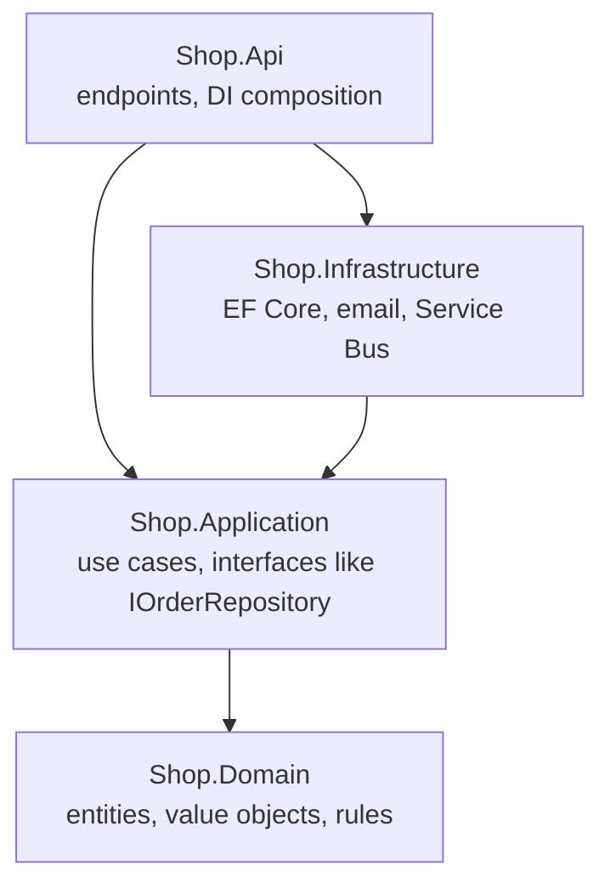

# Production, Architecture and Performance in .NET

> In this document you will learn what it takes to run an ASP.NET Core service in production — configuration per environment, structured logging, OpenTelemetry and Aspire, health checks, resilience with `Microsoft.Extensions.Http.Resilience` and Polly, security headers, Docker images and deployment options, performance rules — and how to structure the code: layered, Clean Architecture, vertical slices, CQRS and MediatR, modular monolith vs microservices. Senior interviews use these topics to check whether you have actually operated .NET systems, not only written them.

**Before this:** [ASP.NET Core fundamentals and middleware](07-aspnet-core-fundamentals-and-middleware.md) · [Memory, GC and performance](05-memory-gc-and-performance.md) · [Production Node.js](../07-nodejs-backend/14-production-nodejs.md) (same ideas in Node) · **Interview questions:** [jump to the interview section](#interview-questions)

## Table of contents

1. [What production-ready means for an ASP.NET Core service](#what-production-ready-means-for-an-aspnet-core-service)
2. [Configuration per environment](#configuration-per-environment)
3. [Structured logging with ILogger](#structured-logging-with-ilogger)
4. [Serilog and log sinks](#serilog-and-log-sinks)
5. [Observability with OpenTelemetry](#observability-with-opentelemetry)
6. [Aspire](#aspire)
7. [Health checks: liveness and readiness](#health-checks-liveness-and-readiness)
8. [Resilience: retries, timeouts and circuit breakers](#resilience-retries-timeouts-and-circuit-breakers)
9. [HTTPS, HSTS, proxies and security headers](#https-hsts-proxies-and-security-headers)
10. [Docker images for ASP.NET Core](#docker-images-for-aspnet-core)
11. [Deployment options](#deployment-options)
12. [Performance in production](#performance-in-production)
13. [Architecture: layered, Clean Architecture and vertical slices](#architecture-layered-clean-architecture-and-vertical-slices)
14. [CQRS and MediatR](#cqrs-and-mediatr)
15. [Modular monolith vs microservices in .NET](#modular-monolith-vs-microservices-in-net)
16. [How to explain this in an interview](#how-to-explain-this-in-an-interview)
17. [Common mistakes](#common-mistakes)
18. [Best practices](#best-practices)
19. [Interview questions](#interview-questions)
20. [Summary](#summary)
21. [References](#references)

---

## What production-ready means for an ASP.NET Core service

"It works on my machine" is not enough. A production-ready service is one that the team can **run, observe, change and recover** safely:

| Area | Question it answers | Main .NET tools |
| --- | --- | --- |
| Configuration | Can the same build run in dev, test and prod? | `appsettings.{Environment}.json`, environment variables, Key Vault, options validation |
| Logging | What happened for this request? | `ILogger`, structured logs, Serilog or OpenTelemetry logs |
| Metrics and tracing | Is it healthy? Where is the time spent? | OpenTelemetry, `System.Diagnostics.Metrics`, `ActivitySource`, Aspire dashboard |
| Health | Should traffic go to this instance? | Health checks middleware |
| Resilience | What happens when a dependency is slow or down? | `Microsoft.Extensions.Http.Resilience`, Polly, request timeouts |
| Security | Is it safe on the internet? | HTTPS, HSTS, security headers, auth (see [Authentication and authorization](11-authentication-and-authorization.md)) |
| Packaging and deployment | How does it reach users, and how do we roll back? | Docker, Azure App Service, Kubernetes, IIS |
| Performance | Does it stay fast under load? | Async I/O, caching, pooling, compression, profiling |
| Graceful shutdown | Do deployments drop requests? | Host shutdown, `stoppingToken` (see [background jobs](12-caching-background-jobs-and-messaging.md)) |

The same checklist for Node.js is in [Production Node.js](../07-nodejs-backend/14-production-nodejs.md). The concepts are the same; this document shows the .NET way.

## Configuration per environment

The configuration system and the options pattern are explained in [ASP.NET Core fundamentals and middleware](07-aspnet-core-fundamentals-and-middleware.md). For production, four rules matter.

**1. One build, many environments.** The environment name comes from `ASPNETCORE_ENVIRONMENT` (or `DOTNET_ENVIRONMENT`). The default is `Production`. Configuration is layered; later sources override earlier ones:

```text
appsettings.json                      (defaults, committed)
appsettings.Production.json           (environment overrides, committed, no secrets)
user secrets                          (Development only)
environment variables                 (ConnectionStrings__Shop, Payments__ApiKey)
command-line arguments
```

**2. Secrets never live in committed files.** Use environment variables injected by the platform or Azure Key Vault (see [Authentication and authorization](11-authentication-and-authorization.md#secrets-user-secrets-environment-variables-and-key-vault)).

**3. Validate configuration at startup.** A missing setting should stop the app at deploy time, not fail the first customer request at 3 a.m.:

```csharp
public sealed class PaymentOptions
{
    public const string Section = "Payments";
    [Required, Url] public string BaseUrl { get; init; } = "";
    [Required] public string ApiKey { get; init; } = "";
    [Range(1, 60)] public int TimeoutSeconds { get; init; } = 10;
}

builder.Services.AddOptions<PaymentOptions>()
    .BindConfiguration(PaymentOptions.Section)
    .ValidateDataAnnotations()
    .ValidateOnStart();          // fail fast during startup if invalid
```

**4. Environment-specific behavior belongs in configuration, not `if (IsProduction())` everywhere.** Use environment checks only for developer tools: the developer exception page, OpenAPI UI, seeding test data.

## Structured logging with ILogger

### What structured logging is

**Structured logging** writes logs as data (fields), not only as text. Instead of the string `"Order 5 loaded for 77"`, the log store gets `{ Message: "...", OrderId: 5, CustomerId: 77 }`, so you can search "all logs where `OrderId = 5`".

The `ILogger` basics are in [Logging with ILogger](07-aspnet-core-fundamentals-and-middleware.md#logging-with-ilogger): message templates with named placeholders (never string interpolation), log levels per category, scopes, and the `[LoggerMessage]` source generator for hot paths. The example below uses a small `[LoggerMessage]` method:

```csharp
static partial class Logs
{
    [LoggerMessage(EventId = 1001, Level = LogLevel.Information, Message = "Order {OrderId} loaded with {ItemCount} items")]
    public static partial void OrderLoaded(ILogger logger, int orderId, int itemCount);
}
```

This section adds what matters in production: JSON output for containers, correlation with traces, and rules for what to log.

### Scopes and the JSON console formatter

A **logging scope** attaches fields to every log written inside it, for example the order ID for all logs of one operation. ASP.NET Core already adds a scope with `TraceId`, `SpanId`, `RequestId` and `RequestPath` for each request.

```csharp
builder.Logging.ClearProviders();
builder.Logging.AddJsonConsole(o => o.IncludeScopes = true);   // built in; good for containers
builder.Logging.AddFilter("Microsoft", LogLevel.Warning);       // less framework noise

app.MapGet("/orders/{id:int}", (int id, ILogger<Program> log) =>
{
    using (log.BeginScope(new Dictionary<string, object> { ["OrderId"] = id }))
    {
        Logs.OrderLoaded(log, id, 3);
        log.LogInformation("Order {OrderId} loaded for {CustomerId}", id, 77);
    }
    return Results.Ok();
});
```

One line from the run (shortened):

```json
{"EventId":1001,"LogLevel":"Information","Category":"Program",
 "Message":"Order 5 loaded with 3 items",
 "State":{"OrderId":5,"ItemCount":3,"{OriginalFormat}":"Order {OrderId} loaded with {ItemCount} items"},
 "Scopes":[{"SpanId":"84348f4dfdfe060c","TraceId":"1af0ba6d2d33ac45b6e6bf904d385880"},
           {"RequestPath":"/orders/5","RequestId":"0HNPGG6JT8NB6:00000001"},
           {"OrderId":5}]}
```

Notice: `OrderId` and `ItemCount` are real fields, the original template is kept (so you can group "all logs of this kind"), and the `TraceId` links the log to the distributed trace.

### Logging rules for production

| Rule | Why |
| --- | --- |
| Default level `Information`, `Warning` for `Microsoft.*` | Enough detail without flooding the log store (log volume costs money) |
| Log **events**, not every line of code | "Payment authorized", "Order shipped", "Retry 2 of 3 for inventory API" |
| Use `LogError(exception, ...)` with the exception object | Stack trace becomes a field; do not log only `ex.Message` |
| Never log secrets or personal data (passwords, tokens, full card numbers, often emails) | Logs are copied to many systems and kept for a long time |
| Include correlation (trace ID) | Find all logs of one request across services |
| Change levels without redeploy | `appsettings` reload or environment variables |

## Serilog and log sinks

The built-in providers (console, debug, EventSource, EventLog on Windows) are enough when the platform collects stdout (Kubernetes, Azure Container Apps) or when you export logs with OpenTelemetry. **Serilog** is a popular third-party logging library with many **sinks** (destinations): files, Seq, Elasticsearch, Application Insights, Datadog. It plugs into `ILogger`, so application code does not change (packages, not run here):

```csharp
// Packages: Serilog.AspNetCore (+ sinks such as Serilog.Sinks.Seq)
builder.Services.AddSerilog((services, lc) => lc
    .ReadFrom.Configuration(builder.Configuration)       // levels and sinks from appsettings
    .Enrich.FromLogContext()
    .Enrich.WithProperty("Service", "orders-api")
    .WriteTo.Console(new Serilog.Formatting.Compact.CompactJsonFormatter()));

var app = builder.Build();
app.UseSerilogRequestLogging();     // one summary log per request instead of several framework logs
```

**Serilog or OpenTelemetry logging?** Both work. A common modern setup is `ILogger` everywhere, OpenTelemetry for traces and metrics, and either Serilog sinks or the OpenTelemetry log exporter for logs. Choose one main pipeline per system to avoid duplicate logs.

## Observability with OpenTelemetry

### The three signals

**Observability** means you can understand what the system is doing from the outside, using:

- **Logs:** individual events ("payment failed for order 42").
- **Metrics:** numbers over time (requests per second, p95 latency, queue length, error rate). Cheap to store, good for alerts.
- **Traces:** the path of one request through services, as a tree of **spans** (timed operations). Shows *where* the time went.

**OpenTelemetry (OTel)** is the vendor-neutral standard for producing and exporting these signals. In .NET, the instrumentation APIs are part of the base class library:

| OpenTelemetry concept | .NET API |
| --- | --- |
| Tracer / span | `ActivitySource` / `Activity` |
| Meter / instrument | `System.Diagnostics.Metrics.Meter`, `Counter<T>`, `Histogram<T>`, `UpDownCounter<T>`, `ObservableGauge<T>` |
| Logs | `ILogger` |

The OpenTelemetry SDK packages only **collect and export** what these APIs produce.

### Custom spans and metrics

```csharp
using System.Diagnostics;
using System.Diagnostics.Metrics;

static class OrderTelemetry { public static readonly ActivitySource Source = new("Shop.Orders"); }

public class OrderMetrics
{
    private readonly Counter<long> _placed;
    public OrderMetrics(IMeterFactory meters) =>                       // IMeterFactory: .NET 8+
        _placed = meters.Create("Shop.Orders").CreateCounter<long>("shop.orders.placed", unit: "{order}");
    public void OrderPlaced(string paymentMethod) =>
        _placed.Add(1, new KeyValuePair<string, object?>("payment.method", paymentMethod));
}

builder.Services.AddSingleton<OrderMetrics>();

app.MapPost("/orders", async (OrderMetrics metrics) =>
{
    using (var activity = OrderTelemetry.Source.StartActivity("ReserveStock"))   // child span
    {
        activity?.SetTag("order.items", 3);
        await Task.Delay(20);              // pretend work
    }
    metrics.OrderPlaced("card");
    return Results.Created("/orders/1", null);
});
```

To see the result without packages, the run used `ActivityListener` and `MeterListener` — the same hooks the OpenTelemetry SDK uses. An `HttpClient` in the same process called the endpoint:

```text
span   Shop.Orders          ReserveStock                                 trace=b328f455 parent=d97a6dd0 35 ms
metric shop.orders.placed += 1 payment.method=card
metric http.server.request.duration = 0.268 http.response.status_code=201,http.route=/orders
span   Microsoft.AspNetCore Microsoft.AspNetCore.Hosting.HttpRequestIn   trace=b328f455 parent=42ba8249 263 ms
span   System.Net.Http      POST                                         trace=b328f455 parent=(root) 429 ms
```

What this shows:

1. **One trace ID** (`b328f455...`) for all three spans: the `HttpClient` span (root), the ASP.NET Core server span (its parent is the client span) and our `ReserveStock` span (child of the server span). The `traceparent` HTTP header (W3C Trace Context) carried the context from client to server automatically.
2. ASP.NET Core emits the standard metric **`http.server.request.duration`** (in seconds) with the route and status code, built in since .NET 8.
3. `StartActivity` returns `null` when nobody listens, so `activity?.` is needed. When tracing is off, instrumentation costs almost nothing.

### Exporting with the OpenTelemetry SDK

(Packages `OpenTelemetry.Extensions.Hosting`, `OpenTelemetry.Instrumentation.AspNetCore`, `OpenTelemetry.Instrumentation.Http`, `OpenTelemetry.Exporter.OpenTelemetryProtocol`; not run here.)

```csharp
builder.Services.AddOpenTelemetry()
    .ConfigureResource(r => r.AddService("orders-api", serviceVersion: "1.4.2"))
    .WithTracing(t => t
        .AddAspNetCoreInstrumentation()
        .AddHttpClientInstrumentation()
        .AddSource("Shop.Orders")                   // our ActivitySource
        .AddOtlpExporter())                         // to a collector, Jaeger, Tempo, Azure Monitor, ...
    .WithMetrics(m => m
        .AddAspNetCoreInstrumentation()
        .AddHttpClientInstrumentation()
        .AddRuntimeInstrumentation()                // GC, thread pool, exceptions
        .AddMeter("Shop.Orders")
        .AddOtlpExporter());
builder.Logging.AddOpenTelemetry(o => { o.IncludeScopes = true; o.AddOtlpExporter(); });
```

The OTLP exporter reads standard environment variables such as `OTEL_EXPORTER_OTLP_ENDPOINT`, so the same code works with any backend. For Azure, the Azure Monitor OpenTelemetry distro (`Azure.Monitor.OpenTelemetry.AspNetCore`, `UseAzureMonitor()`) sends the same data to Application Insights.

**Built-in metrics to watch** (all available as OTel metrics): `http.server.request.duration` (latency, by route and status), `http.server.active_requests`, Kestrel connection counts, `dotnet.gc.*` and thread pool queue length (`dotnet.thread_pool.queue.length`). A growing thread pool queue with low CPU is the classic sign of **thread pool starvation** from blocking calls. You can watch these live with `dotnet-counters monitor` (see [Memory, GC and performance](05-memory-gc-and-performance.md)).

## Aspire

**Aspire** is Microsoft's toolkit for building and running distributed applications locally and deploying them. It was called **.NET Aspire** until **Aspire 13** (November 2025), which dropped ".NET" from the name because it now also orchestrates Python and JavaScript apps. Its docs moved to aspire.dev. (Not run here.)

What it gives you:

- **AppHost:** a small C# project that describes your system — APIs, workers, Redis, PostgreSQL, RabbitMQ — and starts all of them (containers included) with one `dotnet run` (or the `aspire` CLI).
- **ServiceDefaults:** a shared project that adds OpenTelemetry, health checks, service discovery and HTTP resilience to every service with one call (`builder.AddServiceDefaults()`).
- **Dashboard:** a local web UI that shows logs, traces and metrics from all services, using OpenTelemetry.
- **Integrations:** packages that configure clients (Redis, EF Core, Service Bus) with health checks and telemetry.
- **Deployment support:** publishing to Azure Container Apps, Kubernetes manifests or Docker Compose.

```csharp
// AppHost/Program.cs (Aspire)
var builder = DistributedApplication.CreateBuilder(args);

var postgres = builder.AddPostgres("pg").AddDatabase("shopdb");
var cache = builder.AddRedis("cache");

var api = builder.AddProject<Projects.Shop_Api>("api")
    .WithReference(postgres)        // injects the connection string
    .WithReference(cache)
    .WaitFor(postgres);

builder.AddProject<Projects.Shop_Worker>("worker").WithReference(postgres).WithReference(cache);

builder.Build().Run();
```

Aspire is mainly a **developer experience and wiring** tool. It does not replace your production platform; it helps you describe it and run it locally with the same telemetry you will have in production.

## Health checks: liveness and readiness

### What they are

A **health check** is an endpoint that an orchestrator or load balancer calls to decide what to do with an instance. There are two different questions:

| Probe | Question | If it fails | Should include dependencies? |
| --- | --- | --- | --- |
| **Liveness** | Is the process alive and not stuck? | Restart the container | **No** — a database outage must not restart every instance |
| **Readiness** | Can this instance serve traffic now? | Stop sending traffic (no restart) | **Yes** — database, cache, required config |
| Startup (Kubernetes) | Has the app finished starting? | Wait; liveness checks start after it passes | Slow initialization |

### Example (run with the .NET 10 SDK)

```csharp
builder.Services.AddSingleton<DatabaseState>();
builder.Services.AddHealthChecks()
    .AddCheck("self", () => HealthCheckResult.Healthy(), tags: ["live"])
    .AddCheck<DatabaseHealthCheck>("database", tags: ["ready"])
    .AddCheck("disk", () => HealthCheckResult.Degraded("Disk 91% full"), tags: ["ready"]);

var app = builder.Build();
app.MapHealthChecks("/health/live", new HealthCheckOptions { Predicate = c => c.Tags.Contains("live") });
app.MapHealthChecks("/health/ready", new HealthCheckOptions
{
    Predicate = c => c.Tags.Contains("ready"),
    ResponseWriter = WriteJson,        // custom JSON body; the default writes only "Healthy"/"Unhealthy"
});

public class DatabaseHealthCheck(DatabaseState db) : IHealthCheck
{
    public Task<HealthCheckResult> CheckHealthAsync(HealthCheckContext context, CancellationToken ct = default) =>
        Task.FromResult(db.IsUp
            ? HealthCheckResult.Healthy("Connected")
            : HealthCheckResult.Unhealthy("Cannot open connection"));
}
```

Output (the test then simulated a database outage):

```text
GET /health/live  -> 200 Healthy
GET /health/ready -> 200 {"status":"Degraded","checks":[{"name":"database","status":"Healthy","Description":"Connected"},{"name":"disk","status":"Degraded","Description":"Disk 91% full"}]}
-- database goes down --
GET /health/live  -> 200 Healthy
GET /health/ready -> 503 {"status":"Unhealthy","checks":[{"name":"database","status":"Unhealthy","Description":"Cannot open connection"},{"name":"disk","status":"Degraded","Description":"Disk 91% full"}]}
```

What to notice:

1. The overall status is the **worst** individual status.
2. **Degraded returns 200** by default (only Unhealthy returns 503). You can change this with `HealthCheckOptions.ResultStatusCodes`.
3. When the database failed, **liveness stayed 200**. The orchestrator stops routing traffic to the instance but does not restart it — restarting would not fix the database and could cause a restart storm.

Practical tips:

- Ready-made checks for SQL Server, PostgreSQL, Redis, RabbitMQ, Azure services and more are in the community `AspNetCore.HealthChecks.*` packages. EF Core has `AddDbContextCheck<TContext>()` (package `Microsoft.Extensions.Diagnostics.HealthChecks.EntityFrameworkCore`).
- Keep checks **fast and cheap** (a `SELECT 1`, not a full query) and give them timeouts. Probes run every few seconds on every instance.
- Do not expose detailed health output publicly; it reveals your infrastructure. Restrict it with `RequireHost`, a separate port, or authorization.
- Mark the app not ready during shutdown (on `ApplicationStopping`) so the load balancer drains it.

## Resilience: retries, timeouts and circuit breakers

### Why

Every network call can be slow or fail. Without protection, one slow dependency makes all your request threads wait, the queue grows, and your service fails too — a **cascading failure**. The standard tools:

| Strategy | What it does | Main risk |
| --- | --- | --- |
| **Timeout** | Give up after a time limit | Too long = no protection; too short = false failures |
| **Retry** with exponential backoff and jitter | Try again after a growing, randomized delay | Duplicates for non-idempotent calls; retry storms |
| **Circuit breaker** | After many failures, fail fast for a while, then test again | Wrong thresholds hide or cause outages |
| **Rate limiter / bulkhead** | Limit concurrent calls to one dependency | Rejected work must be handled |
| **Hedging** | Send a second request if the first is slow | Extra load |
| **Fallback** | Use cached or default data | Stale data shown as fresh |

### Microsoft.Extensions.Http.Resilience

The recommended way to add resilience to `HttpClient` in .NET 8+ is the package **`Microsoft.Extensions.Http.Resilience`**, built on **Polly v8**. It replaced the older `Microsoft.Extensions.Http.Polly` approach. (Package, not run here.)

```csharp
builder.Services.AddHttpClient<InventoryClient>(c => c.BaseAddress = new Uri("https://inventory.internal"))
    .AddStandardResilienceHandler(o =>
    {
        o.Retry.DisableForUnsafeHttpMethods();             // no automatic retries for POST, PUT, PATCH, DELETE, CONNECT
        o.AttemptTimeout.Timeout = TimeSpan.FromSeconds(3);
        o.TotalRequestTimeout.Timeout = TimeSpan.FromSeconds(10);
    });

// Or for every HttpClient in the app:
builder.Services.ConfigureHttpClientDefaults(http => http.AddStandardResilienceHandler());
```

The **standard resilience handler** chains five strategies, from outermost to innermost, with these defaults (from the official documentation):

| Order | Strategy | Default |
| --- | --- | --- |
| 1 | Rate limiter | 1,000 concurrent permits, queue 0 |
| 2 | Total request timeout | 30 seconds (includes all retries) |
| 3 | Retry | 3 retries, exponential backoff with jitter, base delay 2 seconds |
| 4 | Circuit breaker | Opens at 10% failure ratio, minimum 100 requests, 30-second sampling window, 5-second break |
| 5 | Attempt timeout | 10 seconds per attempt |

Retries and the circuit breaker react to HTTP 5xx, 408 and 429, `HttpRequestException` and Polly's `TimeoutRejectedException`.


**Order matters:** the total timeout is outside the retry, so retries cannot run forever. The attempt timeout is inside the circuit breaker, so slow attempts count as failures and can open the circuit.

**By default the standard handler retries all HTTP methods**, including POST. If the downstream call is not idempotent (create an order, charge a card), a retry can create a duplicate. Disable retries for unsafe methods, or send an **idempotency key** so the server can ignore duplicates.

### Polly pipelines for non-HTTP code

```csharp
// Package Polly.Core (v8) - not run here
var pipeline = new ResiliencePipelineBuilder()
    .AddRetry(new RetryStrategyOptions
    {
        ShouldHandle = new PredicateBuilder().Handle<TimeoutException>(),
        MaxRetryAttempts = 3,
        BackoffType = DelayBackoffType.Exponential,
        UseJitter = true,
    })
    .AddTimeout(TimeSpan.FromSeconds(5))
    .Build();

await pipeline.ExecuteAsync(async ct => await queueClient.SendAsync(message, ct), cancellationToken);
```

### Timeouts on your own endpoints

Protect your **own** API too. The request timeouts middleware (.NET 8+, built in) cancels `HttpContext.RequestAborted` after a limit:

```csharp
builder.Services.AddRequestTimeouts(o => o.AddPolicy("fast", TimeSpan.FromMilliseconds(200)));
app.UseRequestTimeouts();
app.MapGet("/slow", async (CancellationToken ct) => { await Task.Delay(1000, ct); return "done"; })
   .WithRequestTimeout("fast");
```

In the run, `GET /slow` returned **504** after 200 ms, because the handler passed the token to `Task.Delay`. The timeout only works if your code passes the `CancellationToken` down to database and HTTP calls. (Request timeouts are not applied while a debugger is attached.)

## HTTPS, HSTS, proxies and security headers

### HTTPS and HSTS

```csharp
if (!app.Environment.IsDevelopment())
{
    app.UseExceptionHandler("/error");
    app.UseHsts();                  // Strict-Transport-Security: browsers use HTTPS only (default max-age 30 days)
}
app.UseHttpsRedirection();          // HTTP -> HTTPS redirect
```

- **HSTS** tells browsers "only talk to this site over HTTPS for the next N days". It is ignored on `localhost` and only sent on HTTPS responses. Increase `MaxAge` (for example one year) once you are sure all subdomains support HTTPS.
- In containers behind a load balancer, **TLS often ends at the proxy** (ingress, Azure Front Door). Then the app sees plain HTTP, and HTTPS redirection would loop unless the app knows the original scheme — see forwarded headers.
- For pure APIs called by non-browser clients, many teams **do not redirect** HTTP to HTTPS (clients might send tokens over HTTP first); they simply do not listen on HTTP publicly.

### Running behind a reverse proxy: forwarded headers

Behind nginx, YARP, Azure App Service or a Kubernetes ingress, the client IP and the original scheme arrive in `X-Forwarded-For` and `X-Forwarded-Proto` headers. The app must be told to trust them:

```csharp
builder.Services.Configure<ForwardedHeadersOptions>(o =>
{
    o.ForwardedHeaders = ForwardedHeaders.XForwardedFor | ForwardedHeaders.XForwardedProto;
    o.KnownProxies.Add(IPAddress.Parse("10.0.0.10"));    // only trust your proxy
});
var app = builder.Build();
app.UseForwardedHeaders();      // FIRST, before anything that reads scheme, host or client IP
```

Output from the run (the proxy was the loopback address):

```text
Behind proxy: scheme=https remoteIp=203.0.113.9
Direct:       scheme=http  remoteIp=127.0.0.1
```

❌ Trusting forwarded headers from **any** source lets a client fake its IP address, which breaks rate limiting by IP and audit logs. Only trust known proxies or networks. (On Azure App Service and IIS, the platform integration configures this for you.)

### Security headers

ASP.NET Core does not add most security headers automatically. A small middleware does it:

```csharp
app.Use(async (ctx, next) =>
{
    var h = ctx.Response.Headers;
    h.XContentTypeOptions = "nosniff";             // do not guess content types
    h.XFrameOptions = "DENY";                      // no framing (clickjacking)
    h["Referrer-Policy"] = "no-referrer";
    h.ContentSecurityPolicy = "default-src 'none'; frame-ancestors 'none'";   // for a pure JSON API
    await next();
});
```

The run confirmed the headers on responses (`nosniff`, `DENY`). For HTML apps the Content Security Policy needs careful design; web security headers and CSP are explained in [Browser storage and web security basics](../01-cs-and-web-fundamentals/08-browser-storage-and-web-security-basics.md). Also remove the `Server: Kestrel` header if you want less fingerprinting: `builder.WebHost.ConfigureKestrel(o => o.AddServerHeader = false)`.

Rate limiting (`AddRateLimiter`, .NET 7+) is covered in [Web APIs, validation and error handling](09-web-apis-validation-and-error-handling.md).

## Docker images for ASP.NET Core

### A multi-stage Dockerfile

A **multi-stage build** compiles in a large SDK image and copies only the published output into a small runtime image. (Not run here.)

```text
# syntax=docker/dockerfile:1
FROM mcr.microsoft.com/dotnet/sdk:10.0 AS build
WORKDIR /src
COPY ["src/Shop.Api/Shop.Api.csproj", "src/Shop.Api/"]
COPY ["Directory.Packages.props", "./"]
RUN dotnet restore "src/Shop.Api/Shop.Api.csproj"          # cached layer while dependencies do not change
COPY . .
RUN dotnet publish "src/Shop.Api/Shop.Api.csproj" -c Release -o /app/publish --no-restore

FROM mcr.microsoft.com/dotnet/aspnet:10.0-noble-chiseled AS final
WORKDIR /app
COPY --from=build /app/publish .
USER $APP_UID
EXPOSE 8080
ENTRYPOINT ["dotnet", "Shop.Api.dll"]
```

Important facts about the official images:

| Fact | Detail |
| --- | --- |
| Image types | `sdk` (build), `aspnet` (ASP.NET Core runtime), `runtime` (console apps), `runtime-deps` (self-contained and Native AOT apps) |
| Default port | **8080** since .NET 8 (it was 80 before). Configure with `ASPNETCORE_HTTP_PORTS` |
| Non-root user | Images include an `app` user; `USER $APP_UID` runs as non-root. Chiseled images run as non-root by default |
| **Chiseled** images | Ubuntu-based "distroless" images: no shell, no package manager, only what .NET needs. Smaller and with far fewer packages that can have vulnerabilities. Tags like `10.0-noble-chiseled`; `-extra` variants add ICU and time zone data |
| Default OS in .NET 10 | Tags without an OS name (`aspnet:10.0`) now use **Ubuntu 24.04 "Noble"**. In .NET 9 and earlier they used **Debian**. Debian images are no longer published for .NET 10 |
| Globalization | Chiseled (non-extra) images run in globalization-invariant mode; use `-extra` if you need culture-specific formatting |

**No shell** in chiseled images means you cannot `docker exec` into them to debug. Use `dotnet-monitor` or a sidecar container with the diagnostic tools, and rely on logs and traces.

### SDK container publishing

The .NET SDK can build container images **without a Dockerfile**:

```bash
dotnet publish src/Shop.Api -c Release -t:PublishContainer \
  -p:ContainerRepository=shop-api -p:ContainerFamily=noble-chiseled
```

This is simple and produces a non-root image, but a Dockerfile gives more control (extra files, OS packages, multi-project builds).

### Native AOT in containers

**Native AOT** compiles the app to native code ahead of time. In containers, it gives fast startup and small images (`runtime-deps` base, no .NET runtime needed), which helps for scale-to-zero and serverless. Trade-offs: not every library is compatible (reflection-heavy code, some EF Core features, MVC controllers are not supported — minimal APIs are), and builds are slower. Details are in [Memory, GC and performance](05-memory-gc-and-performance.md).

## Deployment options

| Option | How requests reach the app | Good for | Notes |
| --- | --- | --- | --- |
| **Kestrel behind a reverse proxy** (nginx, YARP, Envoy, cloud load balancer) | Proxy terminates TLS, forwards to Kestrel | Linux VMs, containers | Configure forwarded headers and limits |
| **Kubernetes** (AKS, EKS, GKE) | Ingress → Service → pods running Kestrel | Many services, autoscaling | Probes, resource limits, graceful shutdown settings |
| **Azure Container Apps** | Managed ingress → containers | Containers without managing Kubernetes | Scale to zero, Dapr, KEDA-based scaling |
| **Azure App Service** | Front ends → your app (code or container) | Simple web apps and APIs | Deployment slots for zero-downtime swaps, built-in auth and scaling |
| **IIS on Windows** | IIS + **ASP.NET Core Module (ANCM)** | Existing Windows infrastructure | **In-process** hosting (default; app runs inside the IIS worker process, faster) or **out-of-process** (IIS proxies to Kestrel) |
| **Windows Service / systemd** | Kestrel directly or behind a proxy | On-premises servers | `UseWindowsService()` / `UseSystemd()` |

**Kestrel at the edge?** Kestrel is a fast, secure web server and can face the internet directly. A reverse proxy is still common because it adds TLS management, load balancing across instances, request buffering, and a single place for WAF rules and routing. **YARP** (Yet Another Reverse Proxy) is Microsoft's reverse proxy library for building that proxy in .NET.

**Zero-downtime deployment** needs: several instances, readiness probes, graceful shutdown (see [background jobs](12-caching-background-jobs-and-messaging.md#graceful-shutdown-and-failures)), database migrations that are **backward compatible** (expand first, contract later; see [EF Core](10-entity-framework-core-and-data-access.md)), and shared Data Protection keys so cookies survive instance changes.

## Performance in production

The runtime side (GC, allocations, `Span<T>`, pooling) is in [Memory, GC and performance](05-memory-gc-and-performance.md). Async internals are in [Async/await, tasks and threading](04-async-await-tasks-and-threading.md). Here are the rules that matter most for web servers.

### 1. Async all the way, never block

ASP.NET Core serves requests on **thread pool threads**. When a request waits for I/O with `await`, the thread goes back to the pool and serves other requests. When code **blocks** (`.Result`, `.Wait()`, `Thread.Sleep`, synchronous file or network calls), the thread is stuck. Under load, the pool runs out of threads, new threads are added slowly, and latency explodes while CPU stays low. This is **thread pool starvation**.

```csharp
// ❌ Wrong: sync over async blocks a thread per request
app.MapGet("/price/{id}", (int id, PriceClient client) => client.GetPriceAsync(id).Result);

// ✅ Correct
app.MapGet("/price/{id}", async (int id, PriceClient client, CancellationToken ct) => await client.GetPriceAsync(id, ct));
```

**If you know Node.js:** blocking in Node stops the single event loop for everyone. In .NET it blocks one thread at a time, so the problem appears gradually under load — harder to notice in testing, but the cause is the same.

### 2. Do not wrap I/O in Task.Run

`await Task.Run(() => db.Query())` in a request handler just moves blocking work to another pool thread and adds overhead. Use real async APIs. `Task.Run` is for CPU-bound work in desktop apps, not for "making things async" on a server.

### 3. Reuse expensive objects

| Object | Rule |
| --- | --- |
| `HttpClient` | Use `IHttpClientFactory` or typed clients (see [Dependency injection](08-dependency-injection-in-aspnet-core.md)) |
| `DbContext` | Scoped; consider `AddDbContextPool` for very high request rates |
| Redis `ConnectionMultiplexer`, `ServiceBusClient` | One singleton per app |
| `JsonSerializerOptions` | Create once and reuse (it caches metadata) |
| Large buffers | `ArrayPool<T>.Shared` |

### 4. Reduce work per request

- **Cache** where data allows (see [Caching](12-caching-background-jobs-and-messaging.md)).
- **Query less:** projection with `Select`, `AsNoTracking` for reads, pagination, no N+1 queries (see [EF Core](10-entity-framework-core-and-data-access.md)).
- **Compress responses** for large JSON. In the run, a 10,418-byte JSON response became **605 bytes** with Brotli:

```csharp
builder.Services.AddResponseCompression(o => o.EnableForHttps = true);   // review BREACH risk for secrets in responses
app.UseResponseCompression();
```

Often the reverse proxy or CDN already compresses; do it in one place.

- **Stream** large results (`IAsyncEnumerable<T>` from minimal APIs) instead of building huge lists in memory.
- **System.Text.Json source generation** reduces startup time and allocations, and is required for Native AOT.

### 5. Measure before optimizing

- **Load test** (k6, NBomber, Azure Load Testing, JMeter) with realistic data before launch.
- Watch **p95/p99 latency**, not averages.
- Profile with `dotnet-counters`, `dotnet-trace`, `dotnet-dump` or Application Insights profiler; benchmark small hot paths with BenchmarkDotNet.
- Server GC is the default for ASP.NET Core. Since .NET 9, **DATAS** (dynamic adaptation to application sizes) is enabled by default with Server GC, so the heap count adapts to load — good for containers with memory limits.

## Architecture: layered, Clean Architecture and vertical slices

How you organize code matters for how easily it can change. SOLID and design principles are covered in [subject 04](../04-oop-solid-design-patterns/03-solid-principles.md); here are the .NET-specific architecture styles.

### Layered (N-tier)

```text
Shop.Api           (controllers / endpoints)
   ↓
Shop.Services      (business logic)
   ↓
Shop.Data          (EF Core, repositories)
```

Simple and familiar. The problem: business logic depends on data access, and over time logic leaks into controllers and repositories.

### Clean Architecture (also called Onion or Hexagonal / Ports and Adapters)

The **Domain** is in the center and depends on nothing. Outer layers depend inward. Infrastructure (EF Core, email, message brokers) implements interfaces defined by the inner layers.



```xml
<!-- Shop.Application.csproj references only the Domain -->
<ItemGroup>
  <ProjectReference Include="..\Shop.Domain\Shop.Domain.csproj" />
</ItemGroup>
<!-- Shop.Infrastructure.csproj references Application (to implement its interfaces) -->
```

- ✅ Business rules are isolated and easy to unit-test; infrastructure can change.
- ❌ More projects, interfaces and mapping. For CRUD-heavy apps it can be a lot of ceremony; a common criticism is repositories that only wrap `DbContext` methods one to one.

### Vertical slice architecture

Organize code **by feature**, not by technical layer. Each slice contains everything for one use case: endpoint, request/response types, validation, handler and data access.

```text
Features/
  Orders/
    PlaceOrder.cs        (endpoint + request + validator + handler)
    GetOrder.cs
    CancelOrder.cs
  Products/
    SearchProducts.cs
```

```csharp
public static class PlaceOrder
{
    public record Request(int CustomerId, List<Line> Lines);
    public record Line(int ProductId, int Quantity);
    public record Response(int OrderId);

    public static void Map(IEndpointRouteBuilder app) =>
        app.MapPost("/orders", Handle).RequireAuthorization();

    private static async Task<Results<Created<Response>, ValidationProblem>> Handle(
        Request request, ShopDbContext db, TimeProvider clock, CancellationToken ct)
    {
        if (request.Lines.Count == 0)
            return TypedResults.ValidationProblem(new Dictionary<string, string[]> { ["lines"] = ["At least one line is required."] });

        var order = Order.Create(request.CustomerId, request.Lines.Select(l => (l.ProductId, l.Quantity)), clock.GetUtcNow());
        db.Orders.Add(order);
        await db.SaveChangesAsync(ct);
        return TypedResults.Created($"/orders/{order.Id}", new Response(order.Id));
    }
}
```

- ✅ A change to one feature touches one folder. Each slice can be simple (direct `DbContext`) or rich (domain model) as needed.
- ❌ Shared logic needs discipline (put real business rules in the domain model, not copied between slices).

### Which to choose

| Situation | Good fit |
| --- | --- |
| Small CRUD service, small team | Simple layered or vertical slices with direct EF Core |
| Complex business rules (pricing, insurance, logistics) | Clean Architecture or slices with a rich domain model (DDD) |
| Large app, many features, many teams | Vertical slices inside a **modular monolith** |
| Very different scaling or deployment needs per area | Separate services (after the module boundaries are proven) |

In an interview, avoid "Clean Architecture is always best". Show that you choose by complexity and team size.

## CQRS and MediatR

### CQRS

**CQRS** (Command Query Responsibility Segregation) means **separating writes (commands) from reads (queries)**:

- **Commands** change state (`PlaceOrder`, `CancelOrder`) and go through the domain model with validation and business rules.
- **Queries** only read and can use a simpler, faster path: projections, `AsNoTracking`, Dapper, even a separate read database or cache.

CQRS at the code level (separate handler classes) is cheap and common. CQRS with **separate read and write databases** synchronized by events adds eventual consistency and is only worth it for real scale or very different read models.

### MediatR

**MediatR** is a library that implements the **mediator** pattern: the endpoint sends a request object, and MediatR finds the one handler for it. **Pipeline behaviors** wrap every handler for cross-cutting concerns (validation, logging, transactions). (Package, not run here.)

```csharp
public record PlaceOrderCommand(int CustomerId, List<OrderLine> Lines) : IRequest<int>;

public class PlaceOrderHandler(ShopDbContext db) : IRequestHandler<PlaceOrderCommand, int>
{
    public async Task<int> Handle(PlaceOrderCommand cmd, CancellationToken ct)
    {
        var order = Order.Create(cmd.CustomerId, cmd.Lines);
        db.Orders.Add(order);
        await db.SaveChangesAsync(ct);
        return order.Id;
    }
}

public class LoggingBehavior<TRequest, TResponse>(ILogger<LoggingBehavior<TRequest, TResponse>> log)
    : IPipelineBehavior<TRequest, TResponse> where TRequest : notnull
{
    public async Task<TResponse> Handle(TRequest request, RequestHandlerDelegate<TResponse> next, CancellationToken ct)
    {
        log.LogInformation("Handling {Request}", typeof(TRequest).Name);
        return await next();
    }
}

app.MapPost("/orders", async (PlaceOrderCommand cmd, ISender sender, CancellationToken ct) =>
    Results.Created($"/orders/{await sender.Send(cmd, ct)}", null));
```

**Licensing change (July 2025):** MediatR's author moved MediatR and AutoMapper to his company, Lucky Penny Software. Starting with **MediatR 13.0** (and AutoMapper 15.0), the libraries are **dual-licensed**: the Reciprocal Public License 1.5 (RPL-1.5) or a **commercial license**. A free community edition covers companies with under US$5 million annual gross revenue, non-profits, education and non-production use; others need a paid license. **Earlier versions (MediatR 12.x and below) keep their original Apache 2.0 license.**

### Do you need MediatR?

| | With MediatR | Without (plain handler classes) |
| --- | --- | --- |
| Endpoint code | `sender.Send(command)` | Inject `PlaceOrderHandler` and call `HandleAsync` |
| Cross-cutting concerns | Pipeline behaviors | Endpoint filters, middleware, decorators (for example with Scrutor) |
| Navigation in the IDE | Indirect ("go to definition" leads to `IRequest`) | Direct |
| Dependencies | A third-party package with licensing to check | None |
| Alternatives | — | Wolverine, the source-generated `Mediator` library, or just DI |

Many teams now use **plain handler classes registered in DI** plus endpoint filters, because minimal APIs and DI already give most of the benefits. MediatR is still fine and common in existing codebases. The interview answer that shows judgment: "the pattern is useful; the library is optional."

## Modular monolith vs microservices in .NET

A **modular monolith** is one deployable app made of strongly separated **modules** (Orders, Catalog, Billing). Each module has its own folder or projects, its own `DbContext` or database schema, and talks to other modules only through public interfaces or in-process events.

```text
Shop.Host                      (one ASP.NET Core app: Program.cs registers all modules)
Modules/
  Orders/   Orders.Api, Orders.Core, Orders.Infrastructure  -> schema "orders"
  Catalog/  Catalog.Api, Catalog.Core, ...                  -> schema "catalog"
  Billing/  ...                                             -> schema "billing"
Shared/     Shop.SharedKernel (only very stable shared types)
```

Rules that keep it modular:

- No module reads another module's tables. Use the other module's public API or events.
- Enforce boundaries with project references (`internal` types) and architecture tests (for example NetArchTest or ArchUnitNET).
- Use an in-process message bus or outbox events between modules, so a module can later become a service.

**Microservices** are separately deployable services, each with its own database. They give independent deployment and scaling, and team autonomy, but add network calls, distributed transactions (sagas, outbox), versioned contracts, and much more operational work (tracing, service discovery, resilience everywhere).

| | Modular monolith | Microservices |
| --- | --- | --- |
| Deployment | One unit | Many units |
| Calls between parts | In-process (fast, typed, transactional) | Network (latency, failures, retries) |
| Data consistency | One database transaction possible | Eventual consistency, sagas, outbox |
| Operational cost | Low | High: CI/CD per service, observability, platform team |
| Scaling | Scale the whole app | Scale each service separately |
| Team independence | Medium (shared release) | High |
| Good start for | Most new products | Large organizations with proven boundaries and platform maturity |

The common recommendation is to **start with a modular monolith** and extract a service only when a module clearly needs independent scaling, deployment or ownership. System-level trade-offs are discussed in [Scalability and core building blocks](../09-system-design/02-scalability-and-core-building-blocks.md).

---

## How to explain this in an interview

Use this for "How do you make an ASP.NET Core service production-ready?"

1. **Define it:** "Production-ready means the team can run, observe, change and recover the service safely — not just that the features work."
2. **Why it exists:** "In production, dependencies fail, traffic spikes, deployments happen during the day, and nobody can attach a debugger. Without telemetry, health checks and resilience, small problems become outages."
3. **How it works:** "Configuration per environment with validated options and secrets from Key Vault. Structured logging with `ILogger` templates, and OpenTelemetry for traces and metrics exported over OTLP. Liveness and readiness health checks — liveness without dependencies. `AddStandardResilienceHandler` on every `HttpClient`, with retries off for non-idempotent calls. HTTPS, HSTS, forwarded headers and security headers. A multi-stage Docker build on a chiseled, non-root image, deployed with rolling updates and graceful shutdown."
4. **Small example:** "When the inventory API slowed down last time, the p95 latency alert fired, the trace showed the time in the inventory span, the circuit breaker opened so our API failed fast instead of piling up requests, and readiness stayed green because inventory isn't a hard dependency for browsing."
5. **Where it is useful:** "Every service, but especially customer-facing APIs and anything with external dependencies."
6. **Trade-offs / gotchas:** "Retries can create duplicates and retry storms. Too much logging costs money and can leak personal data. Including the database in liveness can restart every pod during a database blip. And architecture should match complexity — Clean Architecture or microservices add cost that a small CRUD service doesn't need."

---

## Common mistakes

| Mistake | What happens | Fix |
| --- | --- | --- |
| String interpolation in log calls | No structured fields, wasted formatting | Message templates or `[LoggerMessage]` |
| Logging tokens, passwords, personal data | Security and privacy incidents | Redaction, review log fields |
| Database check in the liveness probe | All pods restart during a DB blip | Dependencies only in readiness |
| No timeouts on outgoing calls (default `HttpClient.Timeout` is 100 s) | Requests pile up behind a slow dependency | Attempt and total timeouts via the resilience handler |
| Automatic retries on POST without idempotency | Duplicate orders or payments | `DisableForUnsafeHttpMethods`, idempotency keys |
| Several resilience handlers stacked on one client | Unexpected retry multiplication | One handler per client, or a custom pipeline |
| `UseForwardedHeaders` missing or trusting all proxies | Wrong scheme (redirect loops), fake client IPs | Configure known proxies; call it first |
| `.Result` / `.Wait()` in request code | Thread pool starvation under load | Async all the way |
| Running containers as root, on full OS images | Larger attack surface | Chiseled or slim images, `USER $APP_UID` |
| Expecting port 80 in .NET 8+ containers | Service not reachable | Port 8080 or `ASPNETCORE_HTTP_PORTS` |
| Breaking database migrations during rolling deploys | Old instances crash on the new schema | Expand/contract migrations |
| Microservices from day one | Distributed complexity without the benefits | Modular monolith first |
| Clean Architecture ceremony for simple CRUD | Many files, little value | Vertical slices with direct EF Core |
| Upgrading MediatR, MassTransit or FluentAssertions majors without checking licenses | Legal and cost surprises | Review licenses in dependency updates |

## Best practices

- **Fail fast on bad configuration** with `ValidateOnStart`, and keep secrets out of files.
- **Log events as structured data** with a trace ID; keep levels configurable; never log secrets.
- **Instrument with OpenTelemetry** (traces, metrics, logs) and add custom `ActivitySource` spans and `Meter` metrics for business operations.
- **Alert on symptoms** users feel: error rate, p95/p99 latency, saturation (thread pool queue, connection pools), queue lengths.
- **Separate liveness and readiness**; keep checks cheap; protect detailed health output.
- **Give every outgoing call a timeout**, add retries with backoff and jitter only for idempotent operations, and use circuit breakers for unstable dependencies.
- **Pass `CancellationToken` everywhere** so request timeouts and client disconnects stop work.
- **Ship small, non-root container images** (chiseled), pin base image versions, and scan them.
- **Deploy with rolling updates**, graceful shutdown, backward-compatible migrations and shared Data Protection keys.
- **Measure with load tests and profilers** before optimizing; fix blocking calls first.
- **Choose architecture by complexity:** vertical slices or a modular monolith for most systems; Clean Architecture where business rules are rich; microservices when boundaries and the platform are mature.

---

## Interview questions

### Q1. What does "production-ready" mean for an ASP.NET Core API?

**What the interviewer is checking:** Breadth of operational experience.

**Short spoken answer (30–60 seconds):**
> "For me it means we can run, observe, change and recover the service safely. Concretely: configuration per environment with validated options and secrets from a vault; structured logs with a trace ID; OpenTelemetry traces and metrics with alerts on error rate and p95 latency; liveness and readiness health checks; timeouts, retries and circuit breakers on outgoing calls; HTTPS, HSTS, security headers and proper auth; a small non-root container image; rolling deployments with graceful shutdown and backward-compatible migrations; and load tests before big launches. If any of these is missing, the first incident usually shows it."

**Follow-up questions:**
- **Which one would you add first to an existing service with none of them?** — Structured logging with correlation and basic metrics/alerts, because without visibility you cannot prioritize anything else. Then timeouts on outgoing calls.
- **How do you know the service is healthy from the user's view?** — Track the RED metrics per endpoint (rate, errors, duration) and set SLOs, for example "99.9% of requests under 300 ms".

**Common mistakes:** Listing only "Docker and CI/CD"; forgetting observability.

**Where this is used in real projects:** Production readiness reviews before launch.

### Q2. What is structured logging, and how do you do it well in .NET?

**What the interviewer is checking:** Correct use of `ILogger` and log hygiene.

**Short spoken answer:**
> "Structured logging means each log is data with named fields, not just a sentence, so I can query by `OrderId` or count errors by customer. In .NET I use `ILogger` message templates — `LogInformation("Order {OrderId} shipped", id)` — never string interpolation, because interpolation produces one string, loses the fields and formats even when the level is disabled. For hot paths I use the `[LoggerMessage]` source generator. ASP.NET Core adds a scope with `TraceId` and `RequestId`, so logs connect to traces. In containers I write JSON to stdout and let the platform or OpenTelemetry ship it, or use Serilog sinks. And I never log secrets or personal data."

**Follow-up questions:**
- **What does the `{OriginalFormat}` field give you?** — The template itself, so you can group all logs of one kind regardless of values.
- **Why does `LogDebug($"...")` hurt performance even when Debug is off?** — The interpolated string is built before the call. With templates, formatting happens only if the level is enabled.
- **Serilog or built-in providers?** — Built-in JSON console plus OpenTelemetry is enough for many cloud setups; Serilog helps when you need many sinks, enrichers and request-summary logging.

**Common mistakes:** Logging whole request bodies; logging exceptions with only `ex.Message`.

**Where this is used in real projects:** Every service; log search during incidents.

### Q3. Explain OpenTelemetry in .NET: what are traces, spans and metrics, and how do you add custom ones?

**What the interviewer is checking:** Modern observability knowledge.

**Short spoken answer:**
> "OpenTelemetry is the vendor-neutral standard for logs, metrics and traces. A trace is the journey of one request across services, made of spans — timed operations with a parent-child relation. .NET implements the APIs in the base library: a span is an `Activity` from an `ActivitySource`, and metrics come from a `Meter` with counters and histograms. ASP.NET Core and `HttpClient` already create spans and propagate the W3C `traceparent` header, so a call from service A to B shares one trace ID. I add custom spans around important steps with `StartActivity`, and business metrics like 'orders placed' with a counter from `IMeterFactory`. The OpenTelemetry SDK then exports everything with OTLP to Jaeger, Grafana, Azure Monitor or any backend."

**Code:**

```csharp
using var activity = OrderTelemetry.Source.StartActivity("ReserveStock");   // null if nobody listens
activity?.SetTag("order.items", items.Count);
_placedCounter.Add(1, new KeyValuePair<string, object?>("payment.method", "card"));
```

**Follow-up questions:**
- **Why is `activity` nullable?** — When no listener samples the source, `StartActivity` returns `null`, so disabled tracing costs almost nothing.
- **Which built-in metric shows API latency?** — `http.server.request.duration`, tagged by route and status code (.NET 8+). The run above recorded it for `POST /orders` with status 201.
- **How do you avoid high cardinality?** — Never use user IDs or raw URLs as metric tags; use routes, status codes and small enums.

**Common mistakes:** Treating logs as traces; adding user IDs as metric dimensions.

**Where this is used in real projects:** Finding which dependency is slow; SLO dashboards.

### Q4. What is Aspire, and when would you use it?

**Short answer:** Aspire (called **.NET Aspire** until version 13 in November 2025) is Microsoft's toolkit for building and running distributed apps. An **AppHost** project describes the services and resources (APIs, workers, PostgreSQL, Redis, RabbitMQ) and starts them all locally with one command, injecting connection strings. **ServiceDefaults** add OpenTelemetry, health checks, service discovery and HTTP resilience to every service. The **dashboard** shows logs, traces and metrics locally. It also helps publish to Azure Container Apps, Kubernetes or Docker Compose. I would use it for a solution with several services and dependencies, mainly to improve local development and standardize telemetry. It is not a production runtime by itself.

### Q5. Liveness vs readiness: what is the difference, and what goes in each?

**What the interviewer is checking:** Avoiding a classic outage pattern.

**Short spoken answer:**
> "Liveness asks 'is this process alive, or stuck and needing a restart?'. Readiness asks 'should this instance get traffic right now?'. If liveness fails, the orchestrator restarts the container; if readiness fails, it just stops routing traffic. So liveness checks only the process itself — no database. If I put the database in liveness, a short database outage restarts every pod, which doesn't fix anything and causes a restart storm. Readiness includes required dependencies like the database and cache. In ASP.NET Core I register checks with tags and map two endpoints with predicates. In my test, when the database went down, readiness returned 503 and liveness stayed 200."

**Follow-up questions:**
- **What status does `Degraded` return?** — 200 by default; only `Unhealthy` returns 503. Configure `ResultStatusCodes` if you want otherwise.
- **What about slow startup?** — A Kubernetes startup probe, so liveness doesn't kill the app while it warms up.
- **During shutdown?** — Make readiness fail on `ApplicationStopping` so the load balancer drains the instance first.

**Common mistakes:** One `/health` endpoint used for both; expensive checks; public detailed health output.

**Where this is used in real projects:** Kubernetes, Azure Container Apps and App Service health probes.

### Q6. How do you add resilience to HttpClient calls in .NET 8+? What are the risks of retries?

**What the interviewer is checking:** Modern resilience APIs and judgment.

**Short spoken answer:**
> "I use `Microsoft.Extensions.Http.Resilience`, which is built on Polly v8. `AddStandardResilienceHandler` on a typed client adds, from outside in: a rate limiter, a 30-second total timeout, three retries with exponential backoff and jitter, a circuit breaker, and a 10-second timeout per attempt. It handles 5xx, 408, 429 and transport errors. I usually tune the timeouts to the dependency's real latency. The big risk is retrying non-idempotent calls: by default the standard handler retries all methods, so a timed-out POST could create a second order. I call `DisableForUnsafeHttpMethods`, or use idempotency keys. The other risk is retry storms — many clients retrying together — which jitter and the circuit breaker reduce."

**Follow-up questions:**
- **Why is the total timeout outside the retry?** — So the sum of all attempts is bounded. Each attempt has its own inner timeout.
- **What does a circuit breaker do?** — After the failure ratio passes a threshold in the sampling window, it fails calls immediately for the break duration, then lets trial calls through. This protects both your threads and the struggling dependency.
- **Can you stack two resilience handlers?** — Avoid it; the docs recommend one handler per client, or a custom pipeline with `AddResilienceHandler`.

**Common mistakes:** Infinite or immediate retries; no timeout at all (default `HttpClient.Timeout` is 100 seconds).

**Where this is used in real projects:** Calls to payment, inventory, identity and partner APIs.

### Q7. What is thread pool starvation, and how do you detect and fix it?

**What the interviewer is checking:** Real performance debugging in ASP.NET Core.

**Short spoken answer:**
> "ASP.NET Core runs requests on thread pool threads. If code blocks — `.Result`, `.Wait()`, `Thread.Sleep`, synchronous I/O — those threads can't serve other requests. Under load, all threads are blocked, the pool adds new threads only slowly, and requests queue up. The symptom is high latency and timeouts while CPU is low. I detect it with `dotnet-counters` or OpenTelemetry runtime metrics: thread pool queue length growing and thread count climbing. A `dotnet-dump` shows many threads waiting in `Task.Wait`. The fix is async all the way — await real async APIs, pass cancellation tokens, and remove sync-over-async. Raising the minimum thread count only hides the problem."

**Follow-up questions:**
- **Does `Task.Run` around a blocking call help?** — No, it just blocks a different pool thread and adds overhead.
- **Where does sync-over-async hide?** — Constructors and DI factories calling async code, `IOptions` setup, logging sinks doing synchronous network I/O, old libraries.

**Common mistakes:** Assuming "async makes things faster" — async improves scalability (threads are free while waiting), not the speed of one request.

**Where this is used in real projects:** The most common cause of "the API is slow only under load".

### Q8. Explain the official .NET container images and why chiseled images matter.

**What the interviewer is checking:** Container knowledge and current version facts.

**Short spoken answer:**
> "I build in the `sdk` image and run in the `aspnet` image with a multi-stage Dockerfile, so the final image has no compiler or source. Since .NET 8 the images listen on port 8080 and include a non-root `app` user, so I run with `USER $APP_UID`. Chiseled images are Ubuntu-based distroless images: no shell, no package manager, only the files .NET needs. They're smaller and have far fewer packages that can carry vulnerabilities, and they run as non-root by default. The `-extra` variants add ICU and time zone data for globalization. In .NET 10, the default tags are Ubuntu 24.04 instead of Debian. For self-contained or Native AOT apps, I use `runtime-deps`."

**Follow-up questions:**
- **How do you debug a container without a shell?** — Logs and traces first; `dotnet-monitor` or a debug sidecar sharing the process namespace for dumps and traces.
- **Can you build images without a Dockerfile?** — Yes, `dotnet publish -t:PublishContainer`.
- **Why copy the `.csproj` and restore before copying the rest?** — Docker layer caching: restore runs again only when project files change.

**Common mistakes:** Running as root; using the SDK image in production; expecting port 80.

**Where this is used in real projects:** Kubernetes, Azure Container Apps, any container platform.

### Q9. IIS in-process vs out-of-process vs Kestrel behind a reverse proxy?

**Short answer:** On Windows, IIS hosts ASP.NET Core through the **ASP.NET Core Module**. **In-process** (the default) runs the app inside the IIS worker process (`w3wp.exe`) using an IIS-based server, which avoids a proxy hop and is faster. **Out-of-process** makes IIS a reverse proxy to a separate Kestrel process. On Linux and in containers, the app runs on **Kestrel**, usually behind a reverse proxy or load balancer (nginx, YARP, an ingress, a cloud load balancer) that terminates TLS and balances instances. Whichever proxy you use, configure **forwarded headers** with known proxies so the app sees the real scheme and client IP.

### Q10. Debugging: after moving behind a load balancer, users get endless redirects and all requests appear to come from one IP. Why?

**Answer:** The load balancer terminates HTTPS and forwards plain HTTP to the app. The app sees `http`, so `UseHttpsRedirection` redirects to HTTPS; the browser follows, the load balancer forwards HTTP again — a loop. The client IP is the load balancer's, so rate limiting and logs use one IP. Fix:

```csharp
builder.Services.Configure<ForwardedHeadersOptions>(o =>
{
    o.ForwardedHeaders = ForwardedHeaders.XForwardedFor | ForwardedHeaders.XForwardedProto;
    o.KnownIPNetworks.Add(System.Net.IPNetwork.Parse("10.0.0.0/8"));   // the load balancer subnet (.NET 10)
});
app.UseForwardedHeaders();   // first in the pipeline
```

The run confirmed the effect: with a trusted proxy, the app saw `scheme=https remoteIp=203.0.113.9` instead of `http` and the proxy address. Only trust known proxies; otherwise clients can fake their IP with their own `X-Forwarded-For` header. 

> **New in .NET 10:** `KnownIPNetworks` (using `System.Net.IPNetwork`) replaces `KnownNetworks` (using `Microsoft.AspNetCore.HttpOverrides.IPNetwork`). The old members still compile but give the obsolete warning `ASPDEPR005`. On .NET 8 and 9, write `o.KnownNetworks.Add(new IPNetwork(IPAddress.Parse("10.0.0.0"), 8))`.

### Q11. Layered architecture vs Clean Architecture vs vertical slices — how do you choose?

**What the interviewer is checking:** Architecture judgment, not dogma.

**Short spoken answer:**
> "Layered architecture splits by technical layer — API, services, data. It's simple but business logic tends to depend on data access and leak into controllers. Clean Architecture puts the domain in the center with no dependencies; the application layer defines interfaces and infrastructure implements them. That isolates business rules and makes them easy to test, but it adds projects, interfaces and mapping. Vertical slices organize by feature: each use case has its endpoint, request, validation and handler together, so a change touches one folder. For a CRUD-heavy service I'd use vertical slices with EF Core directly. For complex domains — pricing, insurance, logistics — I'd use a rich domain model, with Clean Architecture boundaries or slices on top. I choose by business complexity and team size."

**Follow-up questions:**
- **Do you need a repository on top of EF Core?** — Not always. `DbContext` already is a unit of work and `DbSet` a repository. Repositories help when you want to hide query details from the domain or swap persistence; generic one-to-one wrappers usually add nothing.
- **How do you enforce boundaries?** — Project references, `internal` types, and architecture tests in CI.

**Common mistakes:** "Clean Architecture is always best"; ten projects for a small service.

**Where this is used in real projects:** New service design and refactoring discussions.

### Q12. What is CQRS? Do you need MediatR for it?

**What the interviewer is checking:** Separating the pattern from the library, and license awareness.

**Short spoken answer:**
> "CQRS separates commands, which change state through the domain model and validation, from queries, which only read and can use a fast path like projections or Dapper. At the code level it's just separate handlers and is cheap. Separate read and write databases is a bigger step with eventual consistency, only for real need. MediatR is a mediator library that dispatches a request to its handler and lets you add pipeline behaviors for logging or validation. You don't need it for CQRS: plain handler classes in DI plus endpoint filters work well. Also, since MediatR 13 in July 2025 it's dual-licensed — RPL or commercial, with a free community tier for companies under five million dollars revenue — while 12.x stays Apache 2.0. So for a new project I'd check the license or use plain handlers."

**Follow-up questions:**
- **What does a MediatR pipeline behavior replace?** — Middleware-like cross-cutting code around handlers: validation, logging, transactions, caching. In minimal APIs, endpoint filters or decorators do the same.
- **Downside of MediatR?** — Indirection: harder navigation, hidden handler wiring, and "everything is a request" designs.

**Common mistakes:** Equating CQRS with event sourcing or with MediatR.

**Where this is used in real projects:** Application layers of medium and large ASP.NET Core systems.

### Q13. Modular monolith or microservices for a new .NET product?

**What the interviewer is checking:** Senior trade-off reasoning.

**Short spoken answer:**
> "I'd usually start with a modular monolith: one deployable ASP.NET Core app split into modules like Orders, Catalog and Billing, each with its own schema or `DbContext`, talking only through public interfaces or in-process events. That gives clear boundaries, simple transactions and low operational cost. Microservices give independent deployment, scaling and team ownership, but every call becomes a network call, consistency needs outbox and sagas, and we need strong observability and a platform. I'd extract a module into a service when there's a concrete reason — very different scaling, a separate team, or different release cadence — and the boundary has proven stable."

**Follow-up questions:**
- **How do you keep a monolith modular?** — No cross-module table access, `internal` implementation types, architecture tests, events between modules via an outbox so they can be split later.
- **What breaks first when splitting?** — Shared database tables and synchronous call chains. Fix data ownership first.

**Common mistakes:** Microservices because "Netflix does it"; a "distributed monolith" where services share one database.

**Where this is used in real projects:** Startups and enterprise rewrites. System-level discussion: [Scalability and core building blocks](../09-system-design/02-scalability-and-core-building-blocks.md).

### Q14. Code review: what production problems do you see?

```csharp
var builder = WebApplication.CreateBuilder(args);
builder.Services.AddScoped<PaymentClient>(_ => new PaymentClient(new HttpClient { BaseAddress = new("https://pay.example") }));
var app = builder.Build();

app.MapPost("/checkout", (CheckoutRequest req, PaymentClient pay, ILogger<Program> log) =>
{
    log.LogInformation($"Checkout for {req.Email} with card {req.CardNumber}");
    var result = pay.ChargeAsync(req.Amount).Result;
    return Results.Ok(result);
});
app.MapGet("/health", async (AppDbContext db) => await db.Database.CanConnectAsync() ? Results.Ok() : Results.StatusCode(503));
app.Run();
```

**Answer:**

1. **`new HttpClient` per scope** → socket exhaustion and no DNS refresh. Use `AddHttpClient<PaymentClient>()` with `AddStandardResilienceHandler`.
2. **No timeouts or resilience** on the payment call; a slow provider blocks requests for up to 100 seconds.
3. **`.Result`** blocks a thread pool thread → starvation under load. Make the handler `async` and pass a `CancellationToken`.
4. **Retrying a charge** (once resilience is added) must not create double charges → idempotency key per checkout, retries disabled for POST.
5. **Logging the card number and email** with string interpolation → PCI and privacy violation, and no structured fields. Log `{CheckoutId}` with a template; never log card data.
6. **One `/health` endpoint that checks the database** → if used as liveness, a DB blip restarts all instances. Split into `/health/live` and `/health/ready` with health checks middleware.
7. **No HTTPS/HSTS, auth, rate limiting or exception handler** configured for a checkout endpoint.

### Q15. How would you deploy an ASP.NET Core API with zero downtime?

**Short answer:** Run at least two instances behind a load balancer and use rolling updates (or App Service deployment slots / blue-green). New instances must pass **readiness** before receiving traffic. On shutdown, readiness fails first, the load balancer drains the instance, and the host finishes in-flight requests within `ShutdownTimeout` (and the orchestrator's grace period is longer). **Database migrations are backward compatible**: add columns and tables first (expand), deploy code that uses them, and remove old columns in a later release (contract). Keep **Data Protection keys** shared so cookies stay valid across old and new instances, and keep API changes backward compatible for clients. Watch error rate and latency during the rollout and roll back automatically if they jump.

### Q16. Your API's p99 latency is high but average latency and CPU look fine. How do you investigate?

**Short answer:** High p99 with normal averages means a **subset** of requests is slow. Steps: (1) Break latency down by route and status with `http.server.request.duration` to find which endpoints. (2) Open slow **traces** for those endpoints and see which span takes the time — usually a database query, a downstream API, a lock, or a cache miss path. (3) Check runtime metrics: thread pool queue length (blocking calls), GC pause time and Gen 2 collections (large allocations, LOH), connection pool waits. (4) Check dependencies: slow queries, missing indexes, N+1 queries on some data shapes, retries hiding failures. (5) Reproduce with a load test and profile with `dotnet-trace`. Typical fixes: async instead of blocking, query and index fixes, caching hot data with stampede protection, timeouts and circuit breakers on slow dependencies, and reducing large allocations.

---

## Summary

- **Production-ready** = run, observe, change and recover safely: validated configuration, structured logs, traces and metrics, health checks, resilience, security, small images, safe deployments.
- **Configuration:** one build for all environments; `ASPNETCORE_ENVIRONMENT`; secrets from environment or Key Vault; `ValidateDataAnnotations().ValidateOnStart()`.
- **Logging:** `ILogger` message templates (never interpolation), `[LoggerMessage]` for hot paths, scopes with `TraceId`, JSON console in containers or Serilog sinks; never log secrets or personal data.
- **OpenTelemetry:** `ActivitySource`/`Activity` for spans, `Meter` for metrics, `ILogger` for logs; ASP.NET Core and `HttpClient` propagate W3C trace context; export with OTLP. Built-in `http.server.request.duration` since .NET 8.
- **Aspire** (renamed from .NET Aspire with version 13, November 2025): AppHost orchestration, ServiceDefaults, local telemetry dashboard.
- **Health checks:** liveness without dependencies, readiness with them; `Degraded` returns 200 by default.
- **Resilience:** `AddStandardResilienceHandler` (Polly v8) — rate limiter, 30 s total timeout, 3 retries with jitter, circuit breaker, 10 s attempt timeout; disable retries for unsafe methods or use idempotency keys. Use request timeouts and pass `CancellationToken`.
- **Edge security:** HSTS, HTTPS, forwarded headers with known proxies only, security headers.
- **Containers:** multi-stage builds, port 8080, non-root `app` user, **chiseled** images; .NET 10 default tags use Ubuntu 24.04.
- **Performance:** async all the way (thread pool starvation is the classic issue), reuse clients, cache, project queries, compress, measure p95/p99 and profile before optimizing.
- **Architecture:** choose by complexity — vertical slices or modular monolith for most, Clean Architecture for rich domains, microservices when boundaries and platform are mature. CQRS does not require **MediatR**, which is dual-licensed (RPL-1.5/commercial) since 13.0 (July 2025).

---

## References

- Logging in .NET Core and ASP.NET Core — https://learn.microsoft.com/aspnet/core/fundamentals/logging/
- Compile-time logging source generation (`LoggerMessage`) — https://learn.microsoft.com/dotnet/core/extensions/logger-message-generator
- Console log formatting (JSON console) — https://learn.microsoft.com/dotnet/core/extensions/console-log-formatter
- .NET observability with OpenTelemetry — https://learn.microsoft.com/dotnet/core/diagnostics/observability-with-otel
- Distributed tracing instrumentation (`ActivitySource`) — https://learn.microsoft.com/dotnet/core/diagnostics/distributed-tracing-instrumentation-walkthroughs
- Creating metrics (`Meter`, `IMeterFactory`) — https://learn.microsoft.com/dotnet/core/diagnostics/metrics-instrumentation
- ASP.NET Core built-in metrics — https://learn.microsoft.com/aspnet/core/log-mon/metrics/built-in
- OpenTelemetry .NET — https://opentelemetry.io/docs/languages/dotnet/
- What's new in Aspire 13 — https://aspire.dev/whats-new/aspire-13/
- Health checks in ASP.NET Core — https://learn.microsoft.com/aspnet/core/host-and-deploy/health-checks
- Build resilient HTTP apps (`Microsoft.Extensions.Http.Resilience`) — https://learn.microsoft.com/dotnet/core/resilience/http-resilience
- Polly documentation — https://www.pollydocs.org/
- Request timeouts middleware in ASP.NET Core — https://learn.microsoft.com/aspnet/core/performance/timeouts
- Enforce HTTPS and HSTS in ASP.NET Core — https://learn.microsoft.com/aspnet/core/security/enforcing-ssl
- Configure ASP.NET Core to work with proxy servers and load balancers — https://learn.microsoft.com/aspnet/core/host-and-deploy/proxy-load-balancer
- Response compression in ASP.NET Core — https://learn.microsoft.com/aspnet/core/performance/response-compression
- .NET container images (tags, chiseled, non-root) — https://learn.microsoft.com/dotnet/core/docker/container-images
- Breaking change: .NET 10 default container images use Ubuntu — https://learn.microsoft.com/dotnet/core/compatibility/containers/10.0/default-images-use-ubuntu
- Containerize a .NET app with dotnet publish — https://learn.microsoft.com/dotnet/core/containers/sdk-publish
- Host ASP.NET Core on Windows with IIS (in-process and out-of-process) — https://learn.microsoft.com/aspnet/core/host-and-deploy/iis/
- ASP.NET Core best practices (performance) — https://learn.microsoft.com/aspnet/core/fundamentals/best-practices
- Common web application architectures (.NET architecture guide) — https://learn.microsoft.com/dotnet/architecture/modern-web-apps-azure/common-web-application-architectures
- CQRS pattern (Azure Architecture Center) — https://learn.microsoft.com/azure/architecture/patterns/cqrs
- AutoMapper and MediatR commercial editions launch (July 2025) — https://www.jimmybogard.com/automapper-and-mediatr-commercial-editions-launch-today/
