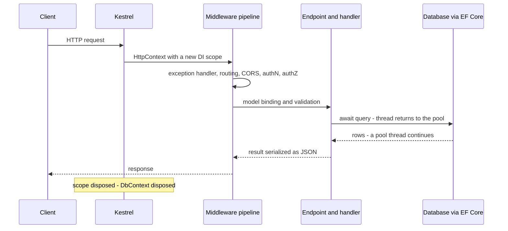
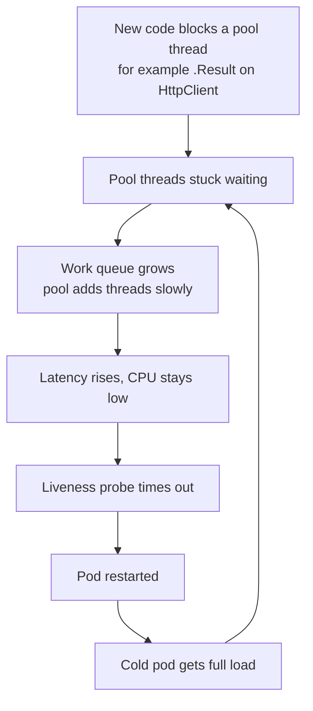
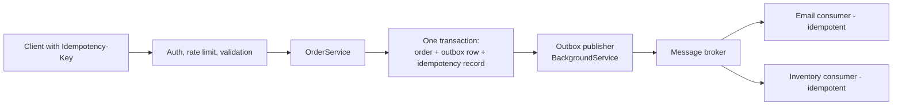

# C# and .NET Backend — Mixed Interview Questions

> This file is mixed, cross-topic practice for the whole C# and .NET backend subject. Each topic document already has its own interview questions; use this file after you have studied the topics, and again right before interviews, because real interviews jump between C#, async code, ASP.NET Core, EF Core, security and production in one conversation.

## Table of contents

1. [All topic questions at a glance](#all-topic-questions-at-a-glance)
2. [Mixed and cross-topic questions](#mixed-and-cross-topic-questions)
3. [Rapid revision round](#rapid-revision-round)
4. [Summary](#summary)

## All topic questions at a glance

Every interview question from the 14 topic documents, in order. Each link jumps to the full answer.

### [C# Fundamentals and the Type System](01-csharp-fundamentals-and-type-system.md)

- [Q1. What is the difference between a value type and a reference type?](01-csharp-fundamentals-and-type-system.md#q1-what-is-the-difference-between-a-value-type-and-a-reference-type)
- [Q2. What does this print?](01-csharp-fundamentals-and-type-system.md#q2-what-does-this-print)
- [Q3. Struct vs class vs record vs record struct: when do you use each?](01-csharp-fundamentals-and-type-system.md#q3-struct-vs-class-vs-record-vs-record-struct-when-do-you-use-each)
- [Q4. What does this print?](01-csharp-fundamentals-and-type-system.md#q4-what-does-this-print)
- [Q5. What is boxing, and why should you care?](01-csharp-fundamentals-and-type-system.md#q5-what-is-boxing-and-why-should-you-care)
- [Q6. Why are strings immutable in C#, and what does that mean for performance?](01-csharp-fundamentals-and-type-system.md#q6-why-are-strings-immutable-in-c-and-what-does-that-mean-for-performance)
- [Q7. What does this print?](01-csharp-fundamentals-and-type-system.md#q7-what-does-this-print)
- [Q8. Explain `==`, `Equals`, `ReferenceEquals` and `GetHashCode`.](01-csharp-fundamentals-and-type-system.md#q8-explain--equals-referenceequals-and-gethashcode)
- [Q9. What is the difference between `int?` and `string?`?](01-csharp-fundamentals-and-type-system.md#q9-what-is-the-difference-between-int-and-string)
- [Q10. What is the difference between `const` and `readonly`?](01-csharp-fundamentals-and-type-system.md#q10-what-is-the-difference-between-const-and-readonly)
- [Q11. What does this print?](01-csharp-fundamentals-and-type-system.md#q11-what-does-this-print)
- [Q12. Explain `ref`, `out` and `in`.](01-csharp-fundamentals-and-type-system.md#q12-explain-ref-out-and-in)
- [Q13. What is the difference between `var`, `object` and `dynamic`?](01-csharp-fundamentals-and-type-system.md#q13-what-is-the-difference-between-var-object-and-dynamic)
- [Q14. What do these switch expressions return?](01-csharp-fundamentals-and-type-system.md#q14-what-do-these-switch-expressions-return)
- [Q15. What is pattern matching, and how is it different from TypeScript narrowing?](01-csharp-fundamentals-and-type-system.md#q15-what-is-pattern-matching-and-how-is-it-different-from-typescript-narrowing)
- [Q16. What does this print, and why?](01-csharp-fundamentals-and-type-system.md#q16-what-does-this-print-and-why)
- [Q17. What is the null-forgiving operator, and when is it dangerous?](01-csharp-fundamentals-and-type-system.md#q17-what-is-the-null-forgiving-operator-and-when-is-it-dangerous)
- [Q18. Code review: what is wrong with this class?](01-csharp-fundamentals-and-type-system.md#q18-code-review-what-is-wrong-with-this-class)
- [Q19. What is a primary constructor, and what is the gotcha?](01-csharp-fundamentals-and-type-system.md#q19-what-is-a-primary-constructor-and-what-is-the-gotcha)
- [Q20. What does `required` do, and how is it different from `init`?](01-csharp-fundamentals-and-type-system.md#q20-what-does-required-do-and-how-is-it-different-from-init)

### [OOP, Interfaces, Generics and Delegates in C#](02-oop-interfaces-generics-and-delegates.md)

- [Q1. What does this print?](02-oop-interfaces-generics-and-delegates.md#q1-what-does-this-print)
- [Q2. What is the difference between `override` and `new`?](02-oop-interfaces-generics-and-delegates.md#q2-what-is-the-difference-between-override-and-new)
- [Q3. What does this print?](02-oop-interfaces-generics-and-delegates.md#q3-what-does-this-print)
- [Q4. Interface vs abstract class: when do you use each?](02-oop-interfaces-generics-and-delegates.md#q4-interface-vs-abstract-class-when-do-you-use-each)
- [Q5. What is explicit interface implementation, and why use it?](02-oop-interfaces-generics-and-delegates.md#q5-what-is-explicit-interface-implementation-and-why-use-it)
- [Q6. What does this print, and how do you fix it?](02-oop-interfaces-generics-and-delegates.md#q6-what-does-this-print-and-how-do-you-fix-it)
- [Q7. What are delegates, and how do `Func`, `Action` and `Predicate` differ?](02-oop-interfaces-generics-and-delegates.md#q7-what-are-delegates-and-how-do-func-action-and-predicate-differ)
- [Q8. What is a closure in C#, and how does the compiler implement it?](02-oop-interfaces-generics-and-delegates.md#q8-what-is-a-closure-in-c-and-how-does-the-compiler-implement-it)
- [Q9. What is the difference between an event and a delegate field?](02-oop-interfaces-generics-and-delegates.md#q9-what-is-the-difference-between-an-event-and-a-delegate-field)
- [Q10. What does this print?](02-oop-interfaces-generics-and-delegates.md#q10-what-does-this-print)
- [Q11. What are generics, and how are C# generics different from TypeScript or Java generics?](02-oop-interfaces-generics-and-delegates.md#q11-what-are-generics-and-how-are-c-generics-different-from-typescript-or-java-generics)
- [Q12. Explain covariance and contravariance with an example.](02-oop-interfaces-generics-and-delegates.md#q12-explain-covariance-and-contravariance-with-an-example)
- [Q13. What is an extension method, and what did C# 14 add?](02-oop-interfaces-generics-and-delegates.md#q13-what-is-an-extension-method-and-what-did-c-14-add)
- [Q14. When would you overload operators?](02-oop-interfaces-generics-and-delegates.md#q14-when-would-you-overload-operators)
- [Q15. Debugging: subscribers are never garbage collected. Why?](02-oop-interfaces-generics-and-delegates.md#q15-debugging-subscribers-are-never-garbage-collected-why)
- [Q16. What do `IComparable<T>` and `IEquatable<T>` give you?](02-oop-interfaces-generics-and-delegates.md#q16-what-do-icomparable-and-iequatable-give-you)
- [Q17. What is the difference between `is`, `as` and a direct cast?](02-oop-interfaces-generics-and-delegates.md#q17-what-is-the-difference-between-is-as-and-a-direct-cast)
- [Q18. Code review: what would you change?](02-oop-interfaces-generics-and-delegates.md#q18-code-review-what-would-you-change)

### [Collections and LINQ](03-collections-and-linq.md)

- [Q1. When would you use `List<T>`, `Dictionary<TKey,TValue>` and `HashSet<T>`?](03-collections-and-linq.md#q1-when-would-you-use-list-dictionary-and-hashset)
- [Q2. What does this print?](03-collections-and-linq.md#q2-what-does-this-print)
- [Q3. What does this print?](03-collections-and-linq.md#q3-what-does-this-print)
- [Q4. What does this print?](03-collections-and-linq.md#q4-what-does-this-print)
- [Q5. What is the difference between `IEnumerable<T>` and `IQueryable<T>`?](03-collections-and-linq.md#q5-what-is-the-difference-between-ienumerable-and-iqueryable)
- [Q6. What is the difference between `First`, `FirstOrDefault`, `Single` and `SingleOrDefault`?](03-collections-and-linq.md#q6-what-is-the-difference-between-first-firstordefault-single-and-singleordefault)
- [Q7. What does this print?](03-collections-and-linq.md#q7-what-does-this-print)
- [Q8. Explain `yield return`. What is the trap with argument validation?](03-collections-and-linq.md#q8-explain-yield-return-what-is-the-trap-with-argument-validation)
- [Q9. What is wrong with this code, and how do you fix it?](03-collections-and-linq.md#q9-what-is-wrong-with-this-code-and-how-do-you-fix-it)
- [Q10. What is the difference between read-only, immutable and frozen collections?](03-collections-and-linq.md#q10-what-is-the-difference-between-read-only-immutable-and-frozen-collections)
- [Q11. Why is `ConcurrentDictionary.GetOrAdd` not "run once"?](03-collections-and-linq.md#q11-why-is-concurrentdictionarygetoradd-not-run-once)
- [Q12. How does a `Dictionary` work internally?](03-collections-and-linq.md#q12-how-does-a-dictionary-work-internally)
- [Q13. What does this print?](03-collections-and-linq.md#q13-what-does-this-print)
- [Q14. `Select` vs `SelectMany`?](03-collections-and-linq.md#q14-select-vs-selectmany)
- [Q15. How do you do a left join in LINQ?](03-collections-and-linq.md#q15-how-do-you-do-a-left-join-in-linq)
- [Q16. What are the new LINQ methods in .NET 9 and .NET 10?](03-collections-and-linq.md#q16-what-are-the-new-linq-methods-in-net-9-and-net-10)
- [Q17. Debugging: this endpoint is slow and uses a lot of memory. Why?](03-collections-and-linq.md#q17-debugging-this-endpoint-is-slow-and-uses-a-lot-of-memory-why)
- [Q18. When is LINQ the wrong tool?](03-collections-and-linq.md#q18-when-is-linq-the-wrong-tool)

### [Async/Await, Tasks and Threading](04-async-await-tasks-and-threading.md)

- [Q1. What is the difference between a Task and a Thread?](04-async-await-tasks-and-threading.md#q1-what-is-the-difference-between-a-task-and-a-thread)
- [Q2. What does this print?](04-async-await-tasks-and-threading.md#q2-what-does-this-print)
- [Q3. Explain how async/await works under the hood.](04-async-await-tasks-and-threading.md#q3-explain-how-asyncawait-works-under-the-hood)
- [Q4. What is `SynchronizationContext`, and why does `ConfigureAwait(false)` matter less in ASP.NET Core?](04-async-await-tasks-and-threading.md#q4-what-is-synchronizationcontext-and-why-does-configureawaitfalse-matter-less-in-aspnet-core)
- [Q5. Why does `.Result` deadlock, and how do you fix it?](04-async-await-tasks-and-threading.md#q5-why-does-result-deadlock-and-how-do-you-fix-it)
- [Q6. What does this print?](04-async-await-tasks-and-threading.md#q6-what-does-this-print)
- [Q7. When do you use `Task.WhenAll` vs awaiting one by one?](04-async-await-tasks-and-threading.md#q7-when-do-you-use-taskwhenall-vs-awaiting-one-by-one)
- [Q8. How does cancellation work in .NET?](04-async-await-tasks-and-threading.md#q8-how-does-cancellation-work-in-net)
- [Q9. Why is `async void` dangerous?](04-async-await-tasks-and-threading.md#q9-why-is-async-void-dangerous)
- [Q10. Is using `Task.Run` in an ASP.NET Core controller a good idea?](04-async-await-tasks-and-threading.md#q10-is-using-taskrun-in-an-aspnet-core-controller-a-good-idea)
- [Q11. What is `ValueTask`, and when should you use it?](04-async-await-tasks-and-threading.md#q11-what-is-valuetask-and-when-should-you-use-it)
- [Q12. What is `IAsyncEnumerable<T>`?](04-async-await-tasks-and-threading.md#q12-what-is-iasyncenumerable)
- [Q13. What does this print?](04-async-await-tasks-and-threading.md#q13-what-does-this-print)
- [Q14. Why can't you `await` inside a `lock`, and what do you use instead?](04-async-await-tasks-and-threading.md#q14-why-cant-you-await-inside-a-lock-and-what-do-you-use-instead)
- [Q15. How would you process 10,000 items by calling an external API, at most 20 at a time?](04-async-await-tasks-and-threading.md#q15-how-would-you-process-10000-items-by-calling-an-external-api-at-most-20-at-a-time)
- [Q16. What is `Channel<T>`, and when would you use it?](04-async-await-tasks-and-threading.md#q16-what-is-channel-and-when-would-you-use-it)
- [Q17. Debugging: the API becomes very slow under load, but CPU is low. What do you check?](04-async-await-tasks-and-threading.md#q17-debugging-the-api-becomes-very-slow-under-load-but-cpu-is-low-what-do-you-check)
- [Q18. Code review: what is wrong here?](04-async-await-tasks-and-threading.md#q18-code-review-what-is-wrong-here)
- [Q19. What is the difference between concurrency and parallelism?](04-async-await-tasks-and-threading.md#q19-what-is-the-difference-between-concurrency-and-parallelism)
- [Q20. What is `TaskCompletionSource`, and why use `RunContinuationsAsynchronously`?](04-async-await-tasks-and-threading.md#q20-what-is-taskcompletionsource-and-why-use-runcontinuationsasynchronously)

### [Memory, Garbage Collection and Performance](05-memory-gc-and-performance.md)

- [Q1. How does the .NET garbage collector decide what to collect?](05-memory-gc-and-performance.md#q1-how-does-the-net-garbage-collector-decide-what-to-collect)
- [Q2. What are GC generations, and why do they exist?](05-memory-gc-and-performance.md#q2-what-are-gc-generations-and-why-do-they-exist)
- [Q3. What is the large object heap, and what problems can it cause?](05-memory-gc-and-performance.md#q3-what-is-the-large-object-heap-and-what-problems-can-it-cause)
- [Q4. Workstation vs server GC, and what is DATAS?](05-memory-gc-and-performance.md#q4-workstation-vs-server-gc-and-what-is-datas)
- [Q5. What is the difference between `Dispose` and a finalizer?](05-memory-gc-and-performance.md#q5-what-is-the-difference-between-dispose-and-a-finalizer)
- [Q6. What does this print?](05-memory-gc-and-performance.md#q6-what-does-this-print)
- [Q7. Can you have a memory leak in .NET? Give examples.](05-memory-gc-and-performance.md#q7-can-you-have-a-memory-leak-in-net-give-examples)
- [Q8. What is `Span<T>`, and why is it a `ref struct`?](05-memory-gc-and-performance.md#q8-what-is-span-and-why-is-it-a-ref-struct)
- [Q9. What is `ArrayPool<T>`, and what are the rules for using it?](05-memory-gc-and-performance.md#q9-what-is-arraypool-and-what-are-the-rules-for-using-it)
- [Q10. When would you use `stackalloc`, and what is the danger?](05-memory-gc-and-performance.md#q10-when-would-you-use-stackalloc-and-what-is-the-danger)
- [Q11. What does this print?](05-memory-gc-and-performance.md#q11-what-does-this-print)
- [Q12. Why should you not call `GC.Collect()`?](05-memory-gc-and-performance.md#q12-why-should-you-not-call-gccollect)
- [Q13. How does tiered compilation work, and how is it different from ReadyToRun and Native AOT?](05-memory-gc-and-performance.md#q13-how-does-tiered-compilation-work-and-how-is-it-different-from-readytorun-and-native-aot)
- [Q14. How would you investigate a memory leak in a production ASP.NET Core service?](05-memory-gc-and-performance.md#q14-how-would-you-investigate-a-memory-leak-in-a-production-aspnet-core-service)
- [Q15. How do you reduce allocations in a hot code path?](05-memory-gc-and-performance.md#q15-how-do-you-reduce-allocations-in-a-hot-code-path)
- [Q16. What happens to an object with a finalizer when it becomes unreachable?](05-memory-gc-and-performance.md#q16-what-happens-to-an-object-with-a-finalizer-when-it-becomes-unreachable)
- [Q17. Code review: what is wrong?](05-memory-gc-and-performance.md#q17-code-review-what-is-wrong)
- [Q18. Is allocation in .NET expensive?](05-memory-gc-and-performance.md#q18-is-allocation-in-net-expensive)

### [.NET Runtime, SDK and Project Structure](06-dotnet-runtime-sdk-and-project-structure.md)

- [Q1. What is the difference between .NET Framework, .NET Core and .NET 5+?](06-dotnet-runtime-sdk-and-project-structure.md#q1-what-is-the-difference-between-net-framework-net-core-and-net-5)
- [Q2. What is the CLR, and what does it do?](06-dotnet-runtime-sdk-and-project-structure.md#q2-what-is-the-clr-and-what-does-it-do)
- [Q3. What is IL, and why does .NET use it?](06-dotnet-runtime-sdk-and-project-structure.md#q3-what-is-il-and-why-does-net-use-it)
- [Q4. What is tiered compilation, and why might a .NET API be slower right after it starts?](06-dotnet-runtime-sdk-and-project-structure.md#q4-what-is-tiered-compilation-and-why-might-a-net-api-be-slower-right-after-it-starts)
- [Q5. Compare framework-dependent, self-contained, single-file, ReadyToRun and Native AOT publishing.](06-dotnet-runtime-sdk-and-project-structure.md#q5-compare-framework-dependent-self-contained-single-file-readytorun-and-native-aot-publishing)
- [Q6. What is the difference between the .NET SDK and the .NET runtime?](06-dotnet-runtime-sdk-and-project-structure.md#q6-what-is-the-difference-between-the-net-sdk-and-the-net-runtime)
- [Q7. An app was built for .NET 10. The server has runtimes 8.0.32, 10.0.11 and 10.0.13 installed. Which runtime does it use?](06-dotnet-runtime-sdk-and-project-structure.md#q7-an-app-was-built-for-net-10-the-server-has-runtimes-8032-10011-and-10013-installed-which-runtime-does-it-use)
- [Q8. What is in an SDK-style `.csproj`, and how is it different from the old format?](06-dotnet-runtime-sdk-and-project-structure.md#q8-what-is-in-an-sdk-style-csproj-and-how-is-it-different-from-the-old-format)
- [Q9. What is Central Package Management, and why use it?](06-dotnet-runtime-sdk-and-project-structure.md#q9-what-is-central-package-management-and-why-use-it)
- [Q10. What does NuGet do on restore, and how is it different from npm?](06-dotnet-runtime-sdk-and-project-structure.md#q10-what-does-nuget-do-on-restore-and-how-is-it-different-from-npm)
- [Q11. What does this program print, and what is its exit code when run as `dotnet run top.cs -- a b`?](06-dotnet-runtime-sdk-and-project-structure.md#q11-what-does-this-program-print-and-what-is-its-exit-code-when-run-as-dotnet-run-topcs----a-b)
- [Q12. This code builds successfully. What happens when it runs?](06-dotnet-runtime-sdk-and-project-structure.md#q12-this-code-builds-successfully-what-happens-when-it-runs)
- [Q13. What is Native AOT, and when would you not use it?](06-dotnet-runtime-sdk-and-project-structure.md#q13-what-is-native-aot-and-when-would-you-not-use-it)
- [Q14. What are file-based apps in .NET 10, and what are they good for?](06-dotnet-runtime-sdk-and-project-structure.md#q14-what-are-file-based-apps-in-net-10-and-what-are-they-good-for)
- [Q15. You join a team. Different projects use different Serilog versions, CI sometimes builds with a different SDK than developers, restore is slow and flaky, and 40 `.csproj` files repeat the same 10 properties. What do you change?](06-dotnet-runtime-sdk-and-project-structure.md#q15-you-join-a-team-different-projects-use-different-serilog-versions-ci-sometimes-builds-with-a-different-sdk-than-developers-restore-is-slow-and-flaky-and-40-csproj-files-repeat-the-same-10-properties-what-do-you-change)

### [ASP.NET Core Fundamentals and Middleware](07-aspnet-core-fundamentals-and-middleware.md)

- [Q1. What is middleware, and how is ASP.NET Core middleware different from Express middleware?](07-aspnet-core-fundamentals-and-middleware.md#q1-what-is-middleware-and-how-is-aspnet-core-middleware-different-from-express-middleware)
- [Q2. What does this print for `GET /hello`?](07-aspnet-core-fundamentals-and-middleware.md#q2-what-does-this-print-for-get-hello)
- [Q3. What does `GET /x` return, and what is printed?](07-aspnet-core-fundamentals-and-middleware.md#q3-what-does-get-x-return-and-what-is-printed)
- [Q4. What is the correct order of the built-in middleware, and what breaks if it is wrong?](07-aspnet-core-fundamentals-and-middleware.md#q4-what-is-the-correct-order-of-the-built-in-middleware-and-what-breaks-if-it-is-wrong)
- [Q5. What is the difference between `Use`, `Run`, `Map` and `MapGet`?](07-aspnet-core-fundamentals-and-middleware.md#q5-what-is-the-difference-between-use-run-map-and-mapget)
- [Q6. How do you write custom middleware, and where do you inject scoped services?](07-aspnet-core-fundamentals-and-middleware.md#q6-how-do-you-write-custom-middleware-and-where-do-you-inject-scoped-services)
- [Q7. Minimal APIs or controllers — how do you choose?](07-aspnet-core-fundamentals-and-middleware.md#q7-minimal-apis-or-controllers--how-do-you-choose)
- [Q8. How does model binding decide where a parameter comes from in a minimal API?](07-aspnet-core-fundamentals-and-middleware.md#q8-how-does-model-binding-decide-where-a-parameter-comes-from-in-a-minimal-api)
- [Q9. Why prefer `TypedResults` over `Results`?](07-aspnet-core-fundamentals-and-middleware.md#q9-why-prefer-typedresults-over-results)
- [Q10. What is the difference between middleware, endpoint filters and MVC action filters?](07-aspnet-core-fundamentals-and-middleware.md#q10-what-is-the-difference-between-middleware-endpoint-filters-and-mvc-action-filters)
- [Q11. Explain configuration precedence. A value is in `appsettings.json`, `appsettings.Production.json`, an environment variable and a command-line argument. Which one wins?](07-aspnet-core-fundamentals-and-middleware.md#q11-explain-configuration-precedence-a-value-is-in-appsettingsjson-appsettingsproductionjson-an-environment-variable-and-a-command-line-argument-which-one-wins)
- [Q12. `IOptions`, `IOptionsSnapshot` and `IOptionsMonitor` — what is the difference? What does this print after editing the file?](07-aspnet-core-fundamentals-and-middleware.md#q12-ioptions-ioptionssnapshot-and-ioptionsmonitor--what-is-the-difference-what-does-this-print-after-editing-the-file)
- [Q13. What is structured logging, and why is `logger.LogInformation($"User {id} logged in")` a problem?](07-aspnet-core-fundamentals-and-middleware.md#q13-what-is-structured-logging-and-why-is-loggerloginformationuser-id-logged-in-a-problem)
- [Q14. A request to an `[Authorize]` endpoint always returns 401 even with a valid JWT. What do you check?](07-aspnet-core-fundamentals-and-middleware.md#q14-a-request-to-an-authorize-endpoint-always-returns-401-even-with-a-valid-jwt-what-do-you-check)
- [Q15. Your Angular app on `http://localhost:4200` gets a CORS error calling your API. How do you fix it correctly?](07-aspnet-core-fundamentals-and-middleware.md#q15-your-angular-app-on-httplocalhost4200-gets-a-cors-error-calling-your-api-how-do-you-fix-it-correctly)
- [Q16. An unhandled exception in production returns an empty 500. How do you return consistent error responses without leaking details?](07-aspnet-core-fundamentals-and-middleware.md#q16-an-unhandled-exception-in-production-returns-an-empty-500-how-do-you-return-consistent-error-responses-without-leaking-details)
- [Q17. What is Kestrel, and why put a reverse proxy in front of it?](07-aspnet-core-fundamentals-and-middleware.md#q17-what-is-kestrel-and-why-put-a-reverse-proxy-in-front-of-it)
- [Q18. How does the generic host shut down an ASP.NET Core app, and why does it matter?](07-aspnet-core-fundamentals-and-middleware.md#q18-how-does-the-generic-host-shut-down-an-aspnet-core-app-and-why-does-it-matter)

### [Dependency Injection in ASP.NET Core](08-dependency-injection-in-aspnet-core.md)

- [Q1. What are the three service lifetimes, and when do you use each?](08-dependency-injection-in-aspnet-core.md#q1-what-are-the-three-service-lifetimes-and-when-do-you-use-each)
- [Q2. What does the `/ids` endpoint return for two requests?](08-dependency-injection-in-aspnet-core.md#q2-what-does-the-ids-endpoint-return-for-two-requests)
- [Q3. What is a captive dependency, and how does ASP.NET Core protect you from it?](08-dependency-injection-in-aspnet-core.md#q3-what-is-a-captive-dependency-and-how-does-aspnet-core-protect-you-from-it)
- [Q4. How do you use a `DbContext` inside a `BackgroundService`?](08-dependency-injection-in-aspnet-core.md#q4-how-do-you-use-a-dbcontext-inside-a-backgroundservice)
- [Q5. When are services disposed, and what is the leak with transient disposables?](08-dependency-injection-in-aspnet-core.md#q5-when-are-services-disposed-and-what-is-the-leak-with-transient-disposables)
- [Q6. You register two implementations of `INotifier`. What do you get when you inject `INotifier`, and `IEnumerable<INotifier>`?](08-dependency-injection-in-aspnet-core.md#q6-you-register-two-implementations-of-inotifier-what-do-you-get-when-you-inject-inotifier-and-ienumerable)
- [Q7. What are keyed services, and when would you use them instead of a factory?](08-dependency-injection-in-aspnet-core.md#q7-what-are-keyed-services-and-when-would-you-use-them-instead-of-a-factory)
- [Q8. Why is `new HttpClient()` per request bad, and what does `IHttpClientFactory` do?](08-dependency-injection-in-aspnet-core.md#q8-why-is-new-httpclient-per-request-bad-and-what-does-ihttpclientfactory-do)
- [Q9. What is wrong with this registration?](08-dependency-injection-in-aspnet-core.md#q9-what-is-wrong-with-this-registration)
- [Q10. What is the difference between constructor injection, `[FromServices]` and `IServiceProvider.GetService`?](08-dependency-injection-in-aspnet-core.md#q10-what-is-the-difference-between-constructor-injection-fromservices-and-iserviceprovidergetservice)
- [Q11. Primary constructors for DI — any downsides?](08-dependency-injection-in-aspnet-core.md#q11-primary-constructors-for-di--any-downsides)
- [Q12. How would you add caching to an `IOrderRepository` without changing its callers?](08-dependency-injection-in-aspnet-core.md#q12-how-would-you-add-caching-to-an-iorderrepository-without-changing-its-callers)
- [Q13. How does .NET DI compare to Angular DI?](08-dependency-injection-in-aspnet-core.md#q13-how-does-net-di-compare-to-angular-di)
- [Q14. When would you replace the built-in container with Autofac?](08-dependency-injection-in-aspnet-core.md#q14-when-would-you-replace-the-built-in-container-with-autofac)
- [Q15. A singleton `ReportService` takes a transient `Clock`. You resolve `ReportService` twice. Do the two `ReportService`s see the same `Clock`?](08-dependency-injection-in-aspnet-core.md#q15-a-singleton-reportservice-takes-a-transient-clock-you-resolve-reportservice-twice-do-the-two-reportservices-see-the-same-clock)
- [Q16. Your API works in Development but in Production users sometimes see each other's data. Where do you look first?](08-dependency-injection-in-aspnet-core.md#q16-your-api-works-in-development-but-in-production-users-sometimes-see-each-others-data-where-do-you-look-first)

### [Web APIs, Validation and Error Handling](09-web-apis-validation-and-error-handling.md)

- [Q1. Why use DTOs instead of returning EF Core entities?](09-web-apis-validation-and-error-handling.md#q1-why-use-dtos-instead-of-returning-ef-core-entities)
- [Q2. How does validation work for controllers vs minimal APIs, and what changed in .NET 10?](09-web-apis-validation-and-error-handling.md#q2-how-does-validation-work-for-controllers-vs-minimal-apis-and-what-changed-in-net-10)
- [Q3. DataAnnotations or FluentValidation?](09-web-apis-validation-and-error-handling.md#q3-dataannotations-or-fluentvalidation)
- [Q4. What is ProblemDetails, and how do you make every error use it?](09-web-apis-validation-and-error-handling.md#q4-what-is-problemdetails-and-how-do-you-make-every-error-use-it)
- [Q5. How does `IExceptionHandler` work? What happens when two handlers are registered?](09-web-apis-validation-and-error-handling.md#q5-how-does-iexceptionhandler-work-what-happens-when-two-handlers-are-registered)
- [Q6. This endpoint throws `InvalidOperationException("secret connection string here")`. What does the client receive with `AddProblemDetails()` and `UseExceptionHandler()`?](09-web-apis-validation-and-error-handling.md#q6-this-endpoint-throws-invalidoperationexceptionsecret-connection-string-here-what-does-the-client-receive-with-addproblemdetails-and-useexceptionhandler)
- [Q7. Exceptions or result objects for "order not found"?](09-web-apis-validation-and-error-handling.md#q7-exceptions-or-result-objects-for-order-not-found)
- [Q8. How do you version an ASP.NET Core API?](09-web-apis-validation-and-error-handling.md#q8-how-do-you-version-an-aspnet-core-api)
- [Q9. What changed with OpenAPI in .NET 9 and .NET 10?](09-web-apis-validation-and-error-handling.md#q9-what-changed-with-openapi-in-net-9-and-net-10)
- [Q10. How do you add rate limiting, and what are the traps?](09-web-apis-validation-and-error-handling.md#q10-how-do-you-add-rate-limiting-and-what-are-the-traps)
- [Q11. Output caching vs response caching?](09-web-apis-validation-and-error-handling.md#q11-output-caching-vs-response-caching)
- [Q12. Design pagination for an orders endpoint with 50 million rows.](09-web-apis-validation-and-error-handling.md#q12-design-pagination-for-an-orders-endpoint-with-50-million-rows)
- [Q13. A mobile client retries `POST /payments` after a timeout and customers are charged twice. How do you fix it?](09-web-apis-validation-and-error-handling.md#q13-a-mobile-client-retries-post-payments-after-a-timeout-and-customers-are-charged-twice-how-do-you-fix-it)
- [Q14. Why do enums show as numbers in your JSON, and how do you change it?](09-web-apis-validation-and-error-handling.md#q14-why-do-enums-show-as-numbers-in-your-json-and-how-do-you-change-it)
- [Q15. Code review: what is wrong with this endpoint?](09-web-apis-validation-and-error-handling.md#q15-code-review-what-is-wrong-with-this-endpoint)
- [Q16. How would you structure error handling for an Angular frontend calling this API?](09-web-apis-validation-and-error-handling.md#q16-how-would-you-structure-error-handling-for-an-angular-frontend-calling-this-api)

### [Entity Framework Core and Data Access](10-entity-framework-core-and-data-access.md)

- [Q1. What are `DbContext`, `DbSet` and the change tracker?](10-entity-framework-core-and-data-access.md#q1-what-are-dbcontext-dbset-and-the-change-tracker)
- [Q2. When do you use `AsNoTracking()`?](10-entity-framework-core-and-data-access.md#q2-when-do-you-use-asnotracking)
- [Q3. What is the N+1 problem in EF Core, and how do you fix it?](10-entity-framework-core-and-data-access.md#q3-what-is-the-n1-problem-in-ef-core-and-how-do-you-fix-it)
- [Q4. What is cartesian explosion, and what are split queries?](10-entity-framework-core-and-data-access.md#q4-what-is-cartesian-explosion-and-what-are-split-queries)
- [Q5. What happens in this code, and what SQL does it run?](10-entity-framework-core-and-data-access.md#q5-what-happens-in-this-code-and-what-sql-does-it-run)
- [Q6. What does this throw, and why?](10-entity-framework-core-and-data-access.md#q6-what-does-this-throw-and-why)
- [Q7. `Attach` vs `Update` — what is the difference, and why does it matter for PUT endpoints?](10-entity-framework-core-and-data-access.md#q7-attach-vs-update--what-is-the-difference-and-why-does-it-matter-for-put-endpoints)
- [Q8. Does `SaveChanges` use a transaction? When do you need an explicit one?](10-entity-framework-core-and-data-access.md#q8-does-savechanges-use-a-transaction-when-do-you-need-an-explicit-one)
- [Q9. How do you prevent lost updates when two users edit the same record?](10-entity-framework-core-and-data-access.md#q9-how-do-you-prevent-lost-updates-when-two-users-edit-the-same-record)
- [Q10. When would you use `ExecuteUpdate`/`ExecuteDelete`, and what are the gotchas?](10-entity-framework-core-and-data-access.md#q10-when-would-you-use-executeupdateexecutedelete-and-what-are-the-gotchas)
- [Q11. Is this code safe from SQL injection?](10-entity-framework-core-and-data-access.md#q11-is-this-code-safe-from-sql-injection)
- [Q12. Why is `DbContext` not thread-safe, and how do you run queries in parallel?](10-entity-framework-core-and-data-access.md#q12-why-is-dbcontext-not-thread-safe-and-how-do-you-run-queries-in-parallel)
- [Q13. What is DbContext pooling, and how is it different from connection pooling?](10-entity-framework-core-and-data-access.md#q13-what-is-dbcontext-pooling-and-how-is-it-different-from-connection-pooling)
- [Q14. How do you apply migrations in production?](10-entity-framework-core-and-data-access.md#q14-how-do-you-apply-migrations-in-production)
- [Q15. Should you wrap EF Core in a generic repository?](10-entity-framework-core-and-data-access.md#q15-should-you-wrap-ef-core-in-a-generic-repository)
- [Q16. EF Core or Dapper?](10-entity-framework-core-and-data-access.md#q16-ef-core-or-dapper)
- [Q17. A GET endpoint returning 20 orders takes 3 seconds. How do you investigate?](10-entity-framework-core-and-data-access.md#q17-a-get-endpoint-returning-20-orders-takes-3-seconds-how-do-you-investigate)

### [Authentication and Authorization in ASP.NET Core](11-authentication-and-authorization.md)

- [Q1. What is the difference between authentication and authorization in ASP.NET Core?](11-authentication-and-authorization.md#q1-what-is-the-difference-between-authentication-and-authorization-in-aspnet-core)
- [Q2. What are authentication schemes and handlers? How do you use more than one?](11-authentication-and-authorization.md#q2-what-are-authentication-schemes-and-handlers-how-do-you-use-more-than-one)
- [Q3. What happens if you call UseAuthorization before UseAuthentication?](11-authentication-and-authorization.md#q3-what-happens-if-you-call-useauthorization-before-useauthentication)
- [Q4. Cookie authentication vs JWT bearer: how do you choose?](11-authentication-and-authorization.md#q4-cookie-authentication-vs-jwt-bearer-how-do-you-choose)
- [Q5. How do you validate JWTs in ASP.NET Core, and what does each TokenValidationParameters setting protect against?](11-authentication-and-authorization.md#q5-how-do-you-validate-jwts-in-aspnet-core-and-what-does-each-tokenvalidationparameters-setting-protect-against)
- [Q6. How would you implement refresh tokens safely?](11-authentication-and-authorization.md#q6-how-would-you-implement-refresh-tokens-safely)
- [Q7. What is ASP.NET Core Identity, and when would you not use it?](11-authentication-and-authorization.md#q7-what-is-aspnet-core-identity-and-when-would-you-not-use-it)
- [Q8. Explain policy-based authorization with requirements and handlers.](11-authentication-and-authorization.md#q8-explain-policy-based-authorization-with-requirements-and-handlers)
- [Q9. What is resource-based authorization, and how does it prevent IDOR?](11-authentication-and-authorization.md#q9-what-is-resource-based-authorization-and-how-does-it-prevent-idor)
- [Q10. Debugging: this endpoint is public by mistake. Why?](11-authentication-and-authorization.md#q10-debugging-this-endpoint-is-public-by-mistake-why)
- [Q11. What is the Data Protection API, and why do users get logged out after every deployment?](11-authentication-and-authorization.md#q11-what-is-the-data-protection-api-and-why-do-users-get-logged-out-after-every-deployment)
- [Q12. How do you configure CORS in ASP.NET Core, and does it protect your API?](11-authentication-and-authorization.md#q12-how-do-you-configure-cors-in-aspnet-core-and-does-it-protect-your-api)
- [Q13. What is CSRF, and how does ASP.NET Core protect against it?](11-authentication-and-authorization.md#q13-what-is-csrf-and-how-does-aspnet-core-protect-against-it)
- [Q14. How does OpenID Connect login work in an ASP.NET Core web app?](11-authentication-and-authorization.md#q14-how-does-openid-connect-login-work-in-an-aspnet-core-web-app)
- [Q15. Where do you store secrets in a .NET application?](11-authentication-and-authorization.md#q15-where-do-you-store-secrets-in-a-net-application)
- [Q16. Code review: what is wrong with this login endpoint?](11-authentication-and-authorization.md#q16-code-review-what-is-wrong-with-this-login-endpoint)
- [Q17. Output prediction: which status codes does this produce?](11-authentication-and-authorization.md#q17-output-prediction-which-status-codes-does-this-produce)
- [Q18. How would you design authorization for a multi-tenant SaaS API in ASP.NET Core?](11-authentication-and-authorization.md#q18-how-would-you-design-authorization-for-a-multi-tenant-saas-api-in-aspnet-core)
- [Q19. How do you test authentication and authorization?](11-authentication-and-authorization.md#q19-how-do-you-test-authentication-and-authorization)

### [Caching, Background Jobs and Messaging in .NET](12-caching-background-jobs-and-messaging.md)

- [Q1. IMemoryCache vs IDistributedCache vs HybridCache — when do you use each?](12-caching-background-jobs-and-messaging.md#q1-imemorycache-vs-idistributedcache-vs-hybridcache--when-do-you-use-each)
- [Q2. What is a cache stampede, and does IMemoryCache.GetOrCreateAsync protect you?](12-caching-background-jobs-and-messaging.md#q2-what-is-a-cache-stampede-and-does-imemorycachegetorcreateasync-protect-you)
- [Q3. Output prediction: what does this print?](12-caching-background-jobs-and-messaging.md#q3-output-prediction-what-does-this-print)
- [Q4. IHostedService vs BackgroundService — what is the difference, and what changed in .NET 10?](12-caching-background-jobs-and-messaging.md#q4-ihostedservice-vs-backgroundservice--what-is-the-difference-and-what-changed-in-net-10)
- [Q5. How do you use a scoped service like DbContext inside a BackgroundService?](12-caching-background-jobs-and-messaging.md#q5-how-do-you-use-a-scoped-service-like-dbcontext-inside-a-backgroundservice)
- [Q6. What happens when an exception escapes ExecuteAsync?](12-caching-background-jobs-and-messaging.md#q6-what-happens-when-an-exception-escapes-executeasync)
- [Q7. How does graceful shutdown work for ASP.NET Core and background services?](12-caching-background-jobs-and-messaging.md#q7-how-does-graceful-shutdown-work-for-aspnet-core-and-background-services)
- [Q8. Design: after an order is placed, send a confirmation email without slowing the API. What are your options?](12-caching-background-jobs-and-messaging.md#q8-design-after-an-order-is-placed-send-a-confirmation-email-without-slowing-the-api-what-are-your-options)
- [Q9. What is the outbox pattern, and why do you need it?](12-caching-background-jobs-and-messaging.md#q9-what-is-the-outbox-pattern-and-why-do-you-need-it)
- [Q10. How do you make a message consumer idempotent?](12-caching-background-jobs-and-messaging.md#q10-how-do-you-make-a-message-consumer-idempotent)
- [Q11. When would you use Channel of T, and what are its limits?](12-caching-background-jobs-and-messaging.md#q11-when-would-you-use-channel-of-t-and-what-are-its-limits)
- [Q12. Hangfire vs Quartz.NET vs a BackgroundService with a timer?](12-caching-background-jobs-and-messaging.md#q12-hangfire-vs-quartznet-vs-a-backgroundservice-with-a-timer)
- [Q13. What are SignalR hubs and groups, and how do you scale SignalR?](12-caching-background-jobs-and-messaging.md#q13-what-are-signalr-hubs-and-groups-and-how-do-you-scale-signalr)
- [Q14. Debugging: after scaling to three instances, users sometimes see old product prices for up to an hour. Why?](12-caching-background-jobs-and-messaging.md#q14-debugging-after-scaling-to-three-instances-users-sometimes-see-old-product-prices-for-up-to-an-hour-why)
- [Q15. Code review: what is wrong with this worker?](12-caching-background-jobs-and-messaging.md#q15-code-review-what-is-wrong-with-this-worker)
- [Q16. How would you cache data per tenant in a multi-tenant .NET API?](12-caching-background-jobs-and-messaging.md#q16-how-would-you-cache-data-per-tenant-in-a-multi-tenant-net-api)

### [Testing .NET Applications](13-testing-dotnet-applications.md)

- [Q1. What is the difference between unit tests and integration tests in ASP.NET Core, and how do you balance them?](13-testing-dotnet-applications.md#q1-what-is-the-difference-between-unit-tests-and-integration-tests-in-aspnet-core-and-how-do-you-balance-them)
- [Q2. Compare xUnit, NUnit and MSTest. Which would you choose?](13-testing-dotnet-applications.md#q2-compare-xunit-nunit-and-mstest-which-would-you-choose)
- [Q3. What is the difference between Fact and Theory in xUnit?](13-testing-dotnet-applications.md#q3-what-is-the-difference-between-fact-and-theory-in-xunit)
- [Q4. How do you share expensive setup between tests in xUnit?](13-testing-dotnet-applications.md#q4-how-do-you-share-expensive-setup-between-tests-in-xunit)
- [Q5. Mocks, stubs and fakes — what are they, and when do you use a mocking library?](13-testing-dotnet-applications.md#q5-mocks-stubs-and-fakes--what-are-they-and-when-do-you-use-a-mocking-library)
- [Q6. Moq vs NSubstitute — and what was the Moq SponsorLink issue?](13-testing-dotnet-applications.md#q6-moq-vs-nsubstitute--and-what-was-the-moq-sponsorlink-issue)
- [Q7. How do you test code that depends on the current time?](13-testing-dotnet-applications.md#q7-how-do-you-test-code-that-depends-on-the-current-time)
- [Q8. How does WebApplicationFactory work, and how do you replace services in it?](13-testing-dotnet-applications.md#q8-how-does-webapplicationfactory-work-and-how-do-you-replace-services-in-it)
- [Q9. Why is the EF Core InMemory provider a bad choice for testing data access? What do you use instead?](13-testing-dotnet-applications.md#q9-why-is-the-ef-core-inmemory-provider-a-bad-choice-for-testing-data-access-what-do-you-use-instead)
- [Q10. Debugging: this test passes alone but fails in the full test run. Why?](13-testing-dotnet-applications.md#q10-debugging-this-test-passes-alone-but-fails-in-the-full-test-run-why)
- [Q11. How do you unit-test a class that uses HttpClient?](13-testing-dotnet-applications.md#q11-how-do-you-unit-test-a-class-that-uses-httpclient)
- [Q12. How do you test authorization rules?](13-testing-dotnet-applications.md#q12-how-do-you-test-authorization-rules)
- [Q13. Code review: what is wrong with these tests?](13-testing-dotnet-applications.md#q13-code-review-what-is-wrong-with-these-tests)
- [Q14. What does code coverage tell you, and what doesn't it tell you?](13-testing-dotnet-applications.md#q14-what-does-code-coverage-tell-you-and-what-doesnt-it-tell-you)
- [Q15. Your integration tests need a real PostgreSQL. How do you set that up in CI?](13-testing-dotnet-applications.md#q15-your-integration-tests-need-a-real-postgresql-how-do-you-set-that-up-in-ci)
- [Q16. How do you test a BackgroundService?](13-testing-dotnet-applications.md#q16-how-do-you-test-a-backgroundservice)

### [Production, Architecture and Performance in .NET](14-production-architecture-and-performance.md)

- [Q1. What does "production-ready" mean for an ASP.NET Core API?](14-production-architecture-and-performance.md#q1-what-does-production-ready-mean-for-an-aspnet-core-api)
- [Q2. What is structured logging, and how do you do it well in .NET?](14-production-architecture-and-performance.md#q2-what-is-structured-logging-and-how-do-you-do-it-well-in-net)
- [Q3. Explain OpenTelemetry in .NET: what are traces, spans and metrics, and how do you add custom ones?](14-production-architecture-and-performance.md#q3-explain-opentelemetry-in-net-what-are-traces-spans-and-metrics-and-how-do-you-add-custom-ones)
- [Q4. What is Aspire, and when would you use it?](14-production-architecture-and-performance.md#q4-what-is-aspire-and-when-would-you-use-it)
- [Q5. Liveness vs readiness: what is the difference, and what goes in each?](14-production-architecture-and-performance.md#q5-liveness-vs-readiness-what-is-the-difference-and-what-goes-in-each)
- [Q6. How do you add resilience to HttpClient calls in .NET 8+? What are the risks of retries?](14-production-architecture-and-performance.md#q6-how-do-you-add-resilience-to-httpclient-calls-in-net-8-what-are-the-risks-of-retries)
- [Q7. What is thread pool starvation, and how do you detect and fix it?](14-production-architecture-and-performance.md#q7-what-is-thread-pool-starvation-and-how-do-you-detect-and-fix-it)
- [Q8. Explain the official .NET container images and why chiseled images matter.](14-production-architecture-and-performance.md#q8-explain-the-official-net-container-images-and-why-chiseled-images-matter)
- [Q9. IIS in-process vs out-of-process vs Kestrel behind a reverse proxy?](14-production-architecture-and-performance.md#q9-iis-in-process-vs-out-of-process-vs-kestrel-behind-a-reverse-proxy)
- [Q10. Debugging: after moving behind a load balancer, users get endless redirects and all requests appear to come from one IP. Why?](14-production-architecture-and-performance.md#q10-debugging-after-moving-behind-a-load-balancer-users-get-endless-redirects-and-all-requests-appear-to-come-from-one-ip-why)
- [Q11. Layered architecture vs Clean Architecture vs vertical slices — how do you choose?](14-production-architecture-and-performance.md#q11-layered-architecture-vs-clean-architecture-vs-vertical-slices--how-do-you-choose)
- [Q12. What is CQRS? Do you need MediatR for it?](14-production-architecture-and-performance.md#q12-what-is-cqrs-do-you-need-mediatr-for-it)
- [Q13. Modular monolith or microservices for a new .NET product?](14-production-architecture-and-performance.md#q13-modular-monolith-or-microservices-for-a-new-net-product)
- [Q14. Code review: what production problems do you see?](14-production-architecture-and-performance.md#q14-code-review-what-production-problems-do-you-see)
- [Q15. How would you deploy an ASP.NET Core API with zero downtime?](14-production-architecture-and-performance.md#q15-how-would-you-deploy-an-aspnet-core-api-with-zero-downtime)
- [Q16. Your API's p99 latency is high but average latency and CPU look fine. How do you investigate?](14-production-architecture-and-performance.md#q16-your-apis-p99-latency-is-high-but-average-latency-and-cpu-look-fine-how-do-you-investigate)

## Mixed and cross-topic questions

These questions combine two or more topics, the way real .NET backend interviews do. Every "what does this print?" answer in this section was run with the .NET 10 SDK (`dotnet run file.cs`) to confirm the output. Code that needs NuGet packages (EF Core, Polly, Serilog and so on) is written from the official documentation and is marked "not run here".

### Q1. Follow one request through an ASP.NET Core API: what happens between the TCP connection and the JSON response?

**What the interviewer is checking:** Whether you can connect the pieces — Kestrel, the middleware pipeline, routing, DI scopes, model binding, validation, EF Core and serialization — into one story, instead of knowing each piece alone.

**Short spoken answer (30–60 seconds):**
> Kestrel accepts the connection and parses the HTTP request into an `HttpContext`. The hosting layer creates a DI scope for the request, so every scoped service, like the `DbContext`, is shared inside this request only. Then the middleware pipeline runs in order: exception handler, HTTPS redirection, routing, CORS, authentication, authorization and my own middleware. Routing has already picked the endpoint, so authorization can read its `[Authorize]` metadata. At the end, the endpoint runs: model binding reads the route, query and JSON body, validation returns a 400 ProblemDetails if the input is bad, and my handler calls a service. The service awaits an EF Core query, which frees the thread while the database works. When the result comes back, a pool thread continues, the result is serialized with System.Text.Json, and the response goes back through the middleware in reverse order. Finally the scope is disposed, which disposes the `DbContext`.

**Detailed explanation:**

| Step | What happens | Where it is explained |
| --- | --- | --- |
| 1 | Kestrel accepts the connection and builds `HttpContext` | [Hosting model](07-aspnet-core-fundamentals-and-middleware.md#the-hosting-model-webapplication-the-generic-host-and-kestrel) |
| 2 | A DI scope is created and stored in `HttpContext.RequestServices` | [Lifetimes](08-dependency-injection-in-aspnet-core.md#lifetimes-singleton-scoped-and-transient) |
| 3 | Middleware runs in registration order; each can short-circuit | [Middleware order](07-aspnet-core-fundamentals-and-middleware.md#middleware-order-in-a-real-app) |
| 4 | Routing selects the endpoint; CORS, authentication and authorization use its metadata | [Routing](07-aspnet-core-fundamentals-and-middleware.md#routing), [Auth middleware order](11-authentication-and-authorization.md#middleware-order) |
| 5 | Model binding fills parameters from route, query, headers, body and DI | [Model binding](07-aspnet-core-fundamentals-and-middleware.md#model-binding) |
| 6 | Validation runs (`[ApiController]` or .NET 10 `AddValidation()`) | [Validation](09-web-apis-validation-and-error-handling.md#validation) |
| 7 | The handler awaits EF Core; no thread is used while the database works | [Task vs Thread](04-async-await-tasks-and-threading.md#task-vs-thread), [EF Core querying](10-entity-framework-core-and-data-access.md#querying-how-linq-becomes-sql) |
| 8 | The result is serialized to JSON; exceptions become ProblemDetails | [ProblemDetails](09-web-apis-validation-and-error-handling.md#problemdetails-one-error-format) |
| 9 | The response passes back through middleware; the scope is disposed | [Disposal](08-dependency-injection-in-aspnet-core.md#disposal-who-disposes-what-and-when) |



**Follow-up questions:**
- **Which thread runs the code after the `await`?** — Any free thread-pool thread. ASP.NET Core has no `SynchronizationContext`, so the request can continue on a different thread than it started on.
- **What happens if the client disconnects in the middle?** — `HttpContext.RequestAborted` is cancelled. If you pass the endpoint's `CancellationToken` down to EF Core and `HttpClient`, the database query is cancelled too. If you do not, the work continues for nothing.
- **Where can this request block other users?** — Anywhere you block a pool thread: `.Result`, `.Wait()`, synchronous I/O. Many blocked threads cause thread pool starvation for everyone.

**Common mistakes:** Saying "ASP.NET Core creates a thread per request". Forgetting the DI scope (and so not being able to explain why `DbContext` is scoped). Putting authorization before routing or authentication in the story.

**Where this is used in real projects:** Debugging "which step is slow?", placing middleware correctly, and explaining your API architecture in a system design round. The same story for Node.js is in [Node.js interview questions](../07-nodejs-backend/interview-questions.md).

Topics: [ASP.NET Core](07-aspnet-core-fundamentals-and-middleware.md) · [DI](08-dependency-injection-in-aspnet-core.md) · [Web APIs](09-web-apis-validation-and-error-handling.md) · [EF Core](10-entity-framework-core-and-data-access.md) · [Async](04-async-await-tasks-and-threading.md)

---

### Q2. What does this print? (closures and deferred LINQ together)

```csharp
var orders = new List<Order> { new(1, 50m), new(2, 150m), new(3, 500m) };
decimal min = 100m;
var big = orders.Where(o => o.Total > min);

min = 400m;
orders.Add(new Order(4, 450m));
Console.WriteLine(string.Join(",", big.Select(o => o.Id)));

var snapshot = big.ToList();
min = 0m;
Console.WriteLine($"{snapshot.Count} {big.Count()}");

record Order(int Id, decimal Total);
```

**Answer:**

```text
3,4
2 4
```

**Step by step:**
1. `Where` does not run yet. It stores the lambda. The lambda **captures the variable** `min`, not its value 100.
2. `min` becomes 400 and order 4 is added to the list.
3. `string.Join` enumerates the query now. It reads the current list (4 orders) and the current `min` (400). Orders 3 (500) and 4 (450) match: `3,4`.
4. `ToList()` runs the query once more with `min = 400` and copies the result: 2 items. The list is a snapshot.
5. `min` becomes 0. `big.Count()` runs the query again: all 4 orders match. The snapshot still has 2.

**Follow-up questions:**
- **Why is this dangerous with EF Core?** — The same rules apply to `IQueryable`. The SQL is built and run only when you enumerate, with the parameter values at that moment, and every enumeration is a new database round trip.
- **How do you "freeze" the filter value?** — Copy it to a local that never changes (`var limit = min;`) and capture that, or materialize with `ToList()` at the point where you want the result.

**Common mistakes:** Expecting `1` item (order 2 only) because "the filter was defined when `min` was 100". Forgetting that each `Count()` re-runs the whole query.

**Where this is used in real projects:** Building search filters step by step, repositories that return `IEnumerable`/`IQueryable`, and bugs where a query runs twice.

Topics: [Lambdas and closures](02-oop-interfaces-generics-and-delegates.md#lambdas-and-closures) · [Deferred execution](03-collections-and-linq.md#yield-return-and-deferred-execution) · [LINQ to Entities](03-collections-and-linq.md#linq-to-objects-vs-linq-to-entities)

---

### Q3. What does this print? (record equality inside a HashSet)

```csharp
var tags = new HashSet<Tag>();
var t = new Tag("dotnet") { Uses = 1 };
tags.Add(t);
Console.WriteLine(tags.Contains(new Tag("dotnet") { Uses = 1 }));

t.Uses = 2;
Console.WriteLine(tags.Contains(t));
Console.WriteLine(tags.Count);
Console.WriteLine(tags.Any(x => x == t));

record Tag(string Name) { public int Uses { get; set; } }
```

**Answer:**

```text
True
False
1
True
```

**Step by step:**
1. A record has **value equality**. Its generated `Equals` and `GetHashCode` use **all** instance fields, including the extra `Uses` property. A new `Tag("dotnet") { Uses = 1 }` is equal to `t`, so `Contains` is `True`.
2. `t.Uses = 2` changes `t`'s hash code. The set stored `t` in the bucket for the **old** hash. `Contains(t)` computes the new hash, looks in a different bucket, and finds nothing: `False`.
3. The item is still inside the set: `Count` is `1`.
4. `Any` does not use hashing; it walks every item and compares with `==`. The item is the same object, so `True`.

**Follow-up questions:**
- **How do you fix it?** — Keys must not change while they are in a hash-based collection. Make the record immutable (`init` or positional properties only), or base equality on a stable ID.
- **Does the same bug happen with `Dictionary` keys?** — Yes. A key whose hash changes becomes unreachable through the indexer and `TryGetValue`.
- **Are records deeply immutable?** — No. Positional properties are `init`-only, but you can add mutable properties, and reference-type members (like a `List<T>`) can still be changed.

**Common mistakes:** "Records are immutable, so this cannot happen." Thinking the item was removed from the set.

**Where this is used in real projects:** De-duplicating DTOs with `HashSet` or `Distinct`, caching by a composite key, and EF Core entities (which is one reason entities are usually classes with identity, not records).

Topics: [Equality](01-csharp-fundamentals-and-type-system.md#equality) · [Struct, class, record](01-csharp-fundamentals-and-type-system.md#struct-class-record-and-record-struct) · [HashSet](03-collections-and-linq.md#hashset)

---

### Q4. What does this print, and what is the bug? (deferred query after `using`)

```csharp
var names = OrderReader.ReadNames();
Console.WriteLine("got the sequence");
try { foreach (var n in names) Console.WriteLine(n); }
catch (ObjectDisposedException ex) { Console.WriteLine($"{ex.GetType().Name}: {ex.ObjectName}"); }

static class OrderReader
{
    public static IEnumerable<string> ReadNames()
    {
        using var conn = new FakeConnection();
        return conn.Query().Select(n => n.ToUpper());   // ❌ returns a lazy query
    }
}

class FakeConnection : IDisposable
{
    bool _disposed;
    public IEnumerable<string> Query()
    {
        foreach (var n in new[] { "pen", "book" })
        {
            ObjectDisposedException.ThrowIf(_disposed, this);
            yield return n;
        }
    }
    public void Dispose() { _disposed = true; Console.WriteLine("connection disposed"); }
}
```

**Answer:**

```text
connection disposed
got the sequence
ObjectDisposedException: FakeConnection
```

**Step by step:**
1. `ReadNames` creates the connection and returns a **lazy** query. Nothing has been read yet.
2. The `using var` declaration ends when `ReadNames` returns, so the connection is disposed **before** the caller gets the sequence.
3. The caller prints `got the sequence` and starts the `foreach`. Only now does `Query()` run, and it finds a disposed connection.

**The fix:** materialize inside the method while the resource is alive (`return conn.Query().Select(...).ToList();`), or make the method itself an iterator (`foreach (...) yield return ...;` inside the `using`), so the `using` lives as long as the enumeration.

**Follow-up questions:**
- **What does this look like with EF Core?** — A repository method that does `using var db = new ShopDbContext(); return db.Orders.Where(...);` throws `ObjectDisposedException` ("Cannot access a disposed context instance") when the caller enumerates. In ASP.NET Core you normally avoid this by injecting a scoped `DbContext`, but the same bug appears with `IDbContextFactory` or manual scopes.
- **Why not just return `IQueryable` from repositories?** — It leaks the data-access lifetime and query building to the callers. Many teams return materialized lists or `IAsyncEnumerable<T>` from a method that owns the context.

**Common mistakes:** Thinking `using` "waits" for the caller to finish. Fixing it by removing `using` (now the connection leaks).

**Where this is used in real projects:** Repositories, file readers (`File.ReadLines` inside a `using`), and any API that wraps a disposable resource.

Topics: [Deferred execution](03-collections-and-linq.md#yield-return-and-deferred-execution) · [using declarations](05-memory-gc-and-performance.md#using-statements-and-declarations) · [DbContext lifetime](10-entity-framework-core-and-data-access.md#dbcontext-lifetime-thread-safety-and-pooling)

---

### Q5. What does this print? (`await using`, `finally` and an exception)

```csharp
try { await PlaceOrderAsync(); }
catch (Exception ex) { Console.WriteLine($"5. caught {ex.Message}"); }

static async Task PlaceOrderAsync()
{
    await using var tx = new FakeTransaction();
    try
    {
        Console.WriteLine("1. saving");
        await Task.Delay(10);
        throw new InvalidOperationException("db down");
    }
    finally { Console.WriteLine("2. finally"); }
}

class FakeTransaction : IAsyncDisposable
{
    public async ValueTask DisposeAsync()
    {
        Console.WriteLine("3. dispose start");
        await Task.Delay(10);
        Console.WriteLine("4. dispose end");
    }
}
```

**Answer:**

```text
1. saving
2. finally
3. dispose start
4. dispose end
5. caught db down
```

**Step by step:**
1. The method prints line 1 and awaits. Later a pool thread continues and the exception is thrown.
2. The inner `finally` runs first (line 2), because it is the closest block.
3. The `await using` declaration is like an outer `try/finally` around the rest of the method. Its `DisposeAsync` runs next and is **awaited** completely (lines 3 and 4).
4. Only after disposal finishes does the exception leave the method. It is stored in the returned `Task`, and the caller's `await` rethrows it (line 5).

**Follow-up questions:**
- **Why does EF Core's `DbContext` and `IDbContextTransaction` support `IAsyncDisposable`?** — Disposing may need I/O (returning a connection, rolling back). `DisposeAsync` does that without blocking a thread.
- **What if `DisposeAsync` itself throws?** — Its exception replaces the original one, and you lose the real cause. Disposal code should not throw.
- **When is the exception actually visible to the caller?** — At the `await`. If the caller never awaits the task, the exception is never observed.

**Common mistakes:** Putting "dispose" before "finally". Thinking the `catch` runs before cleanup.

**Where this is used in real projects:** Database transactions, `await using var scope = scopeFactory.CreateAsyncScope()` in background workers, streams and HTTP responses.

Topics: [Exceptions in async code](04-async-await-tasks-and-threading.md#exceptions-in-async-code) · [IAsyncDisposable](05-memory-gc-and-performance.md#iasyncdisposable) · [Transactions](10-entity-framework-core-and-data-access.md#savechanges-and-transactions)

---

### Q6. What does this print? (grouping, `CountBy` and duplicate keys)

```csharp
var sales = new[] { ("pune", 10), ("delhi", 5), ("pune", 7), ("agra", 1), ("delhi", 3) };

foreach (var g in sales.GroupBy(s => s.Item1))
    Console.Write($"{g.Key}:{g.Sum(x => x.Item2)} ");
Console.WriteLine();

Console.WriteLine(string.Join(" ", sales.CountBy(s => s.Item1).Select(kv => $"{kv.Key}={kv.Value}")));

try { var d = sales.ToDictionary(s => s.Item1, s => s.Item2); }
catch (ArgumentException ex) { Console.WriteLine(ex.Message); }

Console.WriteLine(sales.ToLookup(s => s.Item1)["pune"].Last());
```

**Answer:**

```text
pune:17 delhi:8 agra:1 
pune=2 delhi=2 agra=1
An item with the same key has already been added. Key: pune
(pune, 7)
```

**Step by step:**
1. LINQ to Objects `GroupBy` keeps groups in the order in which each key **first appears** (pune, delhi, agra), and items inside a group keep their original order. It is not sorted.
2. `CountBy` (.NET 9) counts per key without building group objects, in the same first-seen order.
3. `ToDictionary` throws as soon as it sees a second `pune`. It never silently overwrites.
4. `ToLookup` is like a read-only dictionary of lists, so duplicates are fine. `["pune"].Last()` is the second pune sale.

**Follow-up questions:**
- **Is `GroupBy` order guaranteed in EF Core?** — No. The database decides; add `OrderBy` if order matters.
- **How do you build a dictionary when duplicates are possible?** — `GroupBy(...).ToDictionary(g => g.Key, g => g.Sum(...))`, or `AggregateBy` / `CountBy` in .NET 9+.
- **What if `ToLookup` is asked for a missing key?** — It returns an empty sequence instead of throwing.

**Common mistakes:** Expecting alphabetical order. Expecting `ToDictionary` to keep the last value like a JavaScript object would.

**Where this is used in real projects:** Report endpoints, building lookup tables from database rows, and the classic production crash "An item with the same key has already been added" when data quality changes.

Topics: [LINQ operators](03-collections-and-linq.md#the-most-important-linq-operators) · [New LINQ methods](03-collections-and-linq.md#new-linq-methods-in-net-9-and-net-10) · [Dictionary](03-collections-and-linq.md#dictionary)

---

### Q7. Find the bug: what does this print, and why does the count change between runs?

```csharp
var results = new List<int>();
var tasks = new List<Task>();
for (int i = 0; i < 5; i++)
    tasks.Add(Task.Run(async () => { await Task.Delay(10); results.Add(i); }));
await Task.WhenAll(tasks);
Console.WriteLine(string.Join(",", results.Order()));
```

**Answer:** Every number is `5`, and the count is often **less than 5**. Five runs printed `5,5,5,5`, `5,5,5,5`, `5,5`, `5,5,5` and `5,5,5`.

**There are two bugs:**
1. **Closure capture.** A `for` loop has **one** variable `i` for the whole loop. Each lambda captures that variable. By the time the delayed code runs, the loop has finished and `i` is `5`.
2. **A race condition.** `List<T>.Add` is not thread-safe. The continuations run on different pool threads at the same time, and two `Add` calls can write to the same slot, so items are lost. (It can also throw in rare cases.)

**The fix:**

```csharp
// ✅ Let each task return its own value; no shared list
var ids = await Task.WhenAll(Enumerable.Range(0, 5).Select(async id =>
{
    await Task.Delay(10);
    return id;
}));
Console.WriteLine(string.Join(",", ids));   // 0,1,2,3,4
```

Other fixes: copy the loop variable (`int id = i;`) and use a `ConcurrentBag<int>` or a `lock`. Returning results from tasks is the cleanest, because there is no shared mutable state at all. (`Task.WhenAll` returns the results in the order of the input tasks.)

**Follow-up questions:**
- **Would this bug happen in Node.js?** — The capture bug, yes, with `var` (not with `let`). The race, no: JavaScript callbacks never run at the same moment.
- **Does `foreach` have the capture problem?** — No. Since C# 5, `foreach` creates a new variable for each iteration.
- **Why use `Task.Run` here at all?** — You should not for I/O. `Select(async ...)` already runs the operations concurrently without extra threads.

**Common mistakes:** Seeing only one of the two bugs. "Fixing" the race with `Thread.Sleep`.

**Where this is used in real projects:** Batch jobs that start many tasks, fan-out calls to other services, and test code that collects results.

Topics: [Lambdas and closures](02-oop-interfaces-generics-and-delegates.md#lambdas-and-closures) · [Thread safety](04-async-await-tasks-and-threading.md#thread-safety-and-synchronization) · [WhenAll](04-async-await-tasks-and-threading.md#running-tasks-concurrently-whenall-and-whenany)

---

### Q8. Production issue: after a deployment, the API is very slow, CPU is low, and Kubernetes keeps restarting pods. What is happening?

**What the interviewer is checking:** Connecting thread pool starvation (async), health probes (production) and the startup path (hosting) into one diagnosis, and avoiding a restart storm.

**Short spoken answer (30–60 seconds):**
> Slow responses with low CPU make me think of thread pool starvation: something is blocking pool threads, so requests wait in the queue. A new deploy often added sync-over-async, like a `.Result` on an HTTP call or a synchronous database call in a hot path. The restarts are a second problem: if the liveness probe goes through the same starved pool, or if liveness checks the database, the probes time out and Kubernetes kills healthy-but-slow pods. New pods start cold and get the full load, so they starve too. I would confirm with `dotnet-counters` — a growing thread pool queue and slowly rising thread count — and a dump to see where threads are blocked. Then I fix the blocking call, make liveness cheap and dependency-free, and add readiness and startup probes.

**Detailed explanation:**



How to confirm:
1. `dotnet-counters monitor -n <process> System.Runtime` (or the OpenTelemetry metric `dotnet.thread_pool.queue.length`): the queue length keeps growing and the thread count climbs by about one or two per second.
2. `dotnet-dump collect`, then `dotnet-dump analyze` with `clrstack -all` or `parallelstacks`: many threads are stuck in `Task.Wait`, `.Result` or `Monitor.Enter` inside the same method.
3. Compare with the previous release diff: look for `.Result`, `.Wait()`, `GetAwaiter().GetResult()`, `Thread.Sleep`, sync I/O, or a library call that blocks.

How to fix:
- Make the call chain **async all the way**, and pass the `CancellationToken`.
- Make **liveness** trivial (no database, no downstream calls); put dependencies in **readiness**; add a **startup probe** for slow starts.
- As a short-term mitigation only, `ThreadPool.SetMinThreads` can reduce the injection delay. It does not fix the blocking.

**Follow-up questions:**
- **Why does .NET not just create more threads immediately?** — Too many threads waste memory and cause context switching. The pool injects threads gradually (hill climbing) because most of the time more threads do not help.
- **Could it be the database connection pool instead?** — Yes, it looks similar. Check the pool metrics and timeouts ("timeout expired while obtaining a connection from the pool"). A connection leak or long transactions cause this.
- **How do you stop this from shipping again?** — Load tests in CI, analyzers that flag sync-over-async, and code review rules.

**Common mistakes:** Scaling out (more pods) without finding the blocking call. Adding the database to the liveness check.

**Where this is used in real projects:** Every high-traffic ASP.NET Core service on Kubernetes or Azure App Service.

Topics: [Deadlocks and blocking](04-async-await-tasks-and-threading.md#deadlocks-from-result-and-wait) · [Thread pool](04-async-await-tasks-and-threading.md#threads-and-the-thread-pool) · [Health checks](14-production-architecture-and-performance.md#health-checks-liveness-and-readiness) · [Diagnostics tools](05-memory-gc-and-performance.md#diagnostics-tools)

---

### Q9. Production issue: memory grows steadily for days until the container is OOM-killed. Where do you look?

**What the interviewer is checking:** That you know the typical .NET leak sources across caching, DI and events, and a tool-based way to find them.

**Short spoken answer (30–60 seconds):**
> In .NET a leak means something still holds references, so the GC cannot free the objects. I first check the trend with `dotnet-counters`: if the gen 2 heap keeps growing after full GCs, it is a real leak, not just a lazy GC. Then I take two dumps some time apart and compare object counts by type, and use `gcroot` to see who holds them. The usual suspects in an ASP.NET Core app are: an `IMemoryCache` with keys from user input and no size limit, a static dictionary used as a cache, a singleton that subscribes to an event on a long-lived object and never unsubscribes, a captive scoped `DbContext` inside a singleton whose change tracker keeps every entity, and transient disposables resolved from the root provider. Fix the root, then confirm the heap levels off.

**Detailed explanation:**

| Suspect | Why it leaks | Fix | Explained in |
| --- | --- | --- | --- |
| `IMemoryCache` keyed by search text or IDs from the URL | No size limit by default; every new key stays until it expires | Bounded `MemoryCache` with `SizeLimit`, short TTLs, trusted keys only | [IMemoryCache](12-caching-background-jobs-and-messaging.md#imemorycache) |
| `static Dictionary` "cache" | Static fields are GC roots; never cleared | A real cache with eviction | [Memory leaks](05-memory-gc-and-performance.md#memory-leaks-in-net) |
| Event subscription from a short-lived object to a singleton | The publisher's delegate list holds the subscriber | Unsubscribe in `Dispose`, or avoid events across lifetimes | [Events](02-oop-interfaces-generics-and-delegates.md#events-and-the-observer-pattern) |
| Scoped `DbContext` captured by a singleton | Its change tracker keeps every loaded entity forever | `IServiceScopeFactory` or `IDbContextFactory` per unit of work | [Captive dependencies](08-dependency-injection-in-aspnet-core.md#captive-dependencies-and-scope-validation) |
| Transient `IDisposable` resolved from the root provider | The root keeps it to dispose it at shutdown | Resolve inside a scope | [Disposal](08-dependency-injection-in-aspnet-core.md#disposal-who-disposes-what-and-when) |
| Large per-request buffers | LOH growth and fragmentation | `ArrayPool<T>`, streaming | [LOH](05-memory-gc-and-performance.md#the-large-object-heap-and-pinned-object-heap) |

Tools: `dotnet-counters` (trend), `dotnet-gcdump` or `dotnet-dump` (snapshots), `dumpheap -stat` and `gcroot` (who holds it), or the Visual Studio / dotMemory comparison views.

**Follow-up questions:**
- **The heap is stable but the container still hits its memory limit. Why?** — Native memory (for example unmanaged buffers), or the GC not knowing the container limit. Modern .NET reads cgroup limits; check `GCHeapHardLimit` settings and DATAS behavior on .NET 9+.
- **Would calling `GC.Collect()` help?** — No. Reachable objects are never collected. It only adds pauses.

**Common mistakes:** Blaming the GC. Restarting pods every night as the "fix".

**Where this is used in real projects:** Long-running APIs and workers; leaks often appear only after days of traffic.

Topics: [Memory leaks](05-memory-gc-and-performance.md#memory-leaks-in-net) · [Caching](12-caching-background-jobs-and-messaging.md) · [DI lifetimes](08-dependency-injection-in-aspnet-core.md)

---

### Q10. Production issue: after scaling from one to three containers, users are logged out randomly and form posts fail with 400. Why?

**What the interviewer is checking:** That you know the hidden dependency of cookies and antiforgery on the Data Protection key ring, and other "state on one instance" problems.

**Short spoken answer (30–60 seconds):**
> Auth cookies and antiforgery tokens are encrypted with Data Protection keys. By default each instance keeps its own key ring on local disk or in memory. With three containers, a cookie created by instance A cannot be decrypted by B or C, so the user looks anonymous there — that's the random logout. The antiforgery token from A also fails on B, which gives the 400. And on every redeploy the keys are lost, so everyone is logged out. The fix is to persist the key ring in a shared store — Blob Storage, Redis, a database or a shared volume — protect it with Key Vault or a certificate, and set the same application name on all instances. Sticky sessions only hide the problem.

**Detailed explanation:** Other things that break when you go from one instance to many, and their .NET fixes:

| Problem | Why | Fix |
| --- | --- | --- |
| Random logouts, antiforgery 400 | Separate Data Protection key rings | Shared, protected key storage + `SetApplicationName` ([Data Protection](11-authentication-and-authorization.md#the-data-protection-api)) |
| Stale data on some servers | `IMemoryCache` / HybridCache L1 per server | Short L1 TTLs, broadcast invalidation ([invalidation](12-caching-background-jobs-and-messaging.md#invalidation-in-a-multi-server-net-app)) |
| Rate limits 3× too generous | Built-in limiter counts per instance | Gateway or distributed limiter ([rate limiting](09-web-apis-validation-and-error-handling.md#rate-limiting)) |
| Jobs run three times | Each instance runs the same `BackgroundService` timer | A job scheduler with distributed locks, or one worker deployment ([scheduled jobs](12-caching-background-jobs-and-messaging.md#scheduled-jobs-hangfire-and-quartznet)) |
| SignalR messages miss users | Each server only knows its own connections | Backplane or Azure SignalR Service ([SignalR](12-caching-background-jobs-and-messaging.md#signalr-for-real-time-updates)) |
| In-memory `Channel<T>` work lost on scale-in | The queue lives in one process | Durable queue for important work ([Channel](12-caching-background-jobs-and-messaging.md#in-process-queues-with-channel-of-t)) |

**Follow-up questions:**
- **Does JWT bearer auth have the same problem?** — Not for validation: every instance validates the signature with the same public key (JWKS) or shared secret. But ASP.NET Core Identity's bearer tokens from `MapIdentityApi` are protected with Data Protection, so they do.
- **Why not use sticky sessions?** — A server restart or scale-in still loses the keys, and load is uneven. It hides the bug instead of fixing it.

**Common mistakes:** Blaming the load balancer. Storing keys unprotected in a shared folder.

**Where this is used in real projects:** Any ASP.NET Core app with cookies, Identity, antiforgery or Razor/Blazor running on more than one instance or in containers.

Topics: [Data Protection](11-authentication-and-authorization.md#the-data-protection-api) · [Antiforgery](11-authentication-and-authorization.md#antiforgery-and-csrf) · [Deployment](14-production-architecture-and-performance.md#deployment-options)

---

### Q11. Production issue: an endpoint works locally but returns 500 in the new chiseled container image. The log says `CultureNotFoundException`. Why?

**What the interviewer is checking:** Knowledge of container images, globalization-invariant mode and culture-sensitive code — a real problem when moving to small images.

**Short spoken answer (30–60 seconds):**
> The chiseled ASP.NET Core images without the `-extra` suffix run in globalization-invariant mode: there is no ICU library, so only the invariant culture exists. Code like `new CultureInfo("de-DE")` to format a price for a German customer works on my laptop but throws `CultureNotFoundException` in the container. Time zone lookups by name can also fail without time zone data. I can switch to the `-extra` image variant, which includes ICU and time zone data, or decide that the API should be culture-neutral — send numbers and ISO dates in JSON and let the frontend format them. I would also add a test or a startup check that runs inside the real image.

**Code:**

```csharp
using System.Globalization;
Console.WriteLine(decimal.Parse("1,5", new CultureInfo("de-DE")));
```

Run normally, it prints `1.5`. Run with `DOTNET_SYSTEM_GLOBALIZATION_INVARIANT=1` (which is what non-extra chiseled images set), it fails:

```text
Unhandled exception. System.Globalization.CultureNotFoundException: Only the invariant culture is supported in globalization-invariant mode. ...
de-DE is an invalid culture identifier.
```

**Follow-up questions:**
- **Why is invariant mode used at all?** — ICU is large. Without it the image is smaller and has fewer packages that can have vulnerabilities.
- **Which culture does `decimal.Parse("1,5")` use without an argument?** — The current culture of the thread, which in a server is usually invariant or the OS default. Always pass `CultureInfo.InvariantCulture` for machine-readable data.
- **How else would you catch this before production?** — Run integration tests inside the same image in CI, and use the same base image in local Docker runs.

**Common mistakes:** Installing ICU into a chiseled image (it has no package manager — choose the `-extra` variant instead). Parsing user input with the server's culture.

**Where this is used in real projects:** Multi-country e-commerce, invoice and PDF generation, and any move to smaller container images.

Topics: [Docker images](14-production-architecture-and-performance.md#docker-images-for-aspnet-core) · [Numbers and decimal](01-csharp-fundamentals-and-type-system.md#numbers-overflow-integer-division-and-decimal) · [Publishing](06-dotnet-runtime-sdk-and-project-structure.md#publishing-framework-dependent-self-contained-single-file-and-native-aot)

---

### Q12. Design `POST /orders` end to end in ASP.NET Core. What does it need to be production-ready?

**What the interviewer is checking:** Whether you can combine validation, auth, transactions, idempotency, messaging, error handling and observability into one coherent design.

**Short spoken answer (30–60 seconds):**
> The endpoint requires an authenticated user and a policy like `CanPlaceOrders`. The request is a DTO, never the entity, validated with DataAnnotations or FluentValidation, so bad input gets a 400 ProblemDetails. The client sends an `Idempotency-Key` header, so a retry after a timeout returns the first result instead of charging twice. Inside, I load the products, compute prices on the server — never trust prices from the client — and save the order plus an outbox message in one EF Core transaction. A background publisher sends the "OrderPlaced" event to the broker, and consumers like email and inventory are idempotent. Domain errors map to 404 or 409 through `IExceptionHandler`; unexpected errors become a generic 500. I add rate limiting, a request timeout, structured logs with the order ID, a trace span and a metric, and I return 201 with a `Location` header.

**Code (sketch; EF Core and broker code not run here):**

```csharp
app.MapPost("/orders", async Task<Results<Created<OrderDto>, Conflict<string>>> (
        PlaceOrderRequest req,
        [FromHeader(Name = "Idempotency-Key")] string idempotencyKey,
        ClaimsPrincipal user,
        OrderService orders,
        CancellationToken ct) =>
    {
        var result = await orders.PlaceAsync(user.GetUserId(), req, idempotencyKey, ct);
        return result.IsDuplicateWithDifferentBody
            ? TypedResults.Conflict("Idempotency key reused with a different request")
            : TypedResults.Created($"/orders/{result.Order.Id}", result.Order);
    })
    .RequireAuthorization("CanPlaceOrders")
    .RequireRateLimiting("per-user")
    .WithRequestTimeout("checkout");

// Inside OrderService.PlaceAsync (simplified):
// 1. return the stored response if the idempotency key was seen before
// 2. load products, compute totals on the server
// 3. db.Orders.Add(order); db.OutboxMessages.Add(new OutboxMessage("OrderPlaced", payload));
// 4. await db.SaveChangesAsync(ct);   // one transaction: order + outbox + idempotency record
```



**Follow-up questions:**
- **Why not publish the event directly after `SaveChanges`?** — If the process crashes between the commit and the publish, the order exists but no event is sent. The outbox puts both in one database transaction.
- **What if two requests with the same idempotency key arrive at the same time?** — Use a unique index on the key, so the second insert fails and you return the first result (or 409 while it is still in progress).
- **Where do you handle a concurrency conflict on stock?** — Use an optimistic concurrency token on the product row and map `DbUpdateConcurrencyException` to a retry or a 409.

**Common mistakes:** Accepting prices from the client. Retrying POST with Polly without an idempotency key. Sending the email inside the request.

**Where this is used in real projects:** Checkout, payments, bookings — any command that changes money or stock.

Topics: [Validation](09-web-apis-validation-and-error-handling.md#validation) · [Idempotency](09-web-apis-validation-and-error-handling.md#idempotency) · [Transactions](10-entity-framework-core-and-data-access.md#savechanges-and-transactions) · [Outbox](12-caching-background-jobs-and-messaging.md#the-outbox-pattern) · [Authorization](11-authentication-and-authorization.md#roles-claims-and-policies) · [Observability](14-production-architecture-and-performance.md#observability-with-opentelemetry)

---

### Q13. Code review: find the problems in this controller.

```csharp
[ApiController]
[Route("api/invoices")]
public class InvoicesController(AppDbContext db, ILogger<InvoicesController> logger) : ControllerBase
{
    private static readonly HttpClient Http = new();
    private static int _requests;

    [HttpGet("{id}")]
    public Invoice Get(int id)                                                       // 1
    {
        _requests++;                                                                 // 2
        var invoice = db.Invoices.Include(i => i.Lines).First(i => i.Id == id);      // 3
        logger.LogInformation($"Invoice {id} loaded by {User.Identity!.Name}");      // 4
        return invoice;                                                              // 5
    }

    [HttpGet("search")]
    public List<Invoice> Search(string customer) =>
        db.Invoices.FromSqlRaw($"SELECT * FROM Invoices WHERE Customer = '{customer}'").ToList();  // 6

    [HttpPost("{id}/send")]
    public IActionResult Send(int id)
    {
        var pdf = Http.GetByteArrayAsync($"https://pdf.internal/invoices/{id}").Result;   // 7
        Task.Run(() => EmailPdf(pdf));                                                     // 8
        return Ok();
    }
}
```

**What the interviewer is checking:** Whether you can spot problems from many topics at once and rank them by risk.

**Answer, most serious first:**

| # | Problem | Fix | Topic |
| --- | --- | --- | --- |
| 6 | **SQL injection**: an interpolated string passed to `FromSqlRaw` becomes plain SQL text | `FromSql($"... WHERE Customer = {customer}")`, which turns values into parameters | [Raw SQL](10-entity-framework-core-and-data-access.md#raw-sql-without-sql-injection) |
| 1, 3 | **No authorization and no ownership check (IDOR)**: any caller can read any invoice by changing the ID | `[Authorize]` (or a fallback policy) plus resource-based authorization or a query filtered by the user's tenant | [Resource-based authorization](11-authentication-and-authorization.md#resource-based-authorization) |
| 5 | **Returning the EF entity**: leaks internal fields, can cause cycles, ties the API to the schema | Return a DTO projected with `Select` | [DTOs vs entities](09-web-apis-validation-and-error-handling.md#dtos-vs-entities) |
| 3 | **`First` throws** when the invoice does not exist (500 instead of 404); sync query blocks a thread; tracking for a read | `FirstOrDefaultAsync` with `AsNoTracking` or a projection, return `NotFound()` | [Tracking](10-entity-framework-core-and-data-access.md#the-change-tracker-and-tracking-vs-no-tracking) |
| 7 | **Sync over async** with `.Result`: blocks a pool thread, starvation under load | `async Task<IActionResult>` and `await`, pass `CancellationToken` | [Deadlocks](04-async-await-tasks-and-threading.md#deadlocks-from-result-and-wait) |
| 8 | **Fire-and-forget `Task.Run`**: exceptions lost, work cut off at shutdown, scoped services may be disposed | Queue the job (`Channel<T>` + `BackgroundService`, or a durable queue) and return 202 | [Task.Run in ASP.NET Core](04-async-await-tasks-and-threading.md#taskrun-and-cpu-bound-work-in-aspnet-core) |
| 2 | **`_requests++` on a static field**: a data race across threads | `Interlocked.Increment`, or better, a metric counter | [Thread safety](04-async-await-tasks-and-threading.md#thread-safety-and-synchronization) |
| 4 | **String interpolation in logs**: no structured fields; also logs a user name on every read | Message template: `LogInformation("Invoice {InvoiceId} loaded", id)` | [Logging](07-aspnet-core-fundamentals-and-middleware.md#logging-with-ilogger) |
| static `HttpClient` | A static client works for sockets, but never refreshes DNS and has no timeout policy or resilience | Typed client from `IHttpClientFactory` with `AddStandardResilienceHandler` | [IHttpClientFactory](08-dependency-injection-in-aspnet-core.md#ihttpclientfactory) |

**Short spoken answer (30–60 seconds):**
> The two security bugs come first: `FromSqlRaw` with an interpolated string is SQL injection, and there is no authorization or ownership check, so anyone can read any invoice by ID. Then correctness: `First` throws a 500 for a missing invoice, the entity is returned directly instead of a DTO, and the static counter is a race. Then performance and reliability: `.Result` blocks pool threads, `Task.Run` is fire-and-forget and loses failures, the queries are synchronous and tracked, and the static `HttpClient` has no DNS refresh or resilience. Finally logging uses interpolation instead of templates.

**Follow-up questions:**
- **How would you prevent these in the future?** — Analyzers (EF1002 for raw SQL, async analyzers), treat warnings as errors, a fallback authorization policy, integration tests that call endpoints as another user, and code review checklists.

**Common mistakes:** Listing style problems first and missing the injection and IDOR.

**Where this is used in real projects:** Pull request reviews and "review this code" interview rounds.

Topics: [EF Core](10-entity-framework-core-and-data-access.md) · [Auth](11-authentication-and-authorization.md) · [Async](04-async-await-tasks-and-threading.md) · [Web APIs](09-web-apis-validation-and-error-handling.md)

---

### Q14. A service needs data that can only be loaded asynchronously (a remote config, a signing key, a cache warm-up). How do you initialize it with DI?

**What the interviewer is checking:** Async and DI together: constructors and DI factories are synchronous, and blocking there is a classic mistake.

**Short spoken answer (30–60 seconds):**
> Constructors and DI factory lambdas cannot be async, so the tempting fix is `.Result` inside `AddSingleton(sp => ...)`. That blocks a thread, can deadlock in some hosts, and hides failures until the first request. Better options: load the data in a hosted service's `StartAsync` or `IHostedLifecycleService.StartingAsync` before the app starts serving, and store it in a singleton holder; or make the dependency lazy with an async method like `GetKeyAsync()` that caches a `Task`; or, for configuration, use a configuration provider such as the Key Vault provider, which loads at startup. If the app cannot work without the data, failing at startup is good — the deployment fails fast instead of serving errors.

**Code:**

```csharp
// ❌ Wrong: blocking inside a DI factory
builder.Services.AddSingleton(sp => sp.GetRequiredService<IKeyClient>().LoadKeysAsync().Result);

// ✅ Option 1: load during startup in a hosted service
public sealed class SigningKeyStore { public JsonWebKeySet? Keys { get; set; } }

public sealed class SigningKeyLoader(SigningKeyStore store, IKeyClient client) : IHostedService
{
    public async Task StartAsync(CancellationToken ct) => store.Keys = await client.LoadKeysAsync(ct);
    public Task StopAsync(CancellationToken ct) => Task.CompletedTask;
}

builder.Services.AddSingleton<SigningKeyStore>();
builder.Services.AddHostedService<SigningKeyLoader>();   // StartAsync runs before Kestrel starts listening

// ✅ Option 2: lazy, cached async initialization
public sealed class RatesProvider(IRatesClient client)
{
    private readonly Lazy<Task<RateTable>> _rates = new(() => client.LoadAsync());
    public Task<RateTable> GetAsync() => _rates.Value;
}
```

**Detailed explanation:** Hosted services start in registration order, and `StartAsync` of an `IHostedService` runs before the server starts accepting requests, so the store is filled before the first request. A `BackgroundService` is different: its `ExecuteAsync` runs in the background (fully so since .NET 10), so it is **not** a good place for "must finish before traffic" work. Option 2 has a trap: if the first load fails, `Lazy<Task>` caches the failed task forever. Add a retry or reset on failure.

**Follow-up questions:**
- **What about data that changes (keys rotate)?** — Use a `BackgroundService` that refreshes it periodically, and readers that always read the latest value from the singleton holder (`IOptionsMonitor`-style).
- **How do you make the app "not ready" until the warm-up finishes?** — A readiness health check that returns Unhealthy until the store is filled.

**Common mistakes:** `.Result` in factories or constructors. Putting the warm-up in `ExecuteAsync` and expecting it to block startup.

**Where this is used in real projects:** Loading JWKS keys, feature flags, tenant lists, reference data caches.

Topics: [Hosted services](12-caching-background-jobs-and-messaging.md#hosted-services-and-backgroundservice) · [Factory registrations](08-dependency-injection-in-aspnet-core.md#factory-registrations-open-generics-and-forwarding) · [Deadlocks](04-async-await-tasks-and-threading.md#deadlocks-from-result-and-wait) · [Health checks](14-production-architecture-and-performance.md#health-checks-liveness-and-readiness)

---

### Q15. Your API calls a partner API that allows 10 requests per second and returns 429 when you exceed it. Design the client.

**What the interviewer is checking:** Combining `IHttpClientFactory`, resilience, concurrency limits and caching, and knowing that retries can make overload worse.

**Short spoken answer (30–60 seconds):**
> I write a typed client registered with `IHttpClientFactory`, so connections are pooled and DNS is refreshed. On the outgoing side I limit myself before the partner limits me: a client-side rate limiter, for example a token bucket of 10 per second, or a `SemaphoreSlim` for concurrency. When I still get a 429, I read the `Retry-After` header and wait that long instead of retrying immediately; the standard resilience handler retries 429 with backoff and jitter. I keep a total timeout so a request never waits forever, and a circuit breaker so we stop calling when the partner is down. Results that don't change often go into a cache — HybridCache with stampede protection — which removes most calls. With several instances, each one has its own limiter, so I divide the budget per instance or use a shared limiter or queue.

**Code (packages not run here):**

```csharp
builder.Services.AddHttpClient<PartnerClient>(c => c.BaseAddress = new Uri("https://partner.example/"))
    .AddResilienceHandler("partner", pipeline =>
    {
        pipeline.AddRateLimiter(new TokenBucketRateLimiter(new TokenBucketRateLimiterOptions
        {
            TokenLimit = 10, TokensPerPeriod = 10, ReplenishmentPeriod = TimeSpan.FromSeconds(1),
            QueueLimit = 50, QueueProcessingOrder = QueueProcessingOrder.OldestFirst
        }));
        pipeline.AddTimeout(TimeSpan.FromSeconds(10));              // total time including retries
        pipeline.AddRetry(new HttpRetryStrategyOptions
        {
            MaxRetryAttempts = 3, BackoffType = DelayBackoffType.Exponential, UseJitter = true
            // the HTTP retry options handle 429 and respect Retry-After by default
        });
        pipeline.AddCircuitBreaker(new HttpCircuitBreakerStrategyOptions());
        pipeline.AddTimeout(TimeSpan.FromSeconds(3));               // per attempt
    });
```

**Follow-up questions:**
- **Why limit on the client if the partner already returns 429?** — Each 429 costs a round trip, and many clients retrying at once create a retry storm. Staying under the limit is cheaper and more predictable.
- **What if a batch job must send 50,000 requests?** — Put the work in a queue and let one worker (or a few, with a shared budget) drain it at the allowed rate; use `Parallel.ForEachAsync` with a small `MaxDegreeOfParallelism` inside the limit.
- **Should POST calls be retried?** — Only if the partner supports idempotency keys or the operation is naturally idempotent.

**Common mistakes:** `new HttpClient()` per call. Retrying 429 immediately. Forgetting that the limit is per partner account, not per instance.

**Where this is used in real projects:** Payment providers, shipping and tax APIs, CRM integrations, LLM APIs.

Topics: [IHttpClientFactory](08-dependency-injection-in-aspnet-core.md#ihttpclientfactory) · [Resilience](14-production-architecture-and-performance.md#resilience-retries-timeouts-and-circuit-breakers) · [HybridCache](12-caching-background-jobs-and-messaging.md#hybridcache) · [Parallel loops](04-async-await-tasks-and-threading.md#parallel-loops-and-plinq)

---

### Q16. When a long report finishes in a background job, the user who started it should see a notification in the browser at once. Design it in .NET.

**What the interviewer is checking:** Connecting background services, scoped services, SignalR, authentication and scale-out.

**Short spoken answer (30–60 seconds):**
> The endpoint validates the request, stores a "report requested" row, puts a job in a queue and returns 202 with the job ID. A `BackgroundService` reads the queue, creates a DI scope per job, runs the report and saves the result. Then it uses `IHubContext<NotificationsHub>` to send a message to `Clients.User(userId)`. The browser is connected to the hub with the same authentication as the API, so SignalR knows the user ID from the `NameIdentifier` claim. With several servers I add a Redis backplane or use Azure SignalR Service, because the user's connection may be on a different server than the worker. If the user is offline, the result is still in the database, so the page can load it later — the notification is a convenience, not the source of truth.

**Code (shared framework, simplified):**

```csharp
[Authorize]
public class NotificationsHub : Hub { }

public class ReportWorker(Channel<ReportJob> queue, IServiceScopeFactory scopes,
                          IHubContext<NotificationsHub> hub, ILogger<ReportWorker> logger) : BackgroundService
{
    protected override async Task ExecuteAsync(CancellationToken stoppingToken)
    {
        await foreach (var job in queue.Reader.ReadAllAsync(stoppingToken))
        {
            try
            {
                await using var scope = scopes.CreateAsyncScope();
                var reports = scope.ServiceProvider.GetRequiredService<IReportService>();
                var url = await reports.BuildAsync(job, stoppingToken);
                await hub.Clients.User(job.UserId).SendAsync("reportReady", new { job.Id, url }, stoppingToken);
            }
            catch (Exception ex) when (ex is not OperationCanceledException)
            {
                logger.LogError(ex, "Report {ReportId} failed", job.Id);
            }
        }
    }
}
```

**Follow-up questions:**
- **Why `IHubContext` and not the hub class?** — Hub instances are transient and live only for one hub method call. `IHubContext<T>` is the way to send from outside a hub.
- **How do browsers authenticate to the hub with JWTs?** — WebSockets cannot send custom headers from the browser, so the token is sent as the `access_token` query string; configure `JwtBearerEvents.OnMessageReceived` for the hub path, and keep tokens out of logs.
- **Is `Channel<T>` enough here?** — Only if losing a queued report on restart is acceptable. Otherwise use a durable queue or a job table.

**Common mistakes:** Holding the HTTP request open until the report finishes. Injecting the `DbContext` into the worker constructor. Forgetting scale-out.

**Where this is used in real projects:** Exports, imports, payment status updates, admin dashboards, chat.

Topics: [SignalR](12-caching-background-jobs-and-messaging.md#signalr-for-real-time-updates) · [Scoped services in workers](08-dependency-injection-in-aspnet-core.md#using-scoped-services-from-singletons-and-background-services) · [Channel](12-caching-background-jobs-and-messaging.md#in-process-queues-with-channel-of-t) · [JWT bearer](11-authentication-and-authorization.md#jwt-bearer-authentication) · [Real-time chat case study](../09-system-design/10-case-study-real-time-chat-and-notifications.md)

---

### Q17. Your team wants to publish a minimal API with Native AOT to cut cold-start time. What has to change, and what might stop you?

**What the interviewer is checking:** Whether you understand the trade-offs of Native AOT across the runtime, ASP.NET Core, JSON and data access.

**Short spoken answer (30–60 seconds):**
> Native AOT compiles the app to one native executable, so startup is very fast and memory is low, which is great for scale-to-zero containers and serverless. But there is no JIT and the app is trimmed, so anything that needs runtime reflection or code generation is a risk. In practice I start from `WebApplication.CreateSlimBuilder`, use minimal APIs — MVC controllers are not supported — and register a `JsonSerializerContext` so System.Text.Json uses source-generated code. Then I publish and treat every trim and AOT warning as a bug. The usual blockers are libraries: reflection-based mappers, some DI containers, and EF Core, whose AOT support is still limited. If the app needs those, ReadyToRun gives a smaller startup gain with no compatibility cost.

**Code:**

```csharp
var builder = WebApplication.CreateSlimBuilder(args);
builder.Services.ConfigureHttpJsonOptions(o =>
    o.SerializerOptions.TypeInfoResolverChain.Insert(0, AppJsonContext.Default));

var app = builder.Build();
app.MapGet("/products/{id:int}", (int id) => new Product(id, "Desk", 120m));
app.Run();

public record Product(int Id, string Name, decimal Price);

[JsonSerializable(typeof(Product))]
internal partial class AppJsonContext : JsonSerializerContext { }
```

```xml
<PropertyGroup>
  <PublishAot>true</PublishAot>
</PropertyGroup>
```

**Follow-up questions:**
- **Is a Native AOT app always faster?** — Startup and memory, yes. Peak throughput can be a little lower than JIT with dynamic PGO, because there is no runtime profile to re-optimize hot code.
- **What does the Docker image look like?** — The `runtime-deps` base image (no .NET runtime needed), often a chiseled variant, which makes a very small image.
- **What do you need on the build machine?** — The platform's native toolchain (on Windows, the Visual Studio C++ workload); in CI, usually the SDK container image for the target OS.

**Common mistakes:** Ignoring trim warnings because "it compiled". Expecting MVC, Razor or every NuGet package to work.

**Where this is used in real projects:** Azure Functions or AWS Lambda style workloads, sidecars, small high-scale microservices, CLI tools.

Topics: [Native AOT and publishing](06-dotnet-runtime-sdk-and-project-structure.md#jit-tiers-readytorun-and-native-aot) · [Performance view](05-memory-gc-and-performance.md#jit-tiered-compilation-readytorun-and-native-aot) · [Minimal APIs vs controllers](07-aspnet-core-fundamentals-and-middleware.md#minimal-apis-vs-controllers) · [JSON settings](09-web-apis-validation-and-error-handling.md#json-serialization-settings)

---

### Q18. It is October 2026 and your services run on .NET 8. What do you tell your manager, and what changes when you move to .NET 10?

**What the interviewer is checking:** Version awareness (support dates, LTS/STS) and practical knowledge of the upgrade's behavior changes across the stack.

**Short spoken answer (30–60 seconds):**
> .NET 8 and .NET 9 both reach end of support on November 10, 2026, so after that there are no security patches. .NET 10 is the current LTS, supported until November 2028, so it is the target. The upgrade itself is mostly changing the target framework to `net10.0` and updating Microsoft packages, including EF Core 10, which requires .NET 10. Then I test the behavior changes that matter for us: since .NET 9, server GC uses DATAS by default, so memory use and heap counts change; the webapi template no longer includes Swashbuckle and OpenAPI is built in; in .NET 10, cookie auth returns 401 and 403 for API endpoints instead of redirects, `BackgroundService.ExecuteAsync` runs fully in the background, and default container tags use Ubuntu instead of Debian. I would upgrade one service first, run the integration tests and a load test, and roll out with monitoring.

**Detailed explanation:**

| Area | What changes from .NET 8 to .NET 10 | Explained in |
| --- | --- | --- |
| Support | .NET 8 and 9 end Nov 10, 2026; .NET 10 LTS until Nov 2028; STS releases now get 24 months | [Release cadence](06-dotnet-runtime-sdk-and-project-structure.md#release-cadence-lts-and-sts) |
| Language | C# 14 by default (`field` keyword, extension members, null-conditional assignment); C# 13 `params` collections and the `Lock` type | [C# fundamentals](01-csharp-fundamentals-and-type-system.md), [Extension members](02-oop-interfaces-generics-and-delegates.md#extension-methods-and-c-14-extension-members), [Lock](04-async-await-tasks-and-threading.md#thread-safety-and-synchronization) |
| GC | DATAS on by default with server GC (.NET 9+) | [GC modes](05-memory-gc-and-performance.md#gc-modes-workstation-server-background-and-datas) |
| LINQ | `CountBy`, `AggregateBy`, `Index` (.NET 9), `LeftJoin`, `RightJoin` (.NET 10) | [New LINQ methods](03-collections-and-linq.md#new-linq-methods-in-net-9-and-net-10) |
| Web APIs | Built-in OpenAPI (OpenAPI 3.1 by default in .NET 10), minimal API validation with `AddValidation()` | [OpenAPI](09-web-apis-validation-and-error-handling.md#openapi-documents-and-ui) |
| Auth | Cookie auth returns 401/403 for API endpoints; passkeys in Identity | [Cookie authentication](11-authentication-and-authorization.md#cookie-authentication) |
| Hosting | `BackgroundService.ExecuteAsync` runs entirely in the background | [Hosted services](12-caching-background-jobs-and-messaging.md#hosted-services-and-backgroundservice) |
| Containers | Default tags use Ubuntu 24.04; no Debian images | [Docker images](14-production-architecture-and-performance.md#docker-images-for-aspnet-core) |
| Tooling | `.slnx` solutions by default, file-based apps, `dotnet test` on Microsoft.Testing.Platform (opt-in) | [Solutions](06-dotnet-runtime-sdk-and-project-structure.md#solutions-and-the-slnx-format), [Testing](13-testing-dotnet-applications.md#test-projects-and-dotnet-test) |

**Follow-up questions:**
- **Why not .NET 11 in November 2026?** — It is an STS release (24 months). Fine if the team upgrades every year; most companies prefer LTS for fewer forced upgrades.
- **What can break with the C# 14 `field` keyword?** — Code that already uses a member or variable named `field` inside a property accessor now means the backing field. The compiler warns; rename or use `@field`/`this.field`.
- **How do you upgrade many services safely?** — Central Package Management and `Directory.Build.props` to change versions in one place, a `global.json` to pin the SDK, and one pilot service before the rest.

**Common mistakes:** Treating the upgrade as "change one line". Not reading the breaking-change lists for ASP.NET Core and EF Core. Staying on an unsupported version "because it works".

**Where this is used in real projects:** Every .NET team in late 2026.

Topics: [Release cadence](06-dotnet-runtime-sdk-and-project-structure.md#release-cadence-lts-and-sts) · [Central Package Management](06-dotnet-runtime-sdk-and-project-structure.md#directorybuildprops-and-central-package-management) · [EF Core versions](10-entity-framework-core-and-data-access.md#what-ef-core-is)

---

### Q19. You must move a .NET Framework 4.8 ASP.NET Web API to .NET 10. How do you plan it?

**What the interviewer is checking:** Knowing what is different between the old and new platform (hosting, DI, configuration, EF, auth) and planning an incremental migration.

**Short spoken answer (30–60 seconds):**
> .NET Framework 4.8 is Windows-only and gets only security fixes, and ASP.NET Core is a rewrite, so this is a migration, not an upgrade. I first inventory dependencies: which NuGet packages have modern versions, and whether we depend on Windows-only things like `System.Web`, WCF server or Windows authentication. Then I move shared class libraries to .NET Standard 2.0 or multi-target them, so both apps can use them. For the web layer I prefer an incremental "strangler" approach: put YARP in front, move endpoints one by one to a new ASP.NET Core app, and route traffic per path. While moving code I replace `Global.asax` and `HttpModule`s with middleware, `web.config` settings with `appsettings.json` and the options pattern, the old DI container with the built-in one, EF6 with EF Core where it makes sense, and OWIN auth with ASP.NET Core authentication.

**Detailed explanation:**

| Old (.NET Framework) | New (ASP.NET Core on .NET 10) | Explained in |
| --- | --- | --- |
| IIS + `System.Web`, `Global.asax`, HTTP modules and handlers | Kestrel (behind IIS or a proxy) + middleware | [Middleware](07-aspnet-core-fundamentals-and-middleware.md#the-request-pipeline-and-middleware) |
| `web.config` app settings | `appsettings.json`, environment variables, options pattern | [Configuration](07-aspnet-core-fundamentals-and-middleware.md#configuration) |
| Autofac/Unity/Ninject everywhere | Built-in DI (keep Autofac only if you need its features) | [Third-party containers](08-dependency-injection-in-aspnet-core.md#third-party-containers-autofac-and-scrutor) |
| `AspNetSynchronizationContext` (deadlocks with `.Result`) | No `SynchronizationContext` | [SynchronizationContext](04-async-await-tasks-and-threading.md#synchronizationcontext-and-configureawait) |
| EF6 | EF Core (or EF6 on modern .NET as a temporary step) | [EF Core](10-entity-framework-core-and-data-access.md) |
| OWIN / `FormsAuthentication` / machine keys | ASP.NET Core authentication, Data Protection | [Auth](11-authentication-and-authorization.md) |
| `packages.config`, old `.csproj` | SDK-style `.csproj`, `PackageReference` | [Project file](06-dotnet-runtime-sdk-and-project-structure.md#the-sdk-style-project-file) |

**Follow-up questions:**
- **How do users stay logged in across old and new apps during the migration?** — Share authentication: for example a shared cookie with a compatible Data Protection setup (there are packages for sharing cookies between ASP.NET 4.x and ASP.NET Core), or move both to the same OIDC provider.
- **What about code that "worked" with `.Result` in the old app?** — In ASP.NET Core it no longer deadlocks, but it still blocks threads. Make it async during the move.
- **Big-bang or incremental?** — Incremental for anything large: you ship value early, compare behavior side by side, and can roll back per route.

**Common mistakes:** Rewriting everything at once. Forgetting non-web parts (Windows services, scheduled tasks). Assuming every Framework library runs on .NET 10.

**Where this is used in real projects:** Enterprise modernization projects; this is very common in companies with older .NET systems.

Topics: [.NET family](06-dotnet-runtime-sdk-and-project-structure.md#the-net-family-framework-core-and-modern-net) · [ASP.NET Core](07-aspnet-core-fundamentals-and-middleware.md) · [DI](08-dependency-injection-in-aspnet-core.md)

---

### Q20. Node.js or ASP.NET Core for a new backend? Explain the trade-offs as a senior engineer.

**What the interviewer is checking:** That you understand the runtime models deeply enough to compare them fairly, without fan-boy answers.

**Short spoken answer (30–60 seconds):**
> Both are good for I/O-heavy APIs. The main runtime difference is threads. Node runs my JavaScript on one thread with an event loop, so I never need locks, but one CPU-heavy function blocks every request, and I scale across cores with more processes. ASP.NET Core runs requests on a multi-threaded pool, so CPU work and I/O work mix better in one process, but shared state needs thread safety. .NET gives me a static type system at runtime, a very fast JIT and GC, and a large built-in framework — DI, configuration, auth, EF Core, OpenTelemetry — so teams make fewer library choices. Node gives one language across frontend and backend, a huge npm ecosystem and very fast iteration. I would choose based on the team's skills, the existing ecosystem in the company, CPU needs, and long-term maintenance, not benchmarks alone.

**Detailed explanation:**

| | Node.js | ASP.NET Core |
| --- | --- | --- |
| Concurrency model | Single-threaded event loop + libuv thread pool | Multi-threaded thread pool; `async`/`await` frees threads during I/O |
| CPU-heavy work | Blocks the loop; needs worker threads or another service | Runs on pool threads; use `Parallel` with care |
| Shared state | No data races in JS code | Needs `lock`, `Interlocked`, concurrent collections |
| Types | TypeScript at compile time only | Types exist at runtime (reflection, reified generics) |
| Framework | Choose libraries (Express/Fastify/Nest, ORM, validation, DI) | Most pieces built in and maintained together |
| Blocking bug symptom | Whole process freezes | Gradual thread pool starvation under load |
| Scaling on one machine | Cluster or several processes | One process uses all cores |

**Follow-up questions:**
- **Which is faster?** — For typical database-bound APIs both are fast enough; the database dominates. ASP.NET Core usually wins raw throughput benchmarks and CPU-bound work. Measure your own workload.
- **What would make you pick Node?** — A full-stack TypeScript team, sharing validation types with the frontend, serverless functions with tiny cold starts, or an existing Node platform.
- **What would make you pick .NET?** — A team with C# skills, CPU-heavy domain logic, a Microsoft/Azure ecosystem, strict long-term support needs (LTS releases).

**Common mistakes:** "Node can't scale." "C# is only for Windows." Comparing only "hello world" benchmarks.

**Where this is used in real projects:** Technology choice discussions and architecture interviews.

Topics: [JavaScript vs .NET async](04-async-await-tasks-and-threading.md#javascript-vs-net-the-key-difference) · [Node.js runtime](../07-nodejs-backend/01-nodejs-runtime-and-architecture.md) · [Node event loop](../07-nodejs-backend/02-node-event-loop.md) · [What ASP.NET Core is](07-aspnet-core-fundamentals-and-middleware.md#what-aspnet-core-is)

---

### Q21. A bug reached production: `GET /api/orders/{id}` returned another customer's order. Which test would have caught it? Write it.

**What the interviewer is checking:** Linking a security bug (IDOR) to the right test level, and knowing how to fake authentication in ASP.NET Core integration tests.

**Short spoken answer (30–60 seconds):**
> A unit test of the controller with mocks would probably not catch it, because the bug is in how the endpoint, the authorization and the query work together. The right test is an integration test with `WebApplicationFactory`: I replace the real authentication with a test scheme that builds a user from a header, seed two customers' orders into a real test database, call the endpoint as customer A for customer B's order, and expect 404 or 403. I write the same test for every endpoint that takes an ID. The fix itself is resource-based authorization or a query filtered by the current user, and for multi-tenant data, a global query filter.

**Code (xUnit and test packages, not run here):**

```csharp
public class OrderAccessTests(ApiFactory factory) : IClassFixture<ApiFactory>
{
    [Fact]
    public async Task Customer_cannot_read_another_customers_order()
    {
        var client = factory.CreateClient();
        client.DefaultRequestHeaders.Add("X-Test-User", "customer-a");   // read by the test auth handler

        var response = await client.GetAsync($"/api/orders/{TestData.OrderOfCustomerB}");

        Assert.Equal(HttpStatusCode.NotFound, response.StatusCode);      // or Forbidden, by API convention
    }
}

public class ApiFactory : WebApplicationFactory<Program>
{
    protected override void ConfigureWebHost(IWebHostBuilder builder) =>
        builder.ConfigureTestServices(services =>
            services.AddAuthentication("Test")
                    .AddScheme<AuthenticationSchemeOptions, TestAuthHandler>("Test", _ => { }));
}
```

**Follow-up questions:**
- **Why a real database (SQLite or Testcontainers) and not EF Core InMemory?** — The bug may be in the query. InMemory does not run SQL, ignores some constraints and behaves differently, so it can hide query bugs.
- **How do you make sure new endpoints get this test?** — A test that lists all endpoints with route parameters (from `EndpointDataSource`) and calls each one as the wrong user is a strong safety net.
- **404 or 403?** — 404 hides that the resource exists; many APIs use it for private resources. Be consistent.

**Common mistakes:** Testing only the happy path with one user. Mocking the repository so the ownership filter is never tested.

**Where this is used in real projects:** Multi-tenant SaaS, banking and healthcare APIs — anywhere object-level authorization matters.

Topics: [Resource-based authorization](11-authentication-and-authorization.md#resource-based-authorization) · [WebApplicationFactory](13-testing-dotnet-applications.md#integration-tests-with-webapplicationfactory) · [Testing auth](13-testing-dotnet-applications.md#testing-authentication-and-authorization) · [Global query filters](10-entity-framework-core-and-data-access.md#global-query-filters)

---

### Q22. Class, record, struct or record struct: what do you use for an EF Core entity, a request DTO, a domain value like `Money`, and a message on a queue?

**What the interviewer is checking:** That you can apply type-system knowledge to real layers, with reasons.

**Short spoken answer (30–60 seconds):**
> For an EF Core entity I use a class: it has identity, it is mutable, and the change tracker tracks the instance, so value equality from a record would confuse it. For request and response DTOs I use records, because they are simple data, I get value equality for tests and `with` for copies, and System.Text.Json handles them well, including positional records. For a small value like `Money` or a coordinate, I use a `readonly record struct` when it is small and created often, to avoid heap allocations — or a record class if it is used as an EF Core complex type or is bigger. For queue messages I use immutable records, versioned carefully, because they are contracts between services.

**Detailed explanation:**

| Use | Type | Why | Watch out for |
| --- | --- | --- | --- |
| EF Core entity | `class` | Identity, mutable, tracked by reference | Do not override equality based on mutable fields |
| Request/response DTO | `record` (class) | Value equality, readable `ToString`, immutable by default | Do not expose entities; nested lists are still mutable |
| Small value object (`Money`) | `readonly record struct` (or `record`) | No allocation, value semantics | Keep it small (about 16 bytes); avoid boxing; `default` value exists |
| Queue message / event | `record` | Immutable contract | Adding required fields breaks old consumers |
| Service (`OrderService`) | `class` (often `sealed`) | Behavior with dependencies | Thread safety if singleton |

**Follow-up questions:**
- **Can EF Core map records?** — Yes, but as entities they fit poorly. Records work well as **complex types** (value objects), which EF Core 8+ supports, and EF Core 10 can map them to JSON columns.
- **What is the danger of a `struct` DTO in an API?** — A missing JSON property gives `default` values silently (for example `0` for an amount), and large structs are copied on every call.
- **Why `sealed` for services?** — It documents that the class is not designed for inheritance and allows small JIT optimizations.

**Common mistakes:** Using one type for entity, DTO and message. Making large mutable structs "for performance".

**Where this is used in real projects:** Every layer of a typical .NET API; this is a frequent design discussion in code reviews.

Topics: [Struct, class, record](01-csharp-fundamentals-and-type-system.md#struct-class-record-and-record-struct) · [DTOs vs entities](09-web-apis-validation-and-error-handling.md#dtos-vs-entities) · [EF Core modeling](10-entity-framework-core-and-data-access.md#modeling-conventions-attributes-and-the-fluent-api)

---

### Q23. You are asked to do a security review of a public ASP.NET Core API before launch. What do you check?

**What the interviewer is checking:** A structured, layered security mindset across auth, input, data access, transport, secrets and operations — with .NET-specific details.

**Short spoken answer (30–60 seconds):**
> I go layer by layer. Transport: HTTPS only, HSTS, forwarded headers trusted only from our proxy. Authentication: JWT validation checks issuer, audience, lifetime and algorithms, with a short clock skew; cookies are HttpOnly, Secure and SameSite, with antiforgery for cookie-based state changes. Authorization: a fallback policy so endpoints are protected by default, named policies, and ownership checks on every endpoint that takes an ID. Input: DTOs with validation, request size limits, no mass assignment of entities. Data: parameterized SQL only — `FromSql`, never `FromSqlRaw` with interpolation — and tenant filters. Errors: ProblemDetails without stack traces. Abuse: rate limiting and timeouts. Secrets in Key Vault with managed identity, Data Protection keys shared and protected. Finally dependencies and images: vulnerable package scanning, non-root chiseled images, and security logging without tokens.

**Detailed explanation:**

| Layer | Check | Explained in |
| --- | --- | --- |
| Transport | HTTPS, HSTS, `KnownProxies` for forwarded headers, security headers | [HTTPS and headers](14-production-architecture-and-performance.md#https-hsts-proxies-and-security-headers) |
| AuthN | `TokenValidationParameters`, `ClockSkew`, `ValidAlgorithms`, cookie flags | [JWT bearer](11-authentication-and-authorization.md#jwt-bearer-authentication) |
| AuthZ | Fallback policy, policies, resource-based checks | [Fallback policy](11-authentication-and-authorization.md#authorization-basics-authorize-allowanonymous-and-fallback-policies) |
| CSRF/CORS | Antiforgery for cookie auth; exact CORS origins | [Antiforgery](11-authentication-and-authorization.md#antiforgery-and-csrf), [CORS](11-authentication-and-authorization.md#cors-in-aspnet-core) |
| Input | DTOs, validation, size limits | [Validation](09-web-apis-validation-and-error-handling.md#validation) |
| Data | Parameterized SQL, query filters | [Raw SQL](10-entity-framework-core-and-data-access.md#raw-sql-without-sql-injection) |
| Errors | ProblemDetails, no exception messages in Production | [IExceptionHandler](09-web-apis-validation-and-error-handling.md#global-error-handling-with-iexceptionhandler) |
| Abuse | Rate limiting partitioned by user/IP, request timeouts | [Rate limiting](09-web-apis-validation-and-error-handling.md#rate-limiting) |
| Secrets | User secrets only locally; Key Vault + managed identity | [Secrets](11-authentication-and-authorization.md#secrets-user-secrets-environment-variables-and-key-vault) |
| Supply chain | `dotnet list package --vulnerable`, pinned base images, non-root containers | [NuGet packages](06-dotnet-runtime-sdk-and-project-structure.md#nuget-packages-and-packagereference), [Docker](14-production-architecture-and-performance.md#docker-images-for-aspnet-core) |

**Follow-up questions:**
- **What is the most common real API vulnerability?** — Broken object-level authorization (IDOR/BOLA): the API checks "logged in" but not "is this yours".
- **Is CORS part of API security?** — It protects browser users from other sites reading responses; it does not stop direct callers. Never rely on it as access control.
- **What about the OpenAPI document?** — Expose it only if the API is public, or protect it; it maps your attack surface.

**Common mistakes:** Only checking authentication. Treating CORS as a firewall. Leaving the developer exception page or detailed health output on in production.

**Where this is used in real projects:** Launch readiness reviews, penetration-test preparation, compliance audits.

Topics: [Authentication and authorization](11-authentication-and-authorization.md) · [Production](14-production-architecture-and-performance.md) · [Web security basics](../01-cs-and-web-fundamentals/08-browser-storage-and-web-security-basics.md)

---

### Q24. Production issue: p99 latency spikes every few minutes on a reporting endpoint that returns large JSON lists. Average latency is fine. What could it be?

**What the interviewer is checking:** Connecting GC behavior (gen 2, LOH), API design (pagination, streaming) and caching to a latency pattern.

**Short spoken answer (30–60 seconds):**
> Regular spikes in p99 with a normal average often mean GC pauses, especially gen 2 collections. A report endpoint that builds a big `List<T>` and serializes it into one large string or buffer allocates large objects — over 85,000 bytes they go to the large object heap, which is collected only with gen 2. Under load, that triggers frequent gen 2 GCs and pauses. I would confirm with `dotnet-counters`: gen 2 count and GC pause time rising with the spikes, and LOH size. The fixes are on the design side: paginate instead of returning everything, stream results with `IAsyncEnumerable<T>` and `AsNoTracking` so the server never holds the whole list, project only needed columns, and cache or precompute expensive reports. Response compression helps the network but not the allocations.

**Detailed explanation:**

| Signal | Points to |
| --- | --- |
| Spikes line up with gen 2 GC count and "% time in GC" | Large or long-lived allocations |
| LOH size grows and shrinks | Big arrays or strings per request |
| Spikes line up with cache expiry times | Cache stampede on an expensive query |
| Spikes line up with thread pool queue growth | Blocking calls, not GC |
| Spikes on one instance only | Noisy neighbor, a bad node, or a long-running request on that instance |

```csharp
// ✅ Streams rows to the client instead of building one huge list (EF Core, not run here)
app.MapGet("/reports/orders", (ShopDbContext db) =>
    db.Orders.AsNoTracking()
      .Where(o => o.CreatedAt >= DateTime.UtcNow.AddDays(-30))
      .Select(o => new OrderRow(o.Id, o.Total, o.Status))
      .AsAsyncEnumerable());
```

**Follow-up questions:**
- **Would switching GC settings fix it?** — Server GC (the default for ASP.NET Core) and background GC already help. Tuning settings may reduce symptoms, but reducing allocations is the real fix.
- **What if the cause is a cache stampede?** — Use `HybridCache` (one factory call per key per server), TTL jitter, or refresh-ahead.
- **How would you measure the allocation per request?** — BenchmarkDotNet's memory diagnoser for the serializer path, or `dotnet-trace` with allocation sampling.

**Common mistakes:** Looking only at averages. Adding more instances without finding the allocation source.

**Where this is used in real projects:** Export endpoints, admin reports, dashboards with large tables.

Topics: [GC generations](05-memory-gc-and-performance.md#generations-0-1-and-2) · [LOH](05-memory-gc-and-performance.md#the-large-object-heap-and-pinned-object-heap) · [Pagination](09-web-apis-validation-and-error-handling.md#pagination-and-filtering) · [Cache stampede](12-caching-background-jobs-and-messaging.md#cache-stampede-in-net-and-how-to-stop-it) · [Large tables case study](../09-system-design/09-case-study-analytics-dashboard-and-large-tables.md)

---

### Q25. Where should each kind of state live in an ASP.NET Core app: a static field, a singleton, a scoped service, `AsyncLocal<T>`, a cache or the database?

**What the interviewer is checking:** A senior-level mental model of lifetimes, threads and instances — the root cause of many .NET bugs.

**Short spoken answer (30–60 seconds):**
> I ask two questions: who shares this state, and how long must it live? A static field or a singleton is shared by every request and thread in one process, so it must be thread-safe, and it is lost on restart and not shared with other instances — fine for immutable configuration or a bounded cache. A scoped service is per request, so it is the right place for the current user, the tenant and the `DbContext`; it never needs locks if I await properly. `AsyncLocal<T>` flows ambient data along an async call chain, like trace IDs, but it is invisible in signatures, so I use it rarely. A distributed cache is shared by all instances but can be stale or missing. Anything that must survive restarts or be the truth — orders, balances, job status — goes in the database.

**Detailed explanation:**

| Where | Shared by | Lifetime | Thread safety needed | Good for |
| --- | --- | --- | --- | --- |
| `static` field | Whole process | Until process exits | Yes | Immutable lookup data, `ActivitySource` |
| Singleton service | Whole process | Until shutdown | Yes | Caches, clients (`HttpClient` handlers), options monitors |
| Scoped service | One request | One request | Usually no | `DbContext`, current user, tenant context |
| Transient service | One consumer | As long as its owner | No | Small stateless helpers |
| `AsyncLocal<T>` | One async flow | Flows with `await` | No (per flow) | Trace and log context, `IHttpContextAccessor` |
| `IMemoryCache` | One process | Until expiry | Values must be immutable | Hot read data |
| Redis / `HybridCache` L2 | All instances | Until expiry | n/a | Shared cached data |
| Database | Everyone | Durable | Transactions, concurrency tokens | The source of truth |

**Follow-up questions:**
- **Why is `IHttpContextAccessor` in a singleton risky?** — It works through `AsyncLocal`, so it returns the current request only on that request's async flow; captured in background work, it returns null or a finished request.
- **What is the bug when a singleton stores "the current user" in a field?** — Two requests overwrite each other's value; users see each other's data. That state belongs in a scoped service or the claims.
- **How do you share in-memory state across instances?** — You do not: move it to Redis or the database, or accept per-instance state with short TTLs.

**Common mistakes:** Putting per-request data in singletons. Treating a cache as the source of truth. Using `[ThreadStatic]` in async code.

**Where this is used in real projects:** Every design review; this model explains captive dependencies, cache staleness and "users see each other's data" incidents.

Topics: [DI lifetimes](08-dependency-injection-in-aspnet-core.md#lifetimes-singleton-scoped-and-transient) · [The thread can change after await](04-async-await-tasks-and-threading.md#the-thread-can-change-after-await) · [Caching](12-caching-background-jobs-and-messaging.md#caching-options-in-net-at-a-glance) · [Static members](01-csharp-fundamentals-and-type-system.md#properties-constructors-static-const-and-readonly)

---

## Rapid revision round

Short answers for the last hour before an interview. Each one links to the document that explains it in depth.

### R1. What is the difference between a value type and a reference type in one sentence?
A value type variable holds the data itself and is copied on assignment; a reference type variable holds a reference to an object on the heap, so copies share the object. ([C# fundamentals](01-csharp-fundamentals-and-type-system.md#value-types-and-reference-types))

### R2. Is `string` a value type?
No. It is an immutable reference type whose `==` compares content. ([Strings](01-csharp-fundamentals-and-type-system.md#strings))

### R3. What does `int?` mean, and what does `string?` mean?
`int?` is a real runtime type, `Nullable<int>`. `string?` is only a compile-time nullable annotation; at runtime it is the same `string`. ([Nullable types](01-csharp-fundamentals-and-type-system.md#nullable-value-types-and-nullable-reference-types))

### R4. What do records give you?
Value equality, a readable `ToString`, `with` expressions for non-destructive copies, and short positional syntax. Equality and copies are shallow. ([Records](01-csharp-fundamentals-and-type-system.md#struct-class-record-and-record-struct))

### R5. What is boxing?
Converting a value type to `object` or an interface, which allocates a heap copy. ([Boxing](01-csharp-fundamentals-and-type-system.md#boxing-and-unboxing))

### R6. `override` vs `new` on a method?
`override` is resolved at runtime by the real object type; `new` hides the base method and is resolved by the variable's compile-time type. ([virtual, override and new](02-oop-interfaces-generics-and-delegates.md#virtual-override-and-new))

### R7. Interface or abstract class?
Interfaces for contracts and dependencies (many per class, no state); abstract classes for shared state and code in one hierarchy. ([Interface vs abstract class](02-oop-interfaces-generics-and-delegates.md#interface-vs-abstract-class))

### R8. What does `out` mean in `IEnumerable<out T>`?
Covariance: an `IEnumerable<string>` can be used where an `IEnumerable<object>` is expected, because `T` only comes out. ([Variance](02-oop-interfaces-generics-and-delegates.md#covariance-and-contravariance))

### R9. What did C# 14 add to extension methods?
Extension blocks, which allow extension properties, static extension members and operators. ([Extension members](02-oop-interfaces-generics-and-delegates.md#extension-methods-and-c-14-extension-members))

### R10. Why does a `for` loop lambda print the last value?
The loop has one variable, and the lambda captures the variable, not its value. `foreach` creates a new variable per iteration. ([Closures](02-oop-interfaces-generics-and-delegates.md#lambdas-and-closures))

### R11. When does a LINQ query run?
When you enumerate it (`foreach`, `ToList`, `Count`, `First`), not when you define it — and again every time you enumerate. ([Deferred execution](03-collections-and-linq.md#yield-return-and-deferred-execution))

### R12. `IEnumerable<T>` vs `IQueryable<T>`?
`IEnumerable` runs delegates in memory; `IQueryable` builds expression trees that a provider like EF Core translates to SQL. ([LINQ to Entities](03-collections-and-linq.md#linq-to-objects-vs-linq-to-entities))

### R13. `First` vs `Single`?
`First` takes the first match and throws on none; `Single` throws on none **or** on more than one. `...OrDefault` versions return `default` for none. ([First and Single](03-collections-and-linq.md#first-single-firstordefault-and-friends))

### R14. Fastest way to check membership in a big collection?
A `HashSet<T>` (or `Dictionary` keys): O(1) average instead of O(n) for `List.Contains`. ([Complexity](03-collections-and-linq.md#complexity-cheat-sheet))

### R15. What are frozen collections?
.NET 8 read-only collections that are slower to build but faster to read; good for lookup tables built at startup. ([Frozen collections](03-collections-and-linq.md#read-only-immutable-and-frozen-collections))

### R16. Is a `Task` a thread?
No. It is a promise of a result. I/O-bound tasks use no thread while waiting. ([Task vs Thread](04-async-await-tasks-and-threading.md#task-vs-thread))

### R17. Why does `.Result` deadlock in a UI app but not in ASP.NET Core?
UI apps have a single-threaded `SynchronizationContext` that the continuation needs; ASP.NET Core has none. In ASP.NET Core it still blocks a thread and can starve the pool. ([Deadlocks](04-async-await-tasks-and-threading.md#deadlocks-from-result-and-wait))

### R18. Do you need `ConfigureAwait(false)` in ASP.NET Core app code?
Not for correctness, because there is no `SynchronizationContext`. Keep using it in reusable libraries. ([ConfigureAwait](04-async-await-tasks-and-threading.md#synchronizationcontext-and-configureawait))

### R19. `Task.WhenAll` vs `Promise.all` on failure?
`WhenAll` waits for all tasks and keeps every exception; `await` rethrows one of them. `Promise.all` rejects at the first failure. ([Exceptions in async code](04-async-await-tasks-and-threading.md#exceptions-in-async-code))

### R20. Why avoid `async void`?
Callers cannot await it or catch its exceptions; an exception on the thread pool crashes the process. Only use it for event handlers. ([async void](04-async-await-tasks-and-threading.md#async-void))

### R21. How do you limit concurrency for async work?
`Parallel.ForEachAsync` with `MaxDegreeOfParallelism`, or `SemaphoreSlim` with `WaitAsync`. ([Parallel loops](04-async-await-tasks-and-threading.md#parallel-loops-and-plinq))

### R22. Can you `await` inside `lock`?
No (compile error CS1996). Use `SemaphoreSlim(1, 1)`. The .NET 9 `Lock` type has the same rule. ([Thread safety](04-async-await-tasks-and-threading.md#thread-safety-and-synchronization))

### R23. What are GC generations for?
Most objects die young, so gen 0 is collected often and cheaply; survivors move to gen 1 and gen 2, which are collected rarely. ([Generations](05-memory-gc-and-performance.md#generations-0-1-and-2))

### R24. What is the LOH threshold?
Objects of 85,000 bytes or more go to the large object heap, which is collected with gen 2. ([LOH](05-memory-gc-and-performance.md#the-large-object-heap-and-pinned-object-heap))

### R25. What is DATAS?
A GC mode, on by default for server GC since .NET 9, that adapts the number of heaps and memory use to the actual load. ([GC modes](05-memory-gc-and-performance.md#gc-modes-workstation-server-background-and-datas))

### R26. `Dispose` vs finalizer?
`Dispose` releases resources deterministically when you call it (`using`); a finalizer is a last-resort cleanup the GC runs later, and it makes objects live longer. ([Finalizers vs IDisposable](05-memory-gc-and-performance.md#finalizers-vs-idisposable))

### R27. Why is `Span<T>` a `ref struct`?
It can point to stack memory, so it must never escape to the heap: no boxing, no fields in classes, no use across `await`. ([Span and Memory](05-memory-gc-and-performance.md#span-memory-and-ref-struct))

### R28. When do .NET 8 and .NET 9 reach end of support, and until when is .NET 10 supported?
.NET 8 and 9 end on November 10, 2026; .NET 10 (LTS) is supported until November 2028. STS releases now get 24 months. ([Release cadence](06-dotnet-runtime-sdk-and-project-structure.md#release-cadence-lts-and-sts))

### R29. SDK vs runtime?
The SDK builds, tests and publishes (it includes the compiler and CLI); the runtime only runs apps. Servers need only the runtime, or nothing for self-contained apps. ([SDK vs runtime](06-dotnet-runtime-sdk-and-project-structure.md#sdk-vs-runtime))

### R30. What is a file-based app?
New in .NET 10: `dotnet run app.cs` runs a single C# file without a project file, configured with `#:` directives. ([File-based apps](06-dotnet-runtime-sdk-and-project-structure.md#file-based-apps-in-net-10))

### R31. How is ASP.NET Core middleware like Express middleware?
Both are a chain where each piece can act before and after calling `next`; in ASP.NET Core the whole pipeline is awaited, and endpoints run at the end after routing. ([Middleware](07-aspnet-core-fundamentals-and-middleware.md#the-request-pipeline-and-middleware))

### R32. Which middleware must come first?
The exception handler, so it can catch exceptions from everything after it. ([Middleware order](07-aspnet-core-fundamentals-and-middleware.md#middleware-order-in-a-real-app))

### R33. Which configuration source wins by default?
Later sources override earlier ones: `appsettings.json` < `appsettings.{Environment}.json` < user secrets (Development) < environment variables < command line. ([Configuration](07-aspnet-core-fundamentals-and-middleware.md#configuration))

### R34. `IOptions` vs `IOptionsSnapshot` vs `IOptionsMonitor`?
`IOptions`: singleton, read once. `IOptionsSnapshot`: scoped, re-read per request. `IOptionsMonitor`: singleton with `CurrentValue` and change notifications. ([Options pattern](07-aspnet-core-fundamentals-and-middleware.md#the-options-pattern))

### R35. The three DI lifetimes?
Singleton: one for the app. Scoped: one per request. Transient: new every time it is injected. ([Lifetimes](08-dependency-injection-in-aspnet-core.md#lifetimes-singleton-scoped-and-transient))

### R36. What is a captive dependency?
A longer-lived service holding a shorter-lived one, for example a singleton holding a scoped `DbContext`. Scope validation catches it in Development. ([Captive dependencies](08-dependency-injection-in-aspnet-core.md#captive-dependencies-and-scope-validation))

### R37. How do you use a `DbContext` in a `BackgroundService`?
Inject `IServiceScopeFactory` (or `IDbContextFactory<T>`) and create a new scope per unit of work. ([Scoped services in workers](08-dependency-injection-in-aspnet-core.md#using-scoped-services-from-singletons-and-background-services))

### R38. Why use `IHttpClientFactory`?
It pools and recycles the handlers that own connections, which avoids socket exhaustion from `new HttpClient()` per call and stale DNS from one static client. ([IHttpClientFactory](08-dependency-injection-in-aspnet-core.md#ihttpclientfactory))

### R39. What is ProblemDetails?
The RFC 9457 JSON error format (`type`, `title`, `status`, `detail`, extensions), enabled with `AddProblemDetails()`. ([ProblemDetails](09-web-apis-validation-and-error-handling.md#problemdetails-one-error-format))

### R40. How do minimal APIs validate input in .NET 10?
Call `builder.Services.AddValidation()`; DataAnnotations on parameters and DTOs are then validated automatically with a 400 ProblemDetails. ([Validation](09-web-apis-validation-and-error-handling.md#minimal-apis-built-in-validation-in-net-10))

### R41. What is the default rejection status of the rate limiter?
503. Set `RejectionStatusCode` to 429. ([Rate limiting](09-web-apis-validation-and-error-handling.md#rate-limiting))

### R42. Output caching vs response caching?
Output caching stores responses on the server and the server decides; response caching follows HTTP `Cache-Control` headers, which clients can bypass. ([Output caching](09-web-apis-validation-and-error-handling.md#output-caching-vs-response-caching))

### R43. What does the EF Core change tracker do?
It keeps a snapshot of loaded entities and their state, so `SaveChanges` can generate the right INSERT, UPDATE and DELETE statements. ([Change tracker](10-entity-framework-core-and-data-access.md#the-change-tracker-and-tracking-vs-no-tracking))

### R44. How do you fix N+1 queries in EF Core?
Load related data in the same query with `Include` or, better for reads, a `Select` projection. ([N+1](10-entity-framework-core-and-data-access.md#loading-related-data-and-the-n1-problem))

### R45. `FromSql` vs `FromSqlRaw`?
`FromSql($"...{value}")` turns interpolated values into parameters (safe); `FromSqlRaw` takes SQL text as is and is injectable if you build it from input. ([Raw SQL](10-entity-framework-core-and-data-access.md#raw-sql-without-sql-injection))

### R46. How does optimistic concurrency work in EF Core?
A concurrency token (for example SQL Server `rowversion`) is checked in the UPDATE's WHERE clause; zero affected rows throws `DbUpdateConcurrencyException`. ([Optimistic concurrency](10-entity-framework-core-and-data-access.md#optimistic-concurrency))

### R47. 401 vs 403?
401: not authenticated (challenge). 403: authenticated but not allowed (forbid). ([AuthN vs AuthZ](11-authentication-and-authorization.md#authentication-vs-authorization-in-aspnet-core))

### R48. What is the default JWT `ClockSkew`?
5 minutes, so tokens are accepted up to 5 minutes after `exp`. Many teams lower it to 30–60 seconds. ([TokenValidationParameters](11-authentication-and-authorization.md#tokenvalidationparameters-what-each-check-protects))

### R49. What is a fallback authorization policy?
A policy applied to every endpoint without authorization metadata, so new endpoints are protected by default. ([Fallback policy](11-authentication-and-authorization.md#secure-by-default-the-fallback-policy))

### R50. Does a JWT-in-header API need antiforgery?
Not for classic CSRF, because browsers do not add the `Authorization` header automatically. Cookie-authenticated endpoints do. ([Antiforgery](11-authentication-and-authorization.md#antiforgery-and-csrf))

### R51. What does `HybridCache` add over `IDistributedCache`?
An in-memory L1 plus optional distributed L2, built-in stampede protection per server, serialization and tag invalidation. It is GA since March 2025. ([HybridCache](12-caching-background-jobs-and-messaging.md#hybridcache))

### R52. What happens by default when `ExecuteAsync` throws?
Since .NET 6 the whole host stops (`BackgroundServiceExceptionBehavior.StopHost`). ([Background service failures](12-caching-background-jobs-and-messaging.md#graceful-shutdown-and-failures))

### R53. What is the outbox pattern?
Save the business change and the outgoing message in the same database transaction, then publish from the outbox table in the background, so no message is lost or sent for a rolled-back change. ([Outbox](12-caching-background-jobs-and-messaging.md#the-outbox-pattern))

### R54. Why not use EF Core InMemory for data-access tests?
It is not a relational database: no SQL, different behavior for constraints, transactions and queries. Use SQLite in-memory or Testcontainers. ([Testing with a database](13-testing-dotnet-applications.md#testing-with-a-database))

### R55. How do you test code that uses the current time?
Inject `TimeProvider` (.NET 8) and use `FakeTimeProvider` in tests. ([TimeProvider](13-testing-dotnet-applications.md#testing-time-with-timeprovider))

### R56. Liveness vs readiness?
Liveness: is the process alive (no dependencies; failure means restart). Readiness: can it serve traffic now (dependencies included; failure means no traffic). ([Health checks](14-production-architecture-and-performance.md#health-checks-liveness-and-readiness))

### R57. What does the standard resilience handler do?
It adds a rate limiter, total timeout, retry with backoff and jitter, circuit breaker and per-attempt timeout to an `HttpClient`, and it retries all methods by default, including POST. ([Resilience](14-production-architecture-and-performance.md#resilience-retries-timeouts-and-circuit-breakers))

### R58. What are chiseled images?
Small Ubuntu-based "distroless" .NET container images with no shell or package manager, running as non-root; `-extra` variants add ICU and time zone data. ([Docker images](14-production-architecture-and-performance.md#docker-images-for-aspnet-core))

### R59. Do you need MediatR for CQRS?
No. CQRS is separating commands from queries; plain handler classes work. MediatR 13+ is dual-licensed (RPL-1.5 or commercial), so check the license. ([CQRS and MediatR](14-production-architecture-and-performance.md#cqrs-and-mediatr))

### R60. What is Aspire?
Microsoft's toolkit for running and wiring distributed apps locally (AppHost, ServiceDefaults, telemetry dashboard). It was called .NET Aspire until version 13 (November 2025). ([Aspire](14-production-architecture-and-performance.md#aspire))

---

## Summary

- **Know the request story end to end.** Kestrel, the DI scope, middleware order, routing, model binding, validation, EF Core and ProblemDetails come up together; practice telling it in one minute.
- **Lifetimes explain most bugs.** Captive dependencies, `DbContext` thread-safety, "users see each other's data" and leaks all come from state living in the wrong place (static, singleton, scoped, cache, database).
- **Async is about threads, not magic.** `await` frees a thread during I/O; blocking with `.Result` starves the pool; shared state needs locks or, better, no sharing. Compare with Node.js clearly.
- **Deferred execution and closures surprise people.** LINQ and EF Core queries run when enumerated, every time, with the captured variables' current values — watch disposal and repeated queries.
- **Security answers must be layered and specific.** Validate JWT issuer, audience, lifetime and algorithm; protect by default with a fallback policy; check ownership per object; use `FromSql`, antiforgery for cookies, shared Data Protection keys, and never treat CORS as protection.
- **Production thinking wins senior rounds.** Liveness vs readiness, resilience with idempotency, outbox and idempotent consumers, structured logs with trace IDs, and what breaks when you scale from one instance to many.
- **Know the versions.** C# 14 on .NET 10 LTS (until November 2028); .NET 8 and 9 end November 10, 2026; STS is now 24 months; label what is new in .NET 9/10 and state library licensing changes (AutoMapper, MediatR, MassTransit, FluentAssertions) neutrally.
- **For output questions, walk through the steps out loud** — which line runs, what is captured, what is copied — instead of jumping to the answer.
