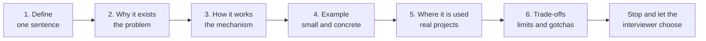
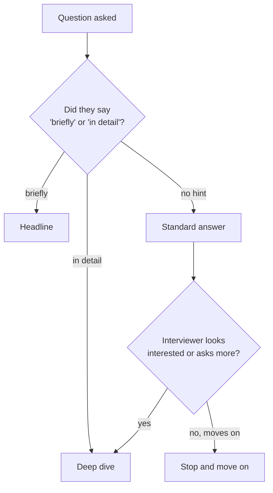
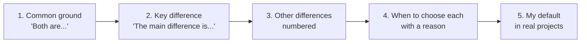
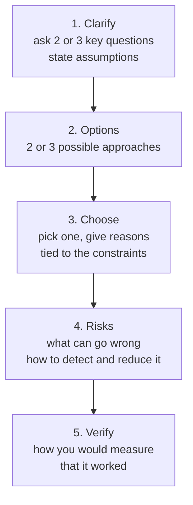

# How to Explain Technical Answers

> In this document you will learn how to turn what you know into clear, spoken interview answers. You will get one simple answer framework, ten fully worked examples (weak answer vs strong answer), ways to control answer length, and tools for follow-ups, pushback, scenario questions, coding rounds and "I don't know" moments.

**Before this:** nothing. Read this early, then use it with every other subject. · **Interview questions:** [jump to the interview section](#interview-questions)

## Table of contents

1. [Knowing is not the same as explaining](#knowing-is-not-the-same-as-explaining)
2. [What the interviewer is really checking](#what-the-interviewer-is-really-checking)
3. [The core answer framework](#the-core-answer-framework)
4. [Controlling answer length](#controlling-answer-length)
5. [Checking in with the interviewer](#checking-in-with-the-interviewer)
6. [Ten worked examples: weak answer vs strong answer](#ten-worked-examples-weak-answer-vs-strong-answer)
7. [Compare and contrast questions](#compare-and-contrast-questions)
8. [Scenario questions](#scenario-questions)
9. [Thinking aloud while coding](#thinking-aloud-while-coding)
10. [Saying I do not know and reasoning from fundamentals](#saying-i-do-not-know-and-reasoning-from-fundamentals)
11. [Handling follow-ups and pushback](#handling-follow-ups-and-pushback)
12. [Useful phrases](#useful-phrases)
13. [Using examples from your own work](#using-examples-from-your-own-work)
14. [Common communication mistakes](#common-communication-mistakes)
15. [A simple practice method](#a-simple-practice-method)
16. [How to explain this in an interview](#how-to-explain-this-in-an-interview)
17. [Interview questions](#interview-questions)
18. [Summary](#summary)
19. [References](#references)

---

## Knowing is not the same as explaining

### The problem

Many good developers have this experience:

- At work, you use closures, promises, Angular services and JWTs every day. Your code works.
- In the interview, someone asks "What is a closure?" Your mind fills with ideas at the same time. You start in the middle, jump to an example, go back to a definition, add a detail, and stop. The interviewer writes "unclear".

You did not fail because you do not know the topic. You failed because **knowing** and **explaining** are two different skills.

| Knowing | Explaining |
| --- | --- |
| You recognize the right code when you see it | You can produce a clear description with no code in front of you |
| Ideas are stored as a network (everything connected) | Speech is a line (one idea after another) |
| You can take your time | You have 30 to 120 seconds |
| Nobody checks the order of your thoughts | The listener needs a clear order to follow you |

The key insight: **speech is linear**. Your knowledge is a web. Explaining means choosing a path through the web and walking it in a fixed order. If you do not have a path ready, you take a random one.

### The solution in one sentence

Use **the same simple order for every answer**, and practice saying answers **out loud** until that order becomes automatic.

That is the whole document. The rest is details, examples and practice.

### Why a fixed order helps

- **It removes a decision.** You do not need to think "where do I start?" You always start with a definition.
- **It helps the listener.** The interviewer knows what is coming. They can follow you even if your English is not perfect.
- **It shows depth step by step.** A definition shows you know the word. "How it works" shows you understand it. Trade-offs show experience.
- **It gives you a place to stop.** After each step, you can stop and let the interviewer guide you.

### A note for non-native English speakers

If English is your second language, a clear structure is even more important than perfect grammar.

- Interviewers forgive small grammar mistakes. They do not forgive answers they cannot follow.
- **Short sentences are your friend.** "A closure is a function. It remembers variables from where it was created." is easier to say and easier to understand than one long sentence.
- Signpost words help a lot: "First...", "The reason is...", "For example...", "The trade-off is...". They tell the listener where you are.
- It is fine to speak slowly. Slow and clear beats fast and confusing.

---

## What the interviewer is really checking

Before you answer, it helps to know what the interviewer is listening for. In a technical question, they are usually checking several things at the same time:

1. **Correctness.** Is what you say true?
2. **Depth.** Do you know *why* and *how*, or only *what*?
3. **Practical experience.** Have you used this in real code? Do you know where it breaks?
4. **Judgment.** Can you say when to use it and when not to?
5. **Communication.** Could you explain this to a teammate in a code review or a design meeting?

The fifth point matters because your future job includes explaining things: in pull requests, in stand-ups, to product managers, to new team members. The interview answer is a sample of how you will communicate at work.

### Signals of a strong answer

- Starts with a direct answer, not with background.
- Uses a small, concrete example.
- Mentions a real place where it is used.
- Names one limitation or trade-off.
- Ends cleanly, without trailing off.

### Signals of a weak answer

- Starts with "So, basically, um, it's like..." and no clear definition.
- Lists keywords without connecting them ("hoisting, scope, lexical, environment...").
- Gives only a textbook definition, with no example.
- Never mentions a downside, so it sounds memorized.
- Goes on for three minutes without a pause.

---

## The core answer framework

### The six steps

Use this order for almost every "What is X?" or "How does X work?" question:

| Step | Question it answers | Typical length | Starter phrase |
| --- | --- | --- | --- |
| 1. **Define** | What is it? | 1 sentence | "X is..." |
| 2. **Why it exists** | What problem does it solve? | 1 to 2 sentences | "It exists because..." / "Without it, ..." |
| 3. **How it works** | What happens inside? | 2 to 4 sentences | "Under the hood, ..." / "When you call X, ..." |
| 4. **Example** | What does it look like? | 1 to 3 sentences, or a few lines of code | "For example, ..." |
| 5. **Where it is used** | Where do I see it in real apps? | 1 to 2 sentences | "In real projects I use it for..." |
| 6. **Trade-offs** | What are the limits and gotchas? | 1 to 2 sentences | "The thing to watch out for is..." |



A short way to remember it: **What, Why, How, Show, Where, Watch out.**

### Why this order works

- **Define first** because the interviewer wants to know immediately that you understand the question. If you start with history or background, they start to worry.
- **Why second** because purpose makes the mechanism easy to understand. "Promises exist to escape callback hell" makes the `then` chain obvious.
- **How third** because this is where depth shows. Most weak answers stop before this step.
- **Example fourth** because an example proves the "how". It also gives the interviewer something concrete to ask about.
- **Where fifth** because it shows real experience, not just reading.
- **Trade-offs last** because they show judgment. They also make a natural ending.

### Step by step, with one topic

Let us build one answer slowly. The question: **"What is a Promise in JavaScript?"**

**Step 1 — Define (one sentence).**
> "A Promise is an object that represents a value that is not ready yet. It will be either fulfilled with a value or rejected with an error."

Check: Is it one sentence? Does it answer the question directly? Yes.

**Step 2 — Why it exists.**
> "It exists to make async code easier to write than nested callbacks. With callbacks, each step goes inside the previous one, and error handling is repeated everywhere."

**Step 3 — How it works.**
> "A promise starts as pending. It settles once, to fulfilled or rejected, and then it never changes. I attach handlers with `then` and `catch`. Each `then` returns a new promise, so I can chain steps. The handlers always run asynchronously, as microtasks, after the current code finishes."

**Step 4 — Example.**
> "For example, `fetch('/api/user')` returns a promise. I can write `.then(res => res.json()).then(user => show(user)).catch(showError)`. One `catch` at the end handles an error from any step."

**Step 5 — Where it is used.**
> "Every HTTP call, file read in Node with `fs/promises`, and every `async` function, because `async` functions return promises."

**Step 6 — Trade-offs.**
> "A promise gives only one value and it is eager: the work starts when the promise is created, and native promises cannot be cancelled. For streams of values or cancellation, I use something like RxJS Observables or an `AbortController`."

Put together, it is about 45 to 60 seconds of speaking. It is complete, ordered and easy to follow.

The code behind the example in step 4 looks like this (shown so you can picture it; you do not write it in a spoken answer):

```js
fetch("/api/user")
  .then((res) => res.json())
  .then((user) => console.log(user.name))
  .catch((error) => console.error("Could not load user", error));
```

### The framework is a guide, not a cage

Use judgment:

- For a small question ("What does `Array.prototype.includes` return?"), steps 1 and 4 are enough.
- For "How does X work?", spend most of your time on step 3.
- For "When would you use X?", spend most of your time on steps 5 and 6.
- If the interviewer interrupts, follow them. The framework is for when you have the floor.

### Write the one-sentence definition in advance

The hardest step under pressure is step 1. Your brain wants to say everything at once. So prepare definitions in advance for the topics you expect. A good definition:

- Has the form "**X is a [category] that [does what].**"
- Has no more than ~20 words.
- Uses no word that itself needs a definition.

| Weak definition | Strong definition |
| --- | --- |
| "Hoisting is when variables go to the top." | "Hoisting means declarations are processed before the code in their scope runs, so names exist from the start of the scope." |
| "Middleware is like a function in Express." | "Middleware is a function that runs between receiving a request and sending a response. It can read or change the request, end it, or pass it on with `next()`." |
| "Change detection is how Angular updates." | "Change detection is how Angular keeps the DOM in sync with component data, by re-checking template bindings after events." |
| "A JWT is a token for login." | "A JWT is a signed, self-contained token that carries claims like the user ID, so a server can verify it without a database lookup." |

---

## Controlling answer length

### Three versions of every answer

Strong candidates can give the same answer at three lengths. You choose the length based on the question and the interviewer.

| Version | Length | When to use | What it contains |
| --- | --- | --- | --- |
| **Headline** | 1 to 2 sentences, about 10 to 30 seconds | Quick-fire rounds, a question inside a bigger discussion, or when you are not sure how deep they want to go | Define + one key detail |
| **Standard** | 30 to 90 seconds | Most "What is X?" questions | All six steps, short |
| **Deep dive** | 2 to 5 minutes | "Explain in detail", "Walk me through how it works", senior interviews | Six steps with internals, edge cases, alternatives |

### Example: the event loop at three lengths

**Headline (about 15 seconds):**
> "The event loop is how single-threaded JavaScript handles async work. When the call stack is empty, it takes the next callback from a queue and runs it. Promise callbacks, which are microtasks, always run before the next timer or event task."

**Standard (about 60 seconds):**
> "The event loop is how single-threaded JavaScript handles async work. JavaScript runs on one main thread. If it waited for a network request, the page would freeze. So the browser or Node does the waiting, and JavaScript only runs the callbacks later.
> It works like this: the engine runs synchronous code on the call stack. When the stack is empty, the loop runs all microtasks, like promise callbacks. Then it takes one task, like a timer or a click handler, runs it, and again drains the microtasks. In the browser, rendering can happen between tasks.
> For example, if I log A, set a zero-millisecond timeout that logs T, resolve a promise that logs P, and log B, I get A, B, P, T.
> This matters in practice: a long loop blocks clicks and rendering, so I split heavy work or move it to a Web Worker."

**Deep dive (several minutes):** everything above, plus: what exactly counts as a task vs a microtask, why `await` continues as a microtask, microtask starvation, `requestAnimationFrame` timing, how Node differs (phases, `process.nextTick`, `setImmediate`), and how Angular's Zone.js hooks into async callbacks. See [the event loop document](../02-javascript/16-event-loop.md) for the full content.

### How to choose the length



Practical rules:

- **Default to the standard answer, then offer more.** "I can go deeper into how Node.js differs if that is useful."
- **Listen to the question words.** "Briefly", "in one line", "quickly" → headline. "Walk me through", "in detail", "what happens internally" → deep dive.
- **Watch the clock.** In a 45-minute round with 15 questions, each answer gets about 2 to 3 minutes including follow-ups. A 5-minute monologue costs you other questions.
- **Senior roles want depth on demand,** not depth by default. Show you can go deep, then let them choose.

### How to stop cleanly

Many people know the content but do not know how to stop. They trail off ("...so yeah, that's basically it, I think..."). Better endings:

- End on the trade-off sentence. It naturally sounds like a conclusion.
- Or end with an offer: "That is the core idea. I can show a code example if you like."
- Then **stop talking**. Silence after an answer is normal. It is the interviewer's turn.

---

## Checking in with the interviewer

An interview is a conversation, not a speech. Checking in keeps you on the right path and shows you can collaborate.

### When to check in

- **Before a long answer:** "Do you want the short version or should I go into how it works internally?"
- **When the question is ambiguous:** "When you say 'cache', do you mean the browser HTTP cache or an application cache like Redis?"
- **After a standard answer:** "Should I go deeper into any part?"
- **During coding and design:** after each major step (see [thinking aloud while coding](#thinking-aloud-while-coding)).

### How often

Not too often. If you ask "Is that OK?" after every sentence, you sound unsure. A good rhythm:

- One clarifying question at the start, only if needed.
- One offer to go deeper at the end of a standard answer.
- In a long coding or design round, a check every few minutes, at natural breakpoints.

### Example

> **Interviewer:** "Tell me about dependency injection in Angular."
>
> **You:** "Sure. I will start with the main idea and then how Angular resolves dependencies, and you can stop me if you want to go into a specific part like providers or the injector hierarchy."

This one sentence does three things: it tells the interviewer your plan, it shows structure, and it invites them to steer.

---

## Ten worked examples: weak answer vs strong answer

Each example has the same parts:

- **The question.**
- **A weak answer** — the kind of answer a person who *does* know the topic often gives under pressure.
- **A strong answer** — about 45 to 90 seconds when spoken, using the framework.
- **What made it better** — the specific changes, so you can apply them to other topics.
- **Where to learn the topic fully** — the topic document in this repository.

Read the strong answers out loud. Do not memorize them word for word. Notice the **shape**.

### Example 1: What is a closure?

**Weak answer:**
> "A closure is a function inside another function. It's like, the inner function can access the outer variables. It's used a lot in JavaScript. Like in loops with var and let."

**Strong answer:**
> "A closure is a function that remembers the variables from the place where it was created. *(Define)*
> It exists because in JavaScript we pass functions around and call them later, in event handlers, timers or promise callbacks, and they still need the data from where they were written. *(Why)*
> Every function keeps a hidden link to the scope it was created in. When the outer function returns, its variables would normally be garbage collected. But if an inner function still references them, they stay alive. The closure keeps the variable itself, not a copy, so it sees later changes. *(How)*
> For example, a `createCounter` function has a local `count` and returns a function that does `count++`. Each counter I create has its own private `count`. *(Example)*
> In real code I use closures for debounce, memoization caches, Express middleware factories like `requireRole('admin')`, and RxJS callbacks that read component fields. *(Where)*
> The thing to watch is memory. Whatever a closure captures stays in memory as long as the closure is reachable, for example through an event listener that was never removed. *(Trade-off)*"

The code behind the example:

```js
function createCounter() {
  let count = 0;
  return () => ++count;
}

const cartCounter = createCounter();
const likeCounter = createCounter();
console.log(cartCounter()); // 1
console.log(cartCounter()); // 2
console.log(likeCounter()); // 1  (separate count)
```

**What made it better:**

- The weak answer's definition ("a function inside a function") describes *nesting*, not the key idea. The strong one says "remembers variables from where it was created".
- The strong answer says *why* closures exist (functions are called later).
- It explains the mechanism (hidden link to scope, garbage collection, reference not copy).
- It gives real uses, not just "loops with var".
- It ends with a real gotcha (memory).

Full topic: [Closures](../02-javascript/05-closures.md).

### Example 2: Explain the event loop

**Weak answer:**
> "JavaScript is single-threaded, so it has an event loop. There is a call stack and a callback queue and also microtasks and macrotasks. setTimeout goes to the macrotask queue and promises go to the microtask queue. The event loop checks the queue."

**Strong answer:**
> "The event loop is the mechanism that lets single-threaded JavaScript handle async work without freezing. *(Define)*
> JavaScript runs on one main thread. In the browser that thread also handles rendering and clicks. If JavaScript waited for a network response, the page would freeze. So the browser or Node does the waiting, and JavaScript runs a callback when the result is ready. *(Why)*
> It works in a cycle. First, all synchronous code runs on the call stack. When the stack is empty, the engine drains the microtask queue: promise callbacks and code after `await`. Then the loop takes one task, like a timer or a click handler, and runs it. After each task it drains the microtasks again. In the browser, rendering can happen between tasks. *(How)*
> For example: log A, `setTimeout` that logs T, a resolved promise whose `then` logs P, then log B. The output is A, B, P, T. Sync first, then microtasks, then the timer task. *(Example)*
> It matters in real apps. A long loop blocks clicks and rendering, so I split heavy work into chunks or use a Web Worker. It also explains why Angular can run change detection after async callbacks: Zone.js hooks into them. *(Where)*
> One gotcha: Node.js has its own loop phases, `process.nextTick` and `setImmediate`, so for output questions I first ask which runtime. *(Trade-off)*"

```js
console.log("A");
setTimeout(() => console.log("T"), 0);
Promise.resolve().then(() => console.log("P"));
console.log("B");
// A
// B
// P
// T
```

**What made it better:**

- The weak answer lists names (stack, queue, micro, macro) but never says *what the loop does* or *why*. Listing terms without connecting them is called "jargon dumping".
- The strong answer gives the order of operations as a sequence of steps.
- It proves the order with a tiny example and its output.
- It connects to real problems (frozen UI, Angular).

Full topic: [Event loop](../02-javascript/16-event-loop.md) and [Node.js event loop](../07-nodejs-backend/02-node-event-loop.md).

### Example 3: How does dependency injection work in Angular?

**Weak answer:**
> "You add the service in the constructor and Angular gives it to you. You need @Injectable and providedIn root. It's a singleton."

**Strong answer:**
> "Dependency injection means a class asks for what it needs, and Angular creates and passes those objects in, instead of the class creating them itself. *(Define)*
> It exists to keep classes loosely coupled. My component does not know how to build an `HttpClient` or which logger implementation to use. That makes it easy to swap implementations and to replace them with fakes in tests. *(Why)*
> Angular has injectors arranged in a tree. A provider tells an injector how to create a value for a token, usually a class. When a component asks for a token, through the constructor or the `inject()` function, Angular looks in the component's own element injector first, then walks up through the parent components, then the module or environment injectors, up to the root. The first provider it finds wins. Each injector creates one instance per provider and caches it. *(How)*
> For example, `@Injectable({ providedIn: 'root' })` registers the service in the root injector, so the whole app shares one instance, and it can be tree-shaken if nobody uses it. But if I put the service in a component's `providers` array, every instance of that component gets its own copy. *(Example)*
> I use this for API services, shared state services, `InjectionToken`s for configuration like an API base URL, and HTTP interceptors, which are multi providers. *(Where)*
> The gotcha is that 'singleton' is not always true. A service provided in a lazy-loaded module or in a component gets a separate instance. That can cause bugs where two parts of the app hold different state. *(Trade-off)*"

```ts
@Injectable({ providedIn: "root" })
export class CartService {
  private http = inject(HttpClient); // inject() works in Angular 14+
}

@Component({
  selector: "app-checkout",
  template: "...",
  providers: [CheckoutFormState], // new instance per CheckoutComponent
})
export class CheckoutComponent {
  constructor(private cart: CartService, private formState: CheckoutFormState) {}
}
```

**What made it better:**

- The weak answer describes only *how to use* it. The strong answer explains *the idea* (ask, do not create) and *why* (coupling, testing).
- It explains *resolution* (the injector tree), which is what "how does it work" really asks.
- It corrects a common half-truth ("it's a singleton") with a precise rule.

Full topic: [Angular dependency injection](../06-angular-16/05-dependency-injection.md). General concept: [Dependency inversion and injection](../04-oop-solid-design-patterns/05-dependency-inversion-and-injection.md).

### Example 4: What is OnPush change detection?

**Weak answer:**
> "OnPush is for performance. It only runs change detection when inputs change. You should use it everywhere."

**Strong answer:**
> "OnPush is a change detection strategy that tells Angular to skip a component and its children unless the component has been marked as needing a check. *(Define)*
> It exists for performance. With the Default strategy, every event, timer or HTTP response makes Angular check every component in the tree. In a big dashboard that is a lot of wasted work. *(Why)*
> An OnPush component is checked only when one of these happens: an input gets a new reference, an event bound in its template or a child's template fires, `markForCheck` is called — the `async` pipe does that for me — or, in Angular 16, a signal read in its template changes. *(How)*
> The classic bug: the parent does `user.name = 'Bob'`. The reference did not change, so the OnPush child still shows the old name. If the parent does `user = { ...user, name: 'Bob' }`, it works. *(Example)*
> I use it for presentational components, lists, tables and anything fed by observables or NgRx. *(Where)*
> The trade-off is discipline. The team must update data immutably, and if I subscribe manually in the component and set a field, I need `markForCheck`. Using the `async` pipe or signals avoids most of that. *(Trade-off)*"

```ts
// ❌ Wrong with OnPush: same reference, the child does not update
this.user.name = "Bob";

// ✅ Correct: new reference, the OnPush child sees a new input
this.user = { ...this.user, name: "Bob" };
```

**What made it better:**

- "Only when inputs change" is incomplete. The strong answer lists all the triggers.
- It shows the classic mutation bug, which proves real experience.
- "Use it everywhere" is replaced by a balanced trade-off.

Full topic: [Change detection and signals](../06-angular-16/10-change-detection-and-signals.md).

### Example 5: JWT or sessions — which would you use?

**Weak answer:**
> "JWT is better because it's stateless and modern. Sessions are old. With JWT you don't need a database."

**Strong answer:**
> "Both are ways to remember who the user is after login. With sessions, the server stores the session data and gives the browser a random session ID in a cookie. With a JWT, the server gives the client a signed token that contains claims, like the user ID and roles, and any service with the key can verify it without a lookup. *(Define both)*
> The main difference is where the state lives. Sessions keep state on the server. That makes logout and revoking access instant: I just delete the session. A JWT stays valid until it expires, so revoking it needs short expiry times, refresh tokens or a denylist. *(How they differ)*
> For a typical web app with its own backend, I would choose sessions in an HttpOnly, Secure, SameSite cookie. It is simple and secure, and with Redis the lookup is fast. *(Choice for case A)*
> I would use JWTs when many services need to verify the user, for mobile clients, or when tokens come from an identity provider through OpenID Connect. Then I keep the access token short-lived, for example 5 to 15 minutes, with a refresh token. *(Choice for case B)*
> One thing I avoid is storing tokens in localStorage, because any XSS can read them. *(Gotcha)*"

**What made it better:**

- "JWT is better" is an opinion with no reasons. "It depends" alone is also weak. The strong answer says **what it depends on, and my default for each case**.
- It names the real trade-off: easy revocation vs no server lookup.
- It shows security awareness (cookie flags, localStorage risk).
- "You don't need a database" is wrong: you still need user data and usually a refresh token store.

Full topic: [Authentication and authorization](../07-nodejs-backend/09-authentication-and-authorization.md#sessions-vs-jwt-how-to-choose).

### Example 6: REST or GraphQL?

**Weak answer:**
> "GraphQL is newer and solves over-fetching. REST has many endpoints and GraphQL has one endpoint. Facebook made GraphQL."

**Strong answer:**
> "Both are ways to design an API. REST exposes resources at URLs and uses HTTP methods, like `GET /orders/42`. GraphQL exposes one typed schema, and the client sends a query that says exactly which fields it wants. *(Define)*
> GraphQL exists mainly to solve two client problems: over-fetching, getting fields you do not need, and under-fetching, where a screen needs several round trips to collect its data. *(Why)*
> In GraphQL the server has a schema and a resolver function per field. The client asks for `order { id, total, customer { name } }` and gets exactly that shape. In REST, the server decides the response shape for each endpoint. *(How)*
> For example, a mobile dashboard that needs the user, their last orders and their notifications can get all three in one GraphQL query instead of three REST calls. *(Example)*
> I would pick REST for public APIs, simple CRUD and when I want HTTP caching, because GET URLs cache well in browsers and CDNs. I would pick GraphQL when many different clients need different shapes of the same data, like web and mobile apps on a big product. *(Where / when)*
> The trade-offs of GraphQL: HTTP caching is harder because most queries are POSTs to one URL, I must protect the server against very expensive or deeply nested queries, and I must avoid the N+1 problem in resolvers, usually with DataLoader-style batching. *(Trade-off)*"

**What made it better:**

- "Newer" and "Facebook made it" are not reasons to choose a technology.
- The strong answer explains the *problem* GraphQL solves and gives a concrete case.
- It gives a decision rule for each option, and real costs (caching, query cost, N+1).

Full topic: [API styles and real-time communication](../09-system-design/04-api-styles-and-real-time-communication.md).

### Example 7: How do you make IPC secure in Electron?

**Weak answer:**
> "You use contextBridge and preload. Don't enable nodeIntegration. Use contextIsolation."

**Strong answer:**
> "In Electron, IPC is message passing between the main process, which has full Node.js and system access, and renderer processes, which show web content and should be treated as untrusted. Securing IPC means the renderer can only ask main to do a small set of safe, specific things. *(Define the goal)*
> It matters because if an attacker gets script running in the renderer, for example through XSS, whatever the renderer can call over IPC, the attacker can call too. *(Why)*
> I do it in layers. First, secure defaults: `contextIsolation` on, `nodeIntegration` off and `sandbox` on. Second, the preload script uses `contextBridge` to expose small, named functions like `saveOrder(order)`, never `ipcRenderer` itself and never a generic `send(channel, data)`. Third, in main, every `ipcMain.handle` checks the sender, for example that `event.senderFrame` comes from my app's origin, and validates the arguments with a schema. Main also decides file paths itself, so the renderer cannot pass an arbitrary path. *(How)*
> For example, instead of exposing `readFile(path)`, I expose `openReport()`. Main shows the file dialog, the user picks a file, and main reads only that file. *(Example)*
> This applies to every desktop feature: saving files, printing, settings and auto-update messages. *(Where)*
> The trade-off is more code: one handler per action and validation for each. But each exposed function is a door, so fewer and narrower doors are worth it. *(Trade-off)*"

```js
// preload.js
const { contextBridge, ipcRenderer } = require("electron");

// ❌ Wrong: exposes every channel to any script in the page
// contextBridge.exposeInMainWorld("ipc", ipcRenderer);

// ✅ Correct: a small, named, specific API
contextBridge.exposeInMainWorld("api", {
  saveOrder: (order) => ipcRenderer.invoke("orders:save", order),
});
```

**What made it better:**

- The weak answer is a list of settings with no explanation. The strong answer explains the **threat** (a compromised renderer) first, so each setting has a reason.
- It covers both sides: what the preload exposes, and what main checks.
- It gives a concrete safer design (`openReport()` instead of `readFile(path)`).

Full topics: [IPC and preload scripts](../08-electron-desktop/03-ipc-and-preload-scripts.md) and [Electron security](../08-electron-desktop/04-electron-security.md).

### Example 8: What is the difference between debounce and throttle?

**Weak answer:**
> "They both limit function calls. Debounce waits and throttle limits. You use them for scroll and search."

**Strong answer:**
> "Both limit how often a function runs when an event fires many times. *(Shared definition)*
> **Debounce** waits until the events *stop* for a set time, then runs once. **Throttle** runs at most once per time interval *while* the events keep coming. *(The one-line difference)*
> Inside, debounce keeps a timer in a closure. Every new event clears the old timer and starts a new one, so the function runs only after a quiet period. Throttle remembers when it last ran and ignores calls until the interval has passed. *(How)*
> For example, in a search box I debounce by 300 milliseconds, so typing 'laptop' sends one request, not six. For a scroll handler that updates a progress bar, I throttle to every 100 milliseconds, so it updates regularly while scrolling. *(Example)*
> Rule of thumb: debounce when I only care about the final value, like search or auto-save. Throttle when I need regular updates during the activity, like scroll, resize or mouse move. *(Where)*
> One gotcha: with debounce, if events never stop, the function never runs. And for visual updates, `requestAnimationFrame` is often better than a fixed throttle. *(Trade-off)*"

```js
function debounce(fn, wait) {
  let timerId;
  return (...args) => {
    clearTimeout(timerId);
    timerId = setTimeout(() => fn(...args), wait);
  };
}

const search = debounce((term) => console.log("search:", term), 300);
search("l");
search("la");
search("laptop");
// after 300 ms of quiet, it prints once:
// search: laptop
```

**What made it better:**

- The weak answer's "debounce waits and throttle limits" does not say *when* each one fires. The strong answer gives a crisp one-line difference.
- Each one gets a concrete, realistic use.
- It gives a rule to choose, which is what interviewers want from a comparison.

Full topic: [Debounce, throttle and performance](../02-javascript/20-debounce-throttle-and-performance.md).

### Example 9: Promise vs Observable

**Weak answer:**
> "Observables are from RxJS and have more operators. Promises are native. Angular uses Observables."

**Strong answer:**
> "Both represent async results. A Promise represents one future value. An Observable represents a stream of zero, one or many values over time. *(Define)*
> There are four main differences. One: a Promise gives one value, an Observable can emit many, like keystrokes or WebSocket messages. Two: a Promise is eager, the work starts when it is created. An Observable is lazy, nothing happens until someone subscribes. Three: an Observable can be cancelled by unsubscribing, a native Promise cannot be cancelled. Four: Observables have operators like `map`, `debounceTime` and `switchMap` to compose streams. *(How they differ)*
> A good example is a typeahead search. With RxJS I take the input stream, apply `debounceTime(300)` and `distinctUntilChanged()`, then `switchMap` to the HTTP call. `switchMap` unsubscribes from the old request when a new term arrives, so an old, slow response can never overwrite a newer one. *(Example)*
> In Angular, `HttpClient`, router events and reactive forms all use Observables. For simple one-time async work in plain TypeScript or Node, I use Promises with `async/await`. *(Where)*
> The trade-off is complexity. RxJS is powerful but has a learning curve, and forgotten subscriptions cause memory leaks. So I use the `async` pipe or `takeUntilDestroyed`, and I convert to a Promise with `firstValueFrom` when I only need one value. *(Trade-off)*"

```ts
// Angular typeahead: a new search term cancels the previous request
this.results$ = this.searchControl.valueChanges.pipe(
  debounceTime(300),
  distinctUntilChanged(),
  switchMap((term) => this.productApi.search(term)),
);
```

**What made it better:**

- The weak answer says *who uses* each one, not *how they differ*. The strong answer gives four clear differences, numbered.
- Numbering ("There are four main differences. One...") makes a long answer easy to follow.
- The typeahead example shows the most important practical benefit: cancellation.

Full topics: [RxJS](../06-angular-16/09-rxjs.md) and [Callbacks and promises](../02-javascript/17-callbacks-and-promises.md).

### Example 10: Explain the Single Responsibility Principle

**Weak answer:**
> "A class should do only one thing. Like, it should have only one function. It's the S in SOLID."

**Strong answer:**
> "The Single Responsibility Principle says a module or class should have one reason to change. In other words, it should serve one concern, or one group of people who ask for changes. *(Define)*
> It exists because when one class mixes several concerns, a change for one concern can break another. The class also becomes hard to test and hard to read. *(Why)*
> 'One reason to change' does not mean 'one method'. A class can have many methods if they all belong to the same concern. The test I use: if the tax rules change, the email template changes and the database changes, would I edit the same class three times? If yes, it has three responsibilities. *(How to apply it)*
> For example, an `OrderService` that calculates totals, saves to the database and sends a confirmation email has three reasons to change. I would split it into a price calculator, an order repository and a notification service. The `OrderService` just coordinates them. *(Example)*
> In Angular, it is why I keep components thin: the component handles the view, and services handle data access and business logic. *(Where)*
> The trade-off is over-splitting. If I create a class for every tiny function, the code becomes harder to follow. I split when I see real, different reasons to change, not in advance. *(Trade-off)*"

```js
// ❌ Wrong: three reasons to change in one class
class OrderService {
  placeOrder(order) {
    const total = order.items.reduce((sum, item) => sum + item.price * item.qty, 0);
    database.save({ ...order, total });
    mailer.send(order.email, `Your total is ${total}`);
  }
}

// ✅ Correct: each class has one reason to change; OrderService coordinates
class OrderService {
  constructor(priceCalculator, orderRepository, notifier) {
    this.priceCalculator = priceCalculator;
    this.orderRepository = orderRepository;
    this.notifier = notifier;
  }
  placeOrder(order) {
    const total = this.priceCalculator.total(order.items);
    this.orderRepository.save({ ...order, total });
    this.notifier.orderPlaced(order.email, total);
  }
}
```

**What made it better:**

- "Only one function" is a common wrong interpretation. The strong answer uses the precise phrase "one reason to change" and explains it.
- It gives a test you can apply.
- It ends with a mature trade-off (over-splitting), which shows judgment.

Full topic: [SOLID principles](../04-oop-solid-design-patterns/03-solid-principles.md).

### The patterns behind all ten improvements

Look at what changed in every example:

| Weak answers often... | Strong answers instead... |
| --- | --- |
| Start with a vague or wrong definition | Start with one precise sentence |
| Describe how to *use* it | Explain *why it exists* and *how it works* |
| List keywords | Connect ideas in order: first, then, so |
| Have no example, or a vague one | Give a small concrete example, often with output |
| Never mention real projects | Name where they use it |
| Say "X is better", or only "it depends" | Say "it depends on A and B; in case A I choose X because..." |
| Stop suddenly or trail off | End on a trade-off or gotcha |

---

## Compare and contrast questions

"What is the difference between X and Y?" is one of the most common question shapes. Examples: `let` vs `var`, `==` vs `===`, `map` vs `forEach`, interface vs type, `switchMap` vs `mergeMap`, SQL vs NoSQL, process vs thread, cookies vs localStorage.

### The framework: Same, Different, Choose

1. **What they have in common** (one sentence). This shows you see the category.
2. **The one key difference** (one sentence). The single most important distinction.
3. **Other differences** (two to four, numbered, or as a small mental table).
4. **When to choose each** (a rule, with a reason).
5. **My default** (optional, but it shows experience).



### Worked example: `let` vs `var`

> "Both declare variables. *(Common)*
> The main difference is scope: `var` is function-scoped and `let` is block-scoped. *(Key difference)*
> There are two more differences. One: both are hoisted, but `let` is in the temporal dead zone until its line runs, so using it early throws a ReferenceError, while `var` just gives `undefined`. Two: a `var` at the top level of a script creates a property on the global object, `let` does not. *(Other differences)*
> The scope difference shows up most in loops. With `var i` and a `setTimeout` inside the loop, all callbacks share one `i`. With `let`, each iteration gets its own `i`. *(Example)*
> In modern code I use `const` by default, `let` when I need to reassign, and never `var`. *(Choose / default)*"

```js
for (var i = 0; i < 3; i++) setTimeout(() => console.log("var", i), 0);
for (let j = 0; j < 3; j++) setTimeout(() => console.log("let", j), 0);
// var 3
// var 3
// var 3
// let 0
// let 1
// let 2
```

### Using a mental table

For comparisons with many dimensions, think of a table with 3 to 5 rows. In a video interview you can even type it in the shared editor. Good dimensions to consider:

| Dimension | Example question it answers |
| --- | --- |
| Purpose | What problem does each solve? |
| Behavior | What happens at runtime? |
| Performance | Which is faster or uses less memory, and when does it matter? |
| Safety / correctness | Which one prevents which bugs? |
| Developer experience | Which is easier to read, test, debug? |
| Ecosystem / support | Browser support, tooling, team familiarity |

You do not need every row. Pick the 2 to 4 that matter for this pair.

### Traps in comparison answers

- **Describing X fully, then Y fully.** The listener must do the comparison in their head. Instead, compare **dimension by dimension**: "For scope, X does this and Y does that."
- **Saying "X is better".** Better for what? Always attach a condition.
- **Saying only "it depends".** This sounds like avoiding the question. Always continue: "It depends on A. If A, I choose X because... Otherwise Y."
- **Forgetting what they share.** If you skip the common ground, the interviewer may think you see them as unrelated.

---

## Scenario questions

Scenario questions describe a situation and ask what you would do. Examples:

- "Our Angular dashboard became slow after we added a big table. What do you do?"
- "Users say they are randomly logged out. How do you investigate?"
- "The Node.js API's memory grows until the process crashes. What do you check?"
- "We need real-time notifications. How would you build them?"

There is no single correct answer. The interviewer checks **how you think**: do you ask questions, consider options and make a reasoned choice?

### The framework: Clarify, Options, Choose, Risks



1. **Clarify.** Ask two or three questions that change the answer. If the interviewer says "you decide", state your assumptions out loud.
2. **Options.** Name two or three realistic approaches. One sentence each.
3. **Choose.** Pick one and give reasons tied to the constraints you clarified.
4. **Risks.** Say what could go wrong and how you would reduce or detect it.
5. **Verify.** Say how you would know it worked (a measurement, a test, monitoring).

For debugging-style scenarios, "Options" becomes "Hypotheses", and you add "how I would test each hypothesis".

### Worked example: "Our Angular dashboard became slow after we added a big table."

> **Clarify:** "First, a few questions. Is it slow on first load, or slow when the user interacts, like typing or scrolling? How many rows are we talking about? And is the data updating in real time, or loaded once?"
>
> *Interviewer: "Slow when scrolling and typing in a filter box. About 5,000 rows. Data loads once."*
>
> **Hypotheses / options:** "With 5,000 rows and slow interaction, I have three main suspects. One: we render all 5,000 rows into the DOM, so every change detection run and every layout is heavy. Two: change detection runs too often or checks too much, for example the Default strategy plus expensive function calls in the template. Three: the filter recalculates on every keystroke without debounce. *(Name them)*
> To confirm, I would record a profile in Chrome DevTools Performance while scrolling and typing, and use the Angular DevTools profiler to see how long change detection takes and which components are checked. *(Verify before fixing)*"
>
> **Choose:** "If the profile confirms it, I would do three things in order of impact. First, virtual scrolling with the CDK `cdk-virtual-scroll-viewport`, so only the visible rows, maybe 30 or 40, are in the DOM. Second, OnPush on the table and row components, with `trackBy` on the `*ngFor`. Third, debounce the filter input by about 200 to 300 milliseconds and move template function calls into pure pipes or precomputed fields."
>
> **Risks:** "Virtual scrolling needs fixed or known row heights, and it can break browser find-in-page and some accessibility features, so I would check the table with a screen reader. OnPush can cause stale views if someone mutates data, so the team must update immutably."
>
> **Verify:** "I would measure the same interaction before and after, in the Performance panel, and compare the long tasks."

**Why this answer works:**

- It does not jump to a solution. It asks questions that really change the answer (load vs interaction, size, live updates).
- It measures before fixing.
- It gives options in order of impact.
- It names honest risks.

Related topics: [Change detection and signals](../06-angular-16/10-change-detection-and-signals.md), [Angular performance](../06-angular-16/12-performance.md), [Web performance](../05-frontend-engineering/05-web-performance-and-core-web-vitals.md).

### Worked example (short): "Users say they are randomly logged out."

> "I would start by finding a pattern. Is it after a fixed time, like 15 minutes? Only in one browser? Only after a deployment? *(Clarify)*
> My hypotheses: the access token expires and the refresh flow fails; two tabs refresh at the same time and one invalidates the other's refresh token when we use refresh token rotation; the session store, like Redis, restarted or evicted keys; or a cookie is rejected because of `SameSite` or `Secure` settings on a different subdomain. *(Hypotheses)*
> I would check the server logs for 401 responses and refresh failures, correlated by user ID and time, and reproduce it with two tabs open. *(Test each)*
> If it is the two-tab race, the fix is to make the client share one in-flight refresh call, and on the server to allow a short grace period for the previous refresh token. *(Choose)*
> The risk of a grace period is a slightly larger window for a stolen token, so I would keep it to a few seconds and log reuse. *(Risk)*"

Related topic: [Authentication and authorization](../07-nodejs-backend/09-authentication-and-authorization.md).

---

## Thinking aloud while coding

In a coding round, the interviewer cannot see inside your head. If you code in silence for 15 minutes, they cannot tell whether you are stuck, confused or doing well. **Thinking aloud** means saying your reasoning as you work, so they can follow and help.

### What to say at each phase

| Phase | What you say | Example |
| --- | --- | --- |
| Understand | Repeat the problem in your words | "So I get an array of numbers and a target, and I return the indices of two numbers that add up to the target." |
| Clarify | Ask about inputs and edge cases | "Can the array be empty? Can there be duplicates? Is there always exactly one answer?" |
| Example | Walk through a small input | "For `[2, 7, 11]` and 9, the answer is `[0, 1]`." |
| Brute force | State the simple idea and its cost | "The simple way is two loops, checking every pair. That is O(n²)." |
| Optimize | Explain the better idea | "I can do one pass with a Map from value to index. For each number I check if `target - number` is already in the map. That makes it O(n)." |
| Confirm | Check before coding | "Does that approach sound good before I write it?" |
| Code | Explain *intent*, not keystrokes | "Now the loop. For each index I compute the complement..." |
| Test | Trace an example through your code | "With `[3, 3]` and 6: index 0, map is empty, store 3. Index 1, complement 3 is in the map, return `[0, 1]`. Good." |
| Analyze | State complexity | "Time O(n), space O(n) for the map." |

The full method for coding rounds, with many worked problems, is in [Problem solving and complexity](02-problem-solving-and-complexity.md).

### What a good think-aloud sounds like

Here is a short transcript for "reverse the words in a sentence":

> "Let me restate: input is a string like `'hello big world'`, output is `'world big hello'`. Should I handle extra spaces between words? *(Interviewer: yes, collapse them into one.)* OK.
> Simple approach: trim, split on one or more spaces, reverse the array, join with one space. That is O(n) time and O(n) space, which is fine because I must build a new string anyway.
> I will use a regular expression `/\s+/` for the split so multiple spaces work."

```js
function reverseWords(sentence) {
  // trim first, otherwise leading spaces create an empty first word
  return sentence.trim().split(/\s+/).reverse().join(" ");
}

console.log(reverseWords("hello big world"));      // world big hello
console.log(reverseWords("  hello   big world  ")); // world big hello
console.log(reverseWords("single"));               // single
```

> "Let me test with leading and trailing spaces: trim removes them, split gives three words, reverse, join. Good. One edge case: an empty string. `''.trim().split(/\s+/)` gives `['']`, and joining gives `''`, which is correct."

### What not to do

- **Do not narrate keystrokes.** "Now I type const, now an equals sign..." is noise. Explain *why*, not *what you type*.
- **Do not go silent for long.** If you need to think, say so: "Let me think for a moment about the edge cases." Silence of 20 to 30 seconds with that sentence is fine. Silence of five minutes is not.
- **Do not hide that you are stuck.** Say what you tried and where you are stuck. The interviewer often gives a hint, and taking a hint well is a positive signal.
- **Do not start coding before agreeing on the approach.** If your approach is wrong, you lose 15 minutes.

### When you are stuck

Say it, then use a strategy out loud:

- "Let me try a smaller example by hand and look for a pattern."
- "What if the array were sorted? Would that help?"
- "The slow part is searching for the complement. Which data structure gives fast lookups? A Map."
- "Let me write the brute force first so we have something working, then improve it."

---

## Saying I do not know and reasoning from fundamentals

Every candidate meets a question they cannot answer. What matters is what you do next.

### Why honesty wins

- Interviewers usually know the answer. If you make something up, they notice. One invented fact makes them doubt everything else you said.
- At work, a teammate who says "I am not sure, let me check" is trusted. A teammate who guesses confidently causes production incidents. The interviewer is checking which one you are.

### The three-step response

1. **Be honest about the gap.** "I have not used that directly."
2. **Share what you do know that is related.** "But I know how X works, which is similar."
3. **Reason toward an answer, clearly labelled as reasoning.** "So I would expect... I would confirm it by checking the docs or writing a quick test."

### Worked example: a question you do not know

> **Interviewer:** "How does Node.js `AsyncLocalStorage` work?"
>
> **Weak:** "Um... it's like localStorage but for Node? It stores data asynchronously." *(Guess, and wrong.)*
>
> **Strong:** "I have not used `AsyncLocalStorage` directly, so let me reason about it. *(Honest)*
> I know the problem it probably solves: in a Node server, many requests are handled at the same time on one thread. If I want a request ID available in every log line, I cannot use a global variable, because requests interleave across `await`s. *(Related knowledge)*
> So I would guess it gives each async call chain its own storage: you start a context when a request begins, and any code that runs later in that same async chain, even after `await`, can read the value. Inside, Node must track which async operation was created by which, so the context can follow the chain. *(Reasoning, labelled as a guess)*
> I would check the Node docs to confirm the API before using it. *(How to verify)*"

That strong answer is close to the real behavior. Even if it were wrong in a detail, it shows exactly what interviewers want: clear thinking from fundamentals and honesty about certainty. (In the Node.js documentation, `AsyncLocalStorage` keeps state that follows callbacks and promise chains. `als.run(store, callback)` makes `store` available through `als.getStore()` inside the callback and in the async work it starts.)

### Reasoning from fundamentals: a mini toolkit

When you do not know a specific API or behavior, these fundamentals help you reason:

| Fundamental | Questions it helps you answer |
| --- | --- |
| The event loop and single thread | Why is X async? Will this block? What order do things run in? |
| Memory and references | Is this a copy or the same object? Will this leak? |
| The network is slow and unreliable | What happens if the request fails, is slow, or arrives twice? |
| Security: never trust the client | Can the user change this? Must the server check it? |
| Caching: every cache can be stale | How is it invalidated? What if it is wrong? |
| Trade-off of space vs time | Can I store something to avoid recomputing it? |

### Phrases for uncertainty

- "I am not 100% sure, but my understanding is..."
- "I have not used it in production, but I know the concept from..."
- "I would expect X, because... I would verify it by..."
- "I do not remember the exact API name, but the idea is..."

Avoid: "I don't know." and then silence. Always continue with what you *do* know.

### A test you can run right away

When the question is about JavaScript behavior, say you would check it with a tiny experiment. For example, if you are not sure what `structuredClone` does with a `Date` and a function:

```js
const original = { createdAt: new Date(0), tags: new Set(["a"]) };
const copy = structuredClone(original);
console.log(copy.createdAt instanceof Date); // true
console.log(copy.tags.has("a"));             // true
console.log(copy.tags === original.tags);    // false (deep copy)

try {
  structuredClone({ onClick: () => {} });
} catch (error) {
  console.log(error.name); // DataCloneError  (functions cannot be cloned)
}
```

Saying "I would run a three-line test" is a real engineering habit, and interviewers like it.

---

## Handling follow-ups and pushback

### Why follow-ups happen

Follow-up questions are **not** a sign that your answer was bad. Interviewers use them to find the edge of your knowledge. Every candidate eventually reaches a follow-up they cannot fully answer. That is expected.

Common types of follow-up:

| Type | Example | What to do |
| --- | --- | --- |
| Go deeper | "How does that work internally?" | Move to the "how" step with more detail |
| Edge case | "What if the list is empty?" | Think about it out loud, give a direct answer |
| Changed constraint | "What if there are 10 million users?" | Say what changes and what stays the same |
| Why not the alternative | "Why not use localStorage?" | Compare with the Same / Different / Choose framework |
| Challenge | "Are you sure?" | Re-check calmly (see below) |
| Experience check | "Have you used this in production?" | Answer honestly, with a real example if you have one |

### Handling "Are you sure?"

This question does **not** always mean you are wrong. Sometimes interviewers test whether you hold your position when you are right.

1. **Pause and re-check.** "Let me think about it again." Re-trace your reasoning or the example.
2. **If you are still confident, say so politely and give the reason.** "Yes, I am fairly confident. The `then` callback is a microtask, and microtasks run before the next timer task, so P prints before T."
3. **If you find a mistake, correct it openly.** "Actually, you are right, I missed that `await` adds a microtask. So the order is..."

Changing your answer because of evidence is a strength. Changing it just because the interviewer looked doubtful is not.

### When the interviewer seems to be wrong

It happens. Stay respectful and use evidence:

> "I might be missing something, but my understanding is that `Promise.all` rejects as soon as one promise rejects, without waiting for the others. I would be happy to check it with a small example."

Never say "No, you are wrong." Offer a way to verify.

### When you realize you made a mistake earlier

Correct it as soon as you notice, even if the interviewer did not:

> "Sorry, I want to correct something I said earlier. I said OnPush only reacts to input changes, but events inside the component also mark it for check."

This shows honesty and attention to detail. It almost always helps you.

### Handling a changed constraint

When the interviewer changes a constraint, do not start from zero. Say what changes:

> **Interviewer:** "And if the table has one million rows instead of 5,000?"
>
> **You:** "Then virtual scrolling alone is not enough, because loading one million rows into the browser is too much memory and network. I would move filtering, sorting and pagination to the server, and the client would request one page at a time, with cursor-based pagination."

---

## Useful phrases

Use these phrases to make your structure audible. You do not need all of them. Pick a few that feel natural and practice them until they are automatic.

### Starting an answer

- "In one sentence, X is..."
- "Let me start with the main idea, then explain how it works."
- "There are three parts to this. First... second... third..."

### Explaining why and how

- "The problem it solves is..."
- "Without it, we would have to..."
- "Under the hood, ..."
- "Step by step, what happens is..."

### Giving examples

- "For example, ..."
- "In my current project, we use it for..."
- "Let me show a small code example."

### Talking about trade-offs

- "The trade-off is..."
- "It is great for X, but not ideal for Y."
- "I would choose X when..., and Y when..."
- "The cost of this approach is..."
- "It depends mainly on two things: ... If ..., I would pick ..."
- "In most cases I would default to X, because..."
- "We gain ..., but we pay with ..."

### Buying time without silence

- "That is a good question. Let me think for a second."
- "Let me make sure I understand the question. You mean...?"
- "Let me try a small example."

### Checking in

- "Does that answer your question, or should I go deeper into ...?"
- "Is this the level of detail you are looking for?"
- "Before I code it, does this approach sound reasonable?"

### Correcting yourself

- "Actually, let me correct that."
- "I said X earlier, but it is more accurate to say Y."

### Ending an answer

- "So in short: ..."
- "That is the core idea. I can show code if that is helpful."

---

## Using examples from your own work

An example from your own project is the strongest kind of example. It proves you used the concept, not just read about it.

### The mini-story formula

When you mention your own work in a technical answer, keep it short (two to four sentences):

1. **Context:** where and what. "In our order management app..."
2. **Problem:** what went wrong or what was needed. "...the product list re-rendered on every keystroke and felt slow."
3. **What you did, with the concept:** "I moved the list to OnPush and switched the data to an observable with the `async` pipe."
4. **Result:** measured if you have a number, described honestly if not. "Typing became smooth; in the profiler the change detection time for that screen dropped clearly."

### Example: turning a definition into experience

> **Question:** "What is a memory leak in a single-page app?"
>
> **Textbook-only answer:** "A memory leak is when memory is not released..."
>
> **Answer with own experience:** "A memory leak is memory that the app no longer needs but that cannot be garbage collected, because something still references it. In SPAs the common causes are subscriptions, event listeners and timers that are not cleaned up when a component is destroyed. In one project, our dashboard got slower the longer people kept it open. I took two heap snapshots in Chrome DevTools, before and after navigating away and back several times, and saw many detached component instances. They were kept alive by an `interval` subscription that was never unsubscribed. We added `takeUntil` with a destroy subject, and memory stayed flat after that."

### Rules for using your own examples

- **Never invent.** Do not invent projects, numbers or your role. Interviewers ask follow-ups, and invented stories fall apart quickly.
- **Use "I" for what you did.** "We" hides your contribution. Say "we" for the team context and "I" for your actions.
- **Be precise with numbers, or say there was no number.** "Load time went from about 6 seconds to under 2 in our tests" is good if true. If you did not measure, say "it was clearly faster for users, but we did not measure it formally" — that honesty is fine.
- **Prepare in advance.** For each major topic you expect (performance, security, state management, testing, async bugs), prepare one real story. Write down two or three sentences for each.
- **Keep confidential details out.** Describe the type of system, not company secrets.

Longer project stories and behavioral answers (with the STAR method) are covered in [Project discussion and behavioral questions](07-project-discussion-and-behavioral.md).

---

## Common communication mistakes

| Mistake | What it looks like | Why it hurts | Fix |
| --- | --- | --- | --- |
| **Rambling** | A 4-minute answer that circles around | The interviewer loses the main point and you lose time for other questions | Use the six steps; stop after the trade-off |
| **Jargon dumping** | "It's about lexical environments, hoisting, TDZ, execution context..." | Lists terms without connecting them; sounds memorized | Use one term at a time and explain how it connects to the next |
| **Memorized definition only** | A perfect textbook sentence, then silence | Shows recall, not understanding | Always add how it works and an example |
| **No examples** | Abstract talk only | Hard to follow; no proof of experience | Give a tiny code example or a real project case |
| **Answering a different question** | Asked "why", answers "what" | Shows you did not listen | Repeat the key word of the question in your first sentence |
| **Starting with background** | "So, historically, in 2015, ES6 introduced..." | The interviewer waits for the actual answer | Answer first, add history only if relevant |
| **Over-hedging** | "Maybe, I think, probably, it could be..." in every sentence | Sounds unsure even when you are right | Be direct when you know; hedge only real uncertainty, once |
| **Over-confidence** | "X is always better", "that never happens" | One counterexample destroys credibility | Use conditions: "usually", "in most web apps", "when..." |
| **Filler words** | "basically", "like", "you know", "um" in every sentence | Distracting, especially when the interviewer is a non-native speaker too | Replace fillers with a short pause |
| **Long silence** | Thinking without saying anything | The interviewer cannot help or assess you | Say "Let me think about this for a moment" |
| **Not checking in** | Talking for 5 minutes in a direction the interviewer did not want | Wastes time | Offer depth instead of forcing it |
| **Arguing** | Defending a wrong point to the end | Shows you cannot learn | Re-check, then accept evidence |

### The "repeat the key word" trick

To avoid answering a different question, start your answer with the key word from the question:

- "**Why** do we need keys in lists?" → "We need keys **because**..."
- "**When** would you not use OnPush?" → "I would **not** use OnPush **when**..."
- "**How** does `bind` work?" → "`bind` works **by** returning a new function that..."

This forces you to answer what was asked.

---

## A simple practice method

You get better at explaining only by explaining, out loud. Reading answers silently feels productive but trains the wrong skill.

### Method 1: Explain out loud, alone

1. Pick one topic, for example "closures".
2. Without notes, say your standard answer out loud, using the six steps.
3. Open the topic document and check: what was wrong, missing or unclear?
4. Say the answer again, better.

Do this with one or two topics at a time, often. Short practice is better than one long session.

### Method 2: Record yourself

1. Record your phone or computer audio while you answer one question.
2. Listen back once. Listen for: Did I define it in the first sentence? Did I give an example? How many filler words? Did I end clearly?
3. Change one thing and record again.

Listening to yourself is uncomfortable at first. It is also the fastest way to hear problems that you cannot notice while speaking.

### Method 3: The Feynman technique

The **Feynman technique** (named after the physicist Richard Feynman) is a way to test understanding by teaching:

1. Choose a concept.
2. Explain it in simple words, as if to a new junior developer or a non-technical friend.
3. Notice where you get stuck, use vague words, or say "it just works that way". These are the gaps in your understanding.
4. Go back to the source and fill those gaps.
5. Explain it again, simpler.

If you cannot explain why `await` does not block the thread, you have found a gap. Fix the gap, not the wording.

### Method 4: Explain with code

Many interviews happen in a shared editor. Practice explaining while typing a small example:

1. Write a 5 to 10 line example for the concept (for example, an OnPush mutation bug).
2. Run it if it is JavaScript (`node file.js`), so you know the output is right.
3. Explain each line out loud as if to an interviewer.

### Method 5: Practice with another person

If you have a friend or colleague:

- They ask a question from any topic document's interview section.
- You answer in 60 seconds.
- They ask one follow-up and one "Are you sure?".
- They tell you one thing that was clear and one thing that was not.

### Turning this repository into practice

Most topic documents in this repository have a section called "How to explain this in an interview" with the six steps already filled in. Use those as models:

1. Read the six steps once.
2. Close the document.
3. Say your own version out loud.
4. Compare.

---

## How to explain this in an interview

Sometimes interviewers ask directly about communication: "How do you explain technical topics to others?" or "How would you explain this to a non-technical person?". Use the framework on the framework:

1. **Define it:** "When I explain something technical, I start with a one-sentence answer, then explain why it exists and how it works, give a concrete example, and finish with where it is used and its trade-offs."
2. **Why it exists:** "People need the main point first. Details only make sense once they know what the thing is and what problem it solves."
3. **How it works:** "I adjust the depth to the listener. For an engineer I go into the mechanism. For a product manager I focus on the problem, the impact and the trade-off in their terms, like time, risk or user experience."
4. **Small example:** "For example, when I explained to our product manager why we needed a caching layer, I did not talk about Redis internals. I said: the same data is loaded thousands of times a minute, caching keeps a copy close by, pages get faster, and the cost is that data can be a few seconds old. Then we discussed if a few seconds was acceptable."
5. **Where it is useful:** "Code reviews, design documents, onboarding new team members and incident reports."
6. **Trade-offs / gotchas:** "Simplifying too much can hide important risks, so I always state the main limitation, even in the simple version."

---

## Interview questions

These questions are practice prompts. Each one shows how to apply the techniques from this document to a real interview question. Some are about communication itself; most are technical questions where the *way* you answer matters as much as the content.

### Q1. How would you explain a technical concept to a non-technical person?

**What the interviewer is checking:** Whether you can adjust your language to the listener, focus on impact instead of internals, and still be honest about limitations. This matters for working with product managers, designers and clients.

**Short spoken answer (30–60 seconds):**
> I start from what the person cares about, not from the technology. First I find out what decision or worry they have. Then I explain the idea with an everyday comparison, give the impact in their terms — time, cost, risk or user experience — and end with the main limitation. For example, if a manager asks why we need an API rate limit, I say: it is like a queue at a shop door that lets in a fixed number of people per minute, so one very busy customer cannot block everyone else. The cost is that a few heavy users may see "try again later" messages. Then I check that it made sense by asking what they would like to decide.

**Detailed explanation:**
A good non-technical explanation has three parts: the **problem in their words**, an **analogy**, and the **consequence or trade-off**. Avoid acronyms. If you must use a technical word, define it in one short sentence. Always check understanding with a question, not with "Does that make sense?" (people say yes to that even when it does not). Better: "Which of these two options sounds better for your users?"

**Follow-up questions:**
- **What if the analogy is misleading?** — Say where it breaks. "It is like a shop queue, except people do not wait in line; they are turned away and must try again."
- **How do you explain a delay caused by technical debt?** — In terms of risk and speed: "Every new feature in this area takes about twice as long because the old code is fragile. Spending a week to clean it up makes the next features faster and reduces bugs."
- **How do you know they understood?** — Ask them to make a decision with the information, or to summarize it back in their words.

**Common mistakes:** Using jargon anyway. Simplifying so much that the risk disappears. Talking down to the person.

**Where this is used in real projects:** Planning meetings, incident reports to managers, explaining estimates, writing release notes.

---

### Q2. What is the difference between `==` and `===`?

**What the interviewer is checking:** A basic JavaScript fact, but also whether you can structure a comparison: common ground, key difference, example, rule.

**Short spoken answer (30–60 seconds):**
> Both compare two values. The key difference is type coercion: `===` is strict equality, it returns false if the types are different. `==` is loose equality: if the types differ, it first converts them using coercion rules, then compares. So `0 == '0'` is true, but `0 === '0'` is false. Loose equality has surprising cases, like `'' == 0` and `[] == false` both being true. The one useful case for `==` is `value == null`, which is true for both `null` and `undefined`. In real code I use `===` everywhere, and many teams enforce it with an ESLint rule like `eqeqeq`.

**Code:**

```js
console.log(0 == "0");            // true   (string converted to number)
console.log(0 === "0");           // false  (different types)
console.log(null == undefined);   // true   (special rule)
console.log(null === undefined);  // false
console.log("" == 0);             // true   (surprising)
console.log([] == false);         // true   (surprising)
console.log(NaN == NaN);          // false  (NaN is never equal to anything)
```

**Follow-up questions:**
- **How do you check for NaN then?** — `Number.isNaN(value)`, or `Object.is(value, NaN)`.
- **What is `Object.is`?** — Like `===`, but `Object.is(NaN, NaN)` is true and `Object.is(0, -0)` is false.
- **Is `===` always safe for objects?** — It compares references, not contents. Two different objects with the same fields are not `===`.

**Common mistakes:** Saying "`==` compares values and `===` compares values and types" without explaining what coercion is. Not knowing the `== null` idiom.

**Where this is used in real projects:** Every condition. Bugs from loose equality often appear when form inputs (strings) are compared with numbers.

Full topic: [Type coercion and equality](../02-javascript/02-type-coercion-and-equality.md).

---

### Q3. "What happens when you type a URL into the browser?" How do you answer a question this big?

**What the interviewer is checking:** Whether you can organize a huge topic, give an overview first, and let the interviewer pick where to go deeper. This question can take one minute or one hour.

**Short spoken answer (30–60 seconds):**
> I will give the main steps first, and then we can zoom into any of them. First, the browser parses the URL and checks its caches. Then DNS turns the domain name into an IP address. The browser opens a TCP connection, and for HTTPS it does a TLS handshake. It sends the HTTP request; the server, often behind a load balancer or CDN, returns a response. Then the browser parses the HTML into the DOM, loads CSS and JavaScript, builds the render tree, does layout and paint, and the page appears. Which part would you like me to go deeper into — networking, the server side or rendering?

**Detailed explanation:**
This is a **map first, details on request** answer. The mistake is to start with DNS details and spend five minutes there. The interviewer may care most about rendering (frontend roles) or about load balancers (backend roles). Give the whole map in about 30 seconds, then ask. If they say "your choice", pick the area of the role you are interviewing for.

**Code or diagram:**


**Follow-up questions:**
- **What is cached along the way?** — The browser HTTP cache, DNS caches (browser, OS, resolver), CDN caches, and server-side caches.
- **Where does a Service Worker fit?** — If one is registered for that site, it can intercept the request before it goes to the network, and answer from its own cache.
- **What blocks rendering?** — CSS in the head blocks rendering; a classic `<script>` without `defer` or `async` blocks HTML parsing.

**Common mistakes:** Going deep on one step without giving the overview. Forgetting TLS. Ending without asking where to go next.

**Where this is used in real projects:** Debugging slow pages, understanding where caching happens, explaining performance work.

Full topic: [What happens when you type a URL](../01-cs-and-web-fundamentals/06-what-happens-when-you-type-a-url.md).

---

### Q4. Explain `this` in JavaScript.

**What the interviewer is checking:** A classic topic where memorized answers are common. They want rules, examples and practical gotchas.

**Short spoken answer (30–60 seconds):**
> `this` is a value that a function receives when it is called. For normal functions it depends on *how the function is called*, not where it is written. There are four main rules. Called as a method, `obj.method()`, `this` is `obj`. Called plainly, `fn()`, `this` is `undefined` in strict mode. Called with `call`, `apply` or `bind`, `this` is the value I pass. Called with `new`, `this` is the new object. Arrow functions are the exception: they do not have their own `this`, they use the `this` of the surrounding code. The classic bug is passing a method as a callback, for example `setTimeout(user.greet)`: it is called plainly, so `this` is lost. I fix it with an arrow function or `bind`.

**Code:**

```js
"use strict";
const user = {
  name: "Asha",
  greet() {
    return `Hi, ${this.name}`;
  },
};

const greet = user.greet; // the function is detached from the object
try {
  greet();
} catch (error) {
  console.log(error.name + ": " + error.message);
  // TypeError: Cannot read properties of undefined (reading 'name')
}

const boundGreet = user.greet.bind(user);
console.log(boundGreet()); // Hi, Asha
```

**Step-by-step walkthrough:**
1. `const greet = user.greet` copies a reference to the function. It does not remember `user`.
2. `greet()` is a plain call. In strict mode, `this` is `undefined`.
3. Reading `undefined.name` throws a `TypeError`.
4. `bind(user)` creates a new function whose `this` is always `user`.

**Follow-up questions:**
- **What is `this` in a non-strict plain call?** — The global object (`globalThis`). That is why in sloppy mode the bug prints `Hi, undefined` instead of throwing, which hides it.
- **Why do arrow functions help in class methods with callbacks?** — Inside `this.items.forEach(() => this.total++)`, the arrow uses the method's `this`, which is the instance.
- **Can you change `this` of an arrow function with `call`?** — No. `call`, `apply` and `bind` cannot change it.

**Common mistakes:** Saying "`this` is the object where the function is defined". Forgetting arrow functions. Not knowing the strict mode difference.

**Where this is used in real projects:** Event handlers, callbacks passed to libraries, class methods passed as callbacks in Angular and React.

Full topic: [this, call, apply and bind](../02-javascript/06-this-call-apply-bind.md).

---

### Q5. What is a race condition in a frontend app, and how do you prevent it?

**What the interviewer is checking:** Whether you can explain an abstract concurrency idea with a concrete, realistic example and give several solutions with trade-offs.

**Short spoken answer (30–60 seconds):**
> A race condition is a bug where the result depends on the timing of operations that finish in an unpredictable order. In frontend apps the classic case is search. The user types "lap", then "laptop". Two requests go out. If the "lap" response is slower and arrives last, the screen shows results for "lap" while the box says "laptop". To prevent it I make sure only the latest request can update the state. In Angular, `switchMap` does this by unsubscribing from the previous request. In plain JavaScript I use an `AbortController` to cancel the old request, or I keep a request counter and ignore responses that are not from the latest request.

**Code:**

```js
let latestRequestId = 0;

async function searchProducts(term) {
  const requestId = ++latestRequestId;
  const results = await fakeApi(term);
  if (requestId !== latestRequestId) return; // ✅ ignore stale responses
  console.log(`show results for "${term}":`, results);
}

// "lap" is slow (200 ms), "laptop" is fast (50 ms)
function fakeApi(term) {
  const delay = term === "lap" ? 200 : 50;
  return new Promise((resolve) => setTimeout(() => resolve([`${term} result`]), delay));
}

searchProducts("lap");
searchProducts("laptop");
// show results for "laptop": [ 'laptop result' ]
// (the slow "lap" response arrives later and is ignored)
```

**Follow-up questions:**
- **Is ignoring the response enough?** — It fixes the UI, but the request still uses the network and server. `AbortController` also cancels the request itself.
- **What about race conditions on writes, like double-clicking "Pay"?** — Cancelling does not help, because the server may already have processed it. Disable the button while submitting and use an idempotency key on the server so a repeated request does not charge twice.
- **Can race conditions happen in single-threaded JavaScript?** — Yes. There are no parallel threads, but async operations can complete in any order.

**Common mistakes:** Saying race conditions cannot happen because JavaScript is single-threaded. Only giving `debounce` as the fix (debounce reduces requests but does not stop a slow old response from arriving last).

**Where this is used in real projects:** Typeahead search, filters, tab switching that loads data, autosave.

---

### Q6. An interviewer asks "Are you sure?" after you predict this output. What do you do?

```js
async function main() {
  console.log("1");
  await null;
  console.log("3");
}

setTimeout(() => console.log("5"), 0);
main();
Promise.resolve().then(() => console.log("4"));
console.log("2");
```

**What the interviewer is checking:** Your event loop knowledge, and whether you can re-check your reasoning calmly instead of changing your answer out of nervousness.

**Answer (exact output):**

```text
1
2
3
4
5
```

**Short spoken answer (30–60 seconds):**
> Let me re-trace it. The `setTimeout` callback is a task, so it runs last. `main()` runs synchronously until the `await`, so it prints 1. The `await null` schedules the rest of `main` as a microtask. Then the `then` callback that prints 4 is queued as a second microtask. Then the synchronous `console.log` prints 2. Now the stack is empty, so microtasks run in order: 3, then 4. Then the timer task prints 5. So yes, I am confident: 1, 2, 3, 4, 5.

**Step-by-step walkthrough:**
1. `setTimeout` registers the timer. Its callback will be a task. Nothing printed.
2. `main()` starts: prints `1`.
3. `await null` pauses `main`. Its continuation goes to the microtask queue (microtask A).
4. `Promise.resolve().then(...)` queues microtask B (prints `4`).
5. `console.log("2")` prints `2`. Synchronous code is done.
6. Microtask A runs: prints `3`.
7. Microtask B runs: prints `4`.
8. The timer task runs: prints `5`.

**Follow-up questions:**
- **What if it were `await somePromise` where the promise is already resolved?** — Still one microtask for a native promise, so the same order.
- **What if you replaced `await null` with a slow `await fetch(...)`?** — Then `3` would print after the response, likely after `5`.
- **What if you realize you were wrong?** — Say so: "You are right, I missed that step." Then re-trace out loud. Correcting yourself clearly is a positive signal.

**Common mistakes:** Changing the answer just because the interviewer asked "Are you sure?". Thinking `await` blocks the whole program.

**Where this is used in real projects:** Understanding why state is not updated "yet" right after an async call, and debugging ordering bugs.

Full topic: [Async/await](../02-javascript/18-async-await.md).

---

### Q7. What is CORS?

**What the interviewer is checking:** A very common web topic where many people give a half-wrong answer. They want the correct direction of protection.

**Short spoken answer (30–60 seconds):**
> CORS, Cross-Origin Resource Sharing, is a browser mechanism that lets a server say which other origins are allowed to read its responses. By default, the browser's same-origin policy stops a page on `app.example.com` from reading a response from `api.other.com`. CORS relaxes that rule safely: the server sends headers like `Access-Control-Allow-Origin`, and the browser checks them. For some requests, like a PUT with JSON, the browser first sends a preflight `OPTIONS` request to ask permission. An important detail: CORS protects users in the browser, not the server. A script or Postman can still call the API. So the server still needs its own authentication and authorization.

**Follow-up questions:**
- **Why does Postman work when the browser shows a CORS error?** — CORS is enforced by browsers. Postman is not a browser page, so it does not apply the same-origin policy.
- **Can you use `Access-Control-Allow-Origin: *` with cookies?** — No. With credentials, the browser requires a specific origin, not `*`.
- **How do you fix a CORS error in development?** — Configure the server to allow the dev origin, or use the dev server proxy (for example Angular CLI's `proxy.conf.json`) so the browser sees the same origin.

**Common mistakes:** Saying "CORS is a security feature of the server that blocks requests". Often the request *does* reach the server; the browser just does not let the page read the response.

**Where this is used in real projects:** Every SPA calling an API on another domain or port.

Related topics: [Browser storage and web security basics](../01-cs-and-web-fundamentals/08-browser-storage-and-web-security-basics.md), [Angular security](../06-angular-16/15-security.md).

---

### Q8. Explain Big-O notation to a junior developer.

**What the interviewer is checking:** Whether you can teach: simple words, an example, and the practical meaning, not only the math.

**Short spoken answer (30–60 seconds):**
> Big-O describes how the work of an algorithm grows when the input grows. It ignores small details and constants and keeps the biggest part. For example, finding a user by looping through an array is O(n): if the array is ten times bigger, it takes about ten times longer. Comparing every user with every other user is O(n²): ten times more users means about a hundred times more work. Looking up a user by ID in a `Map` is O(1) on average: it stays about the same. In practice I think about it when the data can grow, for example a table with thousands of rows. Replacing an `array.find` inside a loop with a `Map` lookup can turn O(n²) into O(n).

**Code:**

```js
const users = [{ id: 1, name: "Asha" }, { id: 2, name: "Ravi" }];
const orders = [{ userId: 2, total: 40 }, { userId: 1, total: 15 }];

// O(n * m): find scans all users for every order
const slow = orders.map((order) => users.find((u) => u.id === order.userId).name);

// O(n + m): build a Map once, then O(1) average lookups
const usersById = new Map(users.map((u) => [u.id, u]));
const fast = orders.map((order) => usersById.get(order.userId).name);

console.log(slow); // [ 'Ravi', 'Asha' ]
console.log(fast); // [ 'Ravi', 'Asha' ]
```

**Follow-up questions:**
- **Does O(1) mean fast?** — It means the cost does not grow with input size. An O(1) operation can still be slow if its constant cost is large.
- **What is space complexity?** — How much extra memory the algorithm uses as input grows. The `Map` above uses O(n) extra space to save time.

**Common mistakes:** Defining Big-O as "how fast the code is" in seconds. Forgetting that small inputs make Big-O differences irrelevant.

Full topic: [Data structures and Big-O](../01-cs-and-web-fundamentals/02-data-structures-and-big-o.md).

---

### Q9. A monolith or microservices — which would you choose?

**What the interviewer is checking:** Trade-off thinking. A strong answer avoids hype, says what the choice depends on, and gives a default.

**Short spoken answer (30–60 seconds):**
> It depends mainly on team size and how independent the parts of the system are. A monolith is one deployable application. A microservices system is many small services that deploy independently and talk over the network. Microservices let separate teams deploy and scale their part independently, but they add network failures, distributed data, harder debugging and more infrastructure. For a small or medium team, or a new product where the boundaries are still changing, I would start with a well-structured modular monolith, with clear modules inside. I would split out a service later when there is a real reason: a team that needs to deploy independently, or one part that needs very different scaling.

**Follow-up questions:**
- **What is a modular monolith?** — One deployable app with strict internal module boundaries, so modules only talk through defined interfaces. It makes a later split easier.
- **What breaks first when you move to microservices?** — Usually data consistency and debugging. You need distributed tracing, retries, idempotency and a plan for transactions across services.

**Common mistakes:** Saying "microservices are modern and scalable" without costs. Saying "it depends" and stopping.

Related topic: [Scalability and core building blocks](../09-system-design/02-scalability-and-core-building-blocks.md).

---

### Q10. The memory of our Node.js API grows until the process crashes. How do you investigate?

**What the interviewer is checking:** The scenario framework: clarify, hypotheses, how to test them, fix, risks.

**Short spoken answer (30–60 seconds):**
> First I would clarify: does memory grow with traffic, or even when idle? Did it start after a specific deployment? Then I would list hypotheses. The common causes are an in-memory cache or `Map` with no size limit, event listeners added per request and never removed, global arrays that collect data, and closures that keep large objects alive. To test them, I would reproduce under load in staging, take two heap snapshots some minutes apart with `--inspect` and Chrome DevTools, and compare which object types grow. If it is an unbounded cache, I would replace it with an LRU cache with a size limit and a TTL, or move it to Redis. Finally I would add a memory metric and an alert, so we see it before the next crash.

**Follow-up questions:**
- **How do you take a heap snapshot in production safely?** — It pauses the process and uses memory, so do it on one instance taken out of the load balancer, or use `v8.writeHeapSnapshot()` carefully.
- **What is the warning "MaxListenersExceededWarning"?** — Node warns when more than 10 listeners (the default) are added to one event on one emitter. It often points to a listener leak.

**Common mistakes:** Jumping straight to "increase the memory limit". That only delays the crash.

Related topics: [Production Node.js](../07-nodejs-backend/14-production-nodejs.md), [Memory management and garbage collection](../02-javascript/19-memory-management-and-garbage-collection.md).

---

### Q11. What is idempotency?

**What the interviewer is checking:** Whether you can explain an abstract word with a concrete example and connect it to real failures.

**Short spoken answer (30–60 seconds):**
> An operation is idempotent if doing it once or many times has the same effect on the server. It matters because networks fail: a client may not get a response and retry, and the request might run twice. In HTTP, GET, PUT and DELETE are defined as idempotent. For example, `PUT /users/7` with the same body sets the same data each time. POST is not idempotent: posting an order twice creates two orders. For payments, I make POST safe to retry with an idempotency key: the client sends a unique key with the request, and the server stores the result for that key. If the same key comes again, it returns the stored result instead of charging again.

**Follow-up questions:**
- **Is DELETE idempotent if the second call returns 404?** — Yes. Idempotency is about the effect on the server state, not the response code. After one or two calls, the resource is gone.
- **Where do you store idempotency keys?** — In a database table or Redis, with the response and an expiry time.

**Common mistakes:** Confusing idempotent with "safe" (safe means no change at all, like GET).

Full topic: [REST API design](../07-nodejs-backend/07-rest-api-design.md).

---

### Q12. What is hoisting? (Avoiding the memorized answer)

**What the interviewer is checking:** Whether you go beyond the common memorized phrase "declarations are moved to the top".

**Short spoken answer (30–60 seconds):**
> Hoisting means that JavaScript processes all declarations in a scope before it runs the code of that scope. Nothing is physically moved; the engine just creates the names first. The behavior depends on the kind of declaration. Function declarations are fully ready, so I can call them before their line. A `var` exists from the start but is `undefined` until its assignment runs. `let`, `const` and `class` also exist from the start, but they are in the temporal dead zone, so reading them before their line throws a ReferenceError. In practice this is why I declare variables before use and prefer `const` and `let`.

**Code:**

```js
console.log(typeof hoistedFn); // function
console.log(typeof varValue);  // undefined
try {
  console.log(letValue);
} catch (error) {
  console.log(error.name);      // ReferenceError
}

function hoistedFn() {}
var varValue = 1;
let letValue = 2;
```

**Follow-up questions:**
- **Are `let` and `const` hoisted?** — Yes, their names are created at the start of the block, but they cannot be accessed until the declaration line runs. That period is the temporal dead zone.
- **Are function expressions hoisted?** — Only the variable is. `const fn = function () {}` follows `const` rules.

**Common mistakes:** Saying "`let` is not hoisted". Saying code is "moved to the top".

Full topic: [Scope, hoisting and TDZ](../02-javascript/03-scope-hoisting-and-tdz.md).

---

### Q13. Why should a team use TypeScript?

**What the interviewer is checking:** Persuasion with balance. Can you argue for a technology and still name its costs?

**Short spoken answer (30–60 seconds):**
> TypeScript adds static types to JavaScript, checked at compile time. The main benefit is catching mistakes before runtime: wrong property names, missing null checks, wrong arguments. It also makes refactoring much safer, because the compiler shows every place that breaks, and the editor gives better autocomplete. That matters most in big codebases and teams. The costs: a build step, a learning curve for advanced types, and false confidence, because types disappear at runtime. Data from an API is not checked automatically, so I still validate external data at runtime, for example with a schema library like Zod.

**Follow-up questions:**
- **Does TypeScript make code faster?** — No. It compiles to JavaScript, and the types are removed.
- **What is `any` and why avoid it?** — `any` turns off type checking for that value. Prefer `unknown`, which forces you to check the type before use.

**Common mistakes:** Claiming TypeScript prevents runtime errors in general. Not mentioning runtime validation.

Related topics: [TypeScript basics](../03-typescript/01-typescript-basics-and-types.md), [Runtime validation](../03-typescript/11-runtime-validation-and-type-safe-apis.md).

---

### Q14. How do you handle an interview question you do not know?

**What the interviewer is checking:** Honesty, and the ability to reason from fundamentals under uncertainty.

**Short spoken answer (30–60 seconds):**
> I say clearly that I have not used it or do not remember it, so the interviewer knows what is knowledge and what is reasoning. Then I connect it to something I do know and reason toward an answer, saying it is my best guess. I also say how I would verify it, for example by checking the official docs or writing a small test. For example, if I did not know what `Promise.any` does, I would say: I know `Promise.all` waits for all and rejects on the first failure, and `Promise.race` settles with the first settled one, so `any` probably resolves with the first *fulfilled* promise and rejects only if all fail. That happens to be correct, but even if it were not, the reasoning shows how I work.

**Follow-up questions:**
- **What if you are completely blank?** — Say what area the question belongs to and ask a clarifying question or for a small hint. "Is this related to how the browser caches requests?" Often that is enough to restart your thinking.
- **Is it bad to say "I don't know" in an interview?** — No, if you continue with reasoning. Inventing an answer is worse.

**Common mistakes:** Guessing confidently. Saying "I don't know" and stopping.

---

### Q15. Walk me through how you approach a coding problem in an interview.

**What the interviewer is checking:** Whether you have a method and whether you communicate during the round.

**Short spoken answer (30–60 seconds):**
> First I restate the problem and ask about inputs, outputs and edge cases, like empty input or duplicates. Then I walk through one or two small examples by hand. I describe a brute-force solution and its complexity, then look for a better approach, often with a hash map, two pointers or sorting. I confirm the approach with the interviewer before coding. While coding I explain my intent, not every keystroke. Then I test by tracing my code with an example and the edge cases, and finally state the time and space complexity. If I get stuck, I say what I am thinking so the interviewer can follow or give a hint.

**Follow-up questions:**
- **Why say the brute force first?** — It shows you can solve the problem at all, gives a baseline to improve, and sometimes it is already good enough for the input size.
- **What if you run out of time?** — Explain what remains, how you would finish it, and what tests you would add. A clear explanation of the missing part still earns credit.

Full method: [Problem solving and complexity](02-problem-solving-and-complexity.md).

---

## Summary

- Knowing a topic and explaining it are two different skills. Explaining must be practiced **out loud**.
- Use one fixed order for answers: **Define → Why it exists → How it works → Example → Where it is used → Trade-offs.**
- Prepare a one-sentence definition for every important topic. The first sentence should directly answer the question.
- Have three lengths ready: **headline** (10–30 s), **standard** (30–90 s), **deep dive** (2–5 min). Default to standard and offer more.
- For comparisons, use **Same → Key difference → Other differences → When to choose each → My default**. Never stop at "it depends".
- For scenarios, use **Clarify → Options or hypotheses → Choose with reasons → Risks → Verify**.
- In coding rounds, think aloud: restate, clarify, example, brute force, optimize, confirm, code, test, complexity.
- When you do not know, be honest, connect to what you do know, reason clearly, and say how you would verify.
- Treat "Are you sure?" as a request to re-check, not as proof you are wrong. Correct your own mistakes openly.
- Use short, real examples from your own work, with "I" for your actions and no invented numbers.
- Avoid rambling, jargon dumping, memorized definitions without examples, and answering a different question.
- Practice with the Feynman technique, recording yourself, and explaining small code examples out loud.

## References

- MDN Web Docs — Closures: https://developer.mozilla.org/en-US/docs/Web/JavaScript/Guide/Closures
- MDN Web Docs — The event loop and execution model: https://developer.mozilla.org/en-US/docs/Web/JavaScript/Event_loop
- MDN Web Docs — `this`: https://developer.mozilla.org/en-US/docs/Web/JavaScript/Reference/Operators/this
- MDN Web Docs — Equality comparisons and sameness: https://developer.mozilla.org/en-US/docs/Web/JavaScript/Equality_comparisons_and_sameness
- MDN Web Docs — `structuredClone()`: https://developer.mozilla.org/en-US/docs/Web/API/Window/structuredClone
- MDN Web Docs — Cross-Origin Resource Sharing (CORS): https://developer.mozilla.org/en-US/docs/Web/HTTP/Guides/CORS
- MDN Web Docs — Idempotent: https://developer.mozilla.org/en-US/docs/Glossary/Idempotent
- Node.js documentation — Asynchronous context tracking (`AsyncLocalStorage`): https://nodejs.org/api/async_context.html
- Angular (v16) — Dependency injection: https://v16.angular.io/guide/dependency-injection
- Angular API — `ChangeDetectionStrategy`: https://v16.angular.io/api/core/ChangeDetectionStrategy
- Electron documentation — Security: https://www.electronjs.org/docs/latest/tutorial/security
- Electron documentation — Inter-Process Communication: https://www.electronjs.org/docs/latest/tutorial/ipc
- RxJS documentation — Observable: https://rxjs.dev/guide/observable
- OWASP Cheat Sheet Series — Session Management: https://cheatsheetseries.owasp.org/cheatsheets/Session_Management_Cheat_Sheet.html
- GraphQL — Introduction: https://graphql.org/learn/
