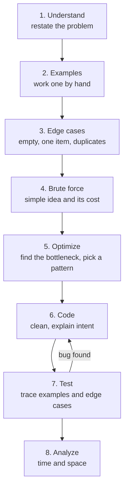
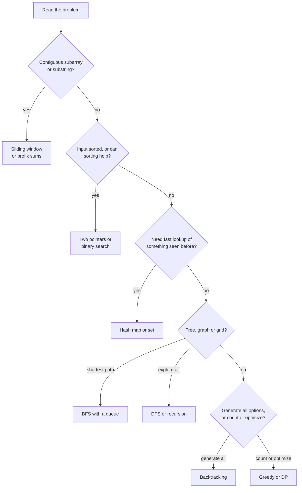
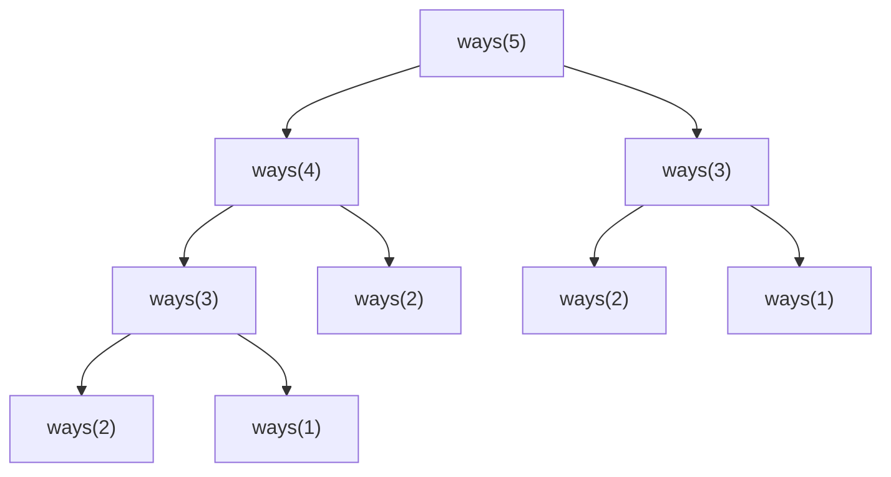

# Problem Solving and Complexity

> In this document you will learn a step-by-step method for coding interview rounds, how to talk while you solve, and the core algorithm patterns (hash maps, two pointers, sliding window, prefix sums, binary search, stacks, BFS, DFS, backtracking, greedy, dynamic programming, heaps and sorting). Each pattern has one fully worked JavaScript problem with code, a walkthrough and complexity analysis.

**Before this:** [Data structures and Big-O](../01-cs-and-web-fundamentals/02-data-structures-and-big-o.md) · [How to explain technical answers](01-how-to-explain-technical-answers.md) · **Interview questions:** [jump to the interview section](#interview-questions)

## Table of contents

1. [What a coding round tests](#what-a-coding-round-tests)
2. [The eight-step method](#the-eight-step-method)
3. [Big-O recap for coding rounds](#big-o-recap-for-coding-rounds)
4. [How to recognize which pattern applies](#how-to-recognize-which-pattern-applies)
5. [Pattern 1: Hash map counting and lookup](#pattern-1-hash-map-counting-and-lookup)
6. [Pattern 2: Two pointers](#pattern-2-two-pointers)
7. [Pattern 3: Sliding window](#pattern-3-sliding-window)
8. [Pattern 4: Prefix sums](#pattern-4-prefix-sums)
9. [Pattern 5: Binary search](#pattern-5-binary-search)
10. [Pattern 6: Stack](#pattern-6-stack)
11. [Pattern 7: Queue and breadth-first search](#pattern-7-queue-and-breadth-first-search)
12. [Pattern 8: Depth-first search and recursion](#pattern-8-depth-first-search-and-recursion)
13. [Pattern 9: Backtracking](#pattern-9-backtracking)
14. [Pattern 10: Greedy](#pattern-10-greedy)
15. [Pattern 11: Dynamic programming](#pattern-11-dynamic-programming)
16. [Pattern 12: Heap and top-k](#pattern-12-heap-and-top-k)
17. [Pattern 13: Sorting-based approaches](#pattern-13-sorting-based-approaches)
18. [JavaScript tips for coding rounds](#javascript-tips-for-coding-rounds)
19. [Testing your solution](#testing-your-solution)
20. [Common mistakes](#common-mistakes)
21. [Best practices](#best-practices)
22. [How to explain this in an interview](#how-to-explain-this-in-an-interview)
23. [Interview questions](#interview-questions)
24. [Summary](#summary)
25. [References](#references)

---

## What a coding round tests

A coding round is usually 30 to 60 minutes. You get one or two problems. You write code in a shared editor, sometimes without running it.

The interviewer checks more than "does the code work". Typical things they look at:

| Area | What they want to see |
| --- | --- |
| Problem understanding | You ask good questions and do not solve the wrong problem |
| Approach | You find a correct idea and can improve it |
| Coding | Clean, readable, correct code with good names |
| Testing | You check your own code with examples and edge cases |
| Complexity | You can state time and space cost and explain why |
| Communication | You explain your thinking so they can follow and help |

So a correct solution written in silence can score lower than a slightly slower solution that is explained well and tested carefully.

> **Frontend and full-stack note:** many companies give frontend developers algorithm problems too, often easier ones, and sometimes mixed with JavaScript-specific tasks like implementing `debounce` or `Promise.all`. Those implementations are in [JavaScript polyfills and implementations](04-javascript-polyfills-and-implementations.md). UI building tasks are in [Machine coding round](05-machine-coding-round.md).

---

## The eight-step method

Use the same steps for every problem. Having a fixed method stops you from panicking and jumping straight into code.



### Step 1: Understand

Restate the problem in your own words. Then ask about inputs and outputs.

Questions that often matter:

- What is the input type and size? (Array of numbers? Up to how many?)
- Can values be negative, zero, duplicated, not sorted?
- What should I return if there is no answer? (`null`, `-1`, empty array, throw?)
- Can I change the input array, or must I keep it unchanged?
- Is there always exactly one answer, or can there be many?

> "So I get an array of integers and a target. I return the indices of two different elements that add up to the target. Can I assume there is exactly one answer? And what should I return if there is none?"

### Step 2: Examples

Work through one small example by hand. Write it in the editor as a comment. This often shows the idea for the solution.

```js
// nums = [2, 7, 11, 15], target = 9  ->  [0, 1]  because 2 + 7 = 9
```

### Step 3: Edge cases

List them now, before coding. You will use them in step 7.

Common edge cases:

- Empty input (`[]`, `""`).
- One element.
- All elements the same.
- Negative numbers and zero.
- Already sorted, reverse sorted.
- Very large input (performance).
- No valid answer.

### Step 4: Brute force

Say the simplest correct idea and its cost, even if it is slow.

> "The brute force checks every pair with two loops. That is O(n²) time and O(1) space."

Why say it?

- It proves you can solve the problem.
- It gives a baseline to improve.
- If the input is small, it may be good enough. Ask: "Is O(n²) acceptable for the input size?"

### Step 5: Optimize

Find the **bottleneck**: the part of the brute force that does repeated work. Then ask which pattern removes it.

> "The slow part is the inner loop: for each number I search the whole array for its partner. If I store the numbers I have already seen in a Map, I can find the partner in O(1) on average. That gives O(n) total."

Then **confirm before coding**: "Does that approach sound good?"

### Step 6: Code

- Use clear names (`indexByValue`, not `m`).
- Write small helper functions if they make the code clearer.
- Say what each part does, not every keystroke.
- If you are not sure about a detail, write the main logic first and leave a short comment for the detail, then come back.

### Step 7: Test

Do not say "I think it works". **Trace** your code with a real example, line by line, and track the variables. Then check the edge cases from step 3.

> "Let me trace `[3, 3]` with target 6. At index 0, the map is empty, so I store 3 → 0. At index 1, the complement is 3, which is in the map, so I return [0, 1]. Correct."

Finding your own bug during testing is a **positive** signal. It shows you test your work.

### Step 8: Analyze

State time and space complexity and explain *why*.

> "Time is O(n) because I visit each element once and Map operations are O(1) on average. Space is O(n) for the map in the worst case."

### Time budget for a 45-minute round

A rough guide for one problem:

| Phase | Minutes |
| --- | --- |
| Understand, examples, edge cases | 5 |
| Brute force and optimize | 5 to 10 |
| Code | 15 to 20 |
| Test and fix | 5 to 10 |
| Complexity and follow-ups | 5 |

If you are 15 minutes in with no approach, code the brute force. A working simple solution is worth more than an unfinished clever one.

### How to talk while solving

The full guide to thinking aloud is in [How to explain technical answers](01-how-to-explain-technical-answers.md#thinking-aloud-while-coding). The key points:

- Say your plan before you code it.
- Explain intent, not keystrokes.
- If you need silence to think, say so: "Let me think about this for a moment."
- If you are stuck, say what you tried and where you are stuck. Take hints gracefully.

---

## Big-O recap for coding rounds

**Big-O** describes how the running time (or memory) of an algorithm grows when the input size `n` grows. It keeps only the biggest term and drops constants. The full explanation is in [Data structures and Big-O](../01-cs-and-web-fundamentals/02-data-structures-and-big-o.md).

| Big-O | Name | Typical example |
| --- | --- | --- |
| O(1) | Constant | Array index access, `Map.get` (average) |
| O(log n) | Logarithmic | Binary search, heap push/pop |
| O(n) | Linear | One loop over the input |
| O(n log n) | Linearithmic | Good sorting (`Array.prototype.sort`) |
| O(n²) | Quadratic | Two nested loops over the input |
| O(2ⁿ) | Exponential | All subsets |
| O(n!) | Factorial | All permutations |

### Using input size to guess the target complexity

Typical interview problems are designed so that the expected solution fits in roughly a second. This rough guide (an approximation, not a rule) helps you guess what complexity the interviewer expects:

| Maximum `n` | Complexity that is usually fine |
| --- | --- |
| up to ~10 | O(n!) |
| up to ~20 | O(2ⁿ) |
| up to ~500 | O(n³) |
| up to ~5,000 | O(n²) |
| up to ~1,000,000 | O(n log n) or O(n) |
| larger | O(n), O(log n) or O(1) |

If the interviewer says "the array can have a million elements", they are telling you O(n²) is too slow.

### Space complexity

**Space complexity** is the extra memory your algorithm uses, not counting the input. Usually you also do not count the output, but say so if it matters.

- A Map that stores every element: O(n) space.
- A few variables: O(1) space.
- Recursion: the call stack uses space. A recursion of depth `d` uses O(d) space.

### Amortized cost

Some operations are usually cheap but sometimes expensive. **Amortized** cost is the average over many operations. Example: `array.push` is O(1) amortized. Most pushes are instant; sometimes the engine must grow the internal storage, which costs more, but averaged over all pushes it is constant.

This also explains why a sliding window with a `while` loop inside a `for` loop can still be O(n): each element enters the window once and leaves at most once.

---

## How to recognize which pattern applies

Most interview problems are variations of a small number of patterns. Learning to spot the clue is more useful than memorizing hundreds of problems.

| Clue in the problem | Pattern to try |
| --- | --- |
| "Find a pair / complement", "count occurrences", "seen before", "duplicates" | Hash map or set |
| Sorted array, "pair with sum", "palindrome", "reverse in place", "remove duplicates in place" | Two pointers |
| "Longest / shortest **contiguous** subarray or substring with a condition" | Sliding window |
| "Sum of a range", "subarray sum equals k", many range queries | Prefix sums |
| Sorted data, "find position", "minimum value that works", "maximum value that works" | Binary search (on index or on the answer) |
| Matching brackets, "next greater element", undo, nested structure | Stack |
| "Shortest path" in an unweighted grid or graph, "level by level" | Queue and BFS |
| Trees, "all paths", "connected components", "explore everything" | DFS and recursion |
| "All combinations / subsets / permutations", "generate all valid..." | Backtracking |
| Intervals, scheduling, "minimum number of...", a local best choice that is always safe | Greedy (often after sorting) |
| "Number of ways", "minimum cost", overlapping subproblems, choices at each step | Dynamic programming |
| "Top k", "k-th largest", "k closest", merging sorted lists | Heap |
| Grouping, finding duplicates, intervals, when order makes the problem easier | Sort first |



This flowchart is a starting point, not a rule. Many problems combine patterns (for example, prefix sums plus a hash map).

---

## Pattern 1: Hash map counting and lookup

### The idea

A **hash map** (`Map` in JavaScript) stores key → value pairs. Looking up a key takes O(1) time on average. A **set** (`Set`) stores unique values with the same fast lookup.

Use them when you need to remember what you have already seen, so you do not search for it again.

**Analogy:** instead of walking through every shelf in a library to find a book (O(n)), you look at the catalogue, which tells you the exact shelf (O(1)).

### Worked problem: Two Sum

**Problem:** Given an array of numbers `nums` and a number `target`, return the indices of two different elements whose sum is `target`. Return `null` if no pair exists.

```text
nums = [2, 7, 11, 15], target = 9   ->  [0, 1]
nums = [3, 2, 4],      target = 6   ->  [1, 2]
nums = [3, 3],         target = 6   ->  [0, 1]
nums = [3],            target = 6   ->  null
```

**Brute force:** check every pair with two loops. O(n²) time, O(1) space.

**Better approach:** walk the array once. For each number, the partner we need is `target - number` (the **complement**). Keep a Map from value → index of numbers we have already passed. If the complement is in the Map, we found the pair.

Important detail: **check first, then store** the current number. Otherwise a number could pair with itself (for example `3` with target `6` in `[3]`).

```js
function twoSum(nums, target) {
  const indexByValue = new Map(); // value -> index where we saw it

  for (let i = 0; i < nums.length; i++) {
    const complement = target - nums[i];
    if (indexByValue.has(complement)) {
      return [indexByValue.get(complement), i];
    }
    indexByValue.set(nums[i], i); // store AFTER checking
  }
  return null;
}

console.log(twoSum([2, 7, 11, 15], 9)); // [ 0, 1 ]
console.log(twoSum([3, 2, 4], 6));      // [ 1, 2 ]
console.log(twoSum([3, 3], 6));         // [ 0, 1 ]
console.log(twoSum([3], 6));            // null
console.log(twoSum([-1, -2, 5], 3));    // [ 1, 2 ]
```

**Walkthrough** for `[3, 2, 4]`, target `6`:

| i | nums[i] | complement | Map before | Found? | Map after |
| --- | --- | --- | --- | --- | --- |
| 0 | 3 | 3 | {} | no | {3→0} |
| 1 | 2 | 4 | {3→0} | no | {3→0, 2→1} |
| 2 | 4 | 2 | {3→0, 2→1} | yes → return [1, 2] | — |

Note that at `i = 0`, the complement of 3 is 3 itself, but the Map is still empty, so we do not wrongly pair index 0 with itself.

**Complexity:** O(n) time (one pass, O(1) average Map operations). O(n) space for the Map.

### A second example: counting

Counting with a Map is the other common use. **Valid anagram:** are two strings made of exactly the same letters?

```js
function isAnagram(a, b) {
  if (a.length !== b.length) return false;
  const counts = new Map();
  for (const ch of a) counts.set(ch, (counts.get(ch) ?? 0) + 1);
  for (const ch of b) {
    const left = counts.get(ch);
    if (!left) return false; // missing letter or used up
    counts.set(ch, left - 1);
  }
  return true;
}

console.log(isAnagram("listen", "silent")); // true
console.log(isAnagram("rat", "car"));       // false
console.log(isAnagram("aab", "abb"));       // false
```

O(n) time, O(k) space where k is the number of different characters.

### Common mistakes

- Using `if (map.get(key))` to test existence. If the stored value is `0` (like index 0), this is false. Use `map.has(key)`.
- Storing before checking (pairs an element with itself).
- Using a plain object with number keys: keys become strings, and inherited keys like `"constructor"` can cause bugs. Prefer `Map` (see [JavaScript tips](#javascript-tips-for-coding-rounds)).

---

## Pattern 2: Two pointers

### The idea

Use two index variables that move through the array, usually from both ends toward the middle, or both forward at different speeds. Each step moves at least one pointer, so the total work is O(n).

It works when the data has an **order** that tells you which pointer to move. Sorted arrays and palindromes are the classic cases.

**Analogy:** two people searching a sorted bookshelf from opposite ends, each stepping toward the middle based on what they see.

### Worked problem: pair with target sum in a sorted array

**Problem:** Given a **sorted** array of numbers and a target, return the indices of two numbers that add up to the target, or `null`.

```text
sorted = [1, 3, 4, 6, 8, 11], target = 10  ->  [2, 3]  (4 + 6)
```

**Brute force:** two loops, O(n²). Or a hash map, O(n) time but O(n) space.

**Two-pointer approach:** start with `left` at the smallest number and `right` at the largest.

- If the sum is too small, the only way to increase it is to move `left` right (to a bigger number).
- If the sum is too big, move `right` left (to a smaller number).
- If equal, done.

Why is it safe to skip? If `sorted[left] + sorted[right]` is too small, then `sorted[left]` plus *any* number to the left of `right` is also too small. So `sorted[left]` can never be part of the answer, and we can drop it.

```js
function pairWithSum(sorted, target) {
  let left = 0;
  let right = sorted.length - 1;

  while (left < right) {
    const sum = sorted[left] + sorted[right];
    if (sum === target) return [left, right];
    if (sum < target) left++; // need a bigger sum
    else right--;             // need a smaller sum
  }
  return null;
}

console.log(pairWithSum([1, 3, 4, 6, 8, 11], 10)); // [ 2, 3 ]
console.log(pairWithSum([1, 2], 10));              // null
console.log(pairWithSum([], 1));                   // null
```

**Walkthrough** for `[1, 3, 4, 6, 8, 11]`, target `10`:

| left | right | values | sum | action |
| --- | --- | --- | --- | --- |
| 0 | 5 | 1 + 11 | 12 | too big → right-- |
| 0 | 4 | 1 + 8 | 9 | too small → left++ |
| 1 | 4 | 3 + 8 | 11 | too big → right-- |
| 1 | 3 | 3 + 6 | 9 | too small → left++ |
| 2 | 3 | 4 + 6 | 10 | found → [2, 3] |

**Complexity:** O(n) time, O(1) space. Better space than the hash map, but it needs sorted input. If the input is not sorted, sorting first costs O(n log n) and loses the original indices.

### A second example: palindrome check

**Valid palindrome:** ignoring case and non-alphanumeric characters, does the string read the same forwards and backwards?

```js
function isPalindrome(text) {
  const isAlnum = (ch) => /[a-z0-9]/i.test(ch);
  let left = 0;
  let right = text.length - 1;
  while (left < right) {
    if (!isAlnum(text[left])) { left++; continue; }
    if (!isAlnum(text[right])) { right--; continue; }
    if (text[left].toLowerCase() !== text[right].toLowerCase()) return false;
    left++;
    right--;
  }
  return true;
}

console.log(isPalindrome("A man, a plan, a canal: Panama")); // true
console.log(isPalindrome("race a car"));                     // false
console.log(isPalindrome(""));                               // true
```

O(n) time, O(1) space. (This simple version works with ASCII letters and digits.)

### Other two-pointer variants

- **Fast and slow pointers** in the same direction: remove duplicates from a sorted array in place, move zeros to the end, detect a cycle in a linked list.
- **Merging** two sorted arrays: one pointer in each.

---

## Pattern 3: Sliding window

### The idea

A **sliding window** is a range `[left, right]` over an array or string that you move forward. You add the new element on the right and remove elements from the left when the window breaks a rule. You keep a small summary of the window (a sum, a count, a Map) so you never recompute it from scratch.

Use it for problems about a **contiguous** subarray or substring: "longest", "shortest", "maximum sum of size k", "contains all characters of".

**Analogy:** looking at a long train through a window that slides along it. You see only a few carriages at a time, and you update what you see as carriages enter and leave.

### Worked problem: longest substring without repeating characters

**Problem:** Given a string, return the length of the longest substring with no repeated characters.

```text
"abcabcbb" -> 3  ("abc")
"bbbbb"    -> 1  ("b")
"pwwkew"   -> 3  ("wke")
""         -> 0
"abba"     -> 2  ("ab" or "ba")
```

**Brute force:** check every substring (O(n²) substrings) and test each for duplicates. O(n³), or O(n²) with a set.

**Sliding window approach:**

- Move `right` forward one character at a time.
- Keep a Map from character → the last index where it was seen.
- If the current character was already seen **inside the current window** (its last index is `>= left`), move `left` to just after that last position.
- After each step, the window `[left, right]` has no repeats. Update the best length.

```js
function lengthOfLongestSubstring(text) {
  const lastIndex = new Map(); // character -> last position seen
  let left = 0;
  let best = 0;
  let right = 0;

  for (const ch of text) {
    // only jump if the repeat is inside the current window
    if (lastIndex.has(ch) && lastIndex.get(ch) >= left) {
      left = lastIndex.get(ch) + 1;
    }
    lastIndex.set(ch, right);
    best = Math.max(best, right - left + 1);
    right++;
  }
  return best;
}

console.log(lengthOfLongestSubstring("abcabcbb")); // 3
console.log(lengthOfLongestSubstring("bbbbb"));    // 1
console.log(lengthOfLongestSubstring("pwwkew"));   // 3
console.log(lengthOfLongestSubstring(""));         // 0
console.log(lengthOfLongestSubstring("abba"));     // 2
```

`for...of` iterates by Unicode **code points**, so an emoji counts as one character, and `right` counts code points. (It does not group multi-code-point characters like some combined emoji; that would need `Intl.Segmenter`.)

**Walkthrough** for `"abba"` — the tricky case:

| right | ch | lastIndex before | left before | repeat inside window? | left after | window | best |
| --- | --- | --- | --- | --- | --- | --- | --- |
| 0 | a | {} | 0 | no | 0 | "a" | 1 |
| 1 | b | {a:0} | 0 | no | 0 | "ab" | 2 |
| 2 | b | {a:0, b:1} | 0 | yes (1 ≥ 0) | 2 | "b" | 2 |
| 3 | a | {a:0, b:2} | 2 | no (0 < 2) | 2 | "ba" | 2 |

At `right = 3`, `a` was last seen at index 0, which is **outside** the window (left is 2). Without the `>= left` check, `left` would jump **backwards** to 1, and the window "bba" would contain two b's. That is the classic bug. An equivalent fix: `left = Math.max(left, lastIndex.get(ch) + 1)`.

**Complexity:** O(n) time — each character is visited once by `right`, and `left` only moves forward. O(k) space for the Map, where k is the number of distinct characters.

### A second example: fixed-size window

**Maximum sum of any k consecutive numbers:** add the new element, subtract the element that leaves.

```js
function maxSumOfK(nums, k) {
  if (k > nums.length) return null;
  let windowSum = 0;
  for (let i = 0; i < k; i++) windowSum += nums[i];
  let best = windowSum;
  for (let i = k; i < nums.length; i++) {
    windowSum += nums[i] - nums[i - k]; // slide by one
    best = Math.max(best, windowSum);
  }
  return best;
}

console.log(maxSumOfK([2, 1, 5, 1, 3, 2], 3)); // 9  (5 + 1 + 3)
```

O(n) time, O(1) space, instead of O(n·k) for re-summing every window.

### When sliding window does not work

Shrinking the window "when the sum gets too big" only works if all numbers are **non-negative**. With negative numbers, adding an element can make the sum smaller, so you cannot know which way to move. Then use [prefix sums](#pattern-4-prefix-sums) instead.

---

## Pattern 4: Prefix sums

### The idea

A **prefix sum** array stores, at position `i`, the sum of all elements before `i`. Then the sum of any range is one subtraction:

`sum(from..to) = prefix[to + 1] - prefix[from]`

**Analogy:** the odometer in a car. To know how far you drove between two cities, you subtract the two odometer readings. You do not need to re-measure the road.

### Simple example: many range-sum queries

```js
class RangeSum {
  constructor(nums) {
    this.prefix = [0]; // prefix[i] = sum of nums[0..i-1]
    for (const n of nums) {
      this.prefix.push(this.prefix[this.prefix.length - 1] + n);
    }
  }
  sum(from, to) {
    return this.prefix[to + 1] - this.prefix[from];
  }
}

const ranges = new RangeSum([3, -1, 4, 2, 5]);
console.log(ranges.prefix);     // [ 0, 3, 2, 6, 8, 13 ]
console.log(ranges.sum(1, 3));  // 5   (-1 + 4 + 2)
console.log(ranges.sum(0, 4));  // 13
console.log(ranges.sum(2, 2));  // 4
```

Building is O(n). Each query is O(1), instead of O(n) per query.

The extra `0` at the start avoids a special case for ranges that begin at index 0.

### Worked problem: subarray sum equals k

**Problem:** Given an array of integers (which can be negative) and a number `k`, count the contiguous subarrays whose sum is exactly `k`.

```text
nums = [1, 1, 1], k = 2   ->  2   ([1,1] twice)
nums = [1, 2, 3], k = 3   ->  2   ([1,2] and [3])
nums = [1, -1, 0], k = 0  ->  3   ([1,-1], [0], [1,-1,0])
```

**Brute force:** for every start, extend the end and keep a running sum. O(n²).

**Better approach (prefix sums + hash map):**

- Walk the array keeping a running `prefix` sum.
- A subarray ending here has sum `k` if some earlier prefix equals `prefix - k`. (Because `prefix - earlierPrefix = k`.)
- Keep a Map from prefix value → how many times we have seen it. Start with `{0: 1}` for the empty prefix.

```js
function subarraySum(nums, k) {
  const seen = new Map([[0, 1]]); // prefix sum -> how many times seen
  let prefix = 0;
  let count = 0;

  for (const n of nums) {
    prefix += n;
    count += seen.get(prefix - k) ?? 0;
    seen.set(prefix, (seen.get(prefix) ?? 0) + 1);
  }
  return count;
}

console.log(subarraySum([1, 1, 1], 2));   // 2
console.log(subarraySum([1, 2, 3], 3));   // 2
console.log(subarraySum([1, -1, 0], 0));  // 3
```

**Walkthrough** for `[1, 2, 3]`, k = 3:

| n | prefix | looking for prefix - k | found count | count | seen after |
| --- | --- | --- | --- | --- | --- |
| — | 0 | — | — | 0 | {0:1} |
| 1 | 1 | -2 | 0 | 0 | {0:1, 1:1} |
| 2 | 3 | 0 | 1 (subarray [1,2]) | 1 | {0:1, 1:1, 3:1} |
| 3 | 6 | 3 | 1 (subarray [3]) | 2 | {0:1, 1:1, 3:1, 6:1} |

**Complexity:** O(n) time, O(n) space. It works with negative numbers, unlike the sliding window.

---

## Pattern 5: Binary search

### The idea

**Binary search** finds a position in **sorted** data by looking at the middle and throwing away half of the remaining range each step. That gives O(log n): one million elements need about 20 steps.

There are two main forms:

1. **Search on an index:** find a value or a position in a sorted array.
2. **Search on the answer:** the answer is a number in a range, and you can check "does this value work?". If the check is **monotonic** (once it works, every bigger value also works), you can binary search the smallest value that works.

**Analogy:** guessing a number between 1 and 100 when someone says "higher" or "lower". You always guess the middle.

### Worked problem 1: lower bound

**Problem:** In a sorted array, return the first index whose value is **greater than or equal to** `target`. If all values are smaller, return `array.length`. This is called **lower bound**, and it is the safest building block for every binary search.

```text
[1, 2, 2, 4], target 2  ->  1
[1, 2, 2, 4], target 3  ->  3
[1, 2, 2, 4], target 5  ->  4   (past the end)
[1, 2, 2, 4], target 0  ->  0
[],           target 3  ->  0
```

**Approach:** keep a half-open range `[left, right)` that always contains the answer.

- Everything before `left` is known to be `< target`.
- Everything from `right` onward is known to be `>= target`.
- Look at `mid`. If `sorted[mid] < target`, the answer is after `mid`: `left = mid + 1`. Otherwise `mid` could be the answer: `right = mid`.
- Stop when `left === right`. That is the answer.

```js
function lowerBound(sorted, target) {
  let left = 0;
  let right = sorted.length; // half-open: [left, right)
  while (left < right) {
    const mid = left + Math.floor((right - left) / 2);
    if (sorted[mid] < target) left = mid + 1;
    else right = mid;
  }
  return left;
}

console.log(lowerBound([1, 2, 2, 4], 2)); // 1
console.log(lowerBound([1, 2, 2, 4], 3)); // 3
console.log(lowerBound([1, 2, 2, 4], 5)); // 4
console.log(lowerBound([1, 2, 2, 4], 0)); // 0
console.log(lowerBound([], 3));           // 0

// Classic "find the index or -1" built on lowerBound
function binarySearch(sorted, target) {
  const i = lowerBound(sorted, target);
  return i < sorted.length && sorted[i] === target ? i : -1;
}
console.log(binarySearch([1, 3, 5, 7], 5)); // 2
console.log(binarySearch([1, 3, 5, 7], 4)); // -1
```

**Walkthrough** for `[1, 2, 2, 4]`, target `2`:

| left | right | mid | sorted[mid] | action |
| --- | --- | --- | --- | --- |
| 0 | 4 | 2 | 2 | not < 2 → right = 2 |
| 0 | 2 | 1 | 2 | not < 2 → right = 1 |
| 0 | 1 | 0 | 1 | < 2 → left = 1 |
| 1 | 1 | — | — | stop, return 1 |

The range always shrinks (either `left` grows or `right` shrinks), so the loop always ends. Off-by-one bugs usually come from mixing styles, such as `right = length - 1` with `right = mid`.

**Complexity:** O(log n) time, O(1) space.

### Worked problem 2: binary search on the answer

**Problem (ship packages within D days):** Packages with given weights must be shipped in order. Each day the ship carries packages in order until adding the next one would go over its capacity. Find the **minimum capacity** that ships everything within `days` days.

```text
weights = [1,2,3,4,5,6,7,8,9,10], days = 5  ->  15
weights = [3,2,2,4,1,4],          days = 3  ->  6
```

**Key observation:** if capacity `c` works, any capacity larger than `c` also works. So "does capacity c work?" is false, false, ..., false, true, true, true. We want the first true. That is a lower bound on the answer.

- The smallest possible capacity is the heaviest package (otherwise it never fits).
- The largest needed capacity is the total weight (ship everything in one day).

```js
function shipWithinDays(weights, days) {
  const canShip = (capacity) => {
    let daysUsed = 1;
    let load = 0;
    for (const weight of weights) {
      if (load + weight > capacity) {
        daysUsed++; // start a new day
        load = 0;
      }
      load += weight;
    }
    return daysUsed <= days;
  };

  let low = Math.max(...weights);
  let high = weights.reduce((sum, w) => sum + w, 0);
  while (low < high) {
    const mid = low + Math.floor((high - low) / 2);
    if (canShip(mid)) high = mid; // mid works, try smaller
    else low = mid + 1;           // mid fails, need bigger
  }
  return low;
}

console.log(shipWithinDays([1, 2, 3, 4, 5, 6, 7, 8, 9, 10], 5)); // 15
console.log(shipWithinDays([3, 2, 2, 4, 1, 4], 3));              // 6
```

**Complexity:** the range has size `S` (sum of weights), so binary search does O(log S) checks. Each check is O(n). Total O(n log S) time, O(1) extra space. (For very large arrays, replace `Math.max(...weights)` with a loop, because spreading a huge array into function arguments can exceed engine limits.)

**Clue for "binary search on the answer":** the problem asks for the **minimum** (or maximum) value such that some condition holds, and checking one value is easy.

---

## Pattern 6: Stack

### The idea

A **stack** is last in, first out (LIFO). In JavaScript, an array with `push` and `pop` is a stack, and both operations are O(1).

Use a stack when the most recent unfinished item is the one you need next: matching brackets, nested structures, undo, "next greater element", and iterative DFS.

**Analogy:** a stack of plates. You always take the top plate, the one you put down last.

### Worked problem: valid parentheses

**Problem:** A string contains only `()[]{}`. Return `true` if every opening bracket is closed by the same type, in the correct order.

```text
"()[]{}" -> true
"([)]"   -> false
"{[]}"   -> true
"(("     -> false
")"      -> false
""       -> true
```

**Approach:** push every opening bracket. When you see a closing bracket, the top of the stack must be its matching opening bracket. At the end, the stack must be empty.

```js
function isValid(s) {
  const pairs = { ")": "(", "]": "[", "}": "{" };
  const stack = [];

  for (const ch of s) {
    if (ch === "(" || ch === "[" || ch === "{") {
      stack.push(ch);
    } else if (ch in pairs) {
      if (stack.pop() !== pairs[ch]) return false;
    }
  }
  return stack.length === 0;
}

console.log(isValid("()[]{}")); // true
console.log(isValid("([)]"));   // false
console.log(isValid("{[]}"));   // true
console.log(isValid("(("));     // false
console.log(isValid(")"));      // false
console.log(isValid(""));       // true
```

**Walkthrough** for `"([)]"`:

| ch | action | stack after |
| --- | --- | --- |
| ( | push | [ ( ] |
| [ | push | [ (, [ ] |
| ) | pop gives `[`, expected `(` | mismatch → return false |

For `")"`: the stack is empty, `pop()` returns `undefined`, which is not `(`, so we return `false`. For `"(("`: the loop ends with two items in the stack, so we return `false`.

**Complexity:** O(n) time, O(n) space in the worst case (all opening brackets).

**Real-world connection:** the same idea is used to check HTML tag nesting, evaluate expressions, and implement undo history.

---

## Pattern 7: Queue and breadth-first search

### The idea

A **queue** is first in, first out (FIFO). **Breadth-first search (BFS)** explores a graph or grid in layers: first all neighbors at distance 1, then distance 2, and so on. Because it explores in distance order, BFS finds the **shortest path in an unweighted graph** (every edge costs the same).

**Analogy:** ripples in water. They spread out one ring at a time.

Two rules make BFS correct and efficient:

1. **Mark a node as visited when you add it to the queue**, not when you take it out. Otherwise the same node can be added many times.
2. In JavaScript, **do not use `array.shift()`** in a big loop to take from the front. `shift` moves every other element, so it is O(n). Use a `head` index instead.

### Worked problem: shortest path in a grid

**Problem:** A grid has `0` for open cells and `1` for walls. Starting at the top-left cell, moving up, down, left or right, return the minimum number of steps to reach the bottom-right cell, or `-1` if it cannot be reached.

```text
grid = [
  [0, 0, 0],
  [1, 1, 0],
  [0, 0, 0],
]
-> 4   (right, right, down, down)
```

```js
function shortestPath(grid) {
  const rows = grid.length;
  const cols = grid[0].length;
  if (grid[0][0] === 1 || grid[rows - 1][cols - 1] === 1) return -1;

  const queue = [[0, 0, 0]]; // [row, col, distance]
  const visited = new Set(["0,0"]);
  const directions = [[1, 0], [-1, 0], [0, 1], [0, -1]];

  for (let head = 0; head < queue.length; head++) { // head index instead of shift()
    const [row, col, distance] = queue[head];
    if (row === rows - 1 && col === cols - 1) return distance;

    for (const [dr, dc] of directions) {
      const r = row + dr;
      const c = col + dc;
      const key = `${r},${c}`;
      if (r < 0 || c < 0 || r >= rows || c >= cols) continue; // outside
      if (grid[r][c] === 1 || visited.has(key)) continue;     // wall or seen
      visited.add(key); // mark when enqueuing
      queue.push([r, c, distance + 1]);
    }
  }
  return -1;
}

console.log(shortestPath([[0, 0, 0], [1, 1, 0], [0, 0, 0]])); // 4
console.log(shortestPath([[0, 1], [1, 0]]));                  // -1
console.log(shortestPath([[0]]));                             // 0
```

**Walkthrough** (first steps) for the 3×3 grid:

1. Queue: `(0,0,d0)`. Take it. Neighbors: `(1,0)` is a wall, `(0,1)` is open → add `(0,1,d1)`.
2. Take `(0,1,d1)`. Neighbors: `(1,1)` wall, `(0,2)` open → add `(0,2,d2)`. `(0,0)` already visited.
3. Take `(0,2,d2)`. Add `(1,2,d3)`.
4. Take `(1,2,d3)`. Add `(2,2,d4)`.
5. Take `(2,2,d4)`. It is the target → return 4.

**Complexity:** each cell enters the queue at most once and checks 4 neighbors. O(rows × cols) time and space.

A string key like `"r,c"` is easy to read. For large grids, a faster alternative is a numeric key `r * cols + c`, or a 2D boolean array.

### A second example: tree level order

BFS on a tree gives nodes **level by level**:

```js
function levelOrder(root) {
  if (!root) return [];
  const result = [];
  let level = [root];
  while (level.length > 0) {
    result.push(level.map((node) => node.value));
    const next = [];
    for (const node of level) {
      if (node.left) next.push(node.left);
      if (node.right) next.push(node.right);
    }
    level = next;
  }
  return result;
}

//      3
//     / \
//    9   20
//       /  \
//      15   7
const tree = {
  value: 3,
  left: { value: 9, left: null, right: null },
  right: {
    value: 20,
    left: { value: 15, left: null, right: null },
    right: { value: 7, left: null, right: null },
  },
};
console.log(JSON.stringify(levelOrder(tree))); // [[3],[9,20],[15,7]]
```

Building a new `next` array per level avoids `shift()` too. O(n) time, O(width) space.

---

## Pattern 8: Depth-first search and recursion

### The idea

**Depth-first search (DFS)** goes as deep as possible along one path before coming back and trying the next one. It is natural to write with **recursion**: a function that calls itself on smaller parts of the problem.

Every recursive function needs:

1. A **base case** that stops the recursion (for example, an empty node).
2. A **recursive case** that makes the problem smaller.

**Analogy:** exploring a maze by always taking the first unexplored corridor, and walking back to the last junction when you hit a dead end.

### Worked problem: maximum depth of a binary tree

**Problem:** Return the number of nodes on the longest path from the root down to a leaf.

Using the tree from the BFS section, the answer is 3 (3 → 20 → 15).

**Approach:** the depth of a tree is 1 (this node) plus the larger depth of its two subtrees. An empty tree has depth 0.

```js
function maxDepth(node) {
  if (node === null) return 0; // base case
  return 1 + Math.max(maxDepth(node.left), maxDepth(node.right));
}

console.log(maxDepth(tree)); // 3
console.log(maxDepth(null)); // 0
```

**Walkthrough** (the call stack):

1. `maxDepth(3)` needs `maxDepth(9)` and `maxDepth(20)`.
2. `maxDepth(9)`: both children are null → `1 + max(0, 0) = 1`.
3. `maxDepth(20)` needs `maxDepth(15)` → 1 and `maxDepth(7)` → 1, so it returns `1 + 1 = 2`.
4. Back in `maxDepth(3)`: `1 + max(1, 2) = 3`.

**Complexity:** O(n) time (each node once). O(h) space for the call stack, where h is the tree height: O(log n) for a balanced tree, O(n) for a tree that is a long chain.

### Iterative version with an explicit stack

JavaScript engines have a limited call stack. Very deep recursion (for example, a chain of 100,000 nodes) throws `RangeError: Maximum call stack size exceeded`. An explicit stack avoids that:

```js
function maxDepthIterative(root) {
  if (!root) return 0;
  const stack = [[root, 1]]; // [node, depth]
  let best = 0;
  while (stack.length > 0) {
    const [node, depth] = stack.pop();
    best = Math.max(best, depth);
    if (node.left) stack.push([node.left, depth + 1]);
    if (node.right) stack.push([node.right, depth + 1]);
  }
  return best;
}

console.log(maxDepthIterative(tree)); // 3
```

### BFS or DFS?

| Need | Choose |
| --- | --- |
| Shortest path in an unweighted graph | BFS |
| Process level by level | BFS |
| Explore all paths, check if a path exists, count connected components | DFS (simpler code) or BFS |
| Tree problems that combine results of children (depth, sum, validate BST) | DFS (recursion) |
| Very deep structures | Iterative DFS or BFS (avoid recursion limits) |

---

## Pattern 9: Backtracking

### The idea

**Backtracking** builds a solution step by step. At each step it tries a choice, explores further, and then **undoes the choice** (backtracks) to try the next one. It is DFS over the tree of all possible choices.

Use it to **generate all** combinations, subsets, permutations, or all valid arrangements (like placing queens on a chessboard or solving a Sudoku).

The template:

```text
function backtrack(state):
    if state is a complete solution: record a copy, return
    for each choice available from this state:
        make the choice
        backtrack(new state)
        undo the choice
```

**Analogy:** trying routes in a maze, leaving a trail of string, and rolling the string back up each time you return to a junction.

### Worked problem 1: all subsets

**Problem:** Return all subsets of an array of distinct numbers.

```text
[1, 2, 3] -> [], [1], [1,2], [1,2,3], [1,3], [2], [2,3], [3]
```

```js
function subsets(items) {
  const result = [];
  const current = [];

  function backtrack(start) {
    result.push([...current]); // every partial state is a subset (copy it!)
    for (let i = start; i < items.length; i++) {
      current.push(items[i]); // choose
      backtrack(i + 1);       // explore
      current.pop();          // un-choose
    }
  }

  backtrack(0);
  return result;
}

console.log(JSON.stringify(subsets([1, 2, 3])));
// [[],[1],[1,2],[1,2,3],[1,3],[2],[2,3],[3]]
```

Using `start` makes each subset appear in only one order (no `[2,1]` after `[1,2]`).

**Complexity:** there are 2ⁿ subsets, and copying each costs up to O(n). O(n · 2ⁿ) time, O(n) extra space for recursion (plus the output).

### Worked problem 2: all permutations

**Problem:** Return all orderings of an array of distinct numbers.

```js
function permutations(items) {
  const result = [];
  const current = [];
  const used = new Array(items.length).fill(false);

  function backtrack() {
    if (current.length === items.length) {
      result.push([...current]);
      return;
    }
    for (let i = 0; i < items.length; i++) {
      if (used[i]) continue;
      used[i] = true;
      current.push(items[i]);
      backtrack();
      current.pop();
      used[i] = false;
    }
  }

  backtrack();
  return result;
}

console.log(JSON.stringify(permutations([1, 2, 3])));
// [[1,2,3],[1,3,2],[2,1,3],[2,3,1],[3,1,2],[3,2,1]]
console.log(permutations([1, 2, 3, 4]).length); // 24
```

**Complexity:** n! permutations, each copied in O(n): O(n · n!) time.

### Common backtracking mistakes

```js
// ❌ Wrong: pushes the same array object every time; later pops empty it
result.push(current);

// ✅ Correct: push a copy
result.push([...current]);
```

Also: forgetting to undo the choice (`pop`, `used[i] = false`), which leaves the state dirty for the next branch.

**Pruning:** in problems like "combinations that sum to a target", stop exploring a branch as soon as it cannot lead to a valid answer (for example, the sum is already too big). Pruning is what makes backtracking practical.

---

## Pattern 10: Greedy

### The idea

A **greedy** algorithm makes the locally best choice at each step and never goes back. It is fast and simple, but it is **only correct when you can argue that the local choice never ruins the global answer**.

Greedy often comes after sorting: sort by start time, by end time, by size.

**Analogy:** giving change with the largest coin first. With euro or dollar coins this gives the fewest coins. But with coins `[1, 3, 4]` and amount 6, greedy gives 4 + 1 + 1 (three coins), while 3 + 3 (two coins) is better. That is why greedy needs a reason, not just a feeling. (The correct general solution is [dynamic programming](#pattern-11-dynamic-programming).)

### Worked problem: merge overlapping intervals

**Problem:** Given a list of intervals `[start, end]`, merge all overlapping intervals.

```text
[[1,3],[8,10],[2,6],[15,18]] -> [[1,6],[8,10],[15,18]]
[[1,4],[4,5]]                -> [[1,5]]     (touching counts as overlapping)
[[1,10],[2,3]]               -> [[1,10]]    (one inside another)
```

**Approach:**

1. Sort intervals by start.
2. Walk through them. Keep the last merged interval.
3. If the current interval starts before or at the end of the last one, they overlap: extend the end to the larger end.
4. Otherwise, start a new merged interval.

Why is the greedy choice safe? After sorting by start, an interval can only overlap with the merged interval just before it. Any earlier merged interval ended before the last one started.

```js
function mergeIntervals(intervals) {
  if (intervals.length === 0) return [];
  // copy before sorting so we do not change the caller's array
  const sorted = [...intervals].sort((a, b) => a[0] - b[0]);
  const merged = [[...sorted[0]]];

  for (let i = 1; i < sorted.length; i++) {
    const last = merged[merged.length - 1];
    const [start, end] = sorted[i];
    if (start <= last[1]) {
      last[1] = Math.max(last[1], end); // overlap: extend
    } else {
      merged.push([start, end]);        // gap: new interval
    }
  }
  return merged;
}

console.log(JSON.stringify(mergeIntervals([[1, 3], [8, 10], [2, 6], [15, 18]])));
// [[1,6],[8,10],[15,18]]
console.log(JSON.stringify(mergeIntervals([[1, 4], [4, 5]])));   // [[1,5]]
console.log(JSON.stringify(mergeIntervals([[1, 10], [2, 3]])));  // [[1,10]]
```

**Walkthrough** for `[[1,3],[8,10],[2,6],[15,18]]`:

1. Sorted: `[1,3], [2,6], [8,10], [15,18]`. Merged: `[[1,3]]`.
2. `[2,6]`: 2 ≤ 3 → overlap → last becomes `[1,6]`.
3. `[8,10]`: 8 > 6 → new → `[[1,6],[8,10]]`.
4. `[15,18]`: 15 > 10 → new → `[[1,6],[8,10],[15,18]]`.

Note `Math.max(last[1], end)`: without it, `[1,10]` followed by `[2,3]` would wrongly shrink to `[1,3]`.

**Complexity:** O(n log n) for sorting plus O(n) for the walk. O(n) space for the copy and output.

**Real-world connection:** merging calendar busy times, combining overlapping time ranges in a dashboard, or collapsing highlighted text ranges.

---

## Pattern 11: Dynamic programming

### The idea

**Dynamic programming (DP)** solves a problem by combining answers to smaller versions of the same problem, and **storing** those answers so each one is computed only once.

DP fits when two things are true:

1. **Optimal substructure:** the answer for a big input can be built from answers for smaller inputs.
2. **Overlapping subproblems:** the same smaller problems come up again and again.

Clue words: "number of ways", "minimum cost", "maximum value", "can you reach", with choices at each step.

**Analogy:** if someone asks you "what is 1+1+1+1+1+1+1?", you count 7. If they add "+1" at the end, you do not count again from the start; you remember 7 and say 8. DP is remembering previous answers.

### Worked problem: climbing stairs

**Problem:** You climb a staircase with `n` steps. Each time you climb 1 or 2 steps. In how many different ways can you reach the top?

```text
n = 1 -> 1   (1)
n = 2 -> 2   (1+1, 2)
n = 3 -> 3   (1+1+1, 1+2, 2+1)
n = 4 -> 5
```

**Finding the recurrence:** to reach step `n`, your last move was either 1 step (from `n-1`) or 2 steps (from `n-2`). So:

`ways(n) = ways(n - 1) + ways(n - 2)`, with `ways(1) = 1` and `ways(2) = 2`.

### Version 1: plain recursion (too slow)

```js
function climbRecursive(n) {
  if (n <= 2) return n;
  return climbRecursive(n - 1) + climbRecursive(n - 2);
}

console.log([1, 2, 3, 4, 5].map(climbRecursive)); // [ 1, 2, 3, 5, 8 ]
```

It is correct, but it recomputes the same values many times. `climbRecursive(30)` makes over 1.6 million calls (we counted 1,664,079). The time is exponential, roughly O(1.6ⁿ).



`ways(3)` is computed twice and `ways(2)` three times, even for `n = 5`. For bigger `n` the repetition explodes.

### Version 2: memoization (top-down)

**Memoization** means: keep the recursion, but store each result in a cache. Before computing, check the cache.

```js
function climbMemo(n, memo = new Map()) {
  if (n <= 2) return n;
  if (memo.has(n)) return memo.get(n);
  const ways = climbMemo(n - 1, memo) + climbMemo(n - 2, memo);
  memo.set(n, ways);
  return ways;
}

console.log(climbMemo(10)); // 89
console.log(climbMemo(45)); // 1836311903
```

Each `n` is computed once: O(n) time, O(n) space (the cache plus the recursion depth).

### Version 3: tabulation (bottom-up)

**Tabulation** means: fill a table from the smallest subproblem up to `n` with a loop. No recursion.

```js
function climbTab(n) {
  if (n <= 2) return n;
  const dp = new Array(n + 1);
  dp[1] = 1;
  dp[2] = 2;
  for (let i = 3; i <= n; i++) {
    dp[i] = dp[i - 1] + dp[i - 2];
  }
  return dp[n];
}

console.log(climbTab(10)); // 89
```

O(n) time, O(n) space, and no risk of a stack overflow.

### Version 4: space-optimized

Each step needs only the previous two values, so we can keep just two variables:

```js
function climbStairs(n) {
  if (n <= 2) return n;
  let twoBack = 1; // ways(i - 2)
  let oneBack = 2; // ways(i - 1)
  for (let i = 3; i <= n; i++) {
    const current = oneBack + twoBack;
    twoBack = oneBack;
    oneBack = current;
  }
  return oneBack;
}

console.log(climbStairs(10)); // 89
console.log(climbStairs(45)); // 1836311903
```

O(n) time, O(1) space.

**Walkthrough** of `climbStairs(5)`:

| i | twoBack before | oneBack before | current | twoBack after | oneBack after |
| --- | --- | --- | --- | --- | --- |
| 3 | 1 | 2 | 3 | 2 | 3 |
| 4 | 2 | 3 | 5 | 3 | 5 |
| 5 | 3 | 5 | 8 | 5 | 8 |

Result: 8.

### Memoization vs tabulation

| | Memoization (top-down) | Tabulation (bottom-up) |
| --- | --- | --- |
| How | Recursion + cache | Loop filling a table |
| Easy to write from the recurrence | Yes, very | Need to choose the fill order |
| Computes only needed subproblems | Yes | Usually computes all of them |
| Stack overflow risk | Yes, for deep recursion | No |
| Space optimization | Harder | Easy (keep only the last rows) |

In an interview, a common path is: write the recurrence → plain recursion → add memoization → convert to tabulation if asked.

### How to approach any DP problem

1. **Define the state:** what does `dp[i]` mean, in words? ("the number of ways to reach step i")
2. **Write the transition:** how is `dp[i]` built from smaller states?
3. **Set base cases.**
4. **Choose the order:** top-down with memo, or bottom-up.
5. **Find the answer:** which state holds it (`dp[n]`, the max of all, ...)?
6. **Optimize space** if each state needs only a few previous states.

A second classic DP problem, **coin change**, is worked in [Q8](#q8-solve-coin-change-fewest-coins-to-make-an-amount) below.

---

## Pattern 12: Heap and top-k

### The idea

A **heap** (priority queue) is a structure that always gives you the smallest (min-heap) or largest (max-heap) item quickly. Adding an item and removing the top item are both O(log n). Looking at the top is O(1).

Use a heap when you need the **k largest, k smallest, k most frequent**, or when you repeatedly need "the next smallest" (for example, merging k sorted lists or scheduling).

**Analogy:** a hospital emergency room. Patients do not leave in arrival order; the most urgent one is always treated next.

JavaScript has **no built-in heap**. In an interview you can:

- Ask if you may assume a `MinPriorityQueue` helper exists (some platforms provide one), or
- Write a small one (about 40 lines, below), or
- Use sorting if the input is small and say what the heap would improve.

### A small MinHeap

A heap is stored in an array. For the item at index `i`, the parent is at `Math.floor((i - 1) / 2)` and the children are at `2i + 1` and `2i + 2`. Every parent is smaller than or equal to its children.

```js
class MinHeap {
  constructor(compare = (a, b) => a - b) {
    this.items = [];
    this.compare = compare;
  }
  get size() {
    return this.items.length;
  }
  peek() {
    return this.items[0];
  }
  push(value) {
    const items = this.items;
    items.push(value);
    let i = items.length - 1;
    // bubble up while smaller than the parent
    while (i > 0) {
      const parent = Math.floor((i - 1) / 2);
      if (this.compare(items[i], items[parent]) >= 0) break;
      [items[i], items[parent]] = [items[parent], items[i]];
      i = parent;
    }
  }
  pop() {
    const items = this.items;
    const top = items[0];
    const last = items.pop();
    if (items.length > 0) {
      items[0] = last;
      let i = 0;
      // sink down while bigger than a child
      while (true) {
        const left = 2 * i + 1;
        const right = left + 1;
        let smallest = i;
        if (left < items.length && this.compare(items[left], items[smallest]) < 0) smallest = left;
        if (right < items.length && this.compare(items[right], items[smallest]) < 0) smallest = right;
        if (smallest === i) break;
        [items[i], items[smallest]] = [items[smallest], items[i]];
        i = smallest;
      }
    }
    return top;
  }
}
```

### Worked problem: top k frequent elements

**Problem:** Given an array of numbers and `k`, return the `k` most frequent numbers.

```text
nums = [1, 1, 1, 2, 2, 3], k = 2  ->  [1, 2]
```

**Approach:**

1. Count frequencies with a Map: O(n).
2. Keep a **min-heap of size k**, ordered by frequency. Push each `[value, count]`. If the heap grows bigger than k, pop the smallest. What remains are the k largest.
3. Pop everything and reverse to get the most frequent first.

Why a **min**-heap for the **largest** items? Because the heap's top is the weakest of the current top k, so it is the one to throw away when a stronger item arrives.

```js
function topKFrequent(nums, k) {
  const counts = new Map();
  for (const n of nums) counts.set(n, (counts.get(n) ?? 0) + 1);

  const heap = new MinHeap((a, b) => a[1] - b[1]); // compare by count
  for (const entry of counts) {
    heap.push(entry);
    if (heap.size > k) heap.pop(); // drop the least frequent
  }

  const result = [];
  while (heap.size > 0) result.push(heap.pop()[0]);
  return result.reverse(); // most frequent first
}

console.log(topKFrequent([1, 1, 1, 2, 2, 3], 2)); // [ 1, 2 ]
console.log(topKFrequent([4, 4, 5, 5, 5, 6], 1)); // [ 5 ]
```

**Complexity:** counting is O(n). With `u` distinct values, the heap work is O(u log k). Total O(n + u log k) time, O(u + k) space. Sorting all distinct values would be O(u log u); the heap is better when k is much smaller than u.

**Another use:** the k-th largest element is the top of a min-heap of size k:

```js
function kthLargest(nums, k) {
  const heap = new MinHeap();
  for (const n of nums) {
    heap.push(n);
    if (heap.size > k) heap.pop();
  }
  return heap.peek();
}

console.log(kthLargest([3, 2, 1, 5, 6, 4], 2)); // 5
```

---

## Pattern 13: Sorting-based approaches

### The idea

Sorting costs O(n log n), but it often turns a hard problem into an easy one. After sorting:

- Equal items are next to each other (duplicates, grouping).
- You can use two pointers or binary search.
- Intervals and events can be processed in time order (greedy).

### Worked problem: group anagrams

**Problem:** Group words that are anagrams of each other.

```text
["eat","tea","tan","ate","nat","bat"] -> [["eat","tea","ate"],["tan","nat"],["bat"]]
```

**Approach:** two words are anagrams if their sorted letters are equal. Use the sorted letters as a Map key.

```js
function groupAnagrams(words) {
  const groups = new Map(); // sorted letters -> words
  for (const word of words) {
    const key = [...word].sort().join("");
    if (!groups.has(key)) groups.set(key, []);
    groups.get(key).push(word);
  }
  return [...groups.values()];
}

console.log(JSON.stringify(groupAnagrams(["eat", "tea", "tan", "ate", "nat", "bat"])));
// [["eat","tea","ate"],["tan","nat"],["bat"]]
```

**Complexity:** for `n` words of maximum length `L`, each key costs O(L log L) to build. Total O(n · L log L) time, O(n · L) space.

Here, `sort()` without a comparator is correct, because we are sorting **characters** as strings. For numbers, it is wrong (see the tips below).

### A second example: minimum meeting rooms

**Problem:** Given meeting time intervals, find the minimum number of rooms needed.

**Approach:** sort start times and end times separately. Walk through starts; before each start, free every room whose meeting has already ended.

```js
function minMeetingRooms(meetings) {
  const starts = meetings.map((m) => m[0]).sort((a, b) => a - b);
  const ends = meetings.map((m) => m[1]).sort((a, b) => a - b);
  let rooms = 0;
  let maxRooms = 0;
  let e = 0;
  for (let s = 0; s < starts.length; s++) {
    while (e < ends.length && ends[e] <= starts[s]) {
      e++;
      rooms--; // a meeting ended, its room is free
    }
    rooms++;
    maxRooms = Math.max(maxRooms, rooms);
  }
  return maxRooms;
}

console.log(minMeetingRooms([[0, 30], [5, 10], [15, 20]])); // 2
console.log(minMeetingRooms([[1, 5], [5, 10]]));            // 1 (back to back)
```

O(n log n) time for sorting, O(n) space.

### Sorting in JavaScript

- `Array.prototype.sort` sorts **in place** and returns the same array.
- Since ES2019 the sort must be **stable**: items that compare equal keep their original order.
- The specification does not fix the algorithm. V8 (Chrome, Node.js) uses TimSort, which is O(n log n).
- `toSorted()` (ES2023) returns a sorted **copy** and leaves the original unchanged.

---

## JavaScript tips for coding rounds

### Use `Map` and `Set` instead of plain objects for lookups

```js
const counts = {};
counts[1] = "number key";
console.log(counts["1"]);         // number key   (the key became the string "1")
console.log(Object.keys(counts)); // [ '1' ]
console.log({}["constructor"] === Object); // true  (inherited key!)

const map = new Map();
map.set(1, "number");
map.set("1", "string");
console.log(map.size); // 2  (1 and "1" are different keys)
```

| | Plain object | `Map` |
| --- | --- | --- |
| Key types | Strings and symbols only | Any value (numbers, objects, ...) |
| Inherited keys (`constructor`, `toString`) | Yes, can cause bugs | No |
| Size | `Object.keys(obj).length` (O(n)) | `map.size` (O(1)) |
| Iteration order | Integer-like keys first, then insertion order | Insertion order |
| Frequent add/delete | Fine, but `Map` is designed for it | Designed for it |

Use `map.has(key)` to test existence, not `map.get(key)`, because a stored value can be `0` or `""`.

### Always pass a comparator when sorting numbers

```js
console.log([10, 9, 1, 2].sort());                // [ 1, 10, 2, 9 ]  ❌ sorted as strings
console.log([10, 9, 1, 2].sort((a, b) => a - b)); // [ 1, 2, 9, 10 ]  ✅
```

Without a comparator, `sort` converts values to strings and compares them as text.

### Avoid `shift()` and `unshift()` in hot loops

`array.shift()` removes the first element and moves every other element one place left. That is O(n) per call, so a BFS with `shift()` can become O(n²). Use a `head` index (as in the [BFS section](#pattern-7-queue-and-breadth-first-search)) or process level by level.

### Build strings and arrays efficiently

```js
// ✅ Fine: modern engines optimize += for strings
let s = "";
for (let i = 0; i < 5; i++) s += i;
console.log(s); // 01234

// ✅ Also fine and clear: collect parts, join once
console.log(Array.from({ length: 5 }, (_, i) => i).join("")); // 01234

// ❌ Slow: spreading in a loop copies the whole array every time -> O(n²)
// result = [...result, item];
// ✅ Use push instead: O(1) amortized
// result.push(item);
```

### Create 2D arrays correctly

```js
const wrong = new Array(2).fill([]); // ❌ both rows are the SAME array
wrong[0].push("x");
console.log(JSON.stringify(wrong)); // [["x"],["x"]]

const right = Array.from({ length: 2 }, () => []); // ✅ a new array per row
right[0].push("x");
console.log(JSON.stringify(right)); // [["x"],[]]
```

### Know the number limits

```js
console.log(0.1 + 0.2);               // 0.30000000000000004
console.log(Number.MAX_SAFE_INTEGER); // 9007199254740991
console.log(2 ** 53 + 1);             // 9007199254740992  (lost precision!)
console.log(2n ** 64n);               // 18446744073709551616n  (BigInt is exact)
```

- Integers are exact only up to `2^53 - 1`. For bigger values (large factorials, big counts), use `BigInt`, or take a modulo if the problem asks for one.
- Integer division: use `Math.floor(a / b)` for non-negative numbers. For negatives, `Math.floor(-7 / 2)` is `-4` and `Math.trunc(-7 / 2)` is `-3`. Choose deliberately.
- `-7 % 3` is `-1` in JavaScript (the sign follows the left operand).

### Other quick tips

- `Math.max()` with no arguments is `-Infinity`; `Math.min()` is `Infinity`. Good starting values for "best so far".
- `Math.max(...hugeArray)` can throw a `RangeError` for very large arrays, because of the argument limit. Use a loop.
- Strings: `str.length` counts UTF-16 code units, so `"a😀".length` is 3. `[..."a😀"].length` is 2 (code points).
- Recursion depth is limited (a deep recursion throws `RangeError: Maximum call stack size exceeded`). Use an explicit stack for very deep inputs.
- `for...of` is readable; a classic `for` loop is better when you need the index or to skip ahead.

---

## Testing your solution

After coding, test like this, out loud:

1. **Trace a normal example** line by line, tracking variables in a small table or comments.
2. **Run the edge cases** you listed in step 3: empty input, one element, duplicates, negatives, no answer, all the same values.
3. **Check boundaries:** the first and last index, loop conditions (`<` vs `<=`), off-by-one in ranges.
4. **Check that loops end:** each iteration must make progress (a pointer moves, a range shrinks).
5. **Check you did not change inputs** you should not change (`sort` mutates!).

If the platform lets you run code, write a few `console.log` checks:

```js
const tests = [
  [[2, 7, 11, 15], 9, [0, 1]],
  [[3, 3], 6, [0, 1]],
  [[3], 6, null],
];
for (const [nums, target, expected] of tests) {
  const actual = twoSum(nums, target);
  console.log(JSON.stringify(actual) === JSON.stringify(expected) ? "PASS" : "FAIL", nums, target);
}
```

---

## Common mistakes

| Mistake | Why it hurts | Fix |
| --- | --- | --- |
| Coding before understanding | You solve the wrong problem | Restate, ask, do an example first |
| Not asking about input size | You cannot tell if O(n²) is OK | Ask "how big can n be?" |
| Skipping the brute force | You may get stuck with nothing working | Say it first, then optimize |
| Using `sort()` on numbers without a comparator | Wrong order | `sort((a, b) => a - b)` |
| `if (map.get(key))` for existence | Fails when the value is `0` | `map.has(key)` |
| Mixed binary search styles | Infinite loops, off-by-one | Use one style (half-open `[left, right)`) consistently |
| Pushing the same array in backtracking | All results end up empty or identical | Push a copy `[...current]` |
| Marking BFS nodes visited when dequeued | Same node enqueued many times | Mark when enqueuing |
| Claiming a greedy algorithm is correct without a reason | Fails on counterexamples | Give an argument, or try a small counterexample |
| Saying "it works" without tracing | Bugs remain | Trace a real example and edge cases |
| Forgetting space complexity | Incomplete analysis | State both time and space |

---

## Best practices

- **Use the eight steps every time.** The method keeps you calm and organized.
- **Name the pattern out loud.** "This is a contiguous substring problem, so I will try a sliding window." It shows structured thinking.
- **State the invariant.** An **invariant** is a fact that stays true at every step, like "the window has no repeated characters" or "the answer is always inside `[left, right)`". It makes your code easier to verify and explain.
- **Prefer clear code over clever code.** Good names and small helpers beat one-line tricks.
- **Write the core logic first,** then handle edge cases. But never forget them.
- **Copy inputs before mutating** if the caller might not expect a change.
- **Practice the patterns, not random problems.** For each pattern, solve a few problems until you recognize the clue quickly.

---

## How to explain this in an interview

Use this when you present your solution (for example, "Explain your solution" after you code):

1. **Define it:** "This is a sliding window problem: I need the longest contiguous substring with a condition."
2. **Why it exists:** "The brute force checks all substrings, which is O(n²) or worse. The window avoids recomputing by reusing the previous window."
3. **How it works:** "I move the right pointer one character at a time. A Map stores the last index of each character. If the current character repeats inside the window, I move the left pointer just past its previous position. The invariant is that the window never has duplicates."
4. **Small example:** "For 'abba': the window grows to 'ab', then the second 'b' moves left to index 2. The last 'a' was at index 0, outside the window, so left stays at 2. The best length is 2."
5. **Where it is useful:** "The same pattern solves 'minimum window substring', 'longest subarray with at most k distinct values', and rate-limiting counters over time windows."
6. **Trade-offs / gotchas:** "It is O(n) time and O(k) space. The gotcha is moving left backwards; I guard it with the 'inside the window' check. If the problem had negative numbers and sums, a window would not work and I would use prefix sums."

---

## Interview questions

### Q1. How do you decide which algorithm pattern to use for a new problem?

**What the interviewer is checking:** Whether you have a structured way to approach unknown problems, instead of relying on memorized solutions.

**Short spoken answer (30–60 seconds):**
> I look at the shape of the input and what the question asks for. If it asks about a contiguous subarray or substring, I think sliding window or prefix sums. If the input is sorted, or sorting would help, I think two pointers or binary search. If I keep searching for something I have seen before, a hash map usually removes that search. Trees and grids point to DFS or BFS, and "shortest path" in an unweighted grid means BFS. "Generate all combinations" means backtracking, and "number of ways" or "minimum cost" with overlapping choices means dynamic programming. I also use the input size: a million elements means I need O(n log n) or better. Then I start from the brute force and ask what part of it repeats work.

**Detailed explanation:**
Most problems are combinations of a small set of patterns. Two signals help most: the **constraint** (size of n, sorted or not, negative numbers or not) and the **question shape** (contiguous, all combinations, shortest, k largest). The brute force is also a guide: the bottleneck in the brute force tells you what to optimize. A nested search loop → hash map; recomputing sums → prefix sums or sliding window; recomputing subproblems → memoization.

**Follow-up questions:**
- **What if no pattern fits?** — Solve small examples by hand and look for a pattern in the answers, write the brute force, then look for repeated work. Many optimizations come from noticing that you compute the same thing twice.
- **What if two patterns fit?** — Compare complexity and simplicity. For example, two-sum on sorted input: two pointers (O(1) space) vs hash map (works unsorted). Choose based on the constraints and say why.

**Common mistakes:** Trying to remember "the problem" instead of reasoning about the structure. Ignoring the input size.

**Where this is used in real projects:** Choosing a `Map` index instead of nested `find` calls when joining API data, binary searching sorted timestamps, BFS over dependency graphs.

---

### Q2. Best time to buy and sell a stock: given daily prices, return the maximum profit from one buy and one later sell.

**What the interviewer is checking:** Whether you can turn an O(n²) "every pair" idea into a one-pass solution by tracking the right state.

**Short spoken answer (30–60 seconds):**
> The brute force checks every buy day with every later sell day, which is O(n²). But for each sell day, the best buy day is simply the lowest price before it. So I walk through the prices once, keep the minimum price so far, and compute the profit if I sold today. I keep the best profit. That is O(n) time and O(1) space. If prices only go down, the best profit is 0, meaning do not trade.

**Code:**

```js
function maxProfit(prices) {
  let minPrice = Infinity;
  let best = 0;
  for (const price of prices) {
    minPrice = Math.min(minPrice, price);      // cheapest buy so far
    best = Math.max(best, price - minPrice);   // profit if we sell today
  }
  return best;
}

console.log(maxProfit([7, 1, 5, 3, 6, 4])); // 5  (buy at 1, sell at 6)
console.log(maxProfit([7, 6, 4, 3, 1]));    // 0
console.log(maxProfit([]));                 // 0
```

**Follow-up questions:**
- **What if you can trade many times?** — Add every positive day-to-day increase: `profit += Math.max(0, prices[i] - prices[i - 1])`. That captures every upward move.
- **Why is updating `minPrice` before computing the profit safe?** — Selling and buying on the same day gives profit 0, which never beats `best` incorrectly.

**Common mistakes:** Using `Math.min(...prices)` and `Math.max(...prices)` overall — the maximum may come before the minimum.

---

### Q3. Find the first non-repeating character in a string.

**What the interviewer is checking:** Hash map counting and knowledge of `Map` insertion order.

**Short spoken answer (30–60 seconds):**
> I do two passes. In the first pass I count each character with a Map. In the second pass I go through the characters in their original order and return the first one with a count of 1. Because a Map keeps insertion order, I can also loop over the Map itself, since each character was inserted at its first appearance. That is O(n) time and O(k) space, where k is the number of distinct characters.

**Code:**

```js
function firstUniqueChar(text) {
  const counts = new Map();
  for (const ch of text) counts.set(ch, (counts.get(ch) ?? 0) + 1);
  for (const [ch, count] of counts) { // Map keeps insertion order
    if (count === 1) return ch;
  }
  return null;
}

console.log(firstUniqueChar("leetcode"));     // l
console.log(firstUniqueChar("loveleetcode")); // v
console.log(firstUniqueChar("aabb"));         // null
```

**Follow-up questions:**
- **Would a plain object work?** — Mostly, but object key order puts integer-like keys (like `"1"`, `"2"`) first, so for a string of digits the order would be wrong. `Map` is safe.
- **What if the string is a stream of characters?** — Keep counts plus a queue of candidates; pop from the front while the front's count is above 1.

---

### Q4. Product of array except self, without division.

**What the interviewer is checking:** Prefix and suffix thinking, and handling zeros.

**Short spoken answer (30–60 seconds):**
> For each position, the answer is the product of everything to its left times everything to its right. I do one pass from the left, storing the running product of the elements before each index. Then one pass from the right, multiplying in the running product of the elements after each index. That is O(n) time and O(1) extra space besides the output. Division would fail when the array contains a zero, which is why the problem forbids it.

**Code:**

```js
function productExceptSelf(nums) {
  const n = nums.length;
  const result = new Array(n).fill(1);

  let leftProduct = 1;
  for (let i = 0; i < n; i++) {
    result[i] = leftProduct; // product of everything left of i
    leftProduct *= nums[i];
  }

  let rightProduct = 1;
  for (let i = n - 1; i >= 0; i--) {
    result[i] *= rightProduct; // times everything right of i
    rightProduct *= nums[i];
  }
  return result;
}

console.log(productExceptSelf([1, 2, 3, 4])); // [ 24, 12, 8, 6 ]
console.log(productExceptSelf([2, 0, 3]));    // [ 0, 6, 0 ]
```

**Follow-up questions:**
- **How is this related to prefix sums?** — It is the same idea with multiplication: precompute partial results from each side so each answer is O(1).

---

### Q5. Count the number of islands in a grid of "1" (land) and "0" (water).

**What the interviewer is checking:** Graph traversal on a grid, connected components, and visited tracking.

**Short spoken answer (30–60 seconds):**
> Each island is a connected group of land cells. I scan every cell. When I find land that I have not visited, I count a new island and then visit the whole island with DFS or BFS, marking every connected land cell as visited. That way each island is counted once. I use an explicit stack instead of recursion, so a very large island cannot overflow the call stack. Every cell is visited a constant number of times, so it is O(rows × cols) time and space.

**Code:**

```js
function numIslands(grid) {
  const rows = grid.length;
  const cols = rows ? grid[0].length : 0;
  const seen = grid.map((row) => row.map(() => false));
  let islands = 0;

  function visitIsland(startRow, startCol) {
    const stack = [[startRow, startCol]];
    seen[startRow][startCol] = true;
    while (stack.length > 0) {
      const [r, c] = stack.pop();
      for (const [dr, dc] of [[1, 0], [-1, 0], [0, 1], [0, -1]]) {
        const nr = r + dr;
        const nc = c + dc;
        if (nr < 0 || nc < 0 || nr >= rows || nc >= cols) continue;
        if (grid[nr][nc] !== "1" || seen[nr][nc]) continue;
        seen[nr][nc] = true;
        stack.push([nr, nc]);
      }
    }
  }

  for (let r = 0; r < rows; r++) {
    for (let c = 0; c < cols; c++) {
      if (grid[r][c] === "1" && !seen[r][c]) {
        islands++;
        visitIsland(r, c);
      }
    }
  }
  return islands;
}

console.log(numIslands([
  ["1", "1", "0", "0", "0"],
  ["1", "1", "0", "0", "0"],
  ["0", "0", "1", "0", "0"],
  ["0", "0", "0", "1", "1"],
])); // 3
console.log(numIslands([])); // 0
```

**Follow-up questions:**
- **Can you avoid the `seen` array?** — Yes, by changing visited land to `"0"` in the grid. That saves memory but mutates the input, so ask first.
- **Do diagonal cells count?** — Ask. If yes, add the four diagonal directions.

**Common mistakes:** Forgetting to mark cells visited, which causes infinite loops. Recursion on huge grids (stack overflow).

---

### Q6. Your sliding window has a `while` loop inside a `for` loop. Why is it O(n) and not O(n²)?

**What the interviewer is checking:** Understanding of amortized analysis, not just counting nested loops.

**Short spoken answer (30–60 seconds):**
> Nested loops do not automatically mean O(n²). What matters is the total number of steps. In a sliding window, the right pointer moves forward n times in total. The left pointer also only moves forward, and it can never pass the right pointer, so across the whole run it moves at most n times. So the total work of the inner loop, added over all iterations of the outer loop, is at most n. Together that is O(2n), which is O(n). This is called amortized analysis: some iterations do more work, but the total is bounded.

**Follow-up questions:**
- **When would a nested loop really be O(n²)?** — When the inner loop restarts from the beginning (or covers a range that does not shrink) on every outer iteration, like checking every pair.

---

### Q7. Explain memoization vs tabulation with an example.

**What the interviewer is checking:** DP fundamentals and the ability to compare two techniques.

**Short spoken answer (30–60 seconds):**
> Both are ways to do dynamic programming: store answers to subproblems so each one is computed only once. Memoization is top-down: I write the natural recursion and add a cache, so before computing `ways(n)` I check if it is already stored. Tabulation is bottom-up: I fill a table with a loop, starting from the base cases, up to `n`. For climbing stairs, plain recursion is exponential, while both versions are O(n). Memoization is easier to write from the recurrence and computes only the states it needs. Tabulation avoids recursion depth limits and makes it easy to reduce space — for climbing stairs I only need the last two values, so O(1) space.

**Follow-up questions:**
- **When would memoization compute fewer states?** — When only some states are reachable from the start, for example in a sparse problem where many table cells are never needed.
- **What is the risk of memoization in JavaScript?** — Deep recursion can throw `RangeError: Maximum call stack size exceeded` for large `n`.

**Common mistakes:** Calling any cache "dynamic programming". DP needs overlapping subproblems and a recurrence.

---

### Q8. Solve coin change: fewest coins to make an amount

**Problem:** Given coin values and an amount, return the fewest coins that add up to the amount, or `-1` if impossible. You have unlimited coins of each value.

**What the interviewer is checking:** Recognizing that greedy fails and DP is needed; defining state and transition.

**Short spoken answer (30–60 seconds):**
> Greedy, always taking the biggest coin, does not always work. With coins 1, 3 and 4 and amount 6, greedy takes 4 + 1 + 1, three coins, but 3 + 3 is two. So I use DP. The state `dp[a]` is the fewest coins to make amount `a`. The base case is `dp[0] = 0`. For each amount, I try every coin: if I use coin `c` last, the cost is `dp[a - c] + 1`. I take the minimum. Amounts that cannot be made stay at Infinity, and I return -1 for those. It is O(amount × number of coins) time and O(amount) space.

**Code:**

```js
function coinChange(coins, amount) {
  const dp = new Array(amount + 1).fill(Infinity);
  dp[0] = 0; // zero coins make amount 0
  for (let a = 1; a <= amount; a++) {
    for (const coin of coins) {
      if (coin <= a && dp[a - coin] + 1 < dp[a]) {
        dp[a] = dp[a - coin] + 1;
      }
    }
  }
  return dp[amount] === Infinity ? -1 : dp[amount];
}

console.log(coinChange([1, 2, 5], 11)); // 3  (5 + 5 + 1)
console.log(coinChange([2], 3));        // -1
console.log(coinChange([1], 0));        // 0
console.log(coinChange([1, 3, 4], 6));  // 2  (3 + 3), greedy would give 3
```

**Step-by-step walkthrough** for coins `[1, 3, 4]`, amount 6:

| a | try coin 1 | try coin 3 | try coin 4 | dp[a] |
| --- | --- | --- | --- | --- |
| 0 | — | — | — | 0 |
| 1 | dp[0]+1 = 1 | — | — | 1 |
| 2 | dp[1]+1 = 2 | — | — | 2 |
| 3 | dp[2]+1 = 3 | dp[0]+1 = 1 | — | 1 |
| 4 | dp[3]+1 = 2 | dp[1]+1 = 2 | dp[0]+1 = 1 | 1 |
| 5 | dp[4]+1 = 2 | dp[2]+1 = 3 | dp[1]+1 = 2 | 2 |
| 6 | dp[5]+1 = 3 | dp[3]+1 = 2 | dp[2]+1 = 3 | 2 |

**Follow-up questions:**
- **How do you count the number of ways instead of the minimum?** — Change the state to "number of ways", start with `ways[0] = 1`, and loop over coins in the outer loop so each combination is counted once regardless of order.
- **How do you return which coins were used?** — Store, for each amount, the coin that gave the best value, then walk back from `amount`.

---

### Q9. What does this print, and why?

```js
const counts = {};
counts[1] = "number key";
console.log(counts["1"]);
console.log(Object.keys(counts));

const map = new Map();
map.set(1, "number");
map.set("1", "string");
console.log(map.size);

console.log([10, 9, 1, 2].sort());
```

**What the interviewer is checking:** JavaScript details that cause bugs in algorithm code.

**Answer:**

```text
number key
[ '1' ]
2
[ 1, 10, 2, 9 ]
```

**Explanation:**
1. Object keys are always strings (or symbols). `counts[1]` uses the key `"1"`, so `counts["1"]` finds it.
2. `Object.keys` returns strings: `['1']`.
3. A `Map` keeps the key type, so `1` and `"1"` are two different keys. Size is 2.
4. `sort()` without a comparator compares values as strings. `"10"` comes before `"2"` because `"1"` < `"2"`. Use `sort((a, b) => a - b)` for numbers.

---

### Q10. Find the bug in this binary search.

```js
function lowerBound(sorted, target) {
  let left = 0;
  let right = sorted.length - 1;
  while (left < right) {
    const mid = Math.floor((left + right) / 2);
    if (sorted[mid] < target) left = mid;
    else right = mid;
  }
  return left;
}
```

**What the interviewer is checking:** Debugging loop invariants and termination.

**Answer:** Two bugs.

1. **Infinite loop.** `left = mid` does not always make progress. With `[1, 3]` and target `3`: `left = 0`, `right = 1`, `mid = 0`, `sorted[0] < 3`, so `left = 0` again. The loop never ends. It must be `left = mid + 1`, because `mid` is known to be too small.
2. **Wrong result past the end.** With `right = length - 1`, the function can never return `length`, so a target bigger than every element gets the last index instead of "not found / insert at end". Use the half-open range `right = sorted.length`.

**Fixed code:**

```js
function lowerBound(sorted, target) {
  let left = 0;
  let right = sorted.length; // ✅ half-open [left, right)
  while (left < right) {
    const mid = left + Math.floor((right - left) / 2);
    if (sorted[mid] < target) left = mid + 1; // ✅ always progresses
    else right = mid;
  }
  return left;
}
```

**How to explain it:** "Each iteration must shrink the range. With `left = mid` and `mid` rounding down, the range can stay the same, so the loop never ends."

---

### Q11. Find the k-th largest element. Compare sorting, a heap and quickselect.

**What the interviewer is checking:** Knowing several solutions and their trade-offs.

**Short spoken answer (30–60 seconds):**
> The simplest way is to sort descending and take index k minus 1. That is O(n log n) time, and it is fine for small inputs. A min-heap of size k is better when k is small: I push every number and pop when the heap grows beyond k, so the top is the k-th largest. That is O(n log k) time and O(k) space, and it also works on a stream. Quickselect, the partition step from quicksort, is O(n) on average but O(n²) in the worst case, and it reorders the array. Randomly choosing the pivot makes the worst case very unlikely. I would start with sorting, then offer the heap, and mention quickselect if they want the best average time.

**Code (heap version):** see `kthLargest` in [Pattern 12](#pattern-12-heap-and-top-k).

**Follow-up questions:**
- **What if the numbers arrive as a stream?** — The heap of size k is ideal: each new number costs O(log k), and the answer is always the heap's top.

---

### Q12. The interviewer asks "Can you do better?" What do you do?

**What the interviewer is checking:** Whether you can reason about the lower limit of a problem and find the bottleneck.

**Short spoken answer (30–60 seconds):**
> First I think about the best possible complexity. If I must look at every element at least once, I cannot beat O(n) time. If my solution is already O(n), "better" probably means less space or fewer passes. Then I look at the bottleneck in my current solution: a repeated search can become a hash map lookup; repeated sums can become prefix sums; sorting might be avoidable with counting if the values are in a small range. If I believe my solution is already optimal, I say why, for example "every element must be read, so O(n) is the lower bound", and ask if they mean space.

**Follow-up questions:**
- **What is a "best conceivable runtime"?** — The lowest complexity any solution could have, based on the size of the input and output. It tells you when to stop optimizing.

---

### Q13. Check if an array has duplicates. Compare a Set and sorting.

**Short answer:**

```js
function hasDuplicateSet(nums) {
  return new Set(nums).size !== nums.length; // O(n) time, O(n) space
}

function hasDuplicateSort(nums) {
  const sorted = [...nums].sort((a, b) => a - b); // O(n log n) time
  for (let i = 1; i < sorted.length; i++) {
    if (sorted[i] === sorted[i - 1]) return true;
  }
  return false;
}

console.log(hasDuplicateSet([1, 2, 3, 1]));  // true
console.log(hasDuplicateSort([1, 2, 3]));    // false
```

The Set version is faster, O(n), but uses O(n) memory. The sort version uses less extra memory **if** you are allowed to sort the input in place; here we copy to keep the input unchanged, so it also uses O(n). It is a classic time-versus-space trade-off. A Set can also stop early: loop and return `true` as soon as `seen.has(n)`.

---

### Q14. Merge two sorted arrays into one sorted array.

**Short answer:** Two pointers, one per array. Each step takes the smaller front element. When one array is finished, append the rest of the other. O(n + m) time.

```js
function mergeSorted(a, b) {
  const result = [];
  let i = 0;
  let j = 0;
  while (i < a.length && j < b.length) {
    if (a[i] <= b[j]) result.push(a[i++]); // <= keeps the merge stable
    else result.push(b[j++]);
  }
  while (i < a.length) result.push(a[i++]);
  while (j < b.length) result.push(b[j++]);
  return result;
}

console.log(mergeSorted([1, 4, 7], [2, 3, 8, 9]).join(",")); // 1,2,3,4,7,8,9
```

`[...a, ...b].sort((x, y) => x - y)` is shorter but O((n + m) log(n + m)), and it ignores that the inputs are already sorted. This merge step is the core of merge sort.

---

### Q15. Move all zeros to the end of an array, in place, keeping the order of other elements.

**Short answer:** Fast and slow pointers. `read` scans every element; `write` marks where the next non-zero should go. Swap non-zeros forward.

```js
function moveZeroes(nums) {
  let write = 0;
  for (let read = 0; read < nums.length; read++) {
    if (nums[read] !== 0) {
      [nums[write], nums[read]] = [nums[read], nums[write]];
      write++;
    }
  }
  return nums;
}

console.log(moveZeroes([0, 1, 0, 3, 12])); // [ 1, 3, 12, 0, 0 ]
```

O(n) time, O(1) space. Invariant: everything before `write` is non-zero and in original order.

---

### Q16. Your recursive solution throws "Maximum call stack size exceeded". What do you do?

**What the interviewer is checking:** Understanding of the call stack and how to convert recursion to iteration.

**Short spoken answer (30–60 seconds):**
> Each recursive call adds a frame to the call stack, and the engine limits the stack size. A recursion that goes, say, a million levels deep will overflow. I have three options. Convert the recursion to a loop with an explicit stack array, which lives on the heap and can grow much larger. Use bottom-up tabulation instead of recursive memoization for DP. Or reduce the depth, for example by recursing on the smaller half. JavaScript engines in practice do not do tail-call optimization (Safari's JavaScriptCore is the exception), so rewriting as a tail call does not help in Node or Chrome.

**Code:**

```js
function depth(n) {
  return n === 0 ? 0 : 1 + depth(n - 1);
}
try {
  depth(1e6);
} catch (error) {
  console.log(error.name + ": " + error.message);
  // RangeError: Maximum call stack size exceeded
}
```

**Follow-up questions:**
- **How big is the stack limit?** — It depends on the engine, the stack size setting and how big each frame is (more local variables means bigger frames). Do not rely on a specific number. If the input can be deep, use iteration.

---

## Summary

- Use the **eight steps**: understand, examples, edge cases, brute force, optimize, code, test, analyze.
- Always say the brute force and its cost, then find the **bottleneck** and remove it with a pattern.
- Use the **input size** to guess the expected complexity (a million elements → O(n log n) or better).
- **Hash maps** remove repeated searches; **two pointers** use order; **sliding windows** reuse work on contiguous ranges; **prefix sums** answer range sums and handle negatives.
- **Binary search** works on sorted data and on monotonic "does this answer work?" checks. Use one consistent style (half-open range).
- **Stacks** handle nesting; **BFS** finds shortest paths in unweighted graphs; **DFS** explores everything; mark visited when enqueuing.
- **Backtracking** = choose, explore, un-choose; push copies of the current state.
- **Greedy** needs a reason it is safe; **DP** needs a state, a transition and base cases (memoization or tabulation).
- **Heaps** give top-k in O(n log k); JavaScript has no built-in heap.
- JavaScript tips: prefer `Map`/`Set`, always pass a numeric comparator to `sort`, avoid `shift()` in hot loops, and watch number precision and recursion depth.
- Test by tracing real examples and edge cases out loud, then state time and space complexity.

> **Next:** a dedicated data structures and algorithms (DSA) section will be added after this subject.

## References

- MDN Web Docs — `Map`: https://developer.mozilla.org/en-US/docs/Web/JavaScript/Reference/Global_Objects/Map
- MDN Web Docs — `Set`: https://developer.mozilla.org/en-US/docs/Web/JavaScript/Reference/Global_Objects/Set
- MDN Web Docs — `Array.prototype.sort()`: https://developer.mozilla.org/en-US/docs/Web/JavaScript/Reference/Global_Objects/Array/sort
- MDN Web Docs — `Array.prototype.toSorted()`: https://developer.mozilla.org/en-US/docs/Web/JavaScript/Reference/Global_Objects/Array/toSorted
- MDN Web Docs — `Number.MAX_SAFE_INTEGER`: https://developer.mozilla.org/en-US/docs/Web/JavaScript/Reference/Global_Objects/Number/MAX_SAFE_INTEGER
- MDN Web Docs — `BigInt`: https://developer.mozilla.org/en-US/docs/Web/JavaScript/Reference/Global_Objects/BigInt
- ECMAScript 2025 Language Specification — `Array.prototype.sort` (stability requirement): https://tc39.es/ecma262/#sec-array.prototype.sort
- V8 blog — Getting things sorted in V8 (TimSort): https://v8.dev/blog/array-sort
- V8 blog — Fast properties in V8 (object key ordering and storage): https://v8.dev/blog/fast-properties
