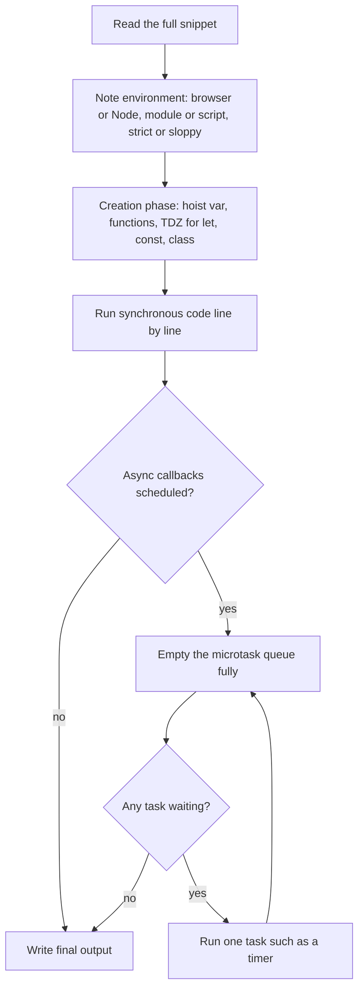
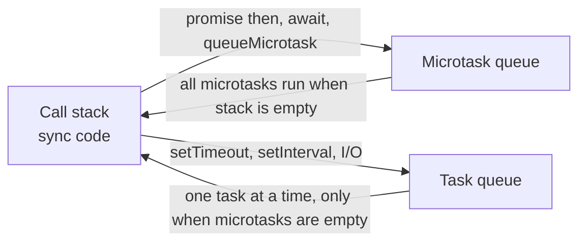
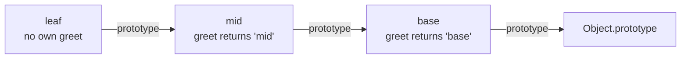
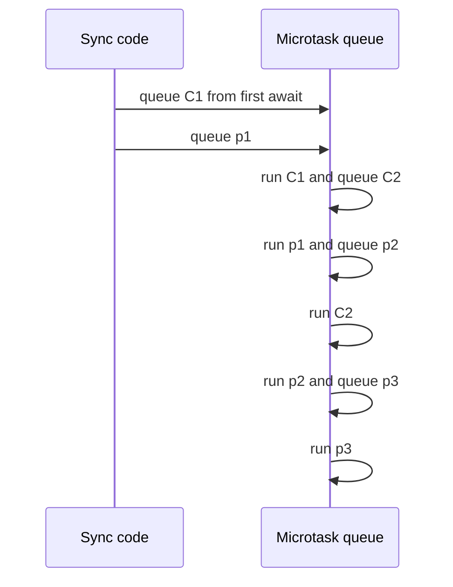
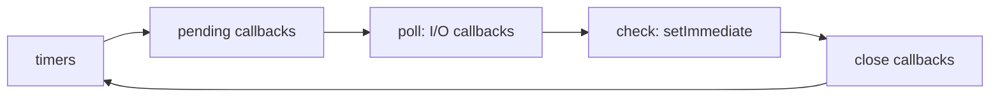

# JavaScript Output Questions

> This document is a large practice set of "what does this print?" questions. They mix many JavaScript topics: hoisting, closures, `this`, prototypes, coercion, references, arrays, the event loop, promises, generators, errors and more. Output questions are common in frontend and full-stack interviews because they show quickly whether you can trace real code in your head.

**Before this:** [Scope, hoisting and TDZ](../02-javascript/03-scope-hoisting-and-tdz.md) · [Closures](../02-javascript/05-closures.md) · [this, call, apply and bind](../02-javascript/06-this-call-apply-bind.md) · [The event loop](../02-javascript/16-event-loop.md) · [Callbacks and promises](../02-javascript/17-callbacks-and-promises.md) · **Interview questions:** [jump to the questions](#interview-questions)

## Table of contents

1. [How to approach output questions in an interview](#how-to-approach-output-questions-in-an-interview)
2. [How to use this document](#how-to-use-this-document)
3. [Interview questions](#interview-questions)
   - [Hoisting and TDZ](#hoisting-and-tdz)
   - [Scope and closures](#scope-and-closures)
   - [The this keyword](#the-this-keyword)
   - [Prototypes and classes](#prototypes-and-classes)
   - [Coercion and equality](#coercion-and-equality)
   - [Objects and references](#objects-and-references)
   - [Arrays](#arrays)
   - [Event loop, promises and async/await](#event-loop-promises-and-asyncawait)
   - [Generators and iterators](#generators-and-iterators)
   - [Error handling and finally](#error-handling-and-finally)
   - [Getters, setters and property descriptors](#getters-setters-and-property-descriptors)
   - [Miscellaneous and combined questions](#miscellaneous-and-combined-questions)
4. [Summary](#summary)
5. [References](#references)

## How to approach output questions in an interview

An **output question** gives you a short piece of code and asks: "What does this print?" The interviewer does not only want the final answer. They want to see *how you think*. A correct answer with no reasoning is weaker than a careful trace that finds a small mistake and fixes it.

### The method

1. **Read the whole snippet first.** Do not start answering after line 1. Look for the "trap" words: `var`, `let`, `this`, `=>`, `new`, `async`, `await`, `setTimeout`, `then`, `finally`, `==`, `sort`, `...`.
2. **Ask about the environment if it matters.** Browser or Node.js? Classic script, ES module or CommonJS? Strict mode? Say it out loud: "I will assume this runs as a CommonJS file in Node.js." Many `this` questions change with the environment.
3. **Do the "creation phase" first.** Before you run any line, list what is hoisted: `var` variables (value `undefined`), function declarations (full function), and `let`/`const`/`class` (in the TDZ, not usable yet).
4. **Trace line by line.** Keep a small table on paper or in your head: variable names and their current values.
5. **For async code, draw three boxes:** the **call stack**, the **microtask queue** (promise callbacks, `await` continuations, `queueMicrotask`) and the **task queue** (timers, I/O). Move each callback into the right box when it is scheduled, not when it runs.
6. **Run the event loop rule:** finish all synchronous code → empty the whole microtask queue → take one task → empty the microtask queue again → repeat.
7. **Say your reasoning aloud.** Short sentences: "Line 3 schedules a timer. That goes to the task queue. Line 4 is a promise `then`. That goes to the microtask queue."
8. **Give the final answer clearly,** in the exact printed format, then mention one thing that would change it (for example, "if this was `let` instead of `var`, it would print 0, 1, 2").



### The event loop picture you should keep in your head



### How to explain an output answer in an interview

1. **Name the concept:** "This question is about the temporal dead zone." or "This is about microtasks versus timers."
2. **State the rule:** "`let` is hoisted but cannot be read before its line runs."
3. **Trace the code:** walk through the important lines in order.
4. **Give the exact output:** say each printed line.
5. **Mention the real-world link:** "This is why an `await` inside `forEach` does not wait."
6. **Mention what would change it:** a different keyword, mode or environment.

### Common mistakes when answering

- Answering too fast and missing one trap word, such as `var` in a loop or a missing `return` inside `.then`.
- Forgetting that a promise executor runs **synchronously**.
- Thinking `await` blocks the whole program. It only pauses the current `async` function.
- Forgetting that `console.log` in Node.js prints strings without quotes, but prints arrays and objects in a special format, such as `[ 1, 2 ]` and `{ a: 1 }`.
- Ignoring the environment. Top-level `this` is different in a browser script, an ES module and a CommonJS file.

## How to use this document

- Every question has a **difficulty** (Easy, Medium or Hard), the **code**, the **exact output**, a **step-by-step explanation** and a **link** to the topic document that teaches the idea in depth.
- Every output was produced by running the code with **Node.js 22**. Code blocks run as **CommonJS** files unless the question says "ES module".
- Outputs are shown in the format Node.js prints. A browser console shows the same values, but sometimes in a different visual style (for example, it may show arrays as `(2) [1, 2]`).
- When the browser gives a different result, the question says so clearly.
- Try to answer each question before you read the output. Cover the answer with your hand if needed.
- The topic documents in [`02-javascript/`](../02-javascript/) already have simpler output questions for one topic at a time. This document focuses on **mixed practice**, where one snippet tests two or three ideas together.

## Interview questions

### Hoisting and TDZ

### Q1. Function declaration vs function expression before the assignment

**Difficulty:** Easy · **Topic:** [Scope, hoisting and TDZ](../02-javascript/03-scope-hoisting-and-tdz.md)

**What the interviewer is checking:** whether you know that only function *declarations* are fully hoisted.

```js
console.log(typeof greet, typeof sayHi);

var sayHi = function () {
  return 'hi';
};
function greet() {
  return 'hello';
}

console.log(typeof greet, typeof sayHi);
```

**Output:**

```text
function undefined
function function
```

**Why:**

1. In the creation phase, `greet` is a function declaration. The whole function is hoisted, so `typeof greet` is `"function"` from the first line.
2. `sayHi` is a `var`. Only the name is hoisted, with the value `undefined`. The function expression is assigned later, when line 3 runs.
3. On the last line both have function values, so both print `function`.

### Q2. A local let shadows the outer variable too early

**Difficulty:** Medium · **Topic:** [Scope, hoisting and TDZ](../02-javascript/03-scope-hoisting-and-tdz.md)

**What the interviewer is checking:** whether you know that the TDZ starts at the top of the *block*, not at the `let` line.

```js
let user = 'Ana';

function show() {
  try {
    console.log(user);
  } catch (error) {
    console.log(error.name);
  }
  let user = 'Ben';
  console.log(user);
}

show();
```

**Output:**

```text
ReferenceError
Ben
```

**Why:**

1. Inside `show`, there is a `let user`. This local `user` exists for the whole function body, from the first line.
2. It is in the **temporal dead zone (TDZ)** until the `let user = 'Ben'` line runs. The TDZ is the time between the start of the scope and the declaration line, when the variable exists but cannot be used.
3. So `console.log(user)` does **not** fall back to the outer `'Ana'`. The local name shadows it, and reading it throws a `ReferenceError`.
4. After the declaration runs, `user` is `'Ben'`.

**Common mistake:** answering `Ana`. Shadowing is decided when the scope is created, not when the line runs.

### Q3. var and a function with the same name

**Difficulty:** Medium · **Topic:** [Scope, hoisting and TDZ](../02-javascript/03-scope-hoisting-and-tdz.md)

**What the interviewer is checking:** what wins when a `var` and a function declaration share a name.

```js
console.log(typeof price);

var price = 10;
function price() {}

console.log(price);
console.log(typeof price);
```

**Output:**

```text
function
10
number
```

**Why:**

1. Creation phase: the function declaration `price` is hoisted with its function value. The `var price` declaration is ignored because the name already exists. A `var` declaration never overwrites a value; only an assignment does.
2. Line 1: `price` is the function, so `typeof` gives `function`.
3. `price = 10` runs. The function declaration line does nothing at run time.
4. Now `price` is `10`, a number.

### Q4. Default parameters and the parameter TDZ

**Difficulty:** Medium · **Topic:** [Scope, hoisting and TDZ](../02-javascript/03-scope-hoisting-and-tdz.md)

**What the interviewer is checking:** whether you know that parameters are initialized left to right, with their own TDZ.

```js
function createUser(name = role, role = 'guest') {
  return `${name} (${role})`;
}

console.log(createUser('Ana'));

try {
  createUser();
} catch (error) {
  console.log(error.name);
}

try {
  createUser(undefined, 'admin');
} catch (error) {
  console.log(error.name);
}
```

**Output:**

```text
Ana (guest)
ReferenceError
ReferenceError
```

**Why:**

1. Parameters behave like `let` declarations created from left to right.
2. `createUser('Ana')`: `name` gets `'Ana'`, so the default `role` expression never runs. `role` gets `'guest'`.
3. `createUser()`: `name` is `undefined`, so its default `role` is evaluated. But `role` is not initialized yet (it comes later), so it is in the TDZ: `ReferenceError`.
4. `createUser(undefined, 'admin')`: passing `undefined` still triggers the default. The value `'admin'` was passed, but `role` is still not initialized when `name` is being set. Same `ReferenceError`.

**Fix:** put the parameter that others depend on first: `function createUser(role = 'guest', name = role)`.

### Q5. The TDZ is about time, not position

**Difficulty:** Medium · **Topic:** [Classes](../02-javascript/09-classes.md)

**What the interviewer is checking:** whether you understand that a function can use a `class` declared below it, as long as the call happens later.

```js
function makeAdmin() {
  return new Admin('root');
}

try {
  makeAdmin();
} catch (error) {
  console.log(`${error.name}: ${error.message}`);
}

class Admin {
  constructor(name) {
    this.name = name;
  }
}

console.log(makeAdmin().name);
```

**Output:**

```text
ReferenceError: Cannot access 'Admin' before initialization
root
```

**Why:**

1. `class` declarations are hoisted like `let`: the name exists, but it is in the TDZ until the `class` line runs.
2. The first call to `makeAdmin()` happens **before** the class line. Inside, `Admin` is still in the TDZ, so it throws.
3. Then the class line runs and `Admin` is initialized.
4. The second call happens **after** that, so it works. The position of `makeAdmin` in the file does not matter. Only the moment of the call matters.

### Q6. Hoisting inside a method, combined with this

**Difficulty:** Medium · **Topic:** [Scope, hoisting and TDZ](../02-javascript/03-scope-hoisting-and-tdz.md)

**What the interviewer is checking:** that you see the local `var` hiding the outer one, and you do not mix up `total` and `this.total`.

```js
var total = 100;

const cart = {
  total: 50,
  getTotal() {
    console.log(total);
    var total = this.total * 2;
    return total;
  },
};

console.log(cart.getTotal());
```

**Output:**

```text
undefined
100
```

**Why:**

1. Inside `getTotal`, `var total` is hoisted to the top of the function with value `undefined`. It hides the outer `total`.
2. The first `console.log(total)` reads the **local** variable: `undefined`.
3. `this` is `cart` (method call), so `this.total` is `50`. The local `total` becomes `100`.
4. The method returns `100`.

### Q7. var and let in the same loop with timers

**Difficulty:** Medium · **Topic:** [Closures](../02-javascript/05-closures.md)

**What the interviewer is checking:** whether you know which variable is shared and which is per iteration.

```js
for (var i = 0; i < 3; i++) {
  let j = i;
  setTimeout(() => console.log(i, j), 0);
}
```

**Output:**

```text
3 0
3 1
3 2
```

**Why:**

1. `var i` is one variable for the whole function (here, the module). All three callbacks share it.
2. `let j` is inside the loop body block. Each iteration creates a **new** `j`, so each callback remembers its own `j`.
3. The timers run after the loop ends. By then `i` is `3`. The `j` values are `0`, `1` and `2`.

### Scope and closures

### Q8. Two counters from one factory

**Difficulty:** Easy · **Topic:** [Closures](../02-javascript/05-closures.md)

**What the interviewer is checking:** that every call of the outer function creates a new, separate closure.

```js
function createCounter() {
  let count = 0;
  return () => ++count;
}

const a = createCounter();
const b = createCounter();

a();
a();
console.log(a(), b(), a());
```

**Output:**

```text
3 1 4
```

**Why:**

1. Each call to `createCounter` creates a new `count` variable. `a` and `b` each remember their own one.
2. `a()` twice → `a`'s count is 2.
3. Arguments are evaluated left to right: `a()` → 3, `b()` → 1 (separate count), `a()` → 4.

### Q9. A closure sees the latest value

**Difficulty:** Medium · **Topic:** [Closures](../02-javascript/05-closures.md)

**What the interviewer is checking:** that a closure keeps a live link to the variable, not a copy of its value.

```js
function setup() {
  let message = 'Loading';
  const log = () => console.log(message);
  message = 'Ready';
  return log;
}

const log = setup();
log();
```

**Output:**

```text
Ready
```

**Why:**

1. `log` is created while `message` is `'Loading'`.
2. But the closure remembers the **variable**, not the value at that moment.
3. `message` changes to `'Ready'` before `log` is called. When `log` runs, it reads the current value: `Ready`.

### Q10. A closure over a variable that is later reassigned

**Difficulty:** Medium · **Topic:** [Closures](../02-javascript/05-closures.md) · [Objects and copying](../02-javascript/07-objects-and-copying.md)

**What the interviewer is checking:** the difference between keeping a reference to an old object and reading the variable again. This is how immutable state stores work.

```js
function createStore() {
  let state = { items: [] };
  return {
    getState: () => state,
    add(item) {
      state = { items: [...state.items, item] };
    },
  };
}

const store = createStore();
const snapshot = store.getState();
store.add('apple');

console.log(snapshot.items.length, store.getState().items.length, snapshot === store.getState());
```

**Output:**

```text
0 1 false
```

**Why:**

1. `snapshot` holds a reference to the **first** state object.
2. `add` does not change that object. It creates a **new** object and points the closure variable `state` to it.
3. `snapshot` still points to the old object with 0 items. `getState()` reads the variable again and returns the new object with 1 item.
4. They are different objects, so `===` is `false`.

**Where this is used:** NgRx and Redux reducers return new state objects. Old references (snapshots) stay unchanged, which makes change detection cheap: a different reference means "something changed".

### Q11. Nested IIFEs and hoisting

**Difficulty:** Medium · **Topic:** [Scope, hoisting and TDZ](../02-javascript/03-scope-hoisting-and-tdz.md)

**What the interviewer is checking:** scope chain lookup together with `var` hoisting.

```js
var name = 'global';

(function () {
  console.log(name);
  var name = 'local';

  (function () {
    console.log(name);
  })();
})();
```

**Output:**

```text
undefined
local
```

**Why:**

1. An **IIFE** (immediately invoked function expression) is a function that runs right after it is created. It has its own scope.
2. Inside the outer IIFE, `var name` is hoisted. The first log reads the local `name`, which is still `undefined`.
3. The inner IIFE has no `name` of its own. It looks one step up the scope chain and finds the outer IIFE's `name`, now `'local'`.

### Q12. A memoize helper with object arguments

**Difficulty:** Hard · **Topic:** [Closures](../02-javascript/05-closures.md) · [Type coercion](../02-javascript/02-type-coercion-and-equality.md)

**What the interviewer is checking:** whether you notice that plain object keys are always strings. This is a real bug in hand-written caches.

```js
function memoize(fn) {
  const cache = {};
  return (arg) => {
    if (arg in cache) return cache[arg];
    return (cache[arg] = fn(arg));
  };
}

let calls = 0;
const getUserName = memoize((user) => {
  calls++;
  return user.name;
});

console.log(getUserName({ name: 'Ana' }));
console.log(getUserName({ name: 'Ben' }));
console.log(calls);
```

**Output:**

```text
Ana
Ana
1
```

**Why:**

1. The cache is a plain object. When you use an object as a key, JavaScript converts it to a string: `"[object Object]"`.
2. First call: the key `"[object Object]"` is not in the cache. `fn` runs, `calls` becomes 1, and `'Ana'` is stored.
3. Second call: the Ben object also becomes `"[object Object]"`. The key exists, so the cached `'Ana'` is returned. `fn` never runs.
4. `calls` is `1`.

**Fix:** use a `Map` (objects are kept as real keys) or a `WeakMap` (keys do not block garbage collection). See [Map, Set, WeakMap and WeakSet](../02-javascript/12-map-set-weakmap-weakset.md).

### Q13. Changing a let loop variable inside the body

**Difficulty:** Hard · **Topic:** [Closures](../02-javascript/05-closures.md)

**What the interviewer is checking:** a deep understanding of how `for (let ...)` creates a new binding for each iteration and copies the value forward.

```js
const fns = [];

for (let i = 0; i < 3; i++) {
  fns.push(() => i);
  i++;
}

console.log(fns.map((f) => f()));
```

**Output:**

```text
[ 1, 3 ]
```

**Why:**

1. With `let`, each iteration gets its own copy of `i`. At the start of the next iteration, the engine creates a new `i` with the last value, then runs `i++`.
2. Iteration 1: `i` is 0. The closure is pushed. Then `i++` makes **this iteration's** `i` equal to 1. The closure sees 1.
3. The loop copies 1 into a new `i`, then the update `i++` makes it 2. `2 < 3`, so the loop continues.
4. Iteration 2: the closure is pushed. `i++` makes this `i` equal to 3. The closure sees 3.
5. New `i` is 3, update makes it 4, `4 < 3` is false. The loop stops.
6. Only two closures exist. They return 1 and 3.

### Q14. A closure over a parameter that points to an object

**Difficulty:** Medium · **Topic:** [Closures](../02-javascript/05-closures.md) · [Objects and copying](../02-javascript/07-objects-and-copying.md)

**What the interviewer is checking:** mutation versus reassignment when a closure captures a parameter.

```js
let settings = { theme: 'light' };

function makeLogger(config) {
  return () => console.log(config.theme);
}

const logger = makeLogger(settings);

settings.theme = 'dark';
logger();

settings = { theme: 'blue' };
logger();
```

**Output:**

```text
dark
dark
```

**Why:**

1. The closure captures the **parameter** `config`, which points to the first settings object.
2. `settings.theme = 'dark'` changes that same object. The logger sees `dark`.
3. `settings = { ... }` points the **outer variable** to a new object. `config` still points to the old one, so the logger still prints `dark`.

### Q15. A once() helper

**Difficulty:** Medium · **Topic:** [Closures](../02-javascript/05-closures.md)

**What the interviewer is checking:** closure state that survives between calls, and keeping `this` and arguments.

```js
function once(fn) {
  let done = false;
  let result;
  return function (...args) {
    if (!done) {
      done = true;
      result = fn.apply(this, args);
    }
    return result;
  };
}

const init = once((x) => {
  console.log('init', x);
  return x * 2;
});

console.log(init(5));
console.log(init(10));
```

**Output:**

```text
init 5
10
10
```

**Why:**

1. `done` and `result` live in the closure created by `once`.
2. First call: `done` is false. `fn` runs with 5, logs `init 5`, and `result` becomes 10.
3. Second call: `done` is true, so `fn` does not run. The saved result `10` is returned. The argument 10 is ignored.

**Where this is used:** initializing a SDK, a database connection or an analytics script only once.

### The this keyword

### Q16. A method copied into a variable

**Difficulty:** Easy · **Topic:** [this, call, apply and bind](../02-javascript/06-this-call-apply-bind.md)

**What the interviewer is checking:** that `this` depends on *how* a function is called, not where it is defined.

```js
const user = {
  name: 'Ana',
  greet() {
    return 'Hi ' + (this && this.name);
  },
};

const greet = user.greet;

console.log(user.greet());
console.log(greet());
```

**Output (Node.js):**

```text
Hi Ana
Hi undefined
```

**Why:**

1. `user.greet()` is a method call. `this` is `user`, so it prints `Hi Ana`.
2. `greet()` is a plain call. In sloppy mode, `this` is `globalThis`. In strict mode, `this` is `undefined`. In Node.js both give `undefined` here, because `globalThis.name` does not exist.
3. **Browser difference:** in a classic browser script (sloppy mode), `this` is `window`, and `window.name` is a real property whose default is the empty string. So the browser prints `Hi ` (with nothing after it). In a browser ES module (strict mode), it prints `Hi undefined`.

### Q17. Arrow function as an object property

**Difficulty:** Medium · **Topic:** [this, call, apply and bind](../02-javascript/06-this-call-apply-bind.md)

**What the interviewer is checking:** that an object literal does not create a `this` scope, so an arrow function takes `this` from the surrounding code.

```js
const counter = {
  count: 10,
  regular() {
    return this.count;
  },
  arrow: () => this.count,
};

console.log(counter.regular(), counter.arrow());
```

**Output (CommonJS file in Node.js):**

```text
10 undefined
```

**Why:**

1. `regular` is a normal method. `this` is `counter`, so it returns 10.
2. `arrow` is an arrow function. Arrows have no own `this`. They use `this` from the place where they were **written**. The object literal `{ ... }` is not a function, so it does not create a `this`.
3. The surrounding code is the top level of a CommonJS module. There, `this` is `module.exports`, an empty object. `{}.count` is `undefined`.
4. **Other environments:** in an ES module, top-level `this` is `undefined`, so `counter.arrow()` throws a `TypeError`. In a classic browser script, `this` is `window`, so it prints `undefined` (unless a global `count` exists).

### Q18. Callbacks inside a method: function vs arrow vs thisArg

**Difficulty:** Medium · **Topic:** [this, call, apply and bind](../02-javascript/06-this-call-apply-bind.md)

**What the interviewer is checking:** three common ways `this` behaves in array callbacks.

```js
'use strict';

const team = {
  name: 'Core',
  members: ['Ana', 'Ben'],
  withFunction() {
    return this.members.map(function (m) {
      return m + '@' + (this ? this.name : 'none');
    });
  },
  withArrow() {
    return this.members.map((m) => m + '@' + this.name);
  },
  withThisArg() {
    return this.members.map(function (m) {
      return m + '@' + this.name;
    }, this);
  },
};

console.log(team.withFunction());
console.log(team.withArrow());
console.log(team.withThisArg());
```

**Output:**

```text
[ 'Ana@none', 'Ben@none' ]
[ 'Ana@Core', 'Ben@Core' ]
[ 'Ana@Core', 'Ben@Core' ]
```

**Why:**

1. `withFunction`: `map` calls the normal callback as a plain function. In strict mode, `this` is `undefined`, so it prints `none`.
2. `withArrow`: the arrow takes `this` from `withArrow`, which is `team`.
3. `withThisArg`: `map` accepts a second argument, `thisArg`. `map` calls the callback with that value as `this`.

### Q19. setTimeout inside a method

**Difficulty:** Medium · **Topic:** [this, call, apply and bind](../02-javascript/06-this-call-apply-bind.md) · [The event loop](../02-javascript/16-event-loop.md)

**What the interviewer is checking:** who calls the timer callback, and what `this` is in that call.

```js
const timer = {
  seconds: 3,
  start() {
    setTimeout(function () {
      console.log('function:', this === timer);
    }, 0);
    setTimeout(() => console.log('arrow:', this.seconds), 0);
  },
};

timer.start();
```

**Output:**

```text
function: false
arrow: 3
```

**Why:**

1. The normal function is called later by the timer system, not by `timer`. So `this` is not `timer`.
   - In Node.js, `this` inside a timer callback is the `Timeout` object.
   - In a browser, it is `window`.
   - In both cases, `this === timer` is `false`.
2. The arrow function has no own `this`. It uses `this` from `start`, which is `timer`. So it prints 3.

### Q20. bind twice, and new with a bound function

**Difficulty:** Hard · **Topic:** [this, call, apply and bind](../02-javascript/06-this-call-apply-bind.md)

**What the interviewer is checking:** the precedence of `this` rules: `new` beats `bind`, and the first `bind` wins.

```js
function getName() {
  return this.name;
}
function Person(name) {
  this.name = name;
}

const a = getName.bind({ name: 'Ana' });
const b = a.bind({ name: 'Ben' });
console.log(b());

const BoundPerson = Person.bind({ name: 'ignored' });
const p = new BoundPerson('Cara');
console.log(p.name, p instanceof Person);
```

**Output:**

```text
Ana
Cara true
```

**Why:**

1. `bind` returns a new function with `this` fixed forever. Binding the bound function again cannot change `this`. The first bind (`Ana`) wins.
2. `new` is stronger than `bind`. With `new BoundPerson(...)`, the engine creates a fresh object and uses it as `this`. The bound object is ignored.
3. The new object is linked to `Person.prototype`, so `instanceof Person` is `true`.

### Q21. call on an arrow function

**Difficulty:** Medium · **Topic:** [this, call, apply and bind](../02-javascript/06-this-call-apply-bind.md)

**What the interviewer is checking:** that `call`, `apply` and `bind` cannot change an arrow function's `this`.

```js
'use strict';

function outer() {
  const inner = () => this.label;
  return inner.call({ label: 'from call' });
}

console.log(outer.call({ label: 'from outer' }));
```

**Output:**

```text
from outer
```

**Why:**

1. `outer.call(...)` sets `this` inside `outer` to `{ label: 'from outer' }`.
2. `inner` is an arrow. Its `this` is always the `this` of `outer`.
3. `inner.call({ label: 'from call' })` passes a `this` value, but arrows ignore it. The result is `from outer`.

### Q22. Class field arrow vs prototype method after destructuring

**Difficulty:** Hard · **Topic:** [Classes](../02-javascript/09-classes.md) · [this, call, apply and bind](../02-javascript/06-this-call-apply-bind.md)

**What the interviewer is checking:** that class bodies are strict, that arrow class fields are per-instance properties, and why they survive being passed around.

```js
class SaveButton {
  label = 'Save';
  handleArrow = () => this.label;
  handleMethod() {
    return this?.label ?? 'lost this';
  }
}

const button = new SaveButton();
const { handleArrow, handleMethod } = button;

console.log(handleArrow());
console.log(handleMethod());
console.log(Object.keys(button));
```

**Output:**

```text
Save
lost this
[ 'label', 'handleArrow' ]
```

**Why:**

1. `handleArrow` is a **class field**. It is created inside the constructor for each instance, so its `this` is fixed to that instance. Calling it alone still works.
2. `handleMethod` lives on `SaveButton.prototype`. Destructuring takes the function out. Calling it alone gives `this = undefined`, because class bodies always run in strict mode. `this?.label` is `undefined`, so `??` gives `'lost this'`.
3. `Object.keys` shows only own, enumerable properties: the two fields. The method is on the prototype, so it is not listed.

**Trade-off:** arrow fields are safe as callbacks (for example, event handlers), but each instance gets its own function copy, and subclasses cannot call them with `super`.

### Q23. Grouping, the comma operator and arrays

**Difficulty:** Hard · **Topic:** [this, call, apply and bind](../02-javascript/06-this-call-apply-bind.md)

**What the interviewer is checking:** that `this` comes from the **shape of the call expression**.

```js
'use strict';

const shop = {
  name: 'Shop',
  who() {
    return this ? this.name : 'undefined this';
  },
};

console.log(shop.who());
console.log((shop.who)());
console.log((0, shop.who)());

const handlers = [shop.who];
console.log(handlers[0]());
```

**Output:**

```text
Shop
Shop
undefined this
undefined
```

**Why:**

1. `shop.who()` is a normal method call: `this` is `shop`.
2. `(shop.who)()`: the parentheses only group. The expression is still a property reference, so `this` is still `shop`.
3. `(0, shop.who)()`: the comma operator evaluates both sides and returns the **value** of the last one — just the function, without the object. It is a plain call, so `this` is `undefined` in strict mode.
4. `handlers[0]()` is a method call on the **array**. `this` is the `handlers` array. Arrays have no `name` property, so it returns `undefined`.

**Where this is used:** bundlers emit `(0, module.fn)()` on purpose, to call an imported function without a `this`.

### Prototypes and classes

### Q24. Own property vs prototype property

**Difficulty:** Easy · **Topic:** [Prototypes and inheritance](../02-javascript/08-prototypes-and-inheritance.md)

**What the interviewer is checking:** how property lookup walks the prototype chain, and how assignment creates own properties.

```js
function Car(model) {
  this.model = model;
}
Car.prototype.wheels = 4;

const a = new Car('A');
const b = new Car('B');

a.wheels = 3;
Car.prototype.wheels = 6;

console.log(a.wheels, b.wheels, a.hasOwnProperty('wheels'), b.hasOwnProperty('wheels'));
```

**Output:**

```text
3 6 true false
```

**Why:**

1. `a.wheels = 3` creates an **own** property on `a`. It does not change the prototype.
2. Changing `Car.prototype.wheels` to 6 affects every object that does not have its own `wheels`.
3. `a` finds its own `3` first. `b` has no own `wheels`, so lookup goes to the prototype and finds `6`.

### Q25. A shared array on the prototype

**Difficulty:** Medium · **Topic:** [Prototypes and inheritance](../02-javascript/08-prototypes-and-inheritance.md)

**What the interviewer is checking:** the difference between *mutating* an inherited object and *assigning* a new one.

```js
function Cart() {}
Cart.prototype.items = [];

const c1 = new Cart();
const c2 = new Cart();

c1.items.push('apple');
c2.items = ['pear'];

console.log(c1.items, c2.items, new Cart().items);
```

**Output:**

```text
[ 'apple' ] [ 'pear' ] [ 'apple' ]
```

**Why:**

1. `c1.items.push(...)` first **reads** `c1.items`. `c1` has no own `items`, so it finds the shared array on the prototype and pushes into it.
2. `c2.items = [...]` is an **assignment**. It creates an own property on `c2`. The shared array is not touched.
3. A brand new cart has no own `items`, so it sees the shared array, which now contains `'apple'`.

**Lesson:** never put mutable data (arrays, objects) on a prototype. Create it in the constructor.

### Q26. Replacing the prototype after creating objects

**Difficulty:** Medium · **Topic:** [Prototypes and inheritance](../02-javascript/08-prototypes-and-inheritance.md)

**What the interviewer is checking:** that objects keep a link to the prototype object that existed when they were created, and how `instanceof` really works.

```js
function User() {}
const before = new User();

User.prototype = { role: 'admin' };
const after = new User();

console.log(before.role, after.role);
console.log(before instanceof User, after instanceof User);
console.log(after.constructor === User, after.constructor === Object);
```

**Output:**

```text
undefined admin
false true
false true
```

**Why:**

1. `before` was linked to the **old** prototype object. Replacing `User.prototype` later does not change that link. So `before.role` is `undefined`.
2. `after` is linked to the new object, which has `role: 'admin'`.
3. `instanceof` checks: "is `User.prototype` (the current one) somewhere in the object's prototype chain?" For `before`, the old prototype is in its chain, not the new one, so `false`.
4. The new prototype object is a plain object literal. It has no own `constructor` property, so `after.constructor` is found further up: `Object.prototype.constructor`, which is `Object`.

### Q27. A parent constructor calls an overridden method

**Difficulty:** Hard · **Topic:** [Classes](../02-javascript/09-classes.md)

**What the interviewer is checking:** the order of construction in a subclass: parent constructor first, child class fields after `super()` returns.

```js
class Animal {
  constructor(name) {
    this.name = name;
    this.describe();
  }
  describe() {
    console.log('Animal', this.name);
  }
}

class Dog extends Animal {
  sound = 'woof';
  describe() {
    console.log('Dog', this.name, this.sound);
  }
}

const dog = new Dog('Rex');
dog.describe();
```

**Output:**

```text
Dog Rex undefined
Dog Rex woof
```

**Why:**

1. `new Dog('Rex')` runs the default derived constructor, which calls `super('Rex')`.
2. Inside `Animal`'s constructor, `this` is the new Dog object. `this.describe()` finds `Dog.prototype.describe` (the override).
3. At this moment, `Dog`'s class field `sound` is **not set yet**. Fields of a derived class are added right after `super()` returns. So it prints `undefined`.
4. After construction, `sound` is `'woof'`, and the second call prints it.

**Lesson:** avoid calling overridable methods from a constructor. The same issue exists in Java and C#.

### Q28. Static properties and inheritance

**Difficulty:** Medium · **Topic:** [Classes](../02-javascript/09-classes.md)

**What the interviewer is checking:** that subclasses inherit static members through the prototype chain of the constructor functions, and that `this` in a static method is the class it was called on.

```js
class Counter {
  static count = 0;
  static increment() {
    return ++this.count;
  }
}
class SubCounter extends Counter {}

Counter.increment();
SubCounter.increment();
SubCounter.increment();

console.log(Counter.count, SubCounter.count, Object.hasOwn(SubCounter, 'count'));
```

**Output:**

```text
1 3 true
```

**Why:**

1. `Object.getPrototypeOf(SubCounter)` is `Counter`. So `SubCounter.count` is found on `Counter` when `SubCounter` has no own `count`.
2. `Counter.increment()`: `this` is `Counter`. `Counter.count` becomes 1.
3. `SubCounter.increment()`: `this` is `SubCounter`. `++this.count` **reads** 1 (inherited) and **writes** 2 as an **own** property of `SubCounter`.
4. The next call reads SubCounter's own 2 and writes 3. `Counter.count` stays 1.

### Q29. A constructor that returns something

**Difficulty:** Hard · **Topic:** [Prototypes and inheritance](../02-javascript/08-prototypes-and-inheritance.md)

**What the interviewer is checking:** the exact rules of `new` about return values.

```js
function Account(owner) {
  this.owner = owner;
  return { owner: 'replaced' };
}

function Wallet(owner) {
  this.owner = owner;
  return 42;
}

const account = new Account('Ana');
const wallet = new Wallet('Ben');

console.log(account.owner, account instanceof Account);
console.log(wallet.owner, wallet instanceof Wallet);
```

**Output:**

```text
replaced false
Ben true
```

**Why:**

1. `new` creates an object, links it to the prototype, and runs the function with that object as `this`.
2. If the function returns an **object**, `new` gives you that object instead. The created object is thrown away. The returned literal is not linked to `Account.prototype`, so `instanceof` is `false`.
3. If the function returns a **primitive** (like `42`), it is ignored. You get the created object.

### Q30. Private fields, getters and JSON

**Difficulty:** Medium · **Topic:** [Classes](../02-javascript/09-classes.md)

**What the interviewer is checking:** what private fields and prototype getters do (and do not) show in keys and JSON.

```js
class Token {
  #value;
  constructor(value) {
    this.#value = value;
  }
  static isToken(obj) {
    return #value in obj;
  }
  get masked() {
    return '***' + this.#value.slice(-2);
  }
}

const token = new Token('abc123');

console.log(token.masked, Token.isToken(token), Token.isToken({}));
console.log(Object.keys(token), JSON.stringify(token));
```

**Output:**

```text
***23 true false
[] {}
```

**Why:**

1. `masked` is a getter on `Token.prototype`. Reading it runs the function, which can read `#value` because it is inside the class.
2. `#value in obj` (ES2022) checks if an object has this private field. It is a safe "brand check".
3. Private fields are not properties. They never appear in `Object.keys` or `JSON.stringify`.
4. The getter is on the prototype, not on the instance, so it is also not in the keys or the JSON. The result is `{}`.

### Q31. Deleting along a prototype chain

**Difficulty:** Hard · **Topic:** [Prototypes and inheritance](../02-javascript/08-prototypes-and-inheritance.md)

**What the interviewer is checking:** that `delete` only removes own properties, and lookup moves up the chain.

```js
const base = { greet() { return 'base'; } };
const mid = Object.create(base);
mid.greet = function () { return 'mid'; };
const leaf = Object.create(mid);

console.log(leaf.greet());
delete leaf.greet;
console.log(leaf.greet());
delete mid.greet;
console.log(leaf.greet());
console.log('greet' in leaf, Object.hasOwn(leaf, 'greet'));
```

**Output:**

```text
mid
mid
base
true false
```

**Why:**



1. `leaf` has no own `greet`. Lookup finds `mid.greet` first: `mid`.
2. `delete leaf.greet` deletes an own property of `leaf`. There is none, so nothing changes (it still returns `true`). Still `mid`.
3. `delete mid.greet` removes it from `mid`. Now lookup reaches `base`: `base`.
4. The `in` operator checks the whole chain: `true`. `Object.hasOwn` checks only own properties: `false`.

### Coercion and equality

### Q32. Arithmetic with mixed types

**Difficulty:** Easy · **Topic:** [Type coercion and equality](../02-javascript/02-type-coercion-and-equality.md)

**What the interviewer is checking:** that `+` prefers strings, while other math operators convert to numbers.

```js
console.log('5' - 2, '5' + 2, 5 + +'2', '5' * '2', true + 1, null + 1, undefined + 1);
```

**Output:**

```text
3 52 7 10 2 1 NaN
```

**Why:**

1. `'5' - 2`: `-` only works on numbers. `'5'` becomes 5 → `3`.
2. `'5' + 2`: if one side of `+` is a string, `+` joins strings → `'52'` (Node prints strings without quotes).
3. `5 + +'2'`: unary `+` converts `'2'` to 2 first → `7`.
4. `'5' * '2'` → `10`.
5. `true` → 1, so `2`. `null` → 0, so `1`. `undefined` → `NaN`, so `NaN`.

### Q33. Adding arrays and objects

**Difficulty:** Medium · **Topic:** [Type coercion and equality](../02-javascript/02-type-coercion-and-equality.md)

**What the interviewer is checking:** how objects become primitives with `+`. We use `JSON.stringify` to show empty strings clearly.

```js
console.log(JSON.stringify([
  [] + [],
  [] + {},
  [1, 2] + [3],
  [null] + '',
  [undefined, null] + '',
  ({}) + 1,
]));
```

**Output:**

```text
["","[object Object]","1,23","",",","[object Object]1"]
```

**Why:**

1. Objects are converted to primitives first. For arrays and plain objects, `valueOf()` returns the object itself (not a primitive), so `toString()` is used.
2. An array's `toString()` is like `join(',')`. `[]` → `''`. `[1, 2]` → `'1,2'`. `[3]` → `'3'`.
3. `join` turns `null` and `undefined` elements into empty strings. So `[null]` → `''` and `[undefined, null]` → `','`.
4. A plain object becomes `'[object Object]'`.
5. Once one side is a string, `+` joins strings.

### Q34. A table of loose equality

**Difficulty:** Medium · **Topic:** [Type coercion and equality](../02-javascript/02-type-coercion-and-equality.md)

**What the interviewer is checking:** the special rules of `==` for `null`, `NaN` and objects.

```js
console.log(null == 0, null >= 0, undefined == null, NaN == NaN);
console.log([0] == false, '' == 0, '0' == false, [] == '');
```

**Output:**

```text
false true true false
true true true true
```

**Why:**

1. `null == 0` is `false`. With `==`, `null` is only equal to `null` and `undefined`. No number conversion happens.
2. `null >= 0` is `true`. Relational operators (`<`, `>=`) **do** convert `null` to 0, and `0 >= 0`.
3. `NaN` is not equal to anything, even itself.
4. `[0] == false`: the boolean becomes 0. The array becomes `'0'`, then 0. `0 == 0`.
5. `'' == 0`: `''` becomes 0. `'0' == false`: both become 0. `[] == ''`: `[]` becomes `''`.

### Q35. Truthy objects that are loosely equal to false

**Difficulty:** Hard · **Topic:** [Type coercion and equality](../02-javascript/02-type-coercion-and-equality.md)

**What the interviewer is checking:** that "truthy" (used by `if`) and "`== false`" are two different rules.

```js
const items = [];
if (items) console.log('truthy');
if (items == false) console.log('loosely equal to false');
if (!items.length) console.log('empty');

const zero = new Number(0);
if (zero) console.log('wrapper object is truthy');
console.log(zero == 0, zero === 0);
```

**Output:**

```text
truthy
loosely equal to false
empty
wrapper object is truthy
true false
```

**Why:**

1. `if (items)` uses **truthiness**. Every object, even an empty array, is truthy.
2. `items == false` uses **loose equality**: `false` → 0, `[]` → `''` → 0. So it is `true`.
3. `!items.length` is `!0` → `true`. This is the correct way to check for an empty array.
4. `new Number(0)` is an **object**, so it is truthy, even though it wraps 0.
5. `zero == 0` unwraps the object to 0 → `true`. `zero === 0` compares an object with a number → `false`.

### Q36. String comparison vs number comparison

**Difficulty:** Medium · **Topic:** [Type coercion and equality](../02-javascript/02-type-coercion-and-equality.md)

**What the interviewer is checking:** that comparing two strings is done character by character, by UTF-16 code units.

```js
console.log('10' > '9', 10 > '9', 'apple' < 'banana', 'Zebra' < 'apple', null > -1, undefined > -1);
```

**Output:**

```text
false true true true true false
```

**Why:**

1. `'10' > '9'`: both are strings, so they are compared character by character. `'1'` (code 49) is less than `'9'` (code 57). So `false`.
2. `10 > '9'`: one side is a number, so `'9'` becomes 9. `true`.
3. `'Zebra' < 'apple'`: uppercase letters have smaller codes than lowercase letters (`'Z'` is 90, `'a'` is 97). So `true`.
4. `null > -1`: `null` → 0. `true`. `undefined > -1`: `undefined` → `NaN`, and any comparison with `NaN` is `false`.

**Real bug:** sorting version numbers or prices that are stored as strings. Convert them to numbers, or use `localeCompare` with `{ numeric: true }`.

### Q37. valueOf and toString in different contexts

**Difficulty:** Hard · **Topic:** [Type coercion and equality](../02-javascript/02-type-coercion-and-equality.md)

**What the interviewer is checking:** the conversion "hint". Some operations prefer a number, some prefer a string, and `+` uses the "default" hint.

```js
const price = {
  valueOf() {
    return 100;
  },
  toString() {
    return '$100';
  },
};

console.log(price + 1, `${price}`, price * 2, String(price), price + '', [price] + '');
```

**Output:**

```text
101 $100 200 $100 100 $100
```

**Why:**

1. `price + 1`: `+` uses the **default** hint. For plain objects, default works like number: `valueOf()` is tried first → 100. Result 101.
2. Template literal and `String(price)` use the **string** hint: `toString()` first → `'$100'`.
3. `price * 2`: number hint → 200.
4. `price + ''`: still the default hint, so `valueOf()` → 100, then `100 + ''` → `'100'`.
5. `[price] + ''`: the array becomes a string with `join`, which calls `toString()` on each element → `'$100'`.

### Q38. typeof surprises

**Difficulty:** Easy · **Topic:** [Basics: variables, types and operators](../02-javascript/01-basics-variables-types-operators.md)

**What the interviewer is checking:** the known oddities of `typeof`.

```js
console.log(typeof null, typeof [], typeof NaN, typeof function () {}, typeof class {});
console.log(typeof Symbol(), typeof 10n, typeof undefined, typeof undeclaredVariable);
```

**Output:**

```text
object object number function function
symbol bigint undefined undefined
```

**Why:**

1. `typeof null` is `'object'`. This is an old bug from the first version of JavaScript. It was never fixed because it would break websites. Use `value === null` to check for null.
2. Arrays are objects. Use `Array.isArray` to check for arrays.
3. `NaN` is a special **number** value.
4. A class is a special function, so `typeof` gives `'function'`.
5. `typeof` on a variable that was never declared does not throw. It returns `'undefined'`. (It **does** throw for a `let` variable in its TDZ — see [Q2](#q2-a-local-let-shadows-the-outer-variable-too-early).)

### Q39. NaN, zero and negative zero in search methods

**Difficulty:** Hard · **Topic:** [Type coercion and equality](../02-javascript/02-type-coercion-and-equality.md) · [Map, Set, WeakMap and WeakSet](../02-javascript/12-map-set-weakmap-weakset.md)

**What the interviewer is checking:** the three equality algorithms: strict equality (`===`), SameValueZero and SameValue (`Object.is`).

```js
const values = [NaN, 0, -0];

console.log(values.indexOf(NaN), values.includes(NaN), values.indexOf(-0));
console.log(Object.is(0, -0), 0 === -0, Object.is(NaN, NaN), new Set(values).size);
```

**Output:**

```text
-1 true 1
false true true 2
```

**Why:**

1. `indexOf` uses `===`. `NaN === NaN` is false, so it returns -1. And `-0 === 0` is true, so `indexOf(-0)` finds `0` at index 1.
2. `includes` uses **SameValueZero**: like `===`, but `NaN` equals `NaN`. So `true`.
3. `Object.is` uses **SameValue**: `NaN` equals `NaN`, and `0` and `-0` are different.
4. `Set` uses SameValueZero: `NaN` is one value, and `0` and `-0` are the same value. So the set has 2 items.

### Objects and references

### Q40. Reference copy vs spread copy

**Difficulty:** Easy · **Topic:** [Objects and copying](../02-javascript/07-objects-and-copying.md)

**What the interviewer is checking:** that assigning an object copies the reference, and spread creates a new object.

```js
const a = { score: 1 };
const b = a;
b.score = 2;

const c = { ...a };
c.score = 3;

console.log(a.score, b.score, c.score, a === b, a === c);
```

**Output:**

```text
2 2 3 true false
```

**Why:**

1. `b = a` copies the **reference**. `a` and `b` point to the same object. Changing `b.score` changes what `a` sees.
2. `{ ...a }` creates a **new** object and copies the properties into it (score is 2 at that moment). Changing `c` does not touch `a`.
3. `a === b` compares references: same object → `true`. `a === c`: different objects → `false`.

### Q41. Shallow copy with nested data

**Difficulty:** Medium · **Topic:** [Objects and copying](../02-javascript/07-objects-and-copying.md)

**What the interviewer is checking:** that spread is a **shallow** copy: nested objects are still shared.

```js
const user = { name: 'Ana', address: { city: 'Pune' }, tags: ['dev'] };
const copy = { ...user };

copy.name = 'Ben';
copy.address.city = 'Delhi';
copy.tags = [...copy.tags, 'lead'];

console.log(user.name, user.address.city, user.tags, copy.tags);
```

**Output:**

```text
Ana Delhi [ 'dev' ] [ 'dev', 'lead' ]
```

**Why:**

1. `copy.name = 'Ben'` changes a top-level string property of the copy only.
2. `copy.address` is the **same** object as `user.address` (shallow copy). Changing `city` changes it for both.
3. `copy.tags = [...]` **replaces** the array in the copy with a new array. `user.tags` still points to the old array.

**Where this matters:** in Angular with `OnPush` or in NgRx, changing a nested property without creating new objects means the UI may not update. Update every level you change: `{ ...user, address: { ...user.address, city: 'Delhi' } }`.

### Q42. Mutating vs reassigning a parameter

**Difficulty:** Medium · **Topic:** [Functions and functional programming](../02-javascript/04-functions-and-functional-programming.md)

**What the interviewer is checking:** that JavaScript passes the reference **by value** ("call by sharing").

```js
function update(order) {
  order.status = 'paid';
  order = { status: 'cancelled' };
  order.total = 0;
}

const order = { status: 'new', total: 50 };
update(order);
console.log(order);
```

**Output:**

```text
{ status: 'paid', total: 50 }
```

**Why:**

1. The parameter `order` gets a copy of the reference. It points to the same object as the outer `order`.
2. `order.status = 'paid'` changes the shared object. The caller sees this.
3. `order = { ... }` points the **parameter** to a new object. The outer variable is not affected.
4. `order.total = 0` changes only the new local object.

### Q43. The order of object keys

**Difficulty:** Medium · **Topic:** [Objects and copying](../02-javascript/07-objects-and-copying.md)

**What the interviewer is checking:** the rule for own property order.

```js
const obj = { b: 1, 2: 'two', a: 2, 1: 'one', '-1': 'minus', 10: 'ten' };
console.log(Object.keys(obj));
```

**Output:**

```text
[ '1', '2', '10', 'b', 'a', '-1' ]
```

**Why:**

1. Keys that are valid **array indexes** (non-negative integers as strings) come first, in ascending numeric order: `'1'`, `'2'`, `'10'`.
2. Then other string keys, in the order they were added: `'b'`, `'a'`, `'-1'`. `'-1'` is not an array index, so it is a normal string key.
3. All keys are strings. (Symbol keys come last, but `Object.keys` skips them.)

**Real bug:** an object keyed by numeric IDs (`{ 30: ..., 4: ... }`) loses its insertion order. Use a `Map` or an array if order matters.

### Q44. Objects as keys in an object vs a Map

**Difficulty:** Hard · **Topic:** [Map, Set, WeakMap and WeakSet](../02-javascript/12-map-set-weakmap-weakset.md)

**What the interviewer is checking:** property keys become strings; `Map` keys keep their identity.

```js
const lookup = {};
const keyA = { id: 1 };
const keyB = { id: 2 };

lookup[keyA] = 'first';
lookup[keyB] = 'second';
console.log(lookup[keyA], Object.keys(lookup));

const map = new Map([[keyA, 'first'], [keyB, 'second']]);
console.log(map.get(keyA), map.size);
```

**Output:**

```text
second [ '[object Object]' ]
first 2
```

**Why:**

1. Both objects are converted to the same string key `'[object Object]'`. The second assignment overwrites the first.
2. Reading `lookup[keyA]` also converts to `'[object Object]'`, so you get `'second'`.
3. A `Map` compares keys by identity (SameValueZero). `keyA` and `keyB` are two different keys.

### Q45. What JSON.stringify drops

**Difficulty:** Medium · **Topic:** [Objects and copying](../02-javascript/07-objects-and-copying.md)

**What the interviewer is checking:** the JSON rules for `undefined`, functions, symbols, `NaN` and `Date`.

```js
const data = {
  id: 1,
  name: undefined,
  save() {},
  createdAt: new Date(0),
  tags: [undefined, () => 1, NaN, Infinity],
  [Symbol('secret')]: 'hidden',
};

console.log(JSON.stringify(data));
```

**Output:**

```text
{"id":1,"createdAt":"1970-01-01T00:00:00.000Z","tags":[null,null,null,null]}
```

**Why:**

1. In an **object**, properties with `undefined`, function or symbol values are skipped. Symbol keys are always skipped.
2. In an **array**, those values cannot be skipped (it would change the indexes), so they become `null`.
3. `NaN` and `Infinity` are not valid JSON numbers. They become `null`.
4. `Date` has a `toJSON()` method that returns an ISO string.

**Real bug:** `JSON.parse(JSON.stringify(x))` as a "deep clone" silently loses data and turns dates into strings. See [Q47](#q47-json-clone-vs-structuredclone).

### Q46. Object.freeze is shallow

**Difficulty:** Hard · **Topic:** [Objects and copying](../02-javascript/07-objects-and-copying.md)

**What the interviewer is checking:** that freeze only protects the top level, and that strict mode makes failed writes throw.

```js
'use strict';

const config = Object.freeze({ api: '/v1', flags: { beta: false } });

config.flags.beta = true;

try {
  config.api = '/v2';
} catch (error) {
  console.log(error.constructor.name);
}

console.log(config.api, config.flags.beta, Object.isFrozen(config), Object.isFrozen(config.flags));
```

**Output:**

```text
TypeError
/v1 true true false
```

**Why:**

1. `Object.freeze` makes the top-level properties read-only. The nested `flags` object is **not** frozen.
2. So `config.flags.beta = true` works.
3. `config.api = '/v2'` fails. In strict mode a failed write throws a `TypeError`. In sloppy mode it would fail **silently**.
4. `const` is not the same as freeze: `const` only stops reassigning the variable.

### Q47. JSON clone vs structuredClone

**Difficulty:** Medium · **Topic:** [Objects and copying](../02-javascript/07-objects-and-copying.md)

**What the interviewer is checking:** the practical difference between the two deep copy methods.

```js
const original = { when: new Date(0), tags: new Set(['a']), nested: { n: 1 } };

const viaJson = JSON.parse(JSON.stringify(original));
const viaClone = structuredClone(original);

console.log(typeof viaJson.when, viaJson.tags);
console.log(viaClone.when instanceof Date, viaClone.tags.has('a'), viaClone.nested === original.nested);
```

**Output:**

```text
string {}
true true false
```

**Why:**

1. The JSON round trip turns the `Date` into a string. A `Set` has no enumerable own properties, so it becomes `{}`.
2. `structuredClone` (available in browsers and in Node.js 17+) supports `Date`, `Set`, `Map`, typed arrays and circular references. The nested object is a real deep copy, so `===` is `false`.
3. `structuredClone` cannot copy functions or DOM nodes (it throws), and it does not keep class prototypes (a class instance becomes a plain object).

### Arrays

### Q48. The default sort

**Difficulty:** Easy · **Topic:** [Arrays and array methods](../02-javascript/10-arrays-and-array-methods.md)

**What the interviewer is checking:** that `sort()` without a compare function sorts as strings.

```js
const nums = [10, 1, 5, 100, 25];
console.log(nums.sort());
console.log(nums.sort((a, b) => a - b));
```

**Output:**

```text
[ 1, 10, 100, 25, 5 ]
[ 1, 5, 10, 25, 100 ]
```

**Why:**

1. Without a compare function, `sort` converts elements to strings and compares them as text. `'100'` comes before `'25'` because `'1'` is less than `'2'`.
2. `(a, b) => a - b` returns a negative number when `a` should come first. This sorts numbers correctly.

### Q49. sort mutates, toSorted does not

**Difficulty:** Medium · **Topic:** [Arrays and array methods](../02-javascript/10-arrays-and-array-methods.md)

**What the interviewer is checking:** which array methods change the original array.

```js
const prices = [30, 10, 20];
const sorted = prices.sort((a, b) => a - b);
console.log(prices, sorted === prices);

const desc = prices.toSorted((a, b) => b - a);
console.log(prices, desc);
```

**Output:**

```text
[ 10, 20, 30 ] true
[ 10, 20, 30 ] [ 30, 20, 10 ]
```

**Why:**

1. `sort` sorts **in place** and returns the **same** array. So `prices` changed, and `sorted === prices`.
2. `toSorted` (ES2023, Node.js 20+) returns a **new** sorted array and leaves the original alone. ES2023 also added `toReversed`, `toSpliced` and `with`.

**Where this matters:** sorting an array that comes from a component `@Input()` or from a store mutates shared state. Use `toSorted` or `[...arr].sort(...)`.

### Q50. Length, holes and sparse arrays

**Difficulty:** Medium · **Topic:** [Arrays and array methods](../02-javascript/10-arrays-and-array-methods.md)

**What the interviewer is checking:** how `length` behaves and what "empty slots" are.

```js
const list = [1, 2, 3];
list[10] = 11;
console.log(list.length, list[5], 5 in list);

list.length = 2;
console.log(list);

console.log([, ,].length, [1, , 3].map((x) => x * 2));
```

**Output:**

```text
11 undefined false
[ 1, 2 ]
2 [ 2, <1 empty item>, 6 ]
```

**Why:**

1. Writing index 10 makes `length` 11. Indexes 3 to 9 are **holes** (empty slots). Reading a hole gives `undefined`, but the index does not exist, so `5 in list` is `false`.
2. Setting `length = 2` deletes every element from index 2 onward.
3. `[, ,]` has a trailing comma, which is ignored. It has two holes, so length 2.
4. `map` skips holes and keeps them as holes in the result.

### Q51. reduce without an initial value

**Difficulty:** Medium · **Topic:** [Arrays and array methods](../02-javascript/10-arrays-and-array-methods.md)

**What the interviewer is checking:** what the accumulator is when you forget the initial value.

```js
const cart = [{ price: 10 }, { price: 20 }];

console.log(cart.reduce((sum, item) => sum + item.price, 0));
console.log(cart.reduce((sum, item) => sum + item.price));

try {
  [].reduce((a, b) => a + b);
} catch (error) {
  console.log(error.constructor.name);
}
```

**Output:**

```text
30
[object Object]20
TypeError
```

**Why:**

1. With initial value `0`, the sum is `0 + 10 + 20 = 30`.
2. Without it, the **first element** (an object) becomes the accumulator, and the loop starts at the second element. `{ price: 10 } + 20` → `'[object Object]' + 20` → `'[object Object]20'`.
3. `reduce` on an empty array with no initial value throws a `TypeError`. Always pass an initial value.

### Q52. forEach return values and find methods

**Difficulty:** Medium · **Topic:** [Arrays and array methods](../02-javascript/10-arrays-and-array-methods.md)

**What the interviewer is checking:** that `return` in `forEach` only skips one callback, and what each search method returns.

```js
const ids = [1, 2, 3, 4];

const result = ids.forEach((id) => {
  if (id === 2) return;
  console.log(id);
  return id * 10;
});
console.log(result);

console.log(ids.find((id) => id > 2), ids.filter((id) => id > 2), ids.findLast((id) => id < 3), ids.find((id) => id > 9));
```

**Output:**

```text
1
3
4
undefined
3 [ 3, 4 ] 2 undefined
```

**Why:**

1. `return` inside the callback only ends that one call. It does not stop the loop. So 2 is skipped, and 3 and 4 are still logged.
2. `forEach` always returns `undefined`. Use `map` if you need the values, or a `for...of` loop if you need `break`.
3. `find` returns the first matching **element** (3). `filter` returns an **array** of all matches. `findLast` (ES2023) searches from the end (2). No match → `undefined`.

### Q53. Array(3), fill and shared references

**Difficulty:** Hard · **Topic:** [Arrays and array methods](../02-javascript/10-arrays-and-array-methods.md)

**What the interviewer is checking:** holes in `Array(n)` and the shared-object trap in `fill`.

```js
console.log(Array(3).map((_, i) => i));
console.log([...Array(3)].map((_, i) => i));
console.log(Array.from({ length: 3 }, (_, i) => i * 2));

const grid = Array(2).fill([]);
grid[0].push('x');
console.log(grid);
```

**Output:**

```text
[ <3 empty items> ]
[ 0, 1, 2 ]
[ 0, 2, 4 ]
[ [ 'x' ], [ 'x' ] ]
```

**Why:**

1. `Array(3)` creates an array with length 3 but **no elements** (3 holes). `map` skips holes, so nothing changes.
2. Spread reads each index and turns holes into real `undefined` values. Now `map` works.
3. `Array.from({ length: 3 }, fn)` is the clean way to build an array with a mapping function.
4. `fill([])` evaluates `[]` **once** and puts the same array in every slot. Pushing into one row changes "all" rows. Use `Array.from({ length: 2 }, () => [])` instead.

### Q54. includes with objects, splice vs slice

**Difficulty:** Medium · **Topic:** [Arrays and array methods](../02-javascript/10-arrays-and-array-methods.md)

**What the interviewer is checking:** reference comparison in search methods, and which method mutates.

```js
const users = [{ id: 1 }];
console.log(users.includes({ id: 1 }), users.some((u) => u.id === 1));

const letters = ['a', 'b', 'c', 'd'];
const removed = letters.splice(1, 2);
console.log(removed, letters, letters.slice(-1));
```

**Output:**

```text
false true
[ 'b', 'c' ] [ 'a', 'd' ] [ 'd' ]
```

**Why:**

1. `includes` compares by identity. `{ id: 1 }` in the call is a new object, so it is not found. To search by content, use `some` or `find` with a condition.
2. `splice(1, 2)` **removes** 2 elements starting at index 1 and returns them. It mutates `letters`.
3. `slice(-1)` returns a **new** array with the last element. It does not mutate.

### Q55. Changing an array while iterating it

**Difficulty:** Hard · **Topic:** [Arrays and array methods](../02-javascript/10-arrays-and-array-methods.md) · [Iterators and generators](../02-javascript/13-iterators-and-generators.md)

**What the interviewer is checking:** that the array iterator reads by index at each step and sees changes made during the loop.

```js
const queue = [1, 2, 3, 4];

for (const item of queue) {
  if (item === 2) queue.push(5);
  if (item === 3) queue.shift();
  console.log(item);
}

console.log(queue);
```

**Output:**

```text
1
2
3
5
[ 2, 3, 4, 5 ]
```

**Why:**

1. The array iterator keeps an index. On every step it reads `queue[index]` and checks the **current** length.
2. Index 0 → 1. Index 1 → 2, and `5` is pushed: `[1, 2, 3, 4, 5]`.
3. Index 2 → 3, and `shift` removes the first element: `[2, 3, 4, 5]`. Every element moves one step left.
4. Index 3 → now that is `5`. The value `4` was skipped, because it moved to index 2, which was already visited.
5. Index 4 → the length is 4, so the loop ends.

**Lesson:** do not add or remove elements in the array you are looping over. Loop over a copy, or build a new array.

### Event loop, promises and async/await

These questions need the three boxes from the method above: call stack, microtask queue and task queue. Write them down while you trace.

### Q56. The basic order

**Difficulty:** Easy · **Topic:** [The event loop](../02-javascript/16-event-loop.md)

**What the interviewer is checking:** sync code, then microtasks, then tasks.

```js
console.log('A');
setTimeout(() => console.log('B'), 0);
Promise.resolve().then(() => console.log('C'));
queueMicrotask(() => console.log('D'));
console.log('E');
```

**Output:**

```text
A
E
C
D
B
```

**Why:**

1. Sync: `A`. The timer callback goes to the task queue. The `then` callback and the `queueMicrotask` callback go to the microtask queue, in that order. Then `E`.
2. The stack is empty, so all microtasks run: `C`, `D`.
3. Then one task: the timer, `B`.

### Q57. The promise executor runs synchronously

**Difficulty:** Medium · **Topic:** [Callbacks and promises](../02-javascript/17-callbacks-and-promises.md)

**What the interviewer is checking:** that `new Promise(fn)` runs `fn` right away, and `resolve` does not stop the function.

```js
console.log('start');

const promise = new Promise((resolve) => {
  console.log('executor');
  resolve('done');
  console.log('after resolve');
});

promise.then((value) => console.log(value));
console.log('end');
```

**Output:**

```text
start
executor
after resolve
end
done
```

**Why:**

1. The **executor** function runs synchronously inside `new Promise`. So `executor` prints right after `start`.
2. `resolve('done')` changes the promise state. It does **not** return from the executor, so `after resolve` still prints.
3. `then` callbacks are always async (microtasks), even if the promise is already resolved. So `done` prints after `end`.

### Q58. Timers inside promises and promises inside timers

**Difficulty:** Medium · **Topic:** [The event loop](../02-javascript/16-event-loop.md)

**What the interviewer is checking:** that microtasks are drained after **every** task, not only after the script.

```js
setTimeout(() => {
  console.log('t1');
  Promise.resolve().then(() => console.log('p-in-t1'));
}, 0);

setTimeout(() => console.log('t2'), 0);

Promise.resolve().then(() => {
  console.log('p1');
  setTimeout(() => console.log('t-in-p1'), 0);
});
```

**Output:**

```text
p1
t1
p-in-t1
t2
t-in-p1
```

**Why:**

1. Script: tasks = [t1, t2]. Microtasks = [p1].
2. Microtasks: `p1` runs and adds a third timer. Tasks = [t1, t2, t-in-p1].
3. Task `t1` runs and adds a microtask. After this task, the microtask queue is drained: `p-in-t1`.
4. Task `t2`, then task `t-in-p1`.

**Note:** Node.js before version 11 ran all ready timers before microtasks, so it printed `t2` before `p-in-t1`. Modern Node.js and browsers give the order above.

### Q59. The synchronous part of an async function

**Difficulty:** Medium · **Topic:** [Async/await](../02-javascript/18-async-await.md)

**What the interviewer is checking:** that an `async` function runs synchronously until the first `await`.

```js
async function loadUser() {
  console.log('loadUser start');
  await null;
  console.log('after await');
  return 'user';
}

console.log('script start');
loadUser().then((user) => console.log('then', user));
console.log('script end');
```

**Output:**

```text
script start
loadUser start
script end
after await
then user
```

**Why:**

1. Calling `loadUser()` runs its body right away, like a normal function: `loadUser start`.
2. `await null` pauses the function. The rest of the function is scheduled as a microtask. The call returns a pending promise.
3. Sync code continues: `script end`.
4. Microtask: the function resumes: `after await`. It returns `'user'`, which resolves the promise and queues the `then` callback: `then user`.

### Q60. Two awaits racing a promise chain

**Difficulty:** Hard · **Topic:** [Async/await](../02-javascript/18-async-await.md) · [The event loop](../02-javascript/16-event-loop.md)

**What the interviewer is checking:** that each `await` of a non-promise value costs one microtask "turn", just like one `.then` step.

```js
async function task() {
  console.log('task start');
  await undefined;
  console.log('task after 1st await');
  await undefined;
  console.log('task after 2nd await');
}

task();

Promise.resolve()
  .then(() => console.log('p1'))
  .then(() => console.log('p2'))
  .then(() => console.log('p3'));

console.log('sync end');
```

**Output:**

```text
task start
sync end
task after 1st await
p1
task after 2nd await
p2
p3
```

**Why:**

1. Sync: `task start`, the first `await` queues the continuation (C1). The chain queues `p1`. Then `sync end`. Microtasks = [C1, p1].
2. C1 runs: `task after 1st await`, and the second `await` queues C2. Microtasks = [p1, C2].
3. `p1` runs and its returned promise resolves, which queues `p2`. Microtasks = [C2, p2].
4. C2: `task after 2nd await`. Then `p2`, which queues `p3`. Then `p3`.



**Tip:** think of each `await` and each `.then` as one step. Two independent chains take turns, one step each.

### Q61. Returning a promise from then costs extra steps

**Difficulty:** Hard · **Topic:** [Callbacks and promises](../02-javascript/17-callbacks-and-promises.md)

**What the interviewer is checking:** deep knowledge of how a promise is resolved with another promise (a "thenable").

```js
Promise.resolve()
  .then(() => {
    console.log('A1');
    return Promise.resolve('x');
  })
  .then((value) => console.log('A2', value));

Promise.resolve()
  .then(() => console.log('B1'))
  .then(() => console.log('B2'))
  .then(() => console.log('B3'))
  .then(() => console.log('B4'));
```

**Output:**

```text
A1
B1
B2
B3
A2 x
B4
```

**Why:**

1. Step 1: `A1` and `B1` run.
2. The `A1` callback returned a **promise**. The outer promise cannot just take its value. The spec schedules a job (`NewPromiseResolveThenableJob`) that calls `.then` on the returned promise. That is one extra microtask.
3. That `.then` callback is itself another microtask. Only then is the outer promise resolved, and only then is `A2` queued.
4. So the A chain loses two steps. Meanwhile the B chain moves on: `B2`, `B3`. Then `A2 x`, then `B4`.

**How to say it:** "Returning a promise from `then` adds two extra microtask ticks compared to returning a plain value." You rarely depend on this in real code, but it explains surprising orders.

### Q62. An async function that returns a promise

**Difficulty:** Hard · **Topic:** [Async/await](../02-javascript/18-async-await.md)

**What the interviewer is checking:** the same extra-ticks rule, applied to `return somePromise` in an async function.

```js
async function plain() {
  return 'plain';
}
async function wrapped() {
  return Promise.resolve('wrapped');
}

wrapped().then((v) => console.log(v));
plain().then((v) => console.log(v));

Promise.resolve()
  .then(() => console.log('t1'))
  .then(() => console.log('t2'))
  .then(() => console.log('t3'));
```

**Output:**

```text
plain
t1
t2
wrapped
t3
```

**Why:**

1. `plain()` returns a promise that is already fulfilled with `'plain'`. Its `then` callback is queued right away.
2. `wrapped()` returns a promise that must be resolved **with another promise**. Like in [Q61](#q61-returning-a-promise-from-then-costs-extra-steps), this needs two extra microtasks before its `then` callback is queued.
3. So `plain` and `t1` come first, then `t2`, and only then `wrapped`, then `t3`.

**Practical note:** inside `try`, `return await promise` matters for catching errors (see [Q75](#q75-return-vs-return-await-inside-try)). Outside `try`, `return promise` and `return await promise` give the same result; only the timing in ticks differs.

### Q63. Sequential awaits vs Promise.all

**Difficulty:** Medium · **Topic:** [Async/await](../02-javascript/18-async-await.md)

**What the interviewer is checking:** that `await` one after another runs work in series, while `Promise.all` runs it in parallel.

```js
const wait = (ms, label) =>
  new Promise((resolve) =>
    setTimeout(() => {
      console.log('done', label);
      resolve(label);
    }, ms)
  );

async function sequential() {
  const a = await wait(30, 'A');
  const b = await wait(10, 'B');
  return [a, b];
}

async function parallel() {
  const [c, d] = await Promise.all([wait(30, 'C'), wait(10, 'D')]);
  return [c, d];
}

sequential()
  .then((result) => {
    console.log('sequential', result);
    return parallel();
  })
  .then((result) => console.log('parallel', result));
```

**Output:**

```text
done A
done B
sequential [ 'A', 'B' ]
done D
done C
parallel [ 'C', 'D' ]
```

**Why:**

1. In `sequential`, the B timer is not even created until A finishes. Total time is about 30 + 10 = 40 ms.
2. In `parallel`, both timers start at the same time. D (10 ms) finishes before C (30 ms). Total time is about 30 ms.
3. `Promise.all` returns results in the **order of the input array**, not in the order they finished. So it is `[ 'C', 'D' ]`.

**Real-world:** a page that loads user, orders and settings with three separate `await` lines is slower than it needs to be, when the calls do not depend on each other.

### Q64. async callbacks in map and reduce

**Difficulty:** Hard · **Topic:** [Async/await](../02-javascript/18-async-await.md) · [Arrays and array methods](../02-javascript/10-arrays-and-array-methods.md)

**What the interviewer is checking:** that an `async` callback always returns a promise, so array methods get promises, not values.

```js
const ids = [1, 2, 3];

const results = ids.map(async (id) => id * 2);
console.log(results.length, results[0] instanceof Promise);
Promise.all(results).then((values) => console.log('all', values));

const total = ids.reduce(async (sum, id) => (await sum) + id, 0);
total.then((t) => console.log('total', t));

console.log('sync done');
```

**Output:**

```text
3 true
sync done
all [ 2, 4, 6 ]
total 6
```

**Why:**

1. `map` with an async callback gives an array of 3 **promises**. To get the values, wrap it in `Promise.all`.
2. In `reduce`, each callback returns a promise, so `sum` is a promise from the second step on. `await sum` unwraps it. This works, but the steps run one after another.
3. `sync done` prints first because everything else is in microtasks.
4. `Promise.all` needs fewer microtask steps than the chain of three awaits in `reduce`, so `all` prints before `total`.

### Q65. catch, recovery and finally in one chain

**Difficulty:** Hard · **Topic:** [Callbacks and promises](../02-javascript/17-callbacks-and-promises.md)

**What the interviewer is checking:** how a rejection skips `then` handlers, how `catch` recovers, and what `finally` passes on.

```js
Promise.reject(new Error('boom'))
  .then(() => console.log('then 1'))
  .catch((error) => {
    console.log('catch', error.message);
    return 'recovered';
  })
  .then((value) => console.log('then 2', value))
  .finally(() => console.log('finally'))
  .then((value) => console.log('then 3', value));
```

**Output:**

```text
catch boom
then 2 recovered
finally
then 3 undefined
```

**Why:**

1. The promise is rejected. `then 1` has no rejection handler, so it is skipped. The rejection moves down the chain.
2. `catch` handles it and **returns** a value. The chain is now fulfilled with `'recovered'`.
3. `then 2` logs the value. It returns nothing, so the next value is `undefined`.
4. `finally` gets no argument. Its return value is ignored, and it passes on the previous value (`undefined`).
5. `then 3` logs `undefined`.

### Q66. What finally can and cannot change

**Difficulty:** Hard · **Topic:** [Callbacks and promises](../02-javascript/17-callbacks-and-promises.md)

**What the interviewer is checking:** the exact rules of `Promise.prototype.finally`.

```js
Promise.resolve('data')
  .finally(() => 'ignored')
  .then((v) => console.log('1:', v));

Promise.resolve('data')
  .finally(() => {
    throw new Error('cleanup failed');
  })
  .then(
    (v) => console.log('2:', v),
    (e) => console.log('2 error:', e.message)
  );

Promise.reject(new Error('original'))
  .finally(() => Promise.resolve('ignored too'))
  .catch((e) => console.log('3:', e.message));
```

**Output:**

```text
2 error: cleanup failed
1: data
3: original
```

**Why:**

1. Case 1: the value returned from `finally` is ignored. The original `'data'` passes through.
2. Case 2: if `finally` **throws** (or returns a rejected promise), that error replaces the original result.
3. Case 3: a fulfilled value returned from `finally` is ignored. The original rejection passes through.
4. **Order:** case 2 prints first. When the `finally` callback returns normally, `finally` internally waits for that return value with an extra `then`, which costs more microtask steps. When the callback throws, the result is known immediately, so case 2 is faster.

**Real-world:** use `finally` to hide a loading spinner. It runs on success and failure, and does not change the result.

### Q67. try/catch around a call that is not awaited

**Difficulty:** Medium · **Topic:** [Async/await](../02-javascript/18-async-await.md) · [Error handling](../02-javascript/15-error-handling.md)

**What the interviewer is checking:** that `try/catch` only catches a rejected promise if you `await` it inside the `try`.

```js
process.on('unhandledRejection', (error) => console.log('unhandled:', error.message));

async function save() {
  throw new Error('save failed');
}

async function handlerA() {
  try {
    save();
    console.log('A: no error seen');
  } catch (error) {
    console.log('A caught', error.message);
  }
}

async function handlerB() {
  try {
    await save();
  } catch (error) {
    console.log('B caught', error.message);
  }
}

handlerA();
handlerB();
```

**Output (Node.js):**

```text
A: no error seen
B caught save failed
unhandled: save failed
```

**Why:**

1. `save()` is async. Throwing inside it does not throw to the caller. It returns a **rejected promise**.
2. In `handlerA`, nobody awaits that promise. The `try` block finishes normally, so `catch` never runs.
3. In `handlerB`, `await` unwraps the rejection and throws it inside the `try`, so `catch` runs.
4. The promise from `handlerA`'s `save()` has no handler. After the microtasks are drained, Node.js emits `unhandledRejection`. Without the listener, Node.js 15+ crashes the process by default. A browser fires the `unhandledrejection` event on `window` and logs an error in the console.

### Q68. Promise.all fails fast, but the other work keeps running

**Difficulty:** Hard · **Topic:** [Callbacks and promises](../02-javascript/17-callbacks-and-promises.md)

**What the interviewer is checking:** that `Promise.all` does not cancel anything.

```js
const task = (ms, ok, label) =>
  new Promise((resolve, reject) =>
    setTimeout(() => {
      console.log('finished', label);
      ok ? resolve(label) : reject(new Error(label));
    }, ms)
  );

Promise.all([task(20, true, 'A'), task(10, false, 'B'), task(30, true, 'C')])
  .then((values) => console.log('all', values))
  .catch((error) => console.log('all failed:', error.message));
```

**Output:**

```text
finished B
all failed: B
finished A
finished C
```

**Why:**

1. All three tasks start at once.
2. B rejects first (10 ms). `Promise.all` rejects **immediately** with B's error.
3. A and C still finish later. Promises are not cancellable. `Promise.all` simply ignores their results.
4. To really stop the other work, pass an `AbortSignal` to the operations (for example, to `fetch`) and abort it in the `catch`.

### Q69. race, any and AggregateError

**Difficulty:** Medium · **Topic:** [Callbacks and promises](../02-javascript/17-callbacks-and-promises.md)

**What the interviewer is checking:** the difference between "first to settle" and "first to succeed".

```js
const after = (ms, value, fail = false) =>
  new Promise((resolve, reject) =>
    setTimeout(() => (fail ? reject(new Error(value)) : resolve(value)), ms)
  );

Promise.race([after(20, 'slow'), after(10, 'fast-fail', true)]).then(
  (v) => console.log('race', v),
  (e) => console.log('race error', e.message)
);

Promise.any([after(20, 'slow'), after(10, 'fast-fail', true)]).then((v) => console.log('any', v));

Promise.any([after(5, 'x', true), after(6, 'y', true)]).catch((e) =>
  console.log(e.constructor.name, e.errors.map((err) => err.message))
);
```

**Output:**

```text
AggregateError [ 'x', 'y' ]
race error fast-fail
any slow
```

**Why:**

1. `Promise.race` settles like the **first promise that settles**, success or failure. The failure at 10 ms wins.
2. `Promise.any` waits for the **first success**. It ignores the failure at 10 ms and resolves with `'slow'` at 20 ms.
3. If **all** promises given to `any` reject, it rejects with an `AggregateError`. Its `errors` array has all the reasons, in input order. That happens at 6 ms, so it prints first.

### Q70. Resolving twice and throwing after resolve

**Difficulty:** Easy · **Topic:** [Callbacks and promises](../02-javascript/17-callbacks-and-promises.md)

**What the interviewer is checking:** that a promise settles only once.

```js
const promise = new Promise((resolve, reject) => {
  resolve('first');
  resolve('second');
  reject(new Error('ignored'));
  throw new Error('also ignored');
});

promise
  .then((value) => console.log(value))
  .catch(() => console.log('never'));
```

**Output:**

```text
first
```

**Why:**

1. The first `resolve` settles the promise. A settled promise never changes again.
2. The second `resolve`, the `reject` and even the `throw` are ignored. A `throw` in the executor normally rejects the promise, but this one is already settled.

### Q71. Node.js: nextTick, promises, setImmediate and setTimeout inside an I/O callback

**Difficulty:** Hard · **Topic:** [Node.js event loop](../07-nodejs-backend/02-node-event-loop.md)

**What the interviewer is checking:** Node.js-specific queues and phases. This is **Node.js only**.

```js
const fs = require('node:fs');

fs.readFile(__filename, () => {
  setTimeout(() => console.log('timeout'), 0);
  setImmediate(() => console.log('immediate'));
  process.nextTick(() => console.log('nextTick'));
  Promise.resolve().then(() => console.log('promise'));
});
```

**Output:**

```text
nextTick
promise
immediate
timeout
```

**Why:**

1. The `readFile` callback runs in the **poll** phase of the Node.js event loop.
2. When the callback finishes, Node.js first runs the `process.nextTick` queue, then the promise microtask queue: `nextTick`, `promise`.
3. After the poll phase comes the **check** phase, where `setImmediate` callbacks run: `immediate`.
4. The timer runs in the **timers** phase of the **next** loop iteration: `timeout`.
5. **Warning:** at the top level of the main file (not inside an I/O callback), the order of `setTimeout(..., 0)` and `setImmediate` is **not guaranteed**. It depends on how fast the process starts. That is why this question puts them inside an I/O callback.



Between every callback, Node.js drains the `nextTick` queue and then the promise microtask queue.

### Q72. Node.js: nextTick vs promise in CommonJS and in an ES module

**Difficulty:** Hard · **Topic:** [Node.js event loop](../07-nodejs-backend/02-node-event-loop.md) · [Modules: ESM and CommonJS](../02-javascript/14-modules-esm-and-commonjs.md)

**What the interviewer is checking:** that `process.nextTick` is not a normal microtask, and that ES modules run in a different context.

The same code, run as a **CommonJS** file (`order.cjs`):

```js
Promise.resolve().then(() => console.log('promise'));
process.nextTick(() => console.log('nextTick'));
console.log('sync');
```

```text
sync
nextTick
promise
```

The same code, run as an **ES module** (`order.mjs`):

```js
Promise.resolve().then(() => console.log('promise'));
process.nextTick(() => console.log('nextTick'));
console.log('sync');
```

```text
sync
promise
nextTick
```

**Why:**

1. In CommonJS, the main script runs as a normal synchronous call. When it finishes, Node.js drains the `nextTick` queue first, then the promise microtasks.
2. An ES module is evaluated as part of an asynchronous, promise-based loading process. When the module body finishes, Node.js is still processing microtasks. The promise `then` is just another microtask in the same queue, so it runs first. The `nextTick` queue is processed only after that.
3. **Lesson:** do not write code that depends on the order of `nextTick` versus promises. Prefer the standard `queueMicrotask` and keep the logic order-independent.

### Q73. A big mixed puzzle

**Difficulty:** Hard · **Topic:** [The event loop](../02-javascript/16-event-loop.md) · [Async/await](../02-javascript/18-async-await.md)

**What the interviewer is checking:** everything together: sync code, an async IIFE, timers, microtasks that create timers, and an `await` on a timer.

```js
console.log('1');

setTimeout(() => console.log('2'), 0);

(async () => {
  console.log('3');
  await new Promise((resolve) => setTimeout(resolve, 0));
  console.log('4');
})();

Promise.resolve().then(() => console.log('5'));

queueMicrotask(() => {
  console.log('6');
  setTimeout(() => console.log('7'), 0);
});

console.log('8');
```

**Output:**

```text
1
3
8
5
6
2
4
7
```

**Why:**

1. Sync: `1`. Timer T2 is queued. The async IIFE runs its sync part: `3`. It creates timer TR (which will resolve the awaited promise) and pauses. `5` and `6` are queued as microtasks. Then `8`.
2. Tasks = [T2, TR]. Microtasks = [5, 6].
3. Microtasks: `5`. Then `6`, which queues timer T7. Tasks = [T2, TR, T7].
4. Task T2: `2`.
5. Task TR: calls `resolve`. The IIFE continuation is queued as a microtask and runs right after this task: `4`.
6. Task T7: `7`.

**How to say it:** "Sync first: 1, 3, 8. Then microtasks: 5 and 6, and 6 adds a timer. Then timers in order: 2, then the timer that resolves the await, so 4 runs as a microtask right after it, then 7."

### Q74. Awaiting a thenable

**Difficulty:** Medium · **Topic:** [Async/await](../02-javascript/18-async-await.md)

**What the interviewer is checking:** that `await` works with any object that has a `then` method, and calls it asynchronously.

```js
const thenable = {
  then(resolve) {
    console.log('then called');
    resolve(42);
  },
};

(async () => {
  console.log('before');
  const value = await thenable;
  console.log('value', value);
})();

console.log('sync');
```

**Output:**

```text
before
sync
then called
value 42
```

**Why:**

1. A **thenable** is any object with a `then(resolve, reject)` method. `await` and `Promise.resolve` treat it like a promise.
2. The `then` method is **not** called synchronously. The engine schedules a microtask to call it. So `sync` prints first.
3. In that microtask, `then called` prints and `resolve(42)` is called. Then the async function resumes with 42.

**Real-world:** this is why some query builders and older promise libraries can be awaited even though they are not real `Promise` objects.

### Q75. return vs return await inside try

**Difficulty:** Hard · **Topic:** [Async/await](../02-javascript/18-async-await.md) · [Error handling](../02-javascript/15-error-handling.md)

**What the interviewer is checking:** that `return promise` inside `try` lets a rejection escape the `catch`.

```js
async function withAwait() {
  try {
    return await Promise.reject(new Error('network'));
  } catch (error) {
    console.log('caught', error.message);
    return 'fallback';
  } finally {
    console.log('cleanup');
  }
}

async function withoutAwait() {
  try {
    return Promise.reject(new Error('network2'));
  } catch (error) {
    return 'never used';
  }
}

withAwait().then((v) => console.log('result', v));
withoutAwait().then(
  (v) => console.log('result2', v),
  (e) => console.log('rejected', e.message)
);
```

**Output:**

```text
caught network
cleanup
result fallback
rejected network2
```

**Why:**

1. `withAwait`: `await` unwraps the rejection **inside** the `try`, so it throws there. `catch` runs, then `finally`. The function resolves with `'fallback'`.
2. `withoutAwait`: `return promise` leaves the `try` block right away. The rejection is observed **later**, outside the `try`. The `catch` never runs, and the caller gets a rejected promise.
3. `withoutAwait`'s result arrives late because its async function was resolved with another promise, which costs extra microtask steps (like [Q62](#q62-an-async-function-that-returns-a-promise)).

**Rule:** inside `try/catch`, write `return await`.

### Q76. Timers with different delays

**Difficulty:** Medium · **Topic:** [The event loop](../02-javascript/16-event-loop.md)

**What the interviewer is checking:** that timers run by delay, and what happens with `0` and `1`.

```js
setTimeout(() => console.log('100'), 100);
setTimeout(() => console.log('0'), 0);
setTimeout(() => console.log('10'), 10);
setTimeout(() => console.log('1'), 1);
```

**Output:**

```text
0
1
10
100
```

**Why:**

1. Timers run in order of their expiry time, not in the order they were written.
2. In Node.js, a delay of `0` is changed to `1` ms. So the `0` and `1` timers have the same delay, and they run in the order they were created: `0`, then `1`.
3. The delay is a **minimum**, not an exact time. A busy main thread delays every timer.
4. **Browser note:** browsers clamp timers that are nested 5 or more levels deep to at least 4 ms. For this flat code, you should expect the same order in a browser.

### Q77. async inside forEach vs for...of

**Difficulty:** Hard · **Topic:** [Async/await](../02-javascript/18-async-await.md)

**What the interviewer is checking:** that `forEach` does not wait for async callbacks, and `for...of` with `await` runs in sequence.

```js
const sleep = (ms) => new Promise((resolve) => setTimeout(resolve, ms));

async function run() {
  const order = [];

  [30, 10, 20].forEach(async (ms) => {
    await sleep(ms);
    order.push(ms);
  });
  console.log('after forEach', order);

  for (const ms of [30, 10, 20]) {
    await sleep(ms);
    order.push('for-' + ms);
  }
  console.log('after for...of', order);
}

run();
```

**Output:**

```text
after forEach []
after for...of [ 10, 20, 30, 'for-30', 'for-10', 'for-20' ]
```

**Why:**

1. `forEach` calls each async callback and ignores the returned promise. All three timers start at once, and `forEach` returns immediately. So `order` is still empty.
2. The `for...of` loop waits for each sleep: 30 ms, then 10 ms more, then 20 ms more.
3. Meanwhile the `forEach` timers finish at 10, 20 and 30 ms. The 30 ms `forEach` timer was created just before the first `for...of` timer (also 30 ms), so it fires first.
4. Final order: `10, 20, 30` from `forEach`, then `for-30, for-10, for-20`.

**Fix:** use `for...of` with `await` for a sequence, or `await Promise.all(items.map(async ...))` for parallel work.

### Generators and iterators

### Q78. The return value of a generator

**Difficulty:** Easy · **Topic:** [Iterators and generators](../02-javascript/13-iterators-and-generators.md)

**What the interviewer is checking:** the `{ value, done }` objects, and that spread ignores the `return` value.

```js
function* ids() {
  yield 1;
  yield 2;
  return 3;
}

const it = ids();
console.log(it.next(), it.next(), it.next(), it.next());
console.log([...ids()]);
```

**Output:**

```text
{ value: 1, done: false } { value: 2, done: false } { value: 3, done: true } { value: undefined, done: true }
[ 1, 2 ]
```

**Why:**

1. Each `next()` runs the generator until the next `yield` and returns `{ value, done: false }`.
2. The `return 3` gives `{ value: 3, done: true }`. After that, every `next()` gives `{ value: undefined, done: true }`.
3. Spread, `for...of` and `Array.from` stop as soon as `done` is `true` and **ignore** that value. So `3` is not in the array.

### Q79. Sending values into a generator

**Difficulty:** Medium · **Topic:** [Iterators and generators](../02-javascript/13-iterators-and-generators.md)

**What the interviewer is checking:** that the value passed to `next(x)` becomes the result of the `yield` where the generator is paused.

```js
function* conversation() {
  const name = yield 'What is your name?';
  const city = yield `Hi ${name}, where do you live?`;
  return `${name} lives in ${city}`;
}

const chat = conversation();
console.log(chat.next('ignored').value);
console.log(chat.next('Ana').value);
console.log(chat.next('Pune').value);
```

**Output:**

```text
What is your name?
Hi Ana, where do you live?
Ana lives in Pune
```

**Why:**

1. The first `next()` starts the generator. There is no paused `yield` yet, so the argument `'ignored'` is thrown away. The generator runs to the first `yield`.
2. `next('Ana')` resumes the first `yield`, which now **evaluates to** `'Ana'`. So `name = 'Ana'`. It runs to the second `yield`.
3. `next('Pune')` makes `city = 'Pune'` and runs to `return`.

**Where this is used:** this two-way communication is how libraries like redux-saga work, and how `async/await` was emulated before ES2017.

### Q80. Generators are lazy, and break closes them

**Difficulty:** Medium · **Topic:** [Iterators and generators](../02-javascript/13-iterators-and-generators.md)

**What the interviewer is checking:** that a generator body does not run when you call the function, and that `break` in `for...of` finishes the generator.

```js
function* load() {
  console.log('start');
  yield 'a';
  console.log('middle');
  yield 'b';
  console.log('end');
}

const gen = load();
console.log('created');

for (const value of gen) {
  console.log(value);
  if (value === 'a') break;
}

console.log(gen.next());
```

**Output:**

```text
created
start
a
{ value: undefined, done: true }
```

**Why:**

1. Calling `load()` only creates the generator object. No code inside runs yet. So `created` prints first.
2. The loop calls `next()`: `start`, then the value `a`.
3. `break` makes `for...of` call `gen.return()`. The generator is closed at the first `yield`. `middle` and `end` never print.
4. A closed generator always returns `{ value: undefined, done: true }`.

### Q81. return() and a finally block that yields

**Difficulty:** Hard · **Topic:** [Iterators and generators](../02-javascript/13-iterators-and-generators.md) · [Error handling](../02-javascript/15-error-handling.md)

**What the interviewer is checking:** that `return()` runs `finally` blocks, and a `yield` inside `finally` can pause the close.

```js
function* reader() {
  try {
    yield 1;
    yield 2;
  } finally {
    console.log('closing');
    yield 'from finally';
  }
}

const r = reader();
console.log(r.next());
console.log(r.return('stop'));
console.log(r.next());
console.log(r.next());
```

**Output:**

```text
{ value: 1, done: false }
closing
{ value: 'from finally', done: false }
{ value: 'stop', done: true }
{ value: undefined, done: true }
```

**Why:**

1. The first `next()` pauses at `yield 1`.
2. `return('stop')` acts like a `return 'stop'` statement at the paused `yield`. Because it is inside `try`, the `finally` block runs: `closing`.
3. The `finally` block contains a `yield`, so the generator pauses again and gives `'from finally'` with `done: false`.
4. The next `next()` finishes the `finally` block. The pending return completes: `{ value: 'stop', done: true }`.
5. After that, the generator is finished.

**Lesson:** use `finally` in generators to release resources (close a file, a connection). Do not `yield` inside `finally`; it makes closing confusing.

### Q82. A custom iterable and a one-time iterator

**Difficulty:** Medium · **Topic:** [Iterators and generators](../02-javascript/13-iterators-and-generators.md)

**What the interviewer is checking:** the difference between an **iterable** (can create many iterators) and an **iterator** (used once).

```js
const range = {
  from: 1,
  to: 3,
  *[Symbol.iterator]() {
    for (let i = this.from; i <= this.to; i++) yield i;
  },
};

console.log([...range], Math.max(...range));

const iterator = range[Symbol.iterator]();
console.log([...iterator], [...iterator]);
```

**Output:**

```text
[ 1, 2, 3 ] 3
[ 1, 2, 3 ] []
```

**Why:**

1. `range` is **iterable**: it has a `Symbol.iterator` method. Each spread calls it again and gets a **fresh** iterator. So you can spread it many times.
2. `iterator` is one generator object. Generator objects are iterable too, but their `Symbol.iterator` returns **themselves**.
3. The first spread uses it up. The second spread gets the same, finished iterator, so the result is empty.

### Error handling and finally

### Q83. finally and return values

**Difficulty:** Medium · **Topic:** [Error handling](../02-javascript/15-error-handling.md)

**What the interviewer is checking:** that `finally` always runs, and that a `return` inside `finally` overrides everything.

```js
function getStatus() {
  try {
    return 'try';
  } finally {
    console.log('finally runs');
  }
}

function override() {
  try {
    throw new Error('fail');
  } catch (error) {
    return 'catch';
  } finally {
    return 'finally';
  }
}

console.log(getStatus());
console.log(override());
```

**Output:**

```text
finally runs
try
finally
```

**Why:**

1. In `getStatus`, `return 'try'` saves the return value, then `finally` runs (`finally runs`), then the function returns `'try'`.
2. In `override`, `catch` saves `'catch'` as the return value. Then `finally` runs its own `return`, which **replaces** it.
3. A `return` (or `throw`) inside `finally` also **swallows** errors. Linters warn about this (`no-unsafe-finally`). Avoid it.

### Q84. finally changes an object that is being returned

**Difficulty:** Medium · **Topic:** [Error handling](../02-javascript/15-error-handling.md) · [Objects and copying](../02-javascript/07-objects-and-copying.md)

**What the interviewer is checking:** that the return value is computed before `finally`, but objects are still references.

```js
function build() {
  const result = { status: 'draft' };
  let count = 1;
  try {
    return [result, count];
  } finally {
    result.status = 'final';
    count = 99;
  }
}

console.log(build());
```

**Output:**

```text
[ { status: 'final' }, 1 ]
```

**Why:**

1. `return [result, count]` creates the array **before** `finally` runs. At that moment `count` is 1, so the array holds `1`.
2. `finally` sets `count = 99`. That changes the variable, not the array that was already built.
3. `finally` also changes `result.status`. The array holds a **reference** to that object, so the change is visible.

### Q85. An error thrown in a timer is not caught by the outer try

**Difficulty:** Medium · **Topic:** [Error handling](../02-javascript/15-error-handling.md) · [The event loop](../02-javascript/16-event-loop.md)

**What the interviewer is checking:** that `try/catch` only covers code running **now** on the call stack.

```js
process.on('uncaughtException', (error) => console.log('uncaught:', error.message));

try {
  setTimeout(() => {
    throw new Error('late error');
  }, 0);
  console.log('try finished');
} catch (error) {
  console.log('caught', error.message);
}

console.log('after try');
```

**Output (Node.js):**

```text
try finished
after try
uncaught: late error
```

**Why:**

1. `setTimeout` only schedules the callback. The `try` block finishes without errors.
2. Later, the callback runs on a new, empty call stack. The old `try` block is gone. Nothing catches the error.
3. In Node.js it becomes an `uncaughtException` (without the listener, the process would crash). In a browser, the error is reported to `window.onerror` and the console.
4. **Fix:** put the `try/catch` inside the callback, or use promises with `await` so errors flow to the `catch`.

### Q86. A custom error class and JSON

**Difficulty:** Hard · **Topic:** [Error handling](../02-javascript/15-error-handling.md) · [Classes](../02-javascript/09-classes.md)

**What the interviewer is checking:** how `Error` properties behave, and why errors log badly as JSON.

```js
class ValidationError extends Error {
  constructor(field) {
    super(`${field} is invalid`);
    this.name = 'ValidationError';
    this.field = field;
  }
}

try {
  throw new ValidationError('email');
} catch (error) {
  console.log(error instanceof ValidationError, error instanceof Error, error.name, error.field);
  console.log(String(error));
  console.log(JSON.stringify(error));
}
```

**Output:**

```text
true true ValidationError email
ValidationError: email is invalid
{"name":"ValidationError","field":"email"}
```

**Why:**

1. `extends Error` works correctly with `class`, so both `instanceof` checks are `true`.
2. `String(error)` uses `Error.prototype.toString`, which gives `name: message`.
3. `JSON.stringify` only includes **own enumerable** properties. `name` and `field` were set with normal assignment, so they are enumerable. `message` and `stack` are own properties too, but created as **non-enumerable** by the `Error` constructor, so they are missing.
4. **Real-world:** when you send errors to a log service, copy the fields yourself: `{ name: e.name, message: e.message, stack: e.stack }`.

### Q87. Throwing a non-Error and using error.cause

**Difficulty:** Medium · **Topic:** [Error handling](../02-javascript/15-error-handling.md)

**What the interviewer is checking:** that you can throw any value (but should not), and that ES2022 added `cause` to wrap errors.

```js
try {
  throw 'plain string';
} catch (error) {
  console.log(typeof error, error instanceof Error, error.stack);
}

try {
  try {
    JSON.parse('{bad');
  } catch (cause) {
    throw new Error('Config file is invalid', { cause });
  }
} catch (error) {
  console.log(error.message, '<-', error.cause.name);
}
```

**Output:**

```text
string false undefined
Config file is invalid <- SyntaxError
```

**Why:**

1. `throw` accepts any value. A thrown string has no `stack` and no `message`. That makes debugging hard. Always throw `Error` objects.
2. `new Error(message, { cause })` (ES2022) keeps the original error. You add context ("Config file is invalid") without losing the root cause (`SyntaxError` from `JSON.parse`).

### Q88. try, catch, finally and continue in a retry loop

**Difficulty:** Hard · **Topic:** [Error handling](../02-javascript/15-error-handling.md)

**What the interviewer is checking:** that `finally` runs on every path out of `try`: normal end, `continue` and `return`.

```js
function retry() {
  for (let attempt = 1; attempt <= 3; attempt++) {
    try {
      console.log('attempt', attempt);
      if (attempt < 3) throw new Error('fail');
      return 'ok';
    } catch (error) {
      console.log('error', attempt);
      continue;
    } finally {
      console.log('finally', attempt);
    }
  }
  return 'gave up';
}

console.log(retry());
```

**Output:**

```text
attempt 1
error 1
finally 1
attempt 2
error 2
finally 2
attempt 3
finally 3
ok
```

**Why:**

1. Attempts 1 and 2 throw. `catch` logs and calls `continue`. Before jumping to the next iteration, `finally` runs.
2. Attempt 3 does not throw and reaches `return 'ok'`. Before the function returns, `finally` runs.
3. `'gave up'` is never reached.

### Getters, setters and property descriptors

### Q89. A setter with validation and a compound assignment

**Difficulty:** Medium · **Topic:** [Objects and copying](../02-javascript/07-objects-and-copying.md)

**What the interviewer is checking:** that `+=` calls the getter **and** the setter.

```js
const account = {
  _balance: 100,
  get balance() {
    console.log('get');
    return this._balance;
  },
  set balance(value) {
    console.log('set', value);
    if (value < 0) return;
    this._balance = value;
  },
};

account.balance = -50;
account.balance += 20;
console.log(account._balance);
```

**Output:**

```text
set -50
get
set 120
120
```

**Why:**

1. `account.balance = -50` calls the setter. It logs, sees a negative value and returns without saving.
2. `account.balance += 20` means `account.balance = account.balance + 20`. First the getter runs (`get`, returns 100), then the setter runs with 120.
3. The setter saves 120.

### Q90. Assigning to a getter-only property

**Difficulty:** Medium · **Topic:** [Objects and copying](../02-javascript/07-objects-and-copying.md)

**What the interviewer is checking:** silent failure in sloppy mode versus an error in strict mode.

```js
const temperature = {
  celsius: 20,
  get fahrenheit() {
    return (this.celsius * 9) / 5 + 32;
  },
};

temperature.fahrenheit = 100;
console.log(temperature.fahrenheit);

(function () {
  'use strict';
  try {
    temperature.fahrenheit = 100;
  } catch (error) {
    console.log(error.constructor.name);
  }
})();
```

**Output:**

```text
68
TypeError
```

**Why:**

1. `fahrenheit` has a getter but no setter. In sloppy mode, the assignment is **silently ignored**. The getter still computes `20 * 9 / 5 + 32 = 68`.
2. Inside a strict-mode function, the same assignment throws a `TypeError`.
3. Code inside `class` bodies and ES modules is always strict, so this throws there too.

### Q91. defineProperty defaults

**Difficulty:** Hard · **Topic:** [Objects and copying](../02-javascript/07-objects-and-copying.md)

**What the interviewer is checking:** that `Object.defineProperty` makes properties non-writable, non-enumerable and non-configurable by default.

```js
const product = {};
Object.defineProperty(product, 'id', { value: 7 });

product.id = 8;

console.log(product.id, Object.keys(product), JSON.stringify(product), delete product.id);
console.log(Object.getOwnPropertyDescriptor(product, 'id'));
```

**Output:**

```text
7 [] {} false
{ value: 7, writable: false, enumerable: false, configurable: false }
```

**Why:**

1. With `defineProperty`, every flag you do not pass is `false`.
2. `writable: false` → the assignment is ignored (sloppy mode). `id` stays 7.
3. `enumerable: false` → hidden from `Object.keys` and `JSON.stringify`.
4. `configurable: false` → `delete` fails and returns `false`.
5. Normal assignment (`product.x = 1`) creates a property with all three flags `true`.

### Q92. Spread copies the value of a getter

**Difficulty:** Hard · **Topic:** [Objects and copying](../02-javascript/07-objects-and-copying.md)

**What the interviewer is checking:** that spread and `Object.assign` **read** getters once and store plain values.

```js
let reads = 0;
const source = {
  get now() {
    reads++;
    return reads;
  },
};

const copy = { ...source };

console.log(copy.now, copy.now, reads);
console.log(Object.getOwnPropertyDescriptor(copy, 'now'));
```

**Output:**

```text
1 1 1
{ value: 1, writable: true, enumerable: true, configurable: true }
```

**Why:**

1. Spread reads every own enumerable property. Reading `now` runs the getter once: `reads` becomes 1.
2. The copy gets a normal **data property** with value 1. It is not a getter anymore.
3. Reading `copy.now` twice returns 1 both times and does not call the original getter.
4. To copy getters as getters, use `Object.defineProperties({}, Object.getOwnPropertyDescriptors(source))`.

### Miscellaneous and combined questions


### Q93. ||, ?? and optional chaining

**Difficulty:** Medium · **Topic:** [Modern JavaScript features](../02-javascript/21-modern-javascript-features.md)

**What the interviewer is checking:** the difference between "falsy" and "nullish". We use `JSON.stringify` so empty strings are visible.

```js
const settings = { volume: 0, theme: '', user: null };

console.log(JSON.stringify([
  settings.volume || 50,
  settings.volume ?? 50,
  settings.theme || 'light',
  settings.theme ?? 'light',
  settings.user?.name,
  settings.user?.name ?? 'guest',
]));
```

**Output:**

```text
[50,0,"light","",null,"guest"]
```

**Why:**

1. `||` replaces **any falsy** value. `0` and `''` are falsy, so they are replaced by `50` and `'light'`. That is often a bug, for example when the user really chose volume 0.
2. `??` replaces only `null` and `undefined`. `0` and `''` are kept.
3. `settings.user?.name`: `user` is `null`, so optional chaining stops and returns `undefined` instead of throwing. Inside an array, `JSON.stringify` writes `undefined` as `null`.
4. `undefined ?? 'guest'` gives `'guest'`.

### Q94. Destructuring defaults with undefined, null and 0

**Difficulty:** Medium · **Topic:** [Modern JavaScript features](../02-javascript/21-modern-javascript-features.md) · [Functions and functional programming](../02-javascript/04-functions-and-functional-programming.md)

**What the interviewer is checking:** that defaults apply **only** for `undefined`.

```js
const { a = 1, b = 2, c = 3 } = { a: undefined, b: null, c: 0 };
console.log(a, b, c);

function setup({ retries = 3, timeout } = {}) {
  return [retries, timeout];
}

console.log(setup(), setup({ retries: null }));

try {
  setup(null);
} catch (error) {
  console.log(error.constructor.name);
}
```

**Output:**

```text
1 null 0
[ 3, undefined ] [ null, undefined ]
TypeError
```

**Why:**

1. Destructuring defaults (and parameter defaults) are used only when the value is `undefined`. `null` and `0` are real values, so they are kept.
2. `setup()` passes nothing, so the parameter default `{}` is used, then `retries` gets 3.
3. `setup({ retries: null })` keeps `null`.
4. `setup(null)`: `null` is not `undefined`, so the `= {}` default is not used. Destructuring `null` throws a `TypeError`.

**Real-world:** APIs often send `null` for "no value". If you rely on destructuring defaults, normalize the data first or use `??`.

### Q95. Post-increment and pre-increment in one expression

**Difficulty:** Hard · **Topic:** [Basics: variables, types and operators](../02-javascript/01-basics-variables-types-operators.md)

**What the interviewer is checking:** left-to-right evaluation and the difference between `i++` and `++i`.

```js
let i = 0;
const arr = [i++, i++, ++i, i];
console.log(arr, i);

let x = 1;
x = x++ + ++x;
console.log(x);
```

**Output:**

```text
[ 0, 1, 3, 3 ] 3
4
```

**Why:**

1. Array elements are evaluated left to right.
2. `i++` returns the old value, then increments: 0 (i is 1), then 1 (i is 2).
3. `++i` increments first, then returns the new value: 3. The last `i` reads 3.
4. `x++ + ++x`: the left `x++` returns 1 and sets `x` to 2. The right `++x` sets `x` to 3 and returns 3. The sum is 4, and that is assigned to `x`.

**In real code:** do not write expressions like this. Interviewers use them only to test evaluation order.

### Q96. Floating-point numbers and safe integers

**Difficulty:** Medium · **Topic:** [Strings, numbers and dates](../02-javascript/11-strings-numbers-and-dates.md)

**What the interviewer is checking:** IEEE 754 double precision and its limits.

```js
console.log(0.1 + 0.2 === 0.3, (0.1 + 0.2).toFixed(2), 0.1 * 3);
console.log(Math.abs(0.1 + 0.2 - 0.3) < Number.EPSILON);
console.log(9007199254740993, 2 ** 53 === 2 ** 53 + 1, 2n ** 53n + 1n);
```

**Output:**

```text
false 0.30 0.30000000000000004
true
9007199254740992 true 9007199254740993n
```

**Why:**

1. Numbers are 64-bit binary floating-point values. `0.1` and `0.2` cannot be stored exactly in binary, so their sum is a tiny bit more than `0.3`.
2. `toFixed(2)` rounds for display and returns a **string**.
3. To compare decimals, check that the difference is smaller than a tiny tolerance like `Number.EPSILON`.
4. Integers are exact only up to `Number.MAX_SAFE_INTEGER` (2^53 - 1). The literal `9007199254740993` cannot be stored, so it becomes the nearest double, `9007199254740992`. For bigger integers, use `BigInt` (the `n` suffix).

**Real-world:** for money, store integer cents (or use a decimal library), not floating-point dollars.

### Q97. var, this and timers together

**Difficulty:** Hard · **Topic:** [Closures](../02-javascript/05-closures.md) · [this, call, apply and bind](../02-javascript/06-this-call-apply-bind.md)

**What the interviewer is checking:** three ideas at once: a shared `var`, arrow `this`, and when timers run.

```js
const logger = {
  prefix: '[app]',
  logLater(messages) {
    for (var i = 0; i < messages.length; i++) {
      setTimeout(() => console.log(this.prefix, i, messages[i]), 0);
    }
  },
};

logger.logLater(['saved', 'synced']);
```

**Output:**

```text
[app] 2 undefined
[app] 2 undefined
```

**Why:**

1. The arrow functions take `this` from `logLater`, which is `logger`. So `this.prefix` works.
2. `var i` is one variable for the whole function. The timers run after the loop, when `i` is 2.
3. `messages[2]` does not exist, so it is `undefined`.
4. **Fix:** use `let i`. Then each callback gets its own `i`, and you get `[app] 0 saved` and `[app] 1 synced`.

### Q98. An async cache without request de-duplication

**Difficulty:** Hard · **Topic:** [Async/await](../02-javascript/18-async-await.md) · [Classes](../02-javascript/09-classes.md)

**What the interviewer is checking:** a real bug: two calls start before the first one finishes, so the cache is empty for both (a "cache stampede").

```js
class Cache {
  #store = new Map();
  hits = 0;

  async get(key, loader) {
    if (this.#store.has(key)) {
      this.hits++;
      return this.#store.get(key);
    }
    const value = await loader(key);
    this.#store.set(key, value);
    return value;
  }
}

let loads = 0;
const loader = async (key) => {
  loads++;
  return key.toUpperCase();
};

const cache = new Cache();
Promise.all([cache.get('a', loader), cache.get('a', loader)]).then((values) =>
  console.log(values, 'loads:', loads, 'hits:', cache.hits)
);
```

**Output:**

```text
[ 'A', 'A' ] loads: 2 hits: 0
```

**Why:**

1. Both `get` calls start in the same synchronous step.
2. The first call checks the store (empty), calls `loader`, and pauses at `await`.
3. The second call runs **before** the first one resumes. The store is still empty, so it also calls `loader`.
4. Both load. `loads` is 2, and there are no cache hits.

**Fix:** store the **promise**, not the value. Then the second call reuses the in-flight request:

```js
class Cache {
  #store = new Map();

  get(key, loader) {
    if (!this.#store.has(key)) {
      const promise = loader(key).catch((error) => {
        this.#store.delete(key); // do not cache failures
        throw error;
      });
      this.#store.set(key, promise);
    }
    return this.#store.get(key);
  }
}

let loads = 0;
const loader = async (key) => {
  loads++;
  return key.toUpperCase();
};

const cache = new Cache();
Promise.all([cache.get('a', loader), cache.get('a', loader)]).then((values) =>
  console.log(values, 'loads:', loads)
);
```

```text
[ 'A', 'A' ] loads: 1
```

**Where this is used:** Angular services that cache HTTP calls with `shareReplay`, and Node.js services that de-duplicate database calls follow the same idea: share the in-flight work.

### Q99. Strings are immutable

**Difficulty:** Medium · **Topic:** [Strings, numbers and dates](../02-javascript/11-strings-numbers-and-dates.md)

**What the interviewer is checking:** that string methods return new strings and index assignment does nothing.

```js
const word = 'hello';
word[0] = 'H';
console.log(word, word.toUpperCase(), word);

console.log('abc'.at(-1), 'a-b-c'.split('-', 2), 'x'.repeat(3), ' hi '.trim().length, 'ab'.padStart(4, '*'));
```

**Output:**

```text
hello HELLO hello
c [ 'a', 'b' ] xxx 2 **ab
```

**Why:**

1. Strings are **immutable** primitives. `word[0] = 'H'` is silently ignored in sloppy mode (in strict mode it throws a `TypeError`).
2. `toUpperCase` returns a **new** string. `word` is unchanged.
3. `at(-1)` reads from the end. `split('-', 2)` stops after 2 pieces. `trim` removes spaces at both ends. `padStart(4, '*')` pads on the left to length 4.

### Q100. Map and Set with keys that look the same

**Difficulty:** Medium · **Topic:** [Map, Set, WeakMap and WeakSet](../02-javascript/12-map-set-weakmap-weakset.md)

**What the interviewer is checking:** that `Map` and `Set` do not convert keys to strings, and compare objects by identity.

```js
const counts = new Map();
for (const word of ['a', 'b', 'a']) {
  counts.set(word, (counts.get(word) ?? 0) + 1);
}
console.log(counts, [...counts.keys()], counts.size);

const map = new Map();
map.set(1, 'number');
map.set('1', 'string');
console.log(map.size, map.get(1));

const set = new Set([1, '1', 1, NaN, NaN, {}, {}]);
console.log(set.size);
```

**Output:**

```text
Map(2) { 'a' => 2, 'b' => 1 } [ 'a', 'b' ] 2
2 number
5
```

**Why:**

1. The `Map` keeps insertion order and counts each word.
2. The number `1` and the string `'1'` are **different** keys in a `Map` (unlike plain object keys, which are all strings).
3. The `Set` keeps: `1`, `'1'`, `NaN` (once, because SameValueZero treats `NaN` as equal to itself), and **two** `{}` objects, because they are different objects. Total: 5.

### Q101. A named function expression

**Difficulty:** Hard · **Topic:** [Functions and functional programming](../02-javascript/04-functions-and-functional-programming.md)

**What the interviewer is checking:** the special scope of a named function expression's name.

```js
const factorial = function fact(n) {
  return n <= 1 ? 1 : n * fact(n - 1);
};
console.log(factorial(4), typeof fact);

const check = function inner() {
  inner = 5;
  return typeof inner;
};
console.log(check());
```

**Output:**

```text
24 undefined
function
```

**Why:**

1. The name `fact` in a function **expression** is visible only inside that function. It is useful for recursion. Outside, `typeof fact` is `'undefined'`.
2. Inside the function, that name is **read-only**. `inner = 5` is ignored in sloppy mode (in strict mode it throws a `TypeError`). So `typeof inner` is still `'function'`.

### Q102. A getter, a prototype and a timer together

**Difficulty:** Hard · **Topic:** [Prototypes and inheritance](../02-javascript/08-prototypes-and-inheritance.md) · [The event loop](../02-javascript/16-event-loop.md)

**What the interviewer is checking:** combining lookup rules with the async order.

```js
const proto = {
  get label() {
    return `${this.name}#${this.version}`;
  },
};

const app = Object.create(proto);
app.name = 'shop';
app.version = 1;

setTimeout(() => console.log('timer', app.label), 0);
Promise.resolve().then(() => {
  app.version++;
  console.log('micro', app.label);
});
app.version = 5;
console.log('sync', app.label, Object.keys(app));
```

**Output:**

```text
sync shop#5 [ 'name', 'version' ]
micro shop#6
timer shop#6
```

**Why:**

1. `label` is a getter on the prototype. When you read `app.label`, the getter runs with `this = app` (the object you read from, not the prototype).
2. Sync code: `version` becomes 5, so `sync shop#5`. `Object.keys` shows only own properties; the inherited getter is not listed.
3. Microtask: `version` becomes 6: `micro shop#6`.
4. The timer runs last and reads the current value: `timer shop#6`.

### Q103. Closures, async and a stale value

**Difficulty:** Hard · **Topic:** [Closures](../02-javascript/05-closures.md) · [Async/await](../02-javascript/18-async-await.md)

**What the interviewer is checking:** a "last request wins" race, like a search box that shows old results.

```js
const delay = (ms, value) => new Promise((resolve) => setTimeout(() => resolve(value), ms));

let shown = '';
let latestQuery = '';

async function search(query, ms) {
  latestQuery = query;
  const result = await delay(ms, `results for ${query}`);
  shown = result;
  console.log('shown:', shown, '| latest query:', latestQuery);
}

search('ja', 30);
search('java', 10);
```

**Output:**

```text
shown: results for java | latest query: java
shown: results for ja | latest query: java
```

**Why:**

1. The user types `ja`, then `java`. Both requests start.
2. The `java` request is faster (10 ms) and shows its results first.
3. The older `ja` request finishes later (30 ms) and **overwrites** the screen with stale results. The closure for that call still holds `query = 'ja'`.
4. **Fix:** remember which request is the latest, and ignore older responses. For example, inside `search`, check `if (query !== latestQuery) return;` before `shown = result`. In Angular, `switchMap` cancels the older request for you. With `fetch`, use an `AbortController`.

### Q104. Coercion inside sort and a comparison function bug

**Difficulty:** Medium · **Topic:** [Arrays and array methods](../02-javascript/10-arrays-and-array-methods.md) · [Type coercion and equality](../02-javascript/02-type-coercion-and-equality.md)

**What the interviewer is checking:** that a compare function must return a number, not a boolean.

```js
const scores = [3, 1, 2, 10, 5, 4, 9, 8, 7, 6, 11];

const wrong = [...scores].sort((a, b) => a > b);
const right = [...scores].sort((a, b) => a - b);

console.log(wrong.join(','));
console.log(right.join(','));
```

**Output:**

```text
3,1,2,10,5,4,9,8,7,6,11
1,2,3,4,5,6,7,8,9,10,11
```

**Why:**

1. `sort` treats the result of the compare function as a number: negative means "a first", positive means "b first", 0 means "keep the order".
2. `a > b` returns `true` or `false`, which convert to `1` or `0`. It never returns a negative number, so the sort never learns that `a` should come before `b`.
3. In V8 (Node.js, Chrome), this array stays unchanged. Other engines may give a different, but still wrong, order. The result of an inconsistent compare function is not defined by the spec.
4. `a - b` returns negative, zero or positive numbers, so it always works for numbers.

### Q105. Tagged template literals

**Difficulty:** Medium · **Topic:** [Strings, numbers and dates](../02-javascript/11-strings-numbers-and-dates.md)

**What the interviewer is checking:** how a tag function receives its arguments.

```js
function tag(strings, ...values) {
  console.log(strings, values);
  return strings.raw.join('|');
}

const user = 'Ana';
const count = 3;
console.log(tag`Hi ${user}, you have ${count} items\n`);
```

**Output:**

```text
[ 'Hi ', ', you have ', ' items\n' ] [ 'Ana', 3 ]
Hi |, you have | items\n
```

**Why:**

1. A **tagged template** calls the function with an array of the static string parts, then the values of each `${}` as separate arguments.
2. There is always one more string part than values. Here: 3 parts and 2 values.
3. `strings` holds the **cooked** strings (escape sequences processed, so `\n` is a real newline; Node.js shows it as `\n` inside the array). `strings.raw` holds the text exactly as written, so `\n` stays as a backslash and an `n`.
4. **Where this is used:** `lit-html`, `styled-components`, `graphql-tag` and safe SQL builders use tags to treat values differently from the static text.

## Summary

- Always start by naming the environment: browser or Node.js, classic script, ES module or CommonJS, strict or sloppy mode. `this` and some event loop orders depend on it.
- Do the creation phase first: `var` is `undefined`, function declarations are complete, and `let`, `const` and `class` are in the TDZ until their line runs. The TDZ is about **time**, not position.
- A closure keeps the **variable**, not a copy of its value. `var` in a loop is one shared variable; `let` creates a new one each iteration.
- `this` is decided by the **call shape**: `obj.fn()`, `fn()`, `new`, `call/apply/bind`. Arrow functions take `this` from where they are written, and nothing can change it.
- Property lookup walks the prototype chain. Assignment creates own properties. Never put mutable arrays or objects on a prototype.
- `+` prefers strings; other math operators convert to numbers. `==` has special rules for `null` and `undefined`. Truthiness and `== false` are different questions.
- Objects are passed and copied by reference. Spread and `Object.freeze` are shallow. Plain object keys are always strings; use `Map` for real keys.
- Know which array methods mutate (`sort`, `splice`, `reverse`, `fill`) and which return new arrays (`toSorted`, `slice`, `map`, `filter`).
- Async order: sync code → all microtasks (promise callbacks, `await` continuations, `queueMicrotask`) → one task (timer, I/O) → all microtasks again. Each `await` or `.then` step is one microtask; returning a promise from `then` or from an `async` function adds two extra steps.
- `try/catch` catches only what is thrown **now** on the stack, or an `await`ed rejection. Inside `try`, write `return await`. `finally` always runs, and a `return` inside `finally` overrides everything.
- Generators are lazy, `next(x)` sends `x` into the paused `yield`, and `break` in `for...of` closes the generator.
- When your traced answer and the real result differ, trace again aloud. Showing a careful method matters as much as the final answer.

## References

- ECMAScript 2025 Language Specification — https://tc39.es/ecma262/2025/
- MDN: Hoisting — https://developer.mozilla.org/en-US/docs/Glossary/Hoisting
- MDN: `let` and the temporal dead zone — https://developer.mozilla.org/en-US/docs/Web/JavaScript/Reference/Statements/let
- MDN: Closures — https://developer.mozilla.org/en-US/docs/Web/JavaScript/Closures
- MDN: `this` — https://developer.mozilla.org/en-US/docs/Web/JavaScript/Reference/Operators/this
- MDN: Inheritance and the prototype chain — https://developer.mozilla.org/en-US/docs/Web/JavaScript/Inheritance_and_the_prototype_chain
- MDN: Public class fields — https://developer.mozilla.org/en-US/docs/Web/JavaScript/Reference/Classes/Public_class_fields
- MDN: Equality comparisons and sameness — https://developer.mozilla.org/en-US/docs/Web/JavaScript/Equality_comparisons_and_sameness
- MDN: Type coercion and `Symbol.toPrimitive` — https://developer.mozilla.org/en-US/docs/Web/JavaScript/Reference/Global_Objects/Symbol/toPrimitive
- MDN: `JSON.stringify` — https://developer.mozilla.org/en-US/docs/Web/JavaScript/Reference/Global_Objects/JSON/stringify
- MDN: `structuredClone` — https://developer.mozilla.org/en-US/docs/Web/API/Window/structuredClone
- MDN: `Array.prototype.sort` — https://developer.mozilla.org/en-US/docs/Web/JavaScript/Reference/Global_Objects/Array/sort
- MDN: Using promises — https://developer.mozilla.org/en-US/docs/Web/JavaScript/Guide/Using_promises
- MDN: `Promise.prototype.finally` — https://developer.mozilla.org/en-US/docs/Web/JavaScript/Reference/Global_Objects/Promise/finally
- MDN: Using microtasks with `queueMicrotask` — https://developer.mozilla.org/en-US/docs/Web/API/HTML_DOM_API/Microtask_guide
- MDN: Iterators and generators — https://developer.mozilla.org/en-US/docs/Web/JavaScript/Guide/Iterators_and_generators
- MDN: `Error` `cause` — https://developer.mozilla.org/en-US/docs/Web/JavaScript/Reference/Global_Objects/Error/cause
- HTML Living Standard: Event loops — https://html.spec.whatwg.org/multipage/webappapis.html#event-loops
- HTML Living Standard: Timers (nesting clamp) — https://html.spec.whatwg.org/multipage/timers-and-user-prompts.html#timers
- Node.js: The Node.js Event Loop — https://nodejs.org/en/learn/asynchronous-work/event-loop-timers-and-nexttick
- Node.js: Understanding `process.nextTick()` — https://nodejs.org/en/learn/asynchronous-work/understanding-processnexttick
- Node.js API: Timers — https://nodejs.org/api/timers.html
- Node.js API: Process events (`unhandledRejection`, `uncaughtException`) — https://nodejs.org/api/process.html
