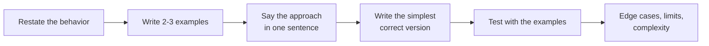
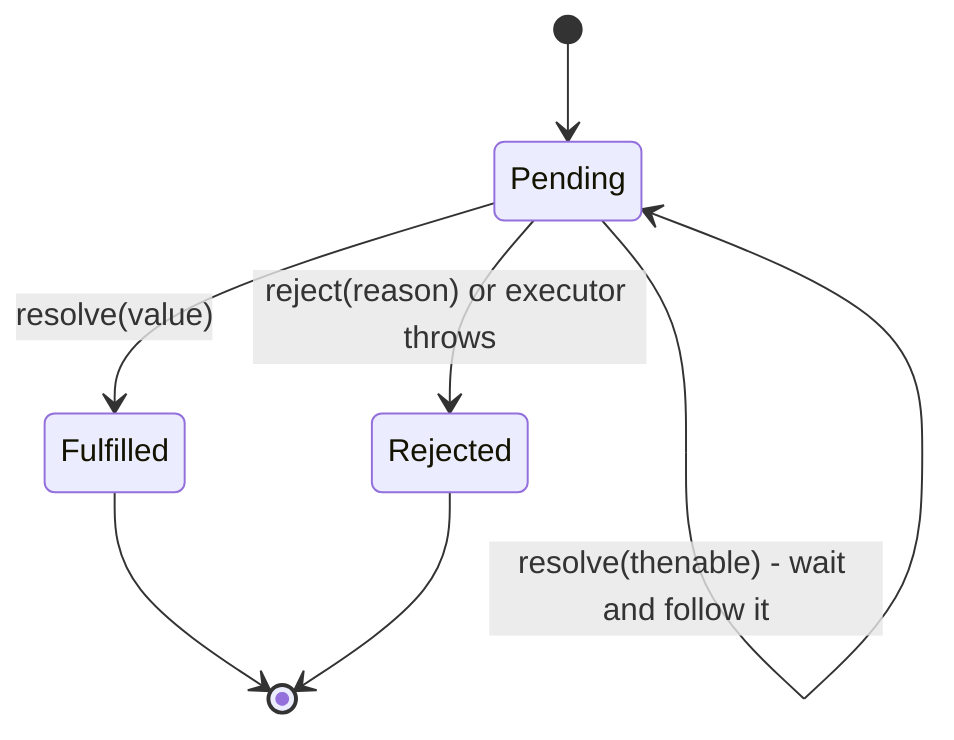
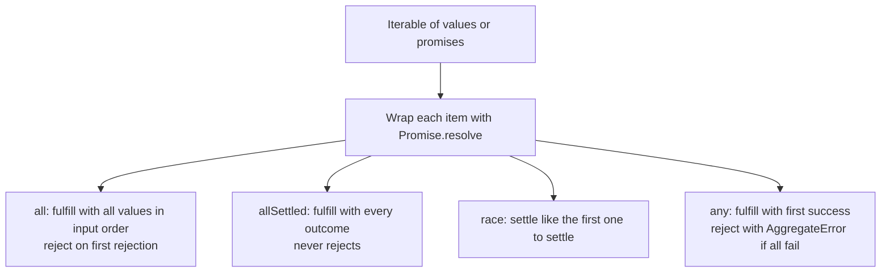
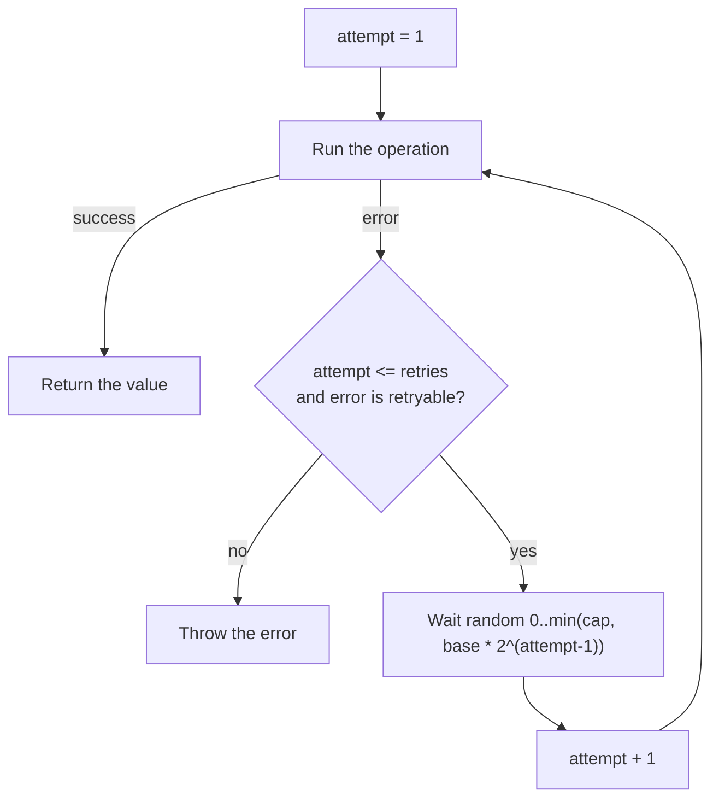
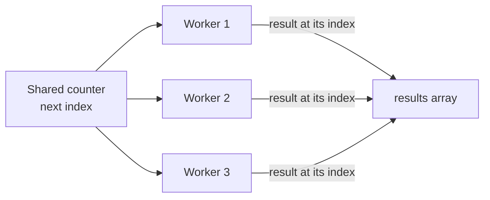
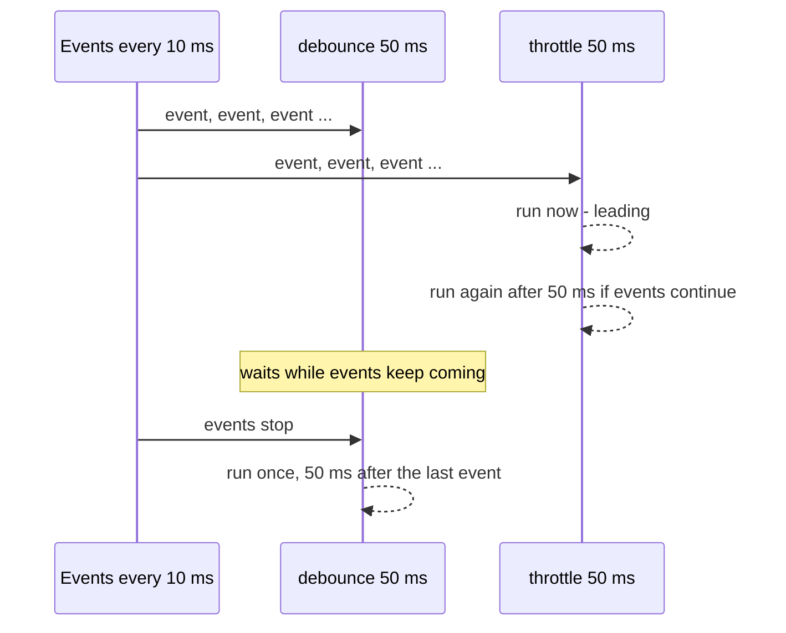
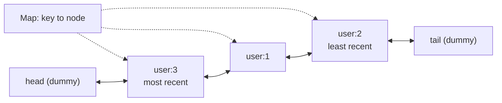
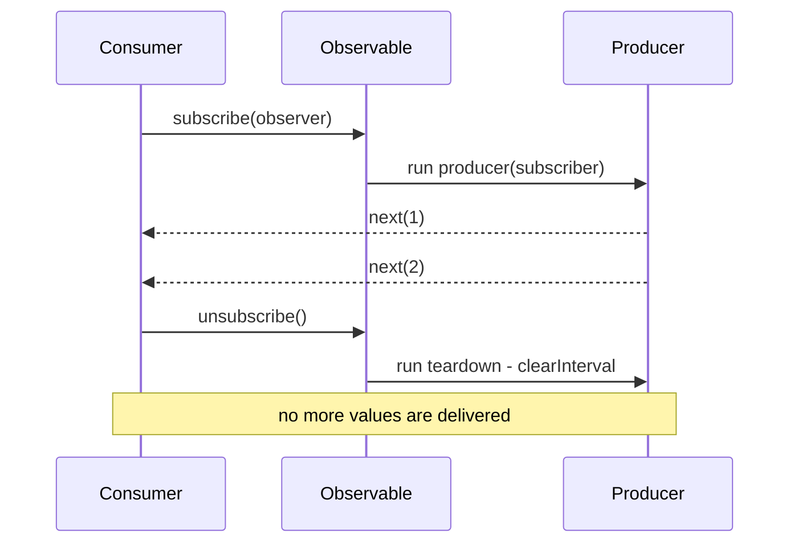

# JavaScript polyfills and implementations

> In this document you will write, test and explain the small utilities that interviewers ask you to build from scratch: array methods, `call`/`apply`/`bind`, `new`, a full Promise, the Promise combinators, debounce, throttle, memoize, curry, deep clone, EventEmitter, LRU cache, retry, a concurrency limiter, a tiny Observable, a virtual-DOM render function and more. These questions test whether you really understand the language, not only whether you can use it.

**Before this:** [Functions and functional programming](../02-javascript/04-functions-and-functional-programming.md) · [Closures](../02-javascript/05-closures.md) · [this, call, apply and bind](../02-javascript/06-this-call-apply-bind.md) · [Prototypes and inheritance](../02-javascript/08-prototypes-and-inheritance.md) · [Callbacks and promises](../02-javascript/17-callbacks-and-promises.md) · **Interview questions:** [jump to the interview section](#interview-questions)

## Table of contents

1. [How to handle an implementation question](#how-to-handle-an-implementation-question)
2. [Array methods](#array-methods)
3. [call, apply and bind](#call-apply-and-bind)
4. [new, instanceof and Object.create](#new-instanceof-and-objectcreate)
5. [A Promise implementation](#a-promise-implementation)
6. [Promise combinators](#promise-combinators)
7. [Async utilities](#async-utilities)
8. [Function utilities](#function-utilities)
9. [Object utilities](#object-utilities)
10. [EventEmitter, LRU cache and Observable](#eventemitter-lru-cache-and-observable)
11. [Array, string and URL utilities](#array-string-and-url-utilities)
12. [A virtual DOM render function](#a-virtual-dom-render-function)
13. [Interview questions](#interview-questions)
14. [Summary](#summary)
15. [References](#references)

> **How to read the code in this document.** Every block with tests was run with Node.js 22. The comments like `// [2, 4, 6]` are the real output. Each block is self-contained: it has the implementation and its test, so you can copy it into a file and run it. Code that touches the DOM was tested with jsdom (a DOM implementation for Node.js) and is browser code.

---

## How to handle an implementation question

### What these questions are

An **implementation question** asks you to write your own version of something that already exists, such as `Array.prototype.map`, `Function.prototype.bind` or `Promise.all`. A **polyfill** is code that adds a missing built-in feature to an older environment, so the newer code still works there. In interviews, "write a polyfill for X" usually just means "implement X yourself".

### Why interviewers ask them

They are short, but they show a lot:

- Do you know the **exact behavior** of the built-in? For example, `Promise.all` keeps the input order, not the finish order.
- Can you use the core language tools: closures, `this`, prototypes, the event loop, `Map` and `Set`?
- Do you think about **edge cases**: empty input, holes in arrays, errors, cycles, cancellation?
- Can you **talk while you code** and test your own work?

### A method that works for every question

Use the same six steps every time. Say each step out loud.

1. **Restate the behavior.** "So `myMap` calls the callback for each element with `(value, index, array)`, uses `thisArg` as `this`, and returns a new array of the same length."
2. **Write two or three examples first.** One normal case, one edge case. These become your tests.
3. **Say the approach in one sentence.** "I loop over the indexes, skip holes, and store each callback result in a new array."
4. **Write the simplest correct version.** Correct first, clever later.
5. **Run your examples by hand** (or in the console). Walk through one example line by line.
6. **Mention edge cases and limits.** What your version does not handle, and how the real built-in differs. Then give the time and space complexity.



### How to explain an implementation in an interview

1. **Define it:** "Debounce makes a function wait until calls stop for N milliseconds, and then runs it once."
2. **Why it exists:** "Search boxes fire an event on every key. Without debounce we send one request per key."
3. **How it works:** "I keep a timer id in a closure. Every call clears the old timer and starts a new one."
4. **Small example:** "If the user types 'phone' quickly, only one call runs, with 'phone'."
5. **Where it is useful:** "Search input, window resize, autosave."
6. **Trade-offs / gotchas:** "The first call is delayed. I keep `this` and the arguments. I add `cancel` so a component can clean up when it is destroyed."

### Should you add methods to built-in prototypes?

In an interview, you usually write `Array.prototype.myMap = function () {...}` because that is what was asked. In real code, **do not change built-in prototypes**:

- Another library may add a method with the same name and a different behavior.
- A future JavaScript version may add the same name (this really happened: `Array.prototype.flatten` was renamed to `flat` because an old library had already added `flatten` with different behavior).
- A plain assignment creates an **enumerable** property, so it shows up in `for...in` loops over every array.

If you must add one, use `Object.defineProperty` with `enumerable: false`. Real projects get polyfills from tools such as **core-js** (used by Babel), based on the list of browsers they support. See [Prototypes and inheritance](../02-javascript/08-prototypes-and-inheritance.md) for how the prototype chain makes polyfills work.

```js
// ❌ Wrong: enumerable, shows up in for...in
Array.prototype.last1 = function () { return this[this.length - 1]; };

// ✅ Correct: non-enumerable, like real built-in methods
Object.defineProperty(Array.prototype, "last2", {
  value: function () { return this[this.length - 1]; },
  writable: true,
  configurable: true,
  enumerable: false,
});

const keys = [];
for (const key in [10, 20]) keys.push(key);
console.log(keys); // [ '0', '1', 'last1' ]
console.log([10, 20].last2()); // 20
```

The rest of this document uses short names like `myMap` and assigns them directly, to keep the code easy to read.

---

## Array methods

These methods are explained in [Arrays and array methods](../02-javascript/10-arrays-and-array-methods.md). Here you write them yourself, with the details the specification cares about.

Four details apply to all of them:

- **`this` is the array.** The method is called as `numbers.myMap(...)`, so inside it, `this` is `numbers`. Use a normal `function`, not an arrow function, or `this` will be wrong.
- **Holes are skipped.** A **hole** is an index that has no value at all, as in `[1, , 3]`. Built-in `map`, `filter`, `forEach` and `reduce` do not call the callback for holes. You check this with `index in array`.
- **The callback must be a function.** Otherwise the built-in throws a `TypeError` before it does anything.
- **The length is read once, at the start.** If the callback pushes new items, they are not visited.

### map

**What it should do:** call `callback(value, index, array)` for each element, with `thisArg` as `this`. Return a **new** array of the same length with the results. Holes stay holes.

**Approach:** create a new array with the same length, loop over the indexes, skip holes, store each result at the same index.

```js
Array.prototype.myMap = function (callback, thisArg) {
  if (this == null) throw new TypeError("myMap called on null or undefined");
  if (typeof callback !== "function") throw new TypeError(callback + " is not a function");

  const source = Object(this);         // works for array-like objects too
  const length = source.length >>> 0;  // read the length once, as a whole number
  const result = new Array(length);    // same length, holes for now

  for (let index = 0; index < length; index++) {
    if (index in source) {             // skip holes
      result[index] = callback.call(thisArg, source[index], index, source);
    }
  }
  return result;
};

// --- Test ---
console.log([1, 2, 3].myMap((n) => n * 2)); // [ 2, 4, 6 ]
console.log([1, , 3].myMap((n) => n * 10)); // [ 10, <1 empty item>, 30 ]

const tax = { rate: 0.2 };
const prices = [100, 50];
console.log(prices.myMap(function (price) { return price * this.rate; }, tax)); // [ 20, 10 ]

const arrayLike = { 0: "a", 1: "b", length: 2 };
console.log(Array.prototype.myMap.call(arrayLike, (s) => s.toUpperCase())); // [ 'A', 'B' ]

try {
  [1].myMap("not a function");
} catch (error) {
  console.log(error.message); // not a function is not a function
}
```

**Edge cases:** holes, array-like objects, `thisArg`, non-function callback. Note that `thisArg` is ignored when the callback is an arrow function, because arrow functions have no own `this`.

**Complexity:** O(n) time, O(n) extra space for the result.

**Follow-up questions:**

- **Why `length >>> 0`?** — It turns the length into a non-negative whole number (`undefined` becomes `0`). The specification uses a slightly different conversion (`ToLength`, which allows up to 2^53 − 1), but `>>> 0` is the classic short form and is fine for an interview.
- **Why `callback.call(thisArg, ...)` and not `callback(...)`?** — To pass `thisArg` as `this`. Without `call`, `this` inside a normal callback would be `undefined` (strict mode).
- **Can you write it with `reduce`?** — Yes: `arr.reduce((acc, v, i, a) => { acc[i] = fn(v, i, a); return acc; }, new Array(arr.length))`. `reduce` also skips holes, so holes stay holes.

### filter

**What it should do:** return a new array with only the elements for which the callback returns a **truthy** value. The new array has no holes.

**Approach:** loop, skip holes, `push` the original value (not the callback result) when the test passes.

```js
Array.prototype.myFilter = function (callback, thisArg) {
  if (this == null) throw new TypeError("myFilter called on null or undefined");
  if (typeof callback !== "function") throw new TypeError(callback + " is not a function");

  const source = Object(this);
  const length = source.length >>> 0;
  const result = [];

  for (let index = 0; index < length; index++) {
    if (index in source) {
      const value = source[index]; // read once, before the callback can change it
      if (callback.call(thisArg, value, index, source)) result.push(value);
    }
  }
  return result;
};

// --- Test ---
console.log([1, 2, 3, 4].myFilter((n) => n % 2 === 0)); // [ 2, 4 ]
console.log([0, "", "Asha", null, 7].myFilter(Boolean)); // [ 'Asha', 7 ]
console.log([1, , 3].myFilter(() => true)); // [ 1, 3 ]

const products = [
  { name: "Phone", inStock: true },
  { name: "Laptop", inStock: false },
];
console.log(products.myFilter((p) => p.inStock).map((p) => p.name)); // [ 'Phone' ]
```

**Complexity:** O(n) time, O(k) space where k is the number of kept items.

**Follow-up:** **Why does `[1, , 3].filter(() => true)` remove the hole?** — `filter` skips holes and only pushes values that passed. A hole never reaches the callback, so it is never pushed.

### reduce

**What it should do:** walk the array from left to right and combine the elements into one value: `accumulator = callback(accumulator, value, index, array)`. If you pass an initial value, start with it. If not, the first **existing** element is the starting accumulator and the loop starts after it.

**The tricky rule:** an empty array (or an array with only holes) and no initial value throws `TypeError: Reduce of empty array with no initial value`.

**Approach:** use `arguments.length` to know if an initial value was passed. You cannot test `initialValue === undefined`, because `undefined` is a valid initial value.

```js
Array.prototype.myReduce = function (callback, initialValue) {
  if (this == null) throw new TypeError("myReduce called on null or undefined");
  if (typeof callback !== "function") throw new TypeError(callback + " is not a function");

  const source = Object(this);
  const length = source.length >>> 0;
  let index = 0;
  let accumulator;

  if (arguments.length >= 2) {
    accumulator = initialValue;
  } else {
    // Find the first index that is not a hole.
    while (index < length && !(index in source)) index++;
    if (index >= length) throw new TypeError("Reduce of empty array with no initial value");
    accumulator = source[index];
    index++;
  }

  for (; index < length; index++) {
    if (index in source) {
      accumulator = callback(accumulator, source[index], index, source);
    }
  }
  return accumulator;
};

// --- Test ---
console.log([1, 2, 3, 4].myReduce((sum, n) => sum + n)); // 10
console.log([1, 2, 3, 4].myReduce((sum, n) => sum + n, 100)); // 110
console.log([, , 5].myReduce((a, b) => a + b)); // 5
console.log([].myReduce((a, b) => a + b, "start")); // start
console.log([undefined].myReduce((a) => a, "x")); // x

try {
  [].myReduce((a, b) => a + b);
} catch (error) {
  console.log(error.message); // Reduce of empty array with no initial value
}

// Realistic: cart total
const cart = [
  { name: "Mouse", price: 25, qty: 2 },
  { name: "Desk", price: 200, qty: 1 },
];
console.log(cart.myReduce((total, item) => total + item.price * item.qty, 0)); // 250
```

**Complexity:** O(n) time, O(1) extra space (not counting what the callback builds).

**Follow-up questions:**

- **Why can't you use an arrow function for `myReduce` itself?** — An arrow function has no own `arguments` and no own `this`. You need both.
- **What does `reduceRight` change?** — Only the direction: start at `length - 1` and go down to `0`. The "first existing element" search also goes from the end.
- **Does `reduce` take a `thisArg`?** — No. Unlike `map` and `filter`, `reduce` has no `thisArg` parameter. The callback is called with `this` set to `undefined`.

### forEach

**What it should do:** call the callback for each existing element. Always return `undefined`. You cannot stop it early with `break` or `return` (only by throwing).

```js
Array.prototype.myForEach = function (callback, thisArg) {
  if (this == null) throw new TypeError("myForEach called on null or undefined");
  if (typeof callback !== "function") throw new TypeError(callback + " is not a function");

  const source = Object(this);
  const length = source.length >>> 0;
  for (let index = 0; index < length; index++) {
    if (index in source) callback.call(thisArg, source[index], index, source);
  }
  // no return: the result is always undefined
};

// --- Test ---
const seen = [];
const returned = ["a", , "c"].myForEach((letter, index) => seen.push(`${index}:${letter}`));
console.log(seen); // [ '0:a', '2:c' ]
console.log(returned); // undefined

// The length is read once: items added during the loop are not visited.
const queue = [1, 2];
queue.myForEach((n) => { if (n === 1) queue.push(99); });
console.log(queue); // [ 1, 2, 99 ]
```

**Follow-up:** **How do you stop a `forEach` early?** — You cannot, except by throwing. Use `for...of` with `break`, or `some`/`every`/`find`, which stop on their own.

**Follow-up:** **Why does `forEach` with an `async` callback not wait?** — `forEach` ignores what the callback returns. An `async` callback returns a promise, and nobody awaits it. Use `for...of` with `await` (one by one) or `Promise.all(items.map(async ...))` (in parallel). See [async/await](../02-javascript/18-async-await.md).

### flat with depth

**What it should do:** `arr.flat(depth = 1)` returns a new array where nested arrays are opened up to `depth` levels. Holes are removed. `flat(Infinity)` flattens everything.

**Approach (recursive):** for each existing element, if it is an array and we still have depth left, flatten it with `depth - 1` and add its items. Otherwise add the element as it is.

```js
Array.prototype.myFlat = function (depth = 1) {
  const result = [];
  const visit = (array, currentDepth) => {
    for (let index = 0; index < array.length; index++) {
      if (!(index in array)) continue; // flat removes holes
      const value = array[index];
      if (Array.isArray(value) && currentDepth > 0) {
        visit(value, currentDepth - 1);
      } else {
        result.push(value);
      }
    }
  };
  visit(Object(this), Math.trunc(Number(depth)) || 0);
  return result;
};

// --- Test ---
const nested = [1, [2, [3, [4]]], 5];
console.log(nested.myFlat()); // [ 1, 2, [ 3, [ 4 ] ], 5 ]
console.log(nested.myFlat(2)); // [ 1, 2, 3, [ 4 ], 5 ]
console.log(nested.myFlat(Infinity)); // [ 1, 2, 3, 4, 5 ]
console.log(nested.myFlat(0)); // [ 1, [ 2, [ 3, [Array] ] ], 5 ]
console.log([1, , [2, , 3]].myFlat()); // [ 1, 2, 3 ]
```

`Math.trunc(Infinity)` is `Infinity`, and `Infinity - 1` is still `Infinity`, so `flat(Infinity)` works with no special code.

**Iterative version (no recursion).** Very deep nesting can overflow the call stack. A stack of `[value, depth]` pairs avoids recursion. We push items in reverse so they come out in the original order.

```js
function flatIterative(array, depth = 1) {
  const result = [];
  const stack = [];
  for (let i = array.length - 1; i >= 0; i--) {
    if (i in array) stack.push([array[i], depth]);
  }
  while (stack.length > 0) {
    const [value, level] = stack.pop();
    if (Array.isArray(value) && level > 0) {
      for (let i = value.length - 1; i >= 0; i--) {
        if (i in value) stack.push([value[i], level - 1]);
      }
    } else {
      result.push(value);
    }
  }
  return result;
}

// --- Test ---
console.log(flatIterative([1, [2, [3, [4]]], 5], Infinity)); // [ 1, 2, 3, 4, 5 ]
console.log(flatIterative([1, [2, [3]]])); // [ 1, 2, [ 3 ] ]

// A very deep array: the iterative version does not overflow the stack.
let deep = [0];
for (let i = 0; i < 100000; i++) deep = [deep];
console.log(flatIterative(deep, Infinity)); // [ 0 ]
```

**Complexity:** O(n) time, where n is the total number of items at all levels. Space: O(n) for the result, plus O(d) recursion depth (recursive) or the stack size (iterative).

**Follow-up questions:**

- **Flatten without `flat` in one line?** — `const flatDeep = (arr) => arr.reduce((acc, v) => acc.concat(Array.isArray(v) ? flatDeep(v) : v), []);`. It is short but slower, because `concat` copies the accumulator each time (O(n²) in the worst case).
- **What about `flatMap`?** — `arr.flatMap(fn)` is `arr.map(fn).flat(1)`, done in one pass. It only flattens one level.

---

## call, apply and bind

How `this` works, and how these three methods change it, is explained in [this, call, apply and bind](../02-javascript/06-this-call-apply-bind.md). Here is the reminder you need: `obj.method()` sets `this` to `obj`. So to call a function `fn` with a chosen `this`, you can **temporarily put `fn` on the object** and call it as a method.

### call

**What it should do:** `fn.myCall(context, ...args)` calls `fn` with `this = context` and the given arguments, and returns the result.

**Approach:**

1. If `context` is `null` or `undefined`, use `globalThis`. If it is a primitive (like `"hi"`), wrap it with `Object(...)`, because you cannot add a property to a primitive.
2. Add the function to the context under a new **`Symbol`** key, so you never overwrite a real property.
3. Call it as a method, delete the key, and return the result.

```js
Function.prototype.myCall = function (context, ...args) {
  if (typeof this !== "function") throw new TypeError("myCall must be called on a function");
  const target = context == null ? globalThis : Object(context);
  const key = Symbol("fn"); // unique: cannot clash with existing keys
  target[key] = this;       // 'this' is the function we want to call
  try {
    return target[key](...args); // method call: 'this' inside is target
  } finally {
    delete target[key];     // clean up even if the function throws
  }
};

// --- Test ---
function introduce(greeting, punctuation) {
  return `${greeting}, I am ${this.name}${punctuation}`;
}
const user = { name: "Asha" };
console.log(introduce.myCall(user, "Hello", "!")); // Hello, I am Asha!
console.log(Object.getOwnPropertySymbols(user).length); // 0  (temporary key removed)

function typeOfThis() { return typeof this; }
console.log(typeOfThis.myCall("text")); // object
console.log(typeOfThis.call("text")); // string
```

**Edge case shown in the test:** in strict mode the real `call` passes primitives and `null`/`undefined` **as they are**. Our version must box the primitive (`"text"` becomes a `String` object), and uses `globalThis` for `null`/`undefined`. That matches sloppy-mode behavior, not strict mode. Say this in the interview: it is a known limit of the "temporary method" trick.

Other limits: the property is visible for a moment (a `Proxy` or a frozen object would notice; adding a key to a frozen object fails), and it changes the object's shape. Real `call` does none of this.

### apply

**What it should do:** same as `call`, but the arguments come as **one array** (or array-like): `fn.myApply(context, [a, b])`.

```js
Function.prototype.myApply = function (context, argsArray) {
  if (typeof this !== "function") throw new TypeError("myApply must be called on a function");
  if (argsArray != null && typeof argsArray !== "object") {
    throw new TypeError("CreateListFromArrayLike called on non-object");
  }
  const target = context == null ? globalThis : Object(context);
  const key = Symbol("fn");
  target[key] = this;
  try {
    return target[key](...Array.from(argsArray ?? []));
  } finally {
    delete target[key];
  }
};

// --- Test ---
const numbers = [5, 1, 9, 3];
console.log(Math.max.myApply(null, numbers)); // 9
console.log(Math.max.myApply(null)); // -Infinity  (no arguments)

const account = { owner: "Ravi" };
function describe(currency, amount) { return `${this.owner}: ${amount} ${currency}`; }
console.log(describe.myApply(account, ["EUR", 120])); // Ravi: 120 EUR
console.log(describe.myApply(account, { 0: "USD", 1: 5, length: 2 })); // Ravi: 5 USD
```

`Array.from` accepts array-like objects (objects with a `length`), like the real `apply`.

### bind

**What it should do:** `fn.myBind(context, ...presetArgs)` does **not** call `fn`. It returns a **new function** that, when called, runs `fn` with `this = context` and the preset arguments first, then the new arguments (this is **partial application**).

**The hard part: `new` on a bound function.** If you call the bound function with `new`, the bound `this` is **ignored**. A new object is created as if you called `new fn(...)`, and the preset arguments are still used.

**Approach:** return a normal `function` (not an arrow), so it can be called with `new`. Inside, check `new.target`. `new.target` is `undefined` for a normal call and is set when the function is called with `new`.

```js
Function.prototype.myBind = function (context, ...presetArgs) {
  if (typeof this !== "function") throw new TypeError("myBind must be called on a function");
  const originalFn = this;

  function boundFn(...laterArgs) {
    if (new.target) {
      // Called with new: ignore context, construct the original function.
      return new originalFn(...presetArgs, ...laterArgs);
    }
    return originalFn.apply(context, [...presetArgs, ...laterArgs]);
  }

  // So that `obj instanceof boundFn` works like the real thing.
  if (originalFn.prototype) boundFn.prototype = originalFn.prototype;
  return boundFn;
};

// --- Test 1: this and partial application ---
const counter = {
  count: 10,
  add(step, times) { return this.count + step * times; },
};
const addFive = counter.add.myBind(counter, 5);
console.log(addFive(2)); // 20

// --- Test 2: a bound method keeps this when passed as a callback ---
const logger = {
  prefix: "[orders]",
  log(message) { return `${this.prefix} ${message}`; },
};
const callbacks = ["created", "paid"].map(logger.log.myBind(logger));
console.log(callbacks); // [ '[orders] created', '[orders] paid' ]

// --- Test 3: new ignores the bound this, keeps preset args ---
function Person(firstName, lastName) {
  this.fullName = `${firstName} ${lastName}`;
}
const ignored = { fullName: "should not change" };
const SharmaPerson = Person.myBind(ignored, "Ankit");
const ankit = new SharmaPerson("Sharma");
console.log(ankit.fullName); // Ankit Sharma
console.log(ankit instanceof Person); // true
console.log(ankit instanceof SharmaPerson); // true
console.log(ignored.fullName); // should not change

// --- Test 4: binding twice does not change this ---
function whoAmI() { return this.name; }
const first = whoAmI.myBind({ name: "first" });
const second = first.myBind({ name: "second" });
console.log(second()); // first
```

**Step-by-step for Test 3:**

1. `Person.myBind(ignored, "Ankit")` stores `originalFn = Person` and `presetArgs = ["Ankit"]` in a closure, and returns `boundFn`.
2. `new SharmaPerson("Sharma")` calls `boundFn` with `new`, so `new.target` is `boundFn` (truthy).
3. We run `new Person("Ankit", "Sharma")`. A fresh object is created; `ignored` is not touched.
4. Because a constructor returned an object, `new boundFn(...)` gives back that object.
5. `instanceof Person` is true. `instanceof SharmaPerson` is true too, because we set `boundFn.prototype` to `Person.prototype`.

**Why binding twice keeps the first `this`:** `second` calls `first` with `this = { name: "second" }`, but `first` ignores its own `this`. It always applies `originalFn` with the first context.

**Edge cases and limits:**

- The real bound function has no `prototype` property and uses the target's prototype only for `instanceof`. Sharing `boundFn.prototype = originalFn.prototype` is a shortcut: if someone adds a property to `boundFn.prototype`, it also changes `originalFn.prototype`. The old MDN polyfill used an empty "middle" function to avoid this.
- The real bound function has `name` `"bound Person"` and `length` = the original length minus the preset arguments (never below 0). You can copy these with `Object.defineProperty(boundFn, "name", { value: "bound " + originalFn.name })`.
- Classes cannot be called without `new`. `Person.myBind(...)` works for classes only when the result is called with `new`, which is also true for the real `bind`.

**Complexity:** O(1) to create the bound function; each call is O(a) to copy the arguments.

**Follow-up questions:**

- **Write `bind` without using `call` or `apply`.** — Use the symbol trick from `myCall` inside `boundFn`: put `originalFn` on the context under a symbol, call it, delete it.
- **Arrow function vs `bind` for fixing `this` in callbacks?** — An arrow function wrapper (`() => logger.log(msg)`) reads `logger` each time it runs. `bind` captures the function and `this` once. In class components, both a class field arrow (`handleClick = () => {}`) and a bind in the constructor work. Arrow class fields create one function per instance.
- **Can you re-bind an arrow function?** — No. Arrow functions take `this` from where they are written. `bind`, `call` and `apply` cannot change it (they can still pass arguments).

---

## new, instanceof and Object.create

The prototype chain and constructors are explained in [Prototypes and inheritance](../02-javascript/08-prototypes-and-inheritance.md) and [Classes](../02-javascript/09-classes.md).

### The new operator (myNew)

**What `new Ctor(...args)` does:**

1. Creates a new empty object.
2. Sets the object's prototype to `Ctor.prototype` (if that is an object; otherwise `Object.prototype`).
3. Calls `Ctor` with `this` = the new object and the arguments.
4. If `Ctor` returns an **object or a function**, that value is the result. Otherwise (a primitive or nothing), the new object is the result.

```js
function myNew(Ctor, ...args) {
  if (typeof Ctor !== "function") throw new TypeError(Ctor + " is not a constructor");
  const proto = Ctor.prototype !== null && typeof Ctor.prototype === "object"
    ? Ctor.prototype
    : Object.prototype;
  const instance = Object.create(proto);            // steps 1 and 2
  const returned = Ctor.apply(instance, args);      // step 3
  const isObject = returned !== null && (typeof returned === "object" || typeof returned === "function");
  return isObject ? returned : instance;            // step 4
}

// --- Test ---
function Product(name, price) {
  this.name = name;
  this.price = price;
}
Product.prototype.label = function () { return `${this.name} - $${this.price}`; };

const phone = myNew(Product, "Phone", 499);
console.log(phone.label()); // Phone - $499
console.log(phone instanceof Product); // true

function ReturnsObject() { this.a = 1; return { b: 2 }; }
function ReturnsPrimitive() { this.a = 1; return 42; }
console.log(myNew(ReturnsObject)); // { b: 2 }
console.log(myNew(ReturnsPrimitive)); // ReturnsPrimitive { a: 1 }
```

**Limits:** `myNew` cannot construct a **class**, because `Ctor.apply(...)` calls the class without `new`, which throws `TypeError: Class constructor ... cannot be invoked without 'new'`. The real way is `Reflect.construct(Ctor, args)`. Arrow functions and methods have no `prototype` and are not constructors; the real `new` throws for them, while `myNew` would not. You could add a check with `Reflect.construct` if asked.

**Follow-up:** **Why does `new` return the object from the constructor if there is one?** — The specification says so. It lets a constructor return a cached instance or a different object (a factory-like pattern). Returning a primitive is ignored.

### instanceof (myInstanceOf)

**What it should do:** `value instanceof Ctor` is true if `Ctor.prototype` appears **anywhere** in the prototype chain of `value`.

**Approach:** primitives return false. Walk up with `Object.getPrototypeOf` until you reach `null`. Compare each link to `Ctor.prototype`.

```js
function myInstanceOf(value, Ctor) {
  if (typeof Ctor !== "function") throw new TypeError("Right-hand side of 'instanceof' is not callable");
  if (value === null || (typeof value !== "object" && typeof value !== "function")) return false;

  const target = Ctor.prototype;
  let proto = Object.getPrototypeOf(value);
  while (proto !== null) {
    if (proto === target) return true;
    proto = Object.getPrototypeOf(proto);
  }
  return false;
}

// --- Test ---
class Animal {}
class Dog extends Animal {}
const rex = new Dog();
console.log(myInstanceOf(rex, Dog)); // true
console.log(myInstanceOf(rex, Animal)); // true
console.log(myInstanceOf(rex, Object)); // true
console.log(myInstanceOf(rex, Array)); // false
console.log(myInstanceOf("text", String)); // false  (primitive)
console.log(myInstanceOf(Object.create(null), Object)); // false  (no prototype at all)
console.log(myInstanceOf(() => {}, Function)); // true
```

**Complexity:** O(d), where d is the depth of the prototype chain.

**Follow-up questions:**

- **What does the real `instanceof` do first?** — It looks for a `Symbol.hasInstance` method on the right side. `Function.prototype` has a default one that does the chain walk above, and classes can override it with `static [Symbol.hasInstance](value) {...}`.
- **Why can `instanceof Array` fail across iframes?** — Each iframe (and each Node.js `vm` context) has its own `Array` constructor, so its arrays have a different `Array.prototype`. Use `Array.isArray`, which works across realms.

### Object.create

**What it should do:** `Object.create(proto, descriptors?)` makes a new object whose prototype is `proto`. `proto` must be an object or `null`. The optional second argument is a set of property descriptors, as in `Object.defineProperties`.

**Classic approach (ES5 style):** a temporary constructor function whose `prototype` is `proto`, then `new` it.

```js
function myCreate(proto, descriptors) {
  if (proto !== null && typeof proto !== "object" && typeof proto !== "function") {
    throw new TypeError("Object prototype may only be an Object or null: " + proto);
  }
  let obj;
  if (proto === null) {
    // A constructor cannot give a null prototype; fix it afterwards.
    obj = {};
    Object.setPrototypeOf(obj, null);
  } else {
    function Temp() {}
    Temp.prototype = proto;
    obj = new Temp();
  }
  if (descriptors !== undefined) Object.defineProperties(obj, descriptors);
  return obj;
}

// --- Test ---
const animal = { speak() { return `${this.name} makes a sound`; } };
const cat = myCreate(animal, {
  name: { value: "Milo", enumerable: true },
});
console.log(cat.speak()); // Milo makes a sound
console.log(Object.getPrototypeOf(cat) === animal); // true

const dictionary = myCreate(null);
console.log(Object.getPrototypeOf(dictionary)); // null
console.log("toString" in dictionary); // false

try {
  myCreate(42);
} catch (error) {
  console.log(error.message); // Object prototype may only be an Object or null: 42
}
```

**Follow-up:** **Why use `Object.create(null)`?** — It makes a "pure dictionary" with no inherited keys like `toString` or `__proto__`. That is safer for maps built from user input. Today a `Map` is usually the better choice.

**Follow-up:** **Why could the old ES5 polyfill not support `null`?** — ES5 had no `Object.setPrototypeOf`, and a constructor with `prototype = null` creates objects that inherit from `Object.prototype` instead. So `Object.create(null)` could not be fully polyfilled in ES5.

---

## A Promise implementation

"Implement a Promise" is one of the hardest questions in this document, because you must get the timing right. The concepts (states, chaining, error flow, microtasks) are explained in [Callbacks and promises](../02-javascript/17-callbacks-and-promises.md) and [The event loop](../02-javascript/16-event-loop.md). Here we build a complete version step by step.

### What it should do

The rules come from the **Promises/A+** specification (the rules every `then`-able library follows) and the ECMAScript specification:

1. **Three states.** A promise starts **pending**. It can become **fulfilled** (with a value) or **rejected** (with a reason). Once it is settled, it never changes again.
2. **The executor runs synchronously.** `new MyPromise(executor)` calls `executor(resolve, reject)` right away. If the executor throws, the promise is rejected.
3. **Callbacks are always asynchronous.** `then` callbacks run in a **microtask**, even if the promise is already settled. (A **microtask** is a small job that runs right after the current synchronous code finishes, before timers.)
4. **`then` returns a new promise.** That new promise is resolved with whatever the callback returns, or rejected with whatever it throws.
5. **Missing callbacks pass the result through.** `p.then(undefined, onRejected)` passes a value straight to the next promise; `p.then(onFulfilled)` passes an error straight through.
6. **Thenable adoption.** If you resolve with something that has a `then` method (a **thenable**, for example another promise), the promise **follows** it: it waits and takes its final state.
7. **No cycles.** Resolving a promise with itself rejects it with a `TypeError`.



### The approach in plain words

- Keep three private fields: `state`, `value` and a list of waiting **reactions**. A reaction is "the two callbacks from one `then` call, plus the `resolve` and `reject` of the promise that `then` returned".
- `then` creates the next promise. If we are still pending, it stores the reaction. If we are already settled, it schedules the reaction right away.
- Settling stores the state and value once, then schedules every waiting reaction.
- **Scheduling** a reaction means: in a microtask, pick the right callback, call it, and resolve the next promise with its result (or reject it if the callback throws).
- **Resolving** is different from fulfilling: resolve first checks for a thenable and adopts it.

### The code

```js
const PENDING = "pending";
const FULFILLED = "fulfilled";
const REJECTED = "rejected";

class MyPromise {
  #state = PENDING;
  #value = undefined;
  #reactions = [];

  constructor(executor) {
    if (typeof executor !== "function") {
      throw new TypeError("Promise resolver " + executor + " is not a function");
    }
    const { resolve, reject } = this.#createResolvers();
    try {
      executor(resolve, reject); // runs synchronously
    } catch (error) {
      reject(error); // ignored if resolve/reject was already called
    }
  }

  // A resolve/reject pair that works only once (the first call wins).
  #createResolvers() {
    let alreadyCalled = false;
    const resolve = (value) => {
      if (alreadyCalled) return;
      alreadyCalled = true;
      this.#resolve(value);
    };
    const reject = (reason) => {
      if (alreadyCalled) return;
      alreadyCalled = true;
      this.#settle(REJECTED, reason);
    };
    return { resolve, reject };
  }

  // The "resolve procedure": handle cycles and thenables, else fulfill.
  #resolve(value) {
    if (value === this) {
      this.#settle(REJECTED, new TypeError("Chaining cycle detected for promise"));
      return;
    }
    if (value !== null && (typeof value === "object" || typeof value === "function")) {
      let then;
      try {
        then = value.then; // read only once: a getter could change its answer
      } catch (error) {
        this.#settle(REJECTED, error);
        return;
      }
      if (typeof then === "function") {
        // Follow the thenable. Done in a microtask, like the real Promise.
        queueMicrotask(() => {
          const { resolve, reject } = this.#createResolvers();
          try {
            then.call(value, resolve, reject);
          } catch (error) {
            reject(error); // ignored if the thenable already called resolve/reject
          }
        });
        return;
      }
    }
    this.#settle(FULFILLED, value);
  }

  #settle(state, value) {
    if (this.#state !== PENDING) return;
    this.#state = state;
    this.#value = value;
    const waiting = this.#reactions;
    this.#reactions = [];
    waiting.forEach((reaction) => this.#schedule(reaction));
  }

  #schedule({ onFulfilled, onRejected, resolve, reject }) {
    queueMicrotask(() => {
      const fulfilled = this.#state === FULFILLED;
      const handler = fulfilled ? onFulfilled : onRejected;
      if (typeof handler !== "function") {
        // No callback for this state: pass the value or error through.
        (fulfilled ? resolve : reject)(this.#value);
        return;
      }
      try {
        resolve(handler(this.#value)); // a returned thenable is adopted
      } catch (error) {
        reject(error);
      }
    });
  }

  then(onFulfilled, onRejected) {
    return new MyPromise((resolve, reject) => {
      const reaction = { onFulfilled, onRejected, resolve, reject };
      if (this.#state === PENDING) this.#reactions.push(reaction);
      else this.#schedule(reaction);
    });
  }

  catch(onRejected) {
    return this.then(undefined, onRejected);
  }

  finally(onFinally) {
    if (typeof onFinally !== "function") return this.then(onFinally, onFinally);
    return this.then(
      // Wait for onFinally, then pass the ORIGINAL value through.
      (value) => MyPromise.resolve(onFinally()).then(() => value),
      // Wait for onFinally, then re-throw the ORIGINAL error.
      (reason) => MyPromise.resolve(onFinally()).then(() => { throw reason; }),
    );
  }

  static resolve(value) {
    if (value instanceof MyPromise) return value; // do not wrap twice
    return new MyPromise((resolve) => resolve(value));
  }

  static reject(reason) {
    return new MyPromise((_, reject) => reject(reason));
  }
}

// --- Test 1: basic chain and error flow ---
new MyPromise((resolve) => setTimeout(() => resolve(2), 50))
  .then((n) => n * 10)
  .then((n) => { throw new Error(`too big: ${n}`); })
  .then(() => console.log("skipped"))
  .catch((error) => error.message)
  .then((message) => console.log("T1", message)); // T1 too big: 20

// --- Test 2: settle once, executor errors ---
new MyPromise((resolve, reject) => {
  resolve("first");
  resolve("second"); // ignored
  reject(new Error("ignored too"));
}).then((v) => console.log("T2", v)); // T2 first

new MyPromise(() => { throw new Error("executor failed"); })
  .catch((e) => console.log("T2b", e.message)); // T2b executor failed

// --- Test 3: thenable adoption ---
const thenable = {
  then(onFulfilled) {
    onFulfilled("from thenable");
    onFulfilled("called twice - ignored");
  },
};
MyPromise.resolve(thenable).then((v) => console.log("T3", v)); // T3 from thenable
MyPromise.resolve(1)
  .then(() => new MyPromise((resolve) => setTimeout(() => resolve("inner"), 80)))
  .then((v) => console.log("T3b", v)); // T3b inner (after 80 ms)
MyPromise.resolve(1)
  .then(() => Promise.resolve("native promise works too"))
  .then((v) => console.log("T3c", v)); // T3c native promise works too

// --- Test 4: finally ---
MyPromise.resolve("data")
  .finally(() => "ignored return value")
  .then((v) => console.log("T4", v)); // T4 data
MyPromise.reject(new Error("boom"))
  .finally(() => new MyPromise((r) => setTimeout(r, 5))) // waits 5 ms
  .catch((e) => console.log("T4b", e.message)); // T4b boom
MyPromise.resolve("data")
  .finally(() => { throw new Error("cleanup failed"); })
  .catch((e) => console.log("T4c", e.message)); // T4c cleanup failed

// --- Test 5: self-resolution ---
const loop = MyPromise.resolve(1).then(() => loop);
loop.catch((e) => console.log("T5", e.constructor.name, e.message)); // T5 TypeError Chaining cycle detected for promise
```

The lines do not print in the order they are written, because some tests wait for timers and the chains have different lengths. This is the real printed output:

```text
T2 first
T2b executor failed
T3 from thenable
T4c cleanup failed
T5 TypeError Chaining cycle detected for promise
T3c native promise works too
T4 data
T4b boom
T1 too big: 20
T3b inner
```

If you replace `MyPromise` with the native `Promise` in the tests, the order is exactly the same. (Only the T5 message text differs slightly: V8 adds `#<Promise>` at the end.)

### Proof that the timing matches the native Promise

The same scenario, run with the native `Promise` and with `MyPromise`, gives the same order:

```js
// The same MyPromise as above, written compactly (catch and finally removed),
// so that this block runs on its own.
const PENDING = "pending", FULFILLED = "fulfilled", REJECTED = "rejected";
class MyPromise {
  #state = PENDING; #value; #reactions = [];
  constructor(executor) {
    const { resolve, reject } = this.#createResolvers();
    try { executor(resolve, reject); } catch (e) { reject(e); }
  }
  #createResolvers() {
    let called = false;
    return {
      resolve: (v) => { if (!called) { called = true; this.#resolve(v); } },
      reject: (r) => { if (!called) { called = true; this.#settle(REJECTED, r); } },
    };
  }
  #resolve(value) {
    if (value === this) return this.#settle(REJECTED, new TypeError("Chaining cycle"));
    if (value !== null && (typeof value === "object" || typeof value === "function")) {
      let then;
      try { then = value.then; } catch (e) { return this.#settle(REJECTED, e); }
      if (typeof then === "function") {
        queueMicrotask(() => {
          const { resolve, reject } = this.#createResolvers();
          try { then.call(value, resolve, reject); } catch (e) { reject(e); }
        });
        return;
      }
    }
    this.#settle(FULFILLED, value);
  }
  #settle(state, value) {
    if (this.#state !== PENDING) return;
    this.#state = state; this.#value = value;
    const waiting = this.#reactions; this.#reactions = [];
    waiting.forEach((r) => this.#schedule(r));
  }
  #schedule({ onFulfilled, onRejected, resolve, reject }) {
    queueMicrotask(() => {
      const ok = this.#state === FULFILLED;
      const handler = ok ? onFulfilled : onRejected;
      if (typeof handler !== "function") return (ok ? resolve : reject)(this.#value);
      try { resolve(handler(this.#value)); } catch (e) { reject(e); }
    });
  }
  then(onFulfilled, onRejected) {
    return new MyPromise((resolve, reject) => {
      const reaction = { onFulfilled, onRejected, resolve, reject };
      if (this.#state === PENDING) this.#reactions.push(reaction); else this.#schedule(reaction);
    });
  }
  static resolve(v) { return v instanceof MyPromise ? v : new MyPromise((r) => r(v)); }
}

function orderTest(P) {
  const log = [];
  log.push("sync start");
  setTimeout(() => log.push("timeout"), 0);
  new P((resolve) => { log.push("executor"); resolve("A"); })
    .then((v) => log.push("then " + v))
    .then(() => log.push("then 2"));
  P.resolve()
    .then(() => { log.push("returns a promise"); return P.resolve("B"); })
    .then((v) => log.push("adopted " + v));
  P.resolve().then(() => log.push("x1")).then(() => log.push("x2"))
    .then(() => log.push("x3")).then(() => log.push("x4"));
  log.push("sync end");
  return new Promise((done) => setTimeout(() => done(log), 10));
}

const nativeLog = await orderTest(Promise);
const myLog = await orderTest(MyPromise);
console.log(nativeLog.join(" | "));
// sync start | executor | sync end | then A | returns a promise | x1 | then 2 | x2 | x3 | adopted B | x4 | timeout
console.log(JSON.stringify(nativeLog) === JSON.stringify(myLog)); // true
```

**Step-by-step (why `adopted B` comes after `x3`):**

1. Synchronous code runs first: `sync start`, `executor` (the executor is synchronous), `sync end`. The timer is queued as a **task** (macrotask).
2. Microtask round 1: `then A`, `returns a promise`, `x1`. The second callback returned the promise `B`. So the promise that `then` returned must **follow** `B`. That queues a job (job J) that will call `B.then(...)`.
3. Round 2: `then 2`, then job J (it calls `B.then`; `B` is already fulfilled, so its reaction is queued at once), then `x2`.
4. Round 3: the `B` reaction runs and resolves the outer promise, which queues `adopted B`. Then `x3` runs and queues `x4`.
5. Round 4: `adopted B`, then `x4`.
6. Only when all microtasks are done does the `timeout` task run.

So **returning a promise from `then` costs two extra microtask ticks** compared to returning a plain value. Both the native Promise and `MyPromise` behave this way, because both follow the thenable in a separate job.

### Edge cases you should mention

- **Settle once.** Later `resolve`/`reject` calls are ignored, including the `reject` from a `catch` after the executor already resolved.
- **A thenable that calls back twice, or calls back and then throws.** Only the first call counts (the `alreadyCalled` flag).
- **A `then` getter that throws.** The promise is rejected with that error.
- **`resolve` with a native Promise inside `MyPromise`** works, because a native promise is a thenable.
- **Unhandled rejections.** The real engine reports rejected promises that never got a handler (Node.js crashes the process by default). `MyPromise` does not track this. To add it, keep an `isHandled` flag, set it in `then`, and after a rejection check it in a `setTimeout`.

**Complexity:** each `then` is O(1). Settling a promise is O(k) for k waiting reactions.

### Follow-up questions

- **Why use `queueMicrotask` and not `setTimeout`?** — Promise callbacks are microtasks. They run before timers and before the browser renders. With `setTimeout`, `then` callbacks would run after timers, so output ordering would be wrong. In very old environments, polyfills used `MutationObserver` or `process.nextTick` to get a microtask.
- **Why must callbacks be async even if the promise is already resolved?** — So the code is predictable. If `then` sometimes ran the callback synchronously and sometimes later (sometimes called "releasing Zalgo"), the order of your code would depend on timing.
- **Why read `value.then` only once?** — A getter could return a function the first time and something else the second time. Reading once makes the check and the call use the same function, as the specification requires.
- **How would you test it fully?** — Run the official `promises-aplus-tests` suite (it needs an adapter with `resolved`, `rejected` and `deferred`). Then compare ordering with the native Promise as shown above.
- **How do you add `MyPromise.all` and the other static methods?** — Use the functions from the next section and replace `Promise` with `MyPromise` inside them (or with `this`, so subclasses work): `static all(iterable) { return new this((resolve, reject) => { ... this.resolve(item).then(...) ... }); }`.
- **What about `Promise.withResolvers` (ES2024)?** — `static withResolvers() { let resolve, reject; const promise = new this((res, rej) => { resolve = res; reject = rej; }); return { promise, resolve, reject }; }`.

---

## Promise combinators

The four combinators and when to use each are explained in [Callbacks and promises](../02-javascript/17-callbacks-and-promises.md#promise-static-methods). Here you implement them. All four:

- accept any **iterable** (an array, a `Set`, a generator), not only arrays,
- accept **non-promise values** too, by wrapping each item with `Promise.resolve(item)`,
- return a **new promise**.



### Promise.all

**What it should do:** fulfill with an array of all values, **in input order** (not finish order). Reject as soon as **any** item rejects (**fail fast**). An empty input fulfills with `[]`.

**Approach:** count how many are still pending. Store each value at its own index. When the counter reaches zero, resolve.

```js
function promiseAll(iterable) {
  return new Promise((resolve, reject) => {
    const items = Array.from(iterable);
    const results = new Array(items.length);
    let remaining = items.length;
    if (remaining === 0) {
      resolve(results);
      return;
    }
    items.forEach((item, index) => {
      Promise.resolve(item).then((value) => {
        results[index] = value;   // keep input order
        remaining -= 1;
        if (remaining === 0) resolve(results);
      }, reject);                 // first rejection wins; later calls are ignored
    });
  });
}

// --- Test ---
const delay = (ms, value, fail = false) =>
  new Promise((resolve, reject) => setTimeout(() => (fail ? reject(new Error(value)) : resolve(value)), ms));

const started = Date.now();
const users = await promiseAll([delay(30, "user"), delay(10, "orders"), 42]);
console.log(users); // [ 'user', 'orders', 42 ]  (input order, not finish order)

console.log(await promiseAll([])); // []
console.log(await promiseAll(new Set([1, Promise.resolve(2)]))); // [ 1, 2 ]

try {
  await promiseAll([delay(50, "slow"), delay(10, "payment failed", true)]);
} catch (error) {
  console.log(error.message); // payment failed
  console.log(Date.now() - started < 100); // true  (did not wait for "slow")
}
```

**Common bug:** using `results.push(value)`. Then the order is the finish order, and `results.length === items.length` as the "done" check breaks when a value is pushed at the wrong time. Always store by index and use a counter.

**Complexity:** O(n) time and space, plus the time of the slowest promise.

**Follow-up questions:**

- **Does fail-fast cancel the other promises?** — No. Promises cannot be cancelled. The others keep running; their results are just ignored. To stop the work, pass an `AbortSignal` to each task and abort it in the `catch`.
- **Why `Promise.resolve(item)` and not `item.then`?** — Items may be plain values or thenables. `Promise.resolve` handles all three cases.
- **Why `Array.from(iterable)` first?** — To know the count and to support any iterable. The real `Promise.all` iterates once and counts as it goes; the result is the same.

### Promise.allSettled

**What it should do:** wait for **every** item. Fulfill with an array of `{ status: "fulfilled", value }` or `{ status: "rejected", reason }` objects, in input order. It never rejects (unless the input is not iterable).

```js
function promiseAllSettled(iterable) {
  const wrapped = Array.from(iterable, (item) =>
    Promise.resolve(item).then(
      (value) => ({ status: "fulfilled", value }),
      (reason) => ({ status: "rejected", reason }),
    ),
  );
  return Promise.all(wrapped); // each wrapped promise always fulfills
}

// --- Test ---
const results = await promiseAllSettled([
  Promise.resolve("profile"),
  Promise.reject(new Error("recommendations down")),
  "static banner",
]);
console.log(results.map((r) => (r.status === "fulfilled" ? r.value : r.reason.message)));
// [ 'profile', 'recommendations down', 'static banner' ]
console.log(results.map((r) => r.status)); // [ 'fulfilled', 'rejected', 'fulfilled' ]
```

**Approach in words:** turn every item into a promise that **always fulfills** with a description of its outcome. Then `Promise.all` cannot fail. (If `promiseAll` is not allowed, use the counter version from `promiseAll` and never call `reject`.)

**Where it is used:** dashboards that load several independent widgets; batch jobs that must report every failure, not only the first.

### Promise.race

**What it should do:** settle the same way as the **first item that settles**, fulfilled or rejected. An empty input gives a promise that **stays pending forever**.

```js
function promiseRace(iterable) {
  return new Promise((resolve, reject) => {
    for (const item of iterable) {
      Promise.resolve(item).then(resolve, reject); // first one to call wins
    }
  });
}

// --- Test ---
const delay = (ms, value, fail = false) =>
  new Promise((resolve, reject) => setTimeout(() => (fail ? reject(new Error(value)) : resolve(value)), ms));

console.log(await promiseRace([delay(30, "mirror A"), delay(10, "mirror B")])); // mirror B

try {
  await promiseRace([delay(30, "data"), delay(10, "timeout", true)]);
} catch (error) {
  console.log(error.message); // timeout
}

const empty = promiseRace([]);
const winner = await promiseRace([empty, delay(5, "empty race never settles")]);
console.log(winner); // empty race never settles
```

**Approach in words:** pass the same `resolve` and `reject` to every item. A promise can be settled only once, so the first call wins and the others are ignored.

**Main use:** timeouts (see the [timeout wrapper](#timeout-wrapper)).

### Promise.any

**What it should do:** fulfill with the **first success**. Ignore rejections unless **all** items reject; then reject with an **`AggregateError`** whose `errors` array holds every reason **in input order**. An empty input rejects right away with an `AggregateError`.

```js
function promiseAny(iterable) {
  return new Promise((resolve, reject) => {
    const items = Array.from(iterable);
    const errors = new Array(items.length);
    let remaining = items.length;
    if (remaining === 0) {
      reject(new AggregateError([], "All promises were rejected"));
      return;
    }
    items.forEach((item, index) => {
      Promise.resolve(item).then(resolve, (reason) => {
        errors[index] = reason;
        remaining -= 1;
        if (remaining === 0) reject(new AggregateError(errors, "All promises were rejected"));
      });
    });
  });
}

// --- Test ---
const delay = (ms, value, fail = false) =>
  new Promise((resolve, reject) => setTimeout(() => (fail ? reject(new Error(value)) : resolve(value)), ms));

console.log(await promiseAny([
  delay(5, "cdn-1 down", true),
  delay(20, "cdn-2"),
  delay(10, "cdn-3"),
])); // cdn-3

try {
  await promiseAny([delay(20, "first failed", true), delay(5, "second failed", true)]);
} catch (error) {
  console.log(error instanceof AggregateError, error.message); // true All promises were rejected
  console.log(error.errors.map((e) => e.message)); // [ 'first failed', 'second failed' ]
}

try {
  await promiseAny([]);
} catch (error) {
  console.log(error.errors.length); // 0
}
```

`promiseAny` is the "mirror image" of `promiseAll`: success is the fast path, and failure needs everybody.

### Running promises in sequence

A common variation: "run these async tasks **one after another** and collect the results". The key point is to pass **functions that create promises**, not promises. A promise has already started when it exists.

```js
async function runInSequence(tasks) {
  const results = [];
  for (const task of tasks) {
    results.push(await task()); // the next task starts only after this one finished
  }
  return results;
}

// The same thing with reduce (older style):
function runInSequenceReduce(tasks) {
  return tasks.reduce(
    (chain, task) => chain.then((results) => task().then((value) => [...results, value])),
    Promise.resolve([]),
  );
}

// --- Test ---
const log = [];
const makeTask = (name, ms) => () =>
  new Promise((resolve) => {
    log.push(`start ${name}`);
    setTimeout(() => { log.push(`end ${name}`); resolve(name); }, ms);
  });

console.log(await runInSequence([makeTask("A", 20), makeTask("B", 5)])); // [ 'A', 'B' ]
console.log(log); // [ 'start A', 'end A', 'start B', 'end B' ]
console.log(await runInSequenceReduce([makeTask("C", 5), makeTask("D", 5)])); // [ 'C', 'D' ]
```

---

## Async utilities

These helpers appear in real code all the time: in Angular services, Node.js scripts, Electron main processes and test helpers. They build on [async/await](../02-javascript/18-async-await.md) and the [event loop](../02-javascript/16-event-loop.md).

### promisify

**What it should do:** turn a function that uses an **error-first callback** (the last argument is `(error, result) => {}`) into a function that returns a promise. (Error-first callbacks are explained in [Callbacks and promises](../02-javascript/17-callbacks-and-promises.md#error-first-callbacks).)

**Approach:** return a new function. When it is called, create a promise, call the original function with the same arguments plus one extra callback. In that callback, reject if there is an error, else resolve with the result. Keep `this`, so it also works for methods.

```js
function promisify(fn) {
  if (typeof fn !== "function") throw new TypeError("promisify expects a function");
  return function (...args) {
    return new Promise((resolve, reject) => {
      // Keep `this` so promisified methods still work.
      fn.call(this, ...args, (error, value) => {
        if (error) reject(error);
        else resolve(value);
      });
    });
  };
}

// --- Test ---
// A callback-style API, like old Node.js APIs or many SDKs.
function getUser(id, callback) {
  setTimeout(() => {
    if (id <= 0) callback(new Error(`Invalid id ${id}`));
    else callback(null, { id, name: "Asha" });
  }, 5);
}

const getUserAsync = promisify(getUser);
console.log(await getUserAsync(7)); // { id: 7, name: 'Asha' }
try {
  await getUserAsync(0);
} catch (error) {
  console.log(error.message); // Invalid id 0
}

// Methods keep `this`
const db = {
  table: "orders",
  count(callback) { callback(null, `${this.table}: 3 rows`); },
};
db.countAsync = promisify(db.count);
console.log(await db.countAsync()); // orders: 3 rows

// A function that throws synchronously becomes a rejection
const broken = promisify(() => { throw new Error("sync throw"); });
await broken().catch((e) => console.log(e.message)); // sync throw
```

**Edge cases:**

- **Synchronous throws.** The call happens inside the promise executor, so a sync throw becomes a rejection. Good.
- **Callbacks with several results** (`callback(null, a, b)`). Node's `util.promisify` keeps only the first one. You can use `(error, ...values)` and resolve with an array if you need all of them.
- **Callback called twice.** The promise ignores the second call, because a promise settles once.

**Follow-up questions:**

- **What does Node's real `util.promisify` add?** — It supports a custom version through the `util.promisify.custom` symbol (for functions like `setTimeout` whose callback is not error-first). In practice, most Node.js core modules already have promise APIs, like `fs/promises` and `timers/promises`.
- **Why must the callback be last?** — It is the convention for error-first callbacks, so a generic `promisify` knows where to add it.

### sleep

**What it should do:** return a promise that resolves after `ms` milliseconds, so you can write `await sleep(500)`. A better version also accepts an **`AbortSignal`** so the wait can be cancelled.

An **`AbortController`** is a standard object (browsers and Node.js) used to cancel async work. `controller.abort()` sets `controller.signal.aborted` to `true` and fires an `"abort"` event on the signal. `fetch`, Node.js streams, `timers/promises` and many libraries accept a `signal`.

```js
function sleep(ms, signal) {
  if (!Number.isFinite(ms) || ms < 0) return Promise.reject(new TypeError("Invalid delay"));
  if (signal?.aborted) return Promise.reject(signal.reason);
  return new Promise((resolve, reject) => {
    const onAbort = () => {
      clearTimeout(timer);
      reject(signal.reason);
    };
    const timer = setTimeout(() => {
      signal?.removeEventListener("abort", onAbort); // no leak
      resolve();
    }, ms);
    signal?.addEventListener("abort", onAbort, { once: true });
  });
}

// --- Test ---
const start = Date.now();
await sleep(50);
console.log(Date.now() - start >= 45); // true  (timers can fire a little early or late)

const controller = new AbortController();
setTimeout(() => controller.abort(), 10);
try {
  await sleep(10_000, controller.signal);
} catch (error) {
  console.log(error.name); // AbortError
}
console.log(Date.now() - start < 1000); // true  (did not wait 10 seconds)
```

The simple interview version is one line: `const sleep = (ms) => new Promise((resolve) => setTimeout(resolve, ms));`. Add the signal version when they ask "how would you cancel it?".

**Note:** Node.js already has this: `import { setTimeout as sleep } from "node:timers/promises"; await sleep(100, undefined, { signal });`.

### Timeout wrapper

**What it should do:** `withTimeout(promise, ms)` returns a promise that settles like `promise`, but rejects with a `TimeoutError` if `promise` takes longer than `ms`.

**Approach:** race the original promise against a timer promise that rejects. **Always clear the timer** when the race is over. Otherwise the timer keeps running (and in Node.js it keeps the process alive until it fires).

```js
class TimeoutError extends Error {
  constructor(message) {
    super(message);
    this.name = "TimeoutError";
  }
}

function withTimeout(promise, ms, message = `Timed out after ${ms} ms`) {
  let timer;
  const timeout = new Promise((_, reject) => {
    timer = setTimeout(() => reject(new TimeoutError(message)), ms);
  });
  return Promise.race([promise, timeout]).finally(() => clearTimeout(timer));
}

// --- Test ---
const delay = (ms, value) => new Promise((resolve) => setTimeout(() => resolve(value), ms));

console.log(await withTimeout(delay(10, "fast response"), 100)); // fast response

try {
  await withTimeout(delay(200, "slow response"), 20, "Report service did not answer");
} catch (error) {
  console.log(error.name, "-", error.message); // TimeoutError - Report service did not answer
}
```

**The important limit:** a timeout does **not stop the slow work**. The slow promise keeps running; its result is just ignored. To really stop it, the work must accept an `AbortSignal`:

```js
// Real cancellation: the request itself is aborted after 5 seconds.
// AbortSignal.timeout() exists in modern browsers and in Node.js 17.3+.
async function loadReport(url) {
  const response = await fetch(url, { signal: AbortSignal.timeout(5000) });
  if (!response.ok) throw new Error(`HTTP ${response.status}`);
  return response.json();
}
console.log(typeof loadReport); // function
```

When the signal times out, `fetch` rejects with a `DOMException` named `"TimeoutError"`. In Angular, the RxJS `timeout` operator does the same job for `HttpClient` requests, and unsubscribing cancels the HTTP request.

### Retry with exponential backoff

**What it should do:** call an async operation. If it fails with a **retryable** error, wait and try again, up to a limit. Each wait is longer than the one before (**exponential backoff**: 100 ms, 200 ms, 400 ms, ...), with a maximum (a **cap**). Add **jitter** (a random part) so that many clients that failed at the same moment do not all retry at the same moment.

**Why each part matters:**

| Part | Problem it solves |
| --- | --- |
| Retry limit | A permanent failure must not loop forever. |
| Retry only some errors | A `400 Bad Request` will fail again. Retry timeouts, `429`, `502`, `503`, `504`, and network errors. |
| Exponential backoff | Gives an overloaded server time to recover. |
| Cap | Waits must not grow to minutes. |
| Jitter | Without it, 1,000 clients retry at the same millisecond (a "thundering herd"). |
| Idempotent operations only | Retrying a non-idempotent `POST /payments` can charge twice. Use an idempotency key. |



```js
const sleep = (ms) => new Promise((resolve) => setTimeout(resolve, ms));

async function retry(operation, {
  retries = 3,             // extra attempts after the first one
  baseDelayMs = 100,
  maxDelayMs = 2000,
  jitter = true,
  shouldRetry = () => true,
  onRetry = () => {},
} = {}) {
  for (let attempt = 1; ; attempt++) {
    try {
      return await operation(attempt); // `return await` so the catch below sees the error
    } catch (error) {
      if (attempt > retries || !shouldRetry(error)) throw error;
      const ceiling = Math.min(maxDelayMs, baseDelayMs * 2 ** (attempt - 1));
      const delayMs = jitter ? Math.random() * ceiling : ceiling; // "full jitter"
      onRetry(error, attempt, delayMs);
      await sleep(delayMs);
    }
  }
}

// --- Test 1: a flaky service that fails twice, then works ---
let calls = 0;
const flakyFetch = async () => {
  calls++;
  if (calls < 3) {
    const error = new Error("503 Service Unavailable");
    error.status = 503;
    throw error;
  }
  return "orders loaded";
};

const result = await retry(flakyFetch, {
  baseDelayMs: 10,
  jitter: false, // fixed delays so the test output is stable
  onRetry: (error, attempt, delayMs) => console.log(`attempt ${attempt} failed: ${error.message}, waiting ${delayMs} ms`),
});
console.log(result, "after", calls, "calls");
// attempt 1 failed: 503 Service Unavailable, waiting 10 ms
// attempt 2 failed: 503 Service Unavailable, waiting 20 ms
// orders loaded after 3 calls

// --- Test 2: do not retry client errors ---
let badCalls = 0;
const isRetryable = (error) => [408, 429, 502, 503, 504].includes(error.status);
try {
  await retry(async () => {
    badCalls++;
    const error = new Error("400 Bad Request");
    error.status = 400;
    throw error;
  }, { shouldRetry: isRetryable });
} catch (error) {
  console.log(error.message, "- calls:", badCalls); // 400 Bad Request - calls: 1
}

// --- Test 3: give up after the limit ---
let downCalls = 0;
try {
  await retry(async () => { downCalls++; throw new Error("still down"); }, { retries: 2, baseDelayMs: 1 });
} catch (error) {
  console.log(error.message, "- calls:", downCalls); // still down - calls: 3
}
```

**Edge cases:** an operation that throws synchronously (handled, because `await operation()` is inside `try`); a `429` response with a `Retry-After` header (use that delay instead of your own); cancellation (pass an `AbortSignal` and stop between attempts, as `sleep(ms, signal)` above does).

**Complexity:** at most `retries + 1` calls. The worst-case total wait is the sum of the ceilings.

**Follow-up questions:**

- **Why `return await` inside `try`?** — Without `await`, the function returns the promise right away and the `catch` never sees its rejection. Inside `try/catch`, `return await` is required for correct error handling.
- **Where should retries live: client or server?** — Retry at **one** layer. If the browser, the API gateway and the backend all retry 3 times, one user click can turn into 4 × 4 × 4 = 64 calls to the database.
- **What is a circuit breaker?** — After many failures, stop calling the service for a while and fail fast. Retries help with short glitches; a circuit breaker protects a service that is really down.
- **Angular?** — The RxJS `retry({ count: 3, delay: (error, retryCount) => timer(...) })` operator does this for `HttpClient` observables.

### Promise pool and concurrency limiter

**What it should do:** you have 500 files to upload or 1,000 URLs to fetch. `Promise.all(items.map(upload))` starts **all** of them at once. That can overload the server, hit rate limits, or run out of sockets or memory. A **concurrency limiter** runs at most `limit` tasks at the same time and starts a new one as soon as one finishes.

**Version 1: `mapLimit(items, limit, fn)`** — the "worker pool" approach. Start `limit` workers. Each worker takes the next index from a shared counter, processes it, and loops until there is no work left. JavaScript is single-threaded, so `next++` cannot be taken twice by two workers.



```js
async function mapLimit(items, limit, fn) {
  if (!Array.isArray(items) || !Number.isInteger(limit) || limit < 1 || typeof fn !== "function") {
    throw new TypeError("Expected an array, a positive integer limit and a function");
  }
  const results = new Array(items.length);
  let next = 0;
  let failed = false;

  async function worker() {
    while (!failed && next < items.length) {
      const index = next++; // safe: no other code runs between the read and the ++
      try {
        results[index] = await fn(items[index], index);
      } catch (error) {
        failed = true; // stop other workers from starting new items
        throw error;
      }
    }
  }

  const workers = Array.from({ length: Math.min(limit, items.length) }, worker);
  await Promise.all(workers); // rejects with the first error
  return results;
}

// --- Test ---
const sleep = (ms) => new Promise((resolve) => setTimeout(resolve, ms));
let running = 0;
let peak = 0;

const urls = ["/a", "/b", "/c", "/d", "/e", "/f", "/g"];
const results = await mapLimit(urls, 3, async (url, index) => {
  running++;
  peak = Math.max(peak, running);
  await sleep(10 + (index % 3) * 5);
  running--;
  return `${url}: ok`;
});
console.log(results.join(", "));
// /a: ok, /b: ok, /c: ok, /d: ok, /e: ok, /f: ok, /g: ok
console.log("peak concurrency:", peak); // peak concurrency: 3

try {
  await mapLimit([1, 2, 3, 4], 2, async (n) => {
    await sleep(5);
    if (n === 2) throw new Error(`item ${n} failed`);
    return n;
  });
} catch (error) {
  console.log(error.message); // item 2 failed
}
```

**Version 2: a limiter function (like the `p-limit` library).** Sometimes tasks arrive over time, not as one array. Then you want `const limit = createLimiter(2); limit(() => upload(file));` anywhere in your code.

```js
function createLimiter(maxConcurrent) {
  let active = 0;
  const queue = [];

  function runNext() {
    if (active >= maxConcurrent || queue.length === 0) return;
    active++;
    const { task, resolve, reject } = queue.shift();
    Promise.resolve()
      .then(task)                // also turns a sync throw into a rejection
      .then(resolve, reject)
      .finally(() => {
        active--;
        runNext();               // a slot is free: start the next waiting task
      });
  }

  return function limit(task) {
    return new Promise((resolve, reject) => {
      queue.push({ task, resolve, reject });
      runNext();
    });
  };
}

// --- Test ---
const sleep = (ms) => new Promise((resolve) => setTimeout(resolve, ms));
const limit = createLimiter(2);
const log = [];

const upload = (name, ms) => limit(async () => {
  log.push(`start ${name}`);
  await sleep(ms);
  log.push(`end ${name}`);
  return name;
});

const uploaded = await Promise.all([upload("a.png", 50), upload("b.png", 10), upload("c.png", 10)]);
console.log(uploaded); // [ 'a.png', 'b.png', 'c.png' ]
console.log(log.join(" > "));
// start a.png > start b.png > end b.png > start c.png > end c.png > end a.png
```

**Step-by-step:** `a` and `b` start (2 slots). `b` ends after 10 ms and frees a slot, so `c` starts. `c` ends at about 20 ms. `a` ends at about 50 ms. `Promise.all` keeps the input order for the results.

**Complexity:** O(n) total work for n tasks. `queue.shift()` is O(n) for big queues; for thousands of waiting tasks, use a queue with a head index instead.

**Follow-up questions:**

- **Fail fast or collect all errors?** — `mapLimit` above stops starting new items after the first error, but items already running finish in the background. For "process everything and report failures", store `{ status, value | reason }` per item like `allSettled`.
- **How do you choose the limit?** — From the other side's capacity: the API rate limit, database pool size, open file limit. Measure; there is no universal number.
- **Where is this used?** — Bulk uploads in a frontend, crawling, sending emails in batches, database migrations in Node.js, processing files in an Electron app without freezing the disk.

### Cancelable promise

**What it should do:** wrap a promise so you can call `cancel()`. After cancel, the wrapped promise rejects with a `CancelError` and the original result is ignored.

**Why:** a classic UI bug. The user types "ph", then "phone". The request for "ph" is slower and arrives **after** the one for "phone", so the screen shows the wrong results. Cancelling the old request fixes it.

```js
class CancelError extends Error {
  constructor() {
    super("Canceled");
    this.name = "CancelError";
  }
}

function makeCancelable(promise) {
  let rejectWrapped;
  const wrapped = new Promise((resolve, reject) => {
    rejectWrapped = reject;
    promise.then(resolve, reject); // if cancel() ran first, these calls are ignored
  });
  return {
    promise: wrapped,
    cancel() { rejectWrapped(new CancelError()); },
  };
}

// --- Test: "latest search wins" ---
const sleep = (ms, value) => new Promise((resolve) => setTimeout(() => resolve(value), ms));
const fakeSearch = (term) => sleep(term === "ph" ? 40 : 10, `results for "${term}"`);

let current = null;
function search(term) {
  current?.cancel(); // cancel the previous search
  current = makeCancelable(fakeSearch(term));
  return current.promise.then(
    (results) => console.log("show", results),
    (error) => { if (error.name !== "CancelError") throw error; console.log("ignored old search"); },
  );
}

await Promise.all([search("ph"), search("phone")]);
// ignored old search
// show results for "phone"
```

**The important limit:** `cancel()` only **ignores** the result. The request for "ph" still runs to the end. To really stop the work, use an `AbortController`:

```js
// Real cancellation with AbortController (browser and Node.js 18+ fetch).
let controller = null;
async function searchProducts(term) {
  controller?.abort();              // abort the previous HTTP request
  controller = new AbortController();
  try {
    const response = await fetch(`/api/products?q=${encodeURIComponent(term)}`, { signal: controller.signal });
    return await response.json();
  } catch (error) {
    if (error.name === "AbortError") return null; // an old request: ignore
    throw error;
  }
}
console.log(typeof searchProducts); // function
```

In Angular, `switchMap` does exactly this: when a new search term arrives, it unsubscribes from the old `HttpClient` request, which cancels it. See [RxJS](../06-angular-16/09-rxjs.md).

### setInterval with setTimeout

**What it should do:** run a callback every `ms` milliseconds using only `setTimeout`, and support stopping it. Common variant: "implement `mySetInterval` and `myClearInterval`".

**Approach:** each tick schedules the **next** tick. Keep the current timer id in a `Map` under a stable interval id, so `myClearInterval(id)` can find and clear the latest timer.

```js
const timers = new Map(); // intervalId -> current setTimeout handle
let nextIntervalId = 1;

function mySetInterval(callback, ms, ...args) {
  const intervalId = nextIntervalId++;
  const schedule = () => {
    const handle = setTimeout(() => {
      schedule();         // schedule the next tick first...
      callback(...args);  // ...so myClearInterval inside the callback clears it
    }, ms);
    timers.set(intervalId, handle);
  };
  schedule();
  return intervalId;
}

function myClearInterval(intervalId) {
  clearTimeout(timers.get(intervalId));
  timers.delete(intervalId);
}

// --- Test ---
let ticks = 0;
const id = mySetInterval((label) => {
  ticks++;
  console.log(`${label} tick ${ticks}`);
  if (ticks === 3) {
    myClearInterval(id);
    console.log("stopped");
  }
}, 10, "poll");
// poll tick 1
// poll tick 2
// poll tick 3
// stopped
```

**Why people use recursive `setTimeout` on purpose:**

- **`setInterval`** is **fixed-rate**: it tries to start every `ms`, even if the last callback is slow. With async work (an HTTP poll that takes longer than the interval), calls can overlap.
- **Recursive `setTimeout`** is **fixed-delay**: you can schedule the next run **after** the work finishes, so runs never overlap.

```js
// Safe polling: wait for the request to finish before scheduling the next one.
function startPolling(task, ms) {
  let stopped = false;
  let handle;
  const run = async () => {
    try {
      await task();
    } catch (error) {
      console.log("poll failed:", error.message); // keep polling after an error
    }
    if (!stopped) handle = setTimeout(run, ms);
  };
  handle = setTimeout(run, ms);
  return () => { stopped = true; clearTimeout(handle); };
}

// --- Test ---
let polls = 0;
const stop = startPolling(async () => {
  polls++;
  if (polls === 2) throw new Error("network glitch");
}, 5);
await new Promise((resolve) => setTimeout(resolve, 60));
stop();
const pollsAtStop = polls;
await new Promise((resolve) => setTimeout(resolve, 30));
console.log(polls === pollsAtStop); // true  (no polls after stop)
// poll failed: network glitch   (printed earlier, during polling)
```

**Follow-up:** **How do you avoid drift?** — Each `setTimeout` delay is a **minimum**, so small delays add up over time. For a clock, compute the next delay from the expected time: `const expected = start + count * ms; setTimeout(tick, Math.max(0, expected - Date.now()));`.

---

## Function utilities

These utilities are **higher-order functions**: functions that take a function and return a new, improved function. They all use **closures** to keep private state (a timer, a cache, a flag) between calls. See [Closures](../02-javascript/05-closures.md) and [Functions and functional programming](../02-javascript/04-functions-and-functional-programming.md). The performance reasons for debounce and throttle are in [Debounce, throttle and performance](../02-javascript/20-debounce-throttle-and-performance.md).

Two rules apply to all of them:

- **Keep `this` and the arguments.** Return a normal `function` (not an arrow), and call the original with `fn.apply(this, args)`. Then the utility also works on object methods.
- **Return the original result** when it makes sense (memoize, once), so the wrapper is a drop-in replacement.

### debounce

**What it should do:** `debounce(fn, wait)` returns a function that waits until calls **stop** for `wait` ms, then calls `fn` once with the **latest** arguments. Options: `leading` (call at the start of a burst), `trailing` (call at the end; default), `cancel()` and `flush()`.

**Analogy:** an elevator door. Every new person who walks in resets the door timer. The door closes only when nobody has come in for a few seconds.

**Approach:** keep the timer id, the latest arguments and the latest `this` in the closure. Every call clears the old timer and starts a new one.

```js
function debounce(fn, wait, { leading = false, trailing = true } = {}) {
  let timer = null;
  let lastArgs = null;
  let lastThis = null;
  let result;

  function invoke() {
    const args = lastArgs;
    const context = lastThis;
    lastArgs = lastThis = null; // mark "no call waiting"
    result = fn.apply(context, args);
    return result;
  }

  function debounced(...args) {
    lastArgs = args;
    lastThis = this;
    const startOfBurst = timer === null;
    clearTimeout(timer);
    timer = setTimeout(() => {
      timer = null;
      if (trailing && lastArgs) invoke(); // only if a call is still waiting
      lastArgs = lastThis = null;
    }, wait);
    if (leading && startOfBurst) invoke();
    return result;
  }

  debounced.cancel = () => {
    clearTimeout(timer);
    timer = null;
    lastArgs = lastThis = null;
  };

  debounced.flush = () => {
    if (timer !== null) {
      clearTimeout(timer);
      timer = null;
      if (lastArgs) invoke(); // run the waiting call now
    }
    return result;
  };

  return debounced;
}

// --- Test ---
const sleep = (ms) => new Promise((resolve) => setTimeout(resolve, ms));
const typeQuickly = async (handler) => {
  for (const text of ["p", "ph", "pho", "phone"]) {
    handler(text);
    await sleep(5); // 5 ms between keys: faster than the 40 ms wait
  }
};

const searchCalls = [];
const search = debounce((term) => searchCalls.push(term), 40);
await typeQuickly(search);
await sleep(80);
console.log(searchCalls); // [ 'phone' ]

const leadingCalls = [];
const leadingSearch = debounce((term) => leadingCalls.push(term), 40, { leading: true, trailing: true });
await typeQuickly(leadingSearch);
await sleep(80);
console.log(leadingCalls); // [ 'p', 'phone' ]

const onlyOne = [];
const single = debounce((term) => onlyOne.push(term), 20, { leading: true, trailing: true });
single("once");
await sleep(50);
console.log(onlyOne); // [ 'once' ]  (one call in the burst: not called twice)

const saved = [];
const autosave = debounce((draft) => saved.push(draft), 40);
autosave("draft 1");
autosave.cancel(); // e.g. the component was destroyed
autosave("draft 2");
autosave.flush(); // e.g. the user closes the tab: save now
await sleep(60);
console.log(saved); // [ 'draft 2' ]

// `this` is kept
const searchBox = {
  label: "products",
  log: [],
  onInput: debounce(function (term) { this.log.push(`${this.label}: ${term}`); }, 10),
};
searchBox.onInput("lamp");
await sleep(30);
console.log(searchBox.log); // [ 'products: lamp' ]
```

**Step-by-step for the first test:**

1. `"p"` at 0 ms: no timer, so start one for 40 ms. `lastArgs = ["p"]`.
2. `"ph"` at about 5 ms: clear the timer, start a new 40 ms timer. `lastArgs = ["ph"]`.
3. Same for `"pho"` and `"phone"`.
4. No more calls. About 40 ms after `"phone"`, the timer fires and calls `fn("phone")` once.

**Edge cases:** `leading: true` with only one call must not call twice (the `lastArgs` check handles it); `this` and arguments of the **last** call are used; `cancel` on unmount; `flush` before the page closes.

**Complexity:** O(1) per call.

**Follow-up questions:**

- **What does `debounced(...)` return?** — The result of the **last completed** call (or `undefined` before any call). It cannot return the future result. If callers need it, return a promise that resolves when the trailing call runs.
- **What is `maxWait`?** — Lodash's option that forces a call at least every `maxWait` ms during a long burst. With it, debounce behaves like a throttle during continuous input.
- **Debounce in Angular?** — Use RxJS: `this.searchControl.valueChanges.pipe(debounceTime(300), distinctUntilChanged(), switchMap(term => this.api.search(term)))`. `switchMap` also cancels the old request.

### throttle

**What it should do:** `throttle(fn, wait)` calls `fn` **at most once every `wait` ms**, no matter how often it is called. Typical uses: scroll position tracking, resize handlers, mouse move, "Save" button spam.

**Debounce vs throttle in one sentence:** debounce waits for a **pause**; throttle runs at a **steady maximum rate** during continuous activity.



**Simplest version (timestamp):** remember when it last ran. Ignore calls that come too soon. This version has no trailing call, so the very last event of a burst can be lost.

```js
function throttleSimple(fn, wait) {
  let lastRun = -Infinity;
  return function (...args) {
    const now = Date.now();
    if (now - lastRun >= wait) {
      lastRun = now;
      return fn.apply(this, args);
    }
  };
}

// --- Test ---
const runs = [];
const track = throttleSimple((y) => runs.push(y), 1000);
track(10); track(20); track(30); // three scroll events in the same millisecond
console.log(runs); // [ 10 ]  (20 and 30 were dropped)
```

**Full version (leading and trailing):** run the first call at once, remember the latest call during the cooldown, and run it when the cooldown ends. The trailing call starts a new cooldown, so the rate stays at "at most once per `wait`".

```js
function throttle(fn, wait, { leading = true, trailing = true } = {}) {
  let timer = null;
  let pendingArgs = null;
  let pendingThis = null;

  function startCooldown() {
    timer = setTimeout(() => {
      if (trailing && pendingArgs) {
        fn.apply(pendingThis, pendingArgs);
        pendingArgs = pendingThis = null;
        startCooldown(); // the trailing call starts a new window
      } else {
        timer = null;    // window over, nothing waiting
      }
    }, wait);
  }

  function throttled(...args) {
    if (timer === null) {
      if (leading) {
        fn.apply(this, args);
      } else {
        pendingArgs = args;
        pendingThis = this;
      }
      startCooldown();
    } else {
      pendingArgs = args; // keep only the latest call
      pendingThis = this;
    }
  }

  throttled.cancel = () => {
    clearTimeout(timer);
    timer = null;
    pendingArgs = pendingThis = null;
  };
  return throttled;
}

// --- Test ---
const sleep = (ms) => new Promise((resolve) => setTimeout(resolve, ms));

const positions = [];
const onScroll = throttle((y) => positions.push(y), 50);
onScroll(100); onScroll(200); onScroll(300); // a burst
await sleep(120);
console.log(positions); // [ 100, 300 ]  (first at once, latest at the end of the window)

const trailingOnly = [];
const resize = throttle((w) => trailingOnly.push(w), 30, { leading: false });
resize(800); resize(900);
await sleep(80);
console.log(trailingOnly); // [ 900 ]

const leadingOnly = [];
const clickSave = throttle((n) => leadingOnly.push(n), 30, { trailing: false });
clickSave(1); clickSave(2); clickSave(3);
await sleep(50);
clickSave(4);
console.log(leadingOnly); // [ 1, 4 ]
```

**Edge cases:** `leading: false` and `trailing: false` together means `fn` never runs (lodash has the same behavior); keep `this` and the latest arguments; `cancel` on unmount.

**Follow-up questions:**

- **When would you choose `requestAnimationFrame` instead?** — For visual updates (moving an element with the mouse). `rAF` throttles to the screen refresh rate and runs right before paint. See [Browser architecture and rendering](../01-cs-and-web-fundamentals/07-browser-architecture-and-rendering.md).
- **Throttle in RxJS?** — `throttleTime(50, asyncScheduler, { leading: true, trailing: true })`, or `auditTime` for "trailing only".

### memoize

**What it should do:** `memoize(fn)` returns a function that **caches** results by arguments. The second call with the same arguments returns the cached value without running `fn` again. It only makes sense for **pure** functions (same input → same output, no side effects).

**Approach:** a `Map` from a **cache key** to the result. For one argument, the argument itself is the key (objects are compared by reference). For several arguments, build a key with a **resolver** function. Optional `maxSize` turns it into an **LRU** cache (least recently used items are removed first), using the fact that a `Map` remembers insertion order.

```js
function memoize(fn, {
  resolver = (...args) => (args.length === 1 ? args[0] : JSON.stringify(args)),
  maxSize = Infinity,
} = {}) {
  const cache = new Map();

  function memoized(...args) {
    const key = resolver(...args);
    if (cache.has(key)) {
      const value = cache.get(key);
      cache.delete(key);      // move to the end = "recently used"
      cache.set(key, value);
      return value;
    }
    const value = fn.apply(this, args);
    cache.set(key, value);
    if (cache.size > maxSize) {
      cache.delete(cache.keys().next().value); // remove the oldest entry
    }
    return value;
  }

  memoized.cache = cache; // allow clearing from outside
  return memoized;
}

// --- Test 1: expensive calculation ---
let runs = 0;
const priceWithTax = memoize((price, rate) => { runs++; return Math.round(price * (1 + rate) * 100) / 100; });
console.log(priceWithTax(100, 0.18), priceWithTax(100, 0.18), priceWithTax(50, 0.18)); // 118 118 59
console.log("runs:", runs); // runs: 2

// --- Test 2: recursion must call the memoized version ---
const fib = memoize((n) => (n < 2 ? n : fib(n - 1) + fib(n - 2)));
console.log(fib(50)); // 12586269025  (instant; without memoize this needs billions of calls)

// --- Test 3: LRU limit ---
const square = memoize((n) => n * n, { maxSize: 2 });
square(1); square(2); square(1); square(3); // 2 is the least recently used, so it is removed
console.log([...square.cache.keys()]); // [ 1, 3 ]

// --- Test 4: async functions: do not cache failures ---
function memoizeAsync(fn) {
  const cache = new Map();
  return (key) => {
    if (!cache.has(key)) {
      const promise = fn(key).catch((error) => {
        cache.delete(key); // a failed request can be retried later
        throw error;
      });
      cache.set(key, promise); // cache the PROMISE: parallel calls share one request
    }
    return cache.get(key);
  };
}

let requests = 0;
const loadUser = memoizeAsync(async (id) => {
  requests++;
  if (requests === 1) throw new Error("network error");
  return { id, name: "Asha" };
});
await loadUser(1).catch((e) => console.log(e.message)); // network error
const [a, b] = await Promise.all([loadUser(1), loadUser(1)]);
console.log(a === b, "requests:", requests); // true requests: 2
```

**Edge cases and limits of the key:**

- `JSON.stringify` keys treat `{a:1,b:2}` and `{b:2,a:1}` as different, turn `undefined` into `null` inside arrays, and drop functions. Use a custom `resolver` for real data (for example `(user) => user.id`).
- Object arguments with the default single-argument key are compared **by reference**. A new object with the same content is a cache miss.
- An unlimited cache is a **memory leak** in a long-running server. Use `maxSize`, a time-to-live, or a `WeakMap` when the keys are objects.

**Complexity:** O(1) average per call, plus the cost of building the key. Space O(k) for k cached entries.

**Follow-up questions:**

- **Why cache the promise and not the value?** — If two components ask for the same user at the same time, both get the same pending promise, so only one HTTP request is sent. This is called **request de-duplication**.
- **How do Angular pure pipes and NgRx selectors relate?** — A pure pipe runs again only when its input reference changes. `createSelector` memoizes the last inputs and result. Both are memoization with a cache size of one.

### once

**What it should do:** `once(fn)` returns a function that runs `fn` only the **first** time. Later calls return the first result.

```js
function once(fn) {
  let called = false;
  let result;
  return function (...args) {
    if (!called) {
      called = true;          // set before calling: safe even if fn calls us again
      result = fn.apply(this, args);
      fn = null;              // let the garbage collector free fn and its closure
    }
    return result;
  };
}

// --- Test ---
let connections = 0;
const connect = once((url) => { connections++; return `connected to ${url}`; });
console.log(connect("db://main")); // connected to db://main
console.log(connect("db://other")); // connected to db://main
console.log("connections:", connections); // connections: 1
```

**Edge case: what if `fn` throws?** With this version the error is thrown once, and later calls return `undefined` (lodash's `once` behaves the same). If you want "retry until it succeeds", set `called = true` **after** a successful call.

**Where it is used:** initializing an SDK, registering a global listener, showing a deprecation warning once, `addEventListener(type, handler, { once: true })` in the DOM, `emitter.once` in Node.js.

### curry

**What it should do:** turn `f(a, b, c)` into a function you can call as `f(a)(b)(c)`, `f(a, b)(c)` or `f(a)(b, c)`. It runs the original when it has received **enough** arguments. "Enough" is `fn.length` (the number of declared parameters).

```js
function curry(fn) {
  return function curried(...args) {
    if (args.length >= fn.length) {
      return fn.apply(this, args);
    }
    return function (...more) {
      return curried.apply(this, [...args, ...more]);
    };
  };
}

// --- Test ---
const formatPrice = (currency, decimals, amount) => `${currency}${amount.toFixed(decimals)}`;
const format = curry(formatPrice);
console.log(format("$")(2)(9.5)); // $9.50
console.log(format("$", 2)(9.5)); // $9.50
console.log(format("€")(0, 9.5)); // €10

const toDollars = format("$", 2); // a reusable, specialized function
console.log([1, 2.5].map((n) => toDollars(n))); // [ '$1.00', '$2.50' ]
```

**Why `map((n) => toDollars(n))` and not `map(toDollars)`?** `map` passes three arguments `(value, index, array)`. `toDollars(1, 0, [...])` would still work here (extra arguments are ignored by `formatPrice`), but in general passing a curried function straight to `map` can give it more arguments than you expect.

**Limit:** `fn.length` does not count rest parameters or parameters after the first default value. So `curry((a, b = 1) => ...)` has `length` 1. You can accept an explicit arity: `curry(fn, arity = fn.length)`.

**Variadic curry: `sum(1)(2)(3)()`.** Here there is no fixed number of arguments. A common rule: **an empty call `()` means "finish"**. Build it immutably, so a partly applied function can be reused safely.

```js
function curryVariadic(fn) {
  const collect = (collected) => (...args) =>
    args.length === 0 ? fn(...collected) : collect([...collected, ...args]);
  return collect([]);
}

// --- Test ---
const sum = curryVariadic((...numbers) => numbers.reduce((total, n) => total + n, 0));
console.log(sum(1)(2)(3)()); // 6
console.log(sum(1, 2)(3, 4)(5)()); // 15

const startWithTen = sum(10);
console.log(startWithTen(1)()); // 11
console.log(startWithTen(2)()); // 12  (not 13: no shared state)

// ❌ Wrong: one shared array, so reusing a partial function mixes values
function sumShared(...first) {
  const values = [...first];
  return function next(...more) {
    if (more.length === 0) return values.reduce((t, n) => t + n, 0);
    values.push(...more);
    return next;
  };
}
const base = sumShared(10);
console.log(base(1)()); // 11
console.log(base(2)()); // 13  (the 1 from the previous call is still there)
```

**Variant without the empty call:** `add(1)(2)(3)` used as a number. Return a function with a custom `valueOf`, so `+add(1)(2)(3)` or `add(1)(2) + 0` gives the total.

```js
function add(...numbers) {
  const total = numbers.reduce((t, n) => t + n, 0);
  const next = (...more) => add(total, ...more);
  next.valueOf = () => total;
  return next;
}
console.log(+add(1)(2)(3)); // 6
console.log(add(5)(5) + 0); // 10
console.log(`${add(1)(1)}` === "2"); // false  (template literals use toString, not valueOf)
```

Mention that this trick is clever but surprising in real code: `console.log(add(1)(2))` prints a function, and string conversion needs `toString` too.

**Follow-up questions:**

- **Currying vs partial application?** — Currying turns a function of n arguments into n functions of one argument each. Partial application fixes **some** arguments and returns a function for the rest (`bind` does this). The `curry` above allows several arguments per call, so it mixes both, like lodash's `curry`.
- **Where is it useful?** — Building small specialized functions (`toDollars`, `hasRole("admin")`), point-free pipelines, configuration of handlers (`onChange("email")`).

### compose and pipe

**What they should do:**

- `pipe(f, g, h)(x)` = `h(g(f(x)))`: run functions **left to right**, each one gets the output of the previous one.
- `compose(f, g, h)(x)` = `f(g(h(x)))`: the same, **right to left** (math order).

```js
const pipe = (...fns) => (input) => fns.reduce((value, fn) => fn(value), input);
const compose = (...fns) => (input) => fns.reduceRight((value, fn) => fn(value), input);

// --- Test ---
const trim = (s) => s.trim();
const toLower = (s) => s.toLowerCase();
const slugify = (s) => s.replace(/[^a-z0-9]+/g, "-");

const makeSlug = pipe(trim, toLower, slugify);
console.log(makeSlug("  Wireless Mouse PRO ")); // wireless-mouse-pro

const makeSlug2 = compose(slugify, toLower, trim);
console.log(makeSlug2("  Wireless Mouse PRO ")); // wireless-mouse-pro

console.log(pipe()("unchanged")); // unchanged  (no functions = identity)

// The first function may take several arguments:
const pipeMulti = (first, ...rest) => (...args) => rest.reduce((value, fn) => fn(value), first(...args));
const total = pipeMulti((price, qty) => price * qty, (n) => n * 1.18, (n) => n.toFixed(2));
console.log(total(10, 3)); // 35.40

// Async pipe: each step may return a promise
const pipeAsync = (...fns) => (input) => fns.reduce((promise, fn) => promise.then(fn), Promise.resolve(input));
const loadOrder = async (id) => ({ id, items: [{ price: 20 }, { price: 5 }] });
const sumItems = (order) => order.items.reduce((t, i) => t + i.price, 0);
console.log(await pipeAsync(loadOrder, sumItems, (n) => `Total: ${n}`)(42)); // Total: 25
```

**Complexity:** O(k) calls for k functions.

**Where it is used:** data transformation steps, middleware-like processing, RxJS `pipe(...)` (the same idea for streams), Redux `compose` for store enhancers.

**Follow-up:** **What is the order of `compose(f, g)(x)`?** — `g` runs first, then `f`: `f(g(x))`. Say it out loud with an example to avoid mixing them up.

---

## Object utilities

Copying and comparing objects is explained in [Objects and copying](../02-javascript/07-objects-and-copying.md). `Map`, `Set` and `WeakMap` are in [Map, Set, WeakMap and WeakSet](../02-javascript/12-map-set-weakmap-weakset.md).

### Deep clone

**What it should do:** create a full, independent copy of a value. Changing the copy must never change the original, at any depth. A good version also handles:

- **cycles** (an object that points back to itself, like `user.self = user`),
- **shared references** (the same object used twice should be copied once, and the copy should also share it),
- `Date`, `RegExp`, `Map`, `Set`, arrays,
- the **prototype** (a class instance stays an instance of its class),
- **symbol keys**.

**Approach:** recursion plus a `WeakMap` called `seen` that maps "original object → its copy". Before copying an object, check `seen`. If it is there, return the existing copy. This one idea fixes both cycles and shared references. Put the copy into `seen` **before** copying the children, or a cycle will recurse forever.

```js
function deepClone(value, seen = new WeakMap()) {
  // Primitives and functions are returned as they are.
  if (value === null || typeof value !== "object") return value;
  if (seen.has(value)) return seen.get(value);

  if (value instanceof Date) return new Date(value.getTime());
  if (value instanceof RegExp) {
    const copy = new RegExp(value.source, value.flags);
    copy.lastIndex = value.lastIndex;
    return copy;
  }
  if (value instanceof Map) {
    const copy = new Map();
    seen.set(value, copy);
    value.forEach((v, k) => copy.set(deepClone(k, seen), deepClone(v, seen)));
    return copy;
  }
  if (value instanceof Set) {
    const copy = new Set();
    seen.set(value, copy);
    value.forEach((v) => copy.add(deepClone(v, seen)));
    return copy;
  }
  if (ArrayBuffer.isView(value) && !(value instanceof DataView)) {
    return value.slice(); // typed arrays such as Uint8Array
  }

  // Arrays and plain or class objects. Keep the prototype.
  const copy = Array.isArray(value)
    ? new Array(value.length)
    : Object.create(Object.getPrototypeOf(value));
  seen.set(value, copy); // BEFORE the children: this is what stops cycles

  for (const key of Reflect.ownKeys(value)) { // string AND symbol keys
    if (Object.prototype.propertyIsEnumerable.call(value, key)) {
      copy[key] = deepClone(value[key], seen);
    }
  }
  return copy;
}

// --- Test ---
class Cart {
  constructor() { this.items = []; }
  total() { return this.items.reduce((t, i) => t + i.price, 0); }
}
const address = { city: "Pune" };
const TAG = Symbol("tag");
const original = {
  name: "Asha",
  createdAt: new Date("2024-01-15T00:00:00Z"),
  pattern: /ord-\d+/gi,
  roles: new Set(["admin", "editor"]),
  prefs: new Map([["theme", { dark: true }]]),
  cart: Object.assign(new Cart(), { items: [{ price: 10 }, { price: 15 }] }),
  home: address,
  work: address,            // the same object used twice
  [TAG]: "vip",
  greet() { return "hi"; },
};
original.self = original;   // a cycle

const copy = deepClone(original);
copy.prefs.get("theme").dark = false;
copy.cart.items.push({ price: 100 });

console.log(original.prefs.get("theme").dark); // true  (original unchanged)
console.log(original.cart.total(), copy.cart.total()); // 25 125
console.log(copy.cart instanceof Cart); // true  (prototype kept)
console.log(copy.self === copy); // true  (cycle copied correctly)
console.log(copy.home === copy.work, copy.home === address); // true false
console.log(copy.createdAt instanceof Date, copy.createdAt !== original.createdAt); // true true
console.log(copy.roles.has("admin"), copy[TAG]); // true vip
console.log(copy.greet === original.greet); // true  (functions are shared, not copied)
```

**Compare with the built-in options:**

| | `JSON.parse(JSON.stringify(x))` | `structuredClone(x)` | `deepClone` above |
| --- | --- | --- | --- |
| Cycles | throws `TypeError` | yes | yes |
| `Date` | becomes a string | yes | yes |
| `Map`, `Set` | become `{}` | yes | yes |
| `undefined`, functions | dropped | functions throw `DataCloneError` | functions shared |
| Class prototype | lost | lost (plain object) | kept |
| Symbol keys | dropped | dropped | kept |

`structuredClone` is a global in modern browsers and in Node.js 17+. In real code, prefer it when you do not need prototypes. See [Objects and copying](../02-javascript/07-objects-and-copying.md) for more.

**Limits of this version:** getters are **called** and copied as plain values; property attributes (read-only, non-enumerable) are not copied; private class fields (`#field`) cannot be copied from outside, so a class with private fields will break; `DataView`, `Error`, DOM nodes and other special objects are not handled.

**Complexity:** O(n) time and space, where n is the number of values in the whole object graph. Each object is copied once thanks to `seen`.

**Follow-up questions:**

- **Why a `WeakMap` and not a `Map` for `seen`?** — Either works for one call, because `seen` is thrown away at the end. `WeakMap` is the habit for "extra data about objects" because it never keeps its keys alive. It also only accepts objects as keys, which fits.
- **How would you do it without recursion?** — Use an explicit stack of `[source, target]` pairs. This avoids "Maximum call stack size exceeded" on very deep data.
- **Shallow copy vs deep copy?** — A shallow copy (`{ ...obj }`, `Object.assign`, `arr.slice()`) copies only the first level. Nested objects are still shared. This is a very common bug with state updates in Angular and React.

### Deep equal

**What it should do:** `deepEqual(a, b)` returns `true` if two values have the same structure and the same values, even if they are different objects.

**Decisions to state out loud first** (there is no single correct answer, so the interviewer wants to hear your choices):

- `NaN` equals `NaN`? Yes (unlike `===`).
- `0` equals `-0`? Yes (like `===`).
- Must the prototypes match? Yes: `[]` is not equal to `{}`, and a `Date` is not equal to a plain object.
- Is `{ a: undefined }` equal to `{}`? No: the keys are different.
- Key order? Does not matter.

```js
function deepEqual(a, b, seen = new Map()) {
  if (a === b) return true;
  if (Number.isNaN(a) && Number.isNaN(b)) return true;
  if (a === null || b === null || typeof a !== "object" || typeof b !== "object") return false;
  if (Object.getPrototypeOf(a) !== Object.getPrototypeOf(b)) return false;

  // Cycles: if we are already comparing a with b higher up, assume equal.
  if (seen.get(a) === b) return true;
  seen.set(a, b);

  if (a instanceof Date) return a.getTime() === b.getTime();
  if (a instanceof RegExp) return a.source === b.source && a.flags === b.flags;

  if (a instanceof Map) {
    if (a.size !== b.size) return false;
    for (const [key, value] of a) {
      if (!b.has(key) || !deepEqual(value, b.get(key), seen)) return false;
    }
    return true;
  }

  if (a instanceof Set) {
    if (a.size !== b.size) return false;
    for (const value of a) {
      if (b.has(value)) continue;
      // Object members: look for a deep-equal member (O(n^2)).
      if (![...b].some((other) => deepEqual(value, other, seen))) return false;
    }
    return true;
  }

  const keysA = Object.keys(a);
  const keysB = Object.keys(b);
  if (keysA.length !== keysB.length) return false;
  for (const key of keysA) {
    if (!Object.hasOwn(b, key) || !deepEqual(a[key], b[key], seen)) return false;
  }
  return true;
}

// --- Test ---
console.log(deepEqual({ a: 1, b: { c: [1, 2] } }, { b: { c: [1, 2] }, a: 1 })); // true
console.log(deepEqual({ a: 1 }, { a: "1" })); // false
console.log(deepEqual(NaN, NaN), deepEqual(0, -0)); // true true
console.log(deepEqual([], {})); // false
console.log(deepEqual({ a: undefined }, {})); // false
console.log(deepEqual([1, 2], [1, 2, 3])); // false
console.log(deepEqual(new Date(2024, 0, 1), new Date(2024, 0, 1))); // true
console.log(deepEqual(new Map([["k", { v: 1 }]]), new Map([["k", { v: 1 }]]))); // true
console.log(deepEqual(new Set([{ id: 1 }]), new Set([{ id: 1 }]))); // true
console.log(deepEqual(new Set([1]), new Set([2]))); // false

const x = { name: "node" };
x.self = x;
const y = { name: "node" };
y.self = y;
console.log(deepEqual(x, y)); // true  (cycles do not loop forever)
```

**Limits:** `Map` keys are compared by identity (`b.has(key)`), not deeply. The `Set` search can match two members of `a` to the same member of `b`. Typed arrays, `Error` objects and symbol keys are not compared specially.

**Complexity:** O(n) for objects and arrays (n values in total). Sets of objects can cost O(n²).

**Follow-up questions:**

- **Why not `JSON.stringify(a) === JSON.stringify(b)`?** — Key order matters for it (`{a,b}` vs `{b,a}` gives different strings), `undefined` and functions are dropped, `NaN` becomes `null`, `Date` becomes a string, and cycles throw.
- **Where is deep equality used?** — Test assertions (`expect(x).toEqual(y)` in Jest; Node's `assert.deepStrictEqual`), "has the form changed?" checks before closing a page, and `distinctUntilChanged((a, b) => deepEqual(a, b))` in RxJS. In change detection, prefer **immutable updates** and cheap reference checks instead.

### Flatten an object with dot keys

**What it should do:** turn a nested object into a flat object whose keys are paths:

```text
{ user: { name: "Asha", address: { city: "Pune" } }, tags: ["a", "b"] }
→ { "user.name": "Asha", "user.address.city": "Pune", "tags.0": "a", "tags.1": "b" }
```

This is used for search indexes, form error maps, translation files and CSV export.

**Approach:** recursion with a `prefix`. For each key, build the full path. If the value is a non-empty plain object or array, go deeper. Otherwise, write `result[path] = value`.

```js
function flattenObject(obj, prefix = "", result = {}) {
  for (const [key, value] of Object.entries(obj)) {
    const path = prefix ? `${prefix}.${key}` : key;
    const isContainer = value !== null && typeof value === "object" && !(value instanceof Date);
    if (isContainer && Object.keys(value).length > 0) {
      flattenObject(value, path, result);
    } else {
      result[path] = value; // primitives, dates, null, empty {} or []
    }
  }
  return result;
}

function unflattenObject(flat) {
  const result = {};
  for (const [path, value] of Object.entries(flat)) {
    const keys = path.split(".");
    let current = result;
    keys.forEach((key, index) => {
      if (key === "__proto__" || key === "constructor" || key === "prototype") {
        throw new Error(`Unsafe key: ${key}`);
      }
      if (index === keys.length - 1) {
        current[key] = value;
      } else {
        current[key] ??= /^\d+$/.test(keys[index + 1]) ? [] : {}; // number next → array
        current = current[key];
      }
    });
  }
  return result;
}

// --- Test ---
const profile = {
  user: { name: "Asha", address: { city: "Pune", zip: null } },
  tags: ["admin", "beta"],
  settings: {},
  joined: new Date("2024-01-15T00:00:00Z"),
};
const flat = flattenObject(profile);
console.log(flat);
// {
//   'user.name': 'Asha',
//   'user.address.city': 'Pune',
//   'user.address.zip': null,
//   'tags.0': 'admin',
//   'tags.1': 'beta',
//   settings: {},
//   joined: 2024-01-15T00:00:00.000Z
// }
console.log(JSON.stringify(unflattenObject({ "user.name": "Asha", "tags.0": "admin", "tags.1": "beta" })));
// {"user":{"name":"Asha"},"tags":["admin","beta"]}
```

**Edge cases:** keys that already contain a dot (`"a.b": 1` cannot be told apart from `a: { b: 1 }`; use another separator or escape it); empty objects and arrays (kept as values, so you do not lose them); `Date` and other special objects (treated as values); cycles (this version would loop forever; add a `seen` set if the input can have cycles).

**Complexity:** O(n) values; each path string costs O(depth) to build.

### Get and set by path

**What they should do:**

- `get(obj, "user.address[0].city", "unknown")` reads a nested value safely. If any step is missing, it returns the default value instead of throwing.
- `set(obj, "user.address[0].city", "Pune")` writes a nested value and **creates missing levels** (an array if the next key is a number, else an object).

This is lodash's `_.get` / `_.set`. Today, optional chaining (`obj.user?.address?.[0]?.city ?? "unknown"`) replaces `get` when the path is known while you write the code. A path **string** is still needed when the path comes from data: form field names, table column configs, translation keys.

**Approach:** first turn the path string into a list of keys: `"a.b[0].c"` → `["a", "b", "0", "c"]`. Then walk the keys.

```js
function toPath(path) {
  if (Array.isArray(path)) return path;
  return String(path)
    .replace(/\[(\w+)\]/g, ".$1") // a[0] → a.0
    .split(".")
    .filter(Boolean);
}

function get(obj, path, defaultValue) {
  let current = obj;
  for (const key of toPath(path)) {
    if (current == null) return defaultValue; // null or undefined: stop safely
    current = current[key];
  }
  return current === undefined ? defaultValue : current;
}

const UNSAFE_KEYS = new Set(["__proto__", "constructor", "prototype"]);

function set(obj, path, value) {
  const keys = toPath(path);
  let current = obj;
  keys.forEach((key, index) => {
    if (UNSAFE_KEYS.has(key)) throw new Error(`Unsafe key in path: ${key}`);
    if (index === keys.length - 1) {
      current[key] = value;
      return;
    }
    if (current[key] === null || typeof current[key] !== "object") {
      current[key] = /^\d+$/.test(keys[index + 1]) ? [] : {};
    }
    current = current[key];
  });
  return obj;
}

// --- Test ---
const order = { customer: { addresses: [{ city: "Pune" }] }, total: 0 };
console.log(get(order, "customer.addresses[0].city")); // Pune
console.log(get(order, "customer.phone.mobile", "n/a")); // n/a
console.log(get(order, "total", 99)); // 0  (0 is a real value, not missing)
console.log(get(order, ["customer", "addresses", "0", "city"])); // Pune

const form = {};
set(form, "shipping.lines[1].qty", 3);
console.log(JSON.stringify(form)); // {"shipping":{"lines":[null,{"qty":3}]}}

// Prototype pollution protection
try {
  set({}, "__proto__.isAdmin", true);
} catch (error) {
  console.log(error.message); // Unsafe key in path: __proto__
}
console.log({}.isAdmin); // undefined  (Object.prototype is safe)
```

`JSON.stringify` prints the empty slot `lines[0]` as `null`; in memory it is a hole.

**Prototype pollution (the security part).** Look at what a naive `set` does with user-controlled paths:

```js
// ❌ Wrong: a naive set without key checks
function naiveSet(obj, path, value) {
  const keys = path.split(".");
  let current = obj;
  for (let i = 0; i < keys.length - 1; i++) {
    current[keys[i]] ??= {};
    current = current[keys[i]];
  }
  current[keys.at(-1)] = value;
}

// An attacker sends a form field named "__proto__.isAdmin"
naiveSet({}, "__proto__.isAdmin", true);
const someOtherUser = {};
console.log(someOtherUser.isAdmin); // true  (every object in the app is now "admin")
delete Object.prototype.isAdmin; // clean up
```

`obj["__proto__"]` is `Object.prototype`, so the write lands on the prototype of **every** object. In a Node.js server, this can change authorization checks or crash the app. Block `__proto__`, `constructor` and `prototype`, or build objects with `Object.create(null)` / use `Map`.

**Complexity:** O(k) for k keys in the path.

**Follow-up questions:**

- **Why does `get` check `current === undefined` and not `!current`?** — Because `0`, `""`, `false` and `null` are real stored values. Only a missing value should fall back to the default (lodash also returns the default only for `undefined`).
- **How would you support keys with dots, like `a["b.c"]`?** — Parse quoted brackets with a small tokenizer, or accept an array path (`["a", "b.c"]`), which needs no parsing.

---

## EventEmitter, LRU cache and Observable

These three are small **classes** that hold state. They are common "design and implement" questions because they mix data structures with API design.

### EventEmitter

**What it should do:** a publish/subscribe object, like Node.js `EventEmitter` or a simple event bus in a frontend app.

- `on(event, listener)` adds a listener.
- `off(event, listener)` removes it.
- `once(event, listener)` adds a listener that runs only once, then removes itself.
- `emit(event, ...args)` calls all listeners for that event, **in the order they were added**, and returns `true` if there were listeners.

How Node's real `EventEmitter` works (and the `"error"` event rule) is explained in [Core modules: fs, path, events and buffer](../07-nodejs-backend/04-core-modules-fs-path-events-buffer.md). The Observer pattern behind it is in [Behavioral patterns](../04-oop-solid-design-patterns/08-behavioral-patterns.md).

**Approach:** a `Map` from event name to an array of listeners.

Three details make the difference between a weak and a strong answer:

1. **Copy the array before looping in `emit`.** A listener may call `off` (or a `once` wrapper removes itself) during `emit`. Removing an item from the array you are looping over makes the loop **skip** the next listener.
2. **`once` needs a wrapper, and `off(original)` must still work.** Store the original function on the wrapper (`wrapper.listener = listener`) and let `off` match either one.
3. **The `"error"` event.** In Node.js, emitting `"error"` with no listener **throws** the error. Silent errors are worse than crashes.

```js
class EventEmitter {
  #events = new Map(); // event name -> array of listeners

  on(event, listener) {
    if (typeof listener !== "function") throw new TypeError("listener must be a function");
    if (!this.#events.has(event)) this.#events.set(event, []);
    this.#events.get(event).push(listener);
    return this; // allows chaining: emitter.on(...).on(...)
  }

  off(event, listener) {
    const listeners = this.#events.get(event);
    if (!listeners) return this;
    // Remove the most recently added match, like Node.js does.
    const index = listeners.findLastIndex((l) => l === listener || l.listener === listener);
    if (index !== -1) listeners.splice(index, 1);
    if (listeners.length === 0) this.#events.delete(event);
    return this;
  }

  once(event, listener) {
    const wrapper = (...args) => {
      this.off(event, wrapper);
      listener.apply(this, args);
    };
    wrapper.listener = listener; // so off(event, listener) can find it
    return this.on(event, wrapper);
  }

  emit(event, ...args) {
    const listeners = this.#events.get(event);
    if (!listeners || listeners.length === 0) {
      if (event === "error") {
        const error = args[0];
        throw error instanceof Error ? error : new Error(`Unhandled error: ${error}`);
      }
      return false;
    }
    for (const listener of [...listeners]) { // copy: safe if listeners change
      listener.apply(this, args);
    }
    return true;
  }

  listenerCount(event) {
    return this.#events.get(event)?.length ?? 0;
  }
}

// --- Test ---
const orders = new EventEmitter();
const log = [];

const sendEmail = (order) => log.push(`email for #${order.id}`);
orders
  .on("created", sendEmail)
  .on("created", (order) => log.push(`stock -${order.qty}`))
  .once("created", () => log.push("first order bonus"));

console.log(orders.emit("created", { id: 1, qty: 2 })); // true
orders.emit("created", { id: 2, qty: 1 });
console.log(log.join(", "));
// email for #1, stock -2, first order bonus, email for #2, stock -1

orders.off("created", sendEmail);
console.log(orders.listenerCount("created")); // 1
console.log(orders.emit("unknown")); // false

// off() also removes a once() listener by its original function
const audit = () => log.push("audit");
orders.once("paid", audit);
orders.off("paid", audit);
console.log(orders.emit("paid")); // false

// A listener that removes itself does not make the next one get skipped
const bus = new EventEmitter();
const calls = [];
const first = () => { calls.push("first"); bus.off("tick", first); };
bus.on("tick", first).on("tick", () => calls.push("second"));
bus.emit("tick");
console.log(calls); // [ 'first', 'second' ]

try {
  bus.emit("error", new Error("disk full"));
} catch (error) {
  console.log("thrown:", error.message); // thrown: disk full
}
```

**What goes wrong without the copy:**

```js
// ❌ Wrong: looping over the live array
const out = [];
const listeners = [];
const a = () => { out.push("a"); listeners.splice(listeners.indexOf(a), 1); }; // a once-style listener
const b = () => out.push("b");
listeners.push(a, b);
for (let i = 0; i < listeners.length; i++) listeners[i]();
console.log(out); // [ 'a' ]  (b was skipped: it moved to index 0 while i became 1)
```

**Complexity:** `on` O(1); `off` O(k) for k listeners of that event; `emit` O(k).

**Follow-up questions:**

- **How would you let callers unsubscribe without keeping the function?** — Return an unsubscribe function from `on`: `return () => this.off(event, listener);`. Many frontend event buses and RxJS (`subscription.unsubscribe()`) use this style.
- **What if a listener throws?** — In this version (and in Node.js) the error stops `emit`, and later listeners do not run. An event bus for UI plugins might wrap each call in `try/catch` and report the error instead, so one broken plugin does not break the others.
- **Memory leaks?** — Every `on` keeps the listener (and its closure) alive. Components must call `off` when they are destroyed. Node.js prints a `MaxListenersExceededWarning` when one event has more than 10 listeners, as a hint of a leak.
- **Sync or async?** — `emit` calls listeners **synchronously**, in order. If you need async, the listener itself schedules work.

### LRU cache

**What it should do:** a cache with a fixed **capacity**. `get(key)` returns the value (or `undefined`/`-1`) and marks the key as **recently used**. `put(key, value)` adds or updates; if the cache is now over capacity, it removes the **least recently used** key. Both operations must be **O(1)**.

**Where it is used:** caching API responses in memory, image caches, database page caches, the browser's back-forward cache idea, the `lru-cache` npm package in Node.js servers.

**Approach 1: a `Map`.** A JavaScript `Map` iterates keys in **insertion order**. So "delete and re-insert" moves a key to the end (most recent), and the **first** key is always the least recently used.

```js
class LRUCache {
  #capacity;
  #map = new Map();

  constructor(capacity) {
    if (!Number.isInteger(capacity) || capacity < 1) throw new RangeError("capacity must be a positive integer");
    this.#capacity = capacity;
  }

  get(key) {
    if (!this.#map.has(key)) return undefined;
    const value = this.#map.get(key);
    this.#map.delete(key);   // move to the end = most recently used
    this.#map.set(key, value);
    return value;
  }

  put(key, value) {
    if (this.#map.has(key)) this.#map.delete(key);
    this.#map.set(key, value);
    if (this.#map.size > this.#capacity) {
      const oldestKey = this.#map.keys().next().value; // first key = least recently used
      this.#map.delete(oldestKey);
    }
  }

  keys() {
    return [...this.#map.keys()]; // from least to most recently used
  }
}

// --- Test ---
const cache = new LRUCache(2);
cache.put("user:1", { name: "Asha" });
cache.put("user:2", { name: "Ravi" });
cache.get("user:1");                 // user:1 is now the most recent
cache.put("user:3", { name: "Mei" }); // over capacity: evict user:2
console.log(cache.keys()); // [ 'user:1', 'user:3' ]
console.log(cache.get("user:2")); // undefined
cache.put("user:1", { name: "Asha K" }); // update also counts as "use"
console.log(cache.keys()); // [ 'user:3', 'user:1' ]
```

**Approach 2: hash map + doubly linked list.** Some interviewers say "do not rely on `Map` order". Then use the classic design:

- A **doubly linked list** keeps the order: most recent near the head, least recent near the tail. Each node has `prev` and `next`, so you can remove any node in O(1).
- A **hash map** from key to **node** gives O(1) lookup.
- Two **dummy** nodes (`head` and `tail`) remove all the "is the list empty?" special cases.



```js
class ListNode {
  constructor(key, value) {
    this.key = key;
    this.value = value;
    this.prev = null;
    this.next = null;
  }
}

class LRUCacheList {
  constructor(capacity) {
    this.capacity = capacity;
    this.nodes = new Map(); // key -> ListNode (used only for lookup)
    this.head = new ListNode(null, null); // dummy: head.next is the most recent
    this.tail = new ListNode(null, null); // dummy: tail.prev is the least recent
    this.head.next = this.tail;
    this.tail.prev = this.head;
  }

  #unlink(node) {
    node.prev.next = node.next;
    node.next.prev = node.prev;
  }

  #addToFront(node) {
    node.prev = this.head;
    node.next = this.head.next;
    this.head.next.prev = node;
    this.head.next = node;
  }

  get(key) {
    const node = this.nodes.get(key);
    if (!node) return -1; // LeetCode-style "not found"
    this.#unlink(node);
    this.#addToFront(node);
    return node.value;
  }

  put(key, value) {
    const existing = this.nodes.get(key);
    if (existing) {
      existing.value = value;
      this.#unlink(existing);
      this.#addToFront(existing);
      return;
    }
    const node = new ListNode(key, value);
    this.nodes.set(key, node);
    this.#addToFront(node);
    if (this.nodes.size > this.capacity) {
      const lru = this.tail.prev;
      this.#unlink(lru);
      this.nodes.delete(lru.key); // this is why the node stores its key
    }
  }

  order() {
    const keys = [];
    for (let node = this.head.next; node !== this.tail; node = node.next) keys.push(node.key);
    return keys; // most recent first
  }
}

// --- Test (the classic sequence) ---
const lru = new LRUCacheList(2);
lru.put(1, 1);
lru.put(2, 2);
console.log(lru.get(1)); // 1
lru.put(3, 3);           // evicts key 2
console.log(lru.get(2)); // -1
lru.put(4, 4);           // evicts key 1
console.log(lru.get(1), lru.get(3), lru.get(4)); // -1 3 4
console.log(lru.order()); // [ 4, 3 ]
```

**Step-by-step:** after `put(1)`, `put(2)` the list is `2, 1`. `get(1)` moves 1 to the front: `1, 2`. `put(3)` adds 3 at the front (`3, 1, 2`), the size is 3 > 2, so the tail node `2` is removed. `put(4)` gives `4, 3, 1` and removes `1`.

**Complexity:** both versions: `get` and `put` O(1) average time; O(capacity) space.

**Follow-up questions:**

- **Why does the node store its key?** — When you evict the tail node, you must also delete it from the map, and the map is indexed by key.
- **Why doubly linked and not singly linked?** — To unlink a node in O(1) you need its previous node. A singly linked list would need an O(n) search for it.
- **How would you add a time-to-live (TTL)?** — Store `expiresAt` with each value. In `get`, if it has expired, delete it and return "not found". Optionally clean up old entries now and then.
- **LRU vs LFU?** — LRU removes the item not used for the longest time. LFU (least **frequently** used) removes the item used the fewest times. LRU is simpler and works well when recent items are likely to be used again.

### A tiny Observable

**What it should do:** a minimal version of the RxJS `Observable` that Angular uses everywhere. RxJS itself is covered in [RxJS](../06-angular-16/09-rxjs.md).

- `new Observable(producer)`: `producer` is a function that receives a **subscriber** with `next`, `error` and `complete`, and may return a **teardown** function (cleanup).
- `subscribe(observer)` starts the producer and returns a **subscription** with `unsubscribe()`. `observer` can be a function (just `next`) or an object `{ next, error, complete }`.
- After `error` or `complete`, nothing more is delivered, and the teardown runs.
- `unsubscribe()` stops delivery and runs the teardown.
- `pipe(map(...), filter(...))` creates **new** observables.

**Key idea:** an Observable is **lazy** and **cold**. Nothing happens until you subscribe, and **each subscriber gets its own run** of the producer (its own timer, its own HTTP request). That is why an Angular `HttpClient` call does nothing without `subscribe`, and why two subscriptions send two requests.



```js
class Observable {
  #producer;

  constructor(producer) {
    this.#producer = producer;
  }

  subscribe(observerOrNext) {
    const observer = typeof observerOrNext === "function"
      ? { next: observerOrNext }
      : { ...observerOrNext };
    let closed = false;
    let teardown = null;

    const runTeardown = () => {
      const cleanup = teardown;
      teardown = null; // never run it twice
      cleanup?.();
    };

    const subscriber = {
      next: (value) => {
        if (!closed) observer.next?.(value);
      },
      error: (error) => {
        if (closed) return;
        closed = true;
        if (observer.error) observer.error(error);
        else console.error("Unhandled Observable error:", error.message);
        runTeardown();
      },
      complete: () => {
        if (closed) return;
        closed = true;
        observer.complete?.();
        runTeardown();
      },
      get closed() { return closed; },
    };

    try {
      const result = this.#producer(subscriber);
      teardown = typeof result === "function" ? result : null;
    } catch (error) {
      subscriber.error(error);
    }
    if (closed) runTeardown(); // finished synchronously before teardown was stored

    return {
      unsubscribe() {
        if (closed) return;
        closed = true;
        runTeardown();
      },
      get closed() { return closed; },
    };
  }

  pipe(...operators) {
    return operators.reduce((source, operator) => operator(source), this);
  }

  static of(...values) {
    return new Observable((subscriber) => {
      for (const value of values) subscriber.next(value);
      subscriber.complete();
    });
  }
}

// Operators: a function that takes a source Observable and returns a new one.
const map = (project) => (source) => new Observable((subscriber) => {
  const subscription = source.subscribe({
    next: (value) => {
      let result;
      try {
        result = project(value);
      } catch (error) {
        subscriber.error(error); // an error in project becomes an error notification
        return;
      }
      subscriber.next(result);
    },
    error: (error) => subscriber.error(error),
    complete: () => subscriber.complete(),
  });
  return () => subscription.unsubscribe(); // unsubscribing the result unsubscribes the source
});

const filter = (predicate) => (source) => new Observable((subscriber) => {
  const subscription = source.subscribe({
    next: (value) => { if (predicate(value)) subscriber.next(value); },
    error: (error) => subscriber.error(error),
    complete: () => subscriber.complete(),
  });
  return () => subscription.unsubscribe();
});

const interval = (ms) => new Observable((subscriber) => {
  let count = 0;
  const id = setInterval(() => subscriber.next(count++), ms);
  return () => {
    clearInterval(id);
    console.log("interval cleared");
  };
});

// --- Test 1: synchronous source ---
Observable.of(1, 2, 3, 4)
  .pipe(filter((n) => n % 2 === 0), map((n) => n * 10))
  .subscribe({ next: (v) => console.log("value", v), complete: () => console.log("done") });
// value 20
// value 40
// done

// --- Test 2: async source and unsubscribe ---
const values = [];
const subscription = interval(5)
  .pipe(map((n) => `tick ${n}`))
  .subscribe((v) => {
    values.push(v);
    if (values.length === 3) subscription.unsubscribe();
  });
await new Promise((resolve) => setTimeout(resolve, 60));
console.log(values, subscription.closed);
// interval cleared   (printed first, when unsubscribe ran)
// [ 'tick 0', 'tick 1', 'tick 2' ] true

// --- Test 3: errors stop the stream ---
Observable.of("1", "x", "3")
  .pipe(map((s) => { const n = Number(s); if (Number.isNaN(n)) throw new Error(`bad number: ${s}`); return n; }))
  .subscribe({ next: (v) => console.log("parsed", v), error: (e) => console.log("error:", e.message) });
// parsed 1
// error: bad number: x

// --- Test 4: cold: each subscriber gets its own producer run ---
let runs = 0;
const request = new Observable((subscriber) => {
  runs++;
  subscriber.next(`response #${runs}`);
  subscriber.complete();
});
request.subscribe((v) => console.log("A got", v)); // A got response #1
request.subscribe((v) => console.log("B got", v)); // B got response #2
```

**Step-by-step for Test 2:**

1. `interval(5).pipe(map(...))` only **creates** objects. No timer exists yet.
2. `subscribe(...)` on the mapped observable runs the `map` producer, which subscribes to the interval observable, which starts `setInterval`.
3. Every 5 ms: interval `next(n)` → map's `next` → `project(n)` → our callback.
4. On the third value, we call `subscription.unsubscribe()`. It runs map's teardown, which unsubscribes from the source, which runs `clearInterval` and prints `interval cleared`.

**Edge cases handled:** no values after `complete`/`error`; teardown runs once; a producer that completes synchronously still runs its teardown; an error thrown inside the producer becomes an `error` notification.

**Complexity:** each value passes through each operator once: O(k) per value for k operators.

**Follow-up questions:**

- **Observable vs Promise?** — A promise is **eager** (starts at once), gives **one** value, and cannot be cancelled. An observable is **lazy**, can give **many** values over time, and can be cancelled with `unsubscribe`, which runs cleanup (like aborting an HTTP request).
- **What is a Subject?** — An Observable that is also an observer, with a list of subscribers. Calling `subject.next(v)` sends `v` to all current subscribers, so it is **hot** (shared). It is basically the `EventEmitter` above with the Observable interface.
- **Why must an Angular component unsubscribe?** — An interval or a store subscription keeps calling the component (and keeps it in memory) after it is destroyed. Use `takeUntil(destroy$)`, the `async` pipe, or `takeUntilDestroyed()` (Angular 16+, developer preview in v16).

---

## Array, string and URL utilities

These are shorter questions. They are often asked as warm-ups, or inside a bigger task ("group these orders by status, then show them in pages of 10").

### groupBy

**What it should do:** split a list into groups by a key. The key can be a property name or a function.

```js
function groupBy(items, keyOrFn) {
  const getKey = typeof keyOrFn === "function" ? keyOrFn : (item) => item[keyOrFn];
  const groups = Object.create(null); // no inherited keys like "toString" or "__proto__"
  items.forEach((item, index) => {
    const key = getKey(item, index);
    (groups[key] ??= []).push(item);
  });
  return groups;
}

// --- Test ---
const orders = [
  { id: 1, status: "paid", total: 40 },
  { id: 2, status: "pending", total: 15 },
  { id: 3, status: "paid", total: 99 },
];
const byStatus = groupBy(orders, "status");
console.log(Object.keys(byStatus)); // [ 'paid', 'pending' ]
console.log(byStatus.paid.map((o) => o.id)); // [ 1, 3 ]

const bySize = groupBy(orders, (o) => (o.total >= 50 ? "large" : "small"));
console.log(JSON.stringify(bySize, ["small", "large", "id"])); // {"small":[{"id":1},{"id":2}],"large":[{"id":3}]}

// The built-in versions (ES2024, Node.js 21+):
console.log(Object.keys(Object.groupBy(orders, (o) => o.status))); // [ 'paid', 'pending' ]
const byPaid = Map.groupBy(orders, (o) => o.status === "paid"); // Map keys can be any value
console.log(byPaid.get(true).length, byPaid.get(false).length); // 2 1
```

**Why `Object.create(null)`?** If a key is `"__proto__"` or `"constructor"`, a normal `{}` already "has" it through the prototype, which gives wrong results or prototype pollution. The real `Object.groupBy` also returns a null-prototype object.

**Complexity:** O(n) time and space.

### chunk

**What it should do:** split an array into pieces of `size` items. The last piece can be smaller.

```js
function chunk(array, size) {
  if (!Number.isInteger(size) || size < 1) throw new RangeError("size must be a positive integer");
  const result = [];
  for (let start = 0; start < array.length; start += size) {
    result.push(array.slice(start, start + size));
  }
  return result;
}

// --- Test ---
console.log(chunk([1, 2, 3, 4, 5], 2)); // [ [ 1, 2 ], [ 3, 4 ], [ 5 ] ]
console.log(chunk([], 3)); // []
const emails = Array.from({ length: 7 }, (_, i) => `user${i}@example.com`);
console.log(chunk(emails, 3).map((batch) => batch.length)); // [ 3, 3, 1 ]  (send in batches of 3)
```

**Edge case:** `size` of 0 would loop forever, so validate it. **Where it is used:** pagination on the client, batch API calls (many APIs accept at most N items per request), rendering a grid in rows.

### unique

**What it should do:** remove duplicates, keep the first occurrence and the original order.

```js
const unique = (array) => [...new Set(array)];

function uniqueBy(array, getKey) {
  const seen = new Set();
  return array.filter((item) => {
    const key = getKey(item);
    if (seen.has(key)) return false;
    seen.add(key);
    return true;
  });
}

// --- Test ---
console.log(unique([3, 1, 3, 2, 1])); // [ 3, 1, 2 ]
console.log(unique([NaN, NaN, 0, -0])); // [ NaN, 0 ]  (Set uses SameValueZero)

const users = [{ id: 1, name: "Asha" }, { id: 2, name: "Ravi" }, { id: 1, name: "Asha (copy)" }];
console.log(uniqueBy(users, (u) => u.id).map((u) => u.name)); // [ 'Asha', 'Ravi' ]

// ❌ The indexOf version is O(n^2) and loses NaN completely
const withIndexOf = (array) => array.filter((v, i) => array.indexOf(v) === i);
console.log(withIndexOf([1, NaN, 1, NaN])); // [ 1 ]
```

**Why the `indexOf` version drops `NaN`:** `indexOf` uses `===`, and `NaN === NaN` is false, so `indexOf(NaN)` is always `-1`, never equal to `i`.

**Complexity:** `Set` versions: O(n) average. `indexOf` version: O(n²).

### A simplified JSON.stringify

**What it should do:** turn a value into a JSON string, following the main rules of the real `JSON.stringify` (without the `replacer` and `space` arguments).

| Value | Result |
| --- | --- |
| `null`, `true`, `false` | `"null"`, `"true"`, `"false"` |
| finite number | the number; `NaN` and `Infinity` become `"null"` |
| string | in double quotes, with `"`, `\` and control characters escaped |
| `undefined`, function, symbol | **skipped** in objects, `"null"` in arrays, `undefined` at the top level |
| object with `toJSON` (like `Date`) | use the result of `toJSON(key)` |
| `BigInt` | throws `TypeError` |
| a cycle | throws `TypeError` |

```js
function stringify(value) {
  const ancestors = []; // objects on the current path, to detect cycles

  const escapeString = (text) =>
    '"' +
    text.replace(/[\\"\u0000-\u001f]/g, (ch) => {
      const short = { '"': '\\"', "\\": "\\\\", "\b": "\\b", "\f": "\\f", "\n": "\\n", "\r": "\\r", "\t": "\\t" };
      return short[ch] ?? "\\u" + ch.charCodeAt(0).toString(16).padStart(4, "0");
    }) +
    '"';

  function serialize(val, key) {
    if (val !== null && typeof val === "object" && typeof val.toJSON === "function") {
      val = val.toJSON(key);
    }
    if (val === null) return "null";
    switch (typeof val) {
      case "boolean": return String(val);
      case "number": return Number.isFinite(val) ? String(val) : "null";
      case "string": return escapeString(val);
      case "bigint": throw new TypeError("Do not know how to serialize a BigInt");
      case "undefined":
      case "function":
      case "symbol": return undefined; // the caller decides: skip or "null"
    }
    if (ancestors.includes(val)) throw new TypeError("Converting circular structure to JSON");
    ancestors.push(val);
    let json;
    if (Array.isArray(val)) {
      const items = val.map((item, index) => serialize(item, String(index)) ?? "null");
      json = "[" + items.join(",") + "]";
    } else {
      const parts = [];
      for (const k of Object.keys(val)) {
        const s = serialize(val[k], k);
        if (s !== undefined) parts.push(escapeString(k) + ":" + s);
      }
      json = "{" + parts.join(",") + "}";
    }
    ancestors.pop(); // leaving this object: siblings may share it, which is not a cycle
    return json;
  }

  return serialize(value, "");
}

// --- Test: compare with the real JSON.stringify ---
const shared = { x: 1 };
const samples = [
  { name: "Asha", age: 30, admin: false, tags: ["a", "b"], address: null },
  [1, "two", undefined, () => {}, NaN, Infinity, -0],
  { skip: undefined, fn() {}, [Symbol("s")]: 1, keep: "yes" },
  { createdAt: new Date("2024-01-15T10:00:00Z") },
  'quote " backslash \\ newline \n tab \t bell \u0007',
  { left: shared, right: shared }, // shared, not circular
  [[], {}, [[{}]]],
  undefined,
  42,
];
for (const sample of samples) {
  console.log(stringify(sample) === JSON.stringify(sample));
}
// true (printed 9 times)

console.log(stringify({ user: "Asha", note: "line1\nline2" })); // {"user":"Asha","note":"line1\nline2"}

const loop = { name: "loop" };
loop.self = loop;
try { stringify(loop); } catch (error) { console.log(error.message); } // Converting circular structure to JSON
try { stringify({ id: 10n }); } catch (error) { console.log(error.message); } // Do not know how to serialize a BigInt
```

**Not handled (say this):** the `replacer` and `space` arguments, boxed primitives (`new String("x")`), lone surrogate escaping (since ES2019 the real one escapes unpaired surrogates as `\udXXX`), and the exact key order rules for integer-like keys (here `Object.keys` already gives the same order the real one uses).

**Complexity:** O(n) values, but `ancestors.includes` makes deep nesting O(n × depth). A `Set` of ancestors makes it O(n).

**Follow-up:** **Why remove the object from `ancestors` when leaving it?** — Because the same object can appear twice **side by side** (`{ left: shared, right: shared }`). That is valid JSON. Only an object that contains itself **on the current path** is a cycle.

### classnames

**What it should do:** build a CSS `class` string from strings, arrays and objects of `{ className: condition }`. This is the popular `classnames` / `clsx` helper in React. Angular has the same feature built in: `[ngClass]="{ active: isActive, disabled: isDisabled }"`.

```js
function classNames(...args) {
  const classes = [];
  for (const arg of args) {
    if (!arg) continue; // skip false, null, undefined, 0, ""
    if (typeof arg === "string" || typeof arg === "number") {
      classes.push(arg);
    } else if (Array.isArray(arg)) {
      const inner = classNames(...arg);
      if (inner) classes.push(inner);
    } else if (typeof arg === "object") {
      for (const [name, enabled] of Object.entries(arg)) {
        if (enabled) classes.push(name);
      }
    }
  }
  return classes.join(" ");
}

// --- Test ---
const isActive = true;
const hasError = false;
console.log(classNames("btn", { "btn-active": isActive, "btn-error": hasError })); // btn btn-active
console.log(classNames("card", ["shadow", ["rounded", null]], undefined, 0, "")); // card shadow rounded
console.log(classNames({ hidden: false })); // (an empty string)
console.log(classNames("col", 6)); // col 6
```

**Complexity:** O(n) for n parts in total.

### Query string parse and stringify

**What they should do:**

- `parseQuery("?q=red%20shoes&size=8&size=9&sale")` → `{ q: "red shoes", size: ["8", "9"], sale: "" }`.
- `stringifyQuery({ q: "red shoes", size: [8, 9] })` → `"q=red%20shoes&size=8&size=9"`.

**Rules to state:** decode with `decodeURIComponent`; in form-encoded data, `+` means a space; a repeated key becomes an array; a key without `=` gets an empty string; skip `undefined` and `null` when stringifying; encode with `encodeURIComponent`.

```js
function parseQuery(queryString) {
  const result = {};
  const query = queryString.startsWith("?") ? queryString.slice(1) : queryString;
  const decode = (text) => {
    try {
      return decodeURIComponent(text.replace(/\+/g, " "));
    } catch {
      return text; // malformed % sequence: keep the raw text instead of crashing
    }
  };

  for (const pair of query.split("&")) {
    if (!pair) continue; // handles "a=1&&b=2" and an empty string
    const equalsAt = pair.indexOf("=");
    const key = decode(equalsAt === -1 ? pair : pair.slice(0, equalsAt));
    const value = equalsAt === -1 ? "" : decode(pair.slice(equalsAt + 1)); // values may contain "="
    if (key === "__proto__") continue; // never let input touch the prototype
    if (Object.hasOwn(result, key)) {
      result[key] = [].concat(result[key], value);
    } else {
      result[key] = value;
    }
  }
  return result;
}

function stringifyQuery(params) {
  const parts = [];
  for (const [key, value] of Object.entries(params)) {
    if (value === undefined || value === null) continue;
    for (const item of Array.isArray(value) ? value : [value]) {
      parts.push(`${encodeURIComponent(key)}=${encodeURIComponent(item)}`);
    }
  }
  return parts.join("&");
}

// --- Test ---
console.log(parseQuery("?q=red%20shoes&size=8&size=9&sale&token=a%3Db%3D"));
// { q: 'red shoes', size: [ '8', '9' ], sale: '', token: 'a=b=' }
console.log(parseQuery("name=Ankit+Sharma&bad=%E0%A4%A")); // { name: 'Ankit Sharma', bad: '%E0%A4%A' }
console.log(parseQuery("")); // {}

const query = stringifyQuery({ q: "red shoes & socks", size: [8, 9], page: 1, filter: undefined });
console.log(query); // q=red%20shoes%20%26%20socks&size=8&size=9&page=1
console.log(JSON.stringify(parseQuery(query))); // {"q":"red shoes & socks","size":["8","9"],"page":"1"}

// The built-in way in browsers and Node.js:
const params = new URLSearchParams("q=red+shoes&size=8&size=9");
console.log(params.get("q"), params.getAll("size")); // red shoes [ '8', '9' ]
console.log(new URLSearchParams({ q: "red shoes" }).toString()); // q=red+shoes
```

**Details worth saying:**

- `encodeURIComponent` encodes a space as `%20`; `URLSearchParams` uses `+`. Both are valid in a query string.
- Everything comes back as **strings**. `page=1` is `"1"`, not `1`. Convert and validate on the server; never trust query values.
- In real code, use `URLSearchParams` (browser and Node.js) or Angular's `HttpParams`. Write your own only in an interview.

**Complexity:** O(n) in the length of the string.

---

## A virtual DOM render function

**What it should do:** turn a plain JavaScript **object tree** that describes the UI into real DOM nodes. This is the core idea of React and other virtual DOM libraries. (Angular does not use a virtual DOM; its compiler creates DOM instructions from templates. See [Components and state management](../05-frontend-engineering/06-components-and-state-management.md) and [React essentials](../05-frontend-engineering/08-react-essentials.md).) This is **browser code**. It was tested with jsdom.

A **virtual node** (vnode) is an object like this:

```text
{ type: "button", props: { className: "btn", onClick: handler }, children: ["Save"] }
```

**Approach:**

1. `h(type, props, ...children)` creates vnodes. (JSX compiles to calls like this.) It flattens children, removes `null`/`false`/`true`, and calls **function components** right away.
2. `render(vnode)` creates the DOM node: a **text node** for strings and numbers, an **element** for objects. It sets props and renders the children recursively.
3. Props: `onClick` → `addEventListener("click", ...)`; `className` → the `class`; a `style` object → `element.style`; `true`/`false` → add or remove a boolean attribute; anything else → `setAttribute`.

```js
function h(type, props, ...children) {
  const flatChildren = children
    .flat(Infinity)
    .filter((child) => child !== null && child !== undefined && typeof child !== "boolean");
  if (typeof type === "function") {
    return type({ ...props, children: flatChildren }); // function component
  }
  return { type, props: props ?? {}, children: flatChildren };
}

function setProp(element, name, value) {
  if (name.startsWith("on") && typeof value === "function") {
    element.addEventListener(name.slice(2).toLowerCase(), value);
  } else if (name === "className") {
    element.className = value;
  } else if (name === "style" && typeof value === "object") {
    Object.assign(element.style, value);
  } else if (typeof value === "boolean") {
    if (value) element.setAttribute(name, "");
    else element.removeAttribute(name);
  } else if (value !== null && value !== undefined) {
    element.setAttribute(name, String(value));
  }
}

function render(vnode) {
  if (typeof vnode === "string" || typeof vnode === "number") {
    return document.createTextNode(String(vnode)); // text is never parsed as HTML: safe
  }
  const element = document.createElement(vnode.type);
  for (const [name, value] of Object.entries(vnode.props)) setProp(element, name, value);
  for (const child of vnode.children) element.appendChild(render(child));
  return element;
}

function mount(vnode, container) {
  container.replaceChildren(render(vnode));
}

// --- Test ---
const TodoItem = ({ todo }) =>
  h("li", { className: todo.done ? "done" : "" }, todo.title, todo.done && " (done)");

let saved = 0;
const app = h(
  "section",
  { id: "todos", style: { padding: "8px" } },
  h("h2", null, "Todos: ", 2),
  h("ul", null, [
    { title: "Write tests", done: true },
    { title: "Ship it", done: false },
  ].map((todo) => h(TodoItem, { todo }))),
  h("button", { onClick: () => saved++, disabled: false }, "Save"),
  h("p", null, ""), // user text: shown as text, not HTML
);

const container = document.getElementById("app");
mount(app, container);
console.log(container.innerHTML);
// <section id="todos" style="padding: 8px;"><h2>Todos: 2</h2><ul><li class="done">Write tests (done)</li><li class="">Ship it</li></ul><button>Save</button><p>&lt;img src=x onerror=alert(1)&gt;</p></section>

container.querySelector("button").click();
container.querySelector("button").click();
console.log("saved:", saved); // saved: 2
```

**Step-by-step for one item:** `h(TodoItem, { todo })` calls `TodoItem({ todo, children: [] })`, which returns `h("li", ...)`. Its children are `["Write tests", " (done)"]`; for the second todo, `todo.done && " (done)"` is `false` and is filtered out. `render` creates `<li>`, sets `class`, and appends two text nodes.

**Security point:** text goes through `createTextNode`, so `""` is shown as text. Never build HTML strings from user data and assign them to `innerHTML`. Attributes need care too: an `href` with a `javascript:` URL would still run code when clicked, so frameworks sanitize URLs.

### Follow-up: updating instead of re-rendering (diff and patch)

Re-creating the whole DOM on every change is slow and loses focus, scroll position and input text. A virtual DOM library **compares** (diffs) the old and new vnode trees and changes only what differs. Here is a small `patch` function. It works by **position** (index), which is the simple version.

```js
function h(type, props, ...children) {
  return { type, props: props ?? {}, children: children.flat(Infinity).filter((c) => c != null && typeof c !== "boolean") };
}
function render(vnode) {
  if (typeof vnode !== "object") return document.createTextNode(String(vnode));
  const element = document.createElement(vnode.type);
  updateProps(element, vnode.props, {});
  vnode.children.forEach((child) => element.appendChild(render(child)));
  return element;
}

function updateProps(element, newProps, oldProps) {
  for (const name of Object.keys(oldProps)) {
    if (!(name in newProps)) {
      if (name.startsWith("on")) element.removeEventListener(name.slice(2).toLowerCase(), oldProps[name]);
      else element.removeAttribute(name === "className" ? "class" : name);
    }
  }
  for (const [name, value] of Object.entries(newProps)) {
    if (oldProps[name] === value) continue; // unchanged: do not touch the DOM
    if (name.startsWith("on")) {
      const event = name.slice(2).toLowerCase();
      if (oldProps[name]) element.removeEventListener(event, oldProps[name]);
      element.addEventListener(event, value);
    } else {
      element.setAttribute(name === "className" ? "class" : name, value);
    }
  }
}

const isDifferent = (a, b) =>
  typeof a !== typeof b || (typeof a !== "object" ? a !== b : a.type !== b.type);

function patch(parent, newVNode, oldVNode, index = 0) {
  const element = parent.childNodes[index];
  if (isDifferent(newVNode, oldVNode)) {
    parent.replaceChild(render(newVNode), element); // different kind: replace the subtree
    return;
  }
  if (typeof newVNode !== "object") return; // same text: nothing to do
  updateProps(element, newVNode.props, oldVNode.props);
  const newChildren = newVNode.children;
  const oldChildren = oldVNode.children;
  const common = Math.min(newChildren.length, oldChildren.length);
  for (let i = 0; i < common; i++) patch(element, newChildren[i], oldChildren[i], i);
  for (let i = common; i < newChildren.length; i++) element.appendChild(render(newChildren[i]));
  for (let i = oldChildren.length - 1; i >= newChildren.length; i--) element.removeChild(element.childNodes[i]);
}

// --- Test ---
const view = (items, title) => h("div", { className: "list" }, h("h3", null, title), h("ul", null, items.map((t) => h("li", null, t))));

const container = document.getElementById("app");
let oldTree = view(["Milk", "Eggs"], "Shopping");
container.replaceChildren(render(oldTree));
const firstLiBefore = container.querySelector("li");

const newTree = view(["Milk", "Bread", "Tea"], "Shopping (3)");
patch(container, newTree, oldTree);
oldTree = newTree;

console.log(container.innerHTML);
// <div class="list"><h3>Shopping (3)</h3><ul><li>Milk</li><li>Bread</li><li>Tea</li></ul></div>
console.log(container.querySelector("li") === firstLiBefore); // true  (unchanged node was reused)

patch(container, view(["Tea"], "Shopping (1)"), oldTree);
console.log(container.querySelectorAll("li").length, container.querySelector("li").textContent); // 1 Tea
```

**Why keys matter:** this `patch` compares children by **index**. If you insert an item at the **start** of a list, every item is "different" from the one at the same index, so every `<li>` gets updated. Worse, if the items are inputs or components with state, the state stays at the old position and appears on the wrong item. Real libraries use a **`key`** prop (`key={todo.id}` in React, `trackBy` in Angular 16's `*ngFor`, `track` in Angular 17+ `@for`) to match old and new children by identity and **move** DOM nodes instead of rewriting them.

**Complexity:** `render` is O(n) for n vnodes. This `patch` is O(n) too. A general tree diff is O(n³); libraries reach O(n) with two rules: elements of different types produce different trees, and keys identify children.

---

## Interview questions

The sections above already include a follow-up list for each implementation. The questions below are **variations, debugging tasks, output predictions and design discussions** built on top of them.

### Q1. What is a polyfill, and how is it different from transpiling?

**What the interviewer is checking:** that you know the difference between adding missing **APIs** and converting new **syntax**, and how real projects handle old browsers.

**Short spoken answer (30–60 seconds):**
> A polyfill is code that adds a missing built-in API at runtime, so newer code works in older environments. For example, if a browser has no `Array.prototype.flat`, the polyfill checks for it and defines it. A transpiler like Babel or the TypeScript compiler is different: it rewrites new **syntax**, such as optional chaining or class fields, into older syntax at build time. You cannot polyfill syntax, because the old engine cannot even parse it. In real projects you combine both: the build tool transpiles syntax for the target browsers, and something like core-js adds the missing APIs. In an interview, "write a polyfill" usually just means "implement this built-in yourself".

**Detailed explanation:**

- A polyfill must **check first** (`if (!Array.prototype.flat) {...}`), so it never replaces a native, faster, correct version.
- It should define methods as **non-enumerable** with `Object.defineProperty`, like real built-ins.
- Some features cannot be polyfilled fully: `Proxy`, true `WeakRef` behavior, private fields `#x` (syntax), `Object.create(null)` in ES5.
- Angular CLI projects set browser targets with a `browserslist` configuration, and list polyfill imports (for example `zone.js`) in the `polyfills` option of `angular.json`.

**Follow-up questions:**

- **Can you polyfill `async/await`?** — Not as a polyfill. It is syntax, so it must be **transpiled** (into generators or a state machine, with `regenerator-runtime` in old Babel setups). The `Promise` it relies on can be polyfilled.
- **What is a ponyfill?** — The same code exported as a normal function (`import flat from "array-flat"`) instead of changing the global prototype. It does not affect other code, so libraries prefer it.

**Common mistakes:** saying "Babel polyfills everything"; forgetting the feature check; changing built-in prototypes in library code.

**Where this is used in real projects:** supporting older browsers in enterprise apps, `structuredClone` or `AbortSignal.timeout` fallbacks, Node.js versions used in CI.

### Q2. What does this print? (all, allSettled, race, any)

```js
const slowA = new Promise((resolve) => setTimeout(() => resolve("A"), 30));
const failB = Promise.reject(new Error("B failed"));

Promise.all([slowA, failB]).then(console.log).catch((e) => console.log("all:", e.message));
Promise.allSettled([slowA, failB]).then((r) => console.log("allSettled:", r.map((x) => x.status).join(",")));
Promise.race([slowA, failB]).catch((e) => console.log("race:", e.message));
Promise.any([slowA, failB]).then((v) => console.log("any:", v));
```

**Answer:**

```text
race: B failed
all: B failed
allSettled: fulfilled,rejected
any: A
```

**Step-by-step:**

1. `failB` is already rejected. `all` and `race` both reject in the first microtask round, because one rejection is enough for them.
2. `race` prints **before** `all`, even though `all` was set up first. The reason is the chain: `race` has its `.catch` attached directly, but `all` has `.then(console.log)` in between. A rejection needs one extra microtask to pass through that `then` (which has no rejection handler) before it reaches `.catch`.
3. `allSettled` must wait for **every** item, including `slowA` (30 ms).
4. `any` ignores the rejection of `B` and waits for a success: `A` after 30 ms. Both `allSettled` and `any` react to `slowA` in the same tick; `allSettled` was registered first.

**Follow-up:** **What would `Promise.any([failB])` print?** — It rejects with an `AggregateError` ("All promises were rejected") whose `errors` array contains the `B failed` error.

### Q3. Debounce or throttle: which one, and why?

**What the interviewer is checking:** that you can pick the right tool for a UI problem and explain the timing difference.

**Short spoken answer (30–60 seconds):**
> Both limit how often a function runs, but in different ways. Debounce waits until the events **stop** for a given time and then runs once with the last value. Throttle runs **at most once per interval** while events keep coming. I use debounce when I only care about the final value, like a search box or autosave: no request until the user pauses typing. I use throttle when I need regular updates during the activity, like tracking scroll position for infinite scroll or sending cursor positions. Both are closures that keep a timer. Both need `cancel` when a component is destroyed. In Angular I would use RxJS `debounceTime` or `throttleTime` instead of writing my own.

**Detailed explanation:**

| Situation | Choice | Why |
| --- | --- | --- |
| Search-as-you-type | debounce (300 ms) | only the final term matters |
| Window resize → recalculate layout | debounce | the final size matters |
| Infinite scroll check | throttle (100–200 ms) | must react while scrolling |
| Drag and drop position | `requestAnimationFrame` | sync with screen refresh |
| Prevent double submit | throttle with `leading: true, trailing: false`, or disable the button | first click wins |

**Follow-up questions:**

- **Can a debounce starve?** — Yes. If events never pause (a user holds a key), a plain debounce never runs. `maxWait` fixes it by forcing a run at least every N ms.
- **Debounce and HTTP: what else do you need?** — Cancel the previous request (`switchMap` or `AbortController`), or a slow old response can overwrite a newer one.

**Common mistakes:** mixing up the two names; creating a new debounced function on every render (React) so the timer never persists; forgetting to keep `this`.

**Where this is used in real projects:** search fields, autosave forms, analytics events, resize observers, scroll listeners.

### Q4. Find the bug in this debounce

```js
function debounce(fn, wait) {
  let timer;
  return (...args) => {
    clearTimeout(timer);
    timer = setTimeout(() => fn(...args), wait);
  };
}

const editor = {
  name: "notes",
  save: debounce(function (text) {
    console.log(`${this?.name} saved: ${text}`);
  }, 10),
};
editor.save("hello");
// prints: undefined saved: hello
```

**Answer:** the wrapper is an **arrow function**, so it has no own `this`, and `fn(...args)` is a plain call. Inside the original function, `this` is `undefined` (module code is strict mode). The fix: return a normal function, capture `this`, and call with `apply`.

```js
function debounce(fn, wait) {
  let timer;
  return function (...args) {
    clearTimeout(timer);
    timer = setTimeout(() => fn.apply(this, args), wait); // the arrow here reads the outer `this`
  };
}

const editor = {
  name: "notes",
  save: debounce(function (text) {
    console.log(`${this.name} saved: ${text}`);
  }, 10),
};
editor.save("hello"); // notes saved: hello
```

**Follow-up:** **Why is the inner arrow function correct here?** — The arrow inside `setTimeout` takes `this` from the surrounding normal function, which is the `editor` object. That is exactly what we want.

### Q5. Find the bugs in this Promise.all

```js
// ❌ Buggy
function buggyAll(promises) {
  return new Promise((resolve, reject) => {
    const results = [];
    promises.forEach((p) => {
      p.then((value) => {
        results.push(value);
        if (results.length === promises.length) resolve(results);
      }, reject);
    });
  });
}

const delay = (ms, v) => new Promise((r) => setTimeout(() => r(v), ms));
console.log(await buggyAll([delay(30, "first"), delay(10, "second")])); // [ 'second', 'first' ]
```

**Answer — three bugs:**

1. **Wrong order.** `push` stores values in **finish** order. `Promise.all` must keep **input** order. Fix: `results[index] = value`.
2. **Plain values crash.** `buggyAll([1, delay(5)])` throws `p.then is not a function`. Fix: `Promise.resolve(p).then(...)`.
3. **Empty input never resolves.** With `[]`, `forEach` does nothing and `resolve` is never called. Fix: `if (promises.length === 0) resolve([])`.

A fourth, smaller point: it only accepts arrays, while the real one accepts any iterable. The correct version is in [Promise.all](#promiseall).

### Q6. What does this print? (sequential vs parallel await)

```js
const sleep = (ms) => new Promise((resolve) => setTimeout(resolve, ms));
const time = async (label, work) => {
  const start = Date.now();
  await work();
  const ms = Date.now() - start;
  console.log(label, ms >= 95 ? "about 100 ms" : "about 50 ms");
};

await time("sequential", async () => {
  await sleep(50);
  await sleep(50);
});
await time("Promise.all", async () => {
  await Promise.all([sleep(50), sleep(50)]);
});
await time("start first, await later", async () => {
  const a = sleep(50);
  const b = sleep(50);
  await a;
  await b;
});
```

**Answer:**

```text
sequential about 100 ms
Promise.all about 50 ms
start first, await later about 50 ms
```

**Why:** a promise starts its work when it is **created**, not when it is awaited. In the first case, the second `sleep` is created only after the first finishes. In the other two, both timers start at once.

**Follow-up:** **Is "start first, await later" safe?** — Not always. If `b` rejects while you are still awaiting `a`, nothing is handling `b` yet, so Node.js can report an **unhandled rejection** and crash. `Promise.all` attaches handlers to both at once, so prefer it.

### Q7. How would you memoize a function whose arguments are objects?

**What the interviewer is checking:** that you know the limits of string keys, and how `Map`/`WeakMap` compare keys.

**Short spoken answer (30–60 seconds):**
> `JSON.stringify` keys are risky with objects: the key order changes the string, functions and `undefined` disappear, and it is slow for big objects. If the function takes one object and the object is treated as immutable, I use a `WeakMap` keyed by the object itself. Lookup is by reference, and when the object is garbage collected, the cache entry goes away too, so there is no memory leak. For several arguments I build a tree of maps: one level per argument, and the result stored at the last level. If the objects are mutated in place, reference-based caching gives stale results, so this only works with immutable data, which is also how NgRx selectors and React's `useMemo` assume you work.

**Code:**

```js
function memoizeByReference(fn) {
  const cache = new WeakMap(); // object -> result, does not keep the object alive
  return (obj) => {
    if (!cache.has(obj)) cache.set(obj, fn(obj));
    return cache.get(obj);
  };
}

function memoizeMultiArg(fn) {
  const root = new Map();
  const RESULT = Symbol("result");
  return function (...args) {
    let node = root;
    for (const arg of args) {          // one Map level per argument
      if (!node.has(arg)) node.set(arg, new Map());
      node = node.get(arg);
    }
    if (!node.has(RESULT)) node.set(RESULT, fn.apply(this, args));
    return node.get(RESULT);
  };
}

// --- Test ---
let computed = 0;
const cartTotal = memoizeByReference((cart) => { computed++; return cart.items.reduce((t, i) => t + i.price, 0); });
const cart = { items: [{ price: 5 }, { price: 7 }] };
console.log(cartTotal(cart), cartTotal(cart), computed); // 12 12 1
const updated = { ...cart, items: [...cart.items, { price: 1 }] }; // immutable update = new reference
console.log(cartTotal(updated), computed); // 13 2

let calls = 0;
const discount = memoizeMultiArg((user, product) => { calls++; return user.vip && product.onSale ? 0.2 : 0; });
const vip = { vip: true };
const lamp = { onSale: true };
console.log(discount(vip, lamp), discount(vip, lamp), calls); // 0.2 0.2 1
```

**Follow-up questions:**

- **Why not a `WeakMap` in `memoizeMultiArg`?** — `WeakMap` keys must be objects. Primitive arguments (numbers, strings) need a `Map`. A production version picks `WeakMap` for object arguments and `Map` for primitives at each level.
- **How do you limit memory?** — Add an LRU limit or a time-to-live, as in [memoize](#memoize).

**Common mistakes:** caching results for objects that are later mutated; using `JSON.stringify` on large objects for every call (it can cost more than the function itself).

**Where this is used in real projects:** derived data in state management (selectors), expensive formatting in tables, caching parsed configuration objects.

### Q8. Deep clone: when would you write your own instead of using structuredClone?

**Short spoken answer (30–60 seconds):**
> In most code I use `structuredClone`. It is built in, fast, handles cycles, `Date`, `Map`, `Set`, typed arrays and more. I write my own only when I need something it does not do: keeping class prototypes so methods still work, copying symbol keys, sharing functions instead of throwing, or custom rules like skipping some fields. My version is recursive with a `WeakMap` of already-copied objects, which handles both cycles and shared references. I also mention that `JSON.parse(JSON.stringify())` is a lossy shortcut: dates become strings, `undefined` and `Map` are lost, and cycles throw.

**Follow-up questions:**

- **Does `structuredClone` copy class instances?** — It copies their own data properties into a **plain object**. The prototype is lost, so `copy instanceof Cart` is false and methods are gone.
- **When is deep cloning a smell?** — When it is used to "protect" state on every change. Immutable updates (copy only the changed path) are cheaper and keep unchanged parts shared, which makes change detection fast.

### Q9. Why are LRU cache operations O(1), and which version would you write?

**What the interviewer is checking:** the data structure reasoning, not just working code.

**Short spoken answer (30–60 seconds):**
> An LRU cache needs two things fast: find a key, and know which key was used least recently. A hash map gives O(1) lookup. For the order I need a structure where I can move any item to the front and remove the last one in O(1). A doubly linked list does that, because each node knows its neighbors, and the map points straight to the node. In JavaScript there is a shortcut: a `Map` keeps insertion order, so deleting and re-inserting a key moves it to the end, and `map.keys().next()` gives the oldest key. Both are O(1). I usually write the `Map` version first and offer the linked-list version if the interviewer wants the classic design or says I cannot rely on `Map` order.

**Follow-up questions:**

- **Is `Map` delete + set really O(1)?** — On average, yes. Engines implement `Map` as a hash table that also tracks insertion order (V8 uses an ordered hash table). Deleted slots are cleaned up when the table is rebuilt; the cost is amortized.
- **How would you make it thread-safe?** — In one JavaScript thread there is no data race: each `get`/`put` runs to completion. With worker threads, each worker has its own memory, so you would share through a central cache (for example Redis) instead.

**Common mistakes:** updating a key without marking it as recently used; forgetting to store the key in the node; O(n) "find the oldest" scans.

**Where this is used in real projects:** in-memory caches in Node.js services, image or thumbnail caches in Electron apps, client-side API caches.

### Q10. Implement bind: what happens when someone uses new on the bound function?

**What the interviewer is checking:** deep knowledge of `this` binding rules and their precedence.

**Short spoken answer (30–60 seconds):**
> `bind` returns a new function that always calls the original with a fixed `this` and some preset arguments. The tricky case is `new`. The rule is that `new` binding has higher priority than an explicit `bind`. So if you call `new` on a bound function, the bound `this` is ignored: a fresh object is created from the original constructor, but the preset arguments are still used. In my implementation I return a normal function, check `new.target`, and if it is set I do `new originalFn(...presetArgs, ...args)`. Otherwise I use `apply` with the bound context. I also set the prototype so `instanceof` works, and mention that the real bound function has no `prototype` property and has a `name` like "bound Person".

**Follow-up questions:**

- **What if the original is an arrow function?** — `bind` can preset arguments, but `this` stays the arrow's lexical `this`. And `new` on it throws, because arrow functions are not constructors. My `myBind` would try `new originalFn` and throw the same `TypeError`.
- **How did people detect `new` before ES2015?** — With `this instanceof boundFn`, because inside a constructor call `this` is a new object whose prototype is `boundFn.prototype`.

**Common mistakes:** returning an arrow function from `myBind` (cannot be used with `new`); forgetting preset arguments; ignoring the return value of the original function.

### Q11. Code review: what is wrong with this retry helper?

```js
// ❌ Under review
async function retry(fn) {
  while (true) {
    try {
      return fn();
    } catch (error) {
      console.log("retrying...");
    }
  }
}

const result = retry(async () => { throw new Error("server down"); });
result.catch((e) => console.log("escaped:", e.message)); // escaped: server down
```

**Answer:**

1. **`return fn()` without `await`.** For an async `fn`, the rejected promise is returned straight away, so the `catch` never runs and there is **no retry at all** (the test shows the error escaping).
2. **No limit.** For a synchronous throw, `while (true)` retries forever and **freezes the thread**, because there is no `await` between tries.
3. **No delay, no backoff, no jitter.** It hammers a server that is already struggling.
4. **Retries every error.** A `400` or a bug in our code will never succeed.
5. **Loses the error.** It only logs a string; no error is reported or re-thrown at the end.
6. **No cancellation.** The caller cannot stop it (for example when the user leaves the page).

The fixed version is in [Retry with exponential backoff](#retry-with-exponential-backoff).

### Q12. What does this print? (microtasks vs macrotasks)

```js
console.log(1);
setTimeout(() => console.log(2));
Promise.resolve().then(() => console.log(3)).then(() => console.log(4));
queueMicrotask(() => console.log(5));
(async () => {
  console.log(6);
  await null;
  console.log(7);
})();
console.log(8);
```

**Answer:** `1 6 8 3 5 7 4 2` (one number per line).

**Step-by-step:**

1. Synchronous code: `1`. The timer is queued as a task. `.then(3)` is queued as a microtask because the promise is already resolved. `queueMicrotask(5)` is queued. The async function runs synchronously until the first `await`: `6`. `await null` queues the rest (`7`) as a microtask. Then `8`.
2. Microtasks in order: `3` (this queues `4`), `5`, `7`, then `4`.
3. The microtask queue is empty, so the timer task runs: `2`.

This order is exactly why the `MyPromise` implementation uses `queueMicrotask`. More puzzles of this kind are in [JavaScript output questions](03-javascript-output-questions.md).

### Q13. Design an async task queue with concurrency, priority and retries

**What the interviewer is checking:** senior-level design: API, data structures, failure handling and trade-offs, using the small pieces from this document.

**Short spoken answer (30–60 seconds):**
> I would start from the concurrency limiter: a counter of active tasks and a waiting queue. `add(task, { priority, retries })` returns a promise for that task's result. For priority, the waiting list becomes a priority queue, a binary heap, so taking the next task is O(log n) instead of sorting. Each task runs through the retry helper with backoff, so a temporary failure does not fail the whole batch. I would add cancellation with an `AbortSignal` per task, a timeout per task so one hung task cannot block a slot forever, events for progress like `onIdle`, and a maximum queue size to apply backpressure. In the browser this queue could manage uploads; in Node.js it could call a rate-limited API. If the work must survive a process restart, an in-memory queue is not enough and I would use a persistent job queue like BullMQ on Redis.

**Code (core of the design, simplified):**

```js
class TaskQueue {
  #active = 0;
  #waiting = []; // kept sorted by priority for simplicity; a heap is better for big queues
  #idleResolvers = [];

  constructor(concurrency) {
    this.concurrency = concurrency;
  }

  add(task, { priority = 0 } = {}) {
    return new Promise((resolve, reject) => {
      const entry = { task, priority, resolve, reject };
      const index = this.#waiting.findIndex((e) => e.priority < priority);
      if (index === -1) this.#waiting.push(entry);
      else this.#waiting.splice(index, 0, entry); // higher priority first, FIFO inside a priority
      this.#next();
    });
  }

  onIdle() {
    if (this.#active === 0 && this.#waiting.length === 0) return Promise.resolve();
    return new Promise((resolve) => this.#idleResolvers.push(resolve));
  }

  #next() {
    while (this.#active < this.concurrency && this.#waiting.length > 0) {
      const { task, resolve, reject } = this.#waiting.shift();
      this.#active++;
      Promise.resolve()
        .then(task)
        .then(resolve, reject)
        .finally(() => {
          this.#active--;
          this.#next();
          if (this.#active === 0 && this.#waiting.length === 0) {
            this.#idleResolvers.splice(0).forEach((done) => done());
          }
        });
    }
  }
}

// --- Test ---
const sleep = (ms) => new Promise((resolve) => setTimeout(resolve, ms));
const queue = new TaskQueue(1);
const order = [];
const job = (name) => async () => { await sleep(5); order.push(name); return name; };

queue.add(job("first"));                       // starts at once (free slot)
queue.add(job("low"), { priority: 0 });
queue.add(job("urgent"), { priority: 10 });    // jumps ahead of "low"
queue.add(job("normal"), { priority: 5 });
await queue.onIdle();
console.log(order); // [ 'first', 'urgent', 'normal', 'low' ]
```

**Follow-up questions:**

- **How do you add retries?** — Wrap the task: `queue.add(() => retry(task, options))`. Keep retry logic out of the queue so each part stays simple.
- **What about backpressure?** — If `#waiting.length` reaches a limit, `add` rejects or returns a promise that waits for space, so a fast producer cannot fill memory.

**Where this is used in real projects:** file upload managers, background sync in Electron apps, crawling, sending notifications in batches. For server jobs that must survive restarts, see [Background jobs and queues](../07-nodejs-backend/13-background-jobs-and-queues.md).

### Q14. Your mapLimit hangs forever. What could be wrong?

**Answer:** one task returns a promise that **never settles** (a request with no timeout, an event that never fires, a missing `resolve` call). Its worker waits forever, and `Promise.all(workers)` never resolves.

Fixes:

- Wrap each task with a **timeout**: `fn = (item) => withTimeout(realFn(item), 10_000)`. Better, pass an `AbortSignal` so the hung work is really stopped.
- Log which item started and did not finish (keep a `Set` of active indexes).
- Check the task for a missing `return` or `await` (a common cause of "a promise that never settles" is code that creates a `new Promise` and forgets to call `resolve` on one branch).

### Q15. Implement fromEvent for the tiny Observable

**Answer:** the producer adds the DOM listener and the teardown removes it. That is the whole point of the teardown: unsubscribing **cleans up the listener**, so there is no memory leak.

```js
// A minimal Observable (the full one is in "A tiny Observable" above)
class Observable {
  constructor(producer) { this.producer = producer; }
  subscribe(next) {
    const teardown = this.producer({ next });
    return { unsubscribe: () => teardown?.() };
  }
}

const fromEvent = (target, type) => new Observable((subscriber) => {
  const handler = (event) => subscriber.next(event);
  target.addEventListener(type, handler);
  return () => target.removeEventListener(type, handler); // cleanup on unsubscribe
});

// --- Test (browser code, run with jsdom) ---
const button = document.createElement("button");
let clicks = 0;
const subscription = fromEvent(button, "click").subscribe(() => clicks++);
button.click();
button.click();
subscription.unsubscribe();
button.click(); // no listener any more
console.log("clicks:", clicks); // clicks: 2
```

**Follow-up:** **Is `fromEvent` hot or cold?** — Each subscription adds its own listener (cold in mechanics), but the events come from the shared DOM element, which fires whether or not anyone listens. People often call it "hot" for that reason. The important part for interviews: every subscriber gets its own listener and must unsubscribe.

### Q16. What is prototype pollution, and how do your utilities defend against it?

**What the interviewer is checking:** security awareness in everyday utility code (`set`, `merge`, query parsing).

**Short spoken answer (30–60 seconds):**
> Prototype pollution happens when user-controlled keys like `__proto__` or `constructor.prototype` are used to write into an object. Writing to `obj["__proto__"].isAdmin` actually writes to `Object.prototype`, so suddenly every object in the process has `isAdmin: true`. It shows up in deep merge, set-by-path and query string parsers that take keys from JSON bodies or URLs. In Node.js it can bypass authorization checks or crash the server. The defenses are: refuse the keys `__proto__`, `constructor` and `prototype`; build lookup objects with `Object.create(null)` or use a `Map`; validate input with a schema; and keep dependencies like lodash updated, because old versions had exactly this bug.

**Code — a deep merge, unsafe and safe:**

```js
const isPlainObject = (v) => v !== null && typeof v === "object" && Object.getPrototypeOf(v) === Object.prototype;

// ❌ Wrong: no key checks
function naiveMerge(target, source) {
  for (const key of Object.keys(source)) {
    if (typeof source[key] === "object" && source[key] !== null) {
      if (!target[key]) target[key] = {};
      naiveMerge(target[key], source[key]);
    } else {
      target[key] = source[key];
    }
  }
  return target;
}

// ✅ Correct: skip dangerous keys, recurse only into plain objects
function safeMerge(target, source) {
  for (const key of Object.keys(source)) {
    if (key === "__proto__" || key === "constructor" || key === "prototype") continue;
    const value = source[key];
    if (isPlainObject(value)) {
      target[key] = safeMerge(isPlainObject(target[key]) ? target[key] : {}, value);
    } else {
      target[key] = value; // arrays and other values are replaced, not merged
    }
  }
  return target;
}

// JSON.parse creates a real own key named "__proto__"
const payload = JSON.parse('{"theme":"dark","__proto__":{"isAdmin":true}}');

console.log(JSON.stringify(safeMerge({ theme: "light", layout: { cols: 2 } }, payload))); // {"theme":"dark","layout":{"cols":2}}
console.log({}.isAdmin); // undefined

naiveMerge({}, payload);
console.log({}.isAdmin); // true  (every object is polluted)
delete Object.prototype.isAdmin;
```

**Follow-up questions:**

- **Why does `JSON.parse` create a `__proto__` key?** — `JSON.parse` defines properties directly (like `Object.defineProperty`), so `"__proto__"` becomes a normal own property. When the naive merge later **assigns** `target["__proto__"]`, that assignment uses the special setter and reaches `Object.prototype`.
- **Does `Object.freeze(Object.prototype)` help?** — It blocks pollution, but it can break libraries that patch prototypes. Node.js also has `--disable-proto=delete` to remove the `__proto__` accessor. These are extra layers, not a replacement for key checks.

**Common mistakes:** checking only `__proto__` (the path `constructor.prototype` also reaches it); trusting that data came "from our own frontend".

**Where this is used in real projects:** config merging, request body handling, form libraries, query parsers. More in [Validation and error handling](../07-nodejs-backend/08-validation-and-error-handling.md).

### Q17. Implement callbackify (the reverse of promisify)

**Answer:** take an async function and return a function whose **last argument** is an error-first callback. Call the async function with the other arguments, then call the callback with `(null, value)` or `(error)`.

```js
function callbackify(asyncFn) {
  return function (...args) {
    const callback = args.pop();
    asyncFn.apply(this, args).then(
      (value) => callback(null, value),
      // A falsy rejection reason would look like "no error", so wrap it.
      (error) => callback(error || new Error("Promise was rejected with a falsy value")),
    );
  };
}

// --- Test ---
const loadPrice = async (sku) => {
  if (!sku) throw new Error("sku required");
  return { sku, price: 25 };
};
const loadPriceCb = callbackify(loadPrice);
loadPriceCb("LAMP-1", (error, result) => console.log(error, result)); // null { sku: 'LAMP-1', price: 25 }
loadPriceCb("", (error) => console.log(error.message)); // sku required
```

**Follow-up:** **Why would you need it?** — To pass modern async code to an old API that expects callbacks (an old plugin system, a library hook). Node.js has `util.callbackify` for this.

### Q18. How do you test these implementations quickly during an interview?

**Short spoken answer (30–60 seconds):**
> I write a few examples before coding, and they become my tests. If the built-in exists, the best test is to compare with it: run my function and the native one on the same inputs and check they match, like I did for `JSON.stringify`. I always include edge cases: empty input, one item, holes or `undefined`, errors, and for async code, a mix of fast and slow tasks so I can see the order. For timing code like debounce, I use small delays in the interview, and in a real project I would use fake timers in Jest or Vitest so the tests are fast and deterministic.

**Follow-up:** **What are fake timers?** — Test helpers (`jest.useFakeTimers()`, `vi.useFakeTimers()`) that replace `setTimeout` and `Date` so the test can move time forward instantly (`jest.advanceTimersByTime(300)`). Angular tests use `fakeAsync` and `tick()` for the same purpose. See [Angular testing](../06-angular-16/14-testing.md).

### Q19. Which implementation would you choose: recursion or a loop?

**Answer:** recursion is shorter and matches tree-shaped data (deep clone, flatten, render). But every recursive call uses a **stack frame**, and very deep data (a 100,000-level nested array, a long linked list) causes `RangeError: Maximum call stack size exceeded`. JavaScript engines do not reliably do tail-call optimization (only Safari's JavaScriptCore implements it), so you cannot count on it. For input that you do not control, use a loop with an explicit stack, like `flatIterative` above. For normal UI or config objects, recursion is fine and easier to read. Say both options and pick based on the input.

### Q20. You have 30 minutes. Which parts of a Promise implementation do you write first?

**Answer:** in this order, testing after each step:

1. States, `value`, settle-once `resolve`/`reject`, synchronous executor with `try/catch`.
2. `then` that returns a new promise and stores reactions while pending.
3. Run reactions in `queueMicrotask`; pass through when a callback is missing; catch callback errors.
4. Resolve with thenables (adoption) and the self-resolution `TypeError`.
5. `catch`, `finally` and the static helpers.

If time runs out, say clearly what is missing (for example "thenable adoption with the once-guard" or "unhandled rejection tracking"). A working, well-explained subset beats a broken full version.

---

## Summary

- Use the same method for every implementation question: restate the behavior, write examples, say the approach, code the simple correct version, test it, then list edge cases and complexity.
- Array method polyfills use `this` as the array, skip holes with `index in array`, validate the callback, and read the length once. `reduce` uses `arguments.length` to detect a missing initial value.
- `call`/`apply` work by temporarily adding the function to the context under a `Symbol` key. `bind` returns a normal function, uses `new.target` to support `new`, and keeps preset arguments.
- `new` = create an object with the right prototype, run the constructor with it, and return the constructor's object result if there is one. `instanceof` walks the prototype chain.
- A Promise needs: settle once, a synchronous executor, callbacks in microtasks, `then` returning a new promise, pass-through for missing callbacks, thenable adoption and cycle detection.
- `all` keeps input order and fails fast; `allSettled` never rejects; `race` follows the first to settle; `any` needs one success and rejects with `AggregateError`. All accept iterables and plain values.
- Debounce waits for a pause; throttle limits the rate. Both keep `this` and the latest arguments in a closure and need `cancel` for cleanup.
- Memoize with a `Map` (LRU with insertion order), cache **promises** for async calls, and delete failed ones. Use `WeakMap` for object keys.
- Deep clone and deep equal use a `WeakMap`/`Map` of visited objects to handle cycles. Prefer `structuredClone` when you do not need prototypes.
- `set`, deep merge and query parsing must block `__proto__`, `constructor` and `prototype` to prevent prototype pollution.
- Async helpers (sleep, timeout, retry, limiter, cancel) should support `AbortSignal`; a timeout or "cancel" without it only ignores the result, the work keeps running.
- EventEmitter copies the listener array before `emit`; LRU is O(1) with `Map` or hash map + doubly linked list; an Observable is lazy, cold, and its teardown runs on unsubscribe; a vDOM render creates text nodes for text, which keeps it safe from HTML injection.

## References

- ECMAScript 2025 Language Specification — https://tc39.es/ecma262/2025/
- Promises/A+ specification — https://promisesaplus.com/
- MDN: Array.prototype.map / filter / reduce / flat — https://developer.mozilla.org/en-US/docs/Web/JavaScript/Reference/Global_Objects/Array
- MDN: Function.prototype.bind — https://developer.mozilla.org/en-US/docs/Web/JavaScript/Reference/Global_Objects/Function/bind
- MDN: new.target — https://developer.mozilla.org/en-US/docs/Web/JavaScript/Reference/Operators/new.target
- MDN: Promise (all, allSettled, race, any, withResolvers) — https://developer.mozilla.org/en-US/docs/Web/JavaScript/Reference/Global_Objects/Promise
- MDN: queueMicrotask — https://developer.mozilla.org/en-US/docs/Web/API/Window/queueMicrotask
- MDN: AbortController and AbortSignal.timeout — https://developer.mozilla.org/en-US/docs/Web/API/AbortSignal/timeout_static
- MDN: structuredClone — https://developer.mozilla.org/en-US/docs/Web/API/Window/structuredClone
- MDN: JSON.stringify — https://developer.mozilla.org/en-US/docs/Web/JavaScript/Reference/Global_Objects/JSON/stringify
- MDN: Object.groupBy and Map.groupBy — https://developer.mozilla.org/en-US/docs/Web/JavaScript/Reference/Global_Objects/Object/groupBy
- MDN: URLSearchParams — https://developer.mozilla.org/en-US/docs/Web/API/URLSearchParams
- Node.js: util.promisify and util.callbackify — https://nodejs.org/api/util.html
- Node.js: Events (EventEmitter) — https://nodejs.org/api/events.html
- Node.js: Timers Promises API — https://nodejs.org/api/timers.html#timers-promises-api
- RxJS: Observable — https://rxjs.dev/guide/observable
- OWASP: Prototype Pollution Prevention Cheat Sheet — https://cheatsheetseries.owasp.org/cheatsheets/Prototype_Pollution_Prevention_Cheat_Sheet.html
- AWS Architecture Blog: Exponential Backoff and Jitter — https://aws.amazon.com/blogs/architecture/exponential-backoff-and-jitter/
