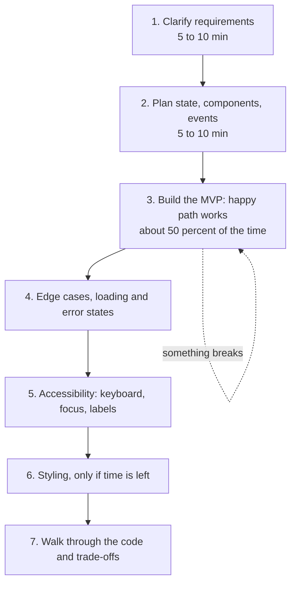
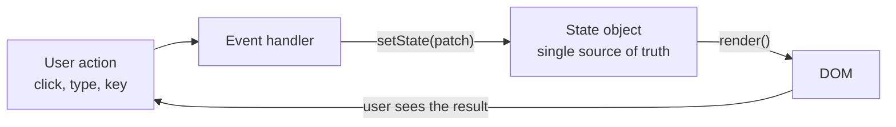
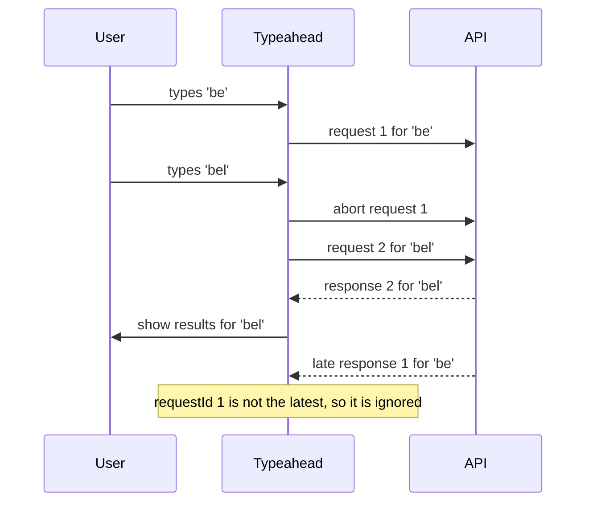
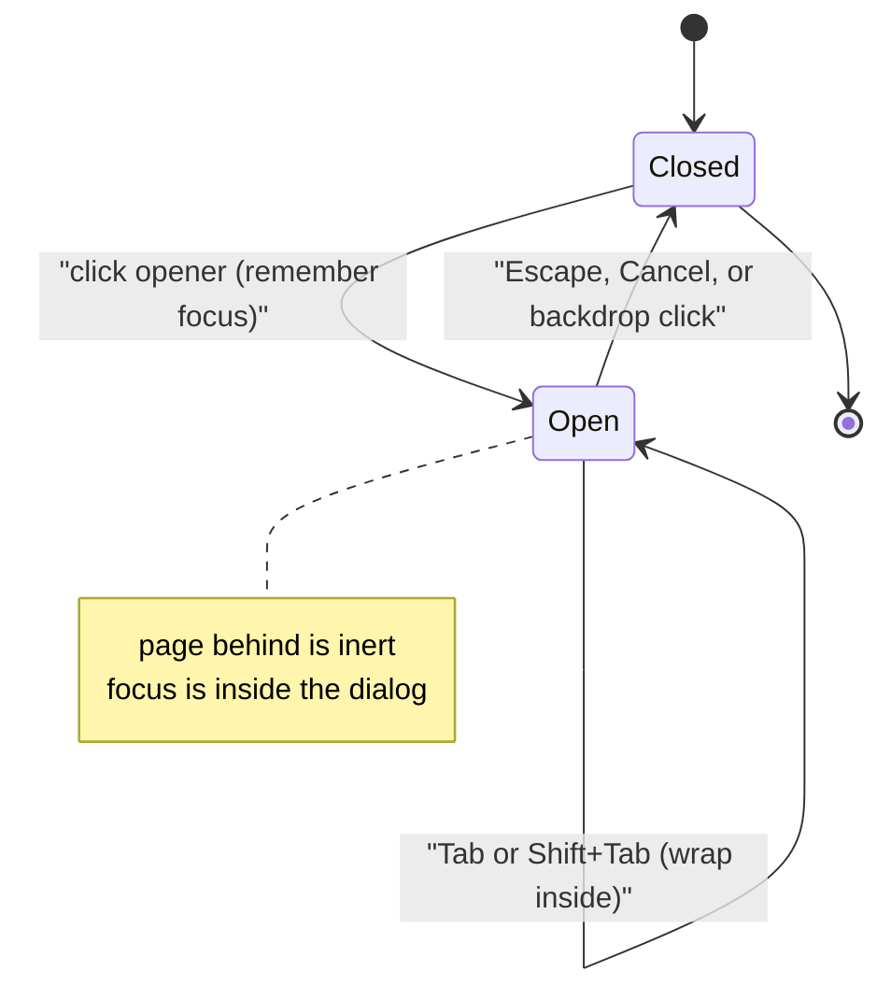
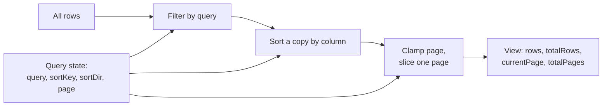
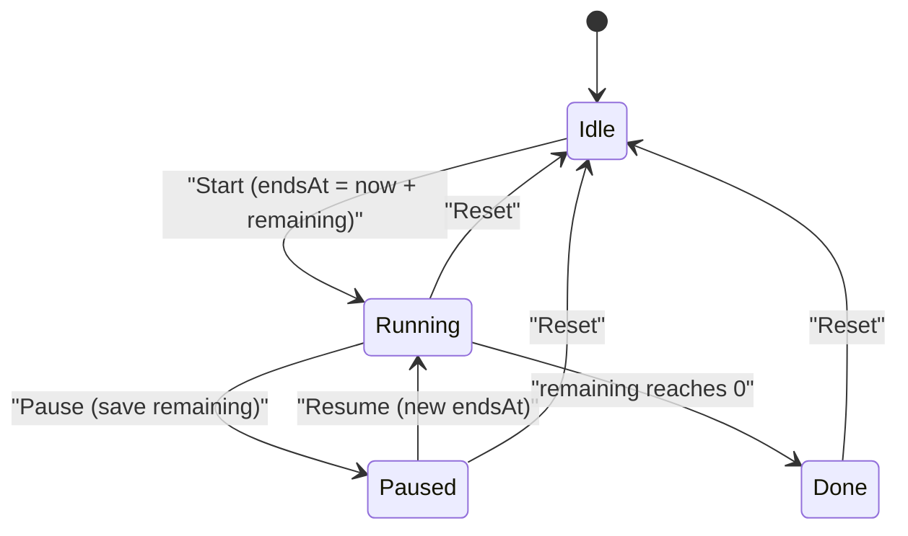

# Machine coding round

> In a machine coding round you build a small, working UI feature in 60 to 120 minutes, usually in plain JavaScript or a framework. This document teaches a repeatable method for the round, a code structure that stays clean under time pressure, and ten fully worked problems (plus two full Angular 16 versions), so you can walk in with patterns you have already built and tested.

**Before this:** [DOM and events](../05-frontend-engineering/03-dom-and-events.md) · [Accessibility](../05-frontend-engineering/04-accessibility.md) · [Components and state management](../05-frontend-engineering/06-components-and-state-management.md) · [Debounce and throttle](../02-javascript/20-debounce-throttle-and-performance.md) · **Interview questions:** [jump to the interview section](#interview-questions)

## Table of contents

1. [What a machine coding round is](#what-a-machine-coding-round-is)
2. [How you are evaluated](#how-you-are-evaluated)
3. [How to approach the round step by step](#how-to-approach-the-round-step-by-step)
4. [A code structure that works every time: state, render, events](#a-code-structure-that-works-every-time-state-render-events)
5. [Problem 1: Todo list with filters and localStorage](#problem-1-todo-list-with-filters-and-localstorage)
6. [Problem 2: Autocomplete typeahead](#problem-2-autocomplete-typeahead)
7. [Problem 3: Star rating](#problem-3-star-rating)
8. [Problem 4: Infinite scroll](#problem-4-infinite-scroll)
9. [Problem 5: Accessible modal dialog](#problem-5-accessible-modal-dialog)
10. [Problem 6: Tabs and accordion](#problem-6-tabs-and-accordion)
11. [Problem 7: Data table with sort, filter and pagination](#problem-7-data-table-with-sort-filter-and-pagination)
12. [Problem 8: File explorer tree and nested comments](#problem-8-file-explorer-tree-and-nested-comments)
13. [Problem 9: Countdown timer and stopwatch](#problem-9-countdown-timer-and-stopwatch)
14. [Problem 10: Multi-step form with validation](#problem-10-multi-step-form-with-validation)
15. [Angular 16 version: typeahead with RxJS switchMap](#angular-16-version-typeahead-with-rxjs-switchmap)
16. [Angular 16 version: data table with OnPush](#angular-16-version-data-table-with-onpush)
17. [Common pitfalls](#common-pitfalls)
18. [Interview questions](#interview-questions)
19. [Summary](#summary)
20. [References](#references)

---

## What a machine coding round is

A **machine coding round** is an interview where you write a real, running feature on a laptop. It is not a whiteboard algorithm question. The interviewer gives you a feature like "build an autocomplete" or "build a todo app with filters". You have a fixed time, usually 60 to 120 minutes. At the end, the feature must work in the browser.

Typical settings:

| Setting | What it looks like |
| --- | --- |
| Language | Plain HTML, CSS and JavaScript ("vanilla"), or the framework of the job (Angular, React, Vue) |
| Environment | Your own laptop, an online editor (CodeSandbox, StackBlitz), or a shared screen |
| Data | Hard-coded JSON, a fake API with `setTimeout`, or a real public API |
| Duration | 60 to 120 minutes, sometimes with a 15-minute discussion at the end |
| Discussion | "How would you scale this?", "How would you test it?", "What would you change with more time?" |

**Why companies use it:** an algorithm question shows if you can think. A machine coding round shows if you can *ship*. It tests things that daily frontend work needs: splitting a feature into pieces, managing state, handling async data, handling errors, keeping the UI accessible, and writing code another person can read.

**Analogy:** an algorithm round is like a driving theory test. A machine coding round is the practical driving test. You can know every rule and still fail if you cannot park the car in the time you have.

## How you are evaluated

Interviewers usually look at the same group of things. The exact weights differ by company, so treat this table as a checklist, not a scoring sheet.

| Area | What the interviewer looks for |
| --- | --- |
| **Working feature** | The core requirements work end to end. A small working app beats a big broken one. |
| **Code structure** | Clear separation of state, rendering and event handling. Small functions with good names. |
| **State management** | One source of truth. The UI is derived from state, not the other way round. |
| **Edge cases** | Empty input, empty results, very long text, fast clicking, slow or failed network. |
| **Async handling** | Loading and error states, cancelling stale requests, no race conditions. |
| **Accessibility** | Real buttons and labels, keyboard support, focus management, ARIA only where needed. |
| **Security** | User text is rendered with `textContent` or framework binding, never with `innerHTML`. |
| **Performance** | Event delegation, debouncing, no full re-render of 10,000 rows, no memory leaks. |
| **Communication** | You explain your plan, your trade-offs, and what you would do with more time. |

The single biggest mistake is spending 40 minutes on CSS and ending with half the logic. **Styling comes last.**

## How to approach the round step by step



### Step 1: Clarify requirements (5 to 10 minutes)

Ask questions before you type. The interviewer often leaves things vague on purpose to see if you ask. Good questions:

- **Scope:** "What is the must-have list? What is nice-to-have?"
- **Data:** "Where does the data come from? A local array or an API? What does one item look like?"
- **Behavior:** "What happens on empty input? On no results? On an API error?"
- **Constraints:** "Can I use a framework or libraries? Which browsers?"
- **Scale:** "How many items? 50 or 50,000?" (This decides if you need pagination or virtualization.)
- **Persistence:** "Should data survive a page reload?"

Then **repeat the requirements back** in one or two sentences. Example: "So: a text input, suggestions after 2 characters, debounced, keyboard navigation, and an error message if the API fails. Persistence is not needed. Correct?"

### Step 2: Plan (5 to 10 minutes)

Write a tiny plan as a comment at the top of your file. Three things:

1. **State shape** — what data changes over time?
2. **UI pieces** — which parts of the screen show that state?
3. **Events** — which user actions change the state?

```js
// PLAN: Todo app
// state:  { todos: [{ id, title, done }], filter: 'all' | 'active' | 'completed' }
// UI:     form (add), filter buttons, list, "N items left"
// events: submit form -> add | change checkbox -> toggle | click delete -> remove | click filter -> set filter
// later:  localStorage, empty state, focus handling
```

This takes two minutes and saves you from rewriting everything at minute 50.

### Step 3: Build the MVP first

**MVP** means "minimum viable product": the smallest version where the main flow works. Hard-code data if needed. Skip styling. Make it work, then make it nice.

- Get one item on the screen first. Then the list. Then one action. Then the next.
- Run the code often. Small steps make bugs easy to find.
- Keep `console.log` out of the final code, or remove it during the wrap-up.

### Step 4: Edge cases, loading and error states

Go through this list for every feature:

- Empty input (`''` and `'   '`).
- No results.
- Very long text (does the layout break?).
- Fast repeated actions (double click on "Submit", fast typing).
- Slow network (show "Loading…").
- Failed network (show an error and a way to retry).
- Special characters in user text (`<script>`, quotes, emoji).

### Step 5: Accessibility

You do not need to know every ARIA attribute. You need the basics right:

- Use native elements: `<button>`, `<input>`, `<label>`, `<form>`. They come with keyboard support.
- Every input has a label.
- Everything that works with the mouse also works with the keyboard.
- Focus goes somewhere sensible after an action (after deleting an item, after closing a modal).
- Announce important async changes with a live region (`role="status"`).

The full topic is in [Accessibility](../05-frontend-engineering/04-accessibility.md).

### Step 6: Styling (only if time is left)

A few lines of CSS for layout and a visible focus ring are enough. Never remove the focus outline without a replacement.

### Step 7: Wrap up and explain

Leave 5 to 10 minutes. Walk the interviewer through: the state shape, how render works, one edge case you handled, and what you would do next ("I would add tests for the pure functions, virtualize the list for 10,000 rows, and move the fetch into a service"). This is where you show seniority.

### A time plan for a 90-minute round

| Minutes | What you do |
| --- | --- |
| 0–10 | Clarify, repeat requirements, write the plan comment |
| 10–55 | MVP: markup, state, render, main events |
| 55–70 | Edge cases, loading/error, persistence |
| 70–80 | Keyboard and focus, labels, live region |
| 80–85 | Minimal CSS |
| 85–90 | Walk-through and "what I would do next" |

If you are running out of time, **say so early** and tell the interviewer what you will skip and why. "I will skip the animation and do keyboard support first, because it affects whether the feature can be used at all." That sentence alone shows good judgment.

### How to explain this in an interview

When the interviewer asks "How do you usually approach a machine coding problem?", use this structure:

1. **Define it:** "For me, the round is about shipping a small working feature with clean structure, not about clever tricks."
2. **Why it matters:** "A half-finished feature with perfect CSS is worth less than a plain feature that works and handles errors."
3. **How I work:** "I clarify the requirements, write a short plan with the state shape and events, build the happy path first, then add edge cases, accessibility and finally styling."
4. **Small example:** "For an autocomplete, my state is query, items, activeIndex, status. Typing changes the query, a debounced fetch fills items, arrow keys change activeIndex."
5. **Where it is useful:** "The same state, render, events structure works in vanilla JS and maps directly to Angular or React components."
6. **Trade-offs:** "Re-rendering a whole list is simple and fine for 100 items. For 10,000 items I would render only the changed rows or virtualize, and I say that out loud."

## A code structure that works every time: state, render, events

Most machine coding bugs come from one problem: **the truth lives in two places**. For example, the list of todos is in an array *and* in the DOM, and they drift apart. The fix is a simple rule:

> **State is the single source of truth. The DOM is only a picture of the state.**

Your code then has three parts:

1. **State** — a plain object that holds everything that can change.
2. **Render** — a function that reads the state and updates the DOM. It never reads data back from the DOM.
3. **Events** — handlers that turn user actions into a new state, then call render.



This is exactly what frameworks do for you. Angular runs change detection and updates the template from component fields. React re-runs your component function when state changes. When you write vanilla code in this shape, the interviewer immediately sees that you understand how frameworks work.

### The smallest possible example

```js
// HTML: <button type="button" id="increment">+1</button> <p id="count" aria-live="polite"></p>

// 1. State
let state = { count: 0 };

// 2. Render: state -> DOM
const output = document.querySelector('#count');
function render() {
  output.textContent = `Clicked ${state.count} times`;
}

// 3. Events: action -> new state -> render
function setState(patch) {
  state = { ...state, ...patch };
  render();
}
document.querySelector('#increment').addEventListener('click', () => {
  setState({ count: state.count + 1 });
});

render();
```

### Patterns you will reuse in every problem

| Pattern | What it means | Why it matters |
| --- | --- | --- |
| `setState(patch)` | Create a new state object, then render | One place where changes happen; easy to log and debug |
| **Event delegation** | One listener on the parent; find the item with `event.target.closest(...)` | Works for items added later; fewer listeners; less memory |
| `data-id` attributes | Store the item id on the element | Lets a delegated handler find which item was clicked |
| `textContent` / `createElement` | Build DOM safely | User text is never parsed as HTML, so no XSS |
| `replaceChildren(...)` | Replace a container's children in one call | Simple full re-render for small lists |
| Pure helper functions | `getTableView(rows, state)` returns data, no DOM | Easy to test, reusable in Angular or React |
| `create...(root, options)` returns `{ destroy }` | Each widget is a factory function | Several instances on one page; clean teardown, no leaks |

A quick refresher on delegation (the full topic is in [DOM and events](../05-frontend-engineering/03-dom-and-events.md)):

```js
// ❌ Wrong: one listener per item, and new items get no listener
document.querySelectorAll('.delete').forEach((button) => {
  button.addEventListener('click', onDelete);
});

// ✅ Correct: one listener on the list, works for current and future items
list.addEventListener('click', (event) => {
  const button = event.target.closest('button.delete');
  if (!button) return;                       // the click was somewhere else
  const id = button.closest('li').dataset.id;
  setState({ todos: state.todos.filter((t) => t.id !== id) });
});
```

> **Note on the code in this document:** every vanilla solution below was run in Node.js with jsdom (a browser DOM in Node) and automated tests that click, type and press keys. The two Angular solutions were compiled with the Angular 16.2 compiler using strict templates and run in the same way. You can copy them and they work.

---

## Problem 1: Todo list with filters and localStorage

**The task:** build a todo list. Add a todo, mark it done, delete it, filter by All / Active / Completed, show how many are left, and keep the todos after a page reload.

### Clarify

- Can titles be empty or only spaces? (No: trim and ignore.)
- Should the filter survive a reload too? (Usually not needed. Ask.)
- Edit a todo? (Often a nice-to-have. Mention it, build it last.)

### Plan

```js
// state:  { todos: [{ id, title, done }], filter: 'all' | 'active' | 'completed' }
// derived: visibleTodos (from todos + filter), itemsLeft
// events: submit -> add | change checkbox -> toggle | click delete -> remove | click filter -> setFilter
// side effect: every state change -> save todos to localStorage
```

Notice that `visibleTodos` is **derived** state. You do not store it. You compute it from `todos` and `filter` during render. Storing it would create a second source of truth that can drift.

### HTML

```html
<section class="todo" aria-labelledby="todo-title">
  <h2 id="todo-title">Todos</h2>
  <form class="todo-form">
    <label for="todo-input">New todo</label>
    <input id="todo-input" name="title" autocomplete="off" maxlength="200" required>
    <button type="submit">Add</button>
  </form>
  <div class="filters" role="group" aria-label="Filter todos">
    <button type="button" data-filter="all" aria-pressed="true">All</button>
    <button type="button" data-filter="active" aria-pressed="false">Active</button>
    <button type="button" data-filter="completed" aria-pressed="false">Completed</button>
  </div>
  <ul class="todo-list"></ul>
  <p class="todo-count" aria-live="polite"></p>
</section>
<script type="module">
  import { createTodoApp } from './todo.js';
  createTodoApp(document.querySelector('.todo'));
</script>
```

### CSS (the important parts)

```css
.todo-item { display: flex; gap: 0.5rem; align-items: center; }
.todo-item.done label { text-decoration: line-through; color: #555; }
.filters [aria-pressed="true"] { font-weight: 700; border-bottom: 2px solid currentColor; }
/* Never remove the focus ring without a replacement. */
button:focus-visible, input:focus-visible { outline: 3px solid #1a73e8; outline-offset: 2px; }
```

### JavaScript

```js
// todo.js
const STORAGE_KEY = 'todo-app:v1';

function isValidTodo(todo) {
  return (
    todo !== null &&
    typeof todo === 'object' &&
    typeof todo.id === 'string' &&
    typeof todo.title === 'string' &&
    typeof todo.done === 'boolean'
  );
}

function loadTodos(storage) {
  try {
    const parsed = JSON.parse(storage.getItem(STORAGE_KEY) ?? '[]');
    return Array.isArray(parsed) ? parsed.filter(isValidTodo) : [];
  } catch {
    return []; // broken JSON or storage blocked: start empty
  }
}

function saveTodos(storage, todos) {
  try {
    storage.setItem(STORAGE_KEY, JSON.stringify(todos));
  } catch {
    // Quota full or storage disabled: the app still works in memory.
  }
}

let idCounter = 0;
function createId() {
  return globalThis.crypto?.randomUUID?.() ?? `${Date.now()}-${idCounter++}`;
}

export function createTodoApp(root, { storage = window.localStorage } = {}) {
  const form = root.querySelector('.todo-form');
  const input = root.querySelector('#todo-input');
  const list = root.querySelector('.todo-list');
  const count = root.querySelector('.todo-count');
  const filterButtons = root.querySelectorAll('[data-filter]');

  // 1. State: the single source of truth.
  let state = { todos: loadTodos(storage), filter: 'all' };

  function setState(patch) {
    state = { ...state, ...patch };
    saveTodos(storage, state.todos);
    render();
  }

  function visibleTodos() {
    if (state.filter === 'active') return state.todos.filter((t) => !t.done);
    if (state.filter === 'completed') return state.todos.filter((t) => t.done);
    return state.todos;
  }

  // 2. Render: state -> DOM. Never read state back from the DOM.
  function renderItem(todo) {
    const li = document.createElement('li');
    li.dataset.id = todo.id;
    li.className = todo.done ? 'todo-item done' : 'todo-item';

    const checkbox = document.createElement('input');
    checkbox.type = 'checkbox';
    checkbox.id = `todo-${todo.id}`;
    checkbox.checked = todo.done;

    const label = document.createElement('label');
    label.htmlFor = checkbox.id;
    label.textContent = todo.title; // textContent: user text is never parsed as HTML

    const remove = document.createElement('button');
    remove.type = 'button';
    remove.className = 'delete';
    remove.textContent = 'Delete';
    remove.setAttribute('aria-label', `Delete ${todo.title}`);

    li.append(checkbox, label, remove);
    return li;
  }

  function render() {
    const focusedId = document.activeElement?.id; // keep keyboard focus after re-render
    const items = visibleTodos();

    if (items.length === 0) {
      const empty = document.createElement('li');
      empty.className = 'empty';
      empty.textContent = state.todos.length === 0 ? 'No todos yet.' : 'Nothing in this filter.';
      list.replaceChildren(empty);
    } else {
      list.replaceChildren(...items.map(renderItem));
    }

    filterButtons.forEach((button) => {
      button.setAttribute('aria-pressed', String(button.dataset.filter === state.filter));
    });

    const left = state.todos.filter((t) => !t.done).length;
    count.textContent = `${left} ${left === 1 ? 'item' : 'items'} left`;

    if (focusedId) document.getElementById(focusedId)?.focus();
  }

  // 3. Events: user action -> new state. One delegated listener per type.
  form.addEventListener('submit', (event) => {
    event.preventDefault();
    const title = input.value.trim();
    if (!title) return;
    setState({ todos: [...state.todos, { id: createId(), title, done: false }] });
    input.value = '';
    input.focus();
  });

  list.addEventListener('change', (event) => {
    const checkbox = event.target.closest('input[type="checkbox"]');
    if (!checkbox) return;
    const id = checkbox.closest('li').dataset.id;
    setState({
      todos: state.todos.map((t) => (t.id === id ? { ...t, done: checkbox.checked } : t)),
    });
  });

  list.addEventListener('click', (event) => {
    const button = event.target.closest('button.delete');
    if (!button) return;
    const id = button.closest('li').dataset.id;
    setState({ todos: state.todos.filter((t) => t.id !== id) });
    input.focus(); // the focused button is gone, so move focus somewhere useful
  });

  root.querySelector('.filters').addEventListener('click', (event) => {
    const button = event.target.closest('[data-filter]');
    if (button) setState({ filter: button.dataset.filter });
  });

  render();
  return { getState: () => state };
}
```

### Walkthrough: what happens when the user adds "Buy milk"

1. The user types "Buy milk" and presses Enter. The browser fires `submit` on the form. (A `<form>` gives you Enter-to-submit for free.)
2. The handler calls `event.preventDefault()`, so the page does not reload.
3. `title` becomes `'Buy milk'` after `trim()`. It is not empty, so we continue.
4. `setState` creates a **new** state object with a new `todos` array. The old array is not changed.
5. `saveTodos` writes the array to `localStorage` as JSON. If storage is full or blocked, the `try/catch` swallows the error and the app keeps working in memory.
6. `render()` builds a fresh `<li>` for each visible todo with `createElement` and `textContent`, and swaps them in with `replaceChildren`.
7. The counter now says "1 item left". It is inside `aria-live="polite"`, so screen readers announce it.
8. The input is cleared and focused again, ready for the next todo.

### Details that interviewers notice

- **Validation on load.** `localStorage` can contain anything: old formats, broken JSON, data from another version of the app. `loadTodos` parses inside `try/catch` and keeps only valid items.
- **Focus after re-render.** `replaceChildren` destroys the old checkbox. If a keyboard user just toggled it, their focus would be lost. `render` remembers the focused element's `id` and focuses the new element with the same id.
- **Focus after delete.** The delete button is gone after deleting, so focus moves to the input.
- **`aria-pressed` on filter buttons** tells screen readers which filter is on.
- **Unique ids.** `crypto.randomUUID()` exists in modern browsers on secure origins (HTTPS and `localhost`). The fallback keeps the code working elsewhere.
- **Storage key with a version** (`todo-app:v1`): if you change the data shape later, you can migrate or ignore old data.

### How you would build it in Angular

- A `TodoStore` service holds `todos` (for example in a `BehaviorSubject`, or a signal in Angular 16 developer preview) and saves to `localStorage` on change.
- A `TodoListComponent` with `ChangeDetectionStrategy.OnPush` gets `todos$ | async`. Each todo is rendered with `*ngFor="let todo of visible; trackBy: trackById"`.
- The form is a Reactive Form with `Validators.required` and a custom "not only spaces" validator.
- Filtering is a pure function or a `computed` value, never a second stored array.
- Angular interpolation `{{ todo.title }}` escapes HTML, so XSS is handled by the framework.

### Follow-up questions

- **"Why not store the HTML of the list in localStorage?"** — Because state is the truth and HTML is just a picture of it. HTML in storage is bigger, harder to migrate, and if you put it back with `innerHTML` you create an XSS hole.
- **"How would you sync the list across two open tabs?"** — Listen to the `storage` event on `window`. It fires in *other* tabs when one tab writes to `localStorage`. In the handler, reload the todos and render.
- **"How would you add editing?"** — Add `editingId` to state. On double click or an "Edit" button, render an `<input>` for that item. Save on Enter or blur, cancel on Escape, and validate the same way as when adding.

---

## Problem 2: Autocomplete typeahead

This is one of the most common machine coding problems because it touches almost everything: async code, debouncing, caching, race conditions, keyboard handling and accessibility.

**The task:** a text input that shows suggestions from an API while the user types. Suggestions appear after 2 characters. The user can pick one with the mouse or the keyboard.

### Clarify

- Minimum characters before searching? (2 is common.)
- Debounce delay? (200 to 300 ms is common.)
- What if the API fails or returns nothing? (Show a message, keep the input usable.)
- Highlight the matching part? (Nice-to-have; do it safely.)

### Plan

```js
// state:   { query, items, activeIndex, open, status: 'idle' | 'loading' | 'success' | 'empty' | 'error' }
// helpers: cache (Map), timerId (debounce), controller (AbortController), latestRequest (id)
// events:  input -> debounce -> search | ArrowUp/Down -> activeIndex | Enter -> select | Escape/blur -> close
```

### The four problems inside this problem

1. **Too many requests.** Typing "berlin" fires 6 input events. **Debounce** waits until the user pauses (for example 300 ms), then searches once. See [Debounce and throttle](../02-javascript/20-debounce-throttle-and-performance.md).
2. **Repeated requests.** The user types "ber", deletes, types "ber" again. A **cache** (`Map` of query to results) answers the second time with no network call.
3. **Stale responses (race condition).** The user types "be", then "bel". The request for "be" is slow and answers *after* "bel". Without protection, the screen shows results for "be" while the input says "bel". We fix it twice: `AbortController` cancels the old request, and a **request id** ignores any old answer that still arrives.
4. **Keyboard and screen readers.** The input uses the ARIA **combobox** pattern: `role="combobox"`, `aria-expanded`, `aria-controls`, and `aria-activedescendant` pointing at the highlighted option. Focus stays in the input the whole time.



### HTML

```html
<div class="typeahead">
  <label for="city-input">City</label>
  <input id="city-input" type="text" autocomplete="off"
         role="combobox" aria-autocomplete="list"
         aria-expanded="false" aria-controls="city-listbox">
  <ul id="city-listbox" role="listbox" aria-label="City suggestions" hidden></ul>
  <p class="visually-hidden" role="status" aria-live="polite"></p>
</div>
<script type="module">
  import { createTypeahead } from './typeahead.js';

  createTypeahead(document.querySelector('.typeahead'), {
    async fetchSuggestions(query, signal) {
      // encodeURIComponent: a query like "São Paulo & co" must not break the URL
      const response = await fetch(`/api/cities?q=${encodeURIComponent(query)}`, { signal });
      if (!response.ok) throw new Error(`HTTP ${response.status}`);
      return response.json(); // ["Berlin", "Bern", ...]
    },
    onSelect: (city) => console.log('Selected', city),
  });
</script>
```

### CSS (the important parts)

```css
.typeahead { position: relative; max-width: 20rem; }
[role="listbox"] { position: absolute; inset-inline: 0; margin: 0; padding: 0; list-style: none;
                   border: 1px solid #888; background: #fff; max-height: 15rem; overflow-y: auto; z-index: 10; }
[role="option"] { padding: 0.4rem 0.6rem; cursor: pointer; }
[role="option"][aria-selected="true"], [role="option"]:hover { background: #e8f0fe; }
mark { background: none; font-weight: 700; color: inherit; }
.visually-hidden { position: absolute; width: 1px; height: 1px; overflow: hidden;
                   clip-path: inset(50%); white-space: nowrap; }
```

### JavaScript

```js
// typeahead.js
export function createTypeahead(root, {
  fetchSuggestions,       // (query, signal) => Promise<string[]>
  onSelect = () => {},
  debounceMs = 300,
  minChars = 2,
  maxCacheSize = 50,
}) {
  const input = root.querySelector('[role="combobox"]');
  const listbox = root.querySelector('[role="listbox"]');
  const status = root.querySelector('[role="status"]');

  let state = { query: '', items: [], activeIndex: -1, open: false, status: 'idle' };
  const cache = new Map();     // normalized query -> results
  let timerId = null;
  let controller = null;       // AbortController of the request in flight
  let latestRequest = 0;       // request id: only the latest response may win
  const listeners = new AbortController(); // removes every listener in destroy()

  function setState(patch) {
    state = { ...state, ...patch };
    render();
  }

  function remember(key, items) {
    cache.delete(key);
    cache.set(key, items);
    if (cache.size > maxCacheSize) cache.delete(cache.keys().next().value); // drop oldest
  }

  async function search(query) {
    const key = query.toLowerCase();
    if (cache.has(key)) {
      const items = cache.get(key);
      remember(key, items); // mark as recently used
      setState({ items, open: true, activeIndex: -1, status: items.length ? 'success' : 'empty' });
      return;
    }

    controller?.abort();                 // cancel the older request (saves bandwidth)
    controller = new AbortController();
    const requestId = ++latestRequest;   // and ignore it if it still answers
    setState({ status: 'loading', open: true });

    try {
      const items = await fetchSuggestions(query, controller.signal);
      if (requestId !== latestRequest) return; // stale response: drop it
      remember(key, items);
      setState({ items, activeIndex: -1, status: items.length ? 'success' : 'empty' });
    } catch (error) {
      if (error.name === 'AbortError' || requestId !== latestRequest) return;
      setState({ items: [], status: 'error' });
    }
  }

  function close() {
    setState({ open: false, activeIndex: -1 });
  }

  function select(index) {
    const value = state.items[index];
    if (value === undefined) return;
    input.value = value;
    setState({ query: value, open: false, activeIndex: -1 });
    onSelect(value);
  }

  // Wrap the matching part in <mark> without using innerHTML.
  function highlight(text, query) {
    const fragment = document.createDocumentFragment();
    const start = text.toLowerCase().indexOf(query.toLowerCase());
    if (!query || start === -1) {
      fragment.append(text);
      return fragment;
    }
    const mark = document.createElement('mark');
    mark.textContent = text.slice(start, start + query.length);
    fragment.append(text.slice(0, start), mark, text.slice(start + query.length));
    return fragment;
  }

  function render() {
    const showList = state.open && state.items.length > 0 && state.status === 'success';
    listbox.hidden = !showList;
    input.setAttribute('aria-expanded', String(showList));

    listbox.replaceChildren(...state.items.map((item, index) => {
      const option = document.createElement('li');
      option.id = `${listbox.id}-option-${index}`;
      option.setAttribute('role', 'option');
      option.setAttribute('aria-selected', String(index === state.activeIndex));
      option.dataset.index = String(index);
      option.append(highlight(item, state.query));
      return option;
    }));

    if (showList && state.activeIndex >= 0) {
      input.setAttribute('aria-activedescendant', `${listbox.id}-option-${state.activeIndex}`);
    } else {
      input.removeAttribute('aria-activedescendant');
    }

    const messages = {
      idle: '',
      loading: 'Loading suggestions…',
      empty: 'No matches found.',
      error: 'Could not load suggestions. Keep typing to try again.',
      success: `${state.items.length} suggestions available. Use up and down arrows to choose.`,
    };
    status.textContent = state.open ? messages[state.status] : '';
  }

  const on = { signal: listeners.signal };

  input.addEventListener('input', () => {
    const query = input.value.trim();
    state = { ...state, query }; // no render yet: we wait for results
    clearTimeout(timerId);
    if (query.length < minChars) {
      controller?.abort();
      latestRequest++; // any response still on the way is now stale
      setState({ items: [], open: false, activeIndex: -1, status: 'idle' });
      return;
    }
    timerId = setTimeout(() => search(query), debounceMs);
  }, on);

  input.addEventListener('keydown', (event) => {
    const count = state.items.length;
    if (event.key === 'ArrowDown' && count > 0) {
      event.preventDefault(); // stop the cursor from jumping in the input
      setState({ open: true, activeIndex: (state.activeIndex + 1) % count });
    } else if (event.key === 'ArrowUp' && count > 0) {
      event.preventDefault();
      setState({ open: true, activeIndex: (state.activeIndex - 1 + count) % count });
    } else if (event.key === 'Enter' && state.open && state.activeIndex >= 0) {
      event.preventDefault(); // do not submit the surrounding form
      select(state.activeIndex);
    } else if (event.key === 'Escape') {
      close();
    }
  }, on);

  // mousedown + preventDefault keeps focus in the input, so blur does not close the list first.
  listbox.addEventListener('mousedown', (event) => event.preventDefault(), on);
  listbox.addEventListener('click', (event) => {
    const option = event.target.closest('[role="option"]');
    if (option) select(Number(option.dataset.index));
  }, on);
  input.addEventListener('blur', close, on);

  render();

  return {
    destroy() {
      clearTimeout(timerId);
      controller?.abort();
      listeners.abort();
    },
  };
}
```

### Walkthrough: the user types "ber" quickly, then presses ArrowDown and Enter

1. Each keystroke fires `input`. The handler trims the value and clears the previous timer. For "b" (1 character) it closes the list and stops.
2. For "be" and then "ber", a new 300 ms timer starts each time. Only the last timer survives, so only `search('ber')` runs.
3. `search` checks the cache. It is empty, so it aborts any old request, creates a new `AbortController`, and sets `requestId = ++latestRequest`.
4. Status becomes `'loading'`. The live region says "Loading suggestions…".
5. The response arrives. `requestId === latestRequest`, so it is fresh. We store it in the cache and render the options. Each option's text is built with text nodes and a `<mark>` element — never `innerHTML`.
6. ArrowDown sets `activeIndex` to 0. `aria-activedescendant` on the input now points at the first option's id. A screen reader announces that option, even though focus never left the input.
7. Enter calls `select(0)`: the input gets the value, the list closes, and `onSelect` tells the outside world.

### Details that interviewers notice

- **`mousedown` + `preventDefault()` on the listbox.** Clicking an option would normally blur the input first. Blur closes the list, so the click would land on nothing. Preventing the default on `mousedown` keeps focus in the input.
- **`event.preventDefault()` on ArrowUp/ArrowDown** stops the text cursor from jumping to the start or end of the input.
- **Enter inside a form** would submit the form. We prevent it only when an option is active.
- **The cache is bounded.** A `Map` remembers insertion order, so the first key is the oldest. When the cache grows past 50 entries, we delete the oldest. Re-inserting on a hit makes it a simple LRU (least recently used) cache. A full LRU implementation is in [Polyfills and implementations](04-javascript-polyfills-and-implementations.md).
- **Errors are not cached.** Only successful results go into the cache, so the next search can retry.
- **`destroy()`** clears the timer, aborts the request, and removes all listeners with one `AbortController`. In a single-page app, widgets come and go; forgetting this causes memory leaks.
- **`encodeURIComponent`** in the fetch URL. A query like `a&b=c` must not change the URL's meaning.

### How you would build it in Angular

In Angular, RxJS gives you most of this in a few operators: `debounceTime`, `distinctUntilChanged`, and `switchMap` (which unsubscribes from the old request when a new term arrives — that is the stale-response fix). The full, tested component is in [Angular 16 version: typeahead with RxJS switchMap](#angular-16-version-typeahead-with-rxjs-switchmap).

### Follow-up questions

- **"Debounce or throttle for search?"** — Debounce. You want one request after the user pauses. Throttle would send requests at a fixed rate while typing, which wastes calls on half-typed words. Throttle fits scroll and resize handlers.
- **"Is AbortController alone enough?"** — Usually, but not always. Some code paths cannot be aborted (a cached promise, a library that ignores the signal). The request-id check is a cheap second guard that makes the "latest wins" rule always true.
- **"How would you do this for 1 million cities?"** — The server does the search with an index (prefix index, trie, or a search engine). The client sends short, debounced queries and limits results to 10. See [Autocomplete search case study](../09-system-design/11-case-study-autocomplete-search.md).
- **"Why `aria-activedescendant` and not moving focus to the option?"** — The user is still typing. If focus moved to the option, the next keystroke would not reach the input. `aria-activedescendant` lets screen readers follow the highlight while focus stays in the input.

---

## Problem 3: Star rating

**The task:** a 1 to 5 star rating. Hover shows a preview. Click sets the value. It must work with the keyboard and be read correctly by screen readers. Some versions also ask for a read-only mode.

### The key idea: radio buttons underneath

A star rating is "choose one value from a small set". That is exactly what a **radio group** is. If you build it from `<input type="radio">` inside a `<fieldset>`, you get for free:

- Arrow keys move between stars and select them.
- Tab enters and leaves the group as one stop.
- Screen readers say "Rate this product, group. 3 stars, radio button, 3 of 5, selected".

The stars are only visual labels. A common wrong answer is five `<span>` elements with click handlers: no keyboard support and nothing for screen readers.

### Plan

```js
// state:  { value, hover }   (hover = star under the mouse, 0 if none)
// render: star i is filled when i <= (hover || value)
// events: change on radio -> value | mouseover star -> hover | mouseleave group -> hover = 0
```

### HTML

```html
<div id="product-rating"></div>
<script type="module">
  import { createStarRating } from './star-rating.js';
  createStarRating(document.getElementById('product-rating'), {
    label: 'Rate this product',
    onChange: (value) => console.log('New rating', value),
  });
</script>
```

### CSS

```css
.star-rating { border: 0; padding: 0; display: inline-flex; gap: 0.25rem; }
.star-rating label { font-size: 2rem; cursor: pointer; color: #9e9e9e; }
.star-rating label.filled { color: #b26a00; } /* dark amber: readable contrast on white */
.star-rating input:focus-visible + label { outline: 3px solid #1a73e8; outline-offset: 2px; }
.star-rating:disabled label { cursor: default; }
```

### JavaScript

```js
// star-rating.js
let instanceCount = 0;

export function createStarRating(root, {
  label = 'Rating',
  max = 5,
  value = 0,
  readOnly = false,
  onChange = () => {},
} = {}) {
  const name = `rating-${++instanceCount}`; // unique radio group name per instance
  let state = { value, hover: 0 };

  // Native radio buttons give us keyboard support (arrow keys) and
  // screen reader support ("3 of 5, selected") for free.
  const fieldset = document.createElement('fieldset');
  fieldset.className = 'star-rating';
  fieldset.disabled = readOnly;

  const legend = document.createElement('legend');
  legend.textContent = label;
  fieldset.append(legend);

  for (let star = 1; star <= max; star++) {
    const id = `${name}-${star}`;
    const radio = document.createElement('input');
    radio.type = 'radio';
    radio.name = name;
    radio.id = id;
    radio.value = String(star);
    radio.className = 'visually-hidden';
    radio.setAttribute('aria-label', `${star} ${star === 1 ? 'star' : 'stars'}`);

    const starLabel = document.createElement('label');
    starLabel.htmlFor = id;
    starLabel.dataset.star = String(star);
    const icon = document.createElement('span');
    icon.setAttribute('aria-hidden', 'true'); // the glyph is decoration only
    icon.textContent = '★';
    starLabel.append(icon);

    fieldset.append(radio, starLabel);
  }

  const text = document.createElement('p');
  text.className = 'star-rating-text';
  root.replaceChildren(fieldset, text);

  function render() {
    const shown = state.hover || state.value; // hover preview wins while the mouse is over
    fieldset.querySelectorAll('label[data-star]').forEach((starLabel) => {
      starLabel.classList.toggle('filled', Number(starLabel.dataset.star) <= shown);
    });
    fieldset.querySelectorAll('input').forEach((radio) => {
      radio.checked = Number(radio.value) === state.value;
    });
    text.textContent = state.value ? `${state.value} out of ${max}` : 'Not rated yet';
  }

  fieldset.addEventListener('change', (event) => {
    state = { ...state, value: Number(event.target.value) };
    render();
    onChange(state.value);
  });

  fieldset.addEventListener('mouseover', (event) => {
    const starLabel = event.target.closest('label[data-star]');
    if (!starLabel || readOnly) return;
    state = { ...state, hover: Number(starLabel.dataset.star) };
    render();
  });

  fieldset.addEventListener('mouseleave', () => {
    state = { ...state, hover: 0 };
    render();
  });

  render();

  return {
    getValue: () => state.value,
    setValue(next) {
      state = { ...state, value: Math.max(0, Math.min(max, Math.round(next))) };
      render();
    },
  };
}
```

### Walkthrough

1. `createStarRating` builds a `<fieldset>` with a `<legend>` and five radio + label pairs. Each radio has an accessible name like "3 stars". The star glyph is `aria-hidden` because "black star" is not useful to hear.
2. Clicking a label checks its radio. The radio fires `change`, which bubbles to the fieldset. The handler sets `value` and calls `onChange`.
3. Keyboard: the user tabs into the group and presses ArrowRight. The browser checks the next radio and fires `change`. We did not write any key handling.
4. `mouseover` on a label sets `hover`. Render fills all stars up to `hover`. `mouseleave` resets `hover` to 0, so the real value shows again.
5. `readOnly: true` sets `fieldset.disabled`, which disables all radios at once.

### Details that interviewers notice

- **`instanceCount` gives each widget a unique radio `name`.** Two ratings on one page with the same name would share one group, and choosing in one would clear the other.
- **The visually hidden class** keeps the radios available to the keyboard and screen readers while hiding them visually. `display: none` would remove them from both.
- **Focus ring:** `input:focus-visible + label` draws the ring on the star, because the real input is invisible.
- **Contrast:** the filled star color must stand out against the background (WCAG asks 3:1 for meaningful graphics).

### How you would build it in Angular

Build it as a form control: implement `ControlValueAccessor` so it works with `formControlName="rating"` like any input. Inputs: `max`, `readOnly`. Output via the CVA `onChange` callback. The template uses `*ngFor` over `[1, 2, 3, 4, 5]` with the same radio + label markup. See [Forms](../06-angular-16/07-forms.md).

### Follow-up questions

- **"How would you support half stars?"** — Use 10 radios with values 0.5 to 5, and draw each star as two halves (two labels clipped to the left and right half). The radio approach still works; only the visuals change.
- **"Can the user clear the rating?"** — Native radios cannot be unchecked by clicking. Add a "Clear rating" button, or a hidden 0-star radio. Do not hack a second click on the same star, because keyboard users cannot do that.

---

## Problem 4: Infinite scroll

**The task:** show a feed of posts. When the user scrolls near the bottom, load the next page automatically. Show loading, error and "end of list" states.

### Why IntersectionObserver and not a scroll listener

The old way was `window.addEventListener('scroll', ...)` and checking `scrollTop + clientHeight >= scrollHeight - 300` on every scroll event. Problems:

- The scroll event fires many times per second, and the check reads layout values, which can force the browser to recalculate layout.
- You must add throttling yourself.

An **IntersectionObserver** asks the browser: "Tell me when this element comes near the viewport." The browser does the geometry work efficiently and calls you only when visibility changes. You put a small **sentinel** element after the list and observe it. `rootMargin: '300px'` means "tell me 300 px *before* it is visible", so loading starts early and the user rarely sees a spinner.

**Analogy:** a scroll listener is like asking "are we there yet?" every second during a car trip. An IntersectionObserver is like the GPS saying "you arrive in 300 meters" once.

### Plan

```js
// state:  { page, loading, error, hasMore }
// DOM:    list (append only), status (live region), "Load more" button = sentinel
// events: sentinel visible -> loadNextPage | click "Load more"/"Try again" -> loadNextPage
// guards: no double loading, stop when hasMore is false, no auto-retry after an error
```

### HTML

```html
<section class="feed" aria-labelledby="feed-title">
  <h2 id="feed-title">Latest posts</h2>
  <ul class="feed-list" aria-busy="false"></ul>
  <p class="feed-status" role="status" aria-live="polite"></p>
  <button type="button" class="feed-load-more">Load more</button>
</section>
<script type="module">
  import { createInfiniteList } from './infinite-list.js';

  createInfiniteList(document.querySelector('.feed'), {
    async fetchPage(page, signal) {
      const response = await fetch(`/api/posts?page=${page}&limit=20`, { signal });
      if (!response.ok) throw new Error(`HTTP ${response.status}`);
      return response.json(); // { items: [{ id, title }], hasMore: true }
    },
    renderItem(post) {
      const li = document.createElement('li');
      li.textContent = post.title;
      return li;
    },
  });
</script>
```

### JavaScript

```js
// infinite-list.js
export function createInfiniteList(root, {
  fetchPage,          // (page, signal) => Promise<{ items: Array, hasMore: boolean }>
  renderItem,         // (item) => HTMLElement
  rootMargin = '300px',
}) {
  const list = root.querySelector('.feed-list');
  const status = root.querySelector('.feed-status');
  const loadMoreButton = root.querySelector('.feed-load-more');

  let state = { page: 0, loading: false, error: null, hasMore: true };
  const controller = new AbortController();

  // The "Load more" button is also the sentinel. Mouse and touch users get
  // automatic loading; keyboard users can still press the button.
  const observer = new IntersectionObserver((entries) => {
    const visible = entries.some((entry) => entry.isIntersecting);
    if (visible && !state.error) loadNextPage(); // after an error, wait for "Try again"
  }, { rootMargin });

  async function loadNextPage() {
    if (state.loading || !state.hasMore) return; // guard: never load the same page twice
    state = { ...state, loading: true, error: null };
    render();

    try {
      const nextPage = state.page + 1;
      const { items, hasMore } = await fetchPage(nextPage, controller.signal);
      // Append only the new items. Re-rendering the whole list would get slower each page.
      list.append(...items.map(renderItem));
      state = { ...state, page: nextPage, loading: false, hasMore };
    } catch (error) {
      if (error.name === 'AbortError') return;
      state = { ...state, loading: false, error: 'Could not load more items.' };
    }
    render();

    if (state.hasMore && !state.error) {
      // If the page was short, the sentinel may still be on screen. The observer
      // only fires on changes, so observe again: that always fires once with the current state.
      observer.unobserve(loadMoreButton);
      observer.observe(loadMoreButton);
    }
  }

  function render() {
    list.setAttribute('aria-busy', String(state.loading));
    if (state.loading) status.textContent = 'Loading more items…';
    else if (state.error) status.textContent = state.error;
    else if (!state.hasMore) status.textContent = 'You have reached the end.';
    else status.textContent = '';

    loadMoreButton.hidden = !state.hasMore;
    // aria-disabled (not disabled) so a keyboard user's focus stays on the button.
    loadMoreButton.setAttribute('aria-disabled', String(state.loading));
    loadMoreButton.textContent = state.error ? 'Try again' : 'Load more';
    if (!state.hasMore) observer.disconnect(); // nothing left to watch
  }

  observer.observe(loadMoreButton);
  loadMoreButton.addEventListener('click', loadNextPage, { signal: controller.signal });
  render();

  return {
    destroy() {
      observer.disconnect();
      controller.abort(); // cancels the request in flight and removes the click listener
    },
  };
}
```

### Walkthrough

1. On start, the observer watches the "Load more" button. Nothing loads until it comes within 300 px of the viewport.
2. The user scrolls down. The observer callback runs with `isIntersecting: true` and calls `loadNextPage()`.
3. The guard `if (state.loading || !state.hasMore) return` blocks duplicate calls. Observers can fire twice quickly, and the user can also click the button.
4. `aria-busy="true"` on the list and "Loading more items…" in the live region tell screen reader users what is happening.
5. The new items are **appended**. We do not re-render old items, so page 20 is as fast as page 1.
6. After loading, we call `unobserve` and `observe` again. Why? If the page was short, the sentinel can still be on screen. An observer only fires on *changes*, so it would never fire again and the feed would stop. Observing again always delivers one fresh entry with the current state.
7. When the server says `hasMore: false`, the button hides, the observer disconnects, and the status says "You have reached the end."
8. On error, the button text becomes "Try again". The observer does **not** retry automatically, otherwise a broken API would be called in a tight loop.

### Details that interviewers notice

- **Keyboard and screen reader users** may never "scroll near the bottom" the way a mouse user does. Making the sentinel a real "Load more" button gives them a way to load more.
- **`aria-disabled` instead of `disabled`** while loading. A disabled button loses focus in some browsers, and the keyboard user is thrown back to the top of the page.
- **`renderItem` uses `textContent`.** Posts are user-generated content.
- **Memory and DOM size.** After 50 pages you might have 1,000 DOM nodes. For very long feeds, use **virtualization** (render only the visible rows plus a buffer) or remove pages far above the viewport. See [News feed and infinite scroll case study](../09-system-design/12-case-study-news-feed-infinite-scroll.md).
- **Duplicate items.** If new posts are added at the top while you page with `page=2`, items shift and you see duplicates. Real feeds use **cursor-based pagination** (`?after=<lastId>`), not page numbers.

### How you would build it in Angular

A `FeedComponent` keeps `posts: Post[]` and a `loading` flag. A small `appInViewport` attribute directive wraps an `IntersectionObserver` and emits an `@Output() visible` event; it disconnects the observer in `ngOnDestroy`. The component appends with `this.posts = [...this.posts, ...page.items]` (new reference for OnPush) and renders with `*ngFor` + `trackBy`. For very long lists, the Angular CDK `cdk-virtual-scroll-viewport` gives virtualization.

### Follow-up questions

- **"How do you restore the scroll position when the user goes back?"** — Keep the loaded items and the scroll offset in a service or in `history.state`. When the user comes back, render the saved items first, then scroll to the saved offset. Without that, the user lands at the top.
- **"Infinite scroll or pagination — which is better?"** — Infinite scroll fits feeds that people browse. Pagination fits search results and tables where people want to find a specific place again, share a link to page 3, or reach the footer.

---

## Problem 5: Accessible modal dialog

**The task:** a "Delete account?" confirmation dialog. It opens from a button, has Cancel and Delete buttons, closes on Escape and on a backdrop click, and is fully keyboard accessible.

### What "accessible modal" means

A modal blocks the page until the user answers. For keyboard and screen reader users, that means five rules:

1. **Move focus into the dialog** when it opens.
2. **Trap focus inside.** Tab and Shift+Tab cycle through the dialog's buttons and never reach the page behind it.
3. **Escape closes it.**
4. **The page behind is inert:** not clickable, not focusable, hidden from screen readers.
5. **Return focus to the button that opened it** when it closes. Without this, keyboard users are thrown back to the top of the page.

Plus the markup: `role="dialog"`, `aria-modal="true"`, and `aria-labelledby` pointing at the title.



### The modern shortcut: native `<dialog>`

All current major browsers support the `<dialog>` element. `dialog.showModal()` does most of the work for you:

```html
<button type="button" id="open-delete">Delete account</button>

<dialog id="delete-dialog" aria-labelledby="dialog-title">
  <h2 id="dialog-title">Delete your account?</h2>
  <p>This removes all your data. You cannot undo this.</p>
  <form method="dialog">
    <button value="cancel" autofocus>Cancel</button>
    <button value="confirm">Delete account</button>
  </form>
</dialog>

<script type="module">
  const dialog = document.getElementById('delete-dialog');
  document.getElementById('open-delete').addEventListener('click', () => dialog.showModal());
  dialog.addEventListener('close', () => {
    if (dialog.returnValue === 'confirm') {
      // call the API
    }
  });
</script>
```

With `showModal()` the browser puts the dialog in the **top layer** (above everything, no `z-index` fights), makes the rest of the page inert, closes it on Escape, and shows a `::backdrop` you can style. A `<form method="dialog">` closes the dialog and sets `returnValue` to the clicked button's value. Most current browsers also move focus back to the opener on close, but many teams still restore focus explicitly to be safe. Backdrop click to close is not built in everywhere; you add it with a click listener that checks if the click landed outside the dialog's box.

**In an interview, mention `<dialog>` first.** Then, if the interviewer says "build it yourself", build the version below. It shows you know what `<dialog>` does for you.

### HTML (custom version)

```html
<div id="app">
  <h1>Account settings</h1>
  <button type="button" id="open-delete">Delete account</button>
</div>

<!-- The overlay is a sibling of #app, so making #app inert does not affect the dialog. -->
<div class="modal-overlay" hidden>
  <div class="modal" role="dialog" aria-modal="true"
       aria-labelledby="modal-title" aria-describedby="modal-desc" tabindex="-1">
    <h2 id="modal-title">Delete your account?</h2>
    <p id="modal-desc">This removes all your data. You cannot undo this.</p>
    <button type="button" data-close autofocus>Cancel</button>
    <button type="button" class="danger" id="confirm-delete">Delete account</button>
  </div>
</div>

<script type="module">
  import { createModal } from './modal.js';

  const modal = createModal(document.querySelector('.modal-overlay'), {
    appRoot: document.getElementById('app'),
  });
  document.getElementById('open-delete').addEventListener('click', modal.open);
  document.getElementById('confirm-delete').addEventListener('click', () => {
    // call the API here, then:
    modal.close();
  });
</script>
```

### CSS

```css
.modal-overlay { position: fixed; inset: 0; background: rgb(0 0 0 / 0.5);
                 display: grid; place-items: center; }
.modal-overlay[hidden] { display: none; } /* "display: grid" would otherwise beat [hidden] */
.modal { background: #fff; padding: 1.5rem; border-radius: 8px; max-width: min(28rem, 90vw); }
```

### JavaScript

```js
// modal.js
const FOCUSABLE = [
  'a[href]', 'button:not([disabled])', 'input:not([disabled])', 'select:not([disabled])',
  'textarea:not([disabled])', '[tabindex]:not([tabindex="-1"])',
].join(',');

export function createModal(overlay, { appRoot, onClose = () => {} }) {
  const dialog = overlay.querySelector('[role="dialog"]');
  let previouslyFocused = null;
  let isOpen = false;

  function getFocusable() {
    return [...dialog.querySelectorAll(FOCUSABLE)].filter((el) => !el.closest('[hidden]'));
  }

  function onKeydown(event) {
    if (event.key === 'Escape') {
      event.stopPropagation();
      close();
      return;
    }
    if (event.key !== 'Tab') return;

    // Focus trap: wrap from last to first (Tab) and first to last (Shift+Tab).
    const focusable = getFocusable();
    if (focusable.length === 0) {
      event.preventDefault();
      dialog.focus();
      return;
    }
    const first = focusable[0];
    const last = focusable[focusable.length - 1];
    if (event.shiftKey && document.activeElement === first) {
      event.preventDefault();
      last.focus();
    } else if (!event.shiftKey && document.activeElement === last) {
      event.preventDefault();
      first.focus();
    }
  }

  function onOverlayClick(event) {
    if (event.target === overlay) close(); // click on the backdrop, not inside the dialog
  }

  function open() {
    if (isOpen) return;
    isOpen = true;
    previouslyFocused = document.activeElement; // 1. remember who opened it
    overlay.hidden = false;
    appRoot.inert = true;                       // 2. page behind: not clickable, not focusable, hidden from screen readers
    document.body.style.overflow = 'hidden';    // 3. stop background scroll
    (dialog.querySelector('[autofocus]') ?? getFocusable()[0] ?? dialog).focus(); // 4. move focus inside
    overlay.addEventListener('keydown', onKeydown);
    overlay.addEventListener('click', onOverlayClick);
  }

  function close() {
    if (!isOpen) return;
    isOpen = false;
    overlay.hidden = true;
    appRoot.inert = false;
    document.body.style.overflow = '';
    overlay.removeEventListener('keydown', onKeydown);
    overlay.removeEventListener('click', onOverlayClick);
    previouslyFocused?.focus();                 // 5. give focus back to the opener
    onClose();
  }

  dialog.querySelectorAll('[data-close]').forEach((button) => button.addEventListener('click', close));

  return { open, close, isOpen: () => isOpen };
}
```

### Walkthrough: open, Tab twice, Escape

1. The user focuses "Delete account" and presses Enter. `open()` stores `document.activeElement` (the opener) in `previouslyFocused`.
2. The overlay is shown. `appRoot.inert = true` makes everything in `#app` unclickable, unfocusable and hidden from assistive technology. That is why the overlay is a **sibling** of `#app`, not a child.
3. Focus moves to the element with `autofocus` (Cancel). For destructive actions, focusing the safe choice is a good default.
4. Tab on Cancel: it is not the last element, so the browser moves to "Delete account" normally.
5. Tab on "Delete account": it is the last focusable element, so we `preventDefault()` and focus the first one. Focus wraps.
6. Escape: `close()` hides the overlay, removes `inert`, removes the listeners, and focuses `previouslyFocused` — the opener button.

### Details that interviewers notice

- **`event.target === overlay`** for backdrop clicks. A click on a button inside the dialog bubbles up to the overlay, but its `target` is the button, so it does not close.
- **Listeners are added on open and removed on close.** No global keydown listener stays alive while the modal is closed.
- **`.modal-overlay[hidden] { display: none; }`** — a common bug: `display: grid` in your CSS beats the browser's default `[hidden] { display: none }`, so the "hidden" overlay stays visible.
- **Background scroll lock** with `overflow: hidden` on `body`, removed on close.
- **The focusable selector** skips disabled elements and `tabindex="-1"`. A production version also skips invisible elements.
- **`inert`** is supported in all current major browsers. Before it existed, people set `aria-hidden="true"` on the page and trapped focus manually. You may see that in older code.

### How you would build it in Angular

Use the Angular CDK: `Dialog` (or `MatDialog` from Angular Material) handles the overlay, focus trap (`cdkTrapFocus`), Escape, and focus restore. If you build your own, the pieces are the same: a service that attaches a component to an overlay container, a `FocusTrap` from `@angular/cdk/a11y`, and restoring focus in `ngOnDestroy`.

### Follow-up questions

- **"What if the dialog content changes while it is open, for example a loading spinner replaces the buttons?"** — The trap reads the focusable elements on every Tab key press, not once at open, so it stays correct. If the focused element itself is removed, move focus to the dialog container (it has `tabindex="-1"` for that reason).
- **"How do you handle a modal that opens another modal?"** — Keep a stack. Only the top modal listens to Escape and traps focus. Closing it restores focus into the modal below. Native `<dialog>` handles stacked modals in the top layer for you.

---

## Problem 6: Tabs and accordion

**The task:** a tab component (Summary / Items / Shipping). Clicking a tab shows its panel. Arrow keys move between tabs. Optionally, an accordion where each section opens and closes.

### Tabs: the keyboard pattern

The WAI-ARIA Authoring Practices describe how tabs should behave:

- The tab list is **one Tab stop**. Tab goes from the tab list to the open panel, not through every tab.
- **ArrowLeft / ArrowRight** move between tabs (and wrap at the ends). **Home / End** go to the first and last tab.
- Each tab has `role="tab"`, `aria-selected`, and `aria-controls` pointing at its panel. Each panel has `role="tabpanel"` and `aria-labelledby` pointing at its tab.

The "one Tab stop" part uses a **roving tabindex**: the selected tab has `tabindex="0"`, all others have `tabindex="-1"`. Arrow keys move both focus and the `tabindex="0"`.

There are two activation styles. **Automatic activation** shows the panel as soon as a tab gets focus (good when panels are already in the page). **Manual activation** only moves focus with arrows and waits for Enter or Space (good when showing a panel triggers a slow network call). The code below uses automatic activation.

### HTML

```html
<div class="tabs">
  <div role="tablist" aria-label="Order details">
    <button type="button" role="tab" id="tab-summary" aria-controls="panel-summary">Summary</button>
    <button type="button" role="tab" id="tab-items" aria-controls="panel-items">Items</button>
    <button type="button" role="tab" id="tab-shipping" aria-controls="panel-shipping">Shipping</button>
  </div>
  <div role="tabpanel" id="panel-summary" aria-labelledby="tab-summary" tabindex="0">Order #1042, paid.</div>
  <div role="tabpanel" id="panel-items" aria-labelledby="tab-items" tabindex="0" hidden>3 items.</div>
  <div role="tabpanel" id="panel-shipping" aria-labelledby="tab-shipping" tabindex="0" hidden>Ships Monday.</div>
</div>
<script type="module">
  import { createTabs } from './tabs.js';
  createTabs(document.querySelector('.tabs'));
</script>
```

### JavaScript

```js
// tabs.js
export function createTabs(root, { initialIndex = 0, onChange = () => {} } = {}) {
  const tablist = root.querySelector('[role="tablist"]');
  const tabs = [...root.querySelectorAll('[role="tab"]')];
  const panels = tabs.map((tab) => document.getElementById(tab.getAttribute('aria-controls')));
  let selectedIndex = -1;

  function select(index, { moveFocus = false } = {}) {
    if (index === selectedIndex) return;
    selectedIndex = index;
    tabs.forEach((tab, i) => {
      const selected = i === index;
      tab.setAttribute('aria-selected', String(selected));
      tab.tabIndex = selected ? 0 : -1; // roving tabindex: only the active tab is in the Tab order
      panels[i].hidden = !selected;
    });
    if (moveFocus) tabs[index].focus();
    onChange(index);
  }

  tablist.addEventListener('click', (event) => {
    const tab = event.target.closest('[role="tab"]');
    if (tab) select(tabs.indexOf(tab));
  });

  tablist.addEventListener('keydown', (event) => {
    const current = tabs.indexOf(document.activeElement);
    if (current === -1) return;
    const last = tabs.length - 1;
    const keyToIndex = {
      ArrowRight: current === last ? 0 : current + 1,
      ArrowLeft: current === 0 ? last : current - 1,
      Home: 0,
      End: last,
    };
    if (!(event.key in keyToIndex)) return;
    event.preventDefault(); // Home/End would otherwise scroll the page
    select(keyToIndex[event.key], { moveFocus: true }); // automatic activation
  });

  select(initialIndex);
  return { select, getSelectedIndex: () => selectedIndex };
}
```

### Walkthrough

1. `select(0)` runs on start: tab 0 gets `aria-selected="true"` and `tabIndex = 0`; the others get `-1`. Panels 1 and 2 are `hidden`.
2. The user tabs into the tab list and lands on "Summary" (the only tab with `tabindex="0"`).
3. ArrowLeft on the first tab wraps to the last tab: `keyToIndex.ArrowLeft` is `last`. `select(2, { moveFocus: true })` updates all attributes and focuses "Shipping".
4. Tab now moves focus into the visible panel (it has `tabindex="0"`), so keyboard users can reach panels with no focusable content inside.

### Accordion

An accordion is simpler: each header is a button that shows or hides its section. It is a **disclosure** pattern: the button has `aria-expanded` and `aria-controls`. Wrapping the button in a heading (`<h3>`) lets screen reader users jump between sections by heading.

```html
<div class="accordion">
  <h3>
    <button type="button" id="faq-1-button" aria-expanded="false" aria-controls="faq-1">
      How long does shipping take?
    </button>
  </h3>
  <div id="faq-1" role="region" aria-labelledby="faq-1-button" hidden>Usually 3 to 5 working days.</div>

  <h3>
    <button type="button" id="faq-2-button" aria-expanded="false" aria-controls="faq-2">
      Can I return an item?
    </button>
  </h3>
  <div id="faq-2" role="region" aria-labelledby="faq-2-button" hidden>Yes, within 30 days.</div>
</div>
```

```js
// accordion.js
export function createAccordion(root, { allowMultiple = false } = {}) {
  const buttons = [...root.querySelectorAll('button[aria-controls]')];

  function setOpen(button, open) {
    button.setAttribute('aria-expanded', String(open));
    document.getElementById(button.getAttribute('aria-controls')).hidden = !open;
  }

  root.addEventListener('click', (event) => {
    const button = event.target.closest('button[aria-controls]');
    if (!button) return;
    const willOpen = button.getAttribute('aria-expanded') !== 'true';
    if (willOpen && !allowMultiple) {
      buttons.filter((b) => b !== button).forEach((b) => setOpen(b, false));
    }
    setOpen(button, willOpen);
  });

  buttons.forEach((button) => setOpen(button, button.getAttribute('aria-expanded') === 'true'));
}
```

If you do not need "only one open at a time", the native `<details>` and `<summary>` elements give you a working disclosure with no JavaScript at all. Current browsers also support `<details name="faq">`: details elements with the same `name` act as an exclusive group (only one open at a time). Check your browser support needs before relying on that.

### How you would build it in Angular

A `TabsComponent` with `@ContentChildren(TabComponent)` collects the tabs from projected content. Each `TabComponent` has `@Input() label` and an `<ng-template>` for lazy panel content. The parent renders the tab buttons, tracks `selectedIndex`, and handles the arrow keys. The Angular CDK also has `FocusKeyManager` and `ListKeyManager` for roving focus. Angular Material's `mat-tab-group` implements the full pattern.

### Follow-up questions

- **"How do you keep the selected tab in the URL?"** — Read `?tab=items` (or the route fragment) on start, and update it with `history.replaceState` (or the Angular Router) when the tab changes. Then reload and shared links keep the tab.
- **"Lazy-load the panel content?"** — Render a panel's content the first time its tab is selected and keep it afterwards (so form input inside is not lost when switching back).

---

## Problem 7: Data table with sort, filter and pagination

**The task:** show a list of users in a table. Clicking a column header sorts by that column (click again to reverse). A search box filters rows. Show 10 rows per page with Previous / Next.

### The key idea: one pure function for the view

Sorting, filtering and paging are **data transformations**. Put them in one pure function that takes rows and a query state and returns what to show. The DOM code only renders the result. Benefits:

- You can test the logic without a browser.
- The same function works in vanilla JS, Angular and React (the Angular version below reuses it).
- The order of operations is explicit: **filter → sort → paginate**. Paginating before filtering is a classic bug: you would filter only the current page.



### The pure logic

```js
// table-logic.js — pure functions: no DOM, easy to test, reusable in Angular or React.
export function compareValues(a, b, type) {
  if (a == null && b == null) return 0;
  if (a == null) return 1;   // empty values always go last
  if (b == null) return -1;
  if (type === 'number') return a - b;
  return String(a).localeCompare(String(b), undefined, { sensitivity: 'base', numeric: true });
}

export function getTableView(rows, columns, { query = '', sortKey = null, sortDir = 'asc', page = 1, pageSize = 10 }) {
  // 1. Filter: match the query against every searchable column.
  const needle = query.trim().toLowerCase();
  const filtered = needle
    ? rows.filter((row) => columns.some((col) => String(row[col.key] ?? '').toLowerCase().includes(needle)))
    : rows;

  // 2. Sort a copy (never mutate the input). Array sort is stable since ES2019.
  const column = columns.find((col) => col.key === sortKey);
  const direction = sortDir === 'desc' ? -1 : 1;
  const sorted = column
    ? [...filtered].sort((a, b) => {
        const x = a[column.key];
        const y = b[column.key];
        if (x == null || y == null) return compareValues(x, y, column.type); // empties last in both directions
        return direction * compareValues(x, y, column.type);
      })
    : filtered;

  // 3. Paginate. Clamp the page so a filter never leaves you on an empty page 7.
  const totalPages = Math.max(1, Math.ceil(sorted.length / pageSize));
  const currentPage = Math.min(Math.max(1, page), totalPages);
  const start = (currentPage - 1) * pageSize;

  return {
    rows: sorted.slice(start, start + pageSize),
    totalRows: sorted.length,
    totalPages,
    currentPage,
    from: sorted.length === 0 ? 0 : start + 1,
    to: Math.min(start + pageSize, sorted.length),
  };
}
```

Points worth saying out loud:

- **`[...filtered].sort(...)`** sorts a copy. `Array.prototype.sort` changes the array in place; sorting the caller's array would be a hidden side effect. (ES2023 also has `toSorted()`, which returns a new array.)
- **Stable sort.** Since ES2019, `sort` must be stable: equal items keep their order. So "sort by role, then by name" works by sorting by name first and role second.
- **`localeCompare` with `numeric: true`** sorts "item2" before "item10", and `sensitivity: 'base'` ignores case. Plain `<` comparison would put "Zoe" before "adam".
- **Empty values (`null`/`undefined`) go last** in both directions. Users do not want 200 empty rows first when they sort descending.
- **Clamping the page:** if you are on page 7 and the filter leaves 2 pages, you land on page 2, not on an empty page.

### HTML

```html
<section class="users-table" aria-labelledby="users-title">
  <h2 id="users-title">Users</h2>
  <label for="user-search">Search users</label>
  <input id="user-search" class="table-search" type="search">
  <table>
    <caption class="visually-hidden">Users, sortable by column</caption>
    <thead></thead>
    <tbody></tbody>
  </table>
  <nav class="pagination" aria-label="Table pages">
    <button type="button" class="prev-page">Previous</button>
    <span class="page-info" aria-live="polite"></span>
    <button type="button" class="next-page">Next</button>
  </nav>
</section>
<script type="module">
  import { createDataTable } from './data-table.js';

  const rows = [
    { id: 1, name: 'Asha', role: 'Admin', age: 34 },
    { id: 2, name: 'Ben', role: 'Editor', age: 27 },
    { id: 3, name: 'Chen', role: 'Viewer', age: 41 },
    // ... usually from an API
  ];
  createDataTable(document.querySelector('.users-table'), {
    rows,
    pageSize: 10,
    columns: [
      { key: 'name', label: 'Name', type: 'string' },
      { key: 'role', label: 'Role', type: 'string' },
      { key: 'age', label: 'Age', type: 'number' },
    ],
  });
</script>
```

### JavaScript

```js
// data-table.js
import { getTableView } from './table-logic.js';

export function createDataTable(root, { rows: initialRows, columns, pageSize = 10 }) {
  let rows = initialRows;
  const search = root.querySelector('.table-search');
  const table = root.querySelector('table');
  const pageInfo = root.querySelector('.page-info');
  const prev = root.querySelector('.prev-page');
  const next = root.querySelector('.next-page');

  let state = { query: '', sortKey: null, sortDir: 'asc', page: 1 };
  let view = null;

  function setState(patch) {
    state = { ...state, ...patch };
    view = getTableView(rows, columns, { ...state, pageSize });
    state = { ...state, page: view.currentPage }; // keep state in sync with the clamped page
    render();
  }

  function renderHead() {
    const tr = document.createElement('tr');
    for (const col of columns) {
      const th = document.createElement('th');
      th.scope = 'col';
      const sorted = state.sortKey === col.key;
      th.setAttribute('aria-sort', sorted ? (state.sortDir === 'asc' ? 'ascending' : 'descending') : 'none');

      const button = document.createElement('button'); // a real button: focusable and works with Enter/Space
      button.type = 'button';
      button.dataset.key = col.key;
      button.textContent = col.label;
      const arrow = document.createElement('span');
      arrow.setAttribute('aria-hidden', 'true');
      arrow.textContent = sorted ? (state.sortDir === 'asc' ? ' ▲' : ' ▼') : '';
      button.append(arrow);

      th.append(button);
      tr.append(th);
    }
    return tr;
  }

  function renderBody() {
    if (view.rows.length === 0) {
      const tr = document.createElement('tr');
      const td = document.createElement('td');
      td.colSpan = columns.length;
      td.textContent = 'No matching rows.';
      tr.append(td);
      return [tr];
    }
    return view.rows.map((row) => {
      const tr = document.createElement('tr');
      for (const col of columns) {
        const td = document.createElement('td');
        td.textContent = col.format ? col.format(row[col.key]) : String(row[col.key] ?? '');
        tr.append(td);
      }
      return tr;
    });
  }

  function render() {
    const focusedKey = document.activeElement?.dataset?.key; // keep focus on the sort button
    table.tHead.replaceChildren(renderHead());
    table.tBodies[0].replaceChildren(...renderBody());
    pageInfo.textContent = `Showing ${view.from}–${view.to} of ${view.totalRows} · Page ${view.currentPage} of ${view.totalPages}`;
    prev.disabled = view.currentPage <= 1;
    next.disabled = view.currentPage >= view.totalPages;
    if (focusedKey) table.tHead.querySelector(`button[data-key="${focusedKey}"]`)?.focus();
  }

  table.tHead.addEventListener('click', (event) => {
    const button = event.target.closest('button[data-key]');
    if (!button) return;
    const key = button.dataset.key;
    const sortDir = state.sortKey === key && state.sortDir === 'asc' ? 'desc' : 'asc';
    setState({ sortKey: key, sortDir, page: 1 });
  });

  let debounceId;
  search.addEventListener('input', () => {
    clearTimeout(debounceId);
    debounceId = setTimeout(() => setState({ query: search.value, page: 1 }), 200);
  });

  prev.addEventListener('click', () => setState({ page: state.page - 1 }));
  next.addEventListener('click', () => setState({ page: state.page + 1 }));

  setState({});
  return {
    getState: () => state,
    setRows(newRows) { rows = newRows; setState({}); }, // new data from the server
  };
}
```

### Walkthrough: the user clicks "Age", then types "user 2"

1. The click on the "Age" header button bubbles to `thead`. The delegated handler reads `data-key="age"`.
2. `sortKey` was `null`, so `sortDir` becomes `'asc'`. `page` resets to 1, because page 3 of a new order is meaningless.
3. `setState` recomputes `view` with `getTableView` and renders. The header gets `aria-sort="ascending"` (screen readers announce it) and a visual arrow marked `aria-hidden`.
4. Render re-creates the header, which would destroy the focused button. `render` remembers `data-key` of the focused button and focuses the new one, so keyboard users can press Enter again to reverse the sort.
5. The user types "user 2". Each keystroke resets a 200 ms timer. After the pause, the query is set, `page` resets to 1, and the table shows only matching rows.
6. The page info "Showing 1–6 of 6 · Page 1 of 1" is in a live region. Previous and Next are disabled at the ends.

### Details that interviewers notice

- **Sort controls are `<button>` elements inside `<th>`.** A clickable `<th>` alone is not focusable and cannot be used with the keyboard.
- **`aria-sort`** belongs on the `<th>`, not on the button.
- **Cells use `textContent`.** Table data often comes from users (names, comments).
- **Empty state row** with `colSpan` so the table does not collapse to nothing.
- **Client-side vs server-side.** This works well up to a few thousand rows. For 100,000 rows, move filter/sort/paging to the server (`?q=&sort=age&dir=asc&page=2`), and show a loading state per page. See [Analytics dashboard and large tables case study](../09-system-design/09-case-study-analytics-dashboard-and-large-tables.md).

### How you would build it in Angular

The full, tested Angular 16 component is in [Angular 16 version: data table with OnPush](#angular-16-version-data-table-with-onpush). It reuses the same pure function.

### Follow-up questions

- **"How would you sort by several columns?"** — Keep `sort: [{ key, dir }]` in state. The comparator walks the list and returns the first non-zero comparison. Shift+click adds a column to the list.
- **"How would you keep sort and page in the URL?"** — Serialize the query state to `URLSearchParams` and update it with `history.replaceState`. On load, parse it back. This makes the table shareable and survives reload.
- **"The table is slow with 10,000 rows. What do you do?"** — First measure with the Performance panel. Then: paginate or virtualize so only visible rows are in the DOM; debounce the search; avoid recomputing the view on unrelated changes; and move work to the server if data keeps growing.

---

## Problem 8: File explorer tree and nested comments

**The task:** show a folder tree like the sidebar of VS Code. Folders open and close. Clicking a file "opens" it. Show the number of files inside each folder. A common variant is nested comments with replies (Reddit-style).

### The key idea: recursion

A tree is a structure where each node can contain more nodes of the same kind. So the code that renders one node can call itself for the children. This is **recursive rendering**.

```js
// The core of every tree renderer:
function renderNode(node) {
  const li = document.createElement('li');
  li.textContent = node.name;
  if (node.children) {
    const ul = document.createElement('ul');
    ul.append(...node.children.map(renderNode)); // the function calls itself
    li.append(ul);
  }
  return li;
}
```

The **base case** is a node without children (a file). The recursion stops there. Without a base case, recursion never ends and you get a stack overflow ("Maximum call stack size exceeded").

### Plan

```js
// data:   [{ id, name, type: 'folder' | 'file', children? }]   (does not change)
// state:  expanded = Set of folder ids    (the only UI state)
// render: renderNode(node, depth) recursively; closed folders render no children
// events: click folder -> toggle in Set | click file -> onOpenFile(id)
```

Notice we do **not** add an `isOpen` flag into the data. The data describes files; the `Set` describes the UI. Keeping them separate means you can reload the data from the server without losing which folders are open.

### HTML

```html
<nav id="explorer" aria-label="Project files"></nav>
<script type="module">
  import { createFileTree } from './file-tree.js';

  const data = [
    { id: 'src', name: 'src', type: 'folder', children: [
      { id: 'src/app', name: 'app', type: 'folder', children: [
        { id: 'src/app/main.ts', name: 'main.ts', type: 'file' },
        { id: 'src/app/app.component.ts', name: 'app.component.ts', type: 'file' },
      ] },
      { id: 'src/index.html', name: 'index.html', type: 'file' },
    ] },
    { id: 'package.json', name: 'package.json', type: 'file' },
  ];
  createFileTree(document.getElementById('explorer'), {
    data,
    onOpenFile: (id) => console.log('Open', id),
  });
</script>
```

### JavaScript

```js
// file-tree.js
// A node looks like: { id: 'src', name: 'src', type: 'folder', children: [...] } or { id, name, type: 'file' }

export function countFiles(node) {
  if (node.type === 'file') return 1;
  return (node.children ?? []).reduce((sum, child) => sum + countFiles(child), 0);
}

export function createFileTree(root, { data, onOpenFile = () => {} }) {
  const expanded = new Set(); // ids of open folders: the only UI state we need

  function renderNode(node, depth) {
    const li = document.createElement('li');

    if (node.type === 'file') {
      const button = document.createElement('button');
      button.type = 'button';
      button.className = 'tree-file';
      button.dataset.id = node.id;
      button.textContent = node.name;
      button.style.paddingInlineStart = `${depth * 16 + 20}px`;
      li.append(button);
      return li;
    }

    const isOpen = expanded.has(node.id);
    const toggle = document.createElement('button');
    toggle.type = 'button';
    toggle.className = 'tree-folder';
    toggle.dataset.id = node.id;
    toggle.setAttribute('aria-expanded', String(isOpen));
    toggle.style.paddingInlineStart = `${depth * 16}px`;

    const icon = document.createElement('span');
    icon.setAttribute('aria-hidden', 'true');
    icon.textContent = isOpen ? '▾ ' : '▸ ';
    toggle.append(icon, `${node.name} (${countFiles(node)})`);
    li.append(toggle);

    // Recursion: a folder renders its children with the same function.
    // Closed folders render nothing below them, so huge trees stay cheap.
    if (isOpen && node.children?.length) {
      const ul = document.createElement('ul');
      ul.append(...node.children.map((child) => renderNode(child, depth + 1)));
      li.append(ul);
    }
    return li;
  }

  function render() {
    const focusedId = root.contains(document.activeElement) ? document.activeElement.dataset.id : null;
    const ul = document.createElement('ul');
    ul.className = 'tree';
    ul.append(...data.map((node) => renderNode(node, 0)));
    root.replaceChildren(ul);
    if (focusedId) root.querySelector(`[data-id="${CSS.escape(focusedId)}"]`)?.focus();
  }

  // One listener for the whole tree (event delegation), not one per node.
  root.addEventListener('click', (event) => {
    const button = event.target.closest('button[data-id]');
    if (!button) return;
    const id = button.dataset.id;
    if (button.classList.contains('tree-folder')) {
      if (expanded.has(id)) expanded.delete(id);
      else expanded.add(id);
      render();
    } else {
      onOpenFile(id);
    }
  });

  render();
  return {
    expandAll() {
      const walk = (nodes) => nodes.forEach((n) => {
        if (n.type === 'folder') { expanded.add(n.id); walk(n.children ?? []); }
      });
      walk(data);
      render();
    },
    collapseAll() { expanded.clear(); render(); },
  };
}
```

### Walkthrough: the user clicks "src", then "app"

1. On start, `expanded` is empty. Only the two top-level nodes render: "▸ src (3)" and "package.json".
2. `countFiles` is recursive too: a file counts as 1; a folder is the sum of its children. "src" contains `main.ts`, `app.component.ts` and `index.html`, so it shows 3.
3. Click on "src": the delegated handler sees `tree-folder`, adds `'src'` to `expanded`, and renders. Now "src" renders its children: "▸ app (2)" and "index.html".
4. The focused "src" button was replaced, so render focuses the new button with the same `data-id`. `aria-expanded="true"` tells screen readers the folder is open.
5. Click on "app": its children appear, indented by `depth * 16px`.
6. Click on "main.ts": the handler calls `onOpenFile('src/app/main.ts')`.

### Accessibility note: disclosure buttons vs `role="tree"`

This version uses **nested lists with disclosure buttons**: each folder is a `<button aria-expanded>`. It is simple, works with Tab and Enter, and screen readers understand it. The full ARIA **tree view** pattern (`role="tree"`, `role="treeitem"`, arrow keys to move, Right to expand, Left to collapse, typeahead) is much more work. In an interview, build the disclosure version first and say: "For a full IDE-like tree I would implement the ARIA tree pattern with a roving tabindex."

### Variant: nested comments with replies

The same recursion works for comments. The interesting part is **adding a reply deep inside the tree without mutating it**:

```js
// comments.js — the same recursion, applied to nested comments.
// A comment looks like: { id, author, text, replies: [] }

// Immutable recursive update: returns a new tree, the old tree is untouched.
export function addReply(comments, parentId, reply) {
  return comments.map((comment) => {
    if (comment.id === parentId) {
      return { ...comment, replies: [...comment.replies, reply] };
    }
    if (comment.replies.length === 0) return comment; // nothing below: keep the same object
    return { ...comment, replies: addReply(comment.replies, parentId, reply) };
  });
}

export function renderComments(comments, depth = 0, maxDepth = 5) {
  const ul = document.createElement('ul');
  ul.className = 'comment-list';
  // Indent replies, but stop adding indent after maxDepth so deep threads stay readable.
  ul.style.paddingInlineStart = depth > 0 && depth < maxDepth ? '16px' : '0';
  for (const comment of comments) {
    const li = document.createElement('li');
    li.dataset.id = comment.id;

    const author = document.createElement('strong');
    author.textContent = comment.author;   // user content: textContent only
    const text = document.createElement('p');
    text.textContent = comment.text;

    const reply = document.createElement('button');
    reply.type = 'button';
    reply.className = 'reply';
    reply.textContent = 'Reply';
    reply.setAttribute('aria-label', `Reply to ${comment.author}`);

    li.append(author, text, reply);
    if (comment.replies.length > 0) {
      li.append(renderComments(comment.replies, Math.min(depth + 1, maxDepth), maxDepth));
    }
    ul.append(li);
  }
  return ul;
}
```

How `addReply` works:

1. It maps over the comments at the current level.
2. If a comment is the parent, it returns a copy with the new reply added.
3. Otherwise, if the comment has replies, it returns a copy whose replies are processed by `addReply` again (recursion).
4. Comments with no replies are returned as they are. Unchanged branches keep the **same object reference**. This matters in Angular OnPush and React: they compare references to decide what to re-render.

```js
const comments = [
  { id: 'c1', author: 'Asha', text: 'Hi', replies: [{ id: 'c2', author: 'Ben', text: 'Hello', replies: [] }] },
  { id: 'c3', author: 'Chen', text: 'Hey', replies: [] },
];
const next = addReply(comments, 'c2', { id: 'c4', author: 'Dan', text: 'Yo', replies: [] });

console.log(comments[0].replies[0].replies.length); // 0  (old tree untouched)
console.log(next[0].replies[0].replies[0].id);      // 'c4'
console.log(next[1] === comments[1]);               // true (unchanged branch reused)
```

### How you would build it in Angular

A component can use itself in its own template: `<app-tree-node *ngFor="let child of node.children; trackBy: trackById" [node]="child">`. Or use a recursive `ng-template` with `*ngTemplateOutlet` and a context object. Keep the expanded `Set` in the parent (or a service), not in each node, so "collapse all" is one line. Angular CDK `cdk-tree` gives a full tree with keyboard support.

### Follow-up questions

- **"The tree has 50,000 nodes. What breaks?"** — Rendering everything at once would be slow, but we only render open folders, which already helps. If one folder has 10,000 files, virtualize that list. For data, load children lazily when a folder opens (`GET /folders/:id/children`).
- **"Can very deep data overflow the stack?"** — Recursion depth equals tree depth. Real file trees are rarely deeper than a few dozen levels, so it is fine. For untrusted, possibly very deep data, use an iterative version with an explicit stack.

---

## Problem 9: Countdown timer and stopwatch

**The task:** a countdown from 3:00 with Start, Pause/Resume and Reset. At zero, it stops and announces "Time is up!". A variant asks for a stopwatch with laps.

### The key idea: store a deadline, not a counter

The naive version:

```js
// ❌ Wrong: drifts
let remaining = 180;
setInterval(() => {
  remaining -= 1;            // assumes exactly 1000 ms passed
  render(remaining);
}, 1000);
```

`setInterval(fn, 1000)` does **not** promise to run exactly every 1000 ms. It runs *at the earliest* after 1000 ms, when the main thread is free. A busy main thread delays it. Browsers also throttle timers in background tabs (often to once per second or less). After a few minutes, the countdown is visibly wrong.

The fix: when the timer starts, compute the **end time**. On every tick, compute `remaining = endsAt - now()`. Late ticks no longer matter; they just update the display a bit later with the correct value.

```js
// ✅ Correct: the clock is the source of truth, ticks only refresh the display
const endsAt = performance.now() + 180_000;
setInterval(() => {
  const remainingMs = Math.max(0, endsAt - performance.now());
  render(remainingMs);
}, 250);
```

`performance.now()` is a **monotonic** clock: it only moves forward. `Date.now()` follows the system clock, which can jump if the user or the OS changes the time.



### HTML

```html
<section class="timer" aria-labelledby="timer-title">
  <h2 id="timer-title">Tea timer</h2>
  <p class="timer-display" role="timer" aria-atomic="true">00:00</p>
  <button type="button" class="timer-start">Start</button>
  <button type="button" class="timer-reset">Reset</button>
  <p class="timer-status" role="status" aria-live="polite"></p>
</section>
<script type="module">
  import { createCountdown } from './countdown.js';
  createCountdown(document.querySelector('.timer'), { durationMs: 3 * 60 * 1000 });
</script>
```

### JavaScript

```js
// countdown.js
export function formatTime(ms) {
  const totalSeconds = Math.ceil(ms / 1000); // 0.2 s left still shows 00:01
  const minutes = Math.floor(totalSeconds / 60);
  const seconds = totalSeconds % 60;
  return `${String(minutes).padStart(2, '0')}:${String(seconds).padStart(2, '0')}`;
}

// performance.now() never jumps when the user changes the system clock; Date.now() can.
export function createCountdown(root, { durationMs, now = () => performance.now(), onFinish = () => {} }) {
  const display = root.querySelector('.timer-display');
  const status = root.querySelector('.timer-status');
  const startButton = root.querySelector('.timer-start');
  const resetButton = root.querySelector('.timer-reset');

  // We store a deadline, not a counter. setInterval can run late (busy main
  // thread, background tab), so "remaining -= 1000" every tick would drift.
  let state = { status: 'idle', remainingMs: durationMs, endsAt: null }; // idle | running | paused | done
  let intervalId = null;

  function tick() {
    const remainingMs = Math.max(0, state.endsAt - now());
    if (remainingMs === 0) {
      stopTicking();
      state = { status: 'done', remainingMs: 0, endsAt: null };
      render();
      status.textContent = 'Time is up!'; // announce once, not every second
      onFinish();
      return;
    }
    state = { ...state, remainingMs };
    render();
  }

  function stopTicking() {
    clearInterval(intervalId);
    intervalId = null;
  }

  function start() {
    if (state.status === 'running' || state.status === 'done') return;
    state = { ...state, status: 'running', endsAt: now() + state.remainingMs };
    status.textContent = '';
    intervalId = setInterval(tick, 250); // tick often; the deadline keeps it accurate
    render();
  }

  function pause() {
    if (state.status !== 'running') return;
    stopTicking();
    state = { ...state, status: 'paused', remainingMs: Math.max(0, state.endsAt - now()), endsAt: null };
    render();
  }

  function reset() {
    stopTicking();
    state = { status: 'idle', remainingMs: durationMs, endsAt: null };
    status.textContent = '';
    render();
  }

  function render() {
    display.textContent = formatTime(state.remainingMs);
    startButton.textContent = state.status === 'running' ? 'Pause' : state.status === 'paused' ? 'Resume' : 'Start';
    startButton.disabled = state.status === 'done';
  }

  startButton.addEventListener('click', () => (state.status === 'running' ? pause() : start()));
  resetButton.addEventListener('click', reset);
  render();

  return { start, pause, reset, getState: () => state, destroy: stopTicking };
}

// Stopwatch: the same idea in the other direction.
export function createStopwatch({ now = () => performance.now() } = {}) {
  let startedAt = null; // when the current run started
  let savedMs = 0;      // time from earlier runs (before pauses)
  return {
    start() { if (startedAt === null) startedAt = now(); },
    pause() { if (startedAt !== null) { savedMs += now() - startedAt; startedAt = null; } },
    reset() { startedAt = null; savedMs = 0; },
    elapsedMs() { return savedMs + (startedAt === null ? 0 : now() - startedAt); },
  };
}
```

### Walkthrough: start, pause after about 1.25 seconds, resume

1. State starts as `idle` with `remainingMs: 3000` (in the test) or 180,000 (3 minutes). The display shows "00:03".
2. Start: `endsAt = now() + 3000`. A 250 ms interval begins.
3. After 1,250 ms, a tick computes `remainingMs = 1750`. `formatTime` rounds **up** with `Math.ceil`, so it shows "00:02". (Rounding down would show "00:00" for the last second, which looks broken.)
4. Pause: the interval is cleared and `remainingMs` (1,750) is saved. No time passes for a paused timer, no matter how long it stays paused.
5. Resume: a **new** `endsAt = now() + 1750`. Ticking continues.
6. When `remainingMs` reaches 0, the interval is cleared, state becomes `done`, Start is disabled, and "Time is up!" is announced once through the live region.

### Details that interviewers notice

- **`role="timer"`** on the display. Its default live setting is "off", so screen readers do not read the time every second (that would be unbearable). The important moment — the end — is announced through a separate `role="status"` region.
- **Double start is blocked** (`if (state.status === 'running') return`), so you never get two intervals running at once — a classic bug where the timer runs at double speed.
- **`destroy()`** clears the interval. A forgotten interval keeps running after the component is removed.
- **Injectable `now`** makes the code testable: tests pass a fake clock and move it forward by hand.

### Stopwatch

The same "time from timestamps" idea in the other direction: `elapsed = savedMs + (now - startedAt)`. On pause, add the current run to `savedMs`. The `createStopwatch` function at the end of the file above has no DOM, so you can drive it from any UI. For smooth display (for example hundredths of a second), update the display with `requestAnimationFrame` instead of `setInterval`, because it runs once per frame, right before the browser paints. **Laps** are simply `laps.push(stopwatch.elapsedMs())` on a button click.

### How you would build it in Angular

Keep the timing logic in a plain class or service (like `createStopwatch`). In the component, use RxJS `interval(250)` with `takeUntil(destroy$)` (or `takeUntilDestroyed()` from `@angular/core/rxjs-interop`, which is a developer preview in Angular 16), and map each tick to `endsAt - performance.now()`. Render with the `async` pipe and OnPush. For tests, Angular's `fakeAsync` and `tick()` move virtual time forward.

### Follow-up questions

- **"The timer must keep going after a page reload."** — Save `endsAt` as an absolute wall-clock time (`Date.now() + remaining`) in `localStorage`. On load, compute the remaining time from it. Here you must use `Date.now()`, because `performance.now()` restarts from zero on every page load.
- **"Why not `setTimeout` recursively?"** — It has the same lateness problem. Recursive `setTimeout` is useful when the next delay depends on the previous run, but the deadline approach is what fixes the drift.

---

## Problem 10: Multi-step form with validation

**The task:** a sign-up wizard with three steps: Account (name, email), Address (city, postal code), and Review. "Next" validates the current step. "Back" keeps the entered data. "Submit" sends everything to an API with a loading state and error handling.

### Plan

```js
// state:  { step, data: { fullName, email, city, postalCode }, errors, submitting, submitted }
// config: steps = [{ title, fields, validate(data) -> errors }]
// events: input -> update data (clear fixed errors) | submit -> validate step -> next step or send
//         back -> previous step
```

Putting the steps in a **config array** means adding a fourth step is mostly data, not new logic.

### HTML

```html
<form class="wizard" novalidate aria-labelledby="wizard-title">
  <h1 id="wizard-title">Create your account</h1>
  <p class="wizard-progress" aria-live="polite"></p>

  <section data-step="0">
    <h2 tabindex="-1">Account</h2>
    <label for="fullName">Full name</label>
    <input id="fullName" name="fullName" autocomplete="name" aria-describedby="fullName-error">
    <p id="fullName-error" class="error"></p>

    <label for="email">Email</label>
    <input id="email" name="email" type="email" autocomplete="email" aria-describedby="email-error">
    <p id="email-error" class="error"></p>
  </section>

  <section data-step="1" hidden>
    <h2 tabindex="-1">Address</h2>
    <label for="city">City</label>
    <input id="city" name="city" autocomplete="address-level2" aria-describedby="city-error">
    <p id="city-error" class="error"></p>

    <label for="postalCode">Postal code</label>
    <input id="postalCode" name="postalCode" inputmode="numeric" autocomplete="postal-code"
           aria-describedby="postalCode-error">
    <p id="postalCode-error" class="error"></p>
  </section>

  <section data-step="2" hidden>
    <h2 tabindex="-1">Review</h2>
    <dl class="wizard-review"></dl>
  </section>

  <button type="button" class="wizard-back">Back</button>
  <button type="submit" class="wizard-next">Next</button>
  <p class="wizard-status" role="status" aria-live="polite"></p>
</form>
<script type="module">
  import { createWizard } from './wizard.js';

  createWizard(document.querySelector('.wizard'), {
    async submit(data) {
      const response = await fetch('/api/register', {
        method: 'POST',
        headers: { 'Content-Type': 'application/json' },
        body: JSON.stringify(data),
      });
      if (!response.ok) throw new Error(`HTTP ${response.status}`);
    },
  });
</script>
```

### JavaScript

```js
// wizard.js
const EMAIL_PATTERN = /^[^\s@]+@[^\s@]+\.[^\s@]+$/; // simple check; the server validates again

// Pure validation: data in, errors out. Easy to unit test and reuse on the server.
export const steps = [
  {
    title: 'Account',
    fields: ['fullName', 'email'],
    validate(d) {
      const errors = {};
      if (d.fullName.trim().length < 2) errors.fullName = 'Enter your full name.';
      if (!EMAIL_PATTERN.test(d.email.trim())) errors.email = 'Enter a valid email, like name@example.com.';
      return errors;
    },
  },
  {
    title: 'Address',
    fields: ['city', 'postalCode'],
    validate(d) {
      const errors = {};
      if (!d.city.trim()) errors.city = 'Enter your city.';
      if (!/^\d{5,6}$/.test(d.postalCode.trim())) errors.postalCode = 'Postal code must be 5 or 6 digits.';
      return errors;
    },
  },
  { title: 'Review', fields: [], validate: () => ({}) },
];

export function createWizard(form, { submit }) { // submit: (data) => Promise<void>
  const sections = [...form.querySelectorAll('[data-step]')];
  const progress = form.querySelector('.wizard-progress');
  const backButton = form.querySelector('.wizard-back');
  const nextButton = form.querySelector('.wizard-next');
  const status = form.querySelector('.wizard-status');
  const review = form.querySelector('.wizard-review');

  let state = {
    step: 0,
    data: { fullName: '', email: '', city: '', postalCode: '' },
    errors: {},
    submitting: false,
    submitted: false,
  };

  function setState(patch) {
    state = { ...state, ...patch };
    render();
  }

  function renderErrors() {
    for (const name of Object.keys(state.data)) {
      const input = form.elements.namedItem(name);
      const error = form.querySelector(`#${name}-error`);
      const message = state.errors[name] ?? '';
      error.textContent = message;
      // aria-invalid + aria-describedby: screen readers read the error with the field.
      if (message) input.setAttribute('aria-invalid', 'true');
      else input.removeAttribute('aria-invalid');
    }
  }

  function renderReview() {
    const labels = { fullName: 'Name', email: 'Email', city: 'City', postalCode: 'Postal code' };
    review.replaceChildren(...Object.entries(labels).flatMap(([key, label]) => {
      const dt = document.createElement('dt');
      dt.textContent = label;
      const dd = document.createElement('dd');
      dd.textContent = state.data[key]; // user input shown with textContent, never innerHTML
      return [dt, dd];
    }));
  }

  function render() {
    sections.forEach((section, i) => { section.hidden = i !== state.step; });
    progress.textContent = `Step ${state.step + 1} of ${steps.length}: ${steps[state.step].title}`;
    backButton.hidden = state.step === 0 || state.submitted;
    nextButton.hidden = state.submitted;
    nextButton.textContent = state.step === steps.length - 1 ? (state.submitting ? 'Submitting…' : 'Submit') : 'Next';
    nextButton.setAttribute('aria-disabled', String(state.submitting));
    renderErrors();
    if (state.step === steps.length - 1) renderReview();
  }

  function focusFirstError(errors) {
    const firstName = steps[state.step].fields.find((name) => errors[name]);
    if (firstName) form.elements.namedItem(firstName).focus();
  }

  function goTo(step) {
    setState({ step, errors: {} });
    // Move focus to the new step's heading so keyboard and screen reader users know where they are.
    sections[step].querySelector('h2')?.focus();
  }

  // Keep state in sync while the user types. Clear a field's error once they fix it.
  form.addEventListener('input', (event) => {
    const { name, value } = event.target;
    if (!(name in state.data)) return;
    const data = { ...state.data, [name]: value };
    const errors = { ...state.errors };
    if (errors[name] && !steps[state.step].validate(data)[name]) delete errors[name];
    setState({ data, errors });
  });

  backButton.addEventListener('click', () => goTo(state.step - 1));

  form.addEventListener('submit', async (event) => {
    event.preventDefault(); // Enter in a field also lands here, so all steps go through validation
    if (state.submitting || state.submitted) return; // no double submit

    const errors = steps[state.step].validate(state.data);
    if (Object.keys(errors).length > 0) {
      setState({ errors });
      focusFirstError(errors);
      return;
    }
    if (state.step < steps.length - 1) {
      goTo(state.step + 1);
      return;
    }

    setState({ submitting: true });
    status.textContent = 'Submitting…';
    try {
      await submit(state.data);
      setState({ submitting: false, submitted: true });
      status.textContent = 'Thank you! Your registration is complete.';
    } catch {
      setState({ submitting: false });
      status.textContent = 'Something went wrong. Your data is still here. Please try again.';
    }
  });

  render();
  return { getState: () => state };
}
```

### Walkthrough: the user presses Next with an empty form

1. "Next" is a `type="submit"` button, so both the click and Enter inside a field fire `submit`. One handler covers both. `novalidate` on the form turns off the browser's own bubbles so our messages are consistent.
2. The handler validates **only the current step**: `steps[0].validate(data)` returns `{ fullName: '...', email: '...' }`.
3. `setState({ errors })` renders the messages into the `<p id="...-error">` elements and sets `aria-invalid="true"` on the inputs. Because each input has `aria-describedby` pointing at its error, screen readers read the message when the field gets focus.
4. `focusFirstError` moves focus to "Full name". The user knows exactly where to start.
5. As the user types a valid name, the `input` handler re-validates that field and removes its error at once. Errors appear on submit but disappear while fixing — a friendly pattern.
6. When step 1 is valid, `goTo(1)` shows the Address section and focuses its heading (`tabindex="-1"` makes a heading focusable from code). Screen reader users hear "Address, heading level 2".
7. On the Review step, the data is shown with `textContent` in a `<dl>`.
8. Submit: `submitting: true` blocks double submits. On error, the data stays and the message invites the user to try again. On success, the buttons hide and the status announces the result.

### Details that interviewers notice

- **Data lives in state, not only in the DOM.** Going Back does not lose anything, and the Review step reads from state.
- **Validation is pure functions** (`validate(data) → errors`). You can unit test them, and you can share the same rules with a Node.js backend.
- **Client validation is for user experience only.** The server must validate again, because anyone can call the API directly. See [Validation and error handling](../07-nodejs-backend/08-validation-and-error-handling.md).
- **`autocomplete` attributes** (`name`, `email`, `postal-code`) let browsers and password managers fill the form. **`inputmode="numeric"`** shows a number keyboard on phones without the problems of `type="number"` (which allows "e" and changes values on scroll).
- **Progress text** "Step 2 of 3: Address" is in a live region, so step changes are announced.

### How you would build it in Angular

Use one `FormGroup` with a nested `FormGroup` per step: `account: { fullName, email }`, `address: { city, postalCode }`. "Next" checks `form.get('account')!.valid`; if not, call `markAllAsTouched()` on that group and focus the first invalid control. Validators: `Validators.required`, `Validators.email`, `Validators.pattern(/^\d{5,6}$/)`. Show errors with `*ngIf="control.touched && control.errors?.['required']"`. A `canDeactivate` guard can warn about unsaved changes when the user navigates away. See [Forms](../06-angular-16/07-forms.md).

### Follow-up questions

- **"How do you keep the draft if the user closes the tab?"** — Save `state.data` to `sessionStorage` or `localStorage` on change (debounced) and restore it on load. Never store passwords or card numbers there.
- **"Async validation, like 'email already taken'?"** — Debounce the check, show "Checking…", cancel stale checks (same race condition as the typeahead), and still handle the conflict on the server at submit time, because two users can register the same email at once.

---

## Angular 16 version: typeahead with RxJS switchMap

Many Angular interviews ask you to build the typeahead in Angular. The vanilla version needed a timer, a request id and an `AbortController`. In Angular, RxJS operators express the same ideas declaratively. For a full explanation of the operators, see [RxJS](../06-angular-16/09-rxjs.md).

| Vanilla idea | RxJS operator |
| --- | --- |
| Debounce timer | `debounceTime(300)` |
| Skip if the term did not change | `distinctUntilChanged()` |
| Abort old request + ignore stale answers | `switchMap(...)` — unsubscribing cancels the old `HttpClient` request |
| Loading state | `startWith({ kind: 'loading' })` inside `switchMap` |
| Error state without killing the stream | `catchError(...)` **inside** `switchMap` |
| Cache | A `Map` of `Observable`s with `shareReplay(1)` in a service |

### The service with a cache

```ts
// city-search.service.ts
import { HttpClient } from '@angular/common/http';
import { Injectable, inject } from '@angular/core';
import { Observable, catchError, shareReplay, throwError } from 'rxjs';

@Injectable({ providedIn: 'root' })
export class CitySearchService {
  private readonly http = inject(HttpClient);
  private readonly cache = new Map<string, Observable<string[]>>();
  private readonly maxCacheSize = 50;

  search(term: string): Observable<string[]> {
    const key = term.toLowerCase();
    const cached = this.cache.get(key);
    if (cached) return cached;

    // HttpClient encodes params for us, so "São Paulo & co" is safe in the URL.
    const request$ = this.http.get<string[]>('/api/cities', { params: { q: term } }).pipe(
      catchError((error: unknown) => {
        this.cache.delete(key); // never cache a failure: the next search tries again
        return throwError(() => error);
      }),
      shareReplay(1), // one HTTP call per term, the result is replayed to later subscribers
    );

    this.cache.set(key, request$);
    if (this.cache.size > this.maxCacheSize) {
      const oldestKey = this.cache.keys().next().value;
      if (oldestKey !== undefined) this.cache.delete(oldestKey);
    }
    return request$;
  }
}
```

### A pure pipe for safe highlighting

```ts
// highlight.pipe.ts
import { Pipe, PipeTransform } from '@angular/core';

export interface HighlightParts { before: string; match: string; after: string; }

// A pure pipe runs again only when its inputs change. A method call in the
// template would run on every change detection pass.
@Pipe({ name: 'highlight', standalone: true })
export class HighlightPipe implements PipeTransform {
  transform(text: string, query: string): HighlightParts {
    const start = query ? text.toLowerCase().indexOf(query.toLowerCase()) : -1;
    if (start === -1) return { before: text, match: '', after: '' };
    return {
      before: text.slice(0, start),
      match: text.slice(start, start + query.length),
      after: text.slice(start + query.length),
    };
  }
}
```

### The component

```ts
// city-typeahead.component.ts
import { AsyncPipe, NgFor, NgIf } from '@angular/common';
import { ChangeDetectionStrategy, Component, EventEmitter, Output, inject } from '@angular/core';
import { FormControl, ReactiveFormsModule } from '@angular/forms';
import {
  Observable, catchError, debounceTime, distinctUntilChanged, map, of, startWith, switchMap, tap,
} from 'rxjs';
import { CitySearchService } from './city-search.service';
import { HighlightPipe } from './highlight.pipe';

export type SearchState =
  | { kind: 'idle' }
  | { kind: 'loading' }
  | { kind: 'success'; items: string[] }
  | { kind: 'error' };

let nextId = 0;

@Component({
  selector: 'app-city-typeahead',
  standalone: true,
  imports: [NgIf, NgFor, AsyncPipe, ReactiveFormsModule, HighlightPipe],
  changeDetection: ChangeDetectionStrategy.OnPush,
  template: `
    <div class="typeahead" *ngIf="state$ | async as state">
      <label [for]="inputId">City</label>
      <input
        [id]="inputId"
        type="text"
        autocomplete="off"
        role="combobox"
        aria-autocomplete="list"
        [attr.aria-controls]="listboxId"
        [attr.aria-expanded]="isListVisible(state)"
        [attr.aria-activedescendant]="isListVisible(state) && activeIndex >= 0 ? listboxId + '-' + activeIndex : null"
        [formControl]="query"
        (keydown)="onKeydown($event, state)"
        (blur)="open = false"
      />

      <ul
        [id]="listboxId"
        role="listbox"
        aria-label="City suggestions"
        [hidden]="!isListVisible(state)"
        (mousedown)="$event.preventDefault()"
      >
        <ng-container *ngIf="state.kind === 'success'">
          <li
            *ngFor="let city of state.items; let i = index; trackBy: trackByCity"
            role="option"
            [id]="listboxId + '-' + i"
            [attr.aria-selected]="i === activeIndex"
            (click)="select(city)"
          >
            <ng-container *ngIf="city | highlight: query.value.trim() as parts">
              {{ parts.before }}<mark>{{ parts.match }}</mark>{{ parts.after }}
            </ng-container>
          </li>
        </ng-container>
      </ul>

      <p class="visually-hidden" role="status" aria-live="polite">
        {{ open ? statusMessage(state) : '' }}
      </p>
    </div>
  `,
})
export class CityTypeaheadComponent {
  @Output() readonly citySelected = new EventEmitter<string>();

  private readonly api = inject(CitySearchService);
  readonly query = new FormControl('', { nonNullable: true });
  readonly inputId = `city-input-${nextId}`;
  readonly listboxId = `city-listbox-${nextId++}`;
  activeIndex = -1;
  open = false;

  readonly state$: Observable<SearchState> = this.query.valueChanges.pipe(
    map((value) => value.trim()),
    debounceTime(300),
    distinctUntilChanged(),
    // switchMap unsubscribes from the previous search when a new term arrives.
    // A slow old response can never overwrite a newer one.
    switchMap((term): Observable<SearchState> =>
      term.length < 2
        ? of({ kind: 'idle' })
        : this.api.search(term).pipe(
            map((items): SearchState => ({ kind: 'success', items })),
            catchError(() => of<SearchState>({ kind: 'error' })), // inside switchMap: the stream survives
            startWith<SearchState>({ kind: 'loading' }),
          ),
    ),
    tap(() => {
      this.activeIndex = -1;
      this.open = true;
    }),
    startWith<SearchState>({ kind: 'idle' }),
  );

  isListVisible(state: SearchState): boolean {
    return this.open && state.kind === 'success' && state.items.length > 0;
  }

  statusMessage(state: SearchState): string {
    switch (state.kind) {
      case 'loading': return 'Loading suggestions…';
      case 'error': return 'Could not load suggestions. Keep typing to try again.';
      case 'success':
        return state.items.length ? `${state.items.length} suggestions available.` : 'No matches found.';
      default: return '';
    }
  }

  onKeydown(event: KeyboardEvent, state: SearchState): void {
    const items = state.kind === 'success' ? state.items : [];
    if (items.length === 0) return;
    if (event.key === 'ArrowDown') {
      event.preventDefault();
      this.open = true;
      this.activeIndex = (this.activeIndex + 1) % items.length;
    } else if (event.key === 'ArrowUp') {
      event.preventDefault();
      this.open = true;
      this.activeIndex = (this.activeIndex - 1 + items.length) % items.length;
    } else if (event.key === 'Enter' && this.open && this.activeIndex >= 0) {
      event.preventDefault();
      this.select(items[this.activeIndex]!);
    } else if (event.key === 'Escape') {
      this.open = false;
    }
  }

  select(city: string): void {
    this.query.setValue(city, { emitEvent: false }); // do not start a new search
    this.open = false;
    this.activeIndex = -1;
    this.citySelected.emit(city);
  }

  trackByCity(_index: number, city: string): string {
    return city;
  }
}
```

### Walkthrough

1. `query.valueChanges` emits every keystroke. `map` trims, `debounceTime(300)` waits for a pause, and `distinctUntilChanged()` drops a term equal to the previous one (for example "ber " → "ber").
2. `switchMap` receives "ber". It subscribes to `api.search('ber')`. Inside, `startWith` emits `loading` first, then `success` when the HTTP response arrives.
3. If the user types "bel" before "ber" answers, `switchMap` **unsubscribes** from the "ber" inner observable. A late "ber" answer can never reach the template. This is the whole stale-response fix in one operator.
4. `catchError` is inside `switchMap`. If it were outside, the first HTTP error would complete the main stream and the search box would stop working forever.
5. The template uses `state$ | async`. The `async` pipe subscribes, marks the OnPush component for check on every emission, and unsubscribes when the component is destroyed. No manual `subscribe`, no leak.
6. Arrow keys and Enter are template events, so Angular marks the OnPush component for check automatically.
7. `{{ parts.before }}<mark>{{ parts.match }}</mark>{{ parts.after }}` — Angular interpolation always escapes text, so even a city name like `` is shown as text.

**One honest trade-off:** with `shareReplay(1)` in the cache, an unsubscribe from `switchMap` does not cancel the HTTP call underneath, because the cache keeps it alive so the result can be cached. The *stale result* is still ignored. If cancelling network traffic matters more than caching, drop the cache or use `shareReplay({ bufferSize: 1, refCount: true })`, which cancels when nobody listens (but then a cancelled request is not cached).

This component was compiled with Angular 16.2 (`strictTemplates: true`) and tested in jsdom with `HttpTestingController`: debounce, a late stale response being ignored, a cache hit with no second request, keyboard selection, and recovery after an HTTP 500.

> **Newer Angular (17+):** you would write the template with `@if` and `@for (city of items; track city)`, and could hold `activeIndex` and `open` in signals. Signal inputs (`input()`) and `output()` arrived in later versions too. The RxJS pipeline stays the same.

---

## Angular 16 version: data table with OnPush

This version reuses the same pure `getTableView` function, now with TypeScript types.

### Typed pure logic

```ts
// table-logic.ts — the same pure function as the vanilla version, with types.
export interface Column<T> {
  key: keyof T & string;
  label: string;
  type: 'string' | 'number';
}

export type SortDir = 'asc' | 'desc';

export interface TableQuery {
  query: string;
  sortKey: string | null;
  sortDir: SortDir;
  page: number;
  pageSize: number;
}

export interface TableView<T> {
  rows: T[];
  totalRows: number;
  totalPages: number;
  currentPage: number;
  from: number;
  to: number;
}

function compareValues(a: unknown, b: unknown, type: Column<unknown>['type']): number {
  if (a == null && b == null) return 0;
  if (a == null) return 1;
  if (b == null) return -1;
  if (type === 'number') return Number(a) - Number(b);
  return String(a).localeCompare(String(b), undefined, { sensitivity: 'base', numeric: true });
}

export function getTableView<T>(rows: readonly T[], columns: readonly Column<T>[], q: TableQuery): TableView<T> {
  const needle = q.query.trim().toLowerCase();
  const filtered = needle
    ? rows.filter((row) => columns.some((col) => String(row[col.key] ?? '').toLowerCase().includes(needle)))
    : [...rows];

  const column = columns.find((col) => col.key === q.sortKey);
  const direction = q.sortDir === 'desc' ? -1 : 1;
  const sorted = column
    ? filtered.sort((a, b) => {
        const x = a[column.key];
        const y = b[column.key];
        if (x == null || y == null) return compareValues(x, y, column.type);
        return direction * compareValues(x, y, column.type);
      })
    : filtered;

  const totalPages = Math.max(1, Math.ceil(sorted.length / q.pageSize));
  const currentPage = Math.min(Math.max(1, q.page), totalPages);
  const start = (currentPage - 1) * q.pageSize;
  return {
    rows: sorted.slice(start, start + q.pageSize),
    totalRows: sorted.length,
    totalPages,
    currentPage,
    from: sorted.length === 0 ? 0 : start + 1,
    to: Math.min(start + q.pageSize, sorted.length),
  };
}
```

### The component

```ts
// data-table.component.ts
import { NgFor, NgIf } from '@angular/common';
import {
  ChangeDetectionStrategy, ChangeDetectorRef, Component, EventEmitter, Input, OnChanges, OnDestroy, Output, inject,
} from '@angular/core';
import { Column, SortDir, TableView, getTableView } from './table-logic';

let nextTableId = 0;

@Component({
  selector: 'app-data-table',
  standalone: true,
  imports: [NgFor, NgIf],
  changeDetection: ChangeDetectionStrategy.OnPush,
  template: `
    <label [for]="searchId">Search</label>
    <input #search [id]="searchId" type="search" (input)="onSearch(search.value)" />

    <table>
      <caption class="visually-hidden">{{ caption }}</caption>
      <thead>
        <tr>
          <th *ngFor="let col of columns; trackBy: trackByKey" scope="col" [attr.aria-sort]="ariaSort(col.key)">
            <button type="button" (click)="toggleSort(col.key)">
              {{ col.label }}
              <span aria-hidden="true">{{ sortKey === col.key ? (sortDir === 'asc' ? '▲' : '▼') : '' }}</span>
            </button>
          </th>
        </tr>
      </thead>
      <tbody>
        <tr *ngFor="let row of view.rows; trackBy: trackById" (click)="rowClick.emit(row)">
          <td *ngFor="let col of columns; trackBy: trackByKey">{{ row[col.key] }}</td>
        </tr>
        <tr *ngIf="view.rows.length === 0">
          <td [attr.colspan]="columns.length">No matching rows.</td>
        </tr>
      </tbody>
    </table>

    <nav aria-label="Table pages">
      <button type="button" (click)="goToPage(view.currentPage - 1)" [disabled]="view.currentPage <= 1">Previous</button>
      <span aria-live="polite">
        Showing {{ view.from }}–{{ view.to }} of {{ view.totalRows }} · Page {{ view.currentPage }} of {{ view.totalPages }}
      </span>
      <button type="button" (click)="goToPage(view.currentPage + 1)" [disabled]="view.currentPage >= view.totalPages">Next</button>
    </nav>
  `,
})
export class DataTableComponent<T extends { id: string | number }> implements OnChanges, OnDestroy {
  // OnPush checks this component only when an @Input gets a NEW reference,
  // an event fires inside it, or an async pipe emits. So parents must pass a new array.
  @Input({ required: true }) rows: readonly T[] = [];
  @Input({ required: true }) columns: readonly Column<T>[] = [];
  @Input() pageSize = 10;
  @Input() caption = 'Data table';
  @Output() readonly rowClick = new EventEmitter<T>();

  private readonly cdr = inject(ChangeDetectorRef);
  readonly searchId = `table-search-${nextTableId++}`;
  query = '';
  sortKey: string | null = null;
  sortDir: SortDir = 'asc';
  page = 1;
  view: TableView<T> = { rows: [], totalRows: 0, totalPages: 1, currentPage: 1, from: 0, to: 0 };
  private searchTimer: ReturnType<typeof setTimeout> | undefined;

  ngOnChanges(): void {
    this.recompute(); // new rows from the parent
  }

  ngOnDestroy(): void {
    clearTimeout(this.searchTimer);
  }

  onSearch(value: string): void {
    clearTimeout(this.searchTimer);
    this.searchTimer = setTimeout(() => {
      this.query = value;
      this.page = 1;
      this.recompute();
      // A timer callback does not mark an OnPush component as dirty.
      // Without this line the table would not update.
      this.cdr.markForCheck();
    }, 200);
  }

  toggleSort(key: string): void {
    this.sortDir = this.sortKey === key && this.sortDir === 'asc' ? 'desc' : 'asc';
    this.sortKey = key;
    this.page = 1;
    this.recompute();
  }

  goToPage(page: number): void {
    this.page = page;
    this.recompute();
  }

  ariaSort(key: string): 'ascending' | 'descending' | 'none' {
    if (this.sortKey !== key) return 'none';
    return this.sortDir === 'asc' ? 'ascending' : 'descending';
  }

  trackById(_index: number, row: T): string | number {
    return row.id; // Angular reuses the <tr> for the same id instead of re-creating it
  }

  trackByKey(_index: number, col: Column<T>): string {
    return col.key;
  }

  // Derived data is computed once per state change, not on every change detection run.
  private recompute(): void {
    this.view = getTableView(this.rows, this.columns, {
      query: this.query,
      sortKey: this.sortKey,
      sortDir: this.sortDir,
      page: this.page,
      pageSize: this.pageSize,
    });
    this.page = this.view.currentPage;
  }
}
```

### The parent that owns the data

```ts
// users-page.component.ts — the parent that owns the data
import { HttpClient } from '@angular/common/http';
import { ChangeDetectionStrategy, ChangeDetectorRef, Component, inject } from '@angular/core';
import { CityTypeaheadComponent } from './city-typeahead.component';
import { DataTableComponent } from './data-table.component';
import { Column } from './table-logic';

interface User { id: number; name: string; role: string; age: number; }

@Component({
  selector: 'app-users-page',
  standalone: true,
  imports: [DataTableComponent, CityTypeaheadComponent],
  changeDetection: ChangeDetectionStrategy.OnPush,
  template: `
    <app-city-typeahead (citySelected)="city = $event"></app-city-typeahead>
    <p>Selected city: {{ city || 'none' }}</p>

    <button type="button" (click)="addUser()">Add test user</button>
    <app-data-table [rows]="users" [columns]="columns" caption="Users" (rowClick)="open($event)"></app-data-table>
  `,
})
export class UsersPageComponent {
  private readonly http = inject(HttpClient);
  private readonly cdr = inject(ChangeDetectorRef);
  city = '';
  users: User[] = [];
  readonly columns: Column<User>[] = [
    { key: 'name', label: 'Name', type: 'string' },
    { key: 'role', label: 'Role', type: 'string' },
    { key: 'age', label: 'Age', type: 'number' },
  ];

  constructor() {
    // HttpClient completes after one response, so this subscription cannot leak.
    this.http.get<User[]>('/api/users').subscribe((users) => {
      this.users = users;
      // OnPush: an HTTP callback is not a template event, so mark this view for checking.
      this.cdr.markForCheck();
    });
  }

  addUser(): void {
    const user: User = { id: Date.now(), name: 'New user', role: 'Viewer', age: 30 };
    // ❌ Wrong with OnPush: this.users.push(user) — same array reference, the table never updates.
    // ✅ Correct: a new array reference, so the OnPush child sees a changed @Input.
    this.users = [...this.users, user];
  }

  open(user: User): void {
    console.log('Open user', user.id);
  }
}
```

### How OnPush affects this component

`ChangeDetectionStrategy.OnPush` tells Angular: "Only check this component when (1) one of its `@Input`s gets a **new reference**, (2) an event fires in its template, (3) an `async` pipe in it emits, or (4) someone calls `markForCheck()`." See [Change detection and signals](../06-angular-16/10-change-detection-and-signals.md).

Three places in this code exist *because* of OnPush:

1. **`this.users = [...this.users, user]` in the parent.** With `this.users.push(user)` the array reference stays the same, so the OnPush table is never checked and the new row never appears. (We verified this: with `push`, the table still says "of 1" after clicking Add.)
2. **`markForCheck()` in the debounced search.** A `setTimeout` callback is not a template event. Zone.js still triggers a change detection run, but an OnPush component that was not marked is skipped, so the table would not update.
3. **`markForCheck()` in the parent's HTTP callback**, for the same reason: the parent is OnPush too, and an HTTP response is not a template event.

Other points:

- **`recompute()` runs only when state changes**, and the template reads the stored `view`. If the template called `getTableView(...)` directly, it would run on every change detection pass.
- **`trackBy: trackById`** lets Angular keep the same `<tr>` for the same user id when the order changes, instead of destroying and re-creating all rows.
- **`@Input({ required: true })`** is new in Angular 16. The compiler reports an error if a parent forgets `[rows]`.
- **A generic component** `DataTableComponent<T extends { id: string | number }>` gives typed columns: `Column<User>` only accepts keys of `User`.

This component was compiled with Angular 16.2 strict templates and tested in jsdom: 24 rows paged into 10, sorting by age with `aria-sort`, a debounced search, HTML in a name shown as text, and adding a user from the parent.

> **Newer Angular (17+):** `@for (row of view.rows; track row.id)` replaces `*ngFor` with `trackBy` (and `track` is required, so you cannot forget it). With signals and `computed()`, `view` can be a computed signal of `rows`, `query`, `sortKey`, `sortDir` and `page`, and the manual `recompute()` and `markForCheck()` calls disappear.

---

## Common pitfalls

These are the mistakes that most often turn a working solution into a weak one.

### 1. XSS through innerHTML

```js
// ❌ Wrong: the comment text is parsed as HTML
li.innerHTML = `<strong>${comment.author}</strong>: ${comment.text}`;
// A comment like  
// runs the attacker's code in every visitor's browser.

// ✅ Correct: build elements, put text in with textContent
const strong = document.createElement('strong');
strong.textContent = comment.author;
li.append(strong, `: ${comment.text}`); // strings passed to append() become text nodes
```

Highlighting a search match is a typical place where people reach for `innerHTML` (`text.replace(query, '<mark>$&</mark>')`). The typeahead above shows how to do it with `createElement('mark')` instead. In Angular, interpolation `{{ }}` is safe; `[innerHTML]` is sanitized but still a place to be careful. See [Angular security](../06-angular-16/15-security.md).

### 2. Memory leaks

- Listeners on `window` or `document` that are never removed (`resize`, `keydown`, `scroll`).
- `setInterval` that keeps running after the widget is gone.
- Observers (`IntersectionObserver`, `ResizeObserver`) never disconnected.
- In Angular: `subscribe()` without unsubscribing, for observables that do not complete.

Fix: every widget factory returns `destroy()`, and an `AbortController` signal removes many listeners at once: `addEventListener('keydown', handler, { signal })`. See [Memory management](../02-javascript/19-memory-management-and-garbage-collection.md).

### 3. Missing loading, empty and error states

An app that shows a blank screen while loading, nothing when there are no results, and silently breaks on a network error feels broken. For every async action, handle all four states: **loading, success, empty, error** — and give the user a way to retry.

### 4. Race conditions

Any time a user can trigger a request faster than the server answers (search, filters, tabs that load data), an old response can overwrite a new one. Use `AbortController`, a request id, or `switchMap`.

### 5. Reading state from the DOM

```js
// ❌ Wrong: the DOM is the "database"
const count = document.querySelectorAll('.todo-item:not(.done)').length;

// ✅ Correct: derive from state
const count = state.todos.filter((t) => !t.done).length;
```

With a filter active, the DOM shows only some items, so the first version gives wrong numbers.

### 6. Divs that act as buttons

A `<div onclick>` is not focusable, does not respond to Enter or Space, and is not announced as a button. Use `<button type="button">`. The `type="button"` matters inside forms: the default type is `submit`.

### 7. Losing focus after re-render

When you re-render a list, the focused element is destroyed and focus falls back to `<body>`. Keyboard users have to start again from the top. Restore focus by id after render, or update only the changed element.

### 8. Double submit and double load

Users double-click. Observers fire twice. Guard with a `submitting` or `loading` flag.

### 9. Polishing too early

Spending the first 30 minutes on CSS, a perfect folder structure, or a build setup. Get the main flow working first.

### 10. Silent assumptions

Assuming the API is always fast, data is always valid, and lists are always short. Say your assumptions out loud, and handle the obvious failures.

---

## Interview questions

### Q1. Walk me through how you would approach this machine coding problem.

**What the interviewer is checking:** whether you have a method, or whether you start typing and hope.

**Short spoken answer (30–60 seconds):**
> First I spend a few minutes clarifying: what is must-have, where the data comes from, what should happen on empty input, errors and slow network. I repeat the requirements back so we agree. Then I write a short plan: the state shape, the UI pieces, and which events change which state. I build the happy path first, with no styling, and run it often. Once it works end to end, I add edge cases, loading and error states, then keyboard and focus handling, and only then CSS. I keep the last few minutes to walk you through the code and what I would improve with more time.

**Detailed explanation:** The order matters because the interviewer judges the final state. A working, plain feature with clear structure is a pass at many companies; a beautiful half-feature is not. The plan comment also gives the interviewer something to react to early ("you do not need persistence"), which saves you time.

**Follow-up questions:**
- **"What if you realize halfway that your design is wrong?"** — Say it out loud, explain the problem, and estimate the cost of fixing it. If the fix is small, refactor now. If not, finish the MVP and describe the better design in the wrap-up.
- **"What do you do when time is almost up?"** — Tell the interviewer what you are skipping and why, and pick the item with the biggest user impact (usually error handling or keyboard support) over cosmetic work.

**Common mistakes:** starting to code before asking anything; building folder structures and build tooling first; going silent for 30 minutes.

**Where this is used in real projects:** the same order (clarify, plan, MVP, harden, polish) is how good engineers deliver features on a team.

### Q2. Why do you keep a separate state object instead of reading values from the DOM?

**What the interviewer is checking:** that you understand single source of truth and how frameworks work.

**Short spoken answer (30–60 seconds):**
> Because if the truth lives in two places, they drift apart. I keep one plain state object, render the DOM from it, and event handlers only change the state. The DOM is a picture of the state, never the database. That makes bugs easier to find, because there is one place where data changes, and it makes features like filters easy, because the filtered list is derived, not stored. It is also exactly the model Angular and React use, so the code is easy to port.

**Detailed explanation:** Reading from the DOM breaks as soon as the DOM shows only part of the data (filters, pagination, virtualization), or when the DOM contains formatted values ("$1,200.00") instead of raw values (1200). It also forces layout reads, which can be slow.

**Follow-up questions:**
- **"Isn't re-rendering everything slow?"** — For tens or a few hundred items, it is fast enough and much simpler. For large lists I would update only changed nodes (keyed rendering), append instead of re-render, or virtualize. Frameworks do the keyed diff for you.
- **"What is derived state?"** — Values you can compute from other state, like `itemsLeft` or `visibleTodos`. Do not store them; compute them during render or with a memoized selector.

**Common mistakes:** storing both `todos` and `filteredTodos` and forgetting to update one of them.

**Where this is used in real projects:** NgRx selectors, React `useMemo`, Angular `computed()` signals are all ways to derive state from one source.

### Q3. Why is using innerHTML with user data dangerous, and what do you use instead?

**What the interviewer is checking:** basic web security awareness under time pressure.

**Short spoken answer (30–60 seconds):**
> innerHTML parses the string as HTML. If the string contains user input, an attacker can inject markup like an image with an onerror handler, and their JavaScript runs in every visitor's browser. That is stored XSS. It can steal data, act as the user, or change the page. So for user text I use textContent, or createElement plus append, which always treat the value as plain text. In Angular I use interpolation, which escapes by default. If I really must insert HTML, for example from a rich text editor, I sanitize it with a well-tested sanitizer like DOMPurify and add a Content Security Policy as a second layer.

**Detailed explanation:** `<script>` tags inserted with `innerHTML` do not run, which gives people false confidence. Event handler attributes (`onerror`, `onload`) and `javascript:` URLs do run. Escaping is also context dependent: escaping for HTML text is not enough inside an attribute or a URL.

**Code:**

```js
const name = '';
el.innerHTML = `Hello ${name}`;   // ❌ runs the onerror code
el.textContent = `Hello ${name}`; // ✅ shows the text literally
```

**Follow-up questions:**
- **"Is `insertAdjacentHTML` safe?"** — No, it parses HTML the same way. `insertAdjacentText` and `append(string)` are safe.
- **"What about highlighting a search term?"** — Split the string and wrap the match in a `<mark>` element created with `createElement`, as in the typeahead solution.

**Common mistakes:** "it is fine because `<script>` does not run in innerHTML"; escaping only `<` and `>`.

**Where this is used in real projects:** comments, chat messages, user names, product reviews — anywhere users write text. See [Angular security](../06-angular-16/15-security.md).

### Q4. In an autocomplete, how do you stop old responses from overwriting new ones?

**What the interviewer is checking:** understanding of async race conditions.

**Short spoken answer (30–60 seconds):**
> Requests can finish in a different order than they were sent. If the user types "be" and then "bel", and "be" is slower, the late "be" result can overwrite the "bel" result. I fix it two ways. First, I cancel the old request with an AbortController when a new one starts, which also saves bandwidth. Second, I give each request an increasing id and only apply the response if its id is still the latest. In Angular, switchMap does both: it unsubscribes from the previous inner observable, and HttpClient cancels the request on unsubscribe.

**Detailed explanation:** Debouncing reduces the number of requests but does not fix the race; two requests can still overlap if the user pauses twice. The request-id guard is important when the async work cannot be cancelled (some libraries, cached promises).

**Follow-up questions:**
- **"Would `exhaustMap` or `concatMap` work here?"** — No. `concatMap` waits for each request in order, so results lag behind typing. `exhaustMap` ignores new terms while a request is running, so the last term may never be searched. `switchMap` is the right one for "latest wins". `exhaustMap` fits a login button where repeated clicks should be ignored.
- **"How do you test this?"** — Mock the fetch so the first call resolves after the second, then assert the screen shows the second result. Both typeahead solutions in this document were tested exactly that way.

**Common mistakes:** saying "debounce fixes it"; forgetting that aborting makes `fetch` reject with an `AbortError` that should not be shown as an error.

**Where this is used in real projects:** search boxes, filter panels, tabs that load data, any "load details for selected item" view.

### Q5. Debounce or throttle — which one for search, scroll and resize?

**Short answer:** **Debounce** waits until the events stop for N ms, then runs once — right for search input and auto-save. **Throttle** runs at most once every N ms while events keep coming — right for scroll position tracking, resize and drag. For "load more when near the bottom", use `IntersectionObserver` instead of either. Implementations are in [Polyfills and implementations](04-javascript-polyfills-and-implementations.md), and the concept is in [Debounce and throttle](../02-javascript/20-debounce-throttle-and-performance.md).

### Q6. What makes a modal dialog accessible?

**What the interviewer is checking:** practical accessibility knowledge, especially focus management.

**Short spoken answer (30–60 seconds):**
> Five things. When it opens, focus moves inside it. While it is open, Tab and Shift+Tab stay inside — a focus trap — and the page behind is inert, so it cannot be clicked, focused or read by screen readers. Escape closes it. When it closes, focus goes back to the button that opened it. And the markup has role dialog, aria-modal true, and aria-labelledby pointing to the title. Today I would start with the native dialog element and showModal, because the browser gives me the top layer, inert background and Escape handling, and I would only build a custom one if the design needs it.

**Detailed explanation:** The most forgotten part is restoring focus. Without it, keyboard users land at the top of the page after closing, and must tab through everything again. The second most forgotten part is the background: without `inert` (or `aria-hidden` plus a trap in older code), screen reader users can browse the page behind the modal.

**Follow-up questions:**
- **"Where should focus go when the dialog opens?"** — To the first useful control. For a destructive confirmation, the safe choice (Cancel). For a form, the first field. For a long text dialog, the dialog container or its heading.
- **"Why is the overlay a sibling of the app root?"** — Because `inert` applies to the whole subtree. If the dialog were inside the inert element, it would be inert too.

**Common mistakes:** only adding `role="dialog"`; trapping focus but forgetting to restore it; closing on any click including clicks inside the dialog.

**Where this is used in real projects:** confirmations, forms in dialogs, image lightboxes, cookie preference panels.

### Q7. Why use IntersectionObserver for infinite scroll instead of a scroll listener?

**Short spoken answer:**
> A scroll listener fires many times per second, and checking positions in it reads layout, which can force extra layout work. You also need throttling. IntersectionObserver lets the browser do the visibility math and calls me only when the sentinel element crosses the threshold. With rootMargin I can start loading a few hundred pixels early. I still guard against double loading, stop observing when there is no more data, and keep a real Load more button for keyboard users.

**Follow-up:**
- **"The first page does not fill the screen and nothing else loads. Why?"** — The observer fires only when intersection *changes*. If the sentinel stays visible after loading, there is no change. Re-observe the sentinel after each load (or check its position once) to trigger another load.

### Q8. How do you make a custom component keyboard accessible?

**What the interviewer is checking:** whether accessibility is part of how you build, not an afterthought.

**Short spoken answer (30–60 seconds):**
> I start with native elements, because a button, a radio group or a details element already has keyboard support and the right role. For example, I build a star rating from radio buttons, so arrow keys work with no code. When there is no native element, I follow the matching WAI-ARIA pattern: tabs use a roving tabindex with arrow keys, a combobox keeps focus in the input and uses aria-activedescendant. Then I manage focus after actions — after delete, after closing a modal, after re-render — and I announce async changes with a live region. I test by unplugging the mouse and using only the keyboard.

**Follow-up questions:**
- **"What is a roving tabindex?"** — In a group like tabs or a toolbar, only the active item has `tabindex="0"` and the others have `-1`. Tab enters and leaves the group as one stop; arrow keys move between items and move the `0`.
- **"When do you use `aria-live`?"** — For content that changes without focus moving there: "3 results", "Saved", "Loading…". Use `polite` for most messages; `assertive` only for urgent errors.

**Common mistakes:** adding ARIA roles to divs but no keyboard handling ("No ARIA is better than bad ARIA"); `outline: none` without a replacement focus style.

**Where this is used in real projects:** design-system components, which every team on the product then reuses — so mistakes multiply.

### Q9. Your data table must handle 100,000 rows. What changes?

**What the interviewer is checking:** scaling judgment and knowing where work should happen.

**Short spoken answer (30–60 seconds):**
> 100,000 rows should not all go to the browser if I can avoid it. I would move filtering, sorting and pagination to the server, with the query state in the URL, and send only one page at a time. If the product really needs all rows on the client, for example an offline analytics view, I would keep the data in memory but render only visible rows with virtualization, debounce the search, maybe run the filter and sort in a Web Worker so typing stays smooth, and memoize the view so it is recomputed only when the query changes.

**Follow-up questions:**
- **"Offset pagination or cursor pagination?"** — Offset (`page=50`) is simple and allows jumping to a page, but it gets slower in the database for deep pages and shifts if rows are inserted. Cursor (`after=<id>`) is stable and fast for "next page" but cannot jump to page 50. Tables that need page numbers often use offset; feeds use cursors.
- **"How does virtualization work?"** — You render a tall spacer to keep the scrollbar correct, and only the rows in the visible window plus a small buffer. On scroll, you compute which rows are visible from `scrollTop / rowHeight` and render those.

**Common mistakes:** "just use `trackBy`" — it helps re-renders but does not reduce 100,000 DOM rows.

**Where this is used in real projects:** admin panels, reporting tools, log viewers. See [Analytics dashboard and large tables](../09-system-design/09-case-study-analytics-dashboard-and-large-tables.md).

### Q10. Why does your countdown store an end time instead of decrementing a counter?

**Short spoken answer:**
> Because timers are not precise. setInterval runs at the earliest after the delay, when the main thread is free, and browsers slow timers down in background tabs. If I subtract one second per tick, the error adds up. If I store the end time and compute remaining equals end minus now on every tick, a late tick only updates the display a bit later — the value is always correct. I use performance.now because it is monotonic and does not jump when the system clock changes.

**Follow-up:**
- **"How do you make it survive a reload?"** — Store the end time as wall-clock `Date.now() + remaining` in storage, because `performance.now()` restarts on each page load.

### Q11. What is event delegation and why do you use it in these problems?

**Short spoken answer:**
> Event delegation means one listener on a parent instead of one per child. Events bubble up, so in the handler I use event.target.closest to find which item was clicked, and a data-id attribute to know which record it is. It works for items added later, uses fewer listeners, and fits well with re-rendering, because the parent stays while the children are replaced.

**Follow-up:**
- **"Which events do not bubble?"** — `focus`, `blur`, `mouseenter` and `mouseleave` do not bubble. Use `focusin` / `focusout` and `mouseover` / `mouseout` for delegation. (The star rating uses `mouseover` for that reason.)

### Q12. How would you test the components you built?

**What the interviewer is checking:** that you think about verification and design code to be testable.

**Short spoken answer (30–60 seconds):**
> I split the logic so most of it is pure functions — like getTableView, the validation rules, addReply — and I unit test those with plain inputs and outputs. For the DOM behavior I write component tests with a DOM environment like jsdom or Testing Library: type into the input, press keys, click, and assert what the user sees, including ARIA attributes. Time-based code gets fake timers or an injected clock. Async code gets a mocked fetch that I can resolve in any order, which is how I test the race condition. And I keep a few end-to-end tests in a real browser for the main flows.

**Follow-up questions:**
- **"How do you test the debounce without waiting 300 ms?"** — Use fake timers (`jest.useFakeTimers()`, Node's `mock.timers`, Angular `fakeAsync` + `tick(300)`) or make the delay an option and pass 0 in tests.
- **"What would you test in the modal?"** — Focus moves in on open, Tab wraps at both ends, Escape closes, focus returns to the opener, and the background is inert.

**Where this is used in real projects:** see [Angular testing](../06-angular-16/14-testing.md).

### Q13. How do you avoid memory leaks in widgets like these?

**Short spoken answer:**
> Anything I start, I stop. Every widget returns a destroy function that clears timers, aborts requests, disconnects observers, and removes listeners. I add listeners with an AbortController signal, so one abort call removes them all. Listeners on window or document are the usual leak, because they keep the closure — and everything it references — alive after the widget is removed. In Angular I prefer the async pipe, which unsubscribes on destroy, or takeUntil with a destroy subject.

### Q14. When would you choose plain JavaScript over a framework in this round?

**Short spoken answer:**
> If the interviewer allows both, I choose the tool of the job I am applying for, because they want to see that. If the job is framework-agnostic, plain JavaScript shows that I understand the DOM, events and state without help, and it has no setup time. A framework is better when the problem has many components and shared state, because I get data binding, component structure and escaping for free. Either way I use the same state, render, events structure, so the code reads the same.

### Q15. Code review: what is wrong with this search implementation?

```js
input.addEventListener('keyup', async () => {
  const res = await fetch('/api/search?q=' + input.value);
  const items = await res.json();
  list.innerHTML = items.map((i) => `<li onclick="pick('${i.name}')">${i.name}</li>`).join('');
});
```

**What the interviewer is checking:** whether you can spot several problems and prioritize them.

**Answer (in priority order):**

1. **XSS:** `innerHTML` with `i.name` from the server, and the name is also injected into an inline `onclick` string. A name with a quote breaks out of the string. Use `createElement` and `textContent`, and a delegated click listener.
2. **Race condition:** responses can arrive out of order. Abort the previous request or check a request id.
3. **No debounce:** one request per key press, including arrow keys and Shift.
4. **`keyup` misses paste and autofill** and fires for non-text keys. Use the `input` event.
5. **No URL encoding:** `a&b` changes the query. Use `encodeURIComponent` or `URLSearchParams`.
6. **No error, loading or empty states**, and `res.ok` is not checked, so a 500 page is parsed as JSON and throws.
7. **No minimum length or trim**, and `<li onclick>` is not keyboard accessible.

**Follow-up:** "Rewrite it." — The typeahead solution in this document is the rewrite.

### Q16. You finished early. What would you add to impress the interviewer?

**Short spoken answer:**
> I would not add random features. I would harden what exists: make sure every async action has loading, empty and error states with retry, test the keyboard-only flow, check focus after every action, test with a slow network in DevTools, and add a few unit tests for the pure logic. Then I would explain how it would scale — virtualization, server-side search, caching — and how I would structure it as reusable components in the team's framework.

---

## Summary

- A machine coding round tests whether you can **ship a working feature** with clean structure in limited time, not clever tricks.
- Follow the order: **clarify → plan → MVP → edge cases → accessibility → styling → explain**. Styling comes last.
- Structure every solution as **state → render → events**. State is the single source of truth; the DOM is a picture of it; derived values are computed, not stored.
- Use **event delegation**, `data-id` attributes and **pure helper functions** (like `getTableView`) that you can test and reuse.
- Never put user data into `innerHTML`. Use `textContent`, `createElement`, or framework binding.
- Every async feature needs **loading, success, empty and error** states, and protection against **stale responses** (`AbortController`, request ids, or `switchMap`).
- Start from **native elements** (button, radio, form, dialog, details) for free keyboard and screen reader support. Manage focus after every action that removes or hides the focused element.
- Timers store a **deadline**, not a counter. Infinite scroll uses **IntersectionObserver** with a re-observe after each page and a real "Load more" button.
- Every widget returns **`destroy()`**: clear timers, abort requests, disconnect observers, remove listeners.
- In **Angular 16**: RxJS `debounceTime` + `distinctUntilChanged` + `switchMap` with `catchError` inside; `async` pipe; OnPush with new references for inputs and `markForCheck()` for non-template callbacks; `trackBy` for lists.

## References

- MDN — IntersectionObserver API: https://developer.mozilla.org/en-US/docs/Web/API/Intersection_Observer_API
- MDN — AbortController: https://developer.mozilla.org/en-US/docs/Web/API/AbortController
- MDN — The dialog element: https://developer.mozilla.org/en-US/docs/Web/HTML/Element/dialog
- MDN — HTMLElement.inert: https://developer.mozilla.org/en-US/docs/Web/API/HTMLElement/inert
- MDN — Element.innerHTML (security considerations): https://developer.mozilla.org/en-US/docs/Web/API/Element/innerHTML
- MDN — setInterval (delays and throttling): https://developer.mozilla.org/en-US/docs/Web/API/Window/setInterval
- MDN — performance.now(): https://developer.mozilla.org/en-US/docs/Web/API/Performance/now
- WAI-ARIA Authoring Practices Guide — Combobox pattern: https://www.w3.org/WAI/ARIA/apg/patterns/combobox/
- WAI-ARIA Authoring Practices Guide — Dialog (modal) pattern: https://www.w3.org/WAI/ARIA/apg/patterns/dialog-modal/
- WAI-ARIA Authoring Practices Guide — Tabs pattern: https://www.w3.org/WAI/ARIA/apg/patterns/tabs/
- WAI-ARIA Authoring Practices Guide — Accordion pattern: https://www.w3.org/WAI/ARIA/apg/patterns/accordion/
- WAI-ARIA Authoring Practices Guide — Radio group pattern: https://www.w3.org/WAI/ARIA/apg/patterns/radio/
- WCAG 2.2 — Non-text contrast (1.4.11): https://www.w3.org/WAI/WCAG22/Understanding/non-text-contrast.html
- OWASP — Cross Site Scripting Prevention Cheat Sheet: https://cheatsheetseries.owasp.org/cheatsheets/Cross_Site_Scripting_Prevention_Cheat_Sheet.html
- Angular (v16) — Change detection and OnPush: https://v16.angular.io/guide/change-detection-skipping-subtrees
- Angular (v16) — Reactive forms: https://v16.angular.io/guide/reactive-forms
- RxJS — switchMap: https://rxjs.dev/api/operators/switchMap
- RxJS — shareReplay: https://rxjs.dev/api/operators/shareReplay
