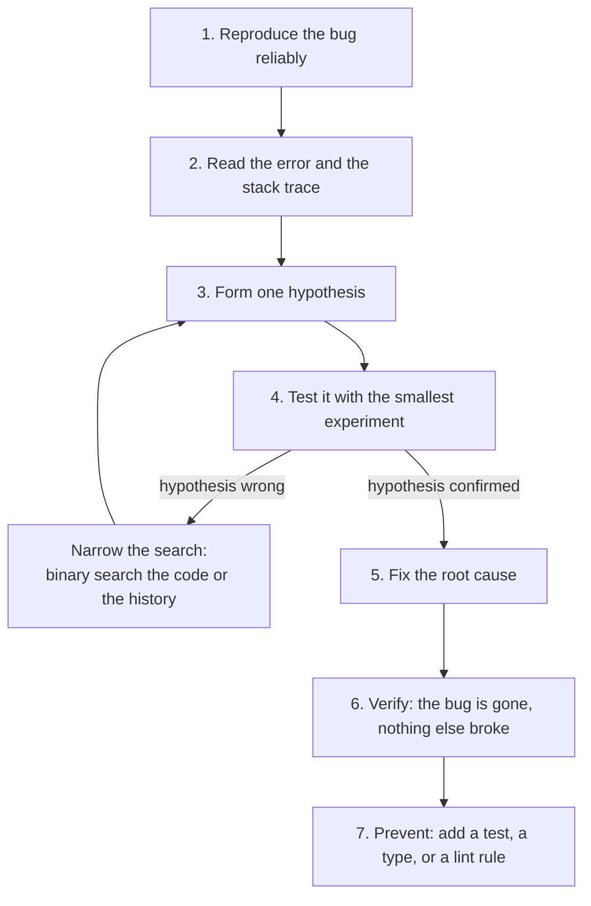
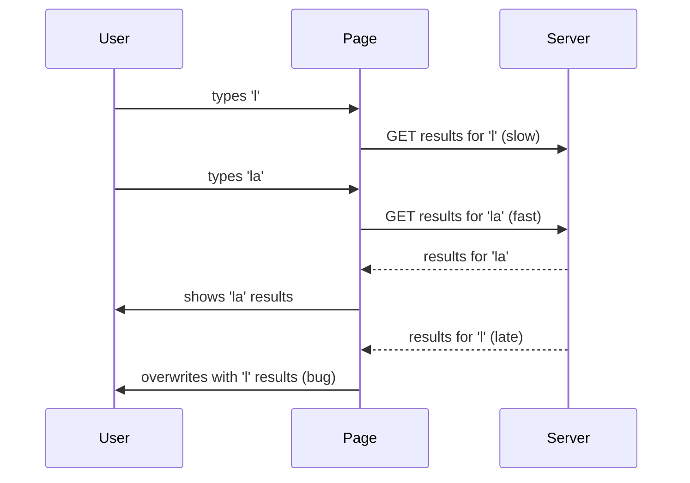
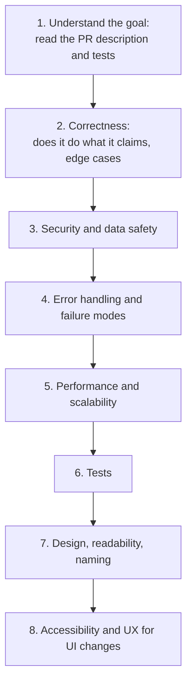

# Debugging and code review

> This document prepares you for two related interview rounds: "find and fix the bug" and "review this pull request". You will learn a calm, repeatable debugging method, how to talk while you debug, 30 real bugs across JavaScript, TypeScript, Angular, React, Node.js, Express and Electron (each with the symptom, the cause and the fix), and how to write code review comments that are specific, kind and prioritized.

**Before this:** [Error handling](../02-javascript/15-error-handling.md) · [Event loop](../02-javascript/16-event-loop.md) · [Async/await](../02-javascript/18-async-await.md) · [How to explain technical answers](01-how-to-explain-technical-answers.md) · **Interview questions:** [jump to the interview section](#interview-questions)

## Table of contents

1. [What debugging and code review rounds look like](#what-debugging-and-code-review-rounds-look-like)
2. [A debugging method that works under pressure](#a-debugging-method-that-works-under-pressure)
3. [Debugging tools you should be able to name and use](#debugging-tools-you-should-be-able-to-name-and-use)
4. [How to talk while you debug](#how-to-talk-while-you-debug)
5. [Bug catalogue: JavaScript](#bug-catalogue-javascript)
6. [Bug catalogue: TypeScript](#bug-catalogue-typescript)
7. [Bug catalogue: Angular and React](#bug-catalogue-angular-and-react)
8. [Bug catalogue: Node.js and Express](#bug-catalogue-nodejs-and-express)
9. [Bug catalogue: Electron and browser security](#bug-catalogue-electron-and-browser-security)
10. [Code review: what to check](#code-review-what-to-check)
11. [How to write review comments in an interview](#how-to-write-review-comments-in-an-interview)
12. [Exercise: review this pull request](#exercise-review-this-pull-request)
13. [Interview questions](#interview-questions)
14. [Summary](#summary)
15. [References](#references)

---

## What debugging and code review rounds look like

There are three common formats:

| Format | What happens | What they check |
| --- | --- | --- |
| **Find the bug** | You get a short snippet and a symptom: "this prints `3 3 3`", "the total is always 0". You explain the cause and fix it. | Language knowledge, reading code carefully |
| **Debug a running app** | You get a small repository with a failing test or a broken feature. You run it, investigate and fix it. | Method, tools, staying calm, not guessing |
| **Code review** | You get a pull request (a diff) and review it like a teammate. | Judgment: what matters most, security, clarity, how you communicate |

All three test the same core skill: **reading code and reasoning about what it really does**, not what the author hoped it does.

Why companies use these rounds: most real engineering time is spent reading and fixing existing code, not writing new code. A developer who debugs methodically and reviews kindly makes the whole team better.

## A debugging method that works under pressure

Guessing is the most common failure. You change something random, run it, it still fails, you change something else. After 20 minutes you have changed five things and understand nothing. Use a method instead.



### 1. Reproduce

You cannot fix what you cannot see. Find the exact steps, input and environment that make the bug happen **every time**. Write them down.

- "Sometimes the cart total is wrong" is not a reproduction.
- "Add an apple (0.1) and a pear (0.2); the total shows 0.30000000000000004" is a reproduction.

If the bug happens only sometimes, it usually depends on **timing** (race condition, slow network), **data** (a special character, an empty list, a time zone) or **environment** (browser, Node version, build mode). Make those things explicit and controllable: throttle the network in DevTools, use the same data, use the same version.

### 2. Read the error

Read the full error message and the stack trace before anything else. They tell you **what** went wrong and **where**.

```text
TypeError: Cannot read properties of undefined (reading 'items')
    at add (cart.js:6:10)
    at Array.forEach (<anonymous>)
    at Cart.addAll (cart.js:9:10)
```

How to read it:

- **The type** (`TypeError`) tells the category: you used a value in a way its type does not allow.
- **The message** tells the detail: something was `undefined`, and the code tried to read `.items` from it.
- **The top frame** (`add`, line 6) is where it crashed. The frames below show who called it. Here `addAll` passed `add` to `forEach`. That is the clue (the fix is in [Bug 4](#bug-4-lost-this-when-passing-a-method-as-a-callback)).

The line where it crashes is not always the line with the bug. The bug is often where the wrong value was **created**, a few frames lower.

### 3. Form one hypothesis

Say a specific, testable sentence: "I think `this` is `undefined` inside `add` because the method is passed without its object." Not: "something is wrong with the class".

### 4. Test with the smallest experiment

Add a breakpoint or one `console.log` that proves or disproves the hypothesis. If you are wrong, you learned something; form the next hypothesis.

When you have no idea where the bug is, **binary search**:

- **In the code:** comment out or skip half the logic. Does the bug still happen? Then it is in the other half. Repeat.
- **In the data:** the import fails for a 10,000-line file? Try the first 5,000 lines, then 2,500...
- **In the history:** it worked last week? `git bisect` checks out commits between "good" and "bad" and you mark each one. With 1,000 commits, you find the guilty one in about 10 steps.

```bash
git bisect start
git bisect bad                 # the current commit is broken
git bisect good v2.3.0         # this release was fine
# git checks out a commit in the middle; you test it, then:
git bisect good                # or: git bisect bad
# ...repeat until git prints the first bad commit
git bisect reset
```

You can even automate it: `git bisect run npm test` runs your test on each step.

### 5. Fix the root cause

Fix *why* it happened, not just the symptom. If a value is `undefined` because a request finished late, adding `?.` everywhere hides the crash but leaves the wrong data on the screen. Fix the race condition instead.

### 6. Verify

Run the reproduction steps again. Run the tests. Check related features that use the same code.

### 7. Prevent

Ask: "How could this never happen again?" Usually one of:

- A **test** that reproduces the bug (it fails before the fix and passes after).
- A **type** that makes the wrong state impossible (for example a union type for loading/success/error).
- A **lint rule** (for example `no-floating-promises` for missing `await`, `eqeqeq` for `==`).
- A **runtime check** at a boundary (validate API responses).

## Debugging tools you should be able to name and use

| Tool | What it is good for |
| --- | --- |
| **Breakpoints** (DevTools Sources panel, VS Code) | Pause at a line, inspect variables and the call stack, step through code |
| **Conditional breakpoints** | Pause only when `order.id === 42` — useful inside loops |
| **Logpoints** | A `console.log` you add in DevTools without editing the code |
| **`debugger;` statement** | A breakpoint in the source code; it pauses when DevTools is open |
| **Pause on exceptions** | Stop at the exact line where an error is thrown, including caught ones |
| **Network panel** | Request order, status codes, payloads, timing; throttle to "Slow 4G" to find race conditions |
| **Performance panel** | Long tasks, layout thrashing, what blocks the main thread |
| **Memory panel** | Heap snapshots, detached DOM nodes, allocation timeline for leaks |
| **Angular DevTools** | Component tree, inputs, change detection profiling |
| **`node --inspect`** | Debug Node.js in Chrome DevTools (`chrome://inspect`) or VS Code |
| **`node --cpu-prof`, `--heap-prof`** | CPU and heap profiles for Node.js processes |
| **`git bisect`** | Find the commit that introduced a bug |
| **Structured logs and tracing** | Debug production without a debugger: request ids, error context. See [Production Node.js](../07-nodejs-backend/14-production-nodejs.md) |

A useful console habit: `console.log({ user, cart })` (with braces) prints the variable names too. And remember that in browser DevTools, a logged object is shown **live**: when you expand it later, you see its *current* contents, not the contents at log time. Use `console.log(JSON.stringify(obj))` or `structuredClone(obj)` when you need a snapshot.

## How to talk while you debug

In an interview, silence is your enemy. The interviewer cannot give you credit for thinking they cannot hear. Narrate your method:

1. **Restate the symptom:** "So the expected output is 0, 1, 2 but we get 3, 3, 3."
2. **Say what you notice:** "The callbacks run after the loop, and `i` is declared with `var`."
3. **State a hypothesis:** "I think all three callbacks share one `i`, and by the time they run, the loop has finished and `i` is 3."
4. **Say how you would check it:** "I would log `i` inside the callback, or change `var` to `let` and see if each callback gets its own value."
5. **Fix and explain the root cause:** "With `let`, each loop turn has its own binding, so each callback closes over a different `i`."
6. **Mention prevention:** "A lint rule like `no-var` would have caught this."

If you are stuck, say what you have ruled out: "It is not the API, because the network tab shows the right data. So the bug is between the response and the render." That still shows a good process.

### How to explain your debugging approach in an interview

1. **Define it:** "Debugging for me is a loop: reproduce, read the error, form one hypothesis, test it, and only then fix."
2. **Why:** "Guessing changes many things at once, so even when it works you do not know why."
3. **How:** "I read the stack trace first, find where the bad value was created, and use breakpoints or one targeted log to prove my idea. If I have no idea where the bug is, I binary search — in the code, in the input data, or in git history with `git bisect`."
4. **Small example:** "A total showed 0. The stack was fine, but a log showed the `return` ran before the `forEach` callbacks finished, because `forEach` does not wait for async callbacks."
5. **Where useful:** "The same loop works for a production incident, a failing test, or a performance problem."
6. **Trade-offs:** "Logs are fast but noisy; breakpoints are precise but slow for timing bugs, because pausing changes the timing. For race conditions I prefer logs with timestamps or throttled network."

---

## Bug catalogue: JavaScript

Every JavaScript snippet in this catalogue was run with Node.js 22. The outputs shown are the real outputs. Each bug has the same parts: **buggy code**, **symptom**, **why it happens**, **fixed code**.

### Bug 1: var in a loop with async callbacks

**Buggy code:**

```js
// Show a toast for each notification, one second apart
var notifications = ['Saved', 'Synced', 'Done'];
for (var i = 0; i < notifications.length; i++) {
  setTimeout(() => {
    console.log(i, notifications[i]);
  }, 10 * i);
}
```

**Symptom:**

```text
3 undefined
3 undefined
3 undefined
```

**Why it happens:** `var` is function-scoped, so there is only **one** `i` for the whole loop. The `setTimeout` callbacks run later, after the loop has finished. By then `i` is 3, and `notifications[3]` is `undefined`. All three closures read the same variable. (Closures remember variables, not values. See [Closures](../02-javascript/05-closures.md).)

**Fixed code:**

```js
const notifications = ['Saved', 'Synced', 'Done'];
for (let i = 0; i < notifications.length; i++) { // let: a new binding for each loop turn
  setTimeout(() => {
    console.log(i, notifications[i]);
  }, 10 * i);
}
```

```text
0 Saved
1 Synced
2 Done
```

`let` in a `for` loop creates a new binding for each iteration, so each callback has its own `i`. Prevention: the ESLint rule `no-var`.

### Bug 2: missing await in a condition

**Buggy code:**

```js
async function isAdmin(user) {
  // imagine a database or API call here
  return user.role === 'admin';
}

async function deleteProject(user, projectId) {
  if (!isAdmin(user)) {
    throw new Error('Forbidden');
  }
  console.log(`Project ${projectId} deleted by ${user.name}`);
}

deleteProject({ name: 'Guest', role: 'viewer' }, 42).catch((e) => console.log(e.message));
```

**Symptom:** a viewer can delete a project. Output: `Project 42 deleted by Guest`.

**Why it happens:** `isAdmin` is `async`, so it always returns a **Promise**. A Promise is an object, and every object is truthy. `!isAdmin(user)` is therefore always `false`, and the check never blocks anyone. This is a security bug that looks completely normal in code review.

**Fixed code:**

```js
async function isAdmin(user) {
  return user.role === 'admin';
}

async function deleteProject(user, projectId) {
  if (!(await isAdmin(user))) { // await the promise, then check the boolean
    throw new Error('Forbidden');
  }
  console.log(`Project ${projectId} deleted by ${user.name}`);
}

deleteProject({ name: 'Guest', role: 'viewer' }, 42).catch((e) => console.log(e.message));
```

Output: `Forbidden`.

Prevention: in TypeScript, the `@typescript-eslint/no-misused-promises` rule reports a Promise used in a condition, and `no-floating-promises` reports promises that are not awaited or handled.

### Bug 3: forEach with an async callback

**Buggy code:**

```js
const getPrice = async (id) => ({ apple: 2, bread: 3, milk: 1 })[id];

async function cartTotal(ids) {
  let total = 0;
  ids.forEach(async (id) => {
    total += await getPrice(id);
  });
  return total;
}

cartTotal(['apple', 'bread', 'milk']).then((total) => console.log('Total:', total));
```

**Symptom:** `Total: 0`.

**Why it happens:** `forEach` calls the callback and **ignores what it returns**. An async callback returns a Promise immediately, at its first `await`. So `forEach` finishes at once, `return total` runs while `total` is still 0, and the additions happen later, too late. `forEach` was never designed to wait.

**Fixed code:**

```js
const getPrice = async (id) => ({ apple: 2, bread: 3, milk: 1 })[id];

// Option A: in parallel (requests are independent)
async function cartTotal(ids) {
  const prices = await Promise.all(ids.map((id) => getPrice(id)));
  return prices.reduce((sum, price) => sum + price, 0);
}

// Option B: one after another (when order or rate limits matter)
async function cartTotalSequential(ids) {
  let total = 0;
  for (const id of ids) {
    total += await getPrice(id);
  }
  return total;
}

cartTotal(['apple', 'bread', 'milk']).then((total) => console.log('Total:', total));
cartTotalSequential(['apple', 'bread', 'milk']).then((total) => console.log('Sequential:', total));
```

```text
Total: 6
Sequential: 6
```

Choose `Promise.all` + `map` when the calls are independent (faster, they run at the same time), and `for...of` with `await` when they must run one by one. See [Async/await](../02-javascript/18-async-await.md).

### Bug 4: lost this when passing a method as a callback

**Buggy code:**

```js
class Cart {
  constructor() {
    this.items = [];
  }
  add(item) {
    this.items.push(item);
  }
  addAll(list) {
    list.forEach(this.add); // passes the function only; 'this' is lost
  }
}

const cart = new Cart();
try {
  cart.addAll(['apple', 'bread']);
} catch (error) {
  console.log(error.constructor.name + ': ' + error.message);
}
```

**Symptom:** `TypeError: Cannot read properties of undefined (reading 'items')`.

**Why it happens:** `this.add` is just a reference to the function. `forEach` calls it as a plain function, `add(item)`, not as `cart.add(item)`. `this` is decided by **how a function is called**. A plain call in strict mode (class bodies are always strict) gives `this = undefined`. See [this, call, apply and bind](../02-javascript/06-this-call-apply-bind.md).

**Fixed code:**

```js
class Cart {
  constructor() {
    this.items = [];
  }
  add(item) {
    this.items.push(item);
  }
  addAll(list) {
    list.forEach((item) => this.add(item)); // arrow function keeps 'this' from addAll()
    // or: list.forEach(this.add, this);  or: list.forEach(this.add.bind(this));
  }
}

const cart = new Cart();
cart.addAll(['apple', 'bread']);
console.log(cart.items);
```

Output: `[ 'apple', 'bread' ]`.

The same bug appears with `button.addEventListener('click', this.save)`, `setTimeout(this.poll, 1000)` and `promise.then(this.render)`.

### Bug 5: arrow function with braces and no return

**Buggy code:**

```js
const users = [{ first: 'Asha', last: 'Rao' }, { first: 'Ben', last: 'Lee' }];

const fullNames = users.map((user) => {
  `${user.first} ${user.last}`;
});

console.log(fullNames);
```

**Symptom:** `[ undefined, undefined ]`.

**Why it happens:** an arrow function with `{ }` has a **block body**. A block body returns `undefined` unless you write `return`. The template string is evaluated and thrown away. Only an arrow without braces (an **expression body**) returns its value automatically.

**Fixed code:**

```js
const users = [{ first: 'Asha', last: 'Rao' }, { first: 'Ben', last: 'Lee' }];

const fullNames = users.map((user) => `${user.first} ${user.last}`); // expression body returns
// or with braces: users.map((user) => { return `${user.first} ${user.last}`; });

console.log(fullNames);
```

Output: `[ 'Asha Rao', 'Ben Lee' ]`.

A related trap: returning an object literal needs parentheses: `users.map((u) => ({ id: u.id }))`. Without them, `{` starts a block.

### Bug 6: map(parseInt)

**Buggy code:**

```js
const quantities = ['10', '20', '30'].map(parseInt);
console.log(quantities);
```

**Symptom:** `[ 10, NaN, NaN ]`.

**Why it happens:** `map` calls the callback with **three** arguments: `(value, index, array)`. `parseInt` takes two: `(string, radix)`. So the calls are `parseInt('10', 0)`, `parseInt('20', 1)`, `parseInt('30', 2)`. Radix 0 means "guess" (10), radix 1 is invalid (`NaN`), and "30" is not a valid binary number (`NaN`).

**Fixed code:**

```js
const quantities = ['10', '20', '30'].map((value) => Number.parseInt(value, 10));
console.log(quantities);
console.log(['10', '20', '30'].map(Number)); // also fine when strings are clean numbers
```

```text
[ 10, 20, 30 ]
[ 10, 20, 30 ]
```

Lesson: be careful passing a function reference straight into `map`, `forEach` or `then` when you do not control how many arguments it receives.

### Bug 7: sort() without a comparator

**Buggy code:**

```js
const prices = [100, 25, 3, 1000];
prices.sort();
console.log(prices);
```

**Symptom:** `[ 100, 1000, 25, 3 ]`.

**Why it happens:** without a compare function, `sort` converts elements to **strings** and compares them character by character. `"1000"` comes before `"25"` because `"1"` < `"2"`. Also, `sort` **changes the original array**.

**Fixed code:**

```js
const prices = [100, 25, 3, 1000];
const ascending = [...prices].sort((a, b) => a - b); // copy, then numeric compare
console.log(ascending);
console.log(prices); // original unchanged
// ES2023: prices.toSorted((a, b) => a - b) also returns a new array
```

```text
[ 3, 25, 100, 1000 ]
[ 100, 25, 3, 1000 ]
```

`(a, b) => a - b` returns a negative number when `a` should come first. For strings, use `a.localeCompare(b)`. See [Arrays and array methods](../02-javascript/10-arrays-and-array-methods.md).

### Bug 8: floating-point money

**Buggy code:**

```js
const items = [{ price: 0.1 }, { price: 0.2 }];
const total = items.reduce((sum, item) => sum + item.price, 0);
console.log(total);
console.log(total === 0.3 ? 'Charge 0.30' : 'Mismatch!');
```

**Symptom:**

```text
0.30000000000000004
Mismatch!
```

**Why it happens:** JavaScript numbers are IEEE-754 binary floating-point. Many decimal fractions, like 0.1 and 0.2, cannot be stored exactly in binary, so tiny errors appear. For prices, tiny errors become wrong totals, failed equality checks, and rounding disputes. See [Strings, numbers and dates](../02-javascript/11-strings-numbers-and-dates.md).

**Fixed code:**

```js
// Store money as integer cents (or use a decimal library for complex math).
const items = [{ priceCents: 10 }, { priceCents: 20 }];
const totalCents = items.reduce((sum, item) => sum + item.priceCents, 0);
console.log(totalCents); // exact integer math

const format = new Intl.NumberFormat('en-US', { style: 'currency', currency: 'USD' });
console.log(format.format(totalCents / 100)); // divide only for display
```

```text
30
$0.30
```

Store money as integer **minor units** (cents, paise), do all math with integers, and convert only for display with `Intl.NumberFormat`. For currency conversion or tax with many decimals, use a decimal library or let the database (`NUMERIC` type) do the math.

### Bug 9: loose equality in validation

**Buggy code:**

```js
function validateQuantity(input) {
  if (input == 0) return 'Quantity is required';
  return 'OK';
}

console.log(validateQuantity(''));   // user typed nothing
console.log(validateQuantity('0'));  // user typed 0
console.log(validateQuantity([]));   // a bug elsewhere passed an array
console.log(validateQuantity('  ')); // spaces
```

**Symptom:** all four calls print `Quantity is required`, but they are four different situations.

**Why it happens:** `==` converts types before comparing. `'' == 0` is `true` (empty string becomes 0), `'  ' == 0` is `true` (whitespace-only string becomes 0), `'0' == 0` is `true`, and `[] == 0` is `true` (the array becomes `''`, then 0). The check cannot tell "empty" from "zero". See [Type coercion and equality](../02-javascript/02-type-coercion-and-equality.md).

**Fixed code:**

```js
function validateQuantity(input) {
  const text = String(input).trim();
  if (text === '') return 'Quantity is required';
  const quantity = Number(text);
  if (!Number.isInteger(quantity) || quantity < 1) return 'Enter a whole number of 1 or more';
  return 'OK';
}

console.log(validateQuantity(''));
console.log(validateQuantity('0'));
console.log(validateQuantity('3'));
console.log(validateQuantity('  '));
```

```text
Quantity is required
Enter a whole number of 1 or more
OK
Quantity is required
```

Convert explicitly, then compare with `===`. Prevention: the ESLint rule `eqeqeq`. (`value == null` is the one common, intentional use of `==`: it matches both `null` and `undefined`.)

### Bug 10: || for defaults when 0 is valid

**Buggy code:**

```js
function applyDiscount(price, options = {}) {
  const discountPercent = options.discountPercent || 10; // default 10%
  return price - (price * discountPercent) / 100;
}

console.log(applyDiscount(200, { discountPercent: 25 }));
console.log(applyDiscount(200, { discountPercent: 0 })); // "no discount" for this customer
```

**Symptom:**

```text
150
180
```

A customer with a 0% discount gets 10%.

**Why it happens:** `||` returns the right side when the left side is **falsy**. `0`, `''`, `false` and `NaN` are falsy, so a real value of 0 is replaced by the default.

**Fixed code:**

```js
function applyDiscount(price, options = {}) {
  const discountPercent = options.discountPercent ?? 10; // only null/undefined use the default
  return price - (price * discountPercent) / 100;
}

console.log(applyDiscount(200, { discountPercent: 25 }));
console.log(applyDiscount(200, { discountPercent: 0 }));
console.log(applyDiscount(200));
```

```text
150
200
180
```

`??` (nullish coalescing, ES2020) uses the default only for `null` and `undefined`. Default parameters (`function f(x = 10)`) also apply only for `undefined`.

### Bug 11: shallow copy shares nested objects

**Buggy code:**

```js
const defaultSettings = { theme: 'light', notifications: { email: true, sms: false } };

const userSettings = { ...defaultSettings };     // looks like a copy...
userSettings.notifications.email = false;         // ...but the nested object is shared

console.log(defaultSettings.notifications.email);
```

**Symptom:** `false` — changing one user's settings changed the defaults for everyone.

**Why it happens:** spread (`{ ...obj }`) copies only the **top level**. `notifications` is an object, so the copy holds the **same reference**. Changing `userSettings.notifications.email` changes the one shared object. See [Objects and copying](../02-javascript/07-objects-and-copying.md).

**Fixed code:**

```js
const defaultSettings = { theme: 'light', notifications: { email: true, sms: false } };

// Option A: deep copy (plain data only: no functions, class instances or DOM nodes)
const userSettings = structuredClone(defaultSettings);
userSettings.notifications.email = false;

// Option B: immutable update, copying each level you change
const otherSettings = {
  ...defaultSettings,
  notifications: { ...defaultSettings.notifications, sms: true },
};

console.log(defaultSettings.notifications); // unchanged
console.log(userSettings.notifications, otherSettings.notifications);
```

```text
{ email: true, sms: false }
{ email: false, sms: false } { email: true, sms: true }
```

`structuredClone` (available in browsers and Node.js 17+) deep-copies plain data. In state management (Angular OnPush, NgRx, React), prefer immutable updates that copy only the changed path.

### Bug 12: off-by-one errors

**Buggy code:**

```js
function getPage(items, page, pageSize) {
  const start = page * pageSize;          // page is 1-based in the UI
  return items.slice(start, start + pageSize);
}

const items = ['a', 'b', 'c', 'd', 'e'];
console.log(getPage(items, 1, 2)); // expect ['a', 'b']

function lastItems(list, count) {
  const result = [];
  for (let i = list.length - count; i <= list.length; i++) result.push(list[i]);
  return result;
}
console.log(lastItems(items, 2)); // expect ['d', 'e']
```

**Symptom:**

```text
[ 'c', 'd' ]
[ 'd', 'e', undefined ]
```

Page 1 shows the second page, and `lastItems` returns an extra `undefined`.

**Why it happens:** two classic off-by-one mistakes. (1) The UI counts pages from 1, but array indexes start at 0. Page 1 must start at index 0, so the formula is `(page - 1) * pageSize`. (2) The valid indexes are `0` to `length - 1`, so `i <= list.length` reads one element past the end.

**Fixed code:**

```js
function getPage(items, page, pageSize) {
  const start = (page - 1) * pageSize;    // convert 1-based page to 0-based index
  return items.slice(start, start + pageSize);
}

const items = ['a', 'b', 'c', 'd', 'e'];
console.log(getPage(items, 1, 2));
console.log(getPage(items, 3, 2)); // last, partial page

function lastItems(list, count) {
  return list.slice(-count); // or loop with i < list.length
}
console.log(lastItems(items, 2));
```

```text
[ 'a', 'b' ]
[ 'e' ]
[ 'd', 'e' ]
```

Testing tip: off-by-one bugs live at the **boundaries**. Always test the first page, the last (partial) page, an empty list, and a list of exactly one page.

### Bug 13: date-only strings and time zones

**Buggy code:**

```js
// The API sends a date-only string for the delivery date.
const delivery = new Date('2025-03-10');
console.log(delivery.toString());
console.log('Delivery day:', delivery.getDate());
```

**Symptom** (run with the time zone set to `America/New_York`):

```text
Sun Mar 09 2025 20:00:00 GMT-0400 (Eastern Daylight Time)
Delivery day: 9
```

Users in the Americas see the delivery one day early. Users in India or Europe see the correct day. The bug "only happens for some users".

**Why it happens:** by the ECMAScript rules, a **date-only** ISO string like `"2025-03-10"` is parsed as **UTC** midnight. Methods like `getDate()` and `toString()` use the **local** time zone. In New York, UTC midnight is 8 PM on the previous day. (A date-time string *without* an offset, like `"2025-03-10T00:00"`, is parsed as local time — the rules differ, which makes this bug easy to create.)

**Fixed code:**

```js
// A date-only ISO string is parsed as UTC midnight. A date-time string without
// "Z" or an offset is parsed as LOCAL time. For a calendar date, parse the parts yourself.
function parseLocalDate(isoDate) {
  const [year, month, day] = isoDate.split('-').map(Number);
  return new Date(year, month - 1, day); // month is 0-based
}

const delivery = parseLocalDate('2025-03-10');
console.log('Delivery day:', delivery.getDate());

// Or keep it as UTC and format it in UTC:
const utc = new Date('2025-03-10');
console.log(utc.toLocaleDateString('en-US', { timeZone: 'UTC' }));
```

```text
Delivery day: 10
3/10/2025
```

Rules of thumb: store and send **instants** (timestamps) in UTC ISO format with `Z`; treat **calendar dates** (birthdays, delivery days) as plain dates, not instants; format for the user with `Intl.DateTimeFormat` and an explicit `timeZone` when it matters. Test with a different time zone (`TZ=America/New_York node test.js` on Linux and macOS).

### Bug 14: search race condition

**Buggy code:**

```js
// Fake API: the server answers short queries more slowly.
const fakeFetch = (query) =>
  new Promise((resolve) => setTimeout(() => resolve(`results for "${query}"`), query.length === 1 ? 50 : 10));

let shown = '';
async function onInput(query) {
  const results = await fakeFetch(query);
  shown = results; // whoever answers LAST wins
}

onInput('l');
setTimeout(() => onInput('la'), 5);
setTimeout(() => console.log('User typed "la", screen shows:', shown), 100);
```

**Symptom:** `User typed "la", screen shows: results for "l"`.

**Why it happens:** two requests are in flight. The request for "l" was sent first but answers last. Each response simply overwrites `shown`, so the **last response wins**, not the **last request**. The user sees results for text that is no longer in the input.



**Fixed code:**

```js
const fakeFetch = (query, signal) =>
  new Promise((resolve, reject) => {
    const timer = setTimeout(() => resolve(`results for "${query}"`), query.length === 1 ? 50 : 10);
    signal.addEventListener('abort', () => {
      clearTimeout(timer);
      reject(new DOMException('Aborted', 'AbortError'));
    });
  });

let shown = '';
let controller = null;

async function onInput(query) {
  controller?.abort();              // cancel the previous request
  controller = new AbortController();
  try {
    shown = await fakeFetch(query, controller.signal);
  } catch (error) {
    if (error.name !== 'AbortError') throw error; // a cancelled request is not an error
  }
}

onInput('l');
setTimeout(() => onInput('la'), 5);
setTimeout(() => console.log('User typed "la", screen shows:', shown), 100);
```

Output: `User typed "la", screen shows: results for "la"`.

Alternatives: a request-id counter (ignore any response that is not the latest), or `switchMap` in RxJS. A full typeahead with all of these is in [Machine coding round](05-machine-coding-round.md#problem-2-autocomplete-typeahead).

### Bug 15: removeEventListener with a new function

**Buggy code:**

```js
class ResizeLogger {
  constructor(target) {
    this.target = target;
    this.calls = 0;
  }
  onResize() { this.calls++; }
  attach() { this.target.addEventListener('resize', this.onResize.bind(this)); }
  detach() { this.target.removeEventListener('resize', this.onResize.bind(this)); }
}

const target = new EventTarget(); // stands in for window
const logger = new ResizeLogger(target);
logger.attach();
logger.detach();
target.dispatchEvent(new Event('resize'));
console.log('Calls after detach:', logger.calls);
```

**Symptom:** `Calls after detach: 1`. The listener was never removed. In a single-page app, every time the component is created, one more listener stays on `window` — a memory leak, and the handler runs many times.

**Why it happens:** `bind` creates a **new function** every time it is called. `removeEventListener` removes a listener only if you pass the **same function object** that was added. The two `bind` calls produce two different functions, so nothing matches.

**Fixed code:**

```js
class ResizeLogger {
  constructor(target) {
    this.target = target;
    this.calls = 0;
  }
  onResize = () => { this.calls++; }; // one function, created once per instance
  attach() { this.target.addEventListener('resize', this.onResize); }
  detach() { this.target.removeEventListener('resize', this.onResize); }
}

const target = new EventTarget();
const logger = new ResizeLogger(target);
logger.attach();
logger.detach();
target.dispatchEvent(new Event('resize'));
console.log('Calls after detach:', logger.calls);

// Another clean option: an AbortController removes many listeners at once.
const controller = new AbortController();
target.addEventListener('resize', () => console.log('never printed'), { signal: controller.signal });
controller.abort();
target.dispatchEvent(new Event('resize'));
```

Output: `Calls after detach: 0` (and `never printed` is indeed never printed).

The arrow-function class field is created once per instance and keeps `this`. An `AbortController` signal is the cleanest way to remove many listeners at once.

## Bug catalogue: TypeScript

### Bug 16: a type assertion hides bad API data

**Buggy code** (compiles with `strict: true` and no errors):

```ts
interface User {
  id: number;
  name: string;
  address: { city: string };
}

// Stands in for: const response = await fetch(`/api/users/${id}`)
async function fetchJson(_url: string): Promise<unknown> {
  return { id: 7, name: 'Asha' }; // the API changed: no address any more
}

async function getUser(id: number): Promise<User> {
  return (await fetchJson(`/api/users/${id}`)) as User; // "trust me, compiler"
}

getUser(7)
  .then((user) => console.log(user.address.city.toUpperCase()))
  .catch((error: Error) => console.log(`${error.name}: ${error.message}`));
```

**Symptom:** `TypeError: Cannot read properties of undefined (reading 'city')` — in production, far away from the API call, in a component that "cannot" get bad data because the type says `address` always exists.

**Why it happens:** `as User` is a **compile-time promise you make to the compiler**. It checks nothing at runtime. TypeScript types disappear when the code is compiled to JavaScript. When the API changes, the type still claims `address` exists, so the compiler happily allows `user.address.city`. See [Runtime validation and type-safe APIs](../03-typescript/11-runtime-validation-and-type-safe-apis.md).

**Fixed code:**

```ts
interface User {
  id: number;
  name: string;
  address: { city: string };
}

async function fetchJson(_url: string): Promise<unknown> {
  return { id: 7, name: 'Asha' };
}

// A type guard checks the real data at runtime. (A schema library like Zod does the same with less code.)
function isUser(value: unknown): value is User {
  if (typeof value !== 'object' || value === null) return false;
  const v = value as Record<string, unknown>;
  const address = v['address'] as Record<string, unknown> | undefined;
  return (
    typeof v['id'] === 'number' &&
    typeof v['name'] === 'string' &&
    typeof address === 'object' && address !== null &&
    typeof address['city'] === 'string'
  );
}

async function getUser(id: number): Promise<User> {
  const data = await fetchJson(`/api/users/${id}`);
  if (!isUser(data)) {
    throw new Error(`Unexpected user payload for id ${id}`); // fail at the boundary, with a clear message
  }
  return data;
}

getUser(7)
  .then((user) => console.log(user.address.city.toUpperCase()))
  .catch((error: Error) => console.log(`${error.name}: ${error.message}`));
```

Output: `Error: Unexpected user payload for id 7` — a clear error at the boundary, with context, instead of a crash somewhere else.

Rules: treat everything from outside (API responses, `JSON.parse`, `localStorage`, URL parameters, `postMessage`, IPC messages) as `unknown` and validate it. Use `as` only when you know something the compiler cannot. A schema library (Zod, Valibot, io-ts) gives you validation and the type from one definition.

## Bug catalogue: Angular and React

The Angular snippets were compiled with the Angular 16.2 compiler (`strictTemplates: true`). The OnPush bug was also run in jsdom to confirm the symptom. The React snippets were not executed here (React is not installed in this repository); their behavior is the documented React behavior.

### Bug 17: mutating state with OnPush

**Buggy code:**

```ts
// cart.component.ts
import { ChangeDetectionStrategy, Component, Input } from '@angular/core';
import { NgFor } from '@angular/common';

export interface CartItem { id: number; name: string; qty: number; }

@Component({
  selector: 'app-cart-summary',
  standalone: true,
  imports: [NgFor],
  changeDetection: ChangeDetectionStrategy.OnPush,
  template: `
    <p>{{ items.length }} items</p>
    <p *ngFor="let item of items">{{ item.name }} × {{ item.qty }}</p>
  `,
})
export class CartSummaryComponent {
  @Input() items: CartItem[] = [];
}

@Component({
  selector: 'app-cart-page',
  standalone: true,
  imports: [CartSummaryComponent],
  template: `
    <button type="button" (click)="addBuggy()">Add (buggy)</button>
    <button type="button" (click)="addFixed()">Add (fixed)</button>
    <app-cart-summary [items]="items"></app-cart-summary>
  `,
})
export class CartPageComponent {
  items: CartItem[] = [{ id: 1, name: 'Apple', qty: 1 }];

  addBuggy(): void {
    this.items.push({ id: 2, name: 'Bread', qty: 1 }); // ❌ same array reference
    this.items[0]!.qty++;                               // ❌ mutating a nested object too
  }

  addFixed(): void {
    this.items = [
      ...this.items.map((item) => (item.id === 1 ? { ...item, qty: item.qty + 1 } : item)), // ✅ new object for the changed item
      { id: 2, name: 'Bread', qty: 1 },                                                     // ✅ new array
    ];
  }
}
```

**Symptom:** after clicking "Add (buggy)", the summary still says `1 items` and `Apple × 1`, even though the array now has two items and the apple quantity is 2. We ran it: before and after the buggy click, the summary text was identical. After "Add (fixed)" it updated at once.

**Why it happens:** with `ChangeDetectionStrategy.OnPush`, Angular checks the child only when an `@Input` gets a **new reference** (compared with `===`), when an event fires in the child's own template, when an `async` pipe in it emits, or when `markForCheck()` is called. `push` and `qty++` change the contents but keep the same array reference, so Angular sees "nothing changed" and skips the child. See [Change detection and signals](../06-angular-16/10-change-detection-and-signals.md).

**Fix:** treat inputs as immutable: create a new array and a new object for each changed item (shown in `addFixed`). Other options: expose the data as an Observable and use the `async` pipe in the child, or call `ChangeDetectorRef.markForCheck()` after a mutation you cannot avoid.

> **Newer Angular (17+):** with signals (`signal`, `computed`, signal inputs), you call `items.update(list => [...list, newItem])`. Signals still compare by reference, so mutating the array inside a signal has the same problem.

### Bug 18: leaking subscriptions

**Buggy code:**

```ts
// live-prices.component.ts (buggy)
import { Component, Injectable, OnInit } from '@angular/core';
import { NgFor } from '@angular/common';
import { Observable, Subject, interval } from 'rxjs';

export interface Price { symbol: string; value: number; }

@Injectable({ providedIn: 'root' })
export class PriceService {
  private readonly pricesSubject = new Subject<Price[]>(); // e.g. fed by a WebSocket
  readonly prices$: Observable<Price[]> = this.pricesSubject.asObservable(); // never completes
  refresh(): void { /* asks the server for fresh prices */ }
}

@Component({
  selector: 'app-live-prices',
  standalone: true,
  imports: [NgFor],
  template: `<p *ngFor="let p of prices">{{ p.symbol }}: {{ p.value }}</p>`,
})
export class LivePricesComponent implements OnInit {
  prices: Price[] = [];

  constructor(private readonly priceService: PriceService) {}

  ngOnInit(): void {
    this.priceService.prices$.subscribe((prices) => (this.prices = prices));
    interval(5000).subscribe(() => this.priceService.refresh());
  }
}
```

**Symptom:** navigate to the prices page and away five times. Now `refresh()` runs five times every 5 seconds, memory grows, and destroyed components keep updating their (invisible) `prices` field. Sometimes errors appear from components that no longer exist.

**Why it happens:** `interval` and a WebSocket-backed `Subject` **never complete**. A subscription lives until it is unsubscribed or the source completes. Destroying the component does not unsubscribe for you. The subscription keeps a reference to the callback, the callback keeps a reference to the component, so the component cannot be garbage collected.

**Fixed code:**

```ts
// live-prices.component.ts (fixed)
import { ChangeDetectionStrategy, Component, OnDestroy, OnInit, inject } from '@angular/core';
import { AsyncPipe, NgFor } from '@angular/common';
import { Subject, interval, takeUntil } from 'rxjs';
import { PriceService } from './dbg-leak-buggy';

@Component({
  selector: 'app-live-prices-fixed',
  standalone: true,
  imports: [NgFor, AsyncPipe],
  changeDetection: ChangeDetectionStrategy.OnPush,
  // Fix 1: the async pipe subscribes and unsubscribes for you.
  template: `<p *ngFor="let p of prices$ | async">{{ p.symbol }}: {{ p.value }}</p>`,
})
export class LivePricesFixedComponent implements OnInit, OnDestroy {
  private readonly priceService = inject(PriceService);
  readonly prices$ = this.priceService.prices$;
  private readonly destroy$ = new Subject<void>();

  ngOnInit(): void {
    // Fix 2: for side effects, complete the subscription when the component is destroyed.
    interval(5000)
      .pipe(takeUntil(this.destroy$)) // keep takeUntil as the LAST operator
      .subscribe(() => this.priceService.refresh());
  }

  ngOnDestroy(): void {
    this.destroy$.next();
    this.destroy$.complete();
  }
}
```

Which observables need cleanup? Ones that do not complete: `interval`, `fromEvent`, store selectors, `Subject`s, router events, `valueChanges`. A single `HttpClient` request completes after one response, so it does not leak (but you may still want to cancel it on destroy). In Angular 16, `takeUntilDestroyed()` from `@angular/core/rxjs-interop` is a shorter option, marked developer preview in that version. See [RxJS](../06-angular-16/09-rxjs.md).

### Bug 19: missing trackBy (Angular) and index keys (React)

**Angular buggy and fixed code:**

```ts
// order-list.component.ts
import { Component, Input } from '@angular/core';
import { NgFor } from '@angular/common';

export interface Order { id: string; customer: string; status: string; }

@Component({
  selector: 'app-order-list',
  standalone: true,
  imports: [NgFor],
  template: `
    <!-- ❌ Wrong: every poll returns NEW objects, so Angular destroys and re-creates every row -->
    <li *ngFor="let order of orders">
      {{ order.customer }} — {{ order.status }}
      <input [attr.aria-label]="'Note for ' + order.customer" />
    </li>

    <!-- ✅ Correct: rows are matched by id, only changed rows are updated -->
    <li *ngFor="let order of orders; trackBy: trackById">
      {{ order.customer }} — {{ order.status }}
      <input [attr.aria-label]="'Note for ' + order.customer" />
    </li>
  `,
})
export class OrderListComponent {
  @Input() orders: Order[] = [];

  trackById(_index: number, order: Order): string {
    return order.id;
  }
}
```

**Symptom (Angular):** the list polls the server every 10 seconds. Each time, every row flickers, any text typed into a row's input disappears, and keyboard focus is lost. The Performance panel shows the whole list being destroyed and re-created.

**Why it happens:** by default `*ngFor` matches items by **object identity**. A new HTTP response creates new objects, even for unchanged orders, so Angular thinks every item is new. `trackBy` tells Angular how to recognize "the same item": by `id`.

**React buggy code:**

```js
function TodoList({ todos, onDelete }) {
  return (
    <ul>
      {todos.map((todo, index) => (
        // ❌ Wrong: the index is not the identity of the item
        <TodoRow key={index} todo={todo} onDelete={onDelete} />
      ))}
    </ul>
  );
}
```

**Symptom (React):** each `TodoRow` has a local text input. Delete the first todo, and the text you typed in row 1 now appears in what used to be row 2.

**Why it happens:** React uses `key` to match elements between renders. After deleting item 0, the item that was at index 1 now has key 0, so React reuses row 0's component instance (with its state) for a different todo.

**Fix:**

```js
// ✅ Correct: a stable, unique id from the data
<TodoRow key={todo.id} todo={todo} onDelete={onDelete} />
```

An index key is fine only for static lists that never reorder, insert or delete.

> **Newer Angular (17+):** `@for (order of orders; track order.id)` makes the tracking expression required, so this bug is harder to write.

### Bug 20: stale closure in React hooks

**Buggy code:**

```js
function SessionTimer() {
  const [seconds, setSeconds] = useState(0);

  useEffect(() => {
    const id = setInterval(() => {
      setSeconds(seconds + 1); // ❌ "seconds" is always 0 here
    }, 1000);
    return () => clearInterval(id);
  }, []); // the effect runs once, so the callback is created once

  return <p>Session: {seconds}s</p>;
}
```

**Symptom:** the timer shows 1 and then stays at 1 forever.

**Why it happens:** each render is a new call of `SessionTimer` with its own `seconds` constant. The effect ran only after the first render (empty dependency array), so the interval callback closed over the first render's `seconds`, which is 0. Every tick sets the state to `0 + 1`. The closure is **stale**: it sees an old render's variables. See [React essentials](../05-frontend-engineering/08-react-essentials.md) and [Closures](../02-javascript/05-closures.md).

**Fixed code:**

```js
function SessionTimer() {
  const [seconds, setSeconds] = useState(0);

  useEffect(() => {
    const id = setInterval(() => {
      setSeconds((current) => current + 1); // ✅ functional update: React passes the latest value
    }, 1000);
    return () => clearInterval(id);
  }, []);

  return <p>Session: {seconds}s</p>;
}
```

Other fixes: list `seconds` in the dependency array (the interval is recreated on every change, which works but is wasteful), or keep the latest value in a `useRef`. The `react-hooks/exhaustive-deps` lint rule warns about the buggy version.

## Bug catalogue: Node.js and Express

The Node.js snippets were run with Node.js 22. Express is not installed in this repository, so the Express examples were not executed; the underlying Node.js behavior (unhandled rejections, the "headers already sent" error) was verified with plain `node:http`.

### Bug 21: an unhandled rejection crashes the process

**Buggy code:**

```js
// Node.js 15+: an unhandled promise rejection ends the process.
async function loadConfig() {
  throw new Error('config.json not found');
}

loadConfig(); // nobody handles the rejection
setTimeout(() => console.log('server still running'), 50);
```

**Symptom:** the process prints the error with its stack trace and **exits with code 1**. `server still running` is never printed. In production, the server restarts in a loop, or simply disappears.

**Why it happens:** since Node.js 15, the default `--unhandled-rejections` mode is `throw`: a rejected promise with no handler is treated like an uncaught exception, and the process ends. Older Node versions only printed a warning, so old code and old blog posts can be misleading.

**Fixed code:**

```js
async function loadConfig() {
  throw new Error('config.json not found');
}

async function main() {
  try {
    await loadConfig();
  } catch (error) {
    console.log('Using default config because:', error.message);
  }
}

main();

// Safety net: log and exit cleanly. It is NOT a replacement for handling errors where they happen.
process.on('unhandledRejection', (reason) => {
  console.error('Unhandled rejection:', reason);
  process.exitCode = 1;
});
setTimeout(() => console.log('server still running'), 50);
```

```text
Using default config because: config.json not found
server still running
```

Handle errors where they happen (`await` inside `try/catch`, or `.catch()`). The global `unhandledRejection` handler is only a safety net for logging. After an unexpected error, the process state may be broken, so many teams log and then exit, and let the process manager restart it. See [Production Node.js](../07-nodejs-backend/14-production-nodejs.md).

### Bug 22: async errors do not reach the Express 4 error middleware

**Buggy code (Express 4):**

```js
app.get('/users/:id', async (req, res) => {
  const user = await db.findUser(req.params.id); // throws: database is down
  res.json(user);
});

// Error middleware: four arguments
app.use((err, req, res, next) => {
  res.status(500).json({ error: 'Internal server error' });
});
```

**Symptom:** when the database fails, the client waits until it times out (the request hangs), and the server logs an unhandled rejection — on Node.js 15+ the whole process crashes. The error middleware never runs.

**Why it happens:** Express 4 calls your handler and **ignores its return value**. An `async` function returns a promise; when it rejects, nobody is listening. Express 4 only catches errors thrown **synchronously** or passed to `next(err)`.

**Fixed code (Express 4):**

```js
// Option A: try/catch and forward the error
app.get('/users/:id', async (req, res, next) => {
  try {
    const user = await db.findUser(req.params.id);
    if (!user) return res.status(404).json({ error: 'User not found' });
    res.json(user);
  } catch (error) {
    next(error); // the error middleware handles it
  }
});

// Option B: a small wrapper for every async handler
const asyncHandler = (fn) => (req, res, next) => Promise.resolve(fn(req, res, next)).catch(next);

app.get('/orders/:id', asyncHandler(async (req, res) => {
  res.json(await db.findOrder(req.params.id));
}));
```

**Express 5** (released in 2024) forwards rejected promises from handlers to `next(err)` automatically, so the buggy code works there. Many existing projects still run Express 4, so check the version before you answer. See [Validation and error handling](../07-nodejs-backend/08-validation-and-error-handling.md).

### Bug 23: sending a response twice (missing return)

**Buggy code:**

```js
app.post('/users', (req, res) => {
  if (!req.body.name) {
    res.status(400).json({ error: 'name is required' }); // ❌ no return
  }
  const user = createUser(req.body);
  res.status(201).json(user);
});
```

**Symptom:** the client gets the 400 response, but the server logs:

```text
Error [ERR_HTTP_HEADERS_SENT]: Cannot set headers after they are sent to the client
```

and `createUser` still ran with invalid data.

**Why it happens:** `res.json()` sends the response but does **not** stop your function. The code continues, creates the user, and tries to send a second response. Node's HTTP module throws, because a request can have only one response. We verified the error with this plain Node.js check:

```js
const http = require('node:http');
const server = http.createServer((req, res) => {
  res.statusCode = 400; res.setHeader('Content-Type', 'application/json'); res.end('{}');
  try { res.setHeader('Content-Type', 'application/json'); } catch (e) { console.log(e.code, '-', e.message); }
});
server.listen(0, () => http.get(`http://localhost:${server.address().port}/`, (r) => { r.resume(); r.on('end', () => server.close()); }));
```

Output: `ERR_HTTP_HEADERS_SENT - Cannot set headers after they are sent to the client`.

**Fixed code:**

```js
app.post('/users', (req, res) => {
  if (!req.body.name) {
    return res.status(400).json({ error: 'name is required' }); // ✅ stop here
  }
  const user = createUser(req.body);
  return res.status(201).json(user);
});
```

The same error appears when an error middleware runs after a response was already sent, or when a callback and a promise both respond.

### Bug 24: blocking the event loop

**Buggy code:**

```js
// A "request handler" that does CPU work on the main thread.
function slowReport() {
  const start = Date.now();
  while (Date.now() - start < 200) { /* pretend to crunch numbers */ }
  return 'report ready';
}

const requestedAt = Date.now();
setTimeout(() => console.log(`health check answered after ${Date.now() - requestedAt >= 200 ? '200+' : '<200'} ms`), 0);
console.log(slowReport());
```

**Symptom:**

```text
report ready
health check answered after 200+ ms
```

While one user generates a report, every other request — including the health check — waits. Under load, the load balancer marks the server as dead.

**Why it happens:** Node.js runs your JavaScript on **one thread**. A timer callback, an incoming request, or a database reply can only run when the current code finishes. A CPU-heavy loop (or `fs.readFileSync` on a large file, `JSON.parse` of a huge payload, `crypto.pbkdf2Sync`, a slow regular expression) blocks everything. See [Node event loop](../07-nodejs-backend/02-node-event-loop.md).

**Fixed code:**

```js
// Move CPU-heavy work to a worker thread so the event loop stays free.
const { Worker } = require('node:worker_threads');

function slowReportInWorker() {
  return new Promise((resolve, reject) => {
    const worker = new Worker(
      `const start = Date.now();
       while (Date.now() - start < 200) {}
       require('node:worker_threads').parentPort.postMessage('report ready');`,
      { eval: true },
    );
    worker.once('message', resolve);
    worker.once('error', reject);
  });
}

const requestedAt = Date.now();
setTimeout(() => console.log(`health check answered after ${Date.now() - requestedAt < 100 ? '<100' : '100+'} ms`), 0);
slowReportInWorker().then(console.log);
```

```text
health check answered after <100 ms
report ready
```

Other fixes: use the async versions of APIs (`fs.promises.readFile`, `crypto.pbkdf2`), split big work into chunks with `setImmediate`, stream large files, or move the work to a background job queue. Measure with `perf_hooks.monitorEventLoopDelay()`. See [Concurrency, worker threads and cluster](../07-nodejs-backend/12-concurrency-worker-threads-and-cluster.md).

### Bug 25: SQL injection

**Buggy code:**

```js
function findUserQuery(email) {
  return `SELECT * FROM users WHERE email = '${email}'`;
}

console.log(findUserQuery('asha@example.com'));
console.log(findUserQuery("' OR '1'='1"));
```

**Symptom:**

```text
SELECT * FROM users WHERE email = 'asha@example.com'
SELECT * FROM users WHERE email = '' OR '1'='1'
```

The second query returns **every user**. With other inputs an attacker can read other tables, change data, or delete it.

**Why it happens:** the input is pasted into the SQL text, so the database cannot tell code from data. The quote in the input closes the string, and the rest becomes SQL.

**Fixed code:**

```js
// Parameterized query: the SQL text and the values travel separately.
// The database never parses the value as SQL.
function findUserQuery(email) {
  return { text: 'SELECT id, name, email FROM users WHERE email = $1', values: [email] };
}

console.log(findUserQuery("' OR '1'='1"));
// With node-postgres: await pool.query(findUserQuery(email));
```

```text
{
  text: 'SELECT id, name, email FROM users WHERE email = $1',
  values: [ "' OR '1'='1" ]
}
```

With **parameterized queries** (also called prepared statements), the SQL text and the values are sent separately. The value is always data. Escaping by hand is not a fix: it is easy to forget one place. ORMs and query builders parameterize for you, but their "raw query" functions do not. Also select only the columns you need, and give the database user only the permissions it needs. See [Databases](../07-nodejs-backend/10-databases.md).

### Bug 26: the N+1 query problem

**Buggy code:**

```js
// Fake database that counts queries.
let queryCount = 0;
const db = {
  async getOrders() { queryCount++; return [{ id: 1, userId: 'u1' }, { id: 2, userId: 'u2' }, { id: 3, userId: 'u1' }]; },
  async getUser(id) { queryCount++; return { id, name: id.toUpperCase() }; },
  async getUsersByIds(ids) { queryCount++; return ids.map((id) => ({ id, name: id.toUpperCase() })); },
};

async function ordersWithUsers() {
  const orders = await db.getOrders();
  for (const order of orders) {
    order.user = await db.getUser(order.userId); // one query PER order
  }
  return orders;
}

ordersWithUsers().then((orders) => console.log(orders.length, 'orders,', queryCount, 'queries'));
```

**Symptom:** `3 orders, 4 queries`. With 500 orders, that is 501 queries for one page. Fast on a laptop with 10 rows, slow in production.

**Why it happens:** one query to get the list (the "1"), then one more query **per item** (the "N"). Each query has network round-trip time, so the total time grows with the number of rows. ORMs hide this easily: accessing `order.user` in a loop can trigger a lazy-loading query each time.

**Fixed code:**

```js
let queryCount = 0;
const db = {
  async getOrders() { queryCount++; return [{ id: 1, userId: 'u1' }, { id: 2, userId: 'u2' }, { id: 3, userId: 'u1' }]; },
  async getUsersByIds(ids) { queryCount++; return ids.map((id) => ({ id, name: id.toUpperCase() })); },
};

async function ordersWithUsers() {
  const orders = await db.getOrders();
  const userIds = [...new Set(orders.map((o) => o.userId))];  // unique ids
  const users = await db.getUsersByIds(userIds);               // ONE query: WHERE id IN (...)
  const usersById = new Map(users.map((u) => [u.id, u]));
  return orders.map((order) => ({ ...order, user: usersById.get(order.userId) }));
}

ordersWithUsers().then((orders) => console.log(orders.length, 'orders,', queryCount, 'queries'));
```

Output: `3 orders, 2 queries` — and still 2 queries for 500 orders.

Other fixes: a SQL `JOIN`, the ORM's eager-loading option (`include`, `relations`), or the DataLoader pattern in GraphQL (it batches all `getUser(id)` calls made in the same tick into one query). Find N+1 problems by logging queries per request.

### Bug 27: CORS with credentials

**Buggy code, version 1:**

```js
app.use((req, res, next) => {
  res.setHeader('Access-Control-Allow-Origin', '*');
  res.setHeader('Access-Control-Allow-Credentials', 'true');
  next();
});
// Frontend: fetch('https://api.example.com/me', { credentials: 'include' })
```

**Symptom:** the browser blocks the response. The console says the wildcard `*` cannot be used when the request's credentials mode is `include`.

**Buggy code, version 2** (the "fix" people find online):

```js
app.use((req, res, next) => {
  res.setHeader('Access-Control-Allow-Origin', req.headers.origin); // ❌ reflects ANY origin
  res.setHeader('Access-Control-Allow-Credentials', 'true');
  next();
});
```

**Symptom:** it "works". But now **any website** the user visits can call your API with the user's cookies and **read** the response. An attacker's page can fetch `/me` and steal the user's data.

**Why it happens:** CORS is the browser's rule for letting a page on one origin read responses from another origin. `*` with credentials is forbidden by the spec because it would give every site access to logged-in data. Reflecting the `Origin` header is the same thing in disguise.

**Fixed code:**

```js
const allowedOrigins = new Set(['https://app.example.com', 'https://admin.example.com']);

app.use((req, res, next) => {
  const origin = req.headers.origin;
  if (origin && allowedOrigins.has(origin)) {
    res.setHeader('Access-Control-Allow-Origin', origin);
    res.setHeader('Access-Control-Allow-Credentials', 'true');
  }
  res.setHeader('Vary', 'Origin'); // caches must not reuse one origin's answer for another
  next();
});
// With the cors package: app.use(cors({ origin: [...allowedOrigins], credentials: true }));
```

Remember: CORS protects **users' browsers**, not your server. It does not stop `curl` or a server-side attacker. You still need authentication, authorization and CSRF protection for cookie-based sessions. See [Authentication and authorization](../07-nodejs-backend/09-authentication-and-authorization.md).

## Bug catalogue: Electron and browser security

### Bug 28: nodeIntegration with remote content

**Buggy code:**

```js
// main.js
const win = new BrowserWindow({
  webPreferences: {
    nodeIntegration: true,     // ❌ page scripts can require('child_process')
    contextIsolation: false,   // ❌ page and preload share one JavaScript world
  },
});
win.loadURL('https://help.partner-site.example'); // ❌ remote content you do not control
```

**Symptom:** none, until it is too late. If that site is compromised, or any page it loads has an XSS bug, or the user is redirected, the attacker's script runs with **full Node.js access**: `require('child_process').exec(...)` runs any program on the user's machine. An XSS becomes **remote code execution**.

**Why it happens:** `nodeIntegration: true` gives the web page the powers of a Node.js program. A desktop app runs with the user's permissions, so the page can read files, steal SSH keys or install malware.

**Fixed code:**

```js
const win = new BrowserWindow({
  webPreferences: {
    nodeIntegration: false,   // default since Electron 5
    contextIsolation: true,   // default since Electron 12
    sandbox: true,            // default for renderers since Electron 20
    preload: path.join(__dirname, 'preload.js'), // the only bridge, with a narrow API
  },
});

// Allow navigation only to your own app; open other links in the system browser.
win.webContents.on('will-navigate', (event, url) => {
  if (new URL(url).origin !== 'https://app.example.com') event.preventDefault();
});
win.webContents.setWindowOpenHandler(({ url }) => {
  if (url.startsWith('https://')) shell.openExternal(url);
  return { action: 'deny' };
});
win.loadURL('https://app.example.com');
```

Also add a Content Security Policy, keep Electron updated, and show third-party content in a separate, restricted window (or the system browser). See [Electron security](../08-electron-desktop/04-electron-security.md).

### Bug 29: exposing ipcRenderer through the preload script

**Buggy code:**

```js
// preload.js
const { contextBridge, ipcRenderer } = require('electron');

// ❌ The page can now send ANY message on ANY channel
contextBridge.exposeInMainWorld('electron', {
  send: (channel, ...args) => ipcRenderer.send(channel, ...args),
  invoke: (channel, ...args) => ipcRenderer.invoke(channel, ...args),
});
```

```js
// main.js
ipcMain.handle('fs:readFile', (_event, filePath) => fs.promises.readFile(filePath, 'utf8')); // ❌ any path
```

**Symptom:** context isolation is on, so it looks secure. But any script in the renderer (including injected XSS) can call `window.electron.invoke('fs:readFile', 'C:/Users/me/.ssh/id_rsa')`. The "isolation" protects nothing, because the bridge is a general-purpose tunnel to the main process.

**Why it happens:** the preload script decides what the page may do. Exposing `ipcRenderer` (or a generic `send`/`invoke` wrapper) gives the page every capability the main process has on any channel. The main handler also trusts its arguments.

**Fixed code:**

```js
// preload.js: one function per use case, fixed channel names, no raw ipcRenderer
contextBridge.exposeInMainWorld('notesApi', {
  saveNote: (note) => ipcRenderer.invoke('notes:save', note),
  listNotes: () => ipcRenderer.invoke('notes:list'),
  onNoteChanged: (callback) => {
    const listener = (_event, note) => callback(note); // do not pass the event object to the page
    ipcRenderer.on('notes:changed', listener);
    return () => ipcRenderer.removeListener('notes:changed', listener);
  },
});
```

```js
// main.js: validate the sender and the arguments
ipcMain.handle('notes:save', async (event, note) => {
  if (new URL(event.senderFrame.url).origin !== 'app://notes') throw new Error('Untrusted sender');
  if (typeof note?.id !== 'string' || typeof note?.text !== 'string' || note.text.length > 100_000) {
    throw new Error('Invalid note');
  }
  const file = path.join(notesDir, `${path.basename(note.id)}.json`); // no "../" escapes
  await fs.promises.writeFile(file, JSON.stringify(note));
  return { ok: true };
});
```

(Use the origin your app actually loads from, for example `file://` or a custom protocol.) See [IPC and preload scripts](../08-electron-desktop/03-ipc-and-preload-scripts.md).

### Bug 30: JWT in localStorage plus an XSS hole

**Buggy code:**

```js
// After login
localStorage.setItem('accessToken', response.token); // long-lived JWT, valid for 30 days

// On every request
fetch('/api/orders', {
  headers: { Authorization: `Bearer ${localStorage.getItem('accessToken')}` },
});

// Somewhere else in the app
reviewElement.innerHTML = review.text; // ❌ XSS
```

**Symptom:** an attacker posts a review containing ``. Every user who opens the product page sends their token to the attacker. The attacker uses it from their own machine for 30 days. Logging out does not help, because a stateless JWT stays valid until it expires.

**Why it happens:** any JavaScript running on your origin can read `localStorage`. So every XSS bug becomes a token theft. Two bugs combine: the XSS (the root cause) and a storage choice that makes XSS much worse.

**Fixed code:**

```js
// 1. Fix the XSS: render user text as text
reviewElement.textContent = review.text;

// 2. Server: keep the session in an HttpOnly cookie that JavaScript cannot read
res.cookie('session', sessionId, {
  httpOnly: true,     // not readable by document.cookie or any script
  secure: true,       // HTTPS only
  sameSite: 'lax',    // not sent on most cross-site requests (CSRF defense)
  maxAge: 8 * 60 * 60 * 1000,
});

// 3. Client: the browser sends the cookie automatically
fetch('/api/orders', { credentials: 'same-origin' });
```

Be honest about the limits in an interview: an `HttpOnly` cookie stops **theft** of the token, but an XSS can still send requests **as the user** while the page is open. So fixing XSS (escaping, sanitizing, Content Security Policy) is still the main defense. If you use cookies, add CSRF protection (`SameSite`, and CSRF tokens for sensitive actions). Another common design: a short-lived access token kept **in memory** plus a refresh token in an `HttpOnly` cookie. See [Angular security](../06-angular-16/15-security.md) and [Authentication and authorization](../07-nodejs-backend/09-authentication-and-authorization.md).

---

## Code review: what to check

**Code review** means reading a teammate's change (a pull request, or PR) before it is merged, to catch problems and share knowledge. In an interview, the reviewer's job is the same as at work: protect users and the codebase, and help the author.

Review in **passes**, from the most important to the least. If you start with variable names, you may run out of time before you notice the security hole.



### The checklist

| Area | Questions to ask |
| --- | --- |
| **Correctness** | Does it solve the stated problem? What about empty input, `null`, zero, one item, very large input, duplicates? Off-by-one at boundaries? Are async calls awaited? Can two requests race? |
| **Readability** | Can I understand each function without scrolling? Is the control flow simple (early returns instead of deep nesting)? Are there comments for the *why*, not the *what*? |
| **Naming** | Do names say what things are (`activeUsers`, not `data2`)? Are booleans named as questions (`isLoading`, `hasMore`)? Do function names say what they do (`fetchOrders`, not `handle`)? |
| **Error handling** | What happens when the network, database or disk fails? Are errors logged with context and shown to the user in a useful way? Are errors swallowed silently (`catch {}`)? |
| **Security** | Is user input validated on the server? Any `innerHTML`, string-built SQL, shell commands, or file paths from input? Are authorization checks present (can user A change user B's data)? Are secrets or personal data logged? |
| **Performance** | Any N+1 queries, work inside loops that could be done once, blocking calls in Node, unbounded lists or caches, missing pagination, memory leaks (listeners, subscriptions, timers)? |
| **Tests** | Do tests cover the new behavior and the edge cases? Would they fail if the code were wrong? Are they readable and independent? |
| **Accessibility** | Native elements, labels, keyboard support, focus management, contrast, live regions for async messages? See [Accessibility](../05-frontend-engineering/04-accessibility.md). |
| **Design** | Does the change fit the existing architecture? Is logic in the right layer (not business rules in a component)? Is it more complex than needed? Is there duplicated code that should share a helper? |
| **Operability** | Will we know when it breaks (logs, metrics)? Is there a migration or feature flag? Can it be rolled back? |

### What a good pull request looks like (so you can recognize one)

- **Small and focused:** one logical change. Reviewers find more problems in 200 lines than in 2,000.
- **A clear description:** what changed, why, how to test it, screenshots for UI changes, and known limitations.
- **Tests included**, and the automated checks (lint, type check, tests) pass before human review.
- **No unrelated changes** (formatting a whole file, renaming things "while I was here").

## How to write review comments in an interview

Good review comments are **specific, kind and prioritized**.

- **Specific:** point to the line, say what the problem is, why it matters, and suggest a fix.
- **Kind:** comment on the code, not the person. Ask questions when you are not sure. Mention what is good.
- **Prioritized:** label each comment so the author knows what blocks the merge.

A simple label system (many teams use something similar, such as "Conventional Comments"):

| Label | Meaning |
| --- | --- |
| **[blocking]** | Must be fixed before merging: bugs, security issues, data loss |
| **[should fix]** | Important, but could be a follow-up ticket if agreed |
| **[question]** | You do not understand something, or want to check an assumption |
| **[suggestion]** | An alternative the author may take or leave |
| **[nit]** | Small style point; never blocks |
| **[praise]** | Something done well — say it, it teaches as much as criticism |

**Weak vs strong comments:**

| ❌ Weak | ✅ Strong |
| --- | --- |
| "This is wrong." | "[blocking] `if (!isAdmin(user))` is always false because `isAdmin` returns a Promise, so every user can delete projects. Add `await`: `if (!(await isAdmin(user)))`. A `no-misused-promises` lint rule would catch this." |
| "Why didn't you use a Map?" | "[suggestion] Looking up users with `find` inside the loop is O(n × m). A `Map` from id to user makes each lookup O(1). Fine as it is for small lists — your call." |
| "Bad naming." | "[nit] `data` → `pendingOrders` would make line 40 easier to read." |
| "Did you even test this?" | "[question] What happens when the API returns an empty list? I think `items[0].id` throws. Could we add a test for that case?" |

In an interview, **say the summary first**, then the details in order of severity: "Overall the structure is clear and I like that validation is in its own function. I have three blocking issues — SQL injection, a missing authorization check, and mass assignment of the role field — then a few smaller points."

### How to explain your code review approach in an interview

1. **Define it:** "A code review is a second pair of eyes that protects users and the codebase, and shares knowledge in the team."
2. **Why it matters:** "Bugs are cheapest to fix before merge, and many security issues are only visible when someone reads the code with an attacker's mind."
3. **How I do it:** "First I read the description and tests to understand the goal. Then I review in passes: correctness, security, error handling, performance, tests, and only then style."
4. **Small example:** "In a profile update endpoint, I would first check that a user can only edit their own profile and cannot set fields like role, before I look at naming."
5. **Where it is useful:** "Every team change, and also my own code — I review my own diff before asking anyone."
6. **Trade-offs:** "Reviews slow down merging, so I keep comments prioritized, approve with small nits, and let linters and formatters handle style automatically."

## Exercise: review this pull request

**PR #482 — "Let users update their profile".** Description: "Adds an endpoint to update the user's profile and calls it from the profile page. Tested manually." The project uses Express 4 and PostgreSQL (node-postgres, where `db.query` returns `{ rows }`).

```js
// routes/profile.js
router.put('/users/:id/profile', requireAuth, async (req, res) => {
  const user = await db.query(`SELECT * FROM users WHERE id = ${req.params.id}`);
  if (!user) res.status(404).send('Not found');

  const updates = req.body;
  Object.assign(user, updates);
  await db.query(
    'UPDATE users SET name = $1, email = $2, role = $3 WHERE id = $4',
    [user.name, user.email, user.role, user.id],
  );

  console.log('Updated user', user);
  res.json(user);
});
```

```js
// public/profile-page.js
async function saveProfile() {
  const res = await fetch(`/api/users/${userId}/profile`, {
    method: 'PUT',
    headers: { 'Content-Type': 'application/json' },
    body: JSON.stringify({ name: nameInput.value, email: emailInput.value }),
  });
  const user = await res.json();
  document.querySelector('#greeting').innerHTML = `Hello, ${user.name}!`;
}

saveButton.addEventListener('click', saveProfile);
```

Take five minutes and write your own review before reading the model review.

### Model review

**Summary:** Thanks for this — the feature is small and easy to follow, and using parameters in the `UPDATE` query is good. Before it can merge I see **four blocking security and correctness problems** on the server and one on the client. Details below, most important first.

**Server: `routes/profile.js`**

1. **[blocking] SQL injection in the `SELECT`.** `req.params.id` is pasted into the SQL string, so a request to `/users/1 OR 1=1/profile` changes the query. Please use a parameter: `db.query('SELECT ... WHERE id = $1', [userId])`, the same way the `UPDATE` already does.
2. **[blocking] Missing authorization (broken object-level authorization).** `requireAuth` checks that *someone* is logged in, but any logged-in user can update *any* user id. We need `if (req.user.id !== userId && !req.user.isAdmin) return res.status(403)...`.
3. **[blocking] Mass assignment lets users make themselves admin.** `Object.assign(user, req.body)` copies every field the client sends, and the `UPDATE` writes `role`. Sending `{ "role": "admin" }` is privilege escalation. Please pick only the allowed fields (`name`, `email`) and never write `role` from this endpoint.
4. **[blocking] The 404 path is broken in two ways.** (a) `db.query` returns `{ rows }`, an object, which is always truthy, so `!user` is never true; and `user.name` reads from the result object, not the row. We need `rows[0]`. (b) There is no `return` after `res.status(404)`, so the code continues and later fails with "Cannot set headers after they are sent".
5. **[blocking] Async errors are not handled.** This is Express 4, so if the database throws, the rejection is unhandled: the request hangs and, on our Node version, the process can crash. Please wrap the handler with our `asyncHandler` or use try/catch with `next(err)`.
6. **[should fix] No input validation.** Empty names, 10,000-character names or invalid emails are saved. Please validate on the server and return `422` with field errors.
7. **[should fix] Personal data in logs and responses.** `console.log('Updated user', user)` logs the whole row (email, and possibly the password hash) to our log system, and `res.json(user)` returns the full row to the client. Please log ids only with our logger, and return only `id, name, email` (`RETURNING id, name, email` does this in one query).
8. **[question] Email changes.** Should changing the email require confirming the new address? Otherwise a stolen session can take over the account permanently. This may be a product decision — happy to discuss.
9. **[suggestion] `PATCH` instead of `PUT`.** The endpoint updates only some fields, which is what `PATCH` means. Not blocking. See [REST API design](../07-nodejs-backend/07-rest-api-design.md).
10. **[should fix] Tests.** "Tested manually" is not enough for an endpoint with authorization logic. Please add tests: own profile (200), someone else's profile (403), `role` in the body is ignored, invalid email (422), unknown id (404).

**Client: `public/profile-page.js`**

11. **[blocking] XSS.** `innerHTML` with `user.name`: a user who sets their name to `` runs script on any page that shows the greeting this way. Use `textContent`.
12. **[should fix] No error handling.** `res.ok` is not checked, so a 403 or 500 response is shown as if it worked (or `res.json()` throws on an HTML error page). Please show the server's validation errors next to the fields, and a general message for other failures.
13. **[should fix] Double submit.** Fast double clicks send two requests. Disable the button (or ignore clicks) while saving, and show "Saving…".
14. **[suggestion]** Use a `<form>` with a submit handler instead of a click listener on the button, so Enter works and the browser's form features (autofill, validation hooks) apply.
15. **[praise]** Nice that the request body only includes `name` and `email` — once the server enforces the same rule, this will be solid.

### The server code after the review

```js
// routes/profile.js (after the review)
const express = require('express');
const { db } = require('../db');
const { logger } = require('../logger');
const { requireAuth } = require('../auth');

const router = express.Router();
const asyncHandler = (fn) => (req, res, next) => Promise.resolve(fn(req, res, next)).catch(next);
const EMAIL_PATTERN = /^[^\s@]+@[^\s@]+\.[^\s@]+$/;

function validateProfile(body) {
  const errors = {};
  const name = typeof body?.name === 'string' ? body.name.trim() : '';
  const email = typeof body?.email === 'string' ? body.email.trim().toLowerCase() : '';
  if (name.length < 1 || name.length > 100) errors.name = 'Name must be 1 to 100 characters.';
  if (!EMAIL_PATTERN.test(email) || email.length > 254) errors.email = 'Enter a valid email.';
  return { errors, value: { name, email } }; // only these two fields can ever be written
}

router.patch('/users/:id/profile', requireAuth, asyncHandler(async (req, res) => {
  const userId = Number(req.params.id);
  if (!Number.isInteger(userId) || userId <= 0) {
    return res.status(400).json({ error: 'Invalid user id' });
  }
  if (req.user.id !== userId && !req.user.isAdmin) {
    return res.status(403).json({ error: 'You can only edit your own profile' });
  }

  const { errors, value } = validateProfile(req.body);
  if (Object.keys(errors).length > 0) {
    return res.status(422).json({ errors });
  }

  const { rows } = await db.query(
    'UPDATE users SET name = $1, email = $2, updated_at = now() WHERE id = $3 RETURNING id, name, email',
    [value.name, value.email, userId],
  );
  if (rows.length === 0) {
    return res.status(404).json({ error: 'User not found' });
  }

  logger.info({ userId, changedBy: req.user.id }, 'profile updated'); // ids only, no personal data
  return res.json(rows[0]);
}));

module.exports = { router, validateProfile };
```

This version was run with stubbed `express`, database and logger modules, and checked for: 403 for another user's id, 400 for a bad id, 422 with field errors, trimmed and lowercased values, `role` never written, 404 for a missing row, and a database error reaching `next(err)`.

What changed, in one sentence each:

- The only SQL is parameterized, and `RETURNING` gives the updated row without a second query.
- Authorization compares the logged-in user with the target id.
- `validateProfile` returns only `name` and `email`, so extra fields like `role` are ignored by design.
- Every early exit has `return`, and `asyncHandler` sends database errors to the error middleware.
- Logs contain ids only; the response contains only public fields.

---

## Interview questions

### Q1. Walk me through how you debug a bug you have never seen before.

**What the interviewer is checking:** whether you have a method, or whether you guess.

**Short spoken answer (30–60 seconds):**
> First I make it reproducible: exact steps, input and environment, so I can trigger it every time. Then I read the error and the stack trace carefully, because they usually say what failed and where. I form one specific hypothesis, like "this value is undefined because the request finishes after render", and test it with the smallest experiment: a breakpoint or one log. If I have no idea where the bug is, I binary search — in the code by disabling half, in the data by cutting the input in half, or in history with git bisect. When I find the root cause, I fix that rather than the symptom, verify with the original steps and the tests, and add a test or lint rule so it cannot come back.

**Detailed explanation:** The key points are reproduce first, one hypothesis at a time, and fix the root cause. Changing several things at once means you never learn what the cause was.

**Follow-up questions:**
- **"What if you cannot reproduce it?"** — Collect more data: logs around the failure with a request id, the user's browser and version, the time, feature flags, the exact data. Compare the environment with yours. Add targeted logging, ship it, and wait for the next occurrence.
- **"How do you know you fixed the root cause and not the symptom?"** — I can explain the full chain from cause to symptom, my fix breaks that chain, and a test that reproduced the bug now passes.

**Common mistakes:** jumping straight to code changes; ignoring the stack trace; "it works now" without knowing why.

**Where this is used in real projects:** every bug ticket and every production incident.

### Q2. A user reports that production shows wrong data sometimes. How do you investigate?

**What the interviewer is checking:** production debugging without a debugger, and structured thinking about intermittent bugs.

**Short spoken answer (30–60 seconds):**
> "Sometimes" usually means timing, data or environment. I would get concrete examples: which user, which page, what time, what they expected. Then I look at logs and traces for those requests, using a request id to follow one request through the services. I check whether it correlates with something: a deployment, a specific browser, slow responses, a cache. For "wrong data sometimes" my first suspects are race conditions between requests, stale caches, and time zone or locale issues. Once I have a theory, I try to reproduce it locally by forcing that condition, for example throttling the network to reorder responses.

**Follow-up questions:**
- **"How would you make this easier next time?"** — Structured logs with a request id, error tracking with user context (no secrets), dashboards for error rates and latency, and alerts. See [Production Node.js](../07-nodejs-backend/14-production-nodejs.md).
- **"Would you add more logging in production?"** — Yes, targeted and temporary if needed, at the right level, never with passwords, tokens or full personal data.

**Common mistakes:** trying to reproduce randomly for hours instead of collecting evidence first.

**Where this is used in real projects:** on-call work and incident response.

### Q3. What is git bisect and when would you use it?

**Short spoken answer:**
> git bisect finds the commit that introduced a bug using binary search over history. I mark a known bad commit and a known good one, git checks out the middle, I test and mark it good or bad, and it halves the range each time. A thousand commits need about ten steps. It is perfect for regressions — "this worked in the last release" — especially when the code is unfamiliar. With `git bisect run` and a test script it is fully automatic.

**Follow-up:** **"What if some commits do not build?"** — Mark them with `git bisect skip`, and git picks another commit nearby.

### Q4. How do you find a memory leak in a single-page app?

**What the interviewer is checking:** practical DevTools skill and understanding of what keeps memory alive.

**Short spoken answer (30–60 seconds):**
> I first confirm there is a leak: repeat an action several times, for example open and close a page ten times, and watch memory in the Performance monitor or the Memory panel. If it grows after forcing garbage collection, something is kept alive. Then I take a heap snapshot before and after the repeated action and compare them, looking for objects that keep growing, especially detached DOM nodes and component instances. The retainers view shows what holds them — usually a listener on window, a timer, an uncompleted subscription, or a global cache. Then I fix the cleanup and repeat the measurement.

**Follow-up questions:**
- **"What is a detached DOM node?"** — An element removed from the page but still referenced from JavaScript, so it cannot be collected. A common cause is a closure in a listener that references it.
- **"What are typical Angular leaks?"** — Subscriptions to observables that never complete, manual `addEventListener` without removal in `ngOnDestroy`, and third-party widgets not destroyed. See [Bug 18](#bug-18-leaking-subscriptions).

**Where this is used in real projects:** long-running dashboards, Electron apps, and SPAs that users keep open all day. See [Memory management](../02-javascript/19-memory-management-and-garbage-collection.md).

### Q5. A Node.js API becomes slow under load and CPU is at 100%. What do you do?

**Short spoken answer (30–60 seconds):**
> High CPU in Node usually means JavaScript is blocking the event loop. I check event loop delay metrics, then take a CPU profile — with `node --cpu-prof`, or by attaching DevTools with `--inspect` — while reproducing the load. The flame graph shows which functions take the time. Typical culprits are synchronous APIs like `readFileSync` or `pbkdf2Sync` in a request path, huge `JSON.parse` or `JSON.stringify`, a slow regular expression, or an O(n²) loop over large data. Fixes are async APIs, streaming, caching, moving CPU work to worker threads or a job queue, and scaling with more processes.

**Follow-up:** **"How do you measure event loop delay?"** — `perf_hooks.monitorEventLoopDelay()` gives a histogram; you can export it as a metric and alert on it. See [Bug 24](#bug-24-blocking-the-event-loop).

### Q6. Why does this try/catch not catch the error?

```js
function loadWidget() {
  try {
    setTimeout(() => {
      throw new Error('widget failed');
    }, 0);
  } catch (error) {
    console.log('caught:', error.message);
  }
  console.log('loadWidget finished');
}
loadWidget();
```

**Answer:** it prints `loadWidget finished`, and then the process crashes with an uncaught `Error: widget failed` (in a browser, the error appears in the console as uncaught). `caught:` is never printed.

**Step by step:**
1. `try` runs `setTimeout`, which only **schedules** the callback and returns at once. Nothing throws, so `catch` is skipped.
2. `loadWidget finished` prints, and `loadWidget` returns. The `try/catch` block no longer exists on the call stack.
3. Later, the event loop runs the timer callback. It throws, but no `try/catch` is on the stack around it, so the error is uncaught.

**Fix:** catch inside the callback, or turn the work into a promise and `await` it:

```js
function loadWidget() {
  return new Promise((resolve, reject) => {
    setTimeout(() => {
      try {
        throw new Error('widget failed');
      } catch (error) {
        reject(error); // hand the error to whoever awaits this promise
      }
    }, 0);
  });
}

async function main() {
  try {
    await loadWidget();
  } catch (error) {
    console.log('caught:', error.message);
  }
}
main();
```

Output: `caught: widget failed`. The rule: `try/catch` only catches errors thrown **while its block is on the call stack**, or rejections you `await` inside it. See [Event loop](../02-javascript/16-event-loop.md).

### Q7. The bug disappears when you add console.log or a breakpoint. What is going on?

**Short spoken answer:**
> That usually points to a timing problem. Pausing at a breakpoint, or even logging, changes the timing, so a race condition stops happening — requests now finish in the "right" order, or an element has time to render. Another cause in the browser is that console.log shows objects live: when you expand the object later, you see its current value, not the value at log time, so the log misleads you. I would log timestamps and snapshots with JSON.stringify, throttle the network to make the race reproducible, and look for code that depends on order without enforcing it.

### Q8. What do you look at first when you review a pull request?

**What the interviewer is checking:** priorities and judgment.

**Short spoken answer (30–60 seconds):**
> I start with the description and the tests, to understand what the change is supposed to do. Then I review in order of risk: is it correct, including edge cases; is it secure — input validation, authorization, injection, XSS, secrets in logs; how does it fail when the network or database fails; and does it have performance problems like N+1 queries or unbounded lists. Only after that do I look at design, readability and naming. Style issues should mostly be handled by the formatter and linter, so I do not spend review time on them.

**Follow-up questions:**
- **"How big should a PR be?"** — As small as possible while still being one complete, logical change. Large PRs get shallow reviews. Split refactoring and features into separate PRs.
- **"Do you run the code when reviewing?"** — For risky or UI changes, yes: check out the branch or use a preview environment. CI already runs the tests, so I focus on what tests cannot see.

**Common mistakes:** commenting on naming and formatting while missing an authorization bug.

### Q9. How do you give feedback when you disagree with a design in a review?

**Short spoken answer:**
> I separate facts from preferences. If it is a bug or a security issue, I say so clearly and explain the impact. If it is a design preference, I explain my reasoning and the trade-off, label it as a suggestion, and accept that the author may choose differently. I ask questions before assuming — maybe they know a constraint I do not. If a thread goes back and forth more than twice, I suggest a short call, and we write the decision down in the PR. I always comment on the code, not the person.

**Follow-up:** **"What if the author is more senior than you?"** — The same rules apply. A clear, evidence-based comment ("this query runs once per order; with 500 orders that is 501 queries") is useful from anyone. Asking a question is a respectful way to raise a concern.

### Q10. How do you handle receiving critical review comments?

**Short spoken answer:**
> I assume good intent and treat comments as information about the code. I make sure I understand each one — I ask if I do not — fix what is right, and explain my reasoning when I disagree, with evidence. I reply to every comment so the reviewer knows it was handled, for example "fixed in the latest commit" or "kept as is because…". If the same type of comment comes up again and again, I add it to my own checklist or propose a lint rule.

### Q11. Find the bug: why is the cart total always 0?

```js
async function cartTotal(ids) {
  let total = 0;
  ids.forEach(async (id) => {
    total += await getPrice(id);
  });
  return total;
}
```

**Answer:** `forEach` ignores the promises returned by the async callback, so `return total` runs before any `await` finishes. Use `Promise.all(ids.map(getPrice))` and sum the result, or a `for...of` loop with `await`. Full version: [Bug 3](#bug-3-foreach-with-an-async-callback).

**Follow-up:** **"Which one would you choose?"** — `Promise.all` if the calls are independent and the API can handle them in parallel; `for...of` if they must be sequential or the API has rate limits. For many items, limit concurrency (for example 5 at a time).

### Q12. How do you prevent the same bug from coming back?

**Short spoken answer:**
> Every bug fix comes with a test that fails without the fix. Then I ask whether a tool could have caught it: a lint rule like eqeqeq, no-floating-promises or exhaustive-deps; a stricter type, for example a union type so an impossible state cannot be written; or runtime validation at a system boundary. For bigger incidents, a blameless postmortem finds the process gap — missing monitoring, a missing review step — and turns it into an action item.

### Q13. A feature works on your machine but not in the test environment. How do you approach it?

**Short spoken answer:**
> I list the differences and check them one by one: configuration and environment variables, versions of Node and dependencies (is the lock file used?), the build mode — production builds minify and tree-shake, which can break code that depends on function names — data in the database, feature flags, time zone and locale, file paths and case sensitivity (Windows and macOS are case-insensitive, Linux is not), network rules like CORS and proxies, and permissions. Logs from that environment and a reproduction in a container that matches it usually find the difference quickly.

### Q14. What is the difference between a bug fix and a workaround, and when is a workaround acceptable?

**Short spoken answer:**
> A fix removes the root cause; a workaround hides the symptom, for example adding a null check where the value should never be null, or a retry around a race condition. A workaround is acceptable during an incident to stop the damage quickly, or when the root cause is in a third-party system we cannot change. But it should be labeled as a workaround, with a comment and a ticket for the real fix, so it does not become permanent by accident.

### Q15. Code review: what is wrong with this Angular component?

```ts
@Component({
  selector: 'app-notifications',
  template: `<div [innerHTML]="message"></div>`,
})
export class NotificationsComponent implements OnInit {
  message = '';
  constructor(private socket: SocketService) {}
  ngOnInit() {
    this.socket.messages$.subscribe((m) => (this.message = m.html));
  }
}
```

**Answer, in priority order:**

1. **Security:** `[innerHTML]` with content from the server. Angular sanitizes `[innerHTML]` and strips scripts and event handlers, so this is not a direct XSS, but it still allows unexpected markup (fake links, forms, layout injection). If the message is plain text, use `{{ message }}`. If it must be rich text, sanitize it on the server too and never bypass Angular's sanitizer with `bypassSecurityTrustHtml` for user content. See [Angular security](../06-angular-16/15-security.md).
2. **Leak:** `messages$` from a socket never completes, and the subscription is never closed. Use the `async` pipe or `takeUntil` with `ngOnDestroy`.
3. **Change detection:** if the component is later switched to OnPush, the subscribe callback will not mark it for check. The `async` pipe solves this too.
4. **Accessibility:** new notifications are not announced. Put the message in a `role="status"` live region.

---

## Summary

- Debugging is a loop: **reproduce → read the error → one hypothesis → smallest experiment → fix the root cause → verify → prevent**. Never change many things at once.
- Read the **whole stack trace**. The crash line shows where it failed; the bug is often where the bad value was created.
- When you have no clue, **binary search**: in the code, in the input data, or in history with `git bisect`.
- **Talk while you debug**: restate the symptom, say your hypothesis and how you will test it, and say what you ruled out.
- The most common JavaScript bugs come from **async timing** (missing `await`, `forEach` with async, race conditions, `try/catch` around callbacks), **`this`**, **coercion** (`==`, `||` with 0), **copying** (shallow copies) and **boundaries** (off-by-one, time zones, floating-point money).
- **Types are not runtime checks.** Validate data from outside your program; `as` checks nothing.
- In Angular, OnPush needs **new references**, long-lived subscriptions need **cleanup**, and lists need **trackBy**. In React, use **stable keys** and **functional state updates**.
- In Node and Express: handle every rejection, **return** after sending a response, wrap async handlers in **Express 4**, never block the event loop, **parameterize SQL**, batch queries to avoid **N+1**, and never reflect any origin with CORS credentials.
- In Electron, keep **contextIsolation, sandbox and no nodeIntegration**, and expose only **narrow, validated** preload APIs. In the browser, fix XSS first, and keep session tokens out of `localStorage` when you can.
- Review code in **passes by risk**: correctness, security, failure handling, performance, tests, then design and style. Comments are **specific, kind and labeled** (blocking, should fix, question, suggestion, nit, praise).

## References

- Chrome DevTools — Debug JavaScript: https://developer.chrome.com/docs/devtools/javascript
- Chrome DevTools — Fix memory problems: https://developer.chrome.com/docs/devtools/memory-problems
- Node.js — Debugging guide: https://nodejs.org/en/learn/getting-started/debugging
- Node.js — Command-line options (`--unhandled-rejections`, `--cpu-prof`): https://nodejs.org/api/cli.html
- Node.js — `perf_hooks.monitorEventLoopDelay`: https://nodejs.org/api/perf_hooks.html
- Node.js — Worker threads: https://nodejs.org/api/worker_threads.html
- Git — git-bisect documentation: https://git-scm.com/docs/git-bisect
- MDN — Array.prototype.sort: https://developer.mozilla.org/en-US/docs/Web/JavaScript/Reference/Global_Objects/Array/sort
- MDN — Date.parse and date time string format: https://developer.mozilla.org/en-US/docs/Web/JavaScript/Reference/Global_Objects/Date/parse
- MDN — Nullish coalescing operator: https://developer.mozilla.org/en-US/docs/Web/JavaScript/Reference/Operators/Nullish_coalescing
- MDN — structuredClone: https://developer.mozilla.org/en-US/docs/Web/API/Window/structuredClone
- MDN — CORS and credentialed requests: https://developer.mozilla.org/en-US/docs/Web/HTTP/Guides/CORS
- TypeScript Handbook — Type assertions and narrowing: https://www.typescriptlang.org/docs/handbook/2/narrowing.html
- Angular (v16) — Skipping component subtrees (OnPush): https://v16.angular.io/guide/change-detection-skipping-subtrees
- Angular (v16) — NgForOf and trackBy: https://v16.angular.io/api/common/NgForOf
- Angular (v16) — Security: https://v16.angular.io/guide/security
- React — useEffect and updating state based on previous state: https://react.dev/reference/react/useState#updating-state-based-on-the-previous-state
- React — Rendering lists and keys: https://react.dev/learn/rendering-lists
- Express — Error handling: https://expressjs.com/en/guide/error-handling.html
- Electron — Security checklist: https://www.electronjs.org/docs/latest/tutorial/security
- Electron — Context isolation: https://www.electronjs.org/docs/latest/tutorial/context-isolation
- OWASP — SQL Injection Prevention Cheat Sheet: https://cheatsheetseries.owasp.org/cheatsheets/SQL_Injection_Prevention_Cheat_Sheet.html
- OWASP — Mass Assignment Cheat Sheet: https://cheatsheetseries.owasp.org/cheatsheets/Mass_Assignment_Cheat_Sheet.html
- OWASP — HTML5 Security Cheat Sheet (local storage): https://cheatsheetseries.owasp.org/cheatsheets/HTML5_Security_Cheat_Sheet.html
- Google Engineering Practices — How to do a code review: https://google.github.io/eng-practices/review/reviewer/
- Conventional Comments: https://conventionalcomments.org/
