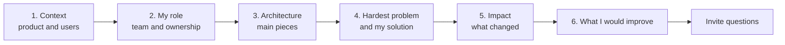
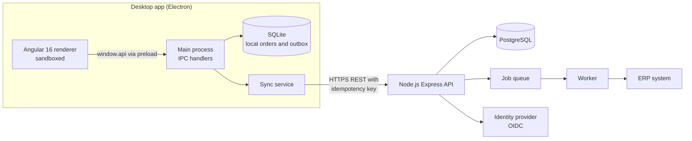
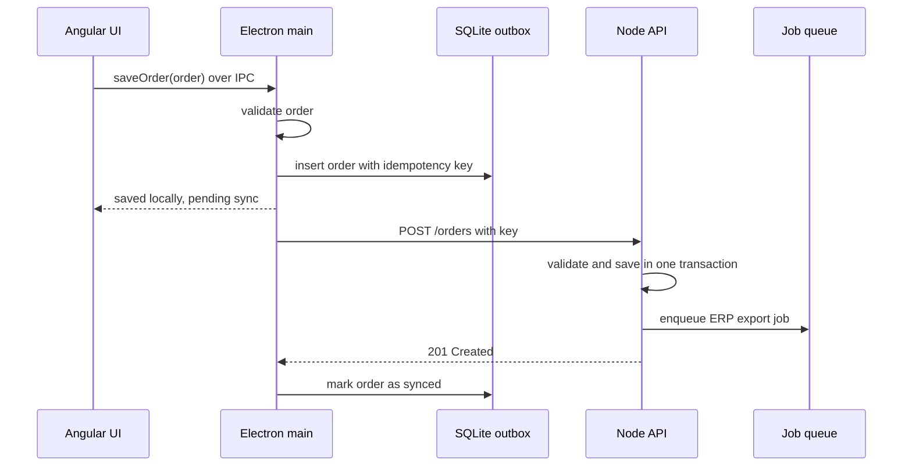
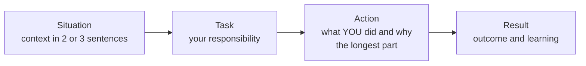

# Project Discussion and Behavioral Questions

> In this document you will learn how to present your own project in two minutes, explain its architecture with a diagram, answer deep-dive questions about your technical decisions, and answer behavioral questions with the STAR method. These rounds often decide between two candidates with similar technical skills, because they show how you work with real systems and real people.

**Before this:** [How to explain technical answers](01-how-to-explain-technical-answers.md) · **Interview questions:** [jump to the interview section](#interview-questions)

## Table of contents

1. [What these rounds test](#what-these-rounds-test)
2. [Choosing the project to present](#choosing-the-project-to-present)
3. [The two-minute project pitch](#the-two-minute-project-pitch)
4. [Explaining architecture with a diagram](#explaining-architecture-with-a-diagram)
5. [Project deep-dive questions](#project-deep-dive-questions)
6. [Behavioral questions and the STAR method](#behavioral-questions-and-the-star-method)
7. [Building your story bank](#building-your-story-bank)
8. [STAR example answers](#star-example-answers)
9. [Other common personal questions](#other-common-personal-questions)
10. [Good questions to ask the interviewer](#good-questions-to-ask-the-interviewer)
11. [Red flags to avoid](#red-flags-to-avoid)
12. [Tailoring for frontend, backend, full-stack and desktop roles](#tailoring-for-frontend-backend-full-stack-and-desktop-roles)
13. [How to explain this in an interview](#how-to-explain-this-in-an-interview)
14. [Interview questions](#interview-questions)
15. [Summary](#summary)
16. [References](#references)

---

## What these rounds test

There are two related kinds of conversation:

- **Project discussion (technical):** "Tell me about a project you worked on." The interviewer wants to see that you understand the system you built, not only your own tickets. They check your technical decisions, your trade-offs and your depth.
- **Behavioral questions:** "Tell me about a time when..." The interviewer wants evidence of how you behave at work: how you handle conflict, pressure, mistakes, ambiguity and other people.

The idea behind behavioral questions is simple: **past behavior is the best available evidence of future behavior.** So they ask for real past situations, not opinions. "I always communicate well" is an opinion. "When our release slipped, I told the product manager on Tuesday, two days before the deadline, and offered two options" is evidence.

What interviewers listen for in both:

| Signal | What it sounds like |
| --- | --- |
| Ownership | "I noticed... so I..." rather than "it was assigned to me" |
| Depth | You can explain *why*, not just *what* |
| Judgment | You name trade-offs and alternatives you rejected |
| Impact | You say what changed because of your work |
| Collaboration | You worked with people, not around them |
| Learning | You say what you would do differently |
| Honesty | Real details, real numbers or honest "we did not measure" |

---

## Choosing the project to present

Pick **one main project** and prepare it deeply. Also prepare one backup project in less detail.

A good project for interviews:

- **You did a significant part of it yourself** and can say clearly what "I" did.
- **It had a real technical challenge** (performance, data consistency, security, offline mode, scale, a hard migration).
- **It matches the role.** For a frontend role, a project with complex UI state. For a backend role, an API with data and integrations. For a desktop role, an Electron app.
- **You know it end to end.** Even parts you did not build: how data flows, how it is deployed, how it is monitored.
- **It is recent enough** that you remember the details.

If your main work project is confidential, describe it at a higher level: "a B2B order management system for a distribution company" instead of the company name and client details. Never share secrets, internal URLs or customer data.

If you do not have a strong work project (for example, a junior developer or someone changing stack), a serious personal project works too, as long as you can discuss real decisions and trade-offs.

---

## The two-minute project pitch

### The structure

When the interviewer says "Tell me about a project", give a **two-minute overview** first. Then let them choose where to go deeper. The structure has six parts:

| # | Part | What to say | Time |
| --- | --- | --- | --- |
| 1 | **Context** | What the product is, who uses it, why it exists | 15–20 s |
| 2 | **Your role** | Your position, team size, what you owned | 10–15 s |
| 3 | **Architecture** | The main pieces and how they talk | 20–30 s |
| 4 | **Hardest problem** | One real challenge and how you solved it | 30–40 s |
| 5 | **Impact** | What changed: numbers if you have them, honest description if not | 10–15 s |
| 6 | **What you would improve** | One or two things you would do differently now | 10–15 s |



Parts 4 and 6 are the most important. "Hardest problem" shows depth. "What I would improve" shows maturity: you can look at your own work critically.

### A full example pitch

The example below uses a typical enterprise stack: an Angular 16 application inside Electron, with a Node.js backend. **It is an illustration of the structure.** Replace every detail with your own true project.

> **Context:** "I worked on a desktop order-management application for field sales staff at a distribution company. The staff visit shops, take orders on a laptop and often have weak or no internet. Before this app, they used spreadsheets and emailed them in the evening, which caused errors and delays.
>
> **My role:** I was one of four developers, the most senior on the frontend. I owned the Angular application and the Electron layer, and I worked on parts of the Node.js API, mainly the order sync endpoints.
>
> **Architecture:** The desktop app is Electron with an Angular 16 renderer. The renderer talks to the Electron main process only through a small preload API. The main process stores data locally in SQLite so the app works offline. When the app is online, a sync service sends orders to a Node.js and Express REST API, which stores them in PostgreSQL and sends them to the ERP system through a job queue.
>
> **Hardest problem:** The hardest part was reliable offline sync. Early on, when the connection dropped in the middle of a sync, some orders were sent twice and created duplicates in the ERP. I designed an outbox: every order is first saved locally with a unique idempotency key. The sync sends pending orders one by one and deletes each only after the server confirms it. On the server, the key has a unique constraint, so a retried request returns the original result instead of creating a second order.
>
> **Impact:** After that change, we had no duplicate orders reported in the following months, and orders reached the ERP the same day instead of the next morning.
>
> **What I would improve:** I would add end-to-end tests for the sync earlier. We found most sync bugs in user testing, which was slow and expensive. I would also move from our custom polling to server-sent events for price updates."

That is about two minutes when spoken. It is concrete, it names technologies with reasons, and it gives the interviewer several doors to open: offline storage, idempotency, Electron security, the queue, testing.

### Rules for the pitch

- **Start with the users and the problem,** not the technology list. "An Angular app with NgRx and Material..." tells nothing about why it matters.
- **Say "I" for your work.** "We" is for the team. Interviewers are hiring you, not your team. Be honest though: do not claim work that others did.
- **Use numbers only if they are true.** "Load time went from 8 s to 2 s on our test machine" is great if you measured it. If not, describe the change honestly: "Users stopped complaining about the delay."
- **Prepare the pitch out loud** until it fits in about two minutes. Do not memorize it word by word; memorize the six parts and the key facts.
- **End with an invitation:** "I can go deeper into the sync design, the Electron security or the frontend architecture."

---

## Explaining architecture with a diagram

Interviewers often ask: "Can you draw the architecture?" You may have a whiteboard, a shared drawing tool, or only words.

### What to draw

Keep it simple: 5 to 10 boxes. Show:

- The **clients** (browser, desktop app, mobile).
- The **main services** (API, workers).
- The **data stores** (database, cache, queue, local storage).
- **External systems** (identity provider, payment, ERP).
- **Arrows** with the protocol or the kind of data (HTTPS REST, IPC, events).

Example for the pitch above:



### How to walk through the diagram

Do not describe boxes one by one ("this is the API, this is the database..."). Instead, **follow one real request** through the system. This is much easier to understand.

> "Let me follow one order. The salesperson fills in the order form in Angular. On submit, the component calls `window.api.saveOrder(order)`, which is a function the preload script exposes. That sends an IPC message to the main process. The main process validates the order, writes it to SQLite together with a new idempotency key, and returns the local ID. The UI shows the order as 'pending sync'.
> Every minute, and also when the network comes back, the sync service reads pending orders from the outbox and posts them to the API. The API validates the order again, saves it in PostgreSQL in one transaction with the key, and adds a job to the queue. It responds 201. The sync service then marks the order as synced. Later a worker takes the job and sends the order to the ERP, with retries if the ERP is down."



### Tips for drawing in interviews

- **Say what you are drawing while you draw.** Silence while drawing feels long.
- **Label arrows.** "REST", "IPC", "events", "SQL".
- **Mark trust boundaries** if security matters: the renderer is untrusted; the API never trusts the client.
- **Show where state lives.** Many follow-up questions are about state: where it is stored, how it stays consistent, what happens on failure.
- **Be ready to zoom in.** The interviewer may say "Tell me more about the sync service." Then draw a smaller diagram for that part only.

Related topics: [Electron architecture and process model](../08-electron-desktop/01-electron-architecture-and-process-model.md), [IPC and preload scripts](../08-electron-desktop/03-ipc-and-preload-scripts.md), [Enterprise Angular architecture](../06-angular-16/13-enterprise-architecture.md), [Background jobs and queues](../07-nodejs-backend/13-background-jobs-and-queues.md).

---

## Project deep-dive questions

After the pitch, interviewers ask follow-up questions about your decisions. Here are the common areas, with model answers based on the example project. Use them as patterns: **decision → reason → alternative considered → trade-off → what you would change.**

### Why did you choose this technology?

> **Question:** "Why Electron and not a web app?"
>
> **Model answer:** "Two requirements drove it: the app had to work fully offline for a whole day, and it had to print to local receipt printers. A Progressive Web App could handle some offline cases with a Service Worker and IndexedDB, but the browser storage could be cleared, and printing silently to a specific local printer is not possible from a normal web page. We also had an existing Angular team, so Electron let us reuse those skills. The trade-off was a large install size, around a hundred megabytes, and the responsibility for secure configuration and auto-updates. If offline was not a requirement, I would have built a web app."

The pattern: **requirement → why the obvious alternative did not fit → what you gained → what it cost.** Never answer "because it is popular" or "the team lead chose it" alone. If someone else chose it, say so, and then explain whether you agree and why.

Related topic: [Performance, architecture and alternatives in Electron](../08-electron-desktop/09-performance-architecture-and-alternatives.md).

### How does it scale?

> **Question:** "What happens if you have ten times more users?"
>
> **Model answer:** "The API is stateless, so we can run more instances behind the load balancer. The first bottleneck would be the database: the order sync does inserts plus a lookup on the idempotency key, which has a unique index, so that is cheap. The ERP export is already behind a queue, so a slow ERP does not slow down the API; the queue just grows and workers catch up. What I would watch is the morning peak, when hundreds of laptops come online and sync at the same time. I would add random jitter to the sync timing so they do not all hit the API in the same second, and rate-limit per device."

The pattern: **what is stateless and scales easily → the first real bottleneck → what already protects you → what you would add.** Do not claim "it scales infinitely".

Related topic: [Scalability and core building blocks](../09-system-design/02-scalability-and-core-building-blocks.md).

### What happens when things fail?

> **Question:** "What if the network drops in the middle of a sync?"
>
> **Model answer:** "There are two cases. If the request never reached the server, the order stays in the outbox and is retried later. If the server saved it but the response was lost, the client cannot know that, so it retries too. That is why we have the idempotency key: the server sees the same key, does not create a second order, and returns the original result. The client then marks it as synced. We also limit retries with exponential backoff, so a long outage does not flood the server when the network returns."

The core logic of the outbox, simplified (in the real app the pending list lives in SQLite, not memory):

```js
const { randomUUID } = require("node:crypto");

class OrderOutbox {
  constructor(sendToServer) {
    this.pending = [];
    this.sendToServer = sendToServer;
  }

  add(order) {
    // the idempotency key is created once, when the order is created
    this.pending.push({ ...order, idempotencyKey: randomUUID() });
  }

  async flush() {
    while (this.pending.length > 0) {
      const order = this.pending[0];
      try {
        await this.sendToServer(order); // the server ignores a repeated key
        this.pending.shift();           // remove only after success
      } catch (error) {
        console.log("still offline, will retry later:", error.message);
        return;
      }
    }
  }
}

// Fake server that remembers keys
const processedKeys = new Set();
let online = false;
async function fakeServer(order) {
  if (!online) throw new Error("network down");
  if (processedKeys.has(order.idempotencyKey)) return "duplicate ignored";
  processedKeys.add(order.idempotencyKey);
  console.log("server saved order", order.id);
}

(async () => {
  const outbox = new OrderOutbox(fakeServer);
  outbox.add({ id: "A-1", total: 120 });
  outbox.add({ id: "A-2", total: 80 });
  await outbox.flush(); // still offline, will retry later: network down
  online = true;
  await outbox.flush(); // server saved order A-1
                        // server saved order A-2
  console.log("pending:", outbox.pending.length); // pending: 0
})();
```

Being able to show the core idea in a few lines of code is very convincing in a project discussion.

### How did you test it?

> **Model answer:** "We had three levels. Unit tests with Jasmine and Karma for Angular services and pure functions, like price calculation, plus Jest tests for the Node API handlers. Integration tests for the API that ran against a real PostgreSQL in Docker, because mocking the database hid bugs in our SQL. And a small set of end-to-end tests with Playwright for the critical paths: create an order offline, go online, check it arrives. Honestly, the sync tests came late, and that is the thing I would change: the bugs we found in user testing would have been cheaper to find with an automated test that simulates network drops."

Name the levels, say what each level protected against, and be honest about gaps.

Related topic: [Angular testing](../06-angular-16/14-testing.md).

### How did you handle security?

> **Model answer:** "On the desktop side, the Angular renderer runs with `contextIsolation`, `sandbox` and no Node integration. The preload exposes only specific functions like `saveOrder` and `printReceipt`, and the main process validates every argument and checks that IPC messages come from our own app's page. We load only local app files, never remote content in a window with privileges. For auth, users sign in through the company identity provider with OpenID Connect using the authorization code flow with PKCE. The refresh token is stored with Electron's `safeStorage`, which uses the operating system's credential protection, not in plain files. On the API side, every request is authorized on the server, including checking that the salesperson can only create orders for their own region."

Related topics: [Electron security](../08-electron-desktop/04-electron-security.md), [Authentication and authorization](../07-nodejs-backend/09-authentication-and-authorization.md), [Angular security](../06-angular-16/15-security.md).

### What trade-offs did you make?

> **Model answer:** "The biggest one was choosing last-write-wins for customer details edited offline. Real conflict resolution, where the user merges two versions, was too expensive for the first release. We accepted that in rare cases one salesperson's change to a shop's phone number could overwrite another's. We reduced the risk by making the server keep a history table, so support could restore old values. For orders we did not accept that risk: orders are never edited after sync, only cancelled and re-created."

A good trade-off answer has: **what you chose → what you gave up → why that was acceptable → how you limited the risk.**

### What was the hardest bug?

> **Model answer:** "The hardest bug was a memory leak in the renderer. After a full day of use, the app became slow and sometimes crashed. I took heap snapshots in Chrome DevTools, before and after opening and closing the order screen several times, and compared them. There were hundreds of detached order components still in memory. They were kept alive by subscriptions to a price-update observable in a root service that were never unsubscribed, plus an IPC listener added on every screen open. I fixed it by using the `async` pipe instead of manual subscriptions, `takeUntil` with a destroy subject where we needed manual subscriptions, and by making the preload's `onPriceUpdate` function return an unsubscribe function that we called in `ngOnDestroy`. After the fix, memory stayed flat during a full-day test."

The pattern for bug stories: **symptom → how you investigated (tools, hypotheses) → root cause → fix → how you verified → how you prevented it in future.**

Related topics: [RxJS](../06-angular-16/09-rxjs.md), [Memory management and garbage collection](../02-javascript/19-memory-management-and-garbage-collection.md).

### How do you deploy and update it?

> **Model answer:** "The API runs in Docker containers, deployed by our CI pipeline after tests pass, with a rolling update so there is no downtime. For the desktop app, we build signed installers with electron-builder and publish them to an update server. The app checks for updates on start and installs them on the next restart. We roll out to a small group of users first, and because old app versions can stay in the field for weeks, the API supports at least the previous version of the sync format."

Related topics: [Packaging, installers and code signing](../08-electron-desktop/06-packaging-installers-and-code-signing.md), [Auto-updates](../08-electron-desktop/07-auto-updates.md).

### How did you know it worked in production?

> **Model answer:** "The API logs structured JSON with a request ID, and we had dashboards for error rate, latency and queue length, with alerts when the queue grew for more than ten minutes. In the desktop app we logged to a local file with rotation and sent crash reports. Each device also reported its number of pending orders during sync, so we could see if one laptop was stuck."

Related topics: [Production Node.js](../07-nodejs-backend/14-production-nodejs.md), [Logging, crash recovery and monitoring in Electron](../08-electron-desktop/08-logging-crash-recovery-and-monitoring.md).

### What would you do differently?

> **Model answer:** "Three things. I would write the sync end-to-end tests from the start. I would define the IPC contract as shared TypeScript types from day one; we added them later, after a few bugs where the renderer and main process disagreed on a field name. And I would have pushed for a feature flag system earlier, because our only way to disable a broken feature was a new release."

This question is almost always asked. "Nothing, it was perfect" is a red flag. Pick real improvements that show you learned.

---

## Behavioral questions and the STAR method

### What behavioral questions are

Behavioral questions ask about **real situations from your past**. They usually start with:

- "Tell me about a time when..."
- "Give me an example of..."
- "Describe a situation where..."
- "What did you do when..."

They are not trick questions. The interviewer wants to understand how you work: with conflict, pressure, mistakes, people and unclear problems.

### The STAR method

**STAR** is a simple structure for telling a work story clearly:

| Letter | Part | What to say | Share of the answer |
| --- | --- | --- | --- |
| **S** | Situation | Where and when. Short background. | ~15% |
| **T** | Task | What you were responsible for, or what the challenge was. | ~10% |
| **A** | Action | What **you** did, step by step, and why. | ~55% |
| **R** | Result | What happened. Numbers if true. What you learned. | ~20% |



**Action is the most important part.** Weak answers spend a long time on the situation and then say "so we fixed it". Strong answers spend most of the time on what *you* did, the decisions you made and *why*.

Many people add an extra **L** for **Learning** at the end (STAR-L): "What I learned is..." This is especially useful for questions about mistakes and failures.

### Rules for good STAR answers

- **Keep it to about two minutes.** The interviewer will ask follow-ups for details.
- **Use "I" for your actions.** "We" hides your contribution. It is fine to say "the team decided X; my part was Y".
- **Be specific.** One real situation, not "usually I do...". If the question asks "tell me about a time", a general answer is a weak answer.
- **Show your reasoning.** "I chose to talk to her privately first, because I did not want her to feel attacked in the stand-up."
- **Make the result real.** A number if you have one, a concrete outcome if not. A good result can also be partial: "It did not fully work, but..."
- **Be honest.** Never invent stories. Follow-up questions ("What did your manager say? What was the exact error?") quickly expose invented stories.
- **Stay positive about other people.** You can describe a difficult person without blaming or insulting them.
- **End clearly.** "...and since then, I always do X." Then stop.

### Weak vs strong: one example

**Question:** "Tell me about a time you had a conflict with a teammate."

**Weak answer:**
> "I don't really have conflicts. I get along with everyone. Sometimes we disagree on code reviews but we discuss and fix it."

Problems: it avoids the question, it is general ("sometimes"), and "I never have conflict" sounds either untrue or like someone who avoids difficult conversations.

**Strong answer:** see the [conflict example](#conflict-with-a-teammate) below.

---

## Building your story bank

You cannot prepare an answer for every possible question. But you do not need to. Most behavioral questions can be answered with a small set of **well-prepared stories**, because one good story can answer several questions.

### How to build it

1. Think of 6 to 8 real situations from your work that you remember well. Good sources:
   - A difficult bug or production incident.
   - A disagreement (with a teammate, a manager, a product owner).
   - A deadline that was at risk.
   - A mistake you made.
   - Something you are proud of.
   - A time you learned something new fast.
   - A time you helped or mentored someone.
   - A time requirements were unclear.
2. For each story, write a few bullet points for S, T, A and R. Not full sentences — just the key facts, so you do not sound memorized.
3. Note which questions each story can answer.

| Story | Can answer questions about |
| --- | --- |
| Production outage after a release | Incident handling, pressure, mistakes, ownership, learning |
| Disagreement about state management | Conflict, persuasion, technical decisions, teamwork |
| Sync feature with unclear requirements | Ambiguity, communication with stakeholders, prioritization |
| Helping a new junior developer | Mentoring, leadership, patience, giving feedback |
| Learning Electron in two weeks | Learning quickly, adaptability, initiative |

4. Practice each story out loud a few times. Check: is it about two minutes? Is most of it the Action? Is the "I" clear?

### Adapting a story to the question

The same story can be told with a different focus. The production outage story:

- For **"Tell me about a mistake"**: focus on your mistake and what you learned.
- For **"Tell me about working under pressure"**: focus on how you stayed calm, communicated and prioritized.
- For **"Tell me about ownership"**: focus on how you went beyond the fix to prevent it from happening again.

---

## STAR example answers

The answers below show the structure and the level of detail that works well. **They are examples, not scripts.** Replace them with your own true experiences. Each one is about two minutes when spoken.

### Conflict with a teammate

**Question:** "Tell me about a time you had a conflict with a teammate."

> **Situation:** "In my last project, another senior developer and I disagreed about state management in our Angular app. He wanted to add NgRx for the whole application. I thought it was too heavy for most of our screens, which were simple forms.
>
> **Task:** We had to decide before starting a new module, and the disagreement was starting to slow down code reviews, with long comment threads.
>
> **Action:** First, I asked him for a short call instead of continuing in review comments, because written comments were making it feel personal. In the call I asked him to explain the problems he wanted to solve. It turned out his real concern was one complex screen, the order editor, where several components shared state and we had bugs from inconsistent updates. That was a fair point. I suggested we write down the criteria together: shared state across many components, complex async flows, need for debugging tools. Then we went through our screens against those criteria. Only two screens met them. We agreed to use NgRx for those two and simple services with BehaviorSubjects for the rest. I wrote a short architecture decision record so the team understood the rule.
>
> **Result:** The review threads stopped, the order editor bugs went down after the NgRx migration, and the rule was easy for new developers to follow. I also learned that many technical disagreements are about different problems, not different solutions. Now I start by asking what problem the other person is trying to solve."

**Why it works:** it is a real technical disagreement, the candidate does not blame the colleague, most of the answer is actions with reasons, and it ends with a learning.

Related topic: [State management and NgRx](../06-angular-16/11-state-management-and-ngrx.md).

### Missed deadline

**Question:** "Tell me about a time you missed a deadline" or "...a project that was late."

> **Situation:** "We committed to delivering a report export feature by the end of a sprint, for a client demo.
>
> **Task:** I owned the export, which had to produce Excel files from large data sets.
>
> **Action:** Halfway through the sprint, I realized the export was much harder than estimated: for big reports the API timed out, because generating the file took over a minute. Instead of hoping to catch up, I told my lead and the product owner the same day. I gave them two options: deliver a working export for small reports by the deadline, with large reports processed in the background and emailed later; or delay the whole feature by one week. I explained the risk of each. They chose the first option for the demo. I then built the background job with a queue and a progress status, and the large-report version shipped the following sprint.
>
> **Result:** The demo went well with the small reports, and the client was fine with the background export. We missed the original full scope by one week, but nobody was surprised. What I learned: I now break features with unknown performance into a quick spike first, and I raise risk as soon as I see it, not at the deadline."

**Why it works:** it admits the miss honestly, shows early communication and options (not just "I worked late"), and shows a concrete change in behavior.

### Production incident

**Question:** "Tell me about a production incident you handled."

> **Situation:** "On a Monday morning, right after a release, users of our order app reported that they could not log in.
>
> **Task:** I was on call that week, so I was responsible for leading the response.
>
> **Action:** First, I confirmed the impact: the error rate on the login endpoint had jumped to almost 100 percent at the time of the deployment. Because the timing matched the release, I decided to roll back first and investigate after, instead of trying to fix forward under pressure. I posted in the incident channel what we knew and when the next update would come. The rollback took about ten minutes and logins recovered. Then I looked for the cause: the release had changed the cookie configuration for the session, and the `SameSite` setting no longer matched our login flow from the identity provider, so the browser dropped the cookie on the redirect back. Our tests did not cover the real redirect flow. I fixed the configuration, added an end-to-end test for the full login flow against our test identity provider, and wrote a short blameless postmortem with three action items.
>
> **Result:** Total impact was about 25 minutes. The new test caught a similar problem two months later before it reached production. I learned to always ask 'can we roll back?' first during an incident, and to test configuration changes as seriously as code changes."

**Why it works:** clear priorities (stop the impact, communicate, then find the root cause), calm decisions with reasons, and prevention, not just the fix.

Related topic: [Production Node.js](../07-nodejs-backend/14-production-nodejs.md).

### Disagreeing with a manager

**Question:** "Tell me about a time you disagreed with your manager."

> **Situation:** "My manager wanted to skip writing tests for a new pricing module to meet a release date.
>
> **Task:** I was the developer building the module, and I was worried because pricing errors would directly cost money.
>
> **Action:** I did not just say 'we need tests'. I asked for fifteen minutes and came with specifics. I showed the three pricing rules that had caused bugs in the last year, and estimated that tests for only the pricing calculations, not the whole module, would take about one and a half days. I proposed a compromise: test the calculation functions fully, skip UI tests for now, and add them in the next sprint. I also said clearly that it was his decision, and that I would support it either way.
>
> **Result:** He agreed to the compromise. During those tests I found a rounding bug in the discount calculation that would have charged some customers the wrong amount. After that, he asked me to define a minimum testing rule for money-related code for the team. What I learned is that disagreement works better with data, a smaller ask and respect for who makes the final decision."

**Why it works:** respectful, data-driven, offers a compromise, accepts the manager's authority, and the result proves the point without bragging.

### Mentoring

**Question:** "Tell me about a time you mentored or helped someone."

> **Situation:** "A junior developer joined our team with a strong JavaScript background but no Angular or RxJS experience.
>
> **Task:** My lead asked me to help her become productive on our codebase.
>
> **Action:** I started by asking what she already knew and how she liked to learn. She preferred working on real tasks to reading. So instead of giving her documents, I picked three small tickets that each touched a different part of the app: a form, a service with HTTP calls and a component with an observable stream. For each one, we did a 30-minute pairing session at the start where I explained the relevant concept with our own code, then she worked alone, and I reviewed her pull request with detailed comments that explained the 'why', not just the change. When she struggled with RxJS operators, I drew marble diagrams for our real streams. I also made sure she presented her third feature in our demo, so she got visibility.
>
> **Result:** After about six weeks she was picking up normal tickets on her own, and a few months later she was reviewing others' RxJS code. I learned that matching the teaching style to the person matters more than the amount of material."

### Learning a new technology quickly

**Question:** "Tell me about a time you had to learn something new quickly."

> **Situation:** "Our team was asked to turn our Angular web app into a desktop app with offline support, and nobody on the team had used Electron.
>
> **Task:** I volunteered to build a proof of concept in two weeks, so the team could decide whether to commit.
>
> **Action:** I started with the official Electron documentation, especially the process model and the security checklist, because I knew that getting the architecture wrong early would be expensive. On day two I had a minimal app loading our Angular build. Then I focused only on the riskiest unknowns: talking safely between Angular and the main process, storing data locally, and printing. For each, I built the smallest working version. I kept a short document with decisions and open questions, and I showed progress to the team every few days instead of only at the end.
>
> **Result:** After two weeks we had a working prototype that saved orders offline and printed receipts, and a clear list of risks, like code signing and auto-updates. The team decided to go ahead, and the prototype's IPC design became the base of the real app. What I learned: when learning fast, I go to official sources first, and I focus on the riskiest parts instead of trying to learn everything."

### Biggest mistake

**Question:** "What is the biggest mistake you made at work?"

> **Situation:** "Early in my career, I ran a database migration script on production that I had only tested on my local database.
>
> **Task:** The script was supposed to add a column and fill it with default values for existing orders.
>
> **Action:** The script worked locally, but production had far more rows, and the update locked the orders table for several minutes during business hours. Order creation failed during that time. As soon as I saw the errors, I told my lead immediately; I did not try to hide it. We waited for the update to finish because stopping it halfway was riskier. Afterwards, I wrote the incident summary myself. Then I changed how I work: I rewrote the migration to update in small batches, and I proposed a rule that migrations must run first on a staging database with a copy of production-size data.
>
> **Result:** The rule became part of our release checklist, and we did not have another migration lock incident while I was there. The lesson I took: 'it works on my machine' is not testing. Production data size and load are part of the requirements."

**Why it works:** it is a real mistake with real impact, the candidate takes ownership without excuses, and the learning changed their behavior and the team's process. Do **not** choose a fake mistake ("I work too hard").

### Proudest achievement

**Question:** "What are you most proud of in your career?"

> **Situation:** "Our main dashboard took around eight seconds to become usable for big customers, and sales teams were complaining.
>
> **Task:** I took ownership of the performance work, with the goal of making it usable in under three seconds on a typical office laptop.
>
> **Action:** I measured first, with the Chrome Performance panel and the Angular DevTools profiler. Three problems stood out: we loaded all modules up front, the main table rendered thousands of rows, and every component used the Default change detection strategy, so each event checked the whole page. I lazy-loaded the admin modules, added virtual scrolling to the table, moved the table and its rows to OnPush with immutable updates, and moved one expensive calculation into a pure pipe. I made the changes in small pull requests and measured after each one, so we knew which change helped.
>
> **Result:** Time to usable went from about eight seconds to under three on our test laptop, and the sales team noticed without being told. I am proud of it because I did not guess; every change was measured, and the approach became the template for performance work in our team."

**Why it works:** measurable impact, a clear method (measure, change, measure again), and it shows technical depth that can be explored in follow-ups.

Related topics: [Angular performance](../06-angular-16/12-performance.md), [Change detection and signals](../06-angular-16/10-change-detection-and-signals.md).

### Handling ambiguity

**Question:** "Tell me about a time you worked with unclear requirements."

> **Situation:** "A product manager asked us to build 'a notifications feature' for our admin portal, with no further detail, and the deadline was one quarter away.
>
> **Task:** I was asked to lead the technical design.
>
> **Action:** Instead of guessing, I wrote a one-page document with the questions that would change the design: Which events create notifications? Real-time or is a refresh acceptable? Email too, or only in-app? Do notifications need to be kept, and for how long? I met the product manager and two actual users. It turned out the main need was one thing: managers wanted to know immediately when a large order failed to export. Everything else was 'nice to have'. So I proposed a small first version: in-app notifications for failed exports only, pushed with server-sent events, with the data model designed so other event types could be added later. I wrote down what we were explicitly not doing yet.
>
> **Result:** We shipped the first version in four weeks instead of a quarter, users used it from day one, and the later additions fitted the data model. What I learned: with unclear requirements, the most valuable step is to find the one real problem and confirm it with real users."

Related topic: [Real-time chat and notifications case study](../09-system-design/10-case-study-real-time-chat-and-notifications.md).

### Giving feedback

**Question:** "Tell me about a time you gave difficult feedback."

> **Situation:** "A colleague often opened very large pull requests, sometimes over two thousand lines, and reviewers either delayed them or approved them without really reading.
>
> **Task:** I was reviewing many of his pull requests and I felt the quality risk was growing. I wanted to raise it without making him defensive.
>
> **Action:** I asked for a private chat, not a comment in the pull request. I described one specific example, not a general judgment: 'Last week's PR had 2,300 lines across four features. I spent an hour on it and still was not confident I had checked the payment changes properly.' Then I explained the impact on the team, not on me personally. I asked how he saw it. He said he did not want to block others with many small reviews. We agreed to try splitting work into smaller PRs, under about 400 lines when possible, and I offered to review his small PRs quickly so he would not be blocked.
>
> **Result:** His next pull requests were much smaller, review times went down, and he later suggested a team guideline on PR size himself. I learned that feedback works best when it is specific, private, about impact and comes with an offer to help."

### Receiving feedback

**Question:** "Tell me about a time you received critical feedback."

> **Situation:** "After a design review, my lead told me that my explanations in meetings were hard to follow. I gave a lot of detail before getting to the point, and people lost interest.
>
> **Task:** I wanted to improve, because I knew good ideas are useless if people do not understand them.
>
> **Action:** First, I thanked him and asked for a concrete example, so I understood exactly what he meant. Then I changed how I prepare. Before each meeting I write down my main point in one sentence and say it first, then the reasons, then the details only if asked. I also asked him to give me a quick signal after the next two meetings about whether it was better.
>
> **Result:** After a few weeks he said my updates were much clearer, and I noticed that decisions in my meetings were made faster. It also helped me in interviews and written design documents. I learned that asking for a specific example turns vague feedback into something I can act on."

---

## Other common personal questions

These are not STAR questions, but they come up in almost every interview. Prepare short, honest answers.

### "Tell me about yourself."

This is usually the first question. It is **not** your life story. Use a 60 to 90 second **present → past → future** structure:

1. **Present:** your current role and what you work on.
2. **Past:** the experience that brought you here, one or two highlights.
3. **Future:** why you are interested in this role.

> "I am a full-stack developer with about six years of experience, currently working mostly with Angular and Node.js. Right now I work on a B2B order management platform, where I lead the frontend and the desktop app built with Electron. Before that, I spent three years building internal admin tools, which is where I got interested in performance and architecture of large Angular apps. Recently I have been doing more backend and system design work, and that is why this role interests me: it is a full-stack position with ownership of features end to end, in a product with real scale."

### "Why are you leaving your current job?"

Be positive and future-focused. Never criticize your current employer.

> "I have learned a lot in my current role, especially about desktop and offline apps. But the product is now in a maintenance phase, and I want to work on a product that is growing, where I can take more ownership of backend and architecture decisions."

### "Why do you want to work here?"

Show you did research. Connect the company's product or engineering to your experience and goals. Avoid answers that could apply to any company ("you are a great company").

### "What is your greatest weakness?"

Choose a **real** weakness that is not a core requirement of the job, and show what you are doing about it.

> "I tend to go too deep into technical details when I explain things, especially to non-technical people. I have been working on it by stating my main point first and offering details only when asked. My lead says my updates are clearer now, but I still have to remind myself in long meetings."

Avoid fake weaknesses like "I am a perfectionist" or "I work too hard". Interviewers have heard them many times and they sound evasive.

### "Where do you see yourself in five years?"

Show ambition that fits the role: deeper technical expertise, more ownership, maybe mentoring or leading. Be honest but connected to this job.

---

## Good questions to ask the interviewer

At the end, the interviewer usually asks: "Do you have any questions for us?" Always have two or three ready. Good questions show interest and help you decide if you want the job.

**About the work:**
- "What would I work on in my first three months?"
- "What is the biggest technical challenge the team is facing right now?"
- "How is the frontend architecture organized? Is it a monorepo, micro-frontends, one big app?"

**About the team and process:**
- "How does the team decide on technical direction, for example a new library or architecture change?"
- "How do code reviews work here?"
- "How do you handle production incidents? Is there an on-call rotation?"
- "How does a feature go from idea to production?"

**About growth:**
- "What does success look like for this role after one year?"
- "How do engineers grow here? Are there opportunities to mentor or lead projects?"

**About the interviewer:**
- "What do you enjoy most about working here?"
- "What is something you would like to change about how the team works?"

Avoid asking about things you could easily find on the company website, and avoid starting with salary and holidays in a technical round (save those for the recruiter or HR).

---

## Red flags to avoid

| Red flag | Why it hurts | What to do instead |
| --- | --- | --- |
| Blaming others ("the backend team was useless") | Suggests you will blame your next team too | Describe facts and your actions |
| Only "we", never "I" | The interviewer cannot see your contribution | Say "I" for your actions |
| "I have never had a conflict / made a mistake" | Sounds untrue or unaware | Share a real, moderate example |
| Fake weaknesses ("I'm a perfectionist") | Sounds evasive | Share a real weakness and your plan |
| Invented numbers or stories | Follow-ups expose them; trust is lost | Use real numbers or honest descriptions |
| Speaking badly about your employer | Unprofessional | Stay neutral and future-focused |
| Not knowing parts of your own project | Suggests shallow involvement | Learn your system end to end before interviews |
| "The architect decided" for every decision | No ownership or opinion | Explain the decision and whether you agree |
| Very long, unstructured stories | The interviewer loses the point | Use STAR, two minutes, then stop |
| Arrogance ("my solution was obviously the best") | Signals poor teamwork | Show trade-offs and what you learned |
| No questions for the interviewer | Suggests low interest | Prepare two or three real questions |
| Sharing confidential details | Shows poor judgment | Describe systems at a general level |

---

## Tailoring for frontend, backend, full-stack and desktop roles

Use the same project and stories, but **change the focus** to match the role.

| Role | Emphasize in your project | Typical deep-dive topics | Good stories |
| --- | --- | --- | --- |
| **Frontend** | UI architecture, state management, performance, accessibility, design collaboration | Component design, change detection, bundle size, Core Web Vitals, forms, testing | Performance improvement, working with designers, complex UI state bug |
| **Backend** | API design, data modeling, reliability, security, scaling | REST design, databases and indexes, caching, queues, auth, observability | Production incident, data migration, scaling a slow endpoint |
| **Full-stack** | End-to-end ownership: from UI to database, and how the parts fit | API contracts between front and back, auth flow end to end, deployment | Feature you built end to end, trade-off between client and server work |
| **Desktop (Electron)** | Process model, security, offline, native features, updates | IPC design, preload security, packaging and signing, auto-update, crash handling, memory | Offline sync, update rollout problem, a memory leak in a long-running app |

Examples of how one project changes focus:

- **For a frontend role:** spend the "hardest problem" part on the order editor's state management and the dashboard performance work.
- **For a backend role:** spend it on the idempotent sync API, the queue to the ERP, and the database design.
- **For a desktop role:** spend it on the secure IPC design, offline storage and the auto-update rollout.

Related topics for preparation: [Frontend architecture at scale](../09-system-design/05-frontend-architecture-at-scale.md), [REST API design](../07-nodejs-backend/07-rest-api-design.md), [Databases](../07-nodejs-backend/10-databases.md), [Electron security](../08-electron-desktop/04-electron-security.md).

---

## How to explain this in an interview

When the interviewer says "Walk me through your project", use the pitch structure as your six steps:

1. **Define it (context):** "It is a desktop order-management app for field sales staff who often work offline."
2. **Why it exists:** "Before it, orders were collected in spreadsheets and emailed at night, which caused errors and a one-day delay."
3. **How it works (architecture):** "Angular 16 inside Electron, with a preload API to the main process, SQLite for offline storage, and a sync service to a Node.js API with PostgreSQL and a job queue to the ERP."
4. **Small example (hardest problem):** "The hardest part was offline sync without duplicate orders. I used an outbox with idempotency keys, so retries are safe."
5. **Where it is useful (impact and your role):** "I owned the Angular and Electron layers. Orders now reach the ERP the same day, and duplicates stopped."
6. **Trade-offs / gotchas (what you would improve):** "We chose last-write-wins for customer edits to ship faster, and I would add automated sync tests earlier."

Then stop and invite questions: "Which part would you like to go deeper into?"

---

## Interview questions

### Q1. Walk me through the most significant project you worked on.

**What the interviewer is checking:** Whether you can give a structured overview, explain your own role clearly, and show depth on at least one hard problem. They are also choosing which areas to probe next.

**Short spoken answer (30–60 seconds):**
> The most significant one is a desktop order-management app for field sales staff who often work without internet. I was one of four developers and owned the Angular frontend and the Electron layer. Architecturally, it is Angular 16 inside Electron, with a small preload API to the main process, local SQLite storage, and a sync service that sends orders to a Node.js and PostgreSQL backend, which exports them to the ERP through a job queue. The hardest problem was offline sync without duplicates, which I solved with an outbox and idempotency keys. Orders now reach the ERP the same day instead of the next morning. If I did it again, I would write automated sync tests from the start. Which part would you like me to go into?

**Detailed explanation:**
This is the six-part pitch, compressed. In a real interview you would usually take the full two minutes ([the two-minute project pitch](#the-two-minute-project-pitch)). The closing question hands control back to the interviewer, which keeps the conversation focused on what they care about.

**Follow-up questions:**
- **What exactly did you build yourself?** — Name concrete parts: "I designed the IPC contract and the preload API, built the outbox and sync service, and implemented the order editor in Angular. The backend sync endpoint I built together with a backend colleague; the ERP worker was his."
- **How big was the system?** — Give honest sizes if you know them: number of users, requests per day, data volume, number of screens. If you do not know exactly, give a range and say it is approximate.
- **What would break first if usage grew ten times?** — See [how does it scale](#how-does-it-scale).

**Common mistakes:** Starting with a list of technologies. Describing only your tickets without the system. Speaking for five minutes without a pause.

**Where this is used in real projects:** The same structure works for demos, onboarding new team members and writing a project summary on your CV.

---

### Q2. Why did your team choose Angular instead of React?

**What the interviewer is checking:** Whether you understand technology choices as trade-offs tied to context, and whether you have your own opinion.

**Short spoken answer (30–60 seconds):**
> The decision was made before I joined, but I agree with it for our case. It was a large enterprise app with many forms and a team of mostly backend-oriented developers. Angular gives a complete framework out of the box: routing, forms, HTTP, dependency injection and a standard project structure. That consistency helped a lot when developers moved between modules. React would have given us more freedom, but we would have had to choose and maintain our own set of libraries for state, forms and data fetching, and every team might choose differently. The trade-off is that Angular has a steeper learning curve, especially RxJS, and in Angular 16 the bundle sizes needed more care.

**Follow-up questions:**
- **Would you choose Angular again for a new project?** — Answer with conditions: "For a large team building a long-lived enterprise app, yes. For a small marketing site or a team with strong React experience, probably not."
- **What do you think of newer Angular features like signals?** — Signals are a developer preview in Angular 16 and became stable in later versions; they make fine-grained updates simpler and reduce the need for RxJS for simple local state. See [Angular 16 vs newer versions](../06-angular-16/16-angular-16-vs-newer-versions.md).

**Common mistakes:** "Angular is better" or "the company uses it" as the only reason. Criticizing the other framework without knowing it.

---

### Q3. If you could rebuild your project today, what would you change?

**What the interviewer is checking:** Self-reflection, learning, and whether you can see weaknesses in your own work without being defensive.

**Short spoken answer (30–60 seconds):**
> Three things. First, I would define the contract between the renderer and the main process as shared TypeScript types from day one. We added them later after bugs where the two sides disagreed on a field. Second, I would build automated tests for the offline sync early, including simulated network drops, because most of our sync bugs were found by users. Third, I would add feature flags early, so we could switch off a broken feature without shipping a new desktop release. None of these were obvious at the start, but they would have saved us time later.

**Follow-up questions:**
- **Why did you not do them at the time?** — Be honest: "We underestimated how many sync edge cases there would be, and the release date pushed us to manual testing."
- **Would you change the main technology choices?** — Only if you really would, with reasons. "Electron was right because of offline and printing needs."

**Common mistakes:** "Nothing." Or a long list of complaints about others' decisions.

---

### Q4. What was your specific contribution, as opposed to the team's?

**What the interviewer is checking:** Ownership and honesty. Many candidates say "we" so much that their contribution is invisible.

**Short spoken answer (30–60 seconds):**
> The team was four developers, a tester and a product owner. My specific parts were: I designed the IPC layer, meaning the preload API and the validation in the main process. I built the outbox and the sync service on the desktop side. I built the order editor in Angular, which was the most complex screen. And I set up the performance profiling that led to the OnPush and virtual scrolling changes. I also reviewed most frontend pull requests. The backend API was mostly built by two colleagues; I worked with them on the sync endpoint and the idempotency design.

**Follow-up questions:**
- **What was the hardest decision you personally made?** — Pick one with a real trade-off, for example choosing last-write-wins for customer edits, and explain why.

**Common mistakes:** Claiming everything ("I built the whole system") or nothing ("we did it together"). Interviewers check with follow-ups.

---

### Q5. How did you keep code quality high in your team?

**What the interviewer is checking:** Engineering practices beyond your own code, and influence on the team.

**Short spoken answer (30–60 seconds):**
> We used a few layers. Automatic checks in CI: linting with ESLint, strict TypeScript, unit tests and a build, and pull requests could not be merged if they failed. Code reviews by at least one other developer, with a team guideline to keep pull requests small, under a few hundred lines when possible. Shared conventions written down: folder structure, naming, and when to use NgRx versus a simple service. And for important decisions, short architecture decision records, so new developers could see why things are the way they are. The most effective single change was small pull requests, because reviews became faster and more careful.

**Follow-up questions:**
- **How do you handle a review where you disagree with the reviewer?** — Ask what problem they see, explain my reasoning once, and if we still disagree on something non-critical, follow the team convention or ask a third person. I do not let a style debate block a release.

---

### Q6. Tell me about a time you had to make a decision without enough information.

**What the interviewer is checking:** Judgment under uncertainty: do you gather the minimum needed, decide, and limit the risk?

**Short spoken answer (30–60 seconds, STAR):**
> **Situation:** during an incident, our API's response times jumped, and we did not yet know why. **Task:** I was on call and had to decide whether to roll back a release from that morning. **Action:** I checked the two things I could check quickly: the timing matched the release, and the slow endpoints were the ones touched by it. I could not prove the release was the cause, but rolling back was low risk and fast, while investigating could take an hour of slow service. So I rolled back and told the team it was a precaution. **Result:** latency returned to normal within minutes, which confirmed the cause. Then we found a missing database index in a new query. My rule since then: when a decision is reversible and cheap, decide fast; when it is hard to reverse, gather more information first.

**Follow-up questions:**
- **What if the rollback had not helped?** — Then I would have learned that the release was not the cause, at low cost, and moved to the next hypothesis, like database load or a dependency.

---

### Q7. How do you balance technical debt against new features?

**What the interviewer is checking:** Pragmatism and the ability to argue for engineering work in business terms.

**Short spoken answer (30–60 seconds):**
> I treat technical debt like any other work: I make its cost visible and prioritize it against features with the product owner. Not all debt is worth paying. I focus on debt in code we change often, or that causes incidents, because that is where it costs real time. I try to express it in business terms: "Every change to the pricing module takes twice as long and caused two bugs this quarter; a one-week refactor would fix that." In practice, two things work well: fixing small debt as part of the feature that touches the code, and reserving a small, regular part of each sprint for larger items, agreed with the product owner.

**Follow-up questions:**
- **Give an example.** — Use a real story: for example, replacing a hand-written HTTP retry wrapper that caused bugs with a shared interceptor, done while building a feature that needed retries anyway.

Related topic: [Enterprise Angular architecture](../06-angular-16/13-enterprise-architecture.md).

---

### Q8. Tell me about a time you improved a process for your team.

**What the interviewer is checking:** Initiative beyond your assigned tasks.

**Short spoken answer (30–60 seconds, STAR):**
> **Situation:** our desktop releases were manual: one developer built the installers on his own machine and uploaded them, which took half a day and sometimes produced unsigned builds. **Task:** I offered to automate it. **Action:** I set up a CI pipeline that built the Windows and macOS installers with electron-builder, signed them with certificates stored as CI secrets, ran the smoke tests and published to our update server as a draft. A person still approved the final release. I documented the process and ran the first two releases together with the developer who used to do it. **Result:** releases went from half a day to about twenty minutes of mostly waiting, and we had no more unsigned builds. It also meant releases no longer depended on one person being available.

Related topic: [Packaging, installers and code signing](../08-electron-desktop/06-packaging-installers-and-code-signing.md).

---

### Q9. Tell me about a time you failed.

**What the interviewer is checking:** Honesty, ownership and learning. This is slightly different from "a mistake": a failure can be a project or goal that did not succeed, even without one clear error.

**Short spoken answer (30–60 seconds, STAR):**
> **Situation:** I proposed and led a migration of our shared UI components into a separate library, so other teams could reuse them. **Task:** I estimated six weeks. **Action:** I focused on the technical side: building, versioning and publishing the library. But I did not involve the other teams early enough. When we released it, their apps used different Angular versions and styling approaches, and they could not adopt it without big changes. **Result:** after three months, only our own team used it. I failed because I solved a technical problem without validating the users' needs. Since then, for any shared tool, I first talk to two or three consumers and agree on their constraints before writing code. A later shared HTTP library, done that way, was adopted by four teams.

**Follow-up questions:**
- **What would you do differently on that project now?** — Start with a short survey of the other teams' versions and needs, build a small pilot with one other team, and only then generalize.

**Common mistakes:** Picking a "failure" that is actually a success. Blaming others for the failure.

---

### Q10. How do you handle a teammate who is not doing their share of the work?

**What the interviewer is checking:** Maturity in team conflict: do you understand first, talk directly and escalate only when needed?

**Short spoken answer (30–60 seconds):**
> First I try to understand, not assume. There may be a reason: unclear tasks, a blocker, personal problems, or they feel stuck and do not want to say it. So I talk to them privately and ask how their task is going and whether something is blocking them. Often the fix is simple: pairing for an hour, splitting a task, or clarifying requirements. If the problem continues and affects the team's commitments, I raise it with the lead, focused on the impact on delivery, not on the person. I would also make sure the team's work is visible, for example on the board, so problems show up early without anyone needing to accuse anyone.

**Follow-up questions:**
- **What if the person is more senior than you?** — The same approach, with even more care to ask rather than tell. A specific question like "Is anything blocking the payment API? We need it by Thursday for integration" is respectful and clear.

---

### Q11. How do you handle several urgent tasks at the same time?

**What the interviewer is checking:** Prioritization and communication under pressure.

**Short spoken answer (30–60 seconds):**
> I first make the list explicit and ask what each one really blocks: is it a production issue affecting users, a blocker for another developer, or a deadline? Production issues affecting users come first. Then things that block other people, because waiting multiplies the cost. If two things truly compete, I do not decide alone in silence: I tell my lead or product owner what I am working on and what will be late, and let them choose if needed. I also say early when something will not fit, instead of trying to do everything and finishing nothing.

**Follow-up questions:**
- **Give a real example.** — Use a story where you had to choose, for example between finishing a feature for a demo and helping a colleague with a production bug, and explain how you communicated.

---

### Q12. How do you keep your technical skills up to date?

**What the interviewer is checking:** Curiosity and a realistic learning habit, not a list of buzzwords.

**Short spoken answer (30–60 seconds):**
> I follow the official sources of the tools I use: the Angular blog and release notes, Node.js release notes and the Electron release notes, because they tell me what changes in my real work. When something looks important, like Angular signals, I try it in a small side project or a low-risk part of our app before forming an opinion. I also learn a lot from code reviews and reading other teams' code. And when I learn something new, I try to explain it to the team in a short session, because explaining shows me what I have not understood yet.

**Common mistakes:** Listing many technologies without showing depth. Claiming to read "everything".

---

### Q13. The interviewer asks a detailed question about a part of your project you did not build. What do you do?

**What the interviewer is checking:** Honesty about your boundaries, and whether you still understand the system around your part.

**Short spoken answer (30–60 seconds):**
> I say clearly that it was not my part, and then explain what I do know about how it works and how it connects to my work. For example: "The ERP worker was built by a colleague. I know it reads jobs from the queue, retries with backoff, and moves failed jobs to a dead-letter queue after five attempts, because my sync status screen reads that status. I do not know the details of the ERP API mapping." That is honest and still shows I understood the system end to end.

**Common mistakes:** Pretending to have built it, then failing the follow-up. Or saying "I don't know, that was someone else" and stopping there.

---

## Summary

- Project and behavioral rounds look for **ownership, depth, judgment, impact, collaboration, learning and honesty**.
- Prepare **one main project** deeply and know it end to end, including parts you did not build.
- Use the **two-minute pitch**: context, your role, architecture, hardest problem, impact, what you would improve. End by inviting questions.
- When drawing architecture, keep 5 to 10 boxes, label arrows, show where state lives, and **follow one real request** through the system.
- Answer deep-dive questions with **decision → reason → alternative considered → trade-off → what you would change**.
- Use **STAR** for behavioral questions, with most of the time on the **Action**, said with "I", and a real result and learning.
- Build a **story bank** of 6 to 8 real stories; each story can answer several questions with a different focus.
- Never invent stories or numbers; follow-up questions expose them.
- Avoid red flags: blaming others, fake weaknesses, "no conflicts ever", criticizing employers.
- Always have two or three real questions for the interviewer.
- Tailor the same project to the role: UI and performance for frontend, APIs and data for backend, end-to-end for full-stack, IPC, security and updates for desktop.

## References

- Amazon Jobs — Interviewing at Amazon (behavioral questions and the STAR method): https://www.amazon.jobs/content/en/how-we-hire/interviewing-at-amazon
- Google re:Work — Use structured interviewing: https://rework.withgoogle.com/intl/en/guides/hiring-use-structured-interviewing
- Google Careers — How we hire: https://www.google.com/about/careers/applications/how-we-hire/
- Electron documentation — Process model: https://www.electronjs.org/docs/latest/tutorial/process-model
- Electron documentation — Security: https://www.electronjs.org/docs/latest/tutorial/security
- Electron documentation — `safeStorage`: https://www.electronjs.org/docs/latest/api/safe-storage
- Angular (v16) — Developer guides: https://v16.angular.io/docs
- MDN Web Docs — Idempotent: https://developer.mozilla.org/en-US/docs/Glossary/Idempotent
- Michael Nygard — Documenting Architecture Decisions: https://cognitect.com/blog/2011/11/15/documenting-architecture-decisions
