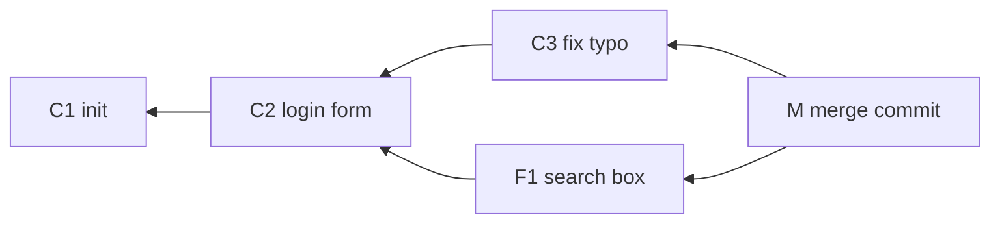
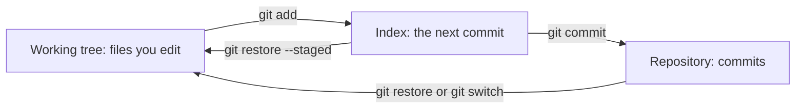
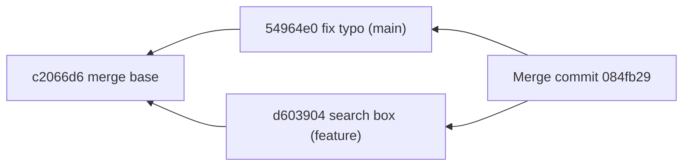
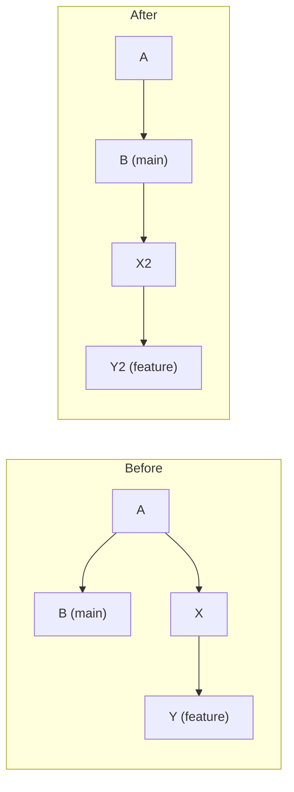
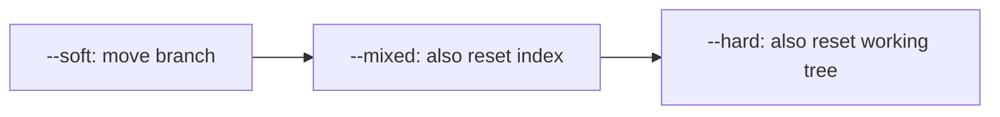
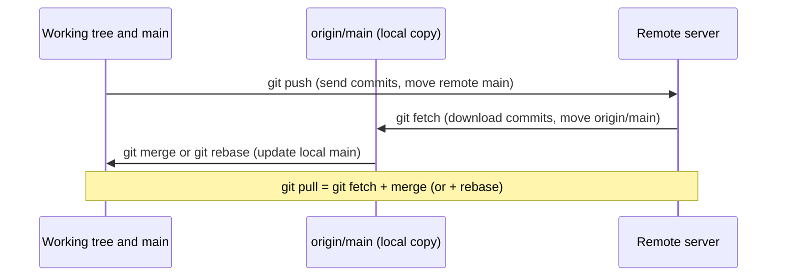
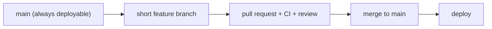

# Git for interviews

> This document explains how Git really works (snapshots, pointers and three areas) and then uses that model to explain every everyday command, merging, rebasing, undoing mistakes, remotes, team workflows and the scenario questions interviewers like ("I committed to main by mistake", "undo a pushed commit"). Every command sequence here was run in a temporary repository with Git 2.54, and the output shown is real (long paths and some lines are shortened).

**Before this:** [How to explain technical answers](01-how-to-explain-technical-answers.md) · [Debugging and code review](06-debugging-and-code-review.md) · [Lockfiles, npm install and npm ci](../07-nodejs-backend/03-modules-npm-and-packages.md#lockfiles-npm-install-and-npm-ci) · **Interview questions:** [jump to the interview section](#interview-questions)

## Table of contents

1. [Why Git questions matter](#why-git-questions-matter)
2. [How Git stores data](#how-git-stores-data)
3. [The three areas: working tree, index and repository](#the-three-areas-working-tree-index-and-repository)
4. [Everyday commands and what really happens](#everyday-commands-and-what-really-happens)
5. [Branches and HEAD](#branches-and-head)
6. [Merging: fast-forward and three-way](#merging-fast-forward-and-three-way)
7. [Resolving conflicts step by step](#resolving-conflicts-step-by-step)
8. [Rebase](#rebase)
9. [Interactive rebase and squashing](#interactive-rebase-and-squashing)
10. [Merge vs rebase vs squash merge](#merge-vs-rebase-vs-squash-merge)
11. [Undoing things: reset, revert, restore and amend](#undoing-things-reset-revert-restore-and-amend)
12. [Reflog: recovering lost commits](#reflog-recovering-lost-commits)
13. [Cherry-pick](#cherry-pick)
14. [Stash](#stash)
15. [Remotes: fetch, pull and push](#remotes-fetch-pull-and-push)
16. [Force pushing safely](#force-pushing-safely)
17. [Tags and releases](#tags-and-releases)
18. [The .gitignore file](#the-gitignore-file)
19. [Branching strategies](#branching-strategies)
20. [Pull requests and code review etiquette](#pull-requests-and-code-review-etiquette)
21. [Conventional commits and good messages](#conventional-commits-and-good-messages)
22. [Finding a bug with git bisect](#finding-a-bug-with-git-bisect)
23. [Hooks, husky and lint-staged](#hooks-husky-and-lint-staged)
24. [Large files and monorepos](#large-files-and-monorepos)
25. [A secret was committed: what to do](#a-secret-was-committed-what-to-do)
26. [Cheat sheet](#cheat-sheet)
27. [Interview questions](#interview-questions)
28. [Summary](#summary)
29. [References](#references)

---

## Why Git questions matter

Git questions are not about memorizing flags. The interviewer wants to know three things:

1. **Do you have a correct mental model?** If you know that a branch is only a pointer to a commit, most "how do I undo this?" questions become easy.
2. **Can you work safely in a team?** Do you know which commands rewrite history, and why rewriting shared history hurts other people?
3. **Can you recover from mistakes calmly?** Everyone commits to the wrong branch or pushes a bad commit sometimes. The senior answer is a calm, safe plan.

So this document first builds the model, then explains each command in terms of that model. When you answer in an interview, use the same order: "Here is what Git stores, here is what this command changes, here is the safe way to do it."

---

## How Git stores data

### Commits are snapshots, not diffs

A **commit** is a saved snapshot of your whole project at one moment, plus some metadata. Many people think Git stores "changes", but it stores **full snapshots**. When `git show` displays a diff, Git calculates it on the fly by comparing two snapshots.

Snapshots are cheap because Git does not copy unchanged files. Every file content is stored once, and many snapshots can point to the same stored content.

Git stores four kinds of **objects** in the `.git/objects` folder. Each object is named by a **hash** (a long ID calculated from its content; Git uses SHA-1 by default, and SHA-256 repositories are also supported):

| Object | What it stores | Analogy |
| --- | --- | --- |
| **blob** | The content of one file (no file name) | The text inside a page |
| **tree** | A folder: a list of names, each pointing to a blob or another tree | A table of contents |
| **commit** | One root tree, parent commit(s), author, committer, message | A labeled photo of the whole project |
| **tag** (annotated) | A pointer to a commit plus a message and tagger | A sticker with a note |

Let us look at real objects. I created a repository with one file and one commit:

```bash
git init -b main
echo "console.log('hi');" > app.js
git add app.js
git commit -m "feat: add app"
git cat-file -p HEAD          # print the commit object
git cat-file -p 'HEAD^{tree}' # print its tree
```

Output:

```text
tree 1ac951f87d00880938af4a7bf6d1dbc5a0f45a45
author Asha Dev <asha@example.com> 1793362663 +0530
committer Asha Dev <asha@example.com> 1793362663 +0530

feat: add app

100644 blob ec10f3e9de1393e70742626e78b79753fbf178d3	app.js
```

The commit points to a tree. The tree says "the file `app.js` has this blob". After this first commit there are exactly 3 objects in `.git/objects`: one blob, one tree, one commit.

The second commit in a repository also has a `parent` line:

```text
tree 4d66bf61c51528573b08cf6f902f61c77e7fb3f6
parent 573da0dddfe7ee7d089b49d9ab7822f2d27368f9
author Asha Dev <asha@example.com> 1793362672 +0530
```

**Why this matters:** the hash of a commit is calculated from its tree, parent, author, date and message. If you change *anything* (even the message), you get a **new commit with a new hash**. That is why `commit --amend`, `rebase` and `cherry-pick` always create new commits. Git never edits a commit; it only creates new ones and moves pointers.

### The history is a graph (a DAG)

Each commit points to its parent (or two parents for a merge commit). Together, the commits form a **DAG**, a *directed acyclic graph*: arrows go one way (from child to parent), and you can never follow arrows back to where you started.



Read the arrows as "my parent is". `M` is a merge commit, so it has two parents. Commands like `git log` start at a commit and walk the arrows backward.

### Branches are pointers

A **branch** is just a small file that contains one commit hash. Nothing more. From a real repository:

```bash
cat .git/refs/heads/feature/x
git branch -v
```

```text
44147eb684f5259979827f3b22b9b060f517789f
  feature/login  c2066d6 feat: login validation
  feature/search d603904 feat: search box
  feature/x      44147eb feat: x
* main           549c2ee Merge branch 'feature/x'
```

Creating a branch costs almost nothing: Git writes a 41-byte file. When you commit on a branch, Git creates the new commit and then **moves the branch pointer** forward to it.

Deleting a branch deletes only the pointer. The commits stay in the object database until Git's garbage collection removes unreachable objects (by default, not for weeks). This is why lost work can usually be recovered.

### HEAD

**HEAD** means "where you are now". Usually HEAD points to a branch, and the branch points to a commit:

```bash
cat .git/HEAD
cat .git/refs/heads/main
```

```text
ref: refs/heads/main
bb2c38303f7765de60ee66439ec97bdd3cfd74d1
```


When you commit, Git follows HEAD to find the current branch and moves *that branch*. If HEAD points directly to a commit instead of a branch, you are in **detached HEAD** state (covered in [Branches and HEAD](#branches-and-head)).

### Short names for commits

| Name | Meaning |
| --- | --- |
| `HEAD` | The current commit |
| `HEAD~1` or `HEAD~` | The parent of HEAD |
| `HEAD~3` | Three steps back, following first parents |
| `HEAD^2` | The second parent of a merge commit |
| `main..feature` | Commits reachable from `feature` but not from `main` (what the feature adds) |
| `HEAD@{2}` | Where HEAD was two moves ago (from the reflog) |
| `v1.2.0` | A tag name |
| `bb2c383` | A short hash (enough characters to be unique) |

---

## The three areas: working tree, index and repository

Git has three places where a version of a file can live:

1. **Working tree** (working directory): the real files on your disk that you edit.
2. **Index** (also called the **staging area**): a list of exactly what will go into the *next* commit. It is a file, `.git/index`.
3. **Repository**: the committed snapshots in `.git/objects`.



**Why the index exists:** it lets you build a commit carefully. You changed five files, but two changes belong to a bug fix and three to a feature. You stage only the bug fix files (or even only some lines with `git add -p`), commit them, then stage the rest. Small, focused commits are easier to review, revert and bisect.

`git status` is simply a comparison of the three areas:

- **"Changes to be committed"**: the index differs from HEAD.
- **"Changes not staged for commit"**: the working tree differs from the index.
- **"Untracked files"**: files in the working tree that are not in the index at all.

In short form (`git status --short`), the first column is the index and the second column is the working tree:

```text
A  app.js      # added to the index, working tree matches index
 M app.js      # modified in working tree, not staged
M  config.js   # modified and staged
?? draft.js    # untracked
```

---

## Everyday commands and what really happens

### git add

`git add file` takes the current content of the file, stores it as a blob, and records "file → blob" in the index. If you edit the file again after `git add`, the index still has the *old* content. You must `git add` again. This surprises many people.

Useful forms:

```bash
git add src/cart.js      # one file
git add -p               # choose hunks (parts of files) interactively
git add -A               # all changes, including deletions and new files
```

### git commit

`git commit` turns the index into a tree, creates a commit object whose parent is the current HEAD commit, and moves the current branch to the new commit. Note: it commits the **index**, not your working tree.

```bash
git commit -m "fix(cart): handle empty cart"
git commit -am "..."   # stage all *tracked* modified files, then commit (new files are not included)
```

### git status and git diff

There are three useful diffs, and each compares two of the three areas:

| Command | Compares | Answers |
| --- | --- | --- |
| `git diff` | working tree vs index | What have I changed but not staged? |
| `git diff --staged` | index vs HEAD | What will my next commit contain? |
| `git diff HEAD` | working tree vs HEAD | Everything I changed since the last commit |

Real run: I added a line, then staged it.

```bash
echo "change" >> app.js
git diff            # shows the change
git add app.js
git diff            # now empty: working tree equals index
git diff --staged   # shows the change
```

```text
diff --git a/app.js b/app.js
index ec10f3e..4facd03 100644
--- a/app.js
+++ b/app.js
@@ -1 +1,2 @@
 console.log('hi');
+change
```

The line `index ec10f3e..4facd03` shows the two blob hashes being compared. Before staging, `git diff` showed this; after staging, `git diff` was empty and `git diff --staged` showed the same output.

Always run `git diff --staged` before committing. It is the cheapest code review you will ever do.

### git log

```bash
git log --oneline                 # one line per commit
git log --oneline --graph --all   # draw the DAG for all branches
git log -p path/to/file           # history of one file with diffs
git log -S "STRIPE_KEY" --all     # commits that added or removed this text ("pickaxe")
git log main..feature/cart        # what the feature branch adds
```

### git restore

`git restore` (added in Git 2.23) only deals with **files**. It never moves branches.

```bash
git restore app.js                     # throw away unstaged changes (index → working tree)
git restore --staged app.js            # unstage (HEAD → index), keep your edits
git restore --source=HEAD~3 app.js     # get the file as it was 3 commits ago
```

Real run: after `git add app.js`, `git restore --staged app.js` changed the status from `M ` to ` M` (unstaged but still modified). Then `git restore app.js` made the working tree clean again.

Warning: `git restore app.js` deletes your uncommitted edits to that file. Git cannot bring them back, because they were never stored as a commit.

### git switch and git checkout

`git checkout` is an old command that does two unrelated jobs: switching branches *and* restoring files. In 2019, Git split it into two clearer commands:

| Old | New |
| --- | --- |
| `git checkout feature` | `git switch feature` |
| `git checkout -b feature` | `git switch -c feature` |
| `git checkout -- file` | `git restore file` |
| `git checkout HEAD~2 -- file` | `git restore --source=HEAD~2 file` |
| `git checkout <hash>` | `git switch --detach <hash>` |

Both still work. In interviews, mention that you prefer `switch` and `restore` because they are harder to misuse, but you know `checkout` because it appears in old scripts and answers.

What `git switch feature` really does: it moves HEAD to point to `feature`, then updates the index and working tree to match that branch's commit. If you have uncommitted changes that would be overwritten, Git refuses to switch. Then you commit, stash, or discard first.

---

## Branches and HEAD

### Creating and moving between branches

```bash
git switch -c feature/login   # create a branch at HEAD and switch to it
git branch                    # list local branches
git branch -v                 # with last commit
git branch -d feature/login   # delete if merged
git branch -D feature/login   # force delete even if not merged
```

`git branch -d` is a safety check. Real output when the branch had work not merged into the current branch:

```text
error: the branch 'feature/report' is not fully merged
hint: If you are sure you want to delete it, run 'git branch -D feature/report'
```

### Detached HEAD

If you switch to a commit hash, tag or remote branch directly, HEAD points to a commit, not to a branch. That is **detached HEAD**. You can look around, run tests and even commit. But new commits belong to no branch, so when you switch away, nothing points to them.

Real run:

```bash
git switch --detach HEAD~2
git status | head -1
echo t > t.js && git add . && git commit -m "experiment"
git switch main
```

```text
HEAD is now at dd2f593 chore: init
HEAD detached at dd2f593
Warning: you are leaving 1 commit behind, not connected to
any of your branches:

  fbc3af1 experiment
```

Git warns you. To keep the work, create a branch: `git branch experiment fbc3af1`. If you missed the warning, the commit is still in the [reflog](#reflog-recovering-lost-commits).

---

## Merging: fast-forward and three-way

**Merging** joins the work of two branches. Git chooses one of two methods.

### Fast-forward merge

If `main` has not moved since you created your branch, `main` is an ancestor of your branch. Git does not need to combine anything. It just moves the `main` pointer forward. No new commit is created.

Real run:

```bash
git switch -c feature/login
# ...two commits...
git switch main
git merge feature/login
git log --oneline --graph
```

```text
Updating e8b92b8..c2066d6
Fast-forward
 login.js | 2 ++
 1 file changed, 2 insertions(+)
 create mode 100644 login.js
* c2066d6 feat: login validation
* 573da0d feat: login form
* e8b92b8 chore: init
```

The history is a straight line. You cannot see that a branch ever existed.

### Three-way merge

If both branches have new commits, Git must combine them. It uses three snapshots:

1. The **merge base**: the latest common ancestor of both branches.
2. The tip of your current branch ("ours").
3. The tip of the other branch ("theirs").

For each file, Git compares both tips with the base. If only one side changed a part, Git takes that change. If both sides changed the *same lines* differently, that is a **conflict**. Git then creates a **merge commit** with two parents.



Real run:

```text
Merge made by the 'ort' strategy.
 search.js | 1 +
 1 file changed, 1 insertion(+)
 create mode 100644 search.js
*   084fb29 Merge branch 'feature/search'
|\
| * d603904 feat: search box
* | 54964e0 fix: typo in readme
|/
* c2066d6 feat: login validation
```

And the merge commit really has two parents:

```text
tree d0a485e7ca5884fb4cb54aac1b9cfdeba3d0c002
parent 54964e0f80368fa307ca727a79bc4bd665013d3e
parent d603904d259df67ee60c3ab6db94fa783916c5ae
```

`ort` is Git's default merge strategy since Git 2.34 (it replaced `recursive`).

### Forcing or forbidding a merge commit

- `git merge --no-ff feature/x` always creates a merge commit, even when a fast-forward is possible. Teams use this to keep a visible record that "this group of commits was one feature".
- `git merge --ff-only feature/x` refuses to merge unless it can fast-forward. This is a safe default for `git pull` (`git config pull.ff only`), because you never get surprise merge commits.

---

## Resolving conflicts step by step

A **merge conflict** happens when both branches changed the same lines (or one changed a file the other deleted). Git cannot know which version is right, so it stops and asks you. A conflict is not an error; it is a question.

### A real example

Base version of `config.js`:

```js
export const config = {
  apiUrl: "https://api.example.com",
  timeoutMs: 5000,
};
```

On `feature/slow-network`, a teammate changed the timeout to `10000`. On `main`, someone changed it to `3000`. Then:

```bash
git switch main
git merge feature/slow-network
```

```text
Auto-merging config.js
CONFLICT (content): Merge conflict in config.js
Automatic merge failed; fix conflicts and then commit the result.
```

### Step 1: see what is conflicted

```bash
git status
```

```text
On branch main
You have unmerged paths.
  (fix conflicts and run "git commit")
  (use "git merge --abort" to abort the merge)

Unmerged paths:
  (use "git add <file>..." to mark resolution)
	both modified:   config.js
```

### Step 2: read the conflict markers

```text
export const config = {
  apiUrl: "https://api.example.com",
<<<<<<< HEAD
  timeoutMs: 3000,
=======
  timeoutMs: 10000,
>>>>>>> feature/slow-network
};
```

- Between `<<<<<<< HEAD` and `=======`: **ours**, the branch you are on (`main`).
- Between `=======` and `>>>>>>>`: **theirs**, the branch being merged in.

Tip: turn on the `zdiff3` conflict style. It also shows the **base** version, which tells you what each side actually changed:

```bash
git config --global merge.conflictStyle zdiff3
```

The same conflict with `zdiff3`:

```text
<<<<<<< HEAD
  timeoutMs: 3000,
||||||| e88c3cd
  timeoutMs: 5000,
=======
  timeoutMs: 10000,
>>>>>>> feature/slow-network
```

Now it is clear: the original was 5000, one side lowered it, the other raised it. That is a real disagreement about behavior, not a text problem.

### Step 3: decide the correct result

This is the important part. Do not just pick one side to make the markers go away. Understand **why** each side changed the line. Here, `main` wanted to fail fast, and the feature wanted to support slow networks. Talk to the other author if you are not sure. Suppose the team agrees on `8000`.

### Step 4: edit, mark resolved, finish

```js
export const config = {
  apiUrl: "https://api.example.com",
  timeoutMs: 8000,
};
```

```bash
git add config.js         # "add" means "I resolved this file"
git commit --no-edit      # finish the merge with the default message
git log --oneline --graph
```

```text
*   d6241c4 Merge branch 'feature/slow-network'
|\
| * b94782c fix: raise timeout for slow networks
* | 3204a7a perf: fail fast with lower timeout
|/
* e88c3cd chore: add config
```

### Step 5: verify

Run the tests and the app. A merge can be free of conflicts and still be broken (for example, one branch renamed a function and the other branch added a new call to the old name). Git only checks text, not meaning.

### Useful commands during a conflict

| Command | What it does |
| --- | --- |
| `git merge --abort` | Go back to the state before the merge (real run: working tree clean again) |
| `git checkout --ours file` | Take our version of the whole file |
| `git checkout --theirs file` | Take their version of the whole file |
| `git diff` | Show the conflict as a combined diff |
| `git mergetool` | Open a configured visual merge tool |
| `git log --merge -p file` | Show the commits on both sides that touched the file |

**Watch out:** during a **rebase**, "ours" and "theirs" swap meaning. A rebase replays *your* commits on top of the other branch, so "ours" is the branch you are rebasing onto, and "theirs" is your own commit being replayed. Real run, rebasing `feature/slow-network` onto `main`:

```text
ours during rebase:
  timeoutMs: 3000,      <- this came from main
theirs during rebase:
  timeoutMs: 10000,     <- this is my feature commit
```

### Ways to reduce conflicts

- Keep branches short-lived and merge or rebase from `main` often.
- Make small pull requests.
- Do not mix big formatting changes with logic changes; run the formatter in its own commit (or for the whole repo once).
- Agree on code ownership for hot files (routes, config, shared constants).

---

## Rebase

### What rebase does

`git rebase main` (while on your feature branch) means: "take my commits that are not on `main`, and replay them one by one on top of the latest `main`." The result is a straight line, as if you had started your work from today's `main`.



(In this picture arrows point from older to newer commits, the order in which they were made.) Note the names: `X` becomes `X2` and `Y` becomes `Y2`. Each replayed commit has a different parent, so it gets a **new hash**. Rebase does not move commits; it creates copies and moves the branch pointer to the copies. The old commits still exist (the reflog can find them), but no branch points to them any more.

Real run. Before the rebase, the feature commit was `b94782c`. After `git rebase main` and resolving one conflict:

```bash
git switch feature/slow-network
git rebase main
# conflict: fix config.js, then
git add config.js
git rebase --continue
git log --oneline --graph --all
```

```text
Successfully rebased and updated refs/heads/feature/slow-network.
* 9a8d7b3 fix: raise timeout for slow networks
* 3204a7a perf: fail fast with lower timeout
* e88c3cd chore: add config
```

The same commit message now has hash `9a8d7b3`. It is a new commit.

During a rebase, a conflict can happen **for each replayed commit**. After resolving, run `git rebase --continue`. You can also run `git rebase --skip` (drop this commit) or `git rebase --abort` (go back to where you started).

### The golden rule: do not rebase shared history

**Never rebase commits that other people already have.** Suppose you pushed `feature/cart`, a teammate built on it, and then you rebase and force-push. Their branch still has the *old* commits. When they pull, Git sees two different histories with the same changes. They get duplicate commits and confusing conflicts, or they accidentally push your old commits back.

Safe uses of rebase:

- Your **local** commits that you have not pushed.
- Your **own** feature branch that nobody else uses, even if pushed (then push with `--force-with-lease`, see [Force pushing safely](#force-pushing-safely)). Ask the team if you are not sure who uses it.
- `git pull --rebase` to put your local, unpushed commits on top of what others pushed.

Never rebase `main`, `develop`, release branches or any branch others commit to.

---

## Interactive rebase and squashing

`git rebase -i <base>` opens a **todo list** of the commits after `<base>`. You edit the list to change history before you share it. This is the real todo list Git produced for five messy commits:

```text
pick 33d6c0d # wip: cart
pick 3136fd7 # wip: more cart
pick b6d5cd9 # fix typo
pick 71e82e5 # add test
pick 4866c87 # address review

# Rebase aabdb39..4866c87 onto aabdb39 (5 commands)
```

Commands you can use on each line:

| Command | Effect |
| --- | --- |
| `pick` | Keep the commit as it is |
| `reword` | Keep the changes, edit the message |
| `edit` | Stop at this commit so you can change it (amend it, split it) |
| `squash` | Combine into the previous commit and merge both messages |
| `fixup` | Combine into the previous commit and throw away this message |
| `drop` | Delete the commit |
| (reorder lines) | Change the order of commits |

### Squash 5 commits into 1 before a pull request

Change lines 2–5 from `pick` to `squash` (or `fixup`):

```text
pick 33d6c0d wip: cart
squash 3136fd7 wip: more cart
squash b6d5cd9 fix typo
squash 71e82e5 add test
squash 4866c87 address review
```

Save, then write one good message in the editor. Real result:

```text
bb4280a feat(cart): add shopping cart
aabdb39 chore: init
```

If the branch was already pushed, update the pull request with `git push --force-with-lease`.

**Another way, without the todo list:** move the branch pointer back to where the branch started, keep all changes staged, and commit once:

```bash
git reset --soft $(git merge-base main HEAD)
git commit -m "feat(cart): add shopping cart"
```

`git merge-base main HEAD` prints the commit where your branch started from `main`. Real run: after the reset, `git status --short` showed `A  cart.js` (the changes of all five commits, staged), and the log became one commit on top of `main`.

### fixup commits and autosquash

During review you often need to fix an *earlier* commit in your branch, not the last one. Create a fixup commit that points to it, and let Git place it automatically:

```bash
git commit -a --fixup=15f30d6          # creates "fixup! feat: profile page"
git rebase -i --autosquash main        # moves it under 15f30d6 and marks it fixup
```

Real run, before and after:

```text
98b170c fixup! feat: profile page
00d3f56 feat: avatar upload
15f30d6 feat: profile page
35b70bf chore: init
== after autosquash
bb55227 feat: avatar upload
bfb7963 feat: profile page
35b70bf chore: init
```

The fix is now part of "feat: profile page". Every commit in the branch is clean and works on its own, which helps reviewers and `git bisect`.

---

## Merge vs rebase vs squash merge

When a pull request is accepted, the platform (GitHub, GitLab, Azure DevOps, Bitbucket) usually offers three ways to land it on `main`.

| | Merge commit | Rebase and merge | Squash and merge |
| --- | --- | --- | --- |
| What lands on `main` | All branch commits + one merge commit | All branch commits, replayed in a line | One new commit with all changes |
| History shape | Graph with branches visible | Straight line | Straight line, one commit per PR |
| Rewrites commits? | No | Yes (new hashes) | Yes (one new commit) |
| Keeps individual commits | Yes | Yes | No (only on the PR page) |
| Revert a whole feature | `git revert -m 1 <merge>` | Revert each commit | `git revert <one commit>` (easiest) |
| `git bisect` precision | Good, if commits are clean | Good, if commits are clean | Coarse: points to a whole PR |
| Good when | You want an exact record of how work happened | Commits are already clean and meaningful | Commits are messy ("wip", "fix typo") and PRs are small |

**What I would say:** "There is no single right answer; it is a team convention. My default for small PRs is squash and merge, because `main` gets one clean, revertable commit per PR and the messy work-in-progress commits disappear. If a PR has well-crafted commits that each make sense alone, rebase and merge keeps them. Merge commits are useful for long-lived branches, like a release branch merging back, where you want to see exactly when the integration happened. Locally, I rebase my own unpushed work on `main`, and I never rebase shared branches."

One practical detail about squash merge: Git does not know the branch was merged, because the squashed commit is a brand-new commit, not the branch tip. Real run after `git merge --squash feature/profile` and committing:

```text
$ git branch -d feature/profile
error: the branch 'feature/profile' is not fully merged
```

That is expected. Delete the branch with `-D` after the PR is merged (platforms usually do it for you). Also, do not keep working on a branch after it was squash-merged. Start a new branch from the updated `main`, or you will get repeated conflicts.

---

## Undoing things: reset, revert, restore and amend

This is the most important section for scenario questions. First answer two questions:

1. **Is the commit already pushed and shared?** If yes, do not rewrite it. Use `revert`.
2. **Do I want to keep the changes in my files?** That decides between `--soft`, `--mixed` and `--hard`.

### git reset: move the branch pointer

`git reset <commit>` moves the **current branch** (and HEAD with it) to `<commit>`. The three modes decide what happens to the index and the working tree:

| Mode | Branch pointer | Index | Working tree | Use it to |
| --- | --- | --- | --- | --- |
| `--soft` | moved | unchanged | unchanged | Undo commits but keep the changes **staged** (re-commit, squash) |
| `--mixed` (default) | moved | reset to the commit | unchanged | Undo commits and unstage; keep edits in files |
| `--hard` | moved | reset to the commit | reset to the commit | Throw away commits **and** uncommitted edits |



Each mode does everything the previous one does, plus one more step.

Real run with three commits, each adding one line to `f.txt`:

```bash
git reset --soft HEAD~1 && git status --short
```

```text
M  f.txt
```

The change from "commit 3" is still there, and it is staged.

```bash
git reset HEAD~1        # --mixed is the default
```

```text
Unstaged changes after reset:
M	f.txt
```

The change is in the file but not staged.

```bash
git reset --hard HEAD~1 && cat f.txt
```

```text
HEAD is now at 90cd7a6 commit 2
line 1
line 2
```

"line 3" is gone from the file. `--hard` is the dangerous one. Committed work can be recovered with the reflog, but **uncommitted** edits that `--hard` throws away are gone for good. Run `git status` before any `--hard`.

### git revert: undo by adding a new commit

`git revert <commit>` creates a **new commit** that applies the opposite of `<commit>`. History is not rewritten, so it is safe on shared branches.

```bash
git revert --no-edit HEAD
git log --oneline
```

```text
[main 38956f1] Revert "commit 3"
 1 file changed, 1 deletion(-)
38956f1 Revert "commit 3"
ab72795 commit 3
90cd7a6 commit 2
158d227 commit 1
```

Both the original commit and its reversal are visible. Everyone else can simply pull.

**Reverting a merge commit** needs `-m` to say which parent is the "mainline" (usually `1`, the branch you merged into):

```text
$ git revert --no-edit HEAD
error: commit f776119d541a37f6bfcc1e8f6073326e592e953d is a merge but no -m option was given.
fatal: revert failed
$ git revert -m 1 --no-edit HEAD
[main 0f0c4c9] Revert "Merge branch 'feature/pay'"
```

A trap: after reverting a merge, merging the same branch again later will **not** bring those changes back, because Git sees that those commits are already in the history. To re-land the feature, revert the revert commit.

### git restore: undo file changes, not commits

`restore` only touches files (see [git restore](#git-restore)). Use it for "throw away my edits in this file" or "unstage this file". It never moves a branch and never creates commits.

### git commit --amend: fix the last commit

`--amend` replaces the last commit with a new one that contains the current index and, optionally, a new message.

```bash
git commit -am "comit 4"              # typo in the message, and a change is missing
echo "line 4b" >> f.txt && git add f.txt
git commit --amend -m "commit 4"
git log --oneline -2
```

```text
d366d1c commit 4
38956f1 Revert "commit 3"
```

The old commit (`f7fa671 comit 4`) is no longer on the branch; `d366d1c` replaced it. Because amend creates a new commit, the same rule applies: only amend commits you have not pushed, or that only you use. `git commit --amend --no-edit` keeps the old message.

### Which undo command? A decision table

| Situation | Command |
| --- | --- |
| Discard edits in a file (not staged) | `git restore file` |
| Unstage a file, keep edits | `git restore --staged file` |
| Fix the last commit's message or add a forgotten file (not pushed) | `git commit --amend` |
| Undo the last local commit, keep changes staged | `git reset --soft HEAD~1` |
| Undo the last local commit, keep changes unstaged | `git reset HEAD~1` |
| Throw away local commits and edits completely | `git reset --hard <commit>` (check `git status` first) |
| Undo a commit that is already pushed or shared | `git revert <commit>` |
| Undo a pushed merge | `git revert -m 1 <merge-commit>` |
| Get one file back from an old commit | `git restore --source=<commit> file` |
| "I reset too far" or "I lost a commit" | `git reflog`, then `git reset --hard HEAD@{n}` or `git branch rescue <hash>` |

---

## Reflog: recovering lost commits

The **reflog** (reference log) is a local diary of every position HEAD and each branch has had: every commit, reset, switch, rebase, merge and amend. It is your safety net. By default, entries are kept for 90 days (30 days for entries whose commits are no longer reachable from any branch).

The reflog is **local only**. It is not pushed or cloned. Your teammate's reflog cannot help you, and a fresh clone starts with an empty reflog.

### Recover from a bad reset

After the `git reset --hard HEAD~1` above:

```bash
git reflog -5
```

```text
90cd7a6 HEAD@{0}: reset: moving to HEAD~1
ab72795 HEAD@{1}: commit: commit 3
90cd7a6 HEAD@{2}: reset: moving to HEAD~1
ab72795 HEAD@{3}: commit: commit 3
90cd7a6 HEAD@{4}: reset: moving to HEAD~1
```

`HEAD@{1}` is where I was just before the reset:

```bash
git reset --hard HEAD@{1}
```

```text
HEAD is now at ab72795 commit 3
```

### Recover a deleted branch

Real run: I created `feature/report` with two commits, switched to `main`, and force-deleted the branch.

```bash
git branch -D feature/report
```

```text
Deleted branch feature/report (was 8b80961).
```

Git even prints the last hash. If that message has scrolled away, use the reflog:

```bash
git reflog | head -4
```

```text
80a5112 HEAD@{0}: checkout: moving from feature/report to main
8b80961 HEAD@{1}: commit: feat: export report as CSV
6e3cf02 HEAD@{2}: commit: feat: monthly report
80a5112 HEAD@{3}: checkout: moving from main to feature/report
```

The last commit on the branch was `8b80961`. Recreate the pointer:

```bash
git branch feature/report 8b80961     # or: git branch feature/report HEAD@{1}
git log --oneline feature/report
```

```text
8b80961 feat: export report as CSV
6e3cf02 feat: monthly report
80a5112 chore: init
```

If the branch was pushed, it is even easier: `git switch feature/report` recreates it from `origin/feature/report` if that remote branch still exists. If the remote branch was deleted after a PR, platforms such as GitHub offer a "Restore branch" button on the pull request page.

If you never had the commits checked out locally (so they are not in your reflog), `git fsck --lost-found` can list unreachable commits, as long as garbage collection has not removed them yet.

---

## Cherry-pick

`git cherry-pick <commit>` takes the **changes** introduced by one commit and applies them as a **new commit** on the current branch. It is a copy with a new hash.

Typical use: a bug fix was made on a release branch, and you need the same fix on `main` (or the other way around) without merging everything else.

Real run:

```bash
git switch -c release/1.2
# ...commit "fix: null check in checkout"...
git switch main
git cherry-pick <hash-of-the-fix>
```

```text
[main 32f4f1f] fix: null check in checkout
 1 file changed, 1 insertion(+)
 create mode 100644 hotfix.js
```

Useful options:

- `git cherry-pick -x <hash>` adds "(cherry picked from commit ...)" to the message, so people can trace where the fix came from. Use it for backports between shared branches.
- `git cherry-pick A..B` picks a range (the commits after A, up to and including B).
- On a conflict: fix it, `git add`, then `git cherry-pick --continue` (or `--abort`).
- If the change already exists on the branch, the cherry-pick is **empty**. Real output when I picked the same fix twice: `The previous cherry-pick is now empty, possibly due to conflict resolution.`

**Trade-off:** cherry-picking creates duplicate commits with different hashes. A few are fine. Heavy cherry-picking between long-lived branches leads to confusing history and repeated conflicts. Prefer fixing on the oldest supported branch and merging forward, and keep cherry-pick for small, isolated fixes.

---

## Stash

`git stash` saves your uncommitted changes in a temporary place and gives you a clean working tree. Typical use: you are halfway through a feature and must switch branches to fix an urgent bug.

Real run (with a modified tracked file `app.js` and a new file `draft.js`):

```bash
git stash push -m "wip: half-done filter"
git status --short
```

```text
Saved working directory and index state On main: wip: half-done filter
?? draft.js
```

`draft.js` is still there: by default, **stash does not save untracked files**. Use `-u` (include untracked) for that:

```bash
git stash push -u -m "wip: with untracked"
git stash list
```

```text
Saved working directory and index state On main: wip: with untracked
stash@{0}: On main: wip: with untracked
stash@{1}: On main: wip: half-done filter
```

| Command | Effect |
| --- | --- |
| `git stash` or `git stash push -m "msg"` | Save tracked changes and clean the working tree |
| `git stash -u` | Also save untracked files |
| `git stash list` | Show all stashes (a stack; the newest is `stash@{0}`) |
| `git stash pop` | Apply the newest stash and remove it from the list |
| `git stash apply stash@{1}` | Apply a stash but keep it in the list |
| `git stash show -p stash@{0}` | See what a stash contains |
| `git stash drop stash@{0}` | Delete one stash |
| `git stash branch new-branch` | Create a branch from where the stash was made and apply it there |

Advice: stashes are easy to forget. For anything longer than a few minutes, a real commit on a branch (`git commit -m "wip"`, squashed later) is safer and visible. If `pop` hits a conflict, the stash is **not** removed, so you do not lose it.

---

## Remotes: fetch, pull and push

A **remote** is another copy of the repository, usually on GitHub, GitLab or Azure DevOps. `origin` is just the default name for the remote you cloned from.

Your local repository keeps **remote-tracking branches** such as `origin/main`. They are your local, read-only memory of where the remote's branches were **the last time you talked to it**. They do not update by themselves.



### fetch vs pull

- **`git fetch`** downloads new commits and moves `origin/*` pointers. It **never changes your branches or files**. It is always safe.
- **`git pull`** is `git fetch` followed by integrating `origin/<branch>` into your current branch, by merge (the classic default), by rebase (`--rebase`), or only by fast-forward (`--ff-only`).

I simulated two developers, Asha and Ravi, sharing one remote (a bare repository; a **bare** repository has no working tree, which is what servers use). Asha pushed "feat: api client". Ravi, who had a local commit "feat: ui shell", tried to push:

```text
 ! [rejected]        main -> main (fetch first)
error: failed to push some refs to '.../origin.git'
hint: Updates were rejected because the remote contains work that you do not
hint: have locally. This is usually caused by another repository pushing to
hint: the same ref. If you want to integrate the remote changes, use
hint: 'git pull' before pushing again.
```

Git refuses a push that is not a fast-forward, because it would throw away Asha's commit. Ravi fetched first:

```bash
git fetch
git status -sb | head -1
git log --oneline --graph --all
```

```text
   73df328..3751664  main       -> origin/main
## main...origin/main [ahead 1, behind 1]
* 320d5b4 feat: ui shell
| * 3751664 feat: api client
|/
* 73df328 chore: init
```

"ahead 1, behind 1" means the branches have **diverged**: each has one commit the other does not. Fetch did not touch Ravi's work; it only showed him the situation. Now he chooses how to integrate:

```bash
git pull --rebase
git log --oneline --graph --all
```

```text
Successfully rebased and updated refs/heads/main.
* 71322d0 feat: ui shell
* 3751664 feat: api client
* 73df328 chore: init
```

His local commit was replayed on top of Asha's (new hash `71322d0`), and now `git push` works. With a plain `git pull` (merge), he would have got an extra "Merge branch 'main' of ..." commit instead. Many teams set:

```bash
git config --global pull.rebase true     # pull rebases local unpushed commits
# or
git config --global pull.ff only         # pull fails instead of creating a surprise merge
```

`pull --rebase` only rewrites **your local commits that were not pushed yet**, so it does not break the golden rule.

### push

```bash
git push -u origin feature/cart   # first push: create the remote branch and set "upstream"
git push                          # later pushes
git push origin --delete feature/cart
```

`-u` (upstream) links your local branch to `origin/feature/cart`, so `git status` can say "ahead 2" and plain `git pull`/`git push` know where to go.

---

## Force pushing safely

After you rebase, amend or squash a branch that was already pushed, a normal push is rejected because the remote branch is no longer an ancestor of yours. You need a **force push**.

- **`git push --force`**: "make the remote branch equal to mine, whatever is there." If a teammate pushed in the meantime, their commits are silently thrown away.
- **`git push --force-with-lease`**: "make the remote equal to mine, **but only if** the remote is still where my `origin/branch` says it is." If someone pushed after your last fetch, the push is rejected.

Real run. Asha pushed "feat: retries". Ravi, who had not fetched, amended his commit and force-pushed with lease:

```text
 ! [rejected]        main -> main (stale info)
error: failed to push some refs to '.../origin.git'
```

The lease protected Asha's commit. **But** there is a trap. Ravi then ran `git fetch` (which updated his `origin/main` to include Asha's commit) and pushed again with `--force-with-lease`:

```text
 + 9856421...329e49b main -> main (forced update)
```

The push succeeded and **Asha's commit was gone from the remote**, because after the fetch, the lease check ("is the remote where I last saw it?") passed. Fetching updates the lease without you ever looking at the new commits. This is why IDEs that auto-fetch in the background make plain `--force-with-lease` weaker.

The fix is `--force-if-includes` (Git 2.30+), which also checks that the remote commit you are about to overwrite is part of your local history (that you actually integrated it). Real run of the same situation:

```bash
git fetch
git push --force-with-lease --force-if-includes
```

```text
 ! [rejected]        main -> main (remote ref updated since checkout)
```

Rules to say in an interview:

1. Never force-push to `main` or other shared branches. Protect them on the platform (branch protection rules forbid force pushes).
2. Force-push only to your own feature branch, with `--force-with-lease` (and `--force-if-includes`, or set `git config --global push.useForceIfIncludes true`).
3. If others use the branch, tell them before rewriting it.

---

## Tags and releases

A **tag** is a name for one specific commit that does not move (a branch moves with new commits; a tag stays). Teams tag releases: `v1.4.2`.

Two kinds:

- **Lightweight tag**: just a pointer, like a branch that never moves. `git tag v1.0.0`
- **Annotated tag**: a real object with tagger, date and message, and it can be signed. `git tag -a v1.1.0 -m "Release 1.1.0: faster checkout"`. Use annotated tags for releases.

Real run:

```bash
git cat-file -t v1.0.0     # what is this tag?
git cat-file -t v1.1.0
git show v1.1.0 --no-patch | head -6
git describe --tags
```

```text
commit
tag
tag v1.1.0
Tagger: Asha Dev <asha@example.com>
Date:   Fri Oct 30 17:49:34 2026 +0530

Release 1.1.0: faster checkout

v1.1.0
```

The lightweight tag points straight at a commit; the annotated tag is its own `tag` object. `git describe` gives a human name for the current commit based on the nearest tag (for example `v1.1.0-3-g5e15d19` means "3 commits after v1.1.0").

Important details:

- **Tags are not pushed by default.** Use `git push origin v1.1.0` or `git push --follow-tags` (pushes annotated tags reachable from what you push).
- Do not move or delete a published release tag. People and build systems rely on it. Make a new version instead.
- Version numbers usually follow **semantic versioning** (MAJOR.MINOR.PATCH); see [Semantic versioning and ranges](../07-nodejs-backend/03-modules-npm-and-packages.md#semantic-versioning-and-ranges).
- A **release** on GitHub or GitLab is a tag plus release notes and build files. CI pipelines often run a deployment when a tag matching `v*` is pushed.

---

## The .gitignore file

`.gitignore` lists files Git should not track: dependencies, build output, logs and local secrets.

```gitignore
node_modules/
.env
*.log
dist/*
!dist/.gitkeep
config.local
```

Rules: `name/` matches folders, `*` matches any characters except `/`, `**` matches across folders, a leading `/` anchors to the folder of the `.gitignore` file, and `!` re-includes something.

**Trap 1: you cannot re-include a file inside an ignored folder.** My first version used `dist/` and `!dist/.gitkeep`. Git did not show `dist/.gitkeep` at all, because when a folder is ignored, Git does not even look inside it. Changing `dist/` to `dist/*` (ignore the contents, not the folder) fixed it. Real `git status --short --untracked-files=all` after the fix:

```text
?? .gitignore
?? dist/.gitkeep
```

**Trap 2: `.gitignore` does not affect files that are already tracked.** Real run: `config.local` was committed, then added to `.gitignore`, then edited:

```text
 M config.local
```

Git still tracks it. You must remove it from the index (not from disk):

```bash
git rm --cached config.local
git status --short
```

```text
D  config.local
?? .gitignore
```

After you commit, the file is untracked and ignored, but it still exists in old commits. If it contains a secret, see [A secret was committed](#a-secret-was-committed-what-to-do).

**Debugging:** `git check-ignore -v file` tells you which rule ignores a file:

```text
.gitignore:2:.env	.env
.gitignore:3:*.log	debug.log
```

Other places for ignore rules: `.git/info/exclude` (your personal rules for this repo, not shared) and a global file set with `core.excludesFile` (good for editor files like `.DS_Store` or `.idea/`).

---

## Branching strategies

A **branching strategy** is the team's agreement on which branches exist, where work starts, and how code reaches production.

### GitHub Flow



- One long-lived branch: `main`, always deployable.
- Each change is a short branch, a pull request, review, CI, merge, deploy.
- **Fits:** web apps and services with continuous deployment, small to medium teams. Simple to explain and run.
- **Weak at:** supporting several released versions at once.

### GitFlow

- Long-lived `main` (released code) and `develop` (integration).
- `feature/*` branches from `develop`; `release/*` branches to stabilize a version; `hotfix/*` from `main` for urgent fixes, merged back to both `main` and `develop`.
- **Fits:** software with planned, versioned releases (installed desktop apps, mobile apps waiting for store review, products supporting several versions, regulated release processes).
- **Weak at:** continuous delivery. Many branches, many merges, long-lived branches drift and conflict. Its original author later added a note recommending simpler flows for continuously delivered web apps.

### Trunk-based development

- Everyone integrates into `main` (the "trunk") at least daily, either directly in very small commits or through very short-lived branches (hours, not weeks).
- Unfinished features are hidden behind **feature flags** (configuration switches that turn code paths on or off at runtime), so incomplete code can be merged safely.
- Needs strong CI (fast tests on every commit), good test coverage and code review that is fast.
- **Fits:** teams practicing continuous integration and deployment; large organizations that want to avoid "merge hell".
- **Weak at:** teams without good automated tests; it then becomes "breaking main daily".

### Release branches

- Work happens on `main`. When a version is ready, cut `release/2.3` from `main`. Only fixes go into the release branch; fixes are made on `main` first and cherry-picked into the release branch (or the other way and merged forward).
- **Fits:** products that must support older versions (for example `2.3.x` while `2.4` is developed), on-premise customers, mobile apps.
- Can be combined with trunk-based development.

### How to choose (what I would say)

"I choose based on how we release. If we deploy a web service many times a day, GitHub Flow or trunk-based development with feature flags keeps branches short and conflicts small. If we ship versioned releases and must patch old versions, I add release branches on top of that. I would only use full GitFlow if the release process really needs a separate integration branch, because it adds a lot of merging. Whatever we choose, `main` is protected: changes go through pull requests with passing CI and at least one review."

---

## Pull requests and code review etiquette

A **pull request** (PR; GitLab calls it a merge request) asks the team to review and merge a branch. The detailed method for reviewing code is in [Debugging and code review](06-debugging-and-code-review.md#code-review-what-to-check). Here is the Git and team side.

### As the author

- **Small PRs.** One purpose per PR; a few hundred changed lines at most when possible. Big refactors go in separate PRs from behavior changes.
- **Good description:** what changed, why, how you tested it, screenshots for UI, risks, and a link to the ticket.
- **Clean commits** (or plan to squash). No "wip" commits if the team uses rebase-and-merge.
- **Self-review first.** Read your own diff on the platform before asking others. You will find debug logs and leftovers.
- **CI must pass** before you request review.
- **Respond to every comment**, either with a change or a short reason. Do not take comments personally.
- **Keep the branch up to date** with `main` (rebase your own branch or merge `main` in, as the team prefers).

### As the reviewer

- Review **soon**; a PR waiting two days blocks a person.
- Comment on the code, not the person ("this function could return early" not "you wrote this badly").
- Mark how important each comment is: blocking issue, suggestion, question, or nitpick ("nit:"). Leave formatting to tools.
- Explain **why**, and suggest a fix when you can.
- Approve when it is good enough and improves the code base, not when it is perfect.

### Platform rules that help

- **Branch protection** on `main`: no direct pushes, no force pushes, required reviews, required CI checks, and "require branch to be up to date".
- **CODEOWNERS** file: automatically requests review from the owners of the touched folders.
- **Merge queue**: tests each PR together with the PRs ahead of it before merging, so `main` stays green when many PRs land at once.

---

## Conventional commits and good messages

A good commit message explains **why** the change was made. The diff already shows what changed.

Format of a good message:

```text
fix(cart): prevent negative quantity on rapid clicks

Clicking "-" quickly sent several requests before the first response,
and the server accepted quantities below zero. Disable the button while
a request is pending and validate quantity >= 0 on the server.

Closes #412
```

- First line (subject): about 50–72 characters, imperative mood ("fix", "add", not "fixed", "adds"), no period.
- Blank line, then a body wrapped at about 72 characters explaining the problem and the reason for this solution.

**Conventional Commits** is a widely used convention for the subject line:

```text
<type>(<optional scope>): <description>
```

| Type | Use for |
| --- | --- |
| `feat` | A new feature (minor version bump) |
| `fix` | A bug fix (patch version bump) |
| `docs` | Documentation only |
| `refactor` | Code change that neither fixes a bug nor adds a feature |
| `perf` | Performance improvement |
| `test` | Adding or fixing tests |
| `build`, `ci` | Build system, dependencies, CI configuration |
| `chore` | Maintenance that does not change source or tests |
| `revert` | Reverting an earlier commit |

A breaking change is marked with `!` (`feat(api)!: remove v1 endpoints`) or a `BREAKING CHANGE:` footer, and means a major version bump.

**Why teams use it:** readable history, and tools (semantic-release, release-please, changesets with conventions) can generate changelogs and choose the next version number automatically. A `commit-msg` hook or `commitlint` in CI enforces the format (see [Hooks](#hooks-husky-and-lint-staged)).

---

## Finding a bug with git bisect

`git bisect` finds the commit that introduced a bug using **binary search** over history. You give it one bad commit and one good commit. It checks out the middle commit, you say good or bad, and it halves the range every time. 1,000 commits need about 10 tests (log2 of 1000 is about 10).

Real run. A cart `total()` function was correct at tag `v1.0.0`. Nine commits later, a test fails:

```js
// test.mjs
import { total } from "./cart.mjs";
const result = total([{ price: 10, qty: 2 }, { price: 5, qty: 1 }]);
if (result !== 25) { console.error("FAIL: expected 25, got", result); process.exit(1); }
console.log("PASS");
```

```text
FAIL: expected 25, got 15
```

Automatic bisect with the test script (exit code 0 means good, 1–127 except 125 means bad, 125 means "cannot test, skip"):

```bash
git bisect start HEAD v1.0.0     # bad commit first, then good
git bisect run node test.mjs
git bisect reset                 # go back to where you were
```

```text
Bisecting: 4 revisions left to test after this (roughly 2 steps)
[420ef3482b894f4280ae6854acd75e1bd8a327d3] chore: change 4
running 'node' 'test.mjs'
PASS
...
0e0804121fa4c8aaebded9ec8161bac705b55927 is the first bad commit
commit 0e0804121fa4c8aaebded9ec8161bac705b55927
Author: Asha Dev <asha@example.com>

    refactor: simplify total

 cart.mjs | 2 +-
 1 file changed, 1 insertion(+), 1 deletion(-)
bisect found first bad commit
```

The "simplify" refactor had changed `i.price * i.qty` to `i.price`. Git found it among nine commits automatically.

Manual bisect works the same way: `git bisect good` / `git bisect bad` after testing each commit by hand, and `git bisect skip` for commits that do not build. Bisect works best when every commit builds and passes tests on its own, which is one more reason for clean commits. A useful detail: the test script must exist in every commit bisect checks out. Here the test was committed together with the function, so it was always there. For a brand-new test, keep the script **outside** the repository or untracked, because untracked files stay in place while bisect switches commits.

---

## Hooks, husky and lint-staged

**Hooks** are scripts Git runs at certain moments. They live in `.git/hooks/` (not committed, so not shared by default). The main client-side hooks:

| Hook | Runs | Typical use |
| --- | --- | --- |
| `pre-commit` | Before the commit is created | Lint and format staged files, block secrets |
| `commit-msg` | After the message is written | Enforce Conventional Commits |
| `pre-push` | Before pushing | Run unit tests |
| `post-merge`, `post-checkout` | After merge or switch | Run `npm install` if the lockfile changed |

If a hook exits with a non-zero code, Git stops the action. Real hooks I installed in a test repository:

```sh
#!/bin/sh
# .git/hooks/pre-commit: block a staged .env file or a debugger statement
if git diff --cached --name-only | grep -qE '(^|/)\.env$'; then
  echo "pre-commit: refusing to commit a .env file" >&2
  exit 1
fi
if git diff --cached -U0 | grep -qE '^\+.*\bdebugger\b'; then
  echo "pre-commit: remove 'debugger' before committing" >&2
  exit 1
fi
```

```sh
#!/bin/sh
# .git/hooks/commit-msg: enforce "type(scope): description"
if ! head -1 "$1" | grep -qE '^(feat|fix|docs|style|refactor|perf|test|build|ci|chore|revert)(\([a-z0-9-]+\))?!?: .+'; then
  echo "commit-msg: use 'type(scope): description', e.g. 'fix(cart): handle empty cart'" >&2
  exit 1
fi
```

Real results:

```text
$ git add .env && git commit -m "feat: config"
pre-commit: refusing to commit a .env file
$ git commit -m "feat: f"            # a.js contains "debugger"
pre-commit: remove 'debugger' before committing
$ git commit -m "added f"
commit-msg: use 'type(scope): description', e.g. 'fix(cart): handle empty cart'
$ git commit -m "feat(utils): add f helper"
$ git log --oneline
5e15d19 feat(utils): add f helper
```

### Sharing hooks in a JavaScript project

Because `.git/hooks` is not committed, JavaScript projects use **husky**: it stores hooks in a committed `.husky/` folder and points Git there (`core.hooksPath`) when you run `npm install`. **lint-staged** runs linters only on staged files, so the hook stays fast:

```json
{
  "scripts": { "prepare": "husky" },
  "lint-staged": {
    "*.{ts,tsx,js}": ["eslint --fix", "prettier --write"],
    "*.{json,md,css}": "prettier --write"
  }
}
```

And `.husky/pre-commit` contains `npx lint-staged`. (Setup details change between husky versions; follow the current docs.) More on linting is in [Linting and formatting](../05-frontend-engineering/10-build-tools-and-bundlers.md#linting-and-formatting-eslint-and-prettier).

**Important:** client-side hooks are a convenience, not a guarantee. Anyone can skip them with `git commit --no-verify` (real run: the commit-msg hook did not stop `git commit --no-verify -m "whatever"`). The **real** enforcement must be in CI and in branch protection on the server.

---

## Large files and monorepos

**Large binary files** (videos, design files, datasets, big build outputs) make every clone slow, because every version stays in history forever. Options:

- Do not commit build output or dependencies at all (`.gitignore`).
- **Git LFS** (Large File Storage): the repository stores a small pointer file, and the real content lives on an LFS server and downloads on demand. `git lfs track "*.psd"`.
- Store large assets in object storage (for example S3) and reference them by URL or version.

**Monorepos** (one repository with many apps and libraries) grow large. Git features that help:

- **Shallow clone** `git clone --depth 1`: only recent history. Common in CI for speed.
- **Partial clone** `git clone --filter=blob:none`: all commits, but file contents download only when needed.
- **Sparse checkout** `git sparse-checkout set apps/web libs/ui`: only these folders in your working tree.
- **CODEOWNERS** for per-folder reviewers, and tools like Nx or Turborepo to build and test only affected projects. See [Monorepo tools](../05-frontend-engineering/10-build-tools-and-bundlers.md#monorepo-tools) and [Workspaces and monorepos](../07-nodejs-backend/03-modules-npm-and-packages.md#workspaces-and-monorepos).

---

## A secret was committed: what to do

Someone committed an API key in `.env` and pushed. The order of steps matters.

**Step 1: rotate the secret first.** Revoke the key in the provider (cloud, payment provider, database) and create a new one. Assume it is already stolen: automated bots scan public repositories for keys very quickly, and anyone who cloned or forked has a copy. Rewriting history does **not** remove those copies. Rotation is the only real fix.

**Step 2: stop tracking the file and prevent it next time.**

```bash
git rm --cached .env
echo .env >> .gitignore
git commit -m "chore: stop tracking .env"
```

But the secret is still in history. Real run:

```bash
git log --oneline -S "STRIPE_KEY" --all
git show HEAD~1:.env
```

```text
56570dc chore: stop tracking .env
7e45cce feat: payments
STRIPE_KEY=sk_test_123
```

**Step 3: decide whether to clean history.** After rotation the old key is useless, so many teams stop here. If policy requires removing it (or the file is personal data), rewrite history with **git filter-repo** (recommended by the Git project over the old `git filter-branch`) or **BFG Repo-Cleaner**, then force-push all affected branches and tags, ask everyone to re-clone, and ask the platform's support to clear cached views and pull request references if needed.

**Step 4: check impact and prevent.** Check the provider's logs for use of the leaked key. Turn on secret scanning and push protection on the platform, add a pre-commit secret scanner (for example gitleaks), and keep secrets in environment variables or a secret manager, never in the repository. See [Configuration and secrets](../07-nodejs-backend/14-production-nodejs.md#configuration-and-secrets).

---

## Cheat sheet

| I want to... | Command |
| --- | --- |
| See what changed | `git status`, `git diff`, `git diff --staged` |
| Stage part of a file | `git add -p` |
| Create and switch to a branch | `git switch -c feature/x` |
| Update my branch with main | `git fetch` then `git rebase origin/main` (own branch) or `git merge origin/main` |
| Pull without surprise merges | `git pull --rebase` or `git pull --ff-only` |
| Fix the last commit | `git commit --amend` |
| Squash my branch | `git rebase -i main` or `git reset --soft $(git merge-base main HEAD)` |
| Undo a pushed commit | `git revert <hash>` |
| Undo local commits, keep changes | `git reset --soft HEAD~n` or `git reset HEAD~n` |
| Find a lost commit | `git reflog` |
| Copy one commit | `git cherry-pick -x <hash>` |
| Put work aside | `git stash -u`, later `git stash pop` |
| Force-push my own branch safely | `git push --force-with-lease --force-if-includes` |
| Tag a release | `git tag -a v1.2.0 -m "..."` then `git push origin v1.2.0` |
| Find which commit broke it | `git bisect start <bad> <good>` then `git bisect run <test>` |
| Find who changed a line | `git blame -L 10,20 file` |
| Find when text appeared | `git log -S "text" --all` |
| Stop tracking a file | `git rm --cached file` + `.gitignore` |

---

## Interview questions

### Q1. How does Git store data? What is a commit?

**What the interviewer is checking:** whether you have a real mental model or only memorized commands.

**What to say (30–60 seconds):**
> Git stores snapshots, not diffs. Every file content is stored once as a blob, folders are trees that map names to blobs and other trees, and a commit points to one root tree plus its parent commits, the author and the message. Everything is named by a hash of its content, so if anything changes, even the message, you get a new commit with a new hash. Commits form a directed acyclic graph through their parent links. A branch is just a pointer to one commit, and HEAD points to the branch I'm on. With that model, most commands are easy to explain: commit creates a new commit and moves the branch, reset moves the branch, and rebase creates copies of commits.

**Deeper explanation:** Unchanged files are shared between snapshots, so snapshots are cheap. Diffs are calculated when you ask for them. For storage efficiency, Git compresses objects and later packs them into packfiles with delta compression, but that is an internal optimization; the model is still snapshots.

**Follow-up questions and how to answer them:**
- **"Why does amend change the hash?"** — The hash covers the tree, the parents, author, committer with dates, and the message. Amend changes at least one of those, so it is a new commit.
- **"What is in `.git`?"** — `objects/` (blobs, trees, commits, tags), `refs/` (branches and tags as small files), `HEAD`, `index` (staging area), `config`, `hooks/`, and `logs/` (the reflog).

**Common mistakes:** saying "Git stores the changes of each commit"; saying a branch "contains" commits (it points to one, and the rest are reachable through parents).

**Real-project example:** Explaining to a junior developer why their "lost" commits after a bad rebase were recoverable: the commits still existed, only the pointer had moved.

### Q2. What is the difference between git fetch and git pull?

**What the interviewer is checking:** that you know which commands change your work and which are safe.

**What to say (30–60 seconds):**
> git fetch downloads new commits from the remote and updates my remote-tracking branches like origin/main, but it never touches my local branches or my files. It's always safe, and I use it to see what changed before I decide anything. git pull is fetch plus integrate: it fetches and then merges origin/main into my current branch, or rebases my local commits on top if I use pull --rebase. So pull can create a merge commit or conflicts. I usually set pull to rebase or fast-forward-only so I never get accidental merge commits, and when I'm unsure, I fetch first and look at the log.

**Deeper explanation:** After `git fetch`, `git status` can say `ahead 1, behind 1`; that means the branches diverged. In my test, fetch showed exactly that, and `git pull --rebase` then replayed my one local commit on top of the remote commit.

**Follow-up questions and how to answer them:**
- **"What does `pull --rebase` rewrite?"** — Only my local commits that were not pushed yet. They get new hashes. Commits already on the remote are not touched, so it is safe.
- **"What is `origin/main`?"** — A local, read-only pointer that remembers where the remote's `main` was at my last fetch. It is not live.

**Common mistakes:** thinking `origin/main` is the live server state; thinking fetch changes files.

**Real-project example:** Before reviewing a teammate's branch, I run `git fetch` and then `git log --oneline main..origin/feature/x` to see exactly what the branch adds, without changing anything locally.

### Q3. Merge vs rebase: what is the difference and which do you use?

**What the interviewer is checking:** understanding of history rewriting and team safety, not a strong opinion.

**What to say (30–60 seconds):**
> Both integrate changes from one branch into another. Merge creates a merge commit with two parents and keeps history exactly as it happened; nothing is rewritten. Rebase replays my commits on top of the other branch, creating new commits with new hashes, which gives a straight, easy-to-read history. The cost of rebase is that it rewrites history, so the golden rule is: never rebase commits other people already have. In practice I rebase my own feature branch on the latest main to keep it clean, and the team decides how PRs land on main: squash, rebase, or merge commit.

**Deeper explanation:** Rebase can produce a conflict for each replayed commit, while merge resolves all conflicts once. During a rebase, "ours" is the branch you are rebasing onto and "theirs" is your commit, the opposite of a merge. See [Merge vs rebase vs squash merge](#merge-vs-rebase-vs-squash-merge).

**Follow-up questions and how to answer them:**
- **"What happens if you rebase a shared branch?"** — Teammates still have the old commits. When they pull, they get duplicates and conflicts, or they push the old commits back. Fixing it needs coordination.
- **"Which gives better bisect results?"** — Both, if commits are small and each builds. A straight history is easier to read; merge commits can be bisected with `--first-parent` to test only at merge points.

**Common mistakes:** saying "rebase is always better" or "never use rebase"; not mentioning the golden rule.

**Real-project example:** On a team with many small PRs, we used squash-and-merge on GitHub, and each developer rebased their own branch on `main` before asking for review, so reviewers saw a diff without unrelated changes.

### Q4. What is a fast-forward merge?

**What the interviewer is checking:** the pointer model.

**What to say (30–60 seconds):**
> If the branch I'm merging into hasn't moved since the other branch was created, its commit is an ancestor of the other branch's tip. Then Git doesn't need to combine anything; it just moves the pointer forward to the other branch's tip. No merge commit is created and the history stays straight. If both sides have new commits, Git does a three-way merge using the merge base, and creates a merge commit with two parents. --no-ff forces a merge commit even when fast-forward is possible, and --ff-only refuses anything else.

**Deeper explanation:** In my test, `git merge feature/login` printed `Updating e8b92b8..c2066d6` and `Fast-forward`, and the log was a straight line.

**Follow-up questions and how to answer them:**
- **"Why would a team want `--no-ff`?"** — To keep a visible record that a group of commits was one feature, and to revert the whole feature with one `git revert -m 1`.

**Common mistakes:** saying a fast-forward "copies commits"; it only moves a pointer.

**Real-project example:** Setting `git config pull.ff only` so that pulling `main` either fast-forwards cleanly or stops and tells me my local `main` has diverged.

### Q5. Explain git reset --soft, --mixed and --hard. How is that different from revert and restore?

**What the interviewer is checking:** that you know exactly what each command changes, and which ones are destructive.

**What to say (30–60 seconds):**
> reset moves the current branch pointer to another commit. With --soft, only the pointer moves, so the undone changes stay staged. With --mixed, the default, the index is also reset, so the changes stay in my files but unstaged. With --hard, the working tree is reset too, so uncommitted edits are lost. revert is different: it doesn't move anything back; it adds a new commit that does the opposite of an old one, so it's safe for pushed, shared history. restore only works on files: discard edits in a file, unstage it, or get a file from an old commit. It never moves branches.

**Deeper explanation:** See the [decision table](#which-undo-command-a-decision-table). Real runs: after `--soft`, status showed `M  f.txt` (staged); after `--mixed`, ` M f.txt` (unstaged); after `--hard`, the line was gone from the file.

**Follow-up questions and how to answer them:**
- **"Can you recover from `reset --hard`?"** — Committed work, yes, with the reflog. Uncommitted edits, no, because they were never stored in a commit.
- **"How do you unstage a file?"** — `git restore --staged file` (older: `git reset file`).

**Common mistakes:** using `reset` on pushed commits on a shared branch; running `--hard` without checking `git status`.

**Real-project example:** I committed three small "wip" commits locally, then ran `git reset --soft HEAD~3` and made one clean commit before pushing.

### Q6. I committed to main by mistake. How do I fix it?

**What the interviewer is checking:** a calm, safe procedure, and whether you ask if it was pushed.

**What to say (30–60 seconds):**
> First question: did I push it? If not, it's easy. While on main, I create a branch at the current commit with git branch feature/x, so the commits are safe on the new branch. Then I move main back with git reset --hard origin/main, or HEAD~n if I know how many commits, after checking that I have no uncommitted work. Then I switch to the feature branch and continue as normal. If I already pushed to main, I don't rewrite it; branch protection would usually block that push anyway. I'd revert the commits on main with git revert and open a proper PR from the feature branch.

**Deeper explanation:** Real run:

```bash
git branch feature/dark-mode    # pointer to my two new commits
git reset --hard HEAD~2         # main goes back
git switch feature/dark-mode
git log --oneline main..feature/dark-mode
```

```text
HEAD is now at 80a5112 chore: init
Switched to branch 'feature/dark-mode'
f092346 feat: save theme preference
fb89229 feat: dark mode toggle
```

Using `origin/main` instead of `HEAD~2` is safer because you do not have to count commits (run `git fetch` first).

**Follow-up questions and how to answer them:**
- **"What if I have uncommitted changes too?"** — `git switch -c feature/x` carries uncommitted changes to the new branch. Or stash first.
- **"What if the commit should go on an existing branch?"** — Switch to that branch, `git cherry-pick` the commits, then reset `main`.

**Common mistakes:** running `reset --hard` first and losing the commits (still recoverable with reflog, but stressful); force-pushing `main`.

**Real-project example:** A hotfix commit made directly on local `main` before a branch was created; moved to `hotfix/login-timeout` and opened as a PR.

### Q7. How do you undo a commit that is already pushed?

**What the interviewer is checking:** respect for shared history.

**What to say (30–60 seconds):**
> If the branch is shared, like main, I use git revert with the commit hash. It creates a new commit that undoes the change, so history isn't rewritten and everyone else can just pull. If it's a merge commit, I use git revert -m 1 to keep the main line. If the commit is on my own feature branch that nobody else uses, I can reset or interactive-rebase it away and push with --force-with-lease. And if it's urgent in production, reverting and redeploying is usually the fastest safe rollback.

**Deeper explanation:** Real run: `git revert --no-edit HEAD` produced `Revert "commit 3"` as a new commit on top. For merges, without `-m` Git fails with "is a merge but no -m option was given".

**Follow-up questions and how to answer them:**
- **"I reverted a merged feature; now the fix is ready. Why doesn't merging the branch again bring it back?"** — Git sees those commits as already merged. Revert the revert commit, then add the fix.
- **"What if the commit contained a password?"** — Revert is not enough; the secret is still in history. Rotate it first. See Q16.

**Common mistakes:** `reset --hard` + `push --force` on `main`.

**Real-project example:** A feature caused errors after deploy; we used the platform's "Revert" button on the PR, which created a revert PR, and deployed it within minutes.

### Q8. How do you recover a deleted branch?

**What the interviewer is checking:** knowledge of the reflog and the fact that deleting a branch deletes only a pointer.

**What to say (30–60 seconds):**
> Deleting a branch only deletes the pointer; the commits are still in the repository for a while. When you delete with git branch -D, Git even prints the last commit hash. If I don't have it, I run git reflog, find the last commit I made or checked out on that branch, and run git branch name hash to recreate the pointer. If the branch was pushed, I can recreate it from origin, or use the platform's restore button on the PR. The reflog is local and entries expire after about 90 days by default, so this works on my machine, not on a fresh clone.

**Deeper explanation:** See [Recover a deleted branch](#recover-a-deleted-branch), where `git branch feature/report 8b80961` brought back both commits.

**Follow-up questions and how to answer them:**
- **"What if it is not in the reflog?"** — `git fsck --lost-found` lists unreachable commits that garbage collection has not removed yet.
- **"Can a teammate's reflog help?"** — Only their own; reflogs are not shared. But their clone may still have the branch or its commits.

**Common mistakes:** thinking the commits are deleted immediately; running `git gc --prune=now` while trying to "clean up".

**Real-project example:** Recovering a branch deleted by a cleanup script by checking the reflog on the developer's laptop.

### Q9. You get a merge conflict in package-lock.json. What do you do?

**What the interviewer is checking:** practical experience, and knowing not to hand-edit generated files.

**What to say (30–60 seconds):**
> I don't resolve the lockfile by hand; it's generated. First I resolve package.json, which is human-written, so that it has both sides' dependency changes. Then I take one version of the lockfile, usually the target branch's, with git checkout --ours or --theirs, and run npm install so npm regenerates the lockfile from the merged package.json. Then I stage both files, finish the merge, and run the tests. Modern npm can also read a lockfile that still has conflict markers and rewrite it cleanly when I run npm install. If a dependency version changed on both sides, I check that the resulting version is what both changes need.

**Deeper explanation:** Real run: `main` added a local package `money` and `feature/dates` added `dates`. Merging gave conflicts in both files:

```text
CONFLICT (content): Merge conflict in package-lock.json
CONFLICT (content): Merge conflict in package.json
```

`package.json` showed both dependencies on conflicting lines. I wrote the dependencies block with both, then:

```bash
git checkout --ours package-lock.json
npm install                 # I used --package-lock-only --offline for the test
git add package.json package-lock.json
git commit --no-edit
```

The regenerated lockfile contained both `"dates": "file:libs/dates"` and `"money": "file:libs/money"`, and `npm ci` installed both. I also tried the shortcut: with the merged `package.json` and the lockfile **still containing conflict markers**, `npm install --package-lock-only` (npm 10.9.3) removed the markers and produced the same two entries. Either way, review the lockfile diff before committing. See [Lockfiles, npm install and npm ci](../07-nodejs-backend/03-modules-npm-and-packages.md#lockfiles-npm-install-and-npm-ci).

**Follow-up questions and how to answer them:**
- **"Why not delete the lockfile and reinstall?"** — That upgrades every dependency within its range at once, which can bring in unrelated breaking changes. Start from one side's lockfile to keep versions stable.
- **"How do you reduce these conflicts?"** — Merge `main` often, keep dependency updates in their own PRs (Dependabot or Renovate), and use the same npm version across the team.

**Common mistakes:** editing the lockfile manually; committing a lockfile with conflict markers; using a different package manager than the team.

**Real-project example:** Two teams upgraded different libraries in the same week; regenerating the lockfile on top of `main`'s version resolved it cleanly, and CI with `npm ci` confirmed it.

### Q10. How do you squash 5 commits before opening a PR?

**What the interviewer is checking:** interactive rebase knowledge and awareness of force-push rules.

**What to say (30–60 seconds):**
> I run git rebase -i main, or HEAD~5, which opens a todo list of my commits. I keep the first as pick and change the other four to squash or fixup, save, and write one good message. Another simple way is git reset --soft to the merge base with main, which keeps all changes staged, and then one commit. If the branch was already pushed, I push with --force-with-lease, and only because it's my own branch. Also, if the team uses squash-and-merge on the platform, I may not need to squash locally at all.

**Deeper explanation:** Real run: five commits (`wip: cart` ... `address review`) became `bb4280a feat(cart): add shopping cart`. For fixes during review, `git commit --fixup=<hash>` and `git rebase -i --autosquash` place fixes automatically. See [Interactive rebase and squashing](#interactive-rebase-and-squashing).

**Follow-up questions and how to answer them:**
- **"squash vs fixup?"** — Both combine into the previous commit; `squash` lets you edit the combined message, `fixup` throws the small commit's message away.
- **"When would you NOT squash?"** — When the commits are meaningful steps (for example a refactor commit then a feature commit); keeping them helps review and bisect.

**Common mistakes:** squashing commits that are already on `main`; plain `--force`.

**Real-project example:** Cleaning up a branch with "fix lint" and "address review" commits into two meaningful commits before rebase-and-merge.

### Q11. What is the golden rule of rebasing, and why?

**What to say (30–60 seconds):**
> Don't rebase commits that exist outside your repository and that other people may have built on. Rebase creates new commits and abandons the old ones. Anyone who has the old commits now has a different history; when they pull, Git tries to combine both, and they get duplicate commits and conflicts, or they push the old commits back. So I rebase only local work or my own feature branch, and shared branches only get merges or reverts.

**Follow-up questions and how to answer them:**
- **"A teammate force-pushed a rebased branch you were using. How do you recover?"** — Fetch, then rebase only *my* commits onto their new branch: `git rebase --onto origin/feature <old-base> my-branch`, or create a fresh branch from theirs and cherry-pick my commits.

**Common mistakes:** thinking "pushed" alone is the line; the real line is "someone else depends on these commits".

### Q12. What is the difference between --force and --force-with-lease?

**What the interviewer is checking:** whether you can rewrite your branch without destroying a teammate's work.

**What to say (30–60 seconds):**
> --force makes the remote branch match mine no matter what, so if someone pushed in between, their commits are lost. --force-with-lease only overwrites if the remote is still at the commit my origin/branch points to, so it fails if someone pushed after my last fetch. There's a catch: if I or my IDE fetched in the background, the lease is updated, and the push can still overwrite work I never looked at. --force-if-includes closes that gap by also checking that the remote tip is in my local history. And for main, force push should be blocked by branch protection anyway.

**Deeper explanation:** Real run in [Force pushing safely](#force-pushing-safely): the first `--force-with-lease` was rejected with `(stale info)`; after a `git fetch`, the same command succeeded and removed the other developer's commit; with `--force-if-includes` it was rejected with `(remote ref updated since checkout)`.

**Follow-up questions and how to answer them:**
- **"How do you recover a commit someone force-pushed away?"** — The author still has it locally (reflog), or any clone that fetched before the force push has it under `origin/branch`'s reflog. Push it back or cherry-pick it.

**Common mistakes:** believing `--force-with-lease` is perfectly safe after a fetch.

**Real-project example:** Setting `push.useForceIfIncludes true` in the global Git config for the whole team after a lost-commit incident.

### Q13. What is HEAD, and what is a detached HEAD?

**What to say (30–60 seconds):**
> HEAD is "where I am now". Normally it points to a branch, and the branch points to a commit; when I commit, that branch moves. A detached HEAD means HEAD points directly to a commit, for example after checking out a tag or a hash. I can look around and even commit, but new commits belong to no branch, so if I switch away they become unreachable. Git warns me, and to keep the work I create a branch with git switch -c name. If I already left, the reflog has the hash.

**Follow-up questions and how to answer them:**
- **"When is detached HEAD normal?"** — During bisect, during a rebase, and in CI, which usually checks out a specific commit.

**Common mistakes:** panicking; it is not an error, just a state.

### Q14. What is git cherry-pick and when would you use it?

**What to say (30–60 seconds):**
> cherry-pick takes the changes of one commit and applies them as a new commit on my current branch. I use it to backport a bug fix to a release branch, or to rescue one commit from a branch that won't be merged. I use -x so the message records the original hash. I avoid using it as a regular way to move features, because duplicate commits with different hashes make history confusing and can cause repeated conflicts.

**Follow-up questions and how to answer them:**
- **"What if the commit depends on earlier commits?"** — The cherry-pick will conflict or fail to build; I either pick the dependencies too or rewrite the fix for that branch.
- **"What if the change is already there?"** — Git reports an empty cherry-pick; I skip it.

**Common mistakes:** cherry-picking a merge commit without `-m`; forgetting to also fix `main`.

**Real-project example:** A security fix merged to `main` was cherry-picked with `-x` to `release/2.3` and `release/2.2` for customers on older versions.

### Q15. What is git stash, and what are its pitfalls?

**What to say (30–60 seconds):**
> stash saves my uncommitted changes and cleans the working tree, so I can switch branches quickly, for example for an urgent bug. Later I run stash pop to bring them back. Pitfalls: by default it doesn't include untracked files, so I use -u; stashes are easy to forget because they aren't on any branch; and pop can conflict, in which case the stash is kept. For longer interruptions I prefer a wip commit on a branch.

**Common mistakes:** losing new files because `-u` was missing; piling up ten unnamed stashes. Use `git stash push -m "message"`.

### Q16. You accidentally committed and pushed a secret. What do you do?

**What the interviewer is checking:** security priorities: rotation before cleanup.

**What to say (30–60 seconds):**
> First I rotate the secret: revoke the key and issue a new one, because I must assume it's already copied. Bots scan public repos fast, and anyone who cloned has it. Removing it from Git doesn't undo that. Then I remove the file from tracking with git rm --cached, add it to .gitignore and commit. If policy requires it, I rewrite history with git filter-repo or BFG, force-push, and ask everyone to re-clone. Then I check the provider's logs for misuse and add prevention: secret scanning with push protection, a pre-commit secret scanner, and secrets in environment variables or a vault.

**Deeper explanation:** A normal "delete the file" commit leaves the secret in history. Real run: `git show HEAD~1:.env` still printed `STRIPE_KEY=sk_test_123` after the file was removed. See [A secret was committed](#a-secret-was-committed-what-to-do).

**Follow-up questions and how to answer them:**
- **"Is a private repository safe enough?"** — No. Many people, CI systems and integrations have access, and private repos can become public or leak. Still rotate.
- **"Why not just `git revert`?"** — Revert adds a new commit; the old commit with the secret is still there.

**Common mistakes:** cleaning history but not rotating; assuming the problem is solved after `git rm`.

**Real-project example:** A test database password committed in an `appsettings` file; rotated, moved to a secret store, and gitleaks added to the pre-commit hook and CI.

### Q17. Which branching strategy would you choose for a team?

**What the interviewer is checking:** that you connect the strategy to how the product is released.

**What to say (30–60 seconds):**
> It depends on how we release. For a web app deployed continuously, I'd use GitHub Flow or trunk-based development: main is always deployable, branches live a day or two, every PR runs CI and gets a review, and unfinished features hide behind feature flags. If we have to support several released versions, like mobile apps or on-premise customers, I add release branches and cherry-pick fixes into them. I'd only choose full GitFlow with a develop branch when the release process is truly scheduled and heavy, because the long-lived branches cause a lot of merging.

**Follow-up questions and how to answer them:**
- **"How do you merge unfinished work daily?"** — Feature flags, small vertical slices, and code paths that are not reachable yet. Remove flags once released.
- **"How do you do a hotfix in trunk-based?"** — Fix on `main` via a normal fast PR and deploy; if a release branch exists, cherry-pick the fix into it.

**Common mistakes:** naming GitFlow by default without a reason; ignoring the CI and testing that trunk-based needs.

**Real-project example:** Moving a team from long feature branches (merges taking days) to short branches with feature flags; merge conflicts dropped and deploys became routine.

### Q18. How does git bisect work?

**What to say (30–60 seconds):**
> bisect is a binary search over history to find the commit that introduced a bug. I give it a bad commit, usually HEAD, and a good one, like the last release tag. It checks out the middle; I test and mark good or bad, and it halves the range each time, so a thousand commits take about ten steps. With git bisect run and a script that exits 0 for good and 1 for bad, it's fully automatic. When it's done, git bisect reset takes me back.

**Deeper explanation:** In my run, `git bisect run node test.mjs` found `refactor: simplify total` among nine commits. Exit code 125 means "skip this commit" (for example, it does not build). See [Finding a bug with git bisect](#finding-a-bug-with-git-bisect) and the debugging method in [Debugging and code review](06-debugging-and-code-review.md).

**Common mistakes:** marking a commit bad because of a different, unrelated failure; forgetting `git bisect reset`.

### Q19. What are Git hooks? How do you share them in a JavaScript project?

**What to say (30–60 seconds):**
> Hooks are scripts Git runs at certain points, like pre-commit before a commit is created, commit-msg to check the message, and pre-push before pushing. A non-zero exit code stops the action. They live in .git/hooks, which isn't committed, so in JavaScript projects we use husky to keep hooks in a committed folder, and lint-staged to run ESLint and Prettier only on staged files so commits stay fast. But hooks can be skipped with --no-verify, so the real enforcement is the same checks in CI plus branch protection.

**Common mistakes:** running the full test suite in pre-commit (slow, so people skip it); relying only on hooks for security.

**Real-project example:** pre-commit with lint-staged for formatting, commit-msg with commitlint for Conventional Commits, and the same lint and test jobs required in CI.

### Q20. What is the staging area and why does it exist?

**What to say (30–60 seconds):**
> The staging area, or index, is the proposed next commit. git add copies the current content of a file into it, and git commit saves exactly what's in it, not what's in my working tree. It lets me build focused commits: if I changed five files for two different reasons, I stage and commit them separately, even part of a file with git add -p. That makes review, revert and bisect easier. One surprise: if I edit a file after git add, the index still has the old version until I add again.

**Common mistakes:** thinking `git commit` saves the working tree; `git commit -am` not including new files.

### Q21. My .gitignore does not ignore a file. Why?

**What to say (30–60 seconds):**
> Usually the file is already tracked. .gitignore only affects untracked files. I run git rm --cached on it, keep it in .gitignore, and commit; the file stays on disk. Other causes: a pattern issue, like ignoring a folder with dist/ and then trying to un-ignore a file inside it, which doesn't work because Git doesn't look inside ignored folders; use dist/* instead. git check-ignore -v shows which rule matches a file.

**Deeper explanation:** Both traps were tested; see [The .gitignore file](#the-gitignore-file).

### Q22. How do you resolve a merge conflict?

**What the interviewer is checking:** method and care, not just markers.

**What to say (30–60 seconds):**
> git status shows the conflicted files. In each file, between the markers I see our version and their version; I enable the zdiff3 style so I also see the original base, which tells me what each side meant to change. I decide the correct combined result, often talking to the other author, not just picking a side to remove the markers. Then I git add the file to mark it resolved, finish with git commit or rebase --continue, and run the tests, because a clean merge can still be logically broken. If it gets messy, git merge --abort takes me back.

**Deeper explanation:** The full real example (timeout 3000 vs 10000, resolved to 8000) is in [Resolving conflicts step by step](#resolving-conflicts-step-by-step).

**Follow-up questions and how to answer them:**
- **"What are ours and theirs during a rebase?"** — Swapped: ours is the branch you rebase onto; theirs is your commit being replayed.
- **"How do you reduce conflicts?"** — Short branches, frequent integration, small PRs, formatting in separate commits.

**Common mistakes:** accepting all of one side blindly; committing conflict markers; not running tests after resolving.

### Q23. How do you revert a merge commit, and what is the trap?

**What to say (30–60 seconds):**
> A merge commit has two parents, so I tell Git which one is the main line: git revert -m 1 merge-hash, where 1 is usually the branch we merged into. That creates a commit undoing everything the feature brought in. The trap is later: if the feature branch is fixed and merged again, Git thinks the old commits are already merged, so only the new commits come in. To bring the whole feature back, I first revert the revert commit, then merge the fix.

### Q24. What makes a good commit message? What are Conventional Commits?

**What to say (30–60 seconds):**
> A short subject in the imperative mood, like "fix cart total for discounted items", around fifty to seventy characters, then a blank line and a body explaining why the change was needed, because the diff already shows what changed. Conventional Commits is a format for the subject: type, optional scope, colon, description, for example feat(cart) or fix(auth). Types like feat and fix map to semantic version bumps, and a ! or a BREAKING CHANGE footer means a major change, so tools can generate changelogs and versions automatically. We enforce it with commitlint in a commit-msg hook and in CI.

**Common mistakes:** messages like "fix", "changes", "wip" on `main`; describing the code instead of the reason.

### Q25. What makes a good pull request, and how do you review one?

**What to say (30–60 seconds):**
> A good PR is small and has one purpose, a description that says what, why and how it was tested, screenshots for UI, a passing CI build, and the author has reviewed their own diff first. As a reviewer, I respond quickly, focus first on correctness, security and design, mark comments as blocking, suggestion or nit, explain why, and leave formatting to tools. I comment on the code, not the person, and approve when the change clearly improves the code base, even if it's not how I'd write it.

**Deeper explanation:** See [Pull requests and code review etiquette](#pull-requests-and-code-review-etiquette) and the review checklist in [Debugging and code review](06-debugging-and-code-review.md#code-review-what-to-check).

**Common mistakes:** 2,000-line PRs; "LGTM" without reading; long debates about style that a formatter should decide.

---

## Summary

- Git stores **snapshots** as objects (blob, tree, commit, tag) named by hashes. Commits form a **DAG**. A **branch** is a movable pointer; **HEAD** points to the current branch.
- The **three areas**: working tree → `git add` → index → `git commit` → repository. `git diff` and `git diff --staged` compare them.
- **Fast-forward** only moves a pointer; a **three-way merge** uses the merge base and creates a merge commit with two parents.
- **Rebase** replays commits as new commits with new hashes. **Never rebase shared history.** Interactive rebase and `reset --soft` squash commits.
- Undo: `restore` for files, `reset` (soft/mixed/hard) to move a branch locally, `revert` for pushed commits (`-m 1` for merges), `--amend` for the last local commit. The **reflog** recovers lost commits and deleted branches.
- `fetch` is always safe; `pull` = fetch + merge or rebase. Force-push only your own branches, with `--force-with-lease --force-if-includes`.
- Choose a branching strategy by how you release; protect `main`; keep PRs small; use Conventional Commits.
- `git bisect run` finds the breaking commit automatically. Hooks help locally, but CI is the real gate.
- A committed secret must be **rotated first**; removing it from history is secondary.

---

## References

- Pro Git book (free, official): https://git-scm.com/book/en/v2
- Pro Git — Git Internals, Git Objects: https://git-scm.com/book/en/v2/Git-Internals-Git-Objects
- Pro Git — Rebasing (including "The Perils of Rebasing"): https://git-scm.com/book/en/v2/Git-Branching-Rebasing
- Pro Git — Reset Demystified: https://git-scm.com/book/en/v2/Git-Tools-Reset-Demystified
- Git reference — git-reset: https://git-scm.com/docs/git-reset
- Git reference — git-revert: https://git-scm.com/docs/git-revert
- Git reference — git-restore: https://git-scm.com/docs/git-restore
- Git reference — git-switch: https://git-scm.com/docs/git-switch
- Git reference — git-rebase (interactive mode, autosquash): https://git-scm.com/docs/git-rebase
- Git reference — git-reflog: https://git-scm.com/docs/git-reflog
- Git reference — git-push (`--force-with-lease`, `--force-if-includes`): https://git-scm.com/docs/git-push
- Git reference — git-pull: https://git-scm.com/docs/git-pull
- Git reference — git-bisect: https://git-scm.com/docs/git-bisect
- Git reference — git-stash: https://git-scm.com/docs/git-stash
- Git reference — git-cherry-pick: https://git-scm.com/docs/git-cherry-pick
- Git reference — gitignore: https://git-scm.com/docs/gitignore
- Git reference — githooks: https://git-scm.com/docs/githooks
- Git reference — merge conflict styles (`merge.conflictStyle`): https://git-scm.com/docs/git-merge#_how_conflicts_are_presented
- git filter-repo: https://github.com/newren/git-filter-repo
- GitHub Docs — Removing sensitive data from a repository: https://docs.github.com/en/authentication/keeping-your-account-and-data-secure/removing-sensitive-data-from-a-repository
- GitHub Docs — About merge methods on GitHub: https://docs.github.com/en/repositories/configuring-branches-and-merges-in-your-repository/configuring-pull-request-merges/about-merge-methods-on-github
- GitHub Docs — About protected branches: https://docs.github.com/en/repositories/configuring-branches-and-merges-in-your-repository/managing-protected-branches/about-protected-branches
- GitHub Flow: https://docs.github.com/en/get-started/using-github/github-flow
- A successful Git branching model (GitFlow, with the author's 2020 note): https://nvie.com/posts/a-successful-git-branching-model/
- Trunk Based Development: https://trunkbaseddevelopment.com/
- Conventional Commits 1.0.0: https://www.conventionalcommits.org/en/v1.0.0/
- husky: https://typicode.github.io/husky/
- lint-staged: https://github.com/lint-staged/lint-staged
- Git LFS: https://git-lfs.com/
- npm Docs — package-lock.json: https://docs.npmjs.com/cli/configuring-npm/package-lock-json
- Google Engineering Practices — Code review: https://google.github.io/eng-practices/review/
