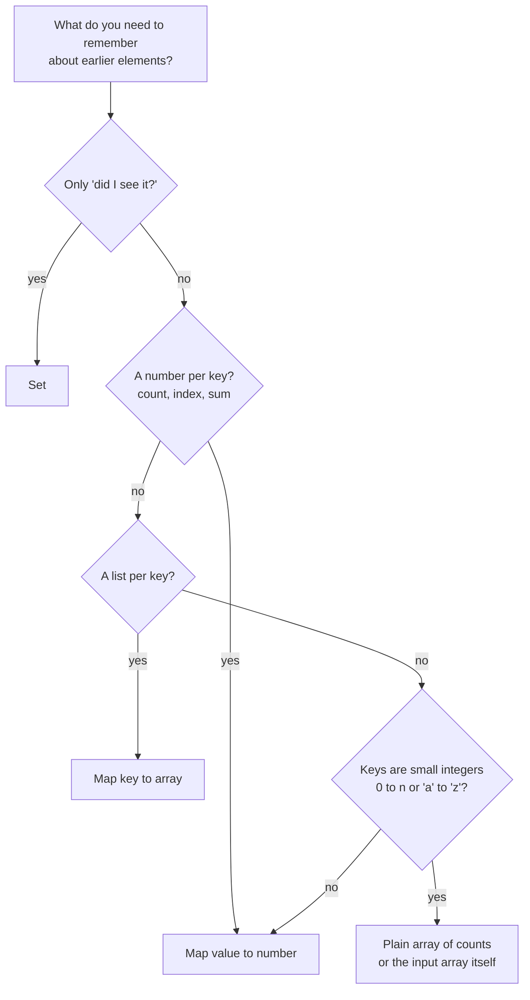
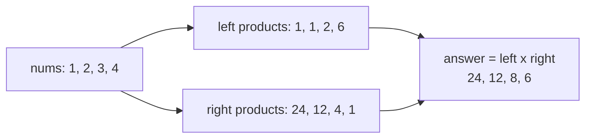
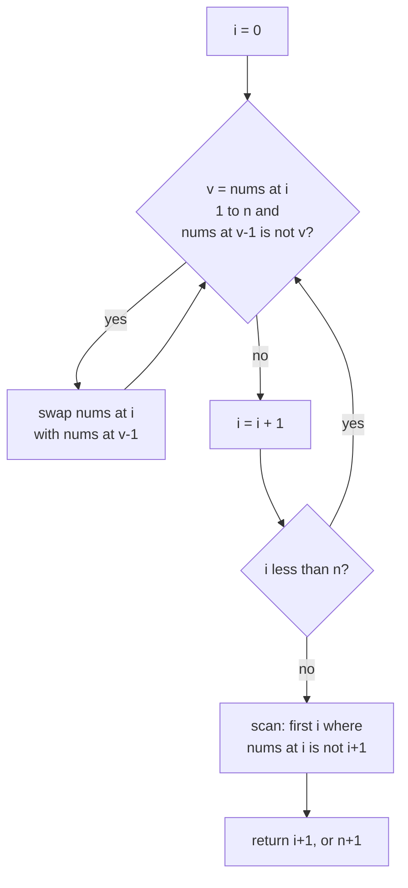

# Arrays and Hashing

> In this document you will learn the most common pattern in coding rounds: use a hash map or a set to remember what you have already seen, so you do not need a second loop. You will solve 12 classic problems with it, from "contains duplicate" to "first missing positive".

**Before this:** [Data structures and Big-O](../01-cs-and-web-fundamentals/02-data-structures-and-big-o.md) · [Problem solving and complexity](../11-coding-interviews/02-problem-solving-and-complexity.md) · **Interview questions:** [jump to the interview section](#interview-questions)

## Table of contents

1. [The pattern](#the-pattern)
2. [Problems](#problems)
3. [Interview questions](#interview-questions)
4. [Summary](#summary)
5. [References](#references)

Problems in this document:

| # | Problem | Level | Main idea |
| --- | --- | --- | --- |
| P1 | [Contains duplicate](#p1-contains-duplicate-easy) | Easy | Set of seen values |
| P2 | [Valid anagram](#p2-valid-anagram-easy) | Easy | Frequency count |
| P3 | [Two sum](#p3-two-sum-easy) | Easy | Map from value to index |
| P4 | [Majority element](#p4-majority-element-easy) | Easy | Boyer-Moore voting |
| P5 | [Group anagrams](#p5-group-anagrams-medium) | Medium | Map from a key to a group |
| P6 | [Top k frequent elements](#p6-top-k-frequent-elements-medium) | Medium | Count, then bucket sort |
| P7 | [Product of array except self](#p7-product-of-array-except-self-medium) | Medium | Prefix and suffix products |
| P8 | [Longest consecutive sequence](#p8-longest-consecutive-sequence-medium) | Medium | Set, start only at sequence starts |
| P9 | [Encode and decode strings](#p9-encode-and-decode-strings-medium) | Medium | Length prefix |
| P10 | [Valid sudoku](#p10-valid-sudoku-medium) | Medium | One set per row, column and box |
| P11 | [Subarray sum equals k](#p11-subarray-sum-equals-k-medium) | Medium | Map of prefix sums |
| P12 | [First missing positive](#p12-first-missing-positive-hard) | Hard | Use the array itself as a hash table |

---

## The pattern

### What it is

A **hash map** stores key → value pairs. Looking up a key, adding a key and deleting a key take **O(1) on average**. "On average" means: usually constant time, but in rare bad cases it can be slower. In JavaScript you use `Map` for this.

A **hash set** stores only keys. It answers one question fast: "have I seen this value before?" In JavaScript you use `Set`.

The **arrays and hashing pattern** means: walk the array once, and store useful facts in a Map or Set while you walk. Later steps read those facts in O(1) instead of searching the array again.

For the basics of how a hash table works inside (hash function, buckets, collisions), see [Data structures and Big-O](../01-cs-and-web-fundamentals/02-data-structures-and-big-o.md). The first look at this pattern is in [Pattern 1: Hash map counting and lookup](../11-coding-interviews/02-problem-solving-and-complexity.md#pattern-1-hash-map-counting-and-lookup). This document goes deeper with 12 problems.

### Why it exists

Many brute-force solutions look like this:

```js
// For each element, search the whole array again.
function hasDuplicateSlow(nums) {
  for (let i = 0; i < nums.length; i++) {
    for (let j = i + 1; j < nums.length; j++) {
      if (nums[i] === nums[j]) return true;
    }
  }
  return false;
}

console.log(hasDuplicateSlow([1, 2, 3, 1])); // true
```

The inner loop is a **search**. Searching an array is O(n), so the whole thing is O(n²). A Set turns that search into O(1). The whole solution becomes O(n).

This is the main trade: **you spend O(n) extra memory to save a factor of n in time.**

### Analogy

Think of a party with a guest list at the door. Without a list, the guard must walk through the whole room to check if a person is already inside. With a list sorted by name (or better, a box of name cards indexed by first letter), the guard checks in one quick look. The Set is that box of name cards.

The analogy breaks in one place: a real list lookup still takes a little time to find the name. A hash lookup jumps almost directly to the right slot.

### When to recognize it

Look for these signals in the problem:

| Signal in the problem | What you store |
| --- | --- |
| "contains duplicate", "seen before", "unique" | `Set` of seen values |
| "find two numbers that add up to…", "pair", "complement" | `Map` value → index |
| "count", "frequency", "most common", "anagram" | `Map` value → count |
| "group by", "categorize", "same letters" | `Map` key → array of items |
| "in O(n)" and the input is not sorted | Probably a Map or Set |
| "subarray sum equals", "number of subarrays with…" | `Map` prefix sum → count |

Another strong signal: the brute force has a nested loop where the inner loop only **searches** for something. That inner search can almost always become a Map lookup.

### The three templates

Almost every problem in this document uses one of these three shapes.

**Template 1: seen before (Set).**

```js
function seenBeforeTemplate(items) {
  const seen = new Set();
  for (const item of items) {
    if (seen.has(item)) {
      return item; // found a repeat: do something with it
    }
    seen.add(item);
  }
  return null;
}

console.log(seenBeforeTemplate(['a', 'b', 'a'])); // a
```

**Template 2: frequency count (Map).**

```js
function countTemplate(items) {
  const counts = new Map();
  for (const item of items) {
    counts.set(item, (counts.get(item) ?? 0) + 1);
  }
  return counts;
}

console.log(countTemplate(['apple', 'pear', 'apple'])); // Map(2) { 'apple' => 2, 'pear' => 1 }
```

The `?? 0` means "use 0 if the key is not there yet". `counts.get` returns `undefined` for a missing key.

**Template 3: group by key (Map of arrays).**

```js
function groupTemplate(items, keyOf) {
  const groups = new Map();
  for (const item of items) {
    const key = keyOf(item);
    if (!groups.has(key)) groups.set(key, []);
    groups.get(key).push(item);
  }
  return [...groups.values()];
}

const orders = [
  { id: 1, status: 'paid' },
  { id: 2, status: 'new' },
  { id: 3, status: 'paid' },
];
console.log(groupTemplate(orders, (o) => o.status).map((g) => g.map((o) => o.id))); // [ [ 1, 3 ], [ 2 ] ]
```

Real-world use: grouping orders by status for a dashboard, counting log lines by error code in a Node.js script, removing duplicate IDs before an API call.

### Choosing the tool



### Map vs object vs array for counting

| Tool | Keys | Good for | Watch out for |
| --- | --- | --- | --- |
| `Map` | Any value (numbers stay numbers) | General counting and lookup | Arrays/objects as keys are compared **by reference** |
| Plain object `{}` | Strings and symbols only | JSON output, fixed known keys | `obj[1]` and `obj['1']` are the same key; inherited keys like `constructor` exist on `{}` |
| `Array(26).fill(0)` | Small integers | Lowercase letters, digits | Only works when the key range is small and known |
| `Set` | Any value | Membership only | Same reference rule as Map |

Example of the object trap:

```js
// ❌ Wrong: plain object as a counter for arbitrary words
const wordCount = {};
for (const w of ['constructor', 'hello']) {
  wordCount[w] = (wordCount[w] || 0) + 1;
}
console.log(typeof wordCount.constructor); // string
// It "worked" by accident: the old value was a function, and function + 1 is a string.

// ✅ Correct: Map has no inherited keys
const safeCount = new Map();
for (const w of ['constructor', 'hello']) {
  safeCount.set(w, (safeCount.get(w) ?? 0) + 1);
}
console.log(safeCount.get('constructor')); // 1
```

Example of the reference trap:

```js
const seen = new Set();
seen.add([1, 2]);
console.log(seen.has([1, 2])); // false
// Two different array objects. Use a string key instead:
seen.add([1, 2].join(','));
console.log(seen.has([1, 2].join(','))); // true
```

For more on how `Map` and `Set` behave, see [Map, Set, WeakMap and WeakSet](../02-javascript/12-map-set-weakmap-weakset.md).

### Complexity

| Operation | Map / Set average | Worst case |
| --- | --- | --- |
| `get`, `set`, `has`, `delete` | O(1) | O(n) with many collisions (rare in practice) |
| Build from n items | O(n) | — |
| Iterate all keys | O(size) | — |

The ECMAScript spec only says `Map` and `Set` must give access "sublinear" in the number of elements on average. Real engines (V8 in Chrome and Node.js) use hash tables, so in interviews you say "O(1) average".

### Common mistakes

- **Storing before checking.** In two sum, if you add the current number before you look for its complement, a number can pair with itself.
- **Using an array as a key.** `map.set([1, 2], x)` stores by reference. Build a string key like `'1,2'` or `'1#2'`.
- **Forgetting the empty-prefix entry.** In prefix-sum counting, the Map must start with `0 → 1`.
- **Sorting numbers without a comparator.** `[10, 9, 1].sort()` gives `[1, 10, 9]` because the default sort compares strings. Use `.sort((a, b) => a - b)`.
- **Calling `Object.keys(obj).length` in a loop.** That is O(size) every time. Keep a separate counter or use `map.size` (O(1)).
- **Claiming O(1) space when the Map grows with input.** A Map with up to n keys is O(n) space. It is O(1) only when the key range is fixed, such as 26 letters.

---
## Problems

Each problem follows the same order: problem, examples, how to recognize the pattern, brute force, optimal approach, code, dry run, complexity, edge cases, follow-ups, and how to say it in the interview.

### P1. Contains duplicate (Easy)

**Problem:** You get an array of numbers. Return `true` if any value appears at least twice. Return `false` if every value is different.

Similar to: LeetCode 217 Contains Duplicate.

**Examples:**

```text
[1, 2, 3, 1]          -> true
[1, 2, 3, 4]          -> false
[1, 1, 1, 3, 3, 4]    -> true
[]                    -> false
```

**How to recognize the pattern:** the question is "have I seen this value before?". That is exactly what a Set answers.

**Brute force:** compare every pair with two loops. O(n²) time, O(1) space. A second option: sort a copy, then check neighbours. O(n log n) time.

**Optimal approach:**

1. Create an empty Set.
2. For each number: if it is already in the Set, return `true`.
3. Otherwise add it.
4. If the loop ends, return `false`.

**Code:**

```js
function containsDuplicate(nums) {
  const seen = new Set();
  for (const n of nums) {
    if (seen.has(n)) return true;
    seen.add(n);
  }
  return false;
}

console.log(containsDuplicate([1, 2, 3, 1]));       // true
console.log(containsDuplicate([1, 2, 3, 4]));       // false
console.log(containsDuplicate([1, 1, 1, 3, 3, 4])); // true
console.log(containsDuplicate([]));                 // false

// Short version: a Set drops duplicates, so compare sizes.
const containsDuplicateShort = (nums) => new Set(nums).size !== nums.length;
console.log(containsDuplicateShort([1, 2, 3, 1])); // true
```

The short version is fine in real code. In an interview, say that it always reads the whole array, while the loop version can stop early at the first repeat.

**Dry run** for `[1, 2, 3, 1]`:

| n | seen before | in seen? | action |
| --- | --- | --- | --- |
| 1 | {} | no | add 1 |
| 2 | {1} | no | add 2 |
| 3 | {1, 2} | no | add 3 |
| 1 | {1, 2, 3} | yes | return true |

**Complexity:** O(n) time, because each `has` and `add` is O(1) on average. O(n) space for the Set.

**Edge cases:** empty array (false), one element (false), negative numbers and zero (Set handles them), `NaN` (a Set treats `NaN` as equal to `NaN`, unlike `===`), `0` and `-0` (a Set treats them as the same value).

**Follow-ups:**

- **What if memory is very limited?** Sort the array in place and compare neighbours. O(n log n) time and little extra memory. It changes the input, so ask first.
- **Duplicate within distance k (LeetCode 219)?** Keep a Set of only the last k values. Remove `nums[i - k]` when the window moves. This is a sliding window, see [Sliding window](03-sliding-window.md).
- **What if the data is too big for memory?** Split the values into files by hash, then check each file alone. Or use a Bloom filter if a small chance of a false "yes" is fine.

**How to say it in the interview:**
> "The brute force compares every pair, which is O(n²). The inner loop is only a search, so I can replace it with a Set. I walk the array once. If the current number is already in the Set, I return true. Otherwise I add it. That is O(n) time and O(n) space. If memory matters more than time, I can sort and compare neighbours instead."

---

### P2. Valid anagram (Easy)

**Problem:** You get two strings `s` and `t`. Return `true` if `t` uses exactly the same letters as `s`, the same number of times, maybe in a different order.

Similar to: LeetCode 242 Valid Anagram. A first version is in [Pattern 1](../11-coding-interviews/02-problem-solving-and-complexity.md#a-second-example-counting). Here we compare versions and handle Unicode.

**Examples:**

```text
s = "anagram", t = "nagaram"  -> true
s = "rat",     t = "car"      -> false
s = "",        t = ""         -> true
s = "ab",      t = "a"        -> false
```

**How to recognize the pattern:** "same letters, same counts, any order" means you compare **frequency counts**.

**Brute force:** sort both strings and compare: `[...s].sort().join('') === [...t].sort().join('')`. O(n log n) time, O(n) space. This is short and fine as a first answer.

**Optimal approach (lowercase English letters):**

1. If the lengths differ, return `false`.
2. Make an array of 26 zeros.
3. For each position `i`, add 1 for `s[i]` and subtract 1 for `t[i]`.
4. If every count is 0 at the end, the strings are anagrams.

**Code:**

```js
// Version 1: only 'a' to 'z'. Fixed-size array, O(1) space.
function isAnagram(s, t) {
  if (s.length !== t.length) return false;
  const counts = new Array(26).fill(0);
  const a = 'a'.charCodeAt(0); // 97
  for (let i = 0; i < s.length; i++) {
    counts[s.charCodeAt(i) - a]++;
    counts[t.charCodeAt(i) - a]--;
  }
  return counts.every((c) => c === 0);
}

console.log(isAnagram('anagram', 'nagaram')); // true
console.log(isAnagram('rat', 'car'));         // false
console.log(isAnagram('', ''));               // true
console.log(isAnagram('ab', 'a'));            // false

// Version 2: any characters, including emoji. Map of counts.
function isAnagramUnicode(s, t) {
  const counts = new Map();
  for (const ch of s) counts.set(ch, (counts.get(ch) ?? 0) + 1); // for...of walks code points
  for (const ch of t) {
    const c = counts.get(ch);
    if (!c) return false; // missing or already used up
    counts.set(ch, c - 1);
  }
  for (const c of counts.values()) if (c !== 0) return false;
  return true;
}

console.log(isAnagramUnicode('😀ab', 'b😀a')); // true
console.log(isAnagramUnicode('😀', '😃'));     // false
```

Why a separate Unicode version? A JavaScript string is a list of **UTF-16 code units**. An emoji like `😀` is two code units. `s[i]` and `charCodeAt` look at code units, so they split the emoji. `for...of` walks by **code point**, so it keeps the emoji whole. For more, see [Strings, numbers and dates](../02-javascript/11-strings-numbers-and-dates.md).

**Dry run** for `s = "rat"`, `t = "car"` (only non-zero counts shown):

| i | s[i] | t[i] | counts after |
| --- | --- | --- | --- |
| 0 | r | c | r:+1, c:-1 |
| 1 | a | a | r:+1, c:-1 |
| 2 | t | r | t:+1, c:-1 |

`t` is +1 and `c` is -1, so not every count is 0. Result: `false`.

**Complexity:** Version 1 is O(n) time and O(1) space (26 slots, a fixed number). Version 2 is O(n) time and O(k) space, where k is the number of different characters.

**Edge cases:** different lengths (return early), empty strings (true), uppercase vs lowercase (ask; usually normalize with `toLowerCase()`), spaces and punctuation (ask if they count), Unicode (use Version 2).

**Follow-ups:**

- **What if the input contains Unicode characters?** Use a Map and `for...of`, as in Version 2. Also think about **normalization**: `'é'` can be one code point, or `e` plus a combining accent. Call `s.normalize('NFC')` on both strings first.
- **Check many words against one word?** Build the count of the main word once. For each candidate, compare counts. Or compute a sorted "signature" and compare strings (see P5).
- **Find all anagram positions of `p` inside `s` (LeetCode 438)?** That is a fixed-size sliding window with counts, see [Sliding window](03-sliding-window.md).

**How to say it in the interview:**
> "Two strings are anagrams when they have the same character counts. Sorting both works in O(n log n), but I can do better by counting. If the input is only lowercase letters, I use an array of 26 counters. I add one for each letter in s and subtract one for each letter in t. If all counters are zero, it is an anagram. That is O(n) time and O(1) space. For Unicode I would switch to a Map and iterate with for...of."

---

### P3. Two sum (Easy)

**Problem:** You get an array `nums` and a number `target`. Return the indices of two different elements whose sum is `target`. Assume exactly one answer exists.

Similar to: LeetCode 1 Two Sum. The basic solution with a full walkthrough is in [Worked problem: Two Sum](../11-coding-interviews/02-problem-solving-and-complexity.md#worked-problem-two-sum). Here we recap it briefly and then go further: count all pairs, and return unique value pairs.

**Examples:**

```text
nums = [2, 7, 11, 15], target = 9   -> [0, 1]
nums = [3, 2, 4],      target = 6   -> [1, 2]
nums = [3, 3],         target = 6   -> [0, 1]
```

**How to recognize the pattern:** you need a **partner** for each element (`target - x`). Looking up "is the partner here?" is a Map lookup.

**Brute force:** try every pair `i < j`. O(n²) time.

**Optimal approach:**

1. Keep a Map from value → index for values you have passed.
2. For each `nums[i]`, compute `need = target - nums[i]`.
3. If `need` is in the Map, return `[map.get(need), i]`.
4. Otherwise store `nums[i] → i`. Store **after** the check, so a number does not pair with itself.

**Code:**

```js
function twoSum(nums, target) {
  const indexOf = new Map(); // value -> index
  for (let i = 0; i < nums.length; i++) {
    const need = target - nums[i];
    if (indexOf.has(need)) return [indexOf.get(need), i];
    indexOf.set(nums[i], i);
  }
  return null; // no pair
}

console.log(twoSum([2, 7, 11, 15], 9)); // [ 0, 1 ]
console.log(twoSum([3, 2, 4], 6));      // [ 1, 2 ]
console.log(twoSum([3, 3], 6));         // [ 0, 1 ]
console.log(twoSum([1, 2], 10));        // null
```

**Going further 1: count all index pairs `i < j` with `nums[i] + nums[j] === target`.** Now duplicates matter. Store **counts** instead of one index.

```js
function countPairs(nums, target) {
  const countOf = new Map(); // value -> how many times seen so far
  let pairs = 0;
  for (const x of nums) {
    pairs += countOf.get(target - x) ?? 0; // each earlier partner makes one pair
    countOf.set(x, (countOf.get(x) ?? 0) + 1);
  }
  return pairs;
}

console.log(countPairs([1, 5, 7, -1, 5], 6)); // 3
console.log(countPairs([3, 3, 3], 6));        // 3
```

For `[3, 3, 3]`: the second 3 pairs with one earlier 3, and the third 3 pairs with two earlier 3s. Total 1 + 2 = 3.

**Going further 2: return each unique value pair once.**

```js
function uniquePairs(nums, target) {
  const seen = new Set();
  const used = new Set(); // smaller value of each pair we already output
  const result = [];
  for (const x of nums) {
    const y = target - x;
    if (seen.has(y)) {
      const small = Math.min(x, y);
      if (!used.has(small)) {
        used.add(small);
        result.push([small, Math.max(x, y)]);
      }
    }
    seen.add(x);
  }
  return result;
}

console.log(uniquePairs([1, 5, 7, -1, 5, 1], 6)); // [ [ 1, 5 ], [ -1, 7 ] ]
```

The smaller value is enough to identify a pair, because the larger value is always `target - small`.

**Dry run** of `twoSum([3, 2, 4], 6)`:

| i | nums[i] | need | Map before | result |
| --- | --- | --- | --- | --- |
| 0 | 3 | 3 | {} | store 3→0 |
| 1 | 2 | 4 | {3→0} | store 2→1 |
| 2 | 4 | 2 | {3→0, 2→1} | found 2 → return [1, 2] |

**Complexity:** O(n) time and O(n) space for all three versions.

**Edge cases:** the same value used twice (`[3, 3]` with target 6 must work; `[3]` with target 6 must not), negative numbers, zero target, no answer.

**Follow-ups:**

- **The array is sorted. Can you use O(1) space?** Yes. Put one pointer at each end and move them inward. See [Two pointers](02-two-pointers.md).
- **Three numbers that sum to zero?** Sort, fix one number, run two pointers on the rest. That is 3Sum in [Two pointers](02-two-pointers.md).
- **Huge list of numbers, many target queries?** Keep a count Map of all values once. For each query, loop over the distinct values and check `target - v`. Each query is O(distinct values).

**How to say it in the interview:**
> "For every number I need its partner, target minus the number. Instead of searching for the partner with a second loop, I keep a Map from value to index of everything I have already passed. For each element I first check the Map, and only then I store the element, so it cannot pair with itself. One pass, O(n) time, O(n) space. If I need to count all pairs, I store counts instead of indices."

---

### P4. Majority element (Easy)

**Problem:** You get an array of length n. One value appears **more than n / 2 times**. Return that value.

Similar to: LeetCode 169 Majority Element.

**Examples:**

```text
[3, 2, 3]              -> 3
[2, 2, 1, 1, 1, 2, 2]  -> 2
[7]                    -> 7
```

**How to recognize the pattern:** "appears most often" is a counting problem, so a Map works. But "more than half" is a special promise. It allows the **Boyer-Moore voting** trick with O(1) space.

**Brute force:** for each element, count how often it appears with an inner loop. O(n²). Better: count with a Map, then return the key with count > n / 2. O(n) time, O(n) space. Another option: sort and return the middle element `sorted[Math.floor(n / 2)]`. O(n log n).

**Optimal approach (Boyer-Moore voting):**

Think of an election. Each element is a vote. Pair up two votes for **different** candidates and throw both away. Because the majority has more than half of all votes, it cannot be fully cancelled. It is the one left at the end.

1. Keep a `candidate` and a `count`, starting at 0.
2. For each number: if `count` is 0, make this number the new candidate.
3. If the number equals the candidate, `count++`. Otherwise `count--`.
4. Return the candidate.

**Code:**

```js
function majorityElement(nums) {
  let candidate = null;
  let count = 0;
  for (const n of nums) {
    if (count === 0) candidate = n;
    count += n === candidate ? 1 : -1;
  }
  return candidate;
}

console.log(majorityElement([3, 2, 3]));             // 3
console.log(majorityElement([2, 2, 1, 1, 1, 2, 2])); // 2
console.log(majorityElement([7]));                   // 7

// If the problem does NOT promise a majority, verify with a second pass.
function majorityOrNull(nums) {
  const c = majorityElement(nums);
  const times = nums.filter((n) => n === c).length;
  return times > nums.length / 2 ? c : null;
}

console.log(majorityOrNull([1, 2, 3])); // null
```

**Dry run** for `[2, 2, 1, 1, 1, 2, 2]`:

| n | count before | candidate | count after |
| --- | --- | --- | --- |
| 2 | 0 | 2 (new) | 1 |
| 2 | 1 | 2 | 2 |
| 1 | 2 | 2 | 1 |
| 1 | 1 | 2 | 0 |
| 1 | 0 | 1 (new) | 1 |
| 2 | 1 | 1 | 0 |
| 2 | 0 | 2 (new) | 1 |

Answer: 2. The candidate changes during the walk. Only the final candidate matters.

**Complexity:** O(n) time, O(1) space.

**Edge cases:** one element, all the same value, the majority bunched at the end, no majority at all (Boyer-Moore still returns something, so verify).

**Follow-ups:**

- **Why does this work?** Each time `count` drops, one candidate vote is cancelled by one different vote. The majority has more votes than everything else combined, so the others run out first and the majority survives.
- **Elements that appear more than n / 3 times (LeetCode 229)?** There can be at most two such values. Keep two candidates and two counts. Then verify both with a second pass.
- **Is a Map solution acceptable?** Yes, as a first answer. Then say "the more-than-half promise lets me reduce space to O(1) with Boyer-Moore".

**How to say it in the interview:**
> "A Map of counts solves it in O(n) time and O(n) space. Because the majority appears more than half the time, I can use Boyer-Moore voting with O(1) space. I keep a candidate and a counter. The same value adds one, a different value removes one, and when the counter hits zero I take the next value as the new candidate. Different values cancel each other in pairs, and the majority cannot be fully cancelled, so it is the final candidate. If the majority is not guaranteed, I verify it with one more pass."

---

### P5. Group anagrams (Medium)

**Problem:** You get an array of words. Put words that are anagrams of each other into the same group. Return the list of groups. The order of groups and the order inside a group do not matter.

Similar to: LeetCode 49 Group Anagrams. [Pattern 13](../11-coding-interviews/02-problem-solving-and-complexity.md#worked-problem-group-anagrams) shows the sorted-key version. Here we also build an O(k) counting key and compare the two.

**Examples:**

```text
["eat", "tea", "tan", "ate", "nat", "bat"]  -> [["eat","tea","ate"], ["tan","nat"], ["bat"]]
[""]                                        -> [[""]]
["a"]                                       -> [["a"]]
```

**How to recognize the pattern:** "put things into groups by some property" is the **group-by template**. The only question is: what key do all anagrams share?

**Brute force:** for each word, compare it with the first word of every existing group using the anagram check from P2. O(n² · k), where n is the number of words and k is the word length.

**Optimal approach:**

1. For each word, build a **key** that is the same for all its anagrams.
2. Option A: sort the letters. `"eat"` → `"aet"`. Cost O(k log k) per word.
3. Option B: count the 26 letters and join the counts into a string, like `"1#0#0#0#1#...#1#..."`. Cost O(k) per word.
4. Push the word into `groups.get(key)`.
5. Return all the groups.

**Code:**

```js
// Option A: sorted letters as the key.
function groupAnagramsSorted(words) {
  const groups = new Map();
  for (const word of words) {
    const key = [...word].sort().join(''); // default sort is fine here: we compare letters
    if (!groups.has(key)) groups.set(key, []);
    groups.get(key).push(word);
  }
  return [...groups.values()];
}

// Option B: letter counts as the key (lowercase a-z).
function groupAnagrams(words) {
  const groups = new Map();
  for (const word of words) {
    const counts = new Array(26).fill(0);
    for (let i = 0; i < word.length; i++) counts[word.charCodeAt(i) - 97]++;
    const key = counts.join('#'); // '#' keeps "1,11" and "11,1" apart
    if (!groups.has(key)) groups.set(key, []);
    groups.get(key).push(word);
  }
  return [...groups.values()];
}

console.log(groupAnagrams(['eat', 'tea', 'tan', 'ate', 'nat', 'bat'])); // [ [ 'eat', 'tea', 'ate' ], [ 'tan', 'nat' ], [ 'bat' ] ]
console.log(groupAnagrams(['']));  // [ [ '' ] ]
console.log(groupAnagramsSorted(['abc', 'cab', 'x'])); // [ [ 'abc', 'cab' ], [ 'x' ] ]
```

Why the separator? Without it, counts `[1, 11]` and `[11, 1]` both join to `"111"`. With `'#'` they become `"1#11"` and `"11#1"`, which are different.

**Dry run** for `["eat", "tea", "bat"]` with sorted keys:

| word | key | groups after |
| --- | --- | --- |
| eat | aet | aet → [eat] |
| tea | aet | aet → [eat, tea] |
| bat | abt | aet → [eat, tea], abt → [bat] |

**Complexity:**

| Version | Time | Space |
| --- | --- | --- |
| Sorted key | O(n · k log k) | O(n · k) |
| Count key | O(n · k) — plus O(26) per word to build the key | O(n · k) |

For short words, the sorted version is often just as fast in practice. Say both, and say why the count key is better in theory.

**Edge cases:** empty string (its key is `""` or all zeros, still one group), a single word, all words in one group, duplicate words (`["a", "a"]` gives one group with both).

**Follow-ups:**

- **What if words contain any Unicode characters?** The 26-slot array no longer works. Use the sorted key with `[...word].sort().join('')`, or a Map of counts turned into a sorted string.
- **Return groups sorted by size?** After grouping, `result.sort((a, b) => b.length - a.length)`. That adds O(g log g) for g groups.
- **Where is this used in real life?** Grouping by a normalized key is common: grouping customers by normalized email, grouping log lines by a message template, deduplicating products by a cleaned title.

**How to say it in the interview:**
> "Anagrams share the same letters, so I need a key that all anagrams have in common, and then I group by that key with a Map. The simplest key is the sorted word, which costs k log k per word. A faster key is the count of each of the 26 letters joined with a separator, which costs O(k). I push each word into the list for its key and return the Map values. Total O(n · k) time with the count key."

---

### P6. Top k frequent elements (Medium)

**Problem:** You get an array of numbers and a number `k`. Return the `k` values that appear most often. The order of the answer does not matter. Assume the answer is unique.

Similar to: LeetCode 347 Top K Frequent Elements. The heap version is in [Pattern 12](../11-coding-interviews/02-problem-solving-and-complexity.md#worked-problem-top-k-frequent-elements) and in [Heaps and top-k, P5](09-heaps-and-top-k.md#p5-top-k-frequent-elements-and-top-k-frequent-words-medium) (which adds tie-breaking). Here we use **bucket sort**, which is O(n).

**Examples:**

```text
nums = [1, 1, 1, 2, 2, 3], k = 2  -> [1, 2]
nums = [1],                k = 1  -> [1]
nums = [4, 4, 5, 5, 5, 6], k = 1  -> [5]
```

**How to recognize the pattern:** "most frequent" means counting first. "Top k" usually means sorting or a heap. But a count can never be bigger than n. That small, known range allows **bucket sort**.

**Brute force:** count with a Map, then sort the entries by count. O(n log n) time.

```js
function topKFrequentSort(nums, k) {
  const counts = new Map();
  for (const n of nums) counts.set(n, (counts.get(n) ?? 0) + 1);
  return [...counts.entries()]
    .sort((a, b) => b[1] - a[1]) // numeric comparator: highest count first
    .slice(0, k)
    .map(([value]) => value);
}

console.log(topKFrequentSort([1, 1, 1, 2, 2, 3], 2)); // [ 1, 2 ]
```

**Optimal approach (bucket sort):**

1. Count each value with a Map.
2. Make an array `buckets` of length `n + 1`. `buckets[c]` holds all values that appear exactly `c` times.
3. Walk the buckets from the highest count down to 1. Collect values until you have `k`.

**Code:**

```js
function topKFrequent(nums, k) {
  const counts = new Map();
  for (const n of nums) counts.set(n, (counts.get(n) ?? 0) + 1);

  // buckets[c] = values that appear c times. A count is at most nums.length.
  const buckets = Array.from({ length: nums.length + 1 }, () => []);
  for (const [value, c] of counts) buckets[c].push(value);

  const result = [];
  for (let c = buckets.length - 1; c >= 1 && result.length < k; c--) {
    for (const value of buckets[c]) {
      result.push(value);
      if (result.length === k) break;
    }
  }
  return result;
}

console.log(topKFrequent([1, 1, 1, 2, 2, 3], 2)); // [ 1, 2 ]
console.log(topKFrequent([1], 1));                // [ 1 ]
console.log(topKFrequent([4, 4, 5, 5, 5, 6], 1)); // [ 5 ]
```

Note: `Array.from({ length }, () => [])` creates a **new** empty array for each slot. `new Array(n).fill([])` would put the **same** array in every slot, which is a classic bug.

**Dry run** for `[1, 1, 1, 2, 2, 3]`, k = 2:

1. Counts: `1 → 3`, `2 → 2`, `3 → 1`.
2. Buckets (length 7): `buckets[3] = [1]`, `buckets[2] = [2]`, `buckets[1] = [3]`, others empty.
3. Walk down from c = 6: slots 6, 5, 4 are empty. c = 3 → take 1. c = 2 → take 2. Now we have k = 2 values. Stop.
4. Answer: `[1, 2]`.

**Complexity:** O(n) time: counting is O(n), filling buckets is O(distinct values), and the walk is O(n). O(n) space for the Map and buckets.

**Edge cases:** k equals the number of distinct values (return all), every value appears once (all in `buckets[1]`), negative numbers (fine, they are Map keys, not indices).

**Follow-ups:**

- **When is a heap better than buckets?** When the data is a **stream** and you cannot store everything, or when k is very small compared with n. A min-heap of size k gives O(n log k) and O(k) extra memory beyond the counts. See [Heaps and top-k](09-heaps-and-top-k.md).
- **Top k frequent words, ties broken alphabetically (LeetCode 692)?** Sort entries with a two-level comparator: `(a, b) => b[1] - a[1] || a[0].localeCompare(b[0])`.
- **What if counts can be huge (not bounded by n)?** Bucket sort needs a small range. Then use a heap or **quickselect** (average O(n)).

**How to say it in the interview:**
> "First I count each value with a Map. Sorting the entries by count would be O(n log n). But a count can never be larger than n, so I can bucket sort: an array where index c holds the values that appear c times. Then I walk from the highest index down and collect values until I have k. That is O(n) time and O(n) space. If this were a stream, I would use a min-heap of size k instead."

---

### P7. Product of array except self (Medium)

**Problem:** You get an array `nums`. Return an array `answer` where `answer[i]` is the product of all elements **except** `nums[i]`. Do it in O(n) time **without using division**.

Similar to: LeetCode 238 Product of Array Except Self.

**Examples:**

```text
[1, 2, 3, 4]       -> [24, 12, 8, 6]
[-1, 1, 0, -3, 3]  -> [0, 0, 9, 0, 0]
[2, 3]             -> [3, 2]
```

**How to recognize the pattern:** "everything except index i" can be split into "everything **left** of i" times "everything **right** of i". Those are **prefix** and **suffix** products. This is the multiplication cousin of prefix sums (see [Prefix sums and intervals](04-prefix-sums-and-intervals.md)).

**Brute force:** for each i, multiply all other elements. O(n²).

**Why not divide?** Multiply everything, then divide by `nums[i]`. It breaks when there is a zero (division by zero), and the problem forbids it anyway.

**Optimal approach:**

1. Left pass: `answer[i]` = product of all elements before `i`. Start with `left = 1`.
2. Right pass: walk from the end with `right = 1`. Multiply `answer[i]` by `right`, then update `right *= nums[i]`.
3. Now `answer[i]` = (product left of i) × (product right of i).



**Code:**

```js
function productExceptSelf(nums) {
  const n = nums.length;
  const answer = new Array(n);

  // Pass 1: answer[i] = product of nums[0..i-1]
  let left = 1;
  for (let i = 0; i < n; i++) {
    answer[i] = left;
    left *= nums[i];
  }

  // Pass 2: multiply by product of nums[i+1..n-1]
  let right = 1;
  for (let i = n - 1; i >= 0; i--) {
    answer[i] *= right;
    right *= nums[i];
  }
  return answer.map((x) => (x === 0 ? 0 : x)); // turn -0 into 0 for clean output
}

console.log(productExceptSelf([1, 2, 3, 4]));      // [ 24, 12, 8, 6 ]
console.log(productExceptSelf([-1, 1, 0, -3, 3])); // [ 0, 0, 9, 0, 0 ]
console.log(productExceptSelf([2, 3]));            // [ 3, 2 ]
```

The last `map` is a JavaScript detail. `-1 * 0` is `-0` in JavaScript. `-0 === 0` is `true`, but `console.log` prints `-0`. The fix only makes the output clean. It is not part of the algorithm.

**Dry run** for `[1, 2, 3, 4]`:

| i | left pass: answer[i] | left after | right pass: right before | answer[i] final |
| --- | --- | --- | --- | --- |
| 0 | 1 | 1 | 24 | 24 |
| 1 | 1 | 2 | 12 | 12 |
| 2 | 2 | 6 | 4 | 8 |
| 3 | 6 | 24 | 1 | 6 |

(The right pass runs from i = 3 down to i = 0. `right` before each step is 1, 4, 12, 24 for i = 3, 2, 1, 0.)

**Complexity:** O(n) time (two passes). O(1) extra space if you do not count the output array, because we only use two variables.

**Edge cases:** one zero (only that index gets a non-zero product), two or more zeros (all answers are 0), negative numbers, length 2.

**Follow-ups:**

- **What if division were allowed?** Count zeros. If there are two or more, all answers are 0. If there is exactly one, only that index gets the product of the others. Otherwise `answer[i] = total / nums[i]`.
- **What about very large products?** Numbers above `Number.MAX_SAFE_INTEGER` (2^53 − 1) lose precision. Use `BigInt` if exact large products are needed: `1n`, `left *= BigInt(nums[i])`.
- **Same idea elsewhere?** "Left max and right max" in trapping rain water ([Two pointers](02-two-pointers.md)) uses the same two-pass shape.

**How to say it in the interview:**
> "The product of everything except i is the product of everything to the left of i times the product of everything to the right. So I do two passes. In the first pass I fill the answer with prefix products. In the second pass I walk from the right with a running suffix product and multiply it in. No division, so zeros are not a problem. O(n) time and O(1) extra space besides the output."

---

### P8. Longest consecutive sequence (Medium)

**Problem:** You get an unsorted array of integers. Return the length of the longest run of consecutive values, like 1, 2, 3, 4. The values do not need to be next to each other in the array. Do it in O(n).

Similar to: LeetCode 128 Longest Consecutive Sequence.

**Examples:**

```text
[100, 4, 200, 1, 3, 2]          -> 4   (1, 2, 3, 4)
[0, 3, 7, 2, 5, 8, 4, 6, 0, 1]  -> 9   (0 to 8)
[]                              -> 0
[1, 2, 0, 1]                    -> 3   (0, 1, 2)
```

**How to recognize the pattern:** "O(n)" with an unsorted array rules out sorting. Asking "is x + 1 in the array?" many times is a Set lookup.

**Brute force:** sort, then count runs. O(n log n). Skip duplicates while counting.

**Optimal approach:**

1. Put all numbers in a Set.
2. For each number `x` in the Set: if `x - 1` is in the Set, **skip** it. It is not the start of a run.
3. If `x - 1` is not in the Set, `x` is a **start**. Count up: `x + 1`, `x + 2`, … while they exist.
4. Keep the longest length.

The skip in step 2 is the key idea. Without it, you would count the same run again from every element inside it, which is O(n²).

**Code:**

```js
function longestConsecutive(nums) {
  const values = new Set(nums);
  let best = 0;

  for (const x of values) {      // iterate the Set, so duplicates are already gone
    if (values.has(x - 1)) continue; // not the start of a run

    let length = 1;
    while (values.has(x + length)) length++;
    best = Math.max(best, length);
  }
  return best;
}

console.log(longestConsecutive([100, 4, 200, 1, 3, 2]));         // 4
console.log(longestConsecutive([0, 3, 7, 2, 5, 8, 4, 6, 0, 1])); // 9
console.log(longestConsecutive([]));                             // 0
console.log(longestConsecutive([1, 2, 0, 1]));                   // 3
```

**Dry run** for `[100, 4, 200, 1, 3, 2]`:

| x | x − 1 in Set? | action | run length | best |
| --- | --- | --- | --- | --- |
| 100 | no (99) | start, 101 missing | 1 | 1 |
| 4 | yes (3) | skip | — | 1 |
| 200 | no (199) | start, 201 missing | 1 | 1 |
| 1 | no (0) | start: 2, 3, 4 exist, 5 missing | 4 | 4 |
| 3 | yes | skip | — | 4 |
| 2 | yes | skip | — | 4 |

**Complexity:** O(n) time. The `while` loop looks like a nested loop, but each value is visited by a `while` step **at most once overall**, because the `while` only runs from run starts. So the total work is O(n) for the outer loop + O(n) for all `while` steps together. O(n) space for the Set.

**Edge cases:** empty array (0), duplicates (the Set removes them; iterate the Set, not the array, or a long run of the same start can be counted many times), negative numbers, one element (1).

**Follow-ups:**

- **Why iterate the Set and not the array?** If the array is `[1, 1, 1, ..., 1, 2, 3, ...]`, iterating the array would start a full count from each copy of 1. Iterating the Set visits each start once.
- **Return the sequence itself?** Keep `bestStart` next to `best`. At the end, build `[bestStart, bestStart + 1, ...]`.
- **Numbers arrive one by one, and you must report the longest run after each one?** Use union-find (disjoint set union): when `x` arrives, union it with `x − 1` and `x + 1` if they exist, and track set sizes. See [Graphs](10-graphs-bfs-dfs-and-topological-sort.md).

**How to say it in the interview:**
> "Sorting would give O(n log n), but they want O(n), so I put all numbers in a Set. A number starts a run only if x minus one is not in the Set. For each start, I count upward while the next number exists. Every number is counted in exactly one run, so even though there is a while loop inside a for loop, the total work is O(n). Space is O(n) for the Set."

---

### P9. Encode and decode strings (Medium)

**Problem:** Write two functions. `encode(list)` turns a list of strings into **one** string. `decode(str)` turns that string back into the **exact** same list. The strings can contain any characters, including `#`, commas, and digits.

Similar to: LeetCode 271 Encode and Decode Strings.

**Examples:**

```text
["lint", "code", "love", "you"]  -> encode -> decode -> ["lint", "code", "love", "you"]
["", "a#b", "12#"]               -> round trip gives the same list
[]                               -> round trip gives []
```

**How to recognize the pattern:** this is a **serialization** problem. Any delimiter you pick can also appear inside a string. The safe answer is to write each string's **length** first. Hashing is not used here, but the problem sits in this group in most pattern lists, and it teaches careful string building.

**Brute force (and why it fails):** join with a delimiter, like `list.join(',')`. Then `["a,b"]` and `["a", "b"]` both encode to `"a,b"`. Escaping the delimiter works but is easy to get wrong.

**Optimal approach (length prefix):**

1. Encode each string as `length + '#' + string`. `"lint"` → `"4#lint"`.
2. Decode with an index `i`. Read digits until you reach `#`. That number is the length.
3. Take exactly that many characters after the `#`. Move `i` past them. Repeat.

The `#` after the number is safe even if the string itself contains `#`, because we never search for `#` inside the string. We jump over the string by its length.

**Code:**

```js
function encode(list) {
  // Build pieces in an array and join once. Strings are immutable,
  // so many "+=" in a loop can create many temporary strings.
  const parts = [];
  for (const s of list) parts.push(`${s.length}#${s}`);
  return parts.join('');
}

function decode(str) {
  const result = [];
  let i = 0;
  while (i < str.length) {
    let j = i;
    while (str[j] !== '#') j++;           // find the end of the length number
    const length = Number(str.slice(i, j));
    const start = j + 1;
    result.push(str.slice(start, start + length));
    i = start + length;                    // jump over the string
  }
  return result;
}

const words = ['lint', 'code', 'love', 'you'];
console.log(encode(words)); // 4#lint4#code4#love3#you
console.log(decode(encode(words))); // [ 'lint', 'code', 'love', 'you' ]
console.log(decode(encode(['', 'a#b', '12#']))); // [ '', 'a#b', '12#' ]
console.log(decode(encode([]))); // []
```

A note on modern engines: V8 has fast paths for string `+=` (it builds "rope" strings internally), so `+=` is often fine in practice. `parts.join('')` is still the clear, safe habit, and it is what you should say in an interview.

**Dry run** of `decode("0#3#a#b")` (from `["", "a#b"]`):

| i | digits read | length | taken | next i |
| --- | --- | --- | --- | --- |
| 0 | "0" | 0 | "" | 2 |
| 2 | "3" | 3 | "a#b" | 7 |
| 7 | — | — | end | — |

**Complexity:** O(total characters) time for both functions. O(total characters) space for the output.

**Edge cases:** empty list (encodes to `""`), empty strings (`"0#"`), strings with `#` or digits, very long strings (length has many digits, still fine), emoji (`length` counts UTF-16 code units and `slice` also uses code units, so they agree).

**Follow-ups:**

- **Why not just `JSON.stringify`?** In real code, that is the right answer: `JSON.parse(JSON.stringify(list))` round-trips any list of strings. The interview wants you to design a format yourself.
- **Can you use a fixed-width length instead of `#`?** Yes. Write every length as, say, 4 hex digits or 4 bytes. Then decode reads exactly 4 characters for the length. This is how many binary protocols frame messages (for example a length prefix before each message on a TCP socket).
- **What about escaping instead?** Replace `#` with `##` inside strings and use `#,` as the separator. It works, but decoding needs careful look-ahead. Length prefix is simpler.

**How to say it in the interview:**
> "A plain delimiter fails because the delimiter can appear inside a string. So I write the length of each string, then a hash sign, then the string. To decode, I read digits up to the hash sign to get the length, then I take exactly that many characters and jump past them. I never search inside the string, so any character is safe. Both directions are linear in the total length."

---

### P10. Valid sudoku (Medium)

**Problem:** You get a 9 × 9 sudoku board. Cells contain `'1'` to `'9'` or `'.'` for empty. Check if the filled cells are valid: no digit repeats in any row, any column, or any of the nine 3 × 3 boxes. You do not need to solve the puzzle.

Similar to: LeetCode 36 Valid Sudoku.

**Examples:**

```text
A normal valid puzzle start             -> true
Same board but two '8's in column 0     -> false
An empty board (all '.')                -> true
```

**How to recognize the pattern:** "no repeats in a group" is the **seen-before** template, once per group. There are 27 groups: 9 rows, 9 columns, 9 boxes.

**Brute force:** check each row, then each column, then each box, each with its own Set. Three separate passes. This is already O(81), so the real goal is clean code with one pass.

**Optimal approach (one pass):**

1. Make 9 Sets for rows, 9 for columns, 9 for boxes.
2. For each filled cell `(r, c)` with digit `d`, compute the box index: `box = Math.floor(r / 3) * 3 + Math.floor(c / 3)`.
3. If `d` is already in `rows[r]`, `cols[c]` or `boxes[box]`, return `false`.
4. Otherwise add `d` to all three.

How the box index works:

| r (row) | Math.floor(r / 3) | c (column) | Math.floor(c / 3) | box |
| --- | --- | --- | --- | --- |
| 0 | 0 | 0 | 0 | 0 |
| 1 | 0 | 5 | 1 | 1 |
| 4 | 1 | 7 | 2 | 5 |
| 8 | 2 | 8 | 2 | 8 |

**Code:**

```js
function isValidSudoku(board) {
  const make9 = () => Array.from({ length: 9 }, () => new Set());
  const rows = make9();
  const cols = make9();
  const boxes = make9();

  for (let r = 0; r < 9; r++) {
    for (let c = 0; c < 9; c++) {
      const d = board[r][c];
      if (d === '.') continue;
      const box = Math.floor(r / 3) * 3 + Math.floor(c / 3);
      if (rows[r].has(d) || cols[c].has(d) || boxes[box].has(d)) return false;
      rows[r].add(d);
      cols[c].add(d);
      boxes[box].add(d);
    }
  }
  return true;
}

const board = [
  ['5', '3', '.', '.', '7', '.', '.', '.', '.'],
  ['6', '.', '.', '1', '9', '5', '.', '.', '.'],
  ['.', '9', '8', '.', '.', '.', '.', '6', '.'],
  ['8', '.', '.', '.', '6', '.', '.', '.', '3'],
  ['4', '.', '.', '8', '.', '3', '.', '.', '1'],
  ['7', '.', '.', '.', '2', '.', '.', '.', '6'],
  ['.', '6', '.', '.', '.', '.', '2', '8', '.'],
  ['.', '.', '.', '4', '1', '9', '.', '.', '5'],
  ['.', '.', '.', '.', '8', '.', '.', '7', '9'],
];
console.log(isValidSudoku(board)); // true

const badBoard = board.map((row) => [...row]); // copy each row
badBoard[0][0] = '8'; // column 0 now has two '8's (rows 0 and 3)
console.log(isValidSudoku(badBoard)); // false

const empty = Array.from({ length: 9 }, () => new Array(9).fill('.'));
console.log(isValidSudoku(empty)); // true
```

Notice `board.map((row) => [...row])`. A plain `[...board]` copies only the outer array. The rows would still be shared, and changing `badBoard[0][0]` would also change `board`. See [Objects and copying](../02-javascript/07-objects-and-copying.md).

**Dry run** of the bad board (only the steps that matter):

1. `(0, 0)` = `'8'`: rows[0], cols[0], boxes[0] are empty. Add `'8'` to all three.
2. … many cells pass …
3. `(3, 0)` = `'8'`: `cols[0]` already has `'8'`. Return `false`.

**Complexity:** O(81) = O(1) time and space for a fixed 9 × 9 board. For a general N × N board (N = k², like 16 × 16), it is O(N²) time and O(N²) space.

**Edge cases:** empty board (true), a full valid solved board (true), duplicate only inside a box but not in any row or column (the box check catches it).

**Follow-ups:**

- **Use less memory?** Use a 9-bit number per row, column and box instead of a Set. Bit `d` is set when digit `d` is seen: `mask & (1 << d)` to test, `mask |= 1 << d` to add. See [Tries, bit manipulation and math](14-tries-bit-manipulation-and-math.md).
- **Use a single Set?** Add strings like `"5 in row 0"`, `"5 in col 0"`, `"5 in box 0"`. One Set, same idea, very readable.
- **Valid means solvable?** No. A board can pass these checks and still have no solution. Solving needs backtracking, see [Backtracking](11-backtracking.md).

**How to say it in the interview:**
> "Each row, column and 3 by 3 box must have no repeated digit, so it is the seen-before pattern 27 times. I keep 9 Sets for rows, 9 for columns and 9 for boxes. The box index is row divided by 3, times 3, plus column divided by 3, using floor. In one pass over the board, if a digit is already in its row, column or box Set, I return false, otherwise I add it. The board is fixed size, so it is constant time, or O(N squared) for an N by N board."

---

### P11. Subarray sum equals k (Medium)

**Short version.** The full write-up (why it works, dry run, edge cases, follow-ups and related problems) is in [Prefix sums and intervals, P5](04-prefix-sums-and-intervals.md#p5-subarray-sum-equals-k-medium). It is here because it shows a **hash map used to look up earlier prefix sums**.

**Problem:** You get an array of integers (they can be negative) and a number `k`. Count how many contiguous subarrays have a sum of exactly `k`. Similar to: LeetCode 560 Subarray Sum Equals K.

```text
nums = [1, 1, 1],  k = 2  -> 2
nums = [1, -1, 0], k = 0  -> 3   ([1, -1], [0], [1, -1, 0])
```

**Key idea:** a subarray ending here sums to `k` when some **earlier** prefix sum equals `prefix - k`. Keep a Map from prefix sum to how many times you have seen it, starting with `0 → 1`. A sliding window does not work, because negative numbers break the window rule.

```js
function subarraySum(nums, k) {
  const countOfPrefix = new Map([[0, 1]]); // the empty prefix
  let prefix = 0;
  let count = 0;
  for (const x of nums) {
    prefix += x;
    count += countOfPrefix.get(prefix - k) ?? 0; // look up BEFORE storing
    countOfPrefix.set(prefix, (countOfPrefix.get(prefix) ?? 0) + 1);
  }
  return count;
}

console.log(subarraySum([1, 1, 1], 2));  // 2
console.log(subarraySum([1, -1, 0], 0)); // 3
```

**Complexity:** O(n) time and O(n) space for the Map. The brute force (every start, with a running sum) is O(n²).

---

### P12. First missing positive (Hard)

**Problem:** You get an unsorted array of integers. Return the **smallest positive integer** (1, 2, 3, …) that is not in the array. You must use O(n) time and O(1) extra space.

Similar to: LeetCode 41 First Missing Positive.

**Examples:**

```text
[1, 2, 0]          -> 3
[3, 4, -1, 1]      -> 2
[7, 8, 9, 11, 12]  -> 1
[1]                -> 2
[]                 -> 1
```

**How to recognize the pattern:** without the space limit, a Set solves it: put everything in a Set, then check 1, 2, 3, … The O(1) space rule means: **use the array itself as the hash table**. This is possible because the answer is always in the range 1 to n + 1.

Why 1 to n + 1? There are n slots. In the best case the array holds exactly 1, 2, …, n, and the answer is n + 1. Any value outside 1..n cannot help fill the slots, so it can be ignored.

**Brute force:** check 1, 2, 3, … and search the array for each. O(n²). With a Set: O(n) time but O(n) space.

```js
function firstMissingPositiveSet(nums) {
  const values = new Set(nums);
  let x = 1;
  while (values.has(x)) x++;
  return x;
}

console.log(firstMissingPositiveSet([3, 4, -1, 1])); // 2
```

**Optimal approach (cyclic placement):**

The goal is: put value `v` at index `v - 1`. So 1 goes to index 0, 2 goes to index 1, and so on.

1. For each index `i`: while `nums[i]` is in the range 1..n **and** it is not already at its correct place, swap it to its correct place.
2. After that, walk the array. The first index `i` where `nums[i] !== i + 1` gives the answer `i + 1`.
3. If every slot is correct, the answer is `n + 1`.

The check "not already at its correct place" is `nums[nums[i] - 1] !== nums[i]`. It also stops infinite loops when there are duplicates.



**Code:**

```js
function firstMissingPositive(nums) {
  const n = nums.length;

  for (let i = 0; i < n; i++) {
    // Keep swapping until the value at i is out of range or already placed.
    while (nums[i] >= 1 && nums[i] <= n && nums[nums[i] - 1] !== nums[i]) {
      const target = nums[i] - 1;
      [nums[i], nums[target]] = [nums[target], nums[i]];
    }
  }

  for (let i = 0; i < n; i++) {
    if (nums[i] !== i + 1) return i + 1;
  }
  return n + 1;
}

console.log(firstMissingPositive([1, 2, 0]));         // 3
console.log(firstMissingPositive([3, 4, -1, 1]));     // 2
console.log(firstMissingPositive([7, 8, 9, 11, 12])); // 1
console.log(firstMissingPositive([1]));               // 2
console.log(firstMissingPositive([]));                // 1
console.log(firstMissingPositive([1, 1]));            // 2
```

A JavaScript detail: inside the swap we compute `target` **first**. Writing `[nums[i], nums[nums[i] - 1]] = [nums[nums[i] - 1], nums[i]]` is a trap. The left side assigns `nums[i]` first, and then `nums[nums[i] - 1]` uses the **new** `nums[i]`, so the second write goes to the wrong slot.

**Dry run** for `[3, 4, -1, 1]` (n = 4):

| step | i | array before | action | array after |
| --- | --- | --- | --- | --- |
| 1 | 0 | [3, 4, −1, 1] | 3 belongs at index 2, swap | [−1, 4, 3, 1] |
| 2 | 0 | [−1, 4, 3, 1] | −1 out of range, move on | same |
| 3 | 1 | [−1, 4, 3, 1] | 4 belongs at index 3, swap | [−1, 1, 3, 4] |
| 4 | 1 | [−1, 1, 3, 4] | 1 belongs at index 0, swap | [1, −1, 3, 4] |
| 5 | 1 | [1, −1, 3, 4] | −1 out of range, move on | same |
| 6 | 2 | [1, −1, 3, 4] | 3 already at index 2 | same |
| 7 | 3 | [1, −1, 3, 4] | 4 already at index 3 | same |

Scan: index 0 has 1 (correct). Index 1 has −1, not 2. Answer: **2**.

**Complexity:** O(n) time. The `while` loop looks nested, but **each swap puts one value in its final place**, and a placed value is never moved again. So there are at most n swaps in total. O(1) extra space, because we only reorder the input.

**Edge cases:** empty array (1), all negative (1), duplicates (`[1, 1]` → 2; the "already placed" check stops the loop), values larger than n (ignored), the array is exactly 1..n (n + 1).

**Follow-ups:**

- **Is it OK to change the input?** Ask. If not, the O(1) space solution is not possible this way. Use the Set version and say so.
- **Another O(1) space method?** The **sign-marking trick**: first replace all values outside 1..n with n + 1. Then for each value `v` (use `Math.abs`), make `nums[v - 1]` negative. The first index with a positive value is the answer.
- **Where else is cyclic placement used?** "Find all duplicates in an array", "find the missing number", "find the duplicate number" when values are in the range 1..n.

**How to say it in the interview:**
> "With a Set this is easy, but they want O(1) space, so I use the array itself as the hash table. The answer must be between 1 and n plus 1, so I only care about values in 1 to n. I swap each such value v into index v minus 1, and I keep swapping until the current slot holds something out of range or already placed. Then the first index i whose value is not i plus 1 gives the answer, or n plus 1 if all are correct. Every swap places one value for good, so there are at most n swaps, which keeps it O(n)."

---

## Interview questions

### Q1. When should you reach for a hash map in a coding problem?

**What the interviewer is checking:** whether you can spot the pattern from the brute force, not only from keywords.

**Short spoken answer (30–60 seconds):**
> "I reach for a hash map when my brute force has an inner loop that only searches for something: a partner value, an earlier index, or a count. A Map turns that search into an O(1) average lookup, so O(n squared) usually becomes O(n). Typical signals are words like 'count', 'frequency', 'duplicate', 'pair that sums to', or 'group by'. The cost is O(n) extra memory, so if memory is very tight or the input is already sorted, I might use sorting or two pointers instead."

**Detailed explanation:** The hash map does not make the algorithm smarter by itself. It replaces a linear search with a constant-time lookup. So the real skill is to write the brute force, find the inner search, and ask "what would I need to have stored to answer this search instantly?". In two sum, the search is "is `target - x` earlier in the array?", so you store values → indices. In subarray sum, the search is "is there an earlier prefix equal to `prefix - k`?", so you store prefix → count.

**Follow-up questions:**
- **Is a hash map lookup always O(1)?** — No. It is O(1) on average. With many collisions, it can degrade. In practice, JavaScript engines handle this well, and interviewers accept O(1) average.
- **When is a sorted array better than a hash map?** — When you need order: range queries, "closest value", or the k smallest. Hash maps have no order by value.

**Common mistakes:** saying "hash map" for every problem without explaining what you store; forgetting to count the O(n) space.

**Where this is used in real projects:** caching API results by URL, deduplicating events by ID, indexing a list of users by ID before joining it with orders.

---

### Q2. Map or plain object for counting in JavaScript?

**What the interviewer is checking:** JavaScript-specific knowledge of key types and inherited properties.

**Short spoken answer (30–60 seconds):**
> "I prefer Map. A Map keeps keys as their real type, so the number 1 and the string '1' are different keys. It has no inherited keys, so a word like 'constructor' is safe. It has a size property in O(1), and it keeps insertion order when I iterate. A plain object turns every key into a string and inherits properties from Object.prototype unless I create it with Object.create(null). Objects are fine when keys are known strings or when I need JSON output."

**Detailed explanation:**

```js
const m = new Map([[1, 'number'], ['1', 'string']]);
console.log(m.size); // 2

const o = { 1: 'number' };
o['1'] = 'string';
console.log(Object.keys(o).length); // 1
```

Also, iterating a Map is direct (`for (const [k, v] of map)`), while for an object you call `Object.entries` first, which builds an array.

**Follow-up questions:**
- **What is `Object.create(null)`?** — An object with no prototype. It has no inherited keys, so it is a safer dictionary. Keys are still strings.
- **What about counting small letters?** — An `Array(26)` of counts is faster and uses O(1) space.

**Common mistakes:** using `if (obj[key])` to test presence, which fails when the stored value is `0`.

**Where this is used in real projects:** Map for caches and lookups keyed by IDs or objects; plain objects for JSON payloads and config.

---

### Q3. Why is longest consecutive sequence O(n) when it has a while loop inside a for loop?

**What the interviewer is checking:** amortized reasoning: counting total work instead of multiplying loop sizes.

**Short spoken answer (30–60 seconds):**
> "Because the inner while loop only runs from the start of a run. A number is a start only if x minus one is not in the Set. Each value belongs to exactly one run, so across the whole algorithm the while loop steps over each value at most once. The outer loop does n steps and the inner loops together do at most n steps, so the total is O(n), not O(n squared)."

**Detailed explanation:** The rule "nested loops mean O(n²)" is only a shortcut. The correct method is to count how many times the innermost line runs **in total**. If you remove the start check, every element of a run would start its own count. A run of length n would cost n + (n−1) + … + 1 = O(n²).

**Follow-up questions:**
- **Another example of the same reasoning?** — First missing positive: each swap places one value for good, so at most n swaps in total. Also the sliding window: each element enters and leaves the window once.

**Common mistakes:** claiming O(n²) because of the loop shape, or claiming O(n) without being able to explain why.

**Where this is used in real projects:** reasoning about batch jobs that "look nested" but touch each record once.

---

### Q4. How do you choose a key when grouping items?

**What the interviewer is checking:** designing a canonical form (a key that is equal exactly when items belong together).

**Short spoken answer (30–60 seconds):**
> "The key must be the same for items that belong in the same group and different for everything else. For anagrams, the sorted letters or the letter counts work. For points on the same line, a reduced slope works. The key must also be a value a Map compares by value, so I turn arrays into strings with a separator. I check that the separator prevents collisions, like counts 1 and 11 versus 11 and 1."

**Detailed explanation:** A good key is called a **canonical form**. Common choices: sorted string, count signature joined with `#`, lowercase and trimmed string, `JSON.stringify` of a small sorted object, or a tuple joined with a separator like `` `${row},${col}` ``.

**Follow-up questions:**
- **Why not use the array itself as the key?** — Map compares objects by reference. Two arrays with the same content are different keys.
- **Is `JSON.stringify` a good key?** — For plain data with a stable key order, yes. But `{a: 1, b: 2}` and `{b: 2, a: 1}` stringify differently, so sort keys first.

**Common mistakes:** joining numbers with no separator; using object keys that change order.

**Where this is used in real projects:** grouping log lines by a cleaned message, grouping orders by `customerId + date`, building a cache key from request parameters.

---

### Q5. Bucket sort vs heap vs sort for top k: which do you choose?

**What the interviewer is checking:** comparing options by constraints, not by habit.

**Short spoken answer (30–60 seconds):**
> "Sorting all counts is simplest and is O(n log n). A min-heap of size k is O(n log k), and it works on a stream because I only keep k items. Bucket sort is O(n), but only because counts are bounded by n, so it needs all the data in memory. In an interview I would say the sort version first, then offer bucket sort for O(n), and mention the heap if the data is a stream or very large."

**Detailed explanation:**

| Method | Time | Extra memory | Best when |
| --- | --- | --- | --- |
| Sort entries | O(n log n) | O(n) | Simple code, small data |
| Min-heap of size k | O(n log k) | O(k) beyond counts | Streams, small k |
| Bucket by count | O(n) | O(n) | All data in memory, counts bounded |
| Quickselect | O(n) average | O(n) | Need the k-th value, order not needed |

**Follow-up questions:**
- **Why a min-heap and not a max-heap for top k largest?** — The min-heap root is the smallest of the current top k. When a bigger item arrives, you pop the root and push the new one. The heap never grows past k. See [Heaps and top-k](09-heaps-and-top-k.md).

**Common mistakes:** forgetting the numeric comparator in `sort`; claiming bucket sort works for any range.

**Where this is used in real projects:** "top 10 searched products" dashboards, trending hashtags, most frequent errors in logs.

---

### Q6. What does "use the array as a hash map" mean?

**What the interviewer is checking:** whether you know the in-place indexing trick and its limits.

**Short spoken answer (30–60 seconds):**
> "When the values are in a known range like 1 to n, each value can point to its own index, value minus one. Then the array itself can record 'I have seen this value', either by moving the value to that index or by flipping the sign at that index. That gives O(1) extra space. The limits are that it only works when values fit the index range, and it changes the input, so I ask first whether mutating is allowed."

**Detailed explanation:** Two common forms:

```js
// Sign marking: does each value 1..n appear? (values are 1..n here)
function findMissingNumbers(nums) {
  for (const v of nums) {
    const idx = Math.abs(v) - 1;
    if (nums[idx] > 0) nums[idx] = -nums[idx]; // mark "idx + 1 was seen"
  }
  const missing = [];
  for (let i = 0; i < nums.length; i++) if (nums[i] > 0) missing.push(i + 1);
  return missing;
}

console.log(findMissingNumbers([4, 3, 2, 7, 8, 2, 3, 1])); // [ 5, 6 ]
```

The other form is cyclic placement, as in P12.

**Follow-up questions:**
- **Can you restore the input?** — With sign marking, yes: take `Math.abs` of every element at the end.

**Common mistakes:** forgetting `Math.abs` when reading a value that was already marked negative.

**Where this is used in real projects:** rarely in app code; it shows up in memory-tight systems code. In interviews, it tests careful index reasoning.

---

### Q7. A teammate wrote this duplicate check. What is wrong?

**What the interviewer is checking:** code review and JavaScript reference semantics.

```js
function hasDuplicatePoint(points) {
  const seen = new Set();
  for (const p of points) {
    if (seen.has(p)) return true;
    seen.add(p);
  }
  return false;
}

console.log(hasDuplicatePoint([[1, 2], [1, 2]])); // false
```

**Short spoken answer (30–60 seconds):**
> "The function returns false for two equal points because a Set compares arrays by reference. Each [1, 2] literal is a different object. The fix is to build a value key, like the string '1,2', and store that in the Set. I would also make sure the key has a separator so that points like 1 and 23 versus 12 and 3 do not collide."

**Fixed code:**

```js
function hasDuplicatePoint(points) {
  const seen = new Set();
  for (const [x, y] of points) {
    const key = `${x},${y}`;
    if (seen.has(key)) return true;
    seen.add(key);
  }
  return false;
}

console.log(hasDuplicatePoint([[1, 2], [1, 2]]));   // true
console.log(hasDuplicatePoint([[1, 23], [12, 3]])); // false
```

**Follow-up questions:**
- **Faster key for integer grid points?** — A number key like `x * width + y` (when bounds are known) avoids building strings.

**Common mistakes:** fixing it with `JSON.stringify(p)`, which works, but missing the reason it was broken.

**Where this is used in real projects:** visited cells in grid algorithms, deduplicating map coordinates, caching by composite keys.

---

### Q8. Your Map-based solution is O(n). The interviewer asks for O(1) space. What are your options?

**What the interviewer is checking:** knowing the standard ways to trade time or input mutation for memory.

**Short spoken answer (30–60 seconds):**
> "I have four usual options. One, sort the input in place and then use neighbours or two pointers. That costs O(n log n) time. Two, if the values are in a small known range, use a fixed-size array of counts, which is O(1) space. Three, if values are in 1 to n, use the array itself with cyclic placement or sign marking. Four, for special promises like a majority element, use a voting algorithm like Boyer-Moore. I would ask whether I am allowed to change the input, because options one and three do that."

**Follow-up questions:**
- **Does sorting really use O(1) space in JavaScript?** — `Array.prototype.sort` sorts in place, but the engine may use extra memory inside (V8 uses TimSort, which can use O(n) temporary space). Say "O(1) extra space apart from the sort".

**Common mistakes:** saying "use a bitmask" when values are not small.

**Where this is used in real projects:** embedded or high-volume processing where memory per item matters.

---

## Summary

- **Signal:** the brute force has an inner loop that only **searches**. **Technique:** store what you need in a Map or Set. **Result:** O(n²) → O(n) time, O(n) space.
- **Seen before** → `Set` (`has`, then `add`). **Count** → `Map` with `(map.get(x) ?? 0) + 1`. **Group** → `Map` from key to array.
- **Pair with a target** → Map value → index. Check **before** storing.
- **Group by property** → design a canonical key (sorted string, counts joined with `#`).
- **Top k by count** → counts are ≤ n, so **bucket sort** gives O(n). Use a heap for streams.
- **Everything except i** → prefix pass + suffix pass, no division.
- **Consecutive runs in O(n)** → Set + only start counting when `x - 1` is missing.
- **Count subarrays with sum k (negatives allowed)** → prefix sums + Map, start with `0 → 1`.
- **Values in 1..n, O(1) space** → use the array as the hash table (cyclic swap or sign marking).
- **Majority (> n/2), O(1) space** → Boyer-Moore voting.
- JavaScript pitfalls: arrays as Set/Map keys compare by reference; plain objects have string keys and inherited keys; `sort()` needs `(a, b) => a - b`; `new Array(n).fill([])` shares one array; build strings with `join`.

## References

- MDN: [Map](https://developer.mozilla.org/en-US/docs/Web/JavaScript/Reference/Global_Objects/Map), [Set](https://developer.mozilla.org/en-US/docs/Web/JavaScript/Reference/Global_Objects/Set), [Array.prototype.sort](https://developer.mozilla.org/en-US/docs/Web/JavaScript/Reference/Global_Objects/Array/sort), [Array.from](https://developer.mozilla.org/en-US/docs/Web/JavaScript/Reference/Global_Objects/Array/from)
- ECMAScript specification, Map objects (the "sublinear access time" requirement): [tc39.es/ecma262 — Map Objects](https://tc39.es/ecma262/#sec-map-objects)
- Boyer, R. S. and Moore, J. S., "MJRTY — A Fast Majority Vote Algorithm" (1991), in *Automated Reasoning: Essays in Honor of Woody Bledsoe*.
- Cormen, Leiserson, Rivest, Stein, *Introduction to Algorithms* (CLRS), chapter on hash tables.
- Problem lists used only as references for problem selection: [LeetCode problem set](https://leetcode.com/problemset/), [NeetCode roadmap](https://neetcode.io/roadmap).
