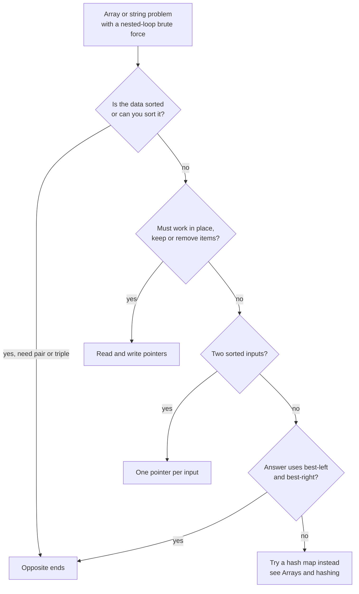
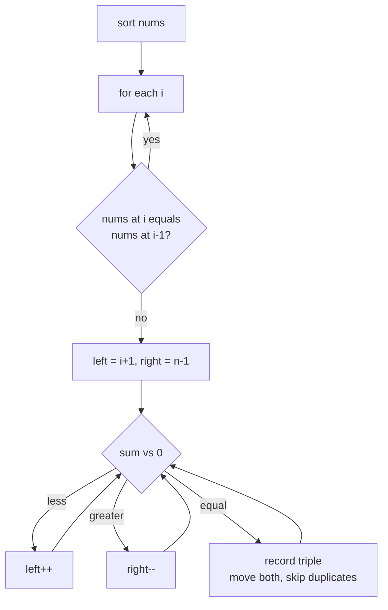
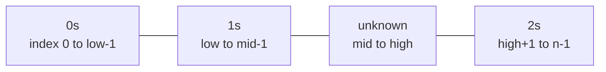
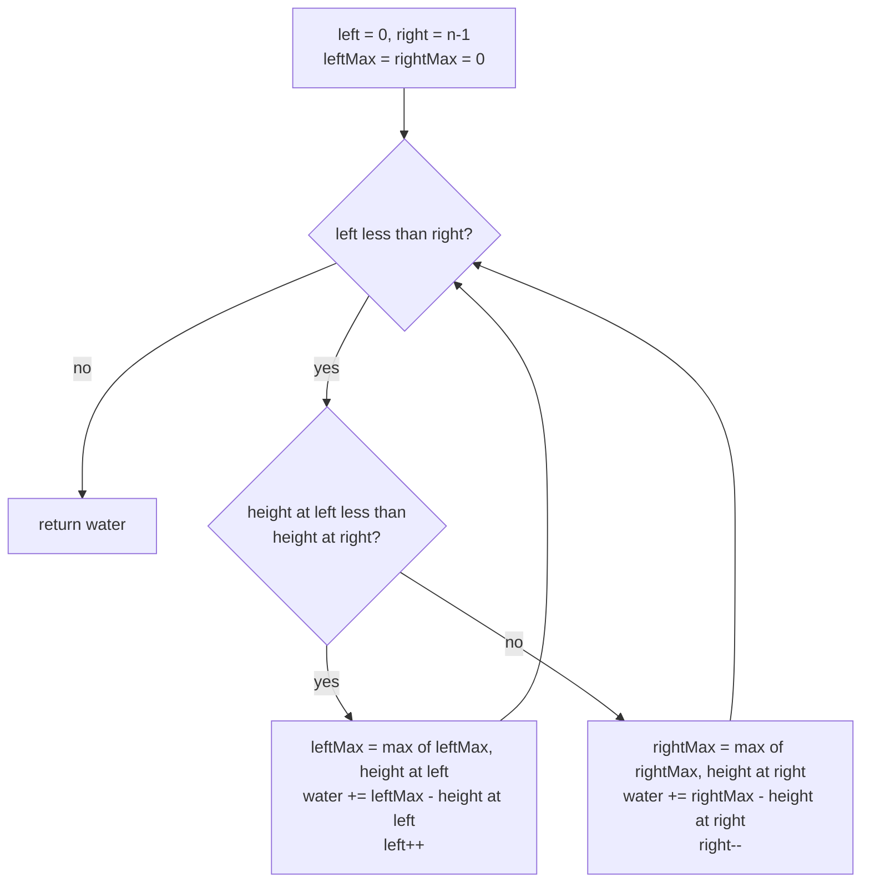

# Two Pointers

> In this document you will learn the two-pointer pattern: two index variables that walk through an array or string in a planned way, so one pass replaces a nested loop. You will solve 12 classic problems, from "valid palindrome" to "trapping rain water", and learn how to prove that skipping elements is safe.

**Before this:** [Arrays and hashing](01-arrays-and-hashing.md) · [Problem solving and complexity](../11-coding-interviews/02-problem-solving-and-complexity.md) · **Interview questions:** [jump to the interview section](#interview-questions)

## Table of contents

1. [The pattern](#the-pattern)
2. [Problems](#problems)
3. [Interview questions](#interview-questions)
4. [Summary](#summary)
5. [References](#references)

Problems in this document:

| # | Problem | Level | Pointer style |
| --- | --- | --- | --- |
| P1 | [Valid palindrome](#p1-valid-palindrome-easy) | Easy | Opposite ends |
| P2 | [Squares of a sorted array](#p2-squares-of-a-sorted-array-easy) | Easy | Opposite ends, fill from the back |
| P3 | [Remove duplicates from sorted array](#p3-remove-duplicates-from-sorted-array-easy) | Easy | Read and write (same direction) |
| P4 | [Move zeroes](#p4-move-zeroes-easy) | Easy | Read and write (same direction) |
| P5 | [Is subsequence](#p5-is-subsequence-easy) | Easy | One pointer per input |
| P6 | [Merge sorted array](#p6-merge-sorted-array-easy) | Easy | One pointer per input, from the back |
| P7 | [Two sum II on a sorted array](#p7-two-sum-ii-on-a-sorted-array-medium) | Medium | Opposite ends |
| P8 | [3Sum](#p8-3sum-medium) | Medium | Fix one, opposite ends on the rest |
| P9 | [Container with most water](#p9-container-with-most-water-medium) | Medium | Opposite ends, move the shorter side |
| P10 | [Sort colors](#p10-sort-colors-medium) | Medium | Three pointers (Dutch national flag) |
| P11 | [4Sum](#p11-4sum-medium) | Medium | Fix two, opposite ends on the rest |
| P12 | [Trapping rain water](#p12-trapping-rain-water-hard) | Hard | Opposite ends with running maximums |

---

## The pattern

### What it is

A **pointer** here is just an index variable, like `left` or `i`. The **two-pointer pattern** uses two such indices that move through the data according to a rule. Every step moves at least one pointer. A pointer never moves back. So the total number of steps is at most about 2n, which is O(n).

There are three common styles:

| Style | Start | Move | Typical problems |
| --- | --- | --- | --- |
| **Opposite ends** | `left = 0`, `right = n - 1` | Toward each other | Sorted pair sum, palindrome, container with most water |
| **Same direction (read/write, or fast/slow)** | Both at the start | `read` always moves, `write` moves only when you keep an element | Remove duplicates, move zeroes, partition |
| **One pointer per input** | One at the start of each array | Move the pointer whose value is "behind" | Merge two sorted arrays, is subsequence, intersection |

A first look at the pattern, with the sorted pair-sum walkthrough, is in [Pattern 2: Two pointers](../11-coding-interviews/02-problem-solving-and-complexity.md#pattern-2-two-pointers). This document goes deeper.

### Why it exists

The brute force for "find a pair" checks every pair: O(n²). Two pointers can skip most pairs **safely**, because the data has an order. When the data is sorted, one comparison tells you that a whole group of pairs cannot be the answer.

Example: in a sorted array, if `nums[left] + nums[right]` is too small, then `nums[left]` plus **any** element left of `right` is also too small. So `nums[left]` is useless and you can drop it with `left++`. One comparison removes n − 1 pairs at once.

### Analogy

**Opposite ends:** two people search a sorted bookshelf for two books whose page counts add up to 500. One starts at the thin end, one at the thick end. If the total is too small, the person at the thin end steps toward thicker books. If too big, the other one steps toward thinner books.

**Read and write:** a person sorts mail. The reader looks at every letter. The writer only puts a letter on the "keep" pile when it is good. The keep pile grows slower than the reader moves.

### When to recognize it

| Signal | Likely style |
| --- | --- |
| The input is **sorted** (or you may sort it) and you need a pair, triple or closest sum | Opposite ends |
| "Palindrome", "reverse", "compare from both sides" | Opposite ends |
| "In place", "O(1) extra space", "remove", "move to the end", "keep the relative order" | Read/write |
| Two sorted arrays or strings to merge or compare | One pointer per input |
| An answer depends on "the best on the left" and "the best on the right" | Opposite ends with running values |
| A linked list: middle, cycle, k-th from the end | Fast/slow — see [Linked lists](07-linked-lists.md) |

### Templates

**Opposite ends:**

```js
function oppositeEndsTemplate(sorted, target) {
  let left = 0;
  let right = sorted.length - 1;
  while (left < right) {
    const sum = sorted[left] + sorted[right];
    if (sum === target) return [left, right];
    if (sum < target) left++; // need a bigger value: drop the small one
    else right--;             // need a smaller value: drop the big one
  }
  return null;
}

console.log(oppositeEndsTemplate([1, 3, 4, 6, 8], 10)); // [ 2, 3 ]
```

**Read/write (same direction):**

```js
function keepIfTemplate(nums, keep) {
  let write = 0; // next slot for a kept element
  for (let read = 0; read < nums.length; read++) {
    if (keep(nums[read])) {
      nums[write] = nums[read];
      write++;
    }
  }
  return write; // number of kept elements; nums[0..write-1] is the result
}

const scores = [5, -1, 7, -3, 2];
const kept = keepIfTemplate(scores, (x) => x >= 0);
console.log(kept, scores.slice(0, kept)); // 3 [ 5, 7, 2 ]
```

This is what `Array.prototype.filter` does, but in place and with O(1) extra space.

**One pointer per input:**

```js
function mergeTemplate(a, b) {
  const out = [];
  let i = 0;
  let j = 0;
  while (i < a.length && j < b.length) {
    if (a[i] <= b[j]) out.push(a[i++]);
    else out.push(b[j++]);
  }
  while (i < a.length) out.push(a[i++]);
  while (j < b.length) out.push(b[j++]);
  return out;
}

console.log(mergeTemplate([1, 4, 9], [2, 3, 10])); // [ 1, 2, 3, 4, 9, 10 ]
```

### How to choose a style



### Two pointers vs hash map

Both can solve "find a pair with sum k". Pick by constraints:

| | Two pointers | Hash map |
| --- | --- | --- |
| Needs sorted input | Yes (or sort first, O(n log n)) | No |
| Extra space | O(1) | O(n) |
| Keeps original indices | Not after sorting | Yes |
| Easy to skip duplicates | Yes, neighbours are equal | Harder |

### Complexity

Each pointer moves at most n times in one direction, so a two-pointer pass is O(n). If you sort first, the total is O(n log n). Problems like 3Sum run a two-pointer pass inside a loop: O(n²). 4Sum: O(n³).

### Common mistakes

- **Using `left <= right` when the two pointers must be different elements.** For pairs, use `left < right`. For palindrome checks either works, because the middle character always matches itself.
- **Forgetting to skip duplicates** in 3Sum and 4Sum, which gives repeated triples.
- **Sorting numbers without a comparator.** `[-1, -4, 2].sort()` gives `[-1, -4, 2]` (string order). Use `(a, b) => a - b`.
- **Moving the wrong pointer.** Always be able to say *why* the element you drop cannot be part of the answer.
- **Using `splice` to remove elements inside a loop.** Each `splice` is O(n), so the loop becomes O(n²). Use read/write pointers.
- **Sorting when the problem asks for original indices.** Sorting loses them. Sort an array of indices instead, or use a hash map.

---

## Problems

Each problem follows the same order: problem, examples, how to recognize the pattern, brute force, optimal approach, code, dry run, complexity, edge cases, follow-ups, and how to say it in the interview.

### P1. Valid palindrome (Easy)

**Problem:** A phrase is a palindrome if it reads the same forwards and backwards after you lowercase it and remove everything that is not a letter or digit. Return `true` if the string is a palindrome.

Similar to: LeetCode 125 Valid Palindrome. The basic version is in [Pattern 2](../11-coding-interviews/02-problem-solving-and-complexity.md#a-second-example-palindrome-check). Here we recap it, then solve the common follow-up: **valid palindrome II** (you may delete at most one character).

**Examples:**

```text
"A man, a plan, a canal: Panama"  -> true
"race a car"                      -> false
" "                               -> true   (nothing left after cleaning)
Palindrome II: "abca"             -> true   (delete 'b' or 'c')
Palindrome II: "abc"              -> false
```

**How to recognize the pattern:** "palindrome" means comparing the first and last characters, then moving inward: opposite ends.

**Brute force:** build a cleaned string, reverse it and compare. O(n) time but O(n) extra space. For palindrome II, try deleting each character and test each result: O(n²).

**Optimal approach:**

1. `left = 0`, `right = n - 1`.
2. Skip characters that are not letters or digits on each side.
3. Compare lowercase characters. Different → `false`. Same → move both inward.
4. For palindrome II: at the first mismatch, you have exactly two choices. Skip the left character or skip the right one. Check whether the remaining middle part is a palindrome for either choice.

**Code:**

```js
const isAlphaNum = (ch) => /^[a-z0-9]$/i.test(ch);

function isPalindrome(text) {
  let left = 0;
  let right = text.length - 1;
  while (left < right) {
    if (!isAlphaNum(text[left])) { left++; continue; }
    if (!isAlphaNum(text[right])) { right--; continue; }
    if (text[left].toLowerCase() !== text[right].toLowerCase()) return false;
    left++;
    right--;
  }
  return true;
}

console.log(isPalindrome('A man, a plan, a canal: Panama')); // true
console.log(isPalindrome('race a car'));                     // false
console.log(isPalindrome(' '));                              // true

// Palindrome II: delete at most one character (plain lowercase input).
function validPalindromeII(s) {
  const isRange = (i, j) => {
    while (i < j) {
      if (s[i] !== s[j]) return false;
      i++;
      j--;
    }
    return true;
  };

  let left = 0;
  let right = s.length - 1;
  while (left < right) {
    if (s[left] !== s[right]) {
      // One deletion allowed: skip left OR skip right.
      return isRange(left + 1, right) || isRange(left, right - 1);
    }
    left++;
    right--;
  }
  return true;
}

console.log(validPalindromeII('abca'));  // true
console.log(validPalindromeII('abc'));   // false
console.log(validPalindromeII('deeee')); // true
```

**Dry run** of `validPalindromeII("abca")`:

| left | right | s[left] | s[right] | action |
| --- | --- | --- | --- | --- |
| 0 | 3 | a | a | match, move in |
| 1 | 2 | b | c | mismatch → try `isRange(2, 2)` ("c") → true |

Answer: `true` (delete `b`).

**Complexity:** O(n) time for both. In palindrome II, the main loop plus at most two `isRange` checks each touch every character at most once more. O(1) extra space.

**Edge cases:** empty string or only punctuation (true), one character (true), mixed case (`"Aa"` is true), digits (`"0P"` is false — `0` and `p` differ).

**Follow-ups:**

- **Why is checking only the first mismatch enough in palindrome II?** All pairs outside the mismatch already matched. Any deletion must remove `s[left]` or `s[right]`, otherwise this pair stays mismatched. So there are only two candidates.
- **What about Unicode letters like `é`?** Use a Unicode-aware test: `/^[\p{L}\p{N}]$/u.test(ch)`. Also walk by code points (`[...text]`) so emoji are not split.
- **Delete at most k characters?** That is no longer a simple two-pointer problem. It becomes dynamic programming on the longest palindromic subsequence. See [Dynamic programming](12-dynamic-programming.md).

**How to say it in the interview:**
> "I put one pointer at each end. I skip anything that is not a letter or digit, then compare the two characters in lowercase. If they differ, it is not a palindrome; otherwise I move both pointers inward. For the version where I may delete one character, at the first mismatch the deleted character must be one of the two, so I check whether the middle part is a palindrome after skipping the left one or the right one. Both versions are O(n) time and O(1) space."

---

### P2. Squares of a sorted array (Easy)

**Problem:** You get an array sorted in non-decreasing order. It can contain negative numbers. Return a new array of the squares of each number, also sorted.

Similar to: LeetCode 977 Squares of a Sorted Array.

**Examples:**

```text
[-4, -1, 0, 3, 10]  -> [0, 1, 9, 16, 100]
[-7, -3, 2, 3, 11]  -> [4, 9, 9, 49, 121]
[-3, -2, -1]        -> [1, 4, 9]
```

**How to recognize the pattern:** the input is sorted, but negatives make the squares "big at both ends, small in the middle". The **largest** square is always at one of the two ends. That means opposite-end pointers.

**Brute force:** square everything, then sort. `nums.map((x) => x * x).sort((a, b) => a - b)`. O(n log n).

**Optimal approach:**

1. `left = 0`, `right = n - 1`, and a result array of length n.
2. Fill the result from the **back** (index `n - 1` down to `0`).
3. Compare `|nums[left]|` and `|nums[right]|`. Put the square of the bigger one at the current back slot and move that pointer inward.

**Code:**

```js
function sortedSquares(nums) {
  const n = nums.length;
  const result = new Array(n);
  let left = 0;
  let right = n - 1;
  for (let pos = n - 1; pos >= 0; pos--) {
    if (Math.abs(nums[left]) > Math.abs(nums[right])) {
      result[pos] = nums[left] * nums[left];
      left++;
    } else {
      result[pos] = nums[right] * nums[right];
      right--;
    }
  }
  return result;
}

console.log(sortedSquares([-4, -1, 0, 3, 10])); // [ 0, 1, 9, 16, 100 ]
console.log(sortedSquares([-7, -3, 2, 3, 11])); // [ 4, 9, 9, 49, 121 ]
console.log(sortedSquares([-3, -2, -1]));       // [ 1, 4, 9 ]
console.log(sortedSquares([]));                 // []
```

**Dry run** for `[-4, -1, 0, 3, 10]`:

| pos | left (value) | right (value) | bigger | result[pos] |
| --- | --- | --- | --- | --- |
| 4 | 0 (−4) | 4 (10) | 10 | 100 |
| 3 | 0 (−4) | 3 (3) | −4 | 16 |
| 2 | 1 (−1) | 3 (3) | 3 | 9 |
| 1 | 1 (−1) | 2 (0) | −1 | 1 |
| 0 | 2 (0) | 2 (0) | 0 | 0 |

**Complexity:** O(n) time, O(n) space for the output (O(1) extra).

**Edge cases:** all negative (the result is the reverse order of squares), all positive (same order), zeros, an empty array, one element.

**Follow-ups:**

- **Why fill from the back?** We always know the largest remaining square (it is at an end). We do not know the smallest without searching for the place where signs change.
- **Can you fill from the front?** Yes: binary search for the first non-negative number, then merge outward with two pointers moving away from each other. Same O(n), more code.
- **Any monotonic function, not only squares?** If the function is "V-shaped" (decreasing then increasing), the same idea works.

**How to say it in the interview:**
> "Sorting the squares works in O(n log n). But because the input is sorted, the largest square is always at one of the two ends: a big negative on the left or a big positive on the right. So I keep a pointer at each end and fill the result from the back. Each step I compare the absolute values, write the bigger square, and move that pointer inward. One pass, O(n) time."

---

### P3. Remove duplicates from sorted array (Easy)

**Problem:** You get a sorted array. Remove the duplicates **in place**, so each value appears once, in the same order. Return the new length `k`. The first `k` slots must hold the unique values. What is after `k` does not matter.

Similar to: LeetCode 26 Remove Duplicates from Sorted Array.

**Examples:**

```text
[1, 1, 2]                       -> k = 2, first slots [1, 2]
[0, 0, 1, 1, 1, 2, 2, 3, 3, 4]  -> k = 5, first slots [0, 1, 2, 3, 4]
[]                              -> k = 0
```

**How to recognize the pattern:** "in place" + "keep some elements in order" = read/write pointers. "Sorted" means duplicates are neighbours, so you only compare with the last kept value.

**Brute force:** `splice` out each duplicate. Each `splice` shifts the rest of the array, which is O(n), so the total is O(n²). Or build a new array with a Set, which breaks the "in place" rule.

**Optimal approach:**

1. `write = 1` (the first element is always kept).
2. For `read` from 1 to n − 1: if `nums[read] !== nums[write - 1]` (different from the last kept value), copy it to `nums[write]` and `write++`.
3. Return `write`.

**Code:**

```js
function removeDuplicates(nums) {
  if (nums.length === 0) return 0;
  let write = 1;
  for (let read = 1; read < nums.length; read++) {
    if (nums[read] !== nums[write - 1]) {
      nums[write] = nums[read];
      write++;
    }
  }
  return write;
}

const a = [0, 0, 1, 1, 1, 2, 2, 3, 3, 4];
const k = removeDuplicates(a);
console.log(k, a.slice(0, k)); // 5 [ 0, 1, 2, 3, 4 ]
console.log(removeDuplicates([1, 1, 2])); // 2
console.log(removeDuplicates([]));        // 0

// Variation: allow each value at most twice (LeetCode 80).
function removeDuplicatesKeepTwo(nums) {
  let write = 0;
  for (const x of nums) {
    // Keep x unless the two last kept values are both x.
    if (write < 2 || x !== nums[write - 2]) {
      nums[write] = x;
      write++;
    }
  }
  return write;
}

const b = [1, 1, 1, 2, 2, 3];
const k2 = removeDuplicatesKeepTwo(b);
console.log(k2, b.slice(0, k2)); // 5 [ 1, 1, 2, 2, 3 ]
```

**Dry run** of `removeDuplicates([1, 1, 2])`:

| read | nums[read] | last kept nums[write−1] | action | write after | array |
| --- | --- | --- | --- | --- | --- |
| 1 | 1 | 1 | skip | 1 | [1, 1, 2] |
| 2 | 2 | 1 | copy to index 1 | 2 | [1, 2, 2] |

Return 2. The first 2 slots are `[1, 2]`.

**Complexity:** O(n) time, O(1) extra space.

**Edge cases:** empty array, one element, all the same value (k = 1), no duplicates (every element is copied onto itself — harmless).

**Follow-ups:**

- **Keep at most m copies?** Generalize the variation: keep `x` if `write < m || x !== nums[write - m]`.
- **The array is not sorted?** Duplicates are not neighbours anymore. Use a Set of seen values with the same read/write loop: O(n) time, O(n) space.
- **In real code?** You would write `[...new Set(sorted)]`. The interview version shows you can do it without extra memory.

**How to say it in the interview:**
> "Because the array is sorted, duplicates sit next to each other. I use a read pointer that visits every element and a write pointer that marks where the next unique value goes. If the current value differs from the last value I kept, I copy it to the write position and move write forward. At the end, write is the new length. One pass, O(1) extra space, and no splice, which would make it quadratic."

---

### P4. Move zeroes (Easy)

**Problem:** Move all zeros in an array to the end, **in place**, while keeping the order of the non-zero elements.

Similar to: LeetCode 283 Move Zeroes.

**Examples:**

```text
[0, 1, 0, 3, 12]  -> [1, 3, 12, 0, 0]
[0]               -> [0]
[1, 2, 3]         -> [1, 2, 3]
```

**How to recognize the pattern:** in place + keep relative order + "move some items to the end" = read/write pointers.

**Brute force:** make a new array with the non-zeros, then add the zeros. O(n) time but O(n) space, and not in place. Or bubble each zero to the end: O(n²).

**Optimal approach:**

1. `write = 0`.
2. For each `read`: if `nums[read] !== 0`, **swap** `nums[read]` and `nums[write]`, then `write++`.
3. Swapping (instead of copying) leaves the zeros behind automatically.

**Code:**

```js
function moveZeroes(nums) {
  let write = 0;
  for (let read = 0; read < nums.length; read++) {
    if (nums[read] !== 0) {
      [nums[write], nums[read]] = [nums[read], nums[write]];
      write++;
    }
  }
  return nums; // returned only to make the examples easy to print
}

console.log(moveZeroes([0, 1, 0, 3, 12])); // [ 1, 3, 12, 0, 0 ]
console.log(moveZeroes([0]));              // [ 0 ]
console.log(moveZeroes([1, 2, 3]));        // [ 1, 2, 3 ]
console.log(moveZeroes([0, 0, 1]));        // [ 1, 0, 0 ]
```

**Dry run** for `[0, 1, 0, 3, 12]`:

| read | nums[read] | write before | action | array after |
| --- | --- | --- | --- | --- |
| 0 | 0 | 0 | skip | [0, 1, 0, 3, 12] |
| 1 | 1 | 0 | swap 0 and 1 | [1, 0, 0, 3, 12] |
| 2 | 0 | 1 | skip | [1, 0, 0, 3, 12] |
| 3 | 3 | 1 | swap 1 and 3 | [1, 3, 0, 0, 12] |
| 4 | 12 | 2 | swap 2 and 4 | [1, 3, 12, 0, 0] |

**Complexity:** O(n) time, O(1) space.

**Edge cases:** all zeros, no zeros (each element swaps with itself), zeros only at the end (no real moves), one element.

**Follow-ups:**

- **Minimize the number of writes?** Copy non-zeros forward first (no swap), then fill the rest with zeros. Or swap only when `read !== write`.
- **Move zeros to the front instead?** Walk from the end with the write pointer at the end.
- **Is this the same as partition in quicksort?** Yes, it is a stable partition around "is zero". Quicksort's partition is similar but does not keep order.

**How to say it in the interview:**
> "I keep a write pointer for the next position of a non-zero value. A read pointer walks through the array. Each time it finds a non-zero, I swap it with the write position and move write forward. All non-zeros end up at the front in their original order, and the zeros are pushed to the back by the swaps. O(n) time and O(1) space."

---

### P5. Is subsequence (Easy)

**Problem:** You get two strings `s` and `t`. Return `true` if `s` is a **subsequence** of `t`. A subsequence keeps the order of characters but may skip some. `"ace"` is a subsequence of `"abcde"`. `"aec"` is not.

Similar to: LeetCode 392 Is Subsequence.

**Examples:**

```text
s = "abc", t = "ahbgdc"  -> true
s = "axc", t = "ahbgdc"  -> false
s = "",    t = "abc"     -> true
s = "a",   t = ""        -> false
```

**How to recognize the pattern:** two sequences, and you match one against the other in order. That is one pointer per input.

**Brute force:** generate all subsequences of `t` and check if `s` is one of them. That is O(2^m) for length m. Nobody does this, but it shows why a greedy scan is the real answer.

**Optimal approach:**

1. `i` points into `s`, `j` points into `t`.
2. Move `j` through `t` every step. When `t[j] === s[i]`, also move `i`.
3. If `i` reaches the end of `s`, every character was matched in order.

Matching as early as possible is always safe. If `s[i]` matches the current `t[j]`, using this match leaves the most characters of `t` for the rest of `s`.

**Code:**

```js
function isSubsequence(s, t) {
  let i = 0;
  for (let j = 0; j < t.length && i < s.length; j++) {
    if (s[i] === t[j]) i++;
  }
  return i === s.length;
}

console.log(isSubsequence('abc', 'ahbgdc')); // true
console.log(isSubsequence('axc', 'ahbgdc')); // false
console.log(isSubsequence('', 'abc'));       // true
console.log(isSubsequence('a', ''));         // false
```

**Dry run** for `s = "abc"`, `t = "ahbgdc"`:

| j | t[j] | s[i] | match? | i after |
| --- | --- | --- | --- | --- |
| 0 | a | a | yes | 1 |
| 1 | h | b | no | 1 |
| 2 | b | b | yes | 2 |
| 3 | g | c | no | 2 |
| 4 | d | c | no | 2 |
| 5 | c | c | yes | 3 |

`i === 3 === s.length`, so `true`.

**Complexity:** O(m) time where m is the length of `t`. O(1) space.

**Edge cases:** empty `s` (always true), empty `t` with non-empty `s` (false), `s` longer than `t` (false), repeated characters (`"aa"` in `"ab"` is false).

**Follow-ups:**

- **Many strings `s1, s2, …, s_k` against the same long `t`?** Pre-process `t` once: for each character, store the sorted list of its positions. For each `s`, find the next position greater than the current one with binary search. That is O(|s| log m) per query. See [Binary search](06-binary-search.md).
- **Count how many times `s` appears as a subsequence (LeetCode 115)?** That needs dynamic programming, see [Dynamic programming](12-dynamic-programming.md).

**How to say it in the interview:**
> "I use one pointer in each string. The pointer in t moves every step. The pointer in s moves only when the two characters match. Taking the earliest possible match is always safe, because it leaves the most of t for the remaining characters. If the s pointer reaches the end, s is a subsequence. O(length of t) time and O(1) space."

---

### P6. Merge sorted array (Easy)

**Problem:** You get two sorted arrays. `nums1` has length `m + n`: the first `m` slots hold real values, and the last `n` slots are zeros (empty space). `nums2` has `n` values. Merge `nums2` into `nums1` **in place** so `nums1` becomes one sorted array.

Similar to: LeetCode 88 Merge Sorted Array.

**Examples:**

```text
nums1 = [1, 2, 3, 0, 0, 0], m = 3, nums2 = [2, 5, 6], n = 3  -> [1, 2, 2, 3, 5, 6]
nums1 = [1], m = 1, nums2 = [], n = 0                      -> [1]
nums1 = [0], m = 0, nums2 = [1], n = 1                     -> [1]
```

**How to recognize the pattern:** two sorted inputs → one pointer each. The twist: the free space is at the **end** of `nums1`, so fill from the back.

**Brute force:** copy `nums2` into the free slots and sort: O((m + n) log(m + n)). Or merge from the front into a new array and copy back: O(m + n) time, O(m + n) space.

**Optimal approach:**

1. `i = m - 1` (last real value in `nums1`), `j = n - 1` (last in `nums2`), `write = m + n - 1`.
2. While `j >= 0`: put the bigger of `nums1[i]` and `nums2[j]` at `write`. Move that pointer and `write` back.
3. When `j` is done, the rest of `nums1` is already in the right place.

Why from the back? If you fill from the front, you overwrite values of `nums1` that you have not read yet. From the back, the write slot is always free or already read.

**Code:**

```js
function merge(nums1, m, nums2, n) {
  let i = m - 1;
  let j = n - 1;
  let write = m + n - 1;
  while (j >= 0) {
    if (i >= 0 && nums1[i] > nums2[j]) {
      nums1[write--] = nums1[i--];
    } else {
      nums1[write--] = nums2[j--];
    }
  }
  return nums1;
}

console.log(merge([1, 2, 3, 0, 0, 0], 3, [2, 5, 6], 3)); // [ 1, 2, 2, 3, 5, 6 ]
console.log(merge([1], 1, [], 0));                       // [ 1 ]
console.log(merge([0], 0, [1], 1));                      // [ 1 ]
console.log(merge([4, 5, 6, 0, 0, 0], 3, [1, 2, 3], 3)); // [ 1, 2, 3, 4, 5, 6 ]
```

**Dry run** for `nums1 = [1, 2, 3, 0, 0, 0]`, `nums2 = [2, 5, 6]`:

| write | nums1[i] | nums2[j] | bigger | nums1 after |
| --- | --- | --- | --- | --- |
| 5 | 3 | 6 | 6 | [1, 2, 3, 0, 0, 6] |
| 4 | 3 | 5 | 5 | [1, 2, 3, 0, 5, 6] |
| 3 | 3 | 2 | 3 | [1, 2, 3, 3, 5, 6] |
| 2 | 2 | 2 | 2 (from nums2, ties go to nums2) | [1, 2, 2, 3, 5, 6] |

Now `j = -1`. Stop. The `1` at index 0 is already in place.

**Complexity:** O(m + n) time, O(1) extra space.

**Edge cases:** `n = 0` (nothing to do), `m = 0` (copy all of `nums2`), all of `nums2` smaller than `nums1` (the loop moves all of `nums1` back), equal values.

**Follow-ups:**

- **Why is the loop condition only `j >= 0`?** When `nums2` is used up, the remaining `nums1` values are already at the front in sorted order.
- **Merge k sorted arrays?** Use a min-heap of the current head of each array: O(N log k). See [Heaps and top-k](09-heaps-and-top-k.md).
- **Where is this used?** The merge step of merge sort, and merging two sorted result lists from two database shards.

**How to say it in the interview:**
> "Both arrays are sorted and the free space is at the end of nums1, so I merge from the back. I keep a pointer at the last real value of each array and a write pointer at the very end. Each step I write the bigger value and move that pointer back. Filling from the back means I never overwrite a value I still need. When nums2 is finished, the rest of nums1 is already in place. O(m plus n) time, O(1) extra space."

---

### P7. Two sum II on a sorted array (Medium)

**Problem:** You get a sorted array and a target. Return the **1-based** indices of the two numbers that add up to the target. Exactly one answer exists. Use O(1) extra space.

Similar to: LeetCode 167 Two Sum II. The basic solution and a full walkthrough are in [Worked problem: pair with target sum in a sorted array](../11-coding-interviews/02-problem-solving-and-complexity.md#worked-problem-pair-with-target-sum-in-a-sorted-array). Here we focus on **why it is correct** and on two variations: the closest pair and counting pairs below a target.

**Examples:**

```text
numbers = [2, 7, 11, 15], target = 9   -> [1, 2]
numbers = [2, 3, 4],      target = 6   -> [1, 3]
numbers = [-1, 0],        target = -1  -> [1, 2]
```

**How to recognize the pattern:** sorted + pair + O(1) space = opposite ends.

**Brute force:** all pairs, O(n²). A hash map gives O(n) time but O(n) space, which breaks the rule.

**Optimal approach:** `left = 0`, `right = n - 1`. If the sum is too small, `left++`. If too big, `right--`. If equal, return.

**Why it never misses the answer:** suppose the answer is `(a, b)` with `a < b`. The pointers start outside or on it: `left <= a` and `right >= b`. Can a pointer jump past its answer index? `left` moves past `a` only if `nums[a] + nums[right] < target`. But `right >= b` means `nums[right] >= nums[b]`, so `nums[a] + nums[right] >= target`. So `left` never moves past `a`. The same argument works for `right`. So both pointers reach the answer.

**Code:**

```js
function twoSumSorted(numbers, target) {
  let left = 0;
  let right = numbers.length - 1;
  while (left < right) {
    const sum = numbers[left] + numbers[right];
    if (sum === target) return [left + 1, right + 1]; // 1-based
    if (sum < target) left++;
    else right--;
  }
  return null;
}

console.log(twoSumSorted([2, 7, 11, 15], 9)); // [ 1, 2 ]
console.log(twoSumSorted([2, 3, 4], 6));      // [ 1, 3 ]
console.log(twoSumSorted([-1, 0], -1));       // [ 1, 2 ]

// Variation 1: the pair whose sum is closest to target.
function closestPairSum(sorted, target) {
  let left = 0;
  let right = sorted.length - 1;
  let best = Infinity;
  while (left < right) {
    const sum = sorted[left] + sorted[right];
    if (Math.abs(sum - target) < Math.abs(best - target)) best = sum;
    if (sum === target) return sum;
    if (sum < target) left++;
    else right--;
  }
  return best;
}

console.log(closestPairSum([1, 4, 6, 9, 13], 12)); // 13

// Variation 2: count pairs i < j with sum < target.
function countPairsBelow(sorted, target) {
  let left = 0;
  let right = sorted.length - 1;
  let count = 0;
  while (left < right) {
    if (sorted[left] + sorted[right] < target) {
      count += right - left; // left pairs with every index in (left, right]
      left++;
    } else {
      right--;
    }
  }
  return count;
}

console.log(countPairsBelow([-1, 1, 2, 3, 5], 4)); // 4
```

In variation 2, when `sorted[left] + sorted[right] < target`, **every** element between `left + 1` and `right` also forms a small enough sum with `sorted[left]`, because they are all ≤ `sorted[right]`. So we add `right - left` pairs at once.

**Dry run** of `countPairsBelow([-1, 1, 2, 3, 5], 4)`:

| left | right | sum | action | count |
| --- | --- | --- | --- | --- |
| 0 | 4 | −1 + 5 = 4 | not < 4 → right-- | 0 |
| 0 | 3 | −1 + 3 = 2 | < 4 → add 3, left++ | 3 |
| 1 | 3 | 1 + 3 = 4 | not < 4 → right-- | 3 |
| 1 | 2 | 1 + 2 = 3 | < 4 → add 1, left++ | 4 |

Now `left = right = 2`, so the loop stops. Answer: **4**. Check by hand: (−1, 1) = 0, (−1, 2) = 1, (−1, 3) = 2 and (1, 2) = 3 are below 4. Every other pair is 4 or more. Counting a small case by hand like this is a good habit in the interview.

**Complexity:** O(n) time, O(1) space for all three.

**Edge cases:** negative numbers, duplicates (`[3, 3]` target 6 → `[1, 2]`), the answer at the two ends, only two elements.

**Follow-ups:**

- **What if the array is not sorted?** Sorting costs O(n log n) and loses the original indices. A hash map is better: O(n) time, O(n) space. See [Arrays and hashing](01-arrays-and-hashing.md#p3-two-sum-easy).
- **What if the array is huge and you only need a yes/no answer?** Two pointers still work in O(n) with O(1) memory, even if the data is read from disk in order from both ends.
- **Pairs with difference k instead of sum?** Use two pointers moving in the **same** direction: if `nums[j] - nums[i] < k`, move `j`; if bigger, move `i`.

**How to say it in the interview:**
> "Because the array is sorted, I start with the smallest and largest values. If the sum is too small, the smallest value cannot be in the answer, because even the largest partner is not enough, so I move left. If it is too big, the largest value is useless, so I move right. Each step removes one candidate, so it is O(n) with O(1) space. The same skeleton gives the closest pair, and for counting pairs below a target, I add right minus left pairs at once."

---

### P8. 3Sum (Medium)

**Problem:** You get an array of integers. Return all **unique** triples `[a, b, c]` (values, not indices) from different positions where `a + b + c === 0`. Each triple must appear once.

Similar to: LeetCode 15 3Sum.

**Examples:**

```text
[-1, 0, 1, 2, -1, -4]  -> [[-1, -1, 2], [-1, 0, 1]]
[0, 1, 1]              -> []
[0, 0, 0, 0]           -> [[0, 0, 0]]
```

**How to recognize the pattern:** "find k numbers with a sum" + "unique results" → sort, fix one number, then two pointers for the rest. Sorting also makes duplicates neighbours, which makes skipping them easy.

**Brute force:** three loops, O(n³), plus a Set of sorted triple keys to remove duplicates. A hash map per fixed number gives O(n²) time but makes deduplication awkward.

**Optimal approach:**

1. Sort the array numerically.
2. For each index `i`: skip it if `nums[i]` equals `nums[i - 1]` (same first value as before).
3. If `nums[i] > 0`, stop. All later values are positive too, so no sum can be 0.
4. Run opposite-end pointers on `i + 1 … n − 1` looking for `-nums[i]`.
5. When you find a triple, record it, then move **both** pointers and skip equal neighbours.



**Code:**

```js
function threeSum(input) {
  const nums = [...input].sort((a, b) => a - b); // copy, then numeric sort
  const result = [];

  for (let i = 0; i < nums.length - 2; i++) {
    if (nums[i] > 0) break;                        // smallest is positive: done
    if (i > 0 && nums[i] === nums[i - 1]) continue; // same first value: skip

    let left = i + 1;
    let right = nums.length - 1;
    while (left < right) {
      const sum = nums[i] + nums[left] + nums[right];
      if (sum < 0) {
        left++;
      } else if (sum > 0) {
        right--;
      } else {
        result.push([nums[i], nums[left], nums[right]]);
        left++;
        right--;
        while (left < right && nums[left] === nums[left - 1]) left++;   // skip same second value
        while (left < right && nums[right] === nums[right + 1]) right--; // skip same third value
      }
    }
  }
  return result;
}

console.log(threeSum([-1, 0, 1, 2, -1, -4])); // [ [ -1, -1, 2 ], [ -1, 0, 1 ] ]
console.log(threeSum([0, 1, 1]));             // []
console.log(threeSum([0, 0, 0, 0]));          // [ [ 0, 0, 0 ] ]
console.log(threeSum([-2, 0, 0, 2, 2]));      // [ [ -2, 0, 2 ] ]
```

**Dry run** for `[-1, 0, 1, 2, -1, -4]`, sorted to `[-4, -1, -1, 0, 1, 2]`:

| i (value) | left, right (values) | sum | action |
| --- | --- | --- | --- |
| 0 (−4) | 1 (−1), 5 (2) | −3 | left++ |
| 0 (−4) | 2 (−1), 5 (2) | −3 | left++ |
| 0 (−4) | 3 (0), 5 (2) | −2 | left++ |
| 0 (−4) | 4 (1), 5 (2) | −1 | left++ → left = right, stop |
| 1 (−1) | 2 (−1), 5 (2) | 0 | record [−1, −1, 2], move both |
| 1 (−1) | 3 (0), 4 (1) | 0 | record [−1, 0, 1], move both → stop |
| 2 (−1) | — | — | same as nums[1], skip |
| 3 (0) | 4 (1), 5 (2) | 3 | right-- → stop |

**Complexity:** O(n²) time: the sort is O(n log n), and for each `i` the two-pointer pass is O(n). O(1) extra space apart from the sort and the output (we copy the input to avoid changing it, which is O(n)).

**Edge cases:** fewer than 3 elements (`[]`), all zeros (one triple), no answer, many duplicates (each triple once), the input must not be changed (we copy it).

**Follow-ups:**

- **3Sum closest (LeetCode 16)?** Same loops. Track the sum with the smallest `Math.abs(sum - target)`. No duplicate skipping needed.
- **Count triples with sum smaller than target (LeetCode 259)?** Same as `countPairsBelow` from P7 inside the `i` loop.
- **Can you do better than O(n²)?** For general integers, no known algorithm is much faster. O(n²) is the expected answer.
- **Why skip duplicates after a match and not before?** Skipping before would also skip valid triples like `[-1, -1, 2]`, where the second value equals the first.

**How to say it in the interview:**
> "I sort the array first, which lets me use two pointers and also puts duplicates next to each other. Then I fix the first number at index i and look for a pair in the rest that sums to minus nums[i], with left and right pointers. If the sum is too small I move left, too big I move right. When I find a triple, I record it and move both pointers past equal values. I also skip i when it has the same value as the previous i. That gives every unique triple once, in O(n squared) time."

---

### P9. Container with most water (Medium)

**Problem:** You get an array `height`. Each value is a vertical line at that index. Choose two lines. Together with the x-axis they form a container. The water it holds is `min(height[i], height[j]) * (j - i)`. Return the largest amount of water.

Similar to: LeetCode 11 Container With Most Water.

**Examples:**

```text
[1, 8, 6, 2, 5, 4, 8, 3, 7]  -> 49   (lines at 1 and 8: min(8, 7) * 7)
[1, 1]                       -> 1
[4, 3, 2, 1, 4]              -> 16
```

**How to recognize the pattern:** "choose two positions", the value depends on the distance between them and the smaller of the two. Start with the widest pair and shrink. That is opposite ends.

**Brute force:** try every pair. O(n²).

**Optimal approach:**

1. `left = 0`, `right = n - 1`. Compute the area and keep the best.
2. Move the pointer at the **shorter** line inward.
3. Repeat until the pointers meet.

**Why move the shorter line?** The area is limited by the shorter line. If you move the taller line inward, the width gets smaller and the height can only stay the same or get smaller (it is still limited by the short line). So every container that uses the short line with a closer partner is **worse** than the current one. You can drop the short line safely.

**Code:**

```js
function maxArea(height) {
  let left = 0;
  let right = height.length - 1;
  let best = 0;
  while (left < right) {
    const area = Math.min(height[left], height[right]) * (right - left);
    best = Math.max(best, area);
    if (height[left] < height[right]) left++;
    else right--;
  }
  return best;
}

console.log(maxArea([1, 8, 6, 2, 5, 4, 8, 3, 7])); // 49
console.log(maxArea([1, 1]));                      // 1
console.log(maxArea([4, 3, 2, 1, 4]));             // 16
console.log(maxArea([5]));                         // 0
```

**Dry run** for `[1, 8, 6, 2, 5, 4, 8, 3, 7]` (first steps):

| left (h) | right (h) | width | area | best | move |
| --- | --- | --- | --- | --- | --- |
| 0 (1) | 8 (7) | 8 | 8 | 8 | left (1 is shorter) |
| 1 (8) | 8 (7) | 7 | 49 | 49 | right (7 is shorter) |
| 1 (8) | 7 (3) | 6 | 18 | 49 | right |
| 1 (8) | 6 (8) | 5 | 40 | 49 | right (equal, either is fine) |
| 1 (8) | 5 (4) | 4 | 16 | 49 | right |
| … | … | … | smaller | 49 | … |

**Complexity:** O(n) time, O(1) space.

**Edge cases:** fewer than 2 lines (0), all equal heights (the widest pair wins), zeros in the array, strictly increasing heights.

**Follow-ups:**

- **When both lines have equal height, which one do you move?** Either. Any better container must be strictly inside both lines (it needs a taller minimum to beat the current area with less width), so moving either side cannot skip it.
- **Is this the same as trapping rain water?** No. Here you choose **two** lines and ignore the lines between them. In trapping rain water, every bar between matters. See P12.

**How to say it in the interview:**
> "I start with the widest container, one pointer at each end. The water is limited by the shorter line. If I moved the taller line inward, the width would shrink and the height could not grow past the short line, so the area could only get worse. That means the short line has already given its best container, and I can move it inward. Each step drops one line, so the whole thing is O(n) time and O(1) space."

---

### P10. Sort colors (Medium)

**Problem:** You get an array that contains only `0`, `1` and `2` (red, white, blue). Sort it **in place** in one pass, without using the library sort.

Similar to: LeetCode 75 Sort Colors. This is the **Dutch national flag** problem, named by Edsger Dijkstra after the three-colour flag.

**Examples:**

```text
[2, 0, 2, 1, 1, 0]  -> [0, 0, 1, 1, 2, 2]
[2, 0, 1]           -> [0, 1, 2]
[1]                 -> [1]
```

**How to recognize the pattern:** "only a few distinct values" + "in place" + "one pass" = partition with several pointers.

**Brute force:** counting sort. Count the 0s, 1s and 2s, then overwrite the array. O(n) time, O(1) space, but **two** passes. It is a perfectly good first answer.

**Optimal approach (three pointers):**

Keep three regions in the array:

| Region | Contains |
| --- | --- |
| `0 … low - 1` | all 0s |
| `low … mid - 1` | all 1s |
| `mid … high` | not looked at yet |
| `high + 1 … n - 1` | all 2s |

1. `low = 0`, `mid = 0`, `high = n - 1`.
2. While `mid <= high`, look at `nums[mid]`:
   - `0` → swap with `nums[low]`, then `low++` and `mid++`.
   - `1` → already in the right region, `mid++`.
   - `2` → swap with `nums[high]`, then `high--`. **Do not** move `mid`, because the value that came from `high` has not been looked at yet.



**Code:**

```js
function sortColors(nums) {
  let low = 0;
  let mid = 0;
  let high = nums.length - 1;
  while (mid <= high) {
    if (nums[mid] === 0) {
      [nums[low], nums[mid]] = [nums[mid], nums[low]];
      low++;
      mid++;
    } else if (nums[mid] === 1) {
      mid++;
    } else {
      [nums[mid], nums[high]] = [nums[high], nums[mid]];
      high--; // mid stays: the swapped-in value is unchecked
    }
  }
  return nums;
}

console.log(sortColors([2, 0, 2, 1, 1, 0])); // [ 0, 0, 1, 1, 2, 2 ]
console.log(sortColors([2, 0, 1]));          // [ 0, 1, 2 ]
console.log(sortColors([1]));                // [ 1 ]
console.log(sortColors([]));                 // []
```

**Dry run** for `[2, 0, 1]`:

| low | mid | high | nums[mid] | action | array after |
| --- | --- | --- | --- | --- | --- |
| 0 | 0 | 2 | 2 | swap mid and high, high-- | [1, 0, 2] |
| 0 | 0 | 1 | 1 | mid++ | [1, 0, 2] |
| 0 | 1 | 1 | 0 | swap low and mid, low++, mid++ | [0, 1, 2] |
| 1 | 2 | 1 | — | mid > high, stop | [0, 1, 2] |

**Complexity:** O(n) time with one pass, O(1) space. Each step either moves `mid` forward or moves `high` back, so there are at most n steps.

**Edge cases:** empty array, all one colour, already sorted, reverse sorted (`[2, 2, 1, 0]`).

**Follow-ups:**

- **Why can `mid` move forward after swapping with `low`?** The value that comes from `low` was already checked: it is a 1 (or it is the same element when `low === mid`). So it is safe.
- **More than three values?** Use counting sort (O(n + k)) or a general sort. The three-pointer idea does not extend nicely.
- **Where else is this used?** Quicksort with many duplicate keys uses a **3-way partition** (less, equal, greater) to avoid slow behaviour. It is the same algorithm.

**How to say it in the interview:**
> "The simple answer is counting sort in two passes. For one pass I use the Dutch national flag method with three pointers. Everything before low is 0, between low and mid is 1, after high is 2, and between mid and high is unknown. If nums[mid] is 0, I swap it to low and move both. If it is 1, I just move mid. If it is 2, I swap it to high and move high back, but I keep mid, because the value I swapped in is not checked yet. O(n) time, O(1) space."

---

### P11. 4Sum (Medium)

**Problem:** You get an array and a target. Return all **unique** quadruplets of values from different positions whose sum is `target`.

Similar to: LeetCode 18 4Sum. This is 3Sum with one more loop, so this section is short.

**Examples:**

```text
nums = [1, 0, -1, 0, -2, 2], target = 0  -> [[-2, -1, 1, 2], [-2, 0, 0, 2], [-1, 0, 0, 1]]
nums = [2, 2, 2, 2, 2],      target = 8  -> [[2, 2, 2, 2]]
```

**How to recognize the pattern:** k-sum with unique results → sort, fix `k - 2` numbers with loops, two pointers for the last two.

**Brute force:** four loops: O(n⁴).

**Optimal approach:** sort. Loop `i`, then loop `j > i`, skipping duplicate values at both levels. For the rest, run the 3Sum two-pointer pass looking for `target - nums[i] - nums[j]`.

**Code:**

```js
function fourSum(input, target) {
  const nums = [...input].sort((a, b) => a - b);
  const n = nums.length;
  const result = [];
  for (let i = 0; i < n - 3; i++) {
    if (i > 0 && nums[i] === nums[i - 1]) continue;
    for (let j = i + 1; j < n - 2; j++) {
      if (j > i + 1 && nums[j] === nums[j - 1]) continue;
      let left = j + 1;
      let right = n - 1;
      while (left < right) {
        const sum = nums[i] + nums[j] + nums[left] + nums[right];
        if (sum < target) left++;
        else if (sum > target) right--;
        else {
          result.push([nums[i], nums[j], nums[left], nums[right]]);
          left++;
          right--;
          while (left < right && nums[left] === nums[left - 1]) left++;
          while (left < right && nums[right] === nums[right + 1]) right--;
        }
      }
    }
  }
  return result;
}

console.log(fourSum([1, 0, -1, 0, -2, 2], 0)); // [ [ -2, -1, 1, 2 ], [ -2, 0, 0, 2 ], [ -1, 0, 0, 1 ] ]
console.log(fourSum([2, 2, 2, 2, 2], 8));      // [ [ 2, 2, 2, 2 ] ]
```

**Generic k-sum:** the same idea works for any k with recursion. Reduce k-sum to (k − 1)-sum by fixing the first value, until k = 2, where you run two pointers. Time O(n^(k−1)).

```js
function kSum(sorted, target, k, start = 0) {
  const result = [];
  if (k === 2) {
    let left = start;
    let right = sorted.length - 1;
    while (left < right) {
      const sum = sorted[left] + sorted[right];
      if (sum < target) left++;
      else if (sum > target) right--;
      else {
        result.push([sorted[left], sorted[right]]);
        left++;
        right--;
        while (left < right && sorted[left] === sorted[left - 1]) left++;
      }
    }
    return result;
  }
  for (let i = start; i < sorted.length - k + 1; i++) {
    if (i > start && sorted[i] === sorted[i - 1]) continue;
    for (const rest of kSum(sorted, target - sorted[i], k - 1, i + 1)) {
      result.push([sorted[i], ...rest]);
    }
  }
  return result;
}

console.log(kSum([-2, -1, 0, 0, 1, 2], 0, 4)); // [ [ -2, -1, 1, 2 ], [ -2, 0, 0, 2 ], [ -1, 0, 0, 1 ] ]
```

**Dry run:** the same as 3Sum, one level deeper. For `i = -2, j = -1`, the pointers look for `0 - (-2) - (-1) = 3` among `[0, 0, 1, 2]` and find `1 + 2`.

**Complexity:** O(n³) time, O(1) extra space apart from the sort and the output.

**Edge cases:** fewer than 4 elements, all equal values, large values (in JavaScript, sums stay exact while they are below 2^53, so overflow is not a problem like in Java or C++).

**Follow-ups:**

- **Count quadruplets from four separate arrays with sum 0 (LeetCode 454)?** Use a hash map of all sums `a + b` (O(n²) entries), then look up `-(c + d)`. O(n²) time and space.
- **Pruning?** If `nums[i] * 4 > target` on a sorted array (with all values used from i onward), you can stop early. This helps in practice but does not change the worst case.

**How to say it in the interview:**
> "4Sum is 3Sum with one more loop. I sort, fix the first two numbers with two loops while skipping equal values, and then find the last two with left and right pointers, skipping duplicates after each match. That is O(n cubed). The same idea generalizes: k-sum reduces to (k minus 1)-sum recursively until it becomes two pointers."

---

### P12. Trapping rain water (Hard)

**Problem:** You get an array of non-negative bar heights, each bar 1 unit wide. After rain, water collects between the bars. Return how many units of water are trapped.

Similar to: LeetCode 42 Trapping Rain Water.

**Examples:**

```text
[0, 1, 0, 2, 1, 0, 1, 3, 2, 1, 2, 1]  -> 6
[4, 2, 0, 3, 2, 5]                    -> 9
[1, 2, 3]                             -> 0
[]                                    -> 0
```

**How to recognize the pattern:** the water above bar `i` depends on the **tallest bar to its left** and the **tallest bar to its right**:

```text
water[i] = min(maxLeft[i], maxRight[i]) - height[i]
```

"Best on the left and best on the right" is a strong signal for prefix/suffix arrays, and then for opposite-end pointers.

**Brute force:** for each bar, scan left and right to find the maximums. O(n²) time.

**Better: prefix and suffix maximum arrays.** O(n) time, O(n) space.

```js
function trapWithArrays(height) {
  const n = height.length;
  const maxLeft = new Array(n);
  const maxRight = new Array(n);
  for (let i = 0; i < n; i++) maxLeft[i] = Math.max(height[i], i > 0 ? maxLeft[i - 1] : 0);
  for (let i = n - 1; i >= 0; i--) maxRight[i] = Math.max(height[i], i < n - 1 ? maxRight[i + 1] : 0);
  let water = 0;
  for (let i = 0; i < n; i++) water += Math.min(maxLeft[i], maxRight[i]) - height[i];
  return water;
}

console.log(trapWithArrays([0, 1, 0, 2, 1, 0, 1, 3, 2, 1, 2, 1])); // 6
```

Here `maxLeft[i]` includes bar `i` itself, so the water value is never negative.

**Optimal approach (two pointers, O(1) space):**

1. `left = 0`, `right = n - 1`, `leftMax = 0`, `rightMax = 0`.
2. While `left < right`:
   - If `height[left] < height[right]`: the right side has a bar at least as tall as anything we need for `left`, so the water at `left` is decided by `leftMax` alone. Update `leftMax`, add `leftMax - height[left]`, then `left++`.
   - Else: the same logic on the right side. Update `rightMax`, add `rightMax - height[right]`, then `right--`.

**Why is that safe?** When `height[left] < height[right]`, we know a bar at least as tall as `height[right]` exists on the right of `left`. So the true `maxRight[left]` is at least `height[right]`. The water at `left` is `min(leftMax, maxRight[left]) − height[left]`. Is `leftMax` always the smaller one? Yes: `leftMax` is the tallest bar we have passed on the left. The left pointer only moves while its bar is shorter than the right bar. So every bar that set `leftMax` was shorter than some bar on the right, and `leftMax` cannot be taller than the right side. We do not need to know the exact right maximum.



**Code:**

```js
function trap(height) {
  let left = 0;
  let right = height.length - 1;
  let leftMax = 0;
  let rightMax = 0;
  let water = 0;
  while (left < right) {
    if (height[left] < height[right]) {
      leftMax = Math.max(leftMax, height[left]);
      water += leftMax - height[left];
      left++;
    } else {
      rightMax = Math.max(rightMax, height[right]);
      water += rightMax - height[right];
      right--;
    }
  }
  return water;
}

console.log(trap([0, 1, 0, 2, 1, 0, 1, 3, 2, 1, 2, 1])); // 6
console.log(trap([4, 2, 0, 3, 2, 5]));                   // 9
console.log(trap([1, 2, 3]));                            // 0
console.log(trap([]));                                   // 0
```

**Dry run** for `[4, 2, 0, 3, 2, 5]`:

| left (h) | right (h) | side | leftMax | rightMax | water added | total |
| --- | --- | --- | --- | --- | --- | --- |
| 0 (4) | 5 (5) | left | 4 | 0 | 0 | 0 |
| 1 (2) | 5 (5) | left | 4 | 0 | 2 | 2 |
| 2 (0) | 5 (5) | left | 4 | 0 | 4 | 6 |
| 3 (3) | 5 (5) | left | 4 | 0 | 1 | 7 |
| 4 (2) | 5 (5) | left | 4 | 0 | 2 | 9 |
| 5 | 5 | — | — | — | stop | 9 |

**Complexity:** O(n) time, O(1) space.

**Edge cases:** fewer than 3 bars (0), strictly increasing or decreasing (0), flat bars (0), one tall bar in the middle (0), zeros everywhere (0).

**Follow-ups:**

- **Is there a stack solution?** Yes. A **monotonic decreasing stack** of indices fills water layer by layer when a taller bar appears. Also O(n). See [Stacks and monotonic stack](05-stacks-and-monotonic-stack.md).
- **2D version (LeetCode 407, trapping rain water II)?** The water level is set by the lowest wall around a region. Use a min-heap that starts with all border cells and expands inward. See [Heaps and top-k](09-heaps-and-top-k.md).
- **How is this different from container with most water?** There you pick two lines and ignore the bars between them. Here every bar holds its own column of water.

**How to say it in the interview:**
> "The water above a bar is the smaller of the tallest bar on its left and the tallest bar on its right, minus its own height. I could precompute both maximums in two arrays, which is O(n) space. To get O(1) space, I use two pointers with a running leftMax and rightMax. I always move the side with the shorter bar. If the left bar is shorter than the right bar, I know the right side has something at least that tall, so the left water is decided by leftMax alone. I add leftMax minus the height and move on. Each bar is processed once, so it is O(n)."

---

## Interview questions

### Q1. When does the two-pointer technique work, and when does it not?

**What the interviewer is checking:** whether you know the requirement behind the trick, not only the trick.

**Short spoken answer (30–60 seconds):**
> "Two pointers work when one comparison lets me safely throw away a whole group of candidates. That usually needs an order: a sorted array, or a value that only gets better or worse as a pointer moves. In two sum on a sorted array, if the sum is too small, the left element cannot pair with anything, so I drop it. Without that order, I cannot know which pointer to move, and then a hash map is usually the right tool. Two pointers also work for in-place filtering, where the order is simply the reading order."

**Detailed explanation:** The key word is **monotonic**: moving a pointer changes the value in a predictable direction. Sorted input gives that. In container with most water, moving the shorter side is the only move that can improve the area. In unsorted two sum, moving a pointer tells you nothing.

**Follow-up questions:**
- **Can you sort first?** — Yes, if you do not need the original indices and O(n log n) is acceptable.
- **What about negative numbers?** — Fine for sorted pair sums. They break the sliding window for sums, which is a different pattern, see [Sliding window](03-sliding-window.md).

**Common mistakes:** applying opposite-end pointers to unsorted input; not being able to explain why a move is safe.

**Where this is used in real projects:** merging sorted streams, deduplicating sorted exports, comparing two sorted lists of IDs to find added and removed items.

---

### Q2. Why is the two-pointer pass O(n) even though there is a loop inside a loop in some solutions?

**What the interviewer is checking:** counting total pointer moves.

**Short spoken answer (30–60 seconds):**
> "Because each pointer only moves in one direction and never goes back. In a single pass, left can move at most n times and right at most n times, so the total work is at most 2n steps, which is O(n). The inner while loops that skip duplicates also move those same pointers, so they are part of that 2n budget, not extra work. In 3Sum, I run that O(n) pass once for each i, which is why 3Sum is O(n squared)."

**Follow-up questions:**
- **What would make it O(n²)?** — Resetting a pointer back to the start inside the loop, or calling `splice` or `indexOf` inside the loop.

**Common mistakes:** saying "two loops, so O(n²)" for the duplicate-skipping while loops.

**Where this is used in real projects:** reasoning about the cost of merge steps in batch jobs.

---

### Q3. Two pointers vs hash map for pair sum: which one do you choose?

**What the interviewer is checking:** trade-offs based on constraints.

**Short spoken answer (30–60 seconds):**
> "If the input is already sorted, I use two pointers: O(n) time and O(1) space. If it is not sorted, a hash map gives O(n) time and keeps the original indices, but uses O(n) memory. Sorting first and then using two pointers is O(n log n) and loses indices, unless I sort an array of indices. If the problem asks for unique value pairs or triples, sorting plus pointers makes duplicates easy to skip, so I usually prefer it there."

**Follow-up questions:**
- **How do you keep indices while sorting?** — Sort an index array: `idx.sort((a, b) => nums[a] - nums[b])`, then use pointers on `idx`.

**Common mistakes:** choosing two pointers on unsorted input and forgetting to account for the sort.

**Where this is used in real projects:** matching transactions to refunds by amount in a sorted ledger.

---

### Q4. Find the bug in this 3Sum code.

**What the interviewer is checking:** debugging JavaScript sort behaviour and duplicate handling.

```js
function threeSumBuggy(nums) {
  nums.sort(); // ❌
  const out = [];
  for (let i = 0; i < nums.length - 2; i++) {
    let left = i + 1;
    let right = nums.length - 1;
    while (left < right) {
      const sum = nums[i] + nums[left] + nums[right];
      if (sum === 0) { out.push([nums[i], nums[left], nums[right]]); left++; right--; }
      else if (sum < 0) left++;
      else right--;
    }
  }
  return out;
}

console.log(threeSumBuggy([-1, 0, 1, 2, -1, -4])); // [ [ -1, -1, 2 ], [ -1, 0, 1 ], [ -1, 0, 1 ] ]
console.log(threeSumBuggy([-5, -5, 7, 10]));        // []
```

**Short spoken answer (30–60 seconds):**
> "There are three problems. First, sort without a comparator sorts as strings, so values end up in the wrong order, for example 10 before 7, and the two-pointer logic misses answers. It must be sort with a minus b. Second, there is no duplicate skipping, so equal first values or equal pairs produce repeated triples. Third, it sorts the caller's array in place, which is a side effect; I would copy it first. With those fixes it returns each unique triple exactly once."

**Detailed explanation:**

- First call: `[-1, 0, 1, 2, -1, -4].sort()` gives `[-1, -1, -4, 0, 1, 2]`, because it compares strings and `"-1" < "-4"`. The triple `[-1, 0, 1]` is found twice, once for each `-1`, because nothing skips equal first values.
- Second call: `[-5, -5, 7, 10].sort()` gives `[-5, -5, 10, 7]`, because the string `"10"` comes before `"7"`. The array is not sorted by value, so the pointer moves are wrong, and the real answer `[-5, -5, 10]` is missed.

The fixed version is `threeSum` in [P8](#p8-3sum-medium).

**Follow-up questions:**
- **What does the default sort compare?** — It converts elements to strings and compares UTF-16 code unit order. `undefined` values go to the end.

**Common mistakes:** finding only the duplicate problem and missing the string sort.

**Where this is used in real projects:** any sort of numeric IDs, prices or timestamps in JavaScript.

---

### Q5. What is the difference between read/write pointers and fast/slow pointers?

**What the interviewer is checking:** naming and understanding pointer styles.

**Short spoken answer (30–60 seconds):**
> "Both move in the same direction. Read and write pointers are for in-place filtering: read visits every element, and write only moves when I keep one, so the kept part grows at the front. Fast and slow pointers move at fixed speeds, usually one step and two steps. They find the middle of a linked list or detect a cycle, because if there is a loop, the fast pointer catches up with the slow one. The first is about building a result; the second is about the structure of the sequence."

**Follow-up questions:**
- **Fast/slow on an array?** — Yes: "find the duplicate number" (LeetCode 287) treats `i → nums[i]` as a linked list and finds the cycle start with Floyd's algorithm. Details are in [Linked lists](07-linked-lists.md).

**Common mistakes:** mixing them up, or thinking fast/slow only works on linked lists.

**Where this is used in real projects:** read/write is how in-place compaction works (removing deleted items from a buffer).

---

### Q6. Your function must not change the input array. How does that change your two-pointer solution?

**What the interviewer is checking:** awareness of side effects and memory cost.

**Short spoken answer (30–60 seconds):**
> "If the solution sorts or swaps, I copy the array first, with spread or slice, which costs O(n) memory. So 3Sum becomes O(n) extra space instead of O(1). For read and write solutions like remove duplicates, the whole point is in-place work, so I would return a new array instead, and the space becomes O(n). I always ask if mutation is allowed, because in real apps the caller might still use the array, for example an Angular component's input or a Redux state."

**Follow-up questions:**
- **Is there a non-mutating sort?** — Yes. `Array.prototype.toSorted` (ES2023) returns a sorted copy. It is available in Node.js 20+ and modern browsers.

```js
const prices = [30, 5, 12];
const sortedPrices = prices.toSorted((a, b) => a - b);
console.log(sortedPrices, prices); // [ 5, 12, 30 ] [ 30, 5, 12 ]
```

**Common mistakes:** sorting a function's input in place without saying so.

**Where this is used in real projects:** immutable state in Angular with OnPush and in NgRx, where mutating arrays breaks change detection.

---

### Q7. How do you prove that moving the shorter line in container with most water is correct?

**What the interviewer is checking:** the "exchange" or "elimination" argument behind greedy pointer moves.

**Short spoken answer (30–60 seconds):**
> "Say the left line is shorter. The current area is its height times the width. Any other container that uses this left line with a right line closer in has a smaller width, and its height is still at most the left line's height. So every one of those containers is no better than the one I just measured. That means I have already seen the best container that uses this left line, and I can safely drop it by moving left. The same argument works for the right side."

**Follow-up questions:**
- **What is this kind of argument called?** — An elimination argument: each move removes candidates that provably cannot beat the best so far. Greedy proofs often look like this, see [Greedy algorithms](13-greedy-algorithms.md).

**Common mistakes:** "we move the shorter one because it is smaller" with no reason.

**Where this is used in real projects:** the habit of proving each pruning step is what keeps optimizations correct.

---

### Q8. When would you use a three-pointer partition instead of sorting?

**What the interviewer is checking:** knowing when the Dutch flag partition is worth it.

**Short spoken answer (30–60 seconds):**
> "When there are only a few distinct groups and I need them separated in place, in one pass. Sorting is O(n log n). Partitioning into three groups is O(n) with O(1) memory. It is the same thing quicksort does with a three-way partition to handle many equal keys. If I have many distinct values, I would just sort, or use counting sort when the value range is small."

**Follow-up questions:**
- **Is the Dutch flag partition stable?** — No. The swaps can change the order of equal elements. For stable grouping, use counting into buckets with extra memory.

**Common mistakes:** moving `mid` after swapping with `high`.

**Where this is used in real projects:** grouping tasks by priority (high, normal, low) in place, or partitioning items into "before, at, after" a pivot date.

---

## Summary

- **Signal:** sorted input + pair/triple/closest sum → **opposite ends**. Move the side that cannot be part of a better answer.
- **Signal:** "in place", "remove", "move to the end", "keep the order" → **read/write pointers**. `write` only moves when you keep an element.
- **Signal:** two sorted inputs → **one pointer per input**. Fill from the back if the free space is at the end.
- **Palindrome** → compare ends, move inward. Delete-one version: at the first mismatch, try skipping either side.
- **3Sum / 4Sum** → sort, fix 1 or 2 values, two pointers for the rest; skip duplicates at every level. O(n²) / O(n³).
- **Container with most water** → move the shorter line; the area is limited by it.
- **Dutch national flag** → `low`, `mid`, `high`; do not move `mid` after swapping with `high`.
- **Trapping rain water** → `water[i] = min(maxLeft, maxRight) - h`; two pointers move the side with the shorter bar.
- **Complexity:** a pass is O(n) because pointers never move back. Count total pointer moves, not loop shapes.
- **JavaScript pitfalls:** `sort()` without `(a, b) => a - b` sorts as strings; `splice` in a loop is O(n²); copy the input (or use `toSorted`) if mutation is not allowed.

## References

- MDN: [Array.prototype.sort](https://developer.mozilla.org/en-US/docs/Web/JavaScript/Reference/Global_Objects/Array/sort), [Array.prototype.toSorted](https://developer.mozilla.org/en-US/docs/Web/JavaScript/Reference/Global_Objects/Array/toSorted), [Destructuring assignment (swapping)](https://developer.mozilla.org/en-US/docs/Web/JavaScript/Reference/Operators/Destructuring_assignment)
- Dijkstra, E. W., *A Discipline of Programming* (1976), chapter on the Dutch national flag problem.
- Sedgewick and Wayne, *Algorithms*, 4th edition, section 2.3 (quicksort with 3-way partitioning): [algs4.cs.princeton.edu/23quicksort](https://algs4.cs.princeton.edu/23quicksort/)
- Cormen, Leiserson, Rivest, Stein, *Introduction to Algorithms* (CLRS), merge procedure in chapter 2.
- Problem lists used only as references for problem selection: [LeetCode problem set](https://leetcode.com/problemset/), [NeetCode roadmap](https://neetcode.io/roadmap).
