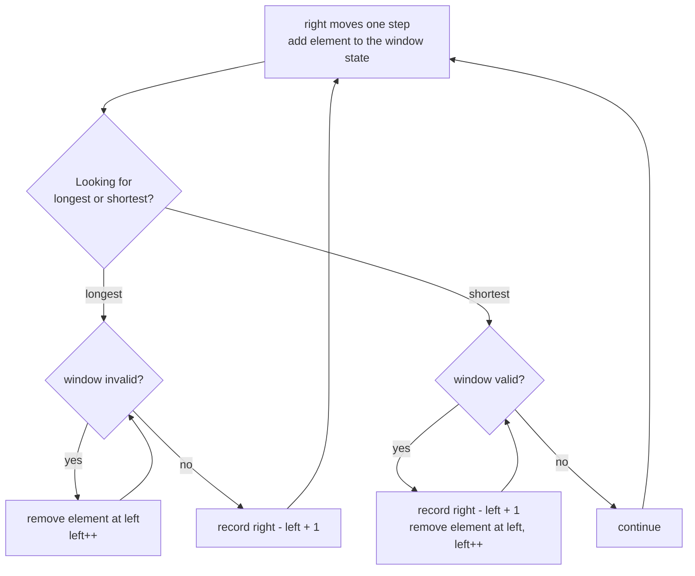
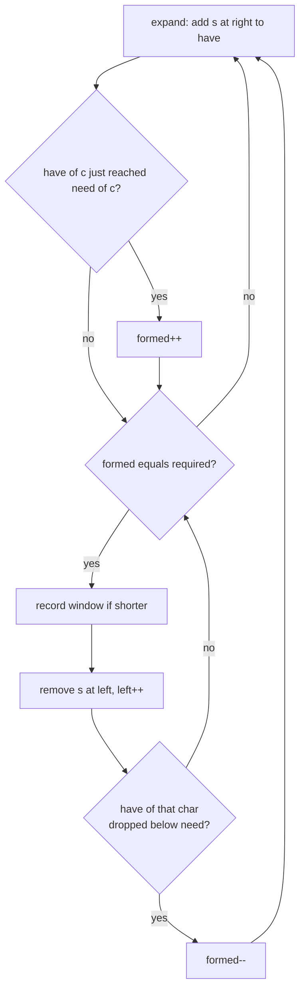
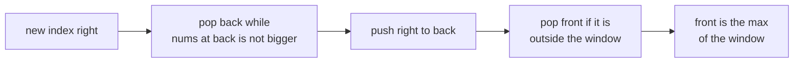

# Sliding Window

> In this document you will learn the sliding window pattern for problems about contiguous subarrays and substrings: "longest", "shortest", "of size k", "containing all of". You will learn the difference between fixed and variable windows, three reusable templates, and you will solve 12 classic problems, including minimum window substring and sliding window maximum.

**Before this:** [Two pointers](02-two-pointers.md) · [Arrays and hashing](01-arrays-and-hashing.md) · [Problem solving and complexity](../11-coding-interviews/02-problem-solving-and-complexity.md) · **Interview questions:** [jump to the interview section](#interview-questions)

## Table of contents

1. [The pattern](#the-pattern)
2. [Problems](#problems)
3. [Interview questions](#interview-questions)
4. [Summary](#summary)
5. [References](#references)

Problems in this document:

| # | Problem | Level | Window type |
| --- | --- | --- | --- |
| P1 | [Maximum sum subarray of size k](#p1-maximum-sum-subarray-of-size-k-easy) | Easy | Fixed |
| P2 | [Contains duplicate within k](#p2-contains-duplicate-within-k-easy) | Easy | Fixed, with a Set |
| P3 | [Best time to buy and sell stock](#p3-best-time-to-buy-and-sell-stock-easy) | Easy | Variable (track the minimum) |
| P4 | [Longest substring without repeating characters](#p4-longest-substring-without-repeating-characters-medium) | Medium | Variable, longest |
| P5 | [Longest repeating character replacement](#p5-longest-repeating-character-replacement-medium) | Medium | Variable, longest |
| P6 | [Permutation in string](#p6-permutation-in-string-medium) | Medium | Fixed, with counts |
| P7 | [Minimum size subarray sum](#p7-minimum-size-subarray-sum-medium) | Medium | Variable, shortest |
| P8 | [Max consecutive ones III](#p8-max-consecutive-ones-iii-medium) | Medium | Variable, longest |
| P9 | [Fruit into baskets](#p9-fruit-into-baskets-medium) | Medium | Variable, at most k distinct |
| P10 | [Minimum window substring](#p10-minimum-window-substring-hard) | Hard | Variable, shortest, with counts |
| P11 | [Sliding window maximum](#p11-sliding-window-maximum-hard) | Hard | Fixed, monotonic deque |
| P12 | [Subarrays with exactly k distinct values](#p12-subarrays-with-exactly-k-distinct-values-hard) | Hard | "At most k" trick |

---

## The pattern

### What it is

A **window** is a contiguous range of an array or string, from index `left` to index `right`. A **sliding window** moves this range forward. You add the new element on the right. Sometimes you remove elements from the left. You keep a small **summary** of what is inside the window (a sum, a count Map, the number of distinct values) and update it in O(1) for each change. You never recompute the summary from scratch.

There are two kinds:

| Kind | Window size | How it moves | Typical question |
| --- | --- | --- | --- |
| **Fixed** | Always k | Add one on the right, remove one on the left, every step | "Maximum sum of k consecutive", "is there an anagram of p in s" |
| **Variable** | Grows and shrinks | Always grow on the right; shrink from the left while a rule is broken (or while it still holds) | "Longest substring with…", "shortest subarray with…" |

The sliding window is a special case of [two pointers](02-two-pointers.md): both pointers move in the same direction, and the elements **between** them matter. The first look at it is in [Pattern 3: Sliding window](../11-coding-interviews/02-problem-solving-and-complexity.md#pattern-3-sliding-window).

### Why it exists

The brute force for "best contiguous subarray" checks all O(n²) start/end pairs. Often it also recomputes each window, which makes it O(n³). The sliding window reuses work. When the window moves by one, most of it stays the same. Only one element enters and maybe a few leave.

### Analogy

Imagine you look at a long train through a window in a station. The window shows a few carriages. When the train moves by one carriage, one new carriage appears on the right and one disappears on the left. You do not need to look at all the carriages again to know what is in the window. You only update for the one that came and the one that left.

For a variable window, the window is like a stretchy band. You stretch the right edge as far as you can. When the band breaks a rule (for example, "no repeated letters"), you pull the left edge in until it is valid again.

### When to recognize it

| Signal | Likely window |
| --- | --- |
| "contiguous", "subarray", "substring" (not "subsequence") | Sliding window or prefix sums |
| "of size k", "every k consecutive" | Fixed window |
| "longest / maximum length … such that …" | Variable window, longest template |
| "shortest / minimum length … such that …" | Variable window, shortest template |
| "at most k distinct", "at most k replacements / flips" | Variable window with a counter |
| "contains all characters of", "anagram of p in s" | Window with a count Map |
| "maximum / minimum of every window of size k" | Fixed window + monotonic deque |
| "exactly k" | `atMost(k) - atMost(k - 1)` |

**Important requirement:** a variable window works when the rule is **monotonic**. That means: if a window is valid, every smaller window inside it is also valid (for "longest" problems), or if a window is valid, every bigger window containing it is valid too (for "shortest" problems). Then you know which pointer to move. Sums with **negative numbers** break this. Then you need [prefix sums](04-prefix-sums-and-intervals.md).

### Templates

**Template 1: fixed window of size k.**

```js
function fixedWindowTemplate(nums, k) {
  let windowSum = 0;
  let best = -Infinity;
  for (let right = 0; right < nums.length; right++) {
    windowSum += nums[right];             // 1. add the new element
    if (right >= k) windowSum -= nums[right - k]; // 2. remove the element that left
    if (right >= k - 1) best = Math.max(best, windowSum); // 3. window is full: record
  }
  return best;
}

console.log(fixedWindowTemplate([2, 1, 5, 1, 3, 2], 3)); // 9
```

**Template 2: variable window, longest valid.**

```js
// Longest window that stays valid. Grow right every step; shrink left while invalid.
function longestWindowTemplate(s) {
  const counts = new Map();
  let left = 0;
  let best = 0;
  for (let right = 0; right < s.length; right++) {
    const ch = s[right];
    counts.set(ch, (counts.get(ch) ?? 0) + 1);   // add s[right]

    while (counts.get(ch) > 1) {                 // window invalid? shrink
      const out = s[left];
      counts.set(out, counts.get(out) - 1);
      left++;
    }

    best = Math.max(best, right - left + 1);     // window is valid here
  }
  return best;
}

console.log(longestWindowTemplate('abcabcbb')); // 3
```

**Template 3: variable window, shortest valid.**

```js
// Shortest window whose sum is at least target (all numbers positive).
function shortestWindowTemplate(nums, target) {
  let left = 0;
  let sum = 0;
  let best = Infinity;
  for (let right = 0; right < nums.length; right++) {
    sum += nums[right];                          // add nums[right]
    while (sum >= target) {                      // window valid? record, then shrink
      best = Math.min(best, right - left + 1);
      sum -= nums[left];
      left++;
    }
  }
  return best === Infinity ? 0 : best;
}

console.log(shortestWindowTemplate([2, 3, 1, 2, 4, 3], 7)); // 2
```

The difference between Template 2 and Template 3 is **where you record the answer**:

- Longest: shrink **while invalid**, then record (the window is valid after the loop).
- Shortest: record **inside** the shrink loop, while the window is still valid.



### Complexity

Each element is **added once** (when `right` passes it) and **removed at most once** (when `left` passes it). So the total work is O(n), even though there is a `while` loop inside the `for` loop. Space is O(1) for sums, or O(k) for a Map with k distinct keys (O(1) if the alphabet is fixed, like 26 letters).

### Common mistakes

- **Using a sliding window on sums with negative numbers.** The window rule is no longer monotonic. Use prefix sums.
- **Off-by-one in the window length.** The length of `[left, right]` is `right - left + 1`.
- **Recording at the wrong time.** For "longest", record after shrinking. For "shortest", record inside the shrink loop.
- **Forgetting to delete zero-count keys** when you use `map.size` as "number of distinct values". A key with count 0 is still counted in `size`.
- **Using `Array.prototype.shift()` for the deque in sliding window maximum.** `shift` is O(n) in the worst case. Use a head index or a real deque.
- **Building substrings inside the loop** (like `s.slice(left, right + 1)` every step). That adds O(n) per step. Store `start` and `length`, and slice once at the end.

---

## Problems

Each problem follows the same order: problem, examples, how to recognize the pattern, brute force, optimal approach, code, dry run, complexity, edge cases, follow-ups, and how to say it in the interview.

### P1. Maximum sum subarray of size k (Easy)

**Problem:** You get an array of numbers and an integer `k`. Return the largest sum of any `k` consecutive elements. Also solve the version that asks for the largest **average**.

Similar to: LeetCode 643 Maximum Average Subarray I. A first version is in [A second example: fixed-size window](../11-coding-interviews/02-problem-solving-and-complexity.md#a-second-example-fixed-size-window). Here we use the general fixed template, handle negatives and add a counting variation.

**Examples:**

```text
nums = [2, 1, 5, 1, 3, 2], k = 3       -> sum 9 (5 + 1 + 3)
nums = [1, 12, -5, -6, 50, 3], k = 4   -> average 12.75 ((12 - 5 - 6 + 50) / 4)
nums = [-3, -1, -2], k = 2             -> sum -3
```

**How to recognize the pattern:** "k consecutive elements" = fixed window.

**Brute force:** for each start, sum the next k elements. O(n · k).

**Optimal approach:**

1. Sum the first k elements.
2. Slide: add `nums[i]`, subtract `nums[i - k]`. Keep the best.
3. Start `best` from the first window sum, **not from 0**, because all sums can be negative.

**Code:**

```js
function maxSumOfSizeK(nums, k) {
  if (k <= 0 || k > nums.length) return null;
  let windowSum = 0;
  for (let i = 0; i < k; i++) windowSum += nums[i];
  let best = windowSum; // not 0: the answer can be negative
  for (let i = k; i < nums.length; i++) {
    windowSum += nums[i] - nums[i - k];
    best = Math.max(best, windowSum);
  }
  return best;
}

const findMaxAverage = (nums, k) => maxSumOfSizeK(nums, k) / k;

console.log(maxSumOfSizeK([2, 1, 5, 1, 3, 2], 3));     // 9
console.log(findMaxAverage([1, 12, -5, -6, 50, 3], 4)); // 12.75
console.log(maxSumOfSizeK([-3, -1, -2], 2));           // -3
console.log(maxSumOfSizeK([1, 2], 3));                 // null

// Variation: how many windows of size k have average >= threshold? (LeetCode 1343)
function countWindowsWithAverage(nums, k, threshold) {
  const needSum = k * threshold; // compare sums, avoid division
  let windowSum = 0;
  let count = 0;
  for (let right = 0; right < nums.length; right++) {
    windowSum += nums[right];
    if (right >= k) windowSum -= nums[right - k];
    if (right >= k - 1 && windowSum >= needSum) count++;
  }
  return count;
}

console.log(countWindowsWithAverage([2, 2, 2, 2, 5, 5, 5, 8], 3, 4)); // 3
```

**Dry run** of `maxSumOfSizeK([2, 1, 5, 1, 3, 2], 3)`:

| i | enters | leaves | windowSum | best |
| --- | --- | --- | --- | --- |
| first window | 2, 1, 5 | — | 8 | 8 |
| 3 | 1 | 2 | 7 | 8 |
| 4 | 3 | 1 | 9 | 9 |
| 5 | 2 | 5 | 6 | 9 |

**Complexity:** O(n) time, O(1) space.

**Edge cases:** `k` larger than the array (return `null` or ask), `k = n` (one window), all negative numbers (do not start `best` at 0), floating-point averages (compare sums instead of averages when you can).

**Follow-ups:**

- **Why compare `windowSum >= k * threshold` instead of `windowSum / k >= threshold`?** Integers stay exact. Division creates floating-point numbers, and comparisons on them can be off by a tiny amount.
- **Maximum sum of any length (no k)?** That is Kadane's algorithm, see [Greedy algorithms](13-greedy-algorithms.md).
- **Many different k values?** Build prefix sums once. Then each window sum is `prefix[i + k] - prefix[i]` in O(1). See [Prefix sums and intervals](04-prefix-sums-and-intervals.md).

**How to say it in the interview:**
> "Every window has exactly k elements, so it is a fixed sliding window. I sum the first k elements, then for each step I add the element that enters on the right and subtract the one that leaves on the left. I keep the best sum, starting from the first window and not from zero, because all sums might be negative. That is O(n) instead of O(n times k)."

---

### P2. Contains duplicate within k (Easy)

**Problem:** You get an array and an integer `k`. Return `true` if there are two **different** indices `i` and `j` with `nums[i] === nums[j]` and `|i - j| <= k`.

Similar to: LeetCode 219 Contains Duplicate II.

**Examples:**

```text
nums = [1, 2, 3, 1],       k = 3  -> true   (indices 0 and 3)
nums = [1, 0, 1, 1],       k = 1  -> true   (indices 2 and 3)
nums = [1, 2, 3, 1, 2, 3], k = 2  -> false
```

**How to recognize the pattern:** "within distance k" = only the last k elements matter. That is a fixed window, and "duplicate" means a Set.

**Brute force:** for each `i`, check the next k elements. O(n · k).

**Optimal approach:**

1. Keep a Set of the values in the window of the last `k` elements.
2. For each `i`: if `nums[i]` is in the Set, return `true`.
3. Add `nums[i]`. If the Set now holds more than `k` values, remove `nums[i - k]`.

**Code:**

```js
function containsNearbyDuplicate(nums, k) {
  const window = new Set();
  for (let i = 0; i < nums.length; i++) {
    if (window.has(nums[i])) return true;
    window.add(nums[i]);
    if (window.size > k) window.delete(nums[i - k]); // keep only the last k values
  }
  return false;
}

console.log(containsNearbyDuplicate([1, 2, 3, 1], 3));       // true
console.log(containsNearbyDuplicate([1, 0, 1, 1], 1));       // true
console.log(containsNearbyDuplicate([1, 2, 3, 1, 2, 3], 2)); // false
console.log(containsNearbyDuplicate([1, 1], 0));             // false
```

Why can we delete `nums[i - k]` safely? The Set never holds duplicates (we would have returned `true`), so each value in it appears exactly once, and deleting it removes exactly the element that left the window.

**Dry run** for `[1, 2, 3, 1, 2, 3]`, k = 2:

| i | nums[i] | in Set? | Set after add | delete | Set after |
| --- | --- | --- | --- | --- | --- |
| 0 | 1 | no | {1} | — | {1} |
| 1 | 2 | no | {1, 2} | — | {1, 2} |
| 2 | 3 | no | {1, 2, 3} | nums[0] = 1 | {2, 3} |
| 3 | 1 | no | {2, 3, 1} | nums[1] = 2 | {3, 1} |
| 4 | 2 | no | {3, 1, 2} | nums[2] = 3 | {1, 2} |
| 5 | 3 | no | {1, 2, 3} | nums[3] = 1 | {2, 3} |

Result: `false`.

**Complexity:** O(n) time, O(min(n, k)) space.

**Edge cases:** `k = 0` (never true: indices must differ), `k >= n` (same as plain contains duplicate), negative values.

**Follow-ups:**

- **Alternative with a Map?** Store `value → last index`. If `i - lastIndex.get(x) <= k`, return `true`. Same complexity, and it does not need deletion.
- **Values within t of each other and indices within k (LeetCode 220)?** Use **buckets** of width `t + 1`: two values in the same bucket are close, and you also check the two neighbour buckets. O(n) time.

**How to say it in the interview:**
> "Only the last k elements can pair with the current one, so I keep a fixed window of the last k values in a Set. For each element I first check if it is in the Set, which means a duplicate within distance k. Then I add it, and if the Set has more than k values, I remove the one that just left the window. O(n) time and O(k) space."

---

### P3. Best time to buy and sell stock (Easy)

**Problem:** You get an array `prices` where `prices[i]` is the price of a stock on day `i`. Buy on one day and sell on a **later** day. Return the maximum profit. If no profit is possible, return 0.

Similar to: LeetCode 121 Best Time to Buy and Sell Stock.

**Examples:**

```text
[7, 1, 5, 3, 6, 4]  -> 5   (buy at 1, sell at 6)
[7, 6, 4, 3, 1]     -> 0   (prices only go down)
[2, 4, 1]           -> 2
```

**How to recognize the pattern:** you need `prices[sell] - prices[buy]` with `buy < sell`. For each sell day, the best buy day is the **cheapest day so far**. This is a window from the cheapest day (`left`) to today (`right`). When a cheaper day appears, the window restarts there.

**Brute force:** try every buy/sell pair. O(n²).

**Optimal approach:**

1. `left = 0` (buy day), loop `right` from 1.
2. If `prices[right] < prices[left]`, move `left = right` (new cheapest day).
3. Otherwise, profit = `prices[right] - prices[left]`. Keep the best.

**Code:**

```js
function maxProfit(prices) {
  let left = 0; // index of the cheapest day so far
  let best = 0;
  for (let right = 1; right < prices.length; right++) {
    if (prices[right] < prices[left]) {
      left = right; // cheaper buy day found: restart the window
    } else {
      best = Math.max(best, prices[right] - prices[left]);
    }
  }
  return best;
}

console.log(maxProfit([7, 1, 5, 3, 6, 4])); // 5
console.log(maxProfit([7, 6, 4, 3, 1]));    // 0
console.log(maxProfit([2, 4, 1]));          // 2
console.log(maxProfit([]));                 // 0
```

**Dry run** for `[7, 1, 5, 3, 6, 4]`:

| right | price | left (price) | action | best |
| --- | --- | --- | --- | --- |
| 1 | 1 | 0 (7) | cheaper → left = 1 | 0 |
| 2 | 5 | 1 (1) | profit 4 | 4 |
| 3 | 3 | 1 (1) | profit 2 | 4 |
| 4 | 6 | 1 (1) | profit 5 | 5 |
| 5 | 4 | 1 (1) | profit 3 | 5 |

**Complexity:** O(n) time, O(1) space.

**Edge cases:** empty or one price (0), prices only falling (0), the minimum is on the last day (it cannot be used), equal prices.

**Follow-ups:**

- **Many transactions allowed (LeetCode 122)?** Add every positive day-to-day difference. That is a greedy argument, see [Greedy algorithms](13-greedy-algorithms.md).
- **With a cooldown or a fee, or at most k transactions?** These need dynamic programming with states (holding / not holding), see [Dynamic programming](12-dynamic-programming.md).
- **Return the days, not only the profit?** Store `bestBuy = left` and `bestSell = right` when `best` improves.

**How to say it in the interview:**
> "For any sell day, the best buy day is the cheapest day before it. So I walk through the prices with a left pointer on the cheapest day so far. If today is even cheaper, I move left to today. Otherwise I compute today's profit and keep the maximum. One pass, O(n) time and O(1) space."

---

### P4. Longest substring without repeating characters (Medium)

**Problem:** You get a string. Return the length of the longest substring that has no repeated characters.

Similar to: LeetCode 3 Longest Substring Without Repeating Characters. The "jump with last index" solution and the tricky `"abba"` walkthrough are in [Worked problem: longest substring without repeating characters](../11-coding-interviews/02-problem-solving-and-complexity.md#worked-problem-longest-substring-without-repeating-characters). Here we show the **template version** with a Set, compare the two, and return the substring itself.

**Examples:**

```text
"abcabcbb"  -> 3   ("abc")
"bbbbb"     -> 1   ("b")
"pwwkew"    -> 3   ("wke"; "pwke" is a subsequence, not a substring)
""          -> 0
```

**How to recognize the pattern:** "longest substring such that…" with a rule ("no repeats") that stays true for smaller windows. That is the longest-window template.

**Brute force:** check every substring for repeats. O(n³), or O(n²) if you extend each start with a Set until a repeat appears.

**Optimal approach (Set, shrink while invalid):**

1. Grow `right`. If `s[right]` is already in the window Set, remove `s[left]` and move `left` until it is gone.
2. Add `s[right]`. The window has no repeats. Record its length.

**Code:**

```js
// Version A: Set + shrink. Each character enters and leaves the Set once.
function lengthOfLongestSubstring(s) {
  const window = new Set();
  let left = 0;
  let best = 0;
  for (let right = 0; right < s.length; right++) {
    while (window.has(s[right])) {
      window.delete(s[left]);
      left++;
    }
    window.add(s[right]);
    best = Math.max(best, right - left + 1);
  }
  return best;
}

console.log(lengthOfLongestSubstring('abcabcbb')); // 3
console.log(lengthOfLongestSubstring('bbbbb'));    // 1
console.log(lengthOfLongestSubstring('pwwkew'));   // 3
console.log(lengthOfLongestSubstring(''));         // 0

// Version B: Map of last index + jump. Also returns the substring.
function longestUniqueSubstring(s) {
  const lastIndex = new Map();
  let left = 0;
  let bestStart = 0;
  let bestLength = 0;
  for (let right = 0; right < s.length; right++) {
    const prev = lastIndex.get(s[right]);
    if (prev !== undefined && prev >= left) left = prev + 1; // jump past the old copy
    lastIndex.set(s[right], right);
    if (right - left + 1 > bestLength) {
      bestLength = right - left + 1;
      bestStart = left;
    }
  }
  return s.slice(bestStart, bestStart + bestLength); // slice once, at the end
}

console.log(longestUniqueSubstring('pwwkew')); // wke
console.log(longestUniqueSubstring('abba'));   // ab
```

**Dry run** of Version A for `"pwwkew"`:

| right | char | shrink? | window after | best |
| --- | --- | --- | --- | --- |
| 0 | p | no | {p} | 1 |
| 1 | w | no | {p, w} | 2 |
| 2 | w | yes: remove p, remove w | {w} | 2 |
| 3 | k | no | {w, k} | 2 |
| 4 | e | no | {w, k, e} | 3 |
| 5 | w | yes: remove w | {k, e, w} | 3 |

**Complexity:** O(n) time for both versions. Version A moves `left` one step at a time, but each character is removed at most once. Version B jumps directly. O(k) space for k distinct characters.

**Edge cases:** empty string, all the same character, all different (the answer is n), spaces and symbols count as characters, emoji (the code above uses code units; use `[...s]` to work on code points).

**Follow-ups:**

- **Which version is better?** Same Big-O. Version B does fewer steps when a repeat is far back. Version A is the general template that also solves "at most k repeats" with small changes.
- **Longest substring with at most k distinct characters (LeetCode 340)?** Same template with a count Map. Shrink while `map.size > k`. See P9.
- **Only lowercase letters?** Replace the Map with `new Array(26)` of last indices for a small constant-factor speed-up.

**How to say it in the interview:**
> "I keep a window with no repeated characters, using a Set. I move the right pointer one step at a time. If the new character is already in the Set, I remove characters from the left until it is gone. Then I add the new character and record the window length. Each character goes in and out of the Set at most once, so it is O(n). An alternative is to store the last index of each character and jump left directly past the old copy."

---

### P5. Longest repeating character replacement (Medium)

**Problem:** You get a string of uppercase letters and an integer `k`. You may change at most `k` characters to any other letter. Return the length of the longest substring that can be made of **one repeated letter**.

Similar to: LeetCode 424 Longest Repeating Character Replacement.

**Examples:**

```text
s = "ABAB",     k = 2  -> 4   (change both A's or both B's)
s = "AABABBA",  k = 1  -> 4   ("AABA" -> "AAAA")
s = "AAAA",     k = 0  -> 4
```

**How to recognize the pattern:** "longest substring" + "at most k changes". A window is valid when it needs at most k changes. The changes needed are `windowLength - countOfMostCommonLetter`. Smaller windows inside a valid window are also valid, so the longest template works.

**Brute force:** for every substring, count letters and check `length - maxCount <= k`. O(n² · 26).

**Optimal approach:**

1. Keep counts of the 26 letters in the window and `maxCount`, the highest count seen in the window.
2. Grow `right`, update its count and `maxCount`.
3. If `(right - left + 1) - maxCount > k`, the window needs too many changes. Remove `s[left]` and move `left` by **one**.
4. Record the window length.

**A subtle trick:** when we shrink, we do **not** lower `maxCount`. That looks wrong, but it is safe. The answer only grows when we find a window with a **bigger** `maxCount` than before. A stale, too-high `maxCount` can only keep the window the same size, never make the answer too big. So the window length never goes above a real valid length. (Because we move `left` by only one step, the window slides at its best size until a better one appears.)

**Code:**

```js
function characterReplacement(s, k) {
  const counts = new Array(26).fill(0);
  const A = 'A'.charCodeAt(0);
  let left = 0;
  let maxCount = 0;
  let best = 0;
  for (let right = 0; right < s.length; right++) {
    const idx = s.charCodeAt(right) - A;
    counts[idx]++;
    maxCount = Math.max(maxCount, counts[idx]);

    if (right - left + 1 - maxCount > k) { // too many changes needed
      counts[s.charCodeAt(left) - A]--;
      left++;                              // slide, do not shrink further
    }
    best = Math.max(best, right - left + 1);
  }
  return best;
}

console.log(characterReplacement('ABAB', 2));    // 4
console.log(characterReplacement('AABABBA', 1)); // 4
console.log(characterReplacement('AAAA', 0));    // 4
console.log(characterReplacement('', 3));        // 0
```

**Dry run** for `"AABABBA"`, k = 1:

| right | char | counts (A, B) after the step | maxCount | length before shrink | changes needed | action | best |
| --- | --- | --- | --- | --- | --- | --- | --- |
| 0 | A | 1, 0 | 1 | 1 | 0 | — | 1 |
| 1 | A | 2, 0 | 2 | 2 | 0 | — | 2 |
| 2 | B | 2, 1 | 2 | 3 | 1 | — | 3 |
| 3 | A | 3, 1 | 3 | 4 | 1 | — | 4 |
| 4 | B | 2, 2 | 3 | 5 | 2 > 1 | remove A, left = 1 | 4 |
| 5 | B | 1, 3 | 3 | 5 | 2 > 1 | remove A, left = 2 | 4 |
| 6 | A | 2, 2 | 3 | 5 | 2 > 1 | remove B, left = 3 | 4 |

Notice rows 4 and 6: `maxCount` stays 3 even though no letter has count 3 in the window anymore. The window just slides at length 4 and never grows past the real answer.

**Complexity:** O(n) time, O(26) = O(1) space.

**Edge cases:** `k = 0` (longest run of one letter), `k >= n` (the whole string), empty string, one letter type only.

**Follow-ups:**

- **Is the stale `maxCount` really safe? Give a simpler, obviously correct version.** Recompute `maxCount = Math.max(...counts)` when you shrink. That costs O(26) per step: still O(n), just a bigger constant. It is a fine answer if you cannot explain the trick.
- **Binary string, flip at most k zeros?** That is P8, the same idea with only one letter to count.

**How to say it in the interview:**
> "A window can become one repeated letter if the number of other letters, window length minus the count of the most common letter, is at most k. That rule holds for smaller windows too, so I use a variable window. I grow right, update the letter counts and the max count, and if the window needs more than k changes I slide left by one. The window length I record is the answer. I do not decrease max count when shrinking, because only a larger max count can produce a larger answer. O(n) time, constant space."

---

### P6. Permutation in string (Medium)

**Problem:** You get two strings `s1` and `s2`. Return `true` if some **permutation** of `s1` is a substring of `s2`. In other words: does `s2` contain an anagram of `s1` as a contiguous block?

Similar to: LeetCode 567 Permutation in String. Closely related: LeetCode 438 Find All Anagrams in a String.

**Examples:**

```text
s1 = "ab",  s2 = "eidbaooo"  -> true   ("ba")
s1 = "ab",  s2 = "eidboaoo"  -> false
s1 = "adc", s2 = "dcda"      -> true   ("cda")
```

**How to recognize the pattern:** the anagram has exactly the length of `s1`. So the window has a **fixed** size `m = s1.length`, and you compare letter counts.

**Brute force:** generate all permutations of `s1` and search for each: O(m! · n). Or sort every window of length m and compare: O(n · m log m).

**Optimal approach:**

1. Count the letters of `s1` (`need`) and of the first window of `s2` (`have`), 26 slots each.
2. Keep `matches` = how many of the 26 letters have equal counts in `need` and `have`.
3. Slide the window: one letter enters, one leaves. Update `have` and fix `matches` for those two letters only.
4. If `matches === 26` at any point, return `true`.

**Code:**

```js
function checkInclusion(s1, s2) {
  const m = s1.length;
  if (m > s2.length) return false;
  const need = new Array(26).fill(0);
  const have = new Array(26).fill(0);
  const code = (str, i) => str.charCodeAt(i) - 97;

  for (let i = 0; i < m; i++) {
    need[code(s1, i)]++;
    have[code(s2, i)]++;
  }
  let matches = 0;
  for (let c = 0; c < 26; c++) if (need[c] === have[c]) matches++;

  // Change have[c] by delta and keep "matches" correct.
  const update = (c, delta) => {
    if (have[c] === need[c]) matches--; // was matching, may stop
    have[c] += delta;
    if (have[c] === need[c]) matches++; // matches now
  };

  for (let right = m; right < s2.length; right++) {
    if (matches === 26) return true;
    update(code(s2, right), +1);    // enters
    update(code(s2, right - m), -1); // leaves
  }
  return matches === 26;
}

console.log(checkInclusion('ab', 'eidbaooo'));  // true
console.log(checkInclusion('ab', 'eidboaoo'));  // false
console.log(checkInclusion('adc', 'dcda'));     // true
console.log(checkInclusion('abc', 'ab'));       // false

// Related: start indices of all anagrams of p in s (LeetCode 438).
function findAnagrams(s, p) {
  const result = [];
  const m = p.length;
  if (m > s.length) return result;
  const diff = new Array(26).fill(0); // need - have
  for (let i = 0; i < m; i++) {
    diff[p.charCodeAt(i) - 97]++;
    diff[s.charCodeAt(i) - 97]--;
  }
  let nonZero = diff.filter((d) => d !== 0).length;
  const change = (c, delta) => {
    if (diff[c] === 0) nonZero++;
    diff[c] += delta;
    if (diff[c] === 0) nonZero--;
  };
  if (nonZero === 0) result.push(0);
  for (let right = m; right < s.length; right++) {
    change(s.charCodeAt(right) - 97, -1);    // enters the window
    change(s.charCodeAt(right - m) - 97, +1); // leaves the window
    if (nonZero === 0) result.push(right - m + 1);
  }
  return result;
}

console.log(findAnagrams('cbaebabacd', 'abc')); // [ 0, 6 ]
console.log(findAnagrams('abab', 'ab'));        // [ 0, 1, 2 ]
```

**Dry run** of `checkInclusion("ab", "eidbaooo")` (only letters that matter):

| window | have a, b | need a, b | matches (of 26) |
| --- | --- | --- | --- |
| "ei" | 0, 0 | 1, 1 | 22 (a, b, e, i differ) |
| "id" | 0, 0 | 1, 1 | 22 (a, b, d, i differ) |
| "db" | 0, 1 | 1, 1 | 24 (a, d differ) |
| "ba" | 1, 1 | 1, 1 | 26 → true |

**Complexity:** O(n + m) time. Each slide is O(1) because we only touch two letters. O(1) space (two arrays of 26).

**Edge cases:** `s1` longer than `s2` (false), `s1` equal to `s2` (true), repeated letters in `s1` (`"aab"`), the match at the very end of `s2` (we check `matches` once more after the loop).

**Follow-ups:**

- **Why not compare the two arrays of 26 after every slide?** That works too and is O(26 · n) = O(n). The `matches` counter is the same Big-O with a smaller constant. Both are acceptable.
- **Unicode or a large alphabet?** Use a Map for `diff` and track the number of non-zero entries, like `findAnagrams` does.

**How to say it in the interview:**
> "An anagram of s1 has the same length as s1, so I slide a fixed window of that length over s2 and compare letter counts. Instead of comparing all 26 counts each time, I keep a counter of how many letters currently match. When the window slides, only two letters change, the one entering and the one leaving, so I update the counter in constant time. If all 26 letters match, I found a permutation. O(n) time, O(1) space."

---

### P7. Minimum size subarray sum (Medium)

**Problem:** You get an array of **positive** integers and a `target`. Return the length of the shortest contiguous subarray whose sum is **at least** `target`. Return 0 if there is none.

Similar to: LeetCode 209 Minimum Size Subarray Sum.

**Examples:**

```text
target = 7,  nums = [2, 3, 1, 2, 4, 3]        -> 2   ([4, 3])
target = 4,  nums = [1, 4, 4]                 -> 1
target = 11, nums = [1, 1, 1, 1, 1, 1, 1, 1]  -> 0
```

**How to recognize the pattern:** "shortest subarray such that sum ≥ target" with **positive** numbers. If a window has a big enough sum, every bigger window also has (positive numbers only add). That is the shortest-window template.

**Brute force:** for each start, extend until the sum reaches the target. O(n²).

**Optimal approach:**

1. Grow `right`, add `nums[right]` to `sum`.
2. While `sum >= target`: record `right - left + 1`, subtract `nums[left]`, `left++`.
3. Return the best length, or 0.

**Code:**

```js
function minSubArrayLen(target, nums) {
  let left = 0;
  let sum = 0;
  let best = Infinity;
  for (let right = 0; right < nums.length; right++) {
    sum += nums[right];
    while (sum >= target) {
      best = Math.min(best, right - left + 1);
      sum -= nums[left];
      left++;
    }
  }
  return best === Infinity ? 0 : best;
}

console.log(minSubArrayLen(7, [2, 3, 1, 2, 4, 3]));        // 2
console.log(minSubArrayLen(4, [1, 4, 4]));                 // 1
console.log(minSubArrayLen(11, [1, 1, 1, 1, 1, 1, 1, 1])); // 0
console.log(minSubArrayLen(3, []));                        // 0
```

**Dry run** for `target = 7`, `[2, 3, 1, 2, 4, 3]`:

| right | add | sum | shrink steps (record, remove) | left after | best |
| --- | --- | --- | --- | --- | --- |
| 0 | 2 | 2 | — | 0 | ∞ |
| 1 | 3 | 5 | — | 0 | ∞ |
| 2 | 1 | 6 | — | 0 | ∞ |
| 3 | 2 | 8 | record 4, remove 2 → 6 | 1 | 4 |
| 4 | 4 | 10 | record 4, remove 3 → 7; record 3, remove 1 → 6 | 3 | 3 |
| 5 | 3 | 9 | record 3, remove 2 → 7; record 2, remove 4 → 3 | 5 | 2 |

**Complexity:** O(n) time, O(1) space.

**Edge cases:** no valid subarray (0), one element already ≥ target (1), the whole array is needed, empty array.

**Follow-ups:**

- **O(n log n) solution?** Build prefix sums (they are increasing because numbers are positive). For each start, binary search the first end where `prefix[end] - prefix[start] >= target`. See [Binary search](06-binary-search.md).
- **What if numbers can be negative (LeetCode 862)?** The window rule breaks. Use prefix sums with a monotonic deque. That is a Hard problem and builds on P11.

**How to say it in the interview:**
> "All numbers are positive, so if a window reaches the target, any bigger window does too. I grow the right side and add to the sum. As long as the sum is at least the target, I record the length and shrink from the left. Each element is added once and removed once, so it is O(n) time with O(1) space. With negative numbers this would not work, and I would switch to prefix sums with a deque."

---

### P8. Max consecutive ones III (Medium)

**Problem:** You get a binary array (only 0s and 1s) and an integer `k`. You may flip at most `k` zeros to ones. Return the length of the longest run of ones you can get.

Similar to: LeetCode 1004 Max Consecutive Ones III.

**Examples:**

```text
nums = [1, 1, 1, 0, 0, 0, 1, 1, 1, 1, 0], k = 2                    -> 6
nums = [0, 0, 1, 1, 0, 0, 1, 1, 1, 0, 1, 1, 0, 0, 0, 1, 1, 1, 1], k = 3 -> 10
nums = [0, 0, 0], k = 0                                            -> 0
```

**How to recognize the pattern:** "longest subarray" + "at most k zeros inside". A window is valid when it has at most k zeros. Smaller windows have fewer zeros, so the longest template works.

**Brute force:** for every start, extend while the zero count is ≤ k. O(n²).

**Optimal approach:** count zeros in the window. Shrink from the left while `zeros > k`. Record the length.

**Code:**

```js
function longestOnes(nums, k) {
  let left = 0;
  let zeros = 0;
  let best = 0;
  for (let right = 0; right < nums.length; right++) {
    if (nums[right] === 0) zeros++;
    while (zeros > k) {
      if (nums[left] === 0) zeros--;
      left++;
    }
    best = Math.max(best, right - left + 1);
  }
  return best;
}

console.log(longestOnes([1, 1, 1, 0, 0, 0, 1, 1, 1, 1, 0], 2)); // 6
console.log(longestOnes([0, 0, 1, 1, 0, 0, 1, 1, 1, 0, 1, 1, 0, 0, 0, 1, 1, 1, 1], 3)); // 10
console.log(longestOnes([0, 0, 0], 0)); // 0
console.log(longestOnes([1, 1], 0));    // 2
```

**Dry run** for `[1, 1, 1, 0, 0, 0, 1, 1, 1, 1, 0]`, k = 2 (key steps):

| right | value | zeros | shrink | window | length | best |
| --- | --- | --- | --- | --- | --- | --- |
| 0–2 | 1, 1, 1 | 0 | — | 0..2 | 3 | 3 |
| 3 | 0 | 1 | — | 0..3 | 4 | 4 |
| 4 | 0 | 2 | — | 0..4 | 5 | 5 |
| 5 | 0 | 3 | move left past index 3 (the first 0) | 4..5 | 2 | 5 |
| 6–9 | 1s | 2 | — | 4..9 | 6 | 6 |
| 10 | 0 | 3 | move left past index 4 | 5..10 | 6 | 6 |

**Complexity:** O(n) time, O(1) space.

**Edge cases:** `k = 0` (longest run of ones), `k` ≥ number of zeros (the whole array), all zeros, all ones.

**Follow-ups:**

- **Flip exactly one zero, and the data is an infinite stream (LeetCode 487 follow-up)?** Store only the index of the last zero instead of the whole window. When a new zero arrives, `left = lastZero + 1`.
- **Same as which other problem?** It is P5 with two letters, where you only count the "wrong" letter.

**How to say it in the interview:**
> "I need the longest window with at most k zeros, because I can flip those zeros. I grow the window to the right and count zeros. When the count goes above k, I move the left pointer forward until I drop a zero. After that the window is valid, and I record its length. Each index enters and leaves once, so it is O(n) time and O(1) space."

---

### P9. Fruit into baskets (Medium)

**Problem:** A row of trees is given as an array `fruits`, where `fruits[i]` is the fruit type of tree `i`. You have two baskets, and each basket holds only **one type** of fruit (any amount). You start at any tree and pick one fruit from every tree moving right, and you must stop when a fruit does not fit in your baskets. Return the most fruits you can pick.

In plain words: **find the longest subarray with at most 2 distinct values.**

Similar to: LeetCode 904 Fruit Into Baskets.

**Examples:**

```text
[1, 2, 1]           -> 3
[0, 1, 2, 2]        -> 3   ([1, 2, 2])
[1, 2, 3, 2, 2]     -> 4   ([2, 3, 2, 2])
[3, 3, 3, 1, 2, 1, 1, 2, 3, 3, 4] -> 5   ([1, 2, 1, 1, 2])
```

**How to recognize the pattern:** after you translate the story, it is "longest subarray with at most k distinct values" with k = 2. That is the longest-window template with a count Map.

**Brute force:** for every start, extend while the number of types is ≤ 2. O(n²).

**Optimal approach:**

1. Keep a Map `type → count` for the window.
2. Grow `right`, add `fruits[right]`.
3. While `map.size > k`: decrease the count of `fruits[left]`. If it reaches 0, **delete** the key. `left++`.
4. Record the length.

**Code:**

```js
function longestWithAtMostKDistinct(values, k) {
  const counts = new Map();
  let left = 0;
  let best = 0;
  for (let right = 0; right < values.length; right++) {
    counts.set(values[right], (counts.get(values[right]) ?? 0) + 1);
    while (counts.size > k) {
      const out = values[left];
      const c = counts.get(out) - 1;
      if (c === 0) counts.delete(out); // important: otherwise size stays too big
      else counts.set(out, c);
      left++;
    }
    best = Math.max(best, right - left + 1);
  }
  return best;
}

const totalFruit = (fruits) => longestWithAtMostKDistinct(fruits, 2);

console.log(totalFruit([1, 2, 1]));       // 3
console.log(totalFruit([0, 1, 2, 2]));    // 3
console.log(totalFruit([1, 2, 3, 2, 2])); // 4
console.log(totalFruit([3, 3, 3, 1, 2, 1, 1, 2, 3, 3, 4])); // 5
console.log(longestWithAtMostKDistinct([...'eceba'], 2));    // 3
```

The last line is LeetCode 340 (longest substring with at most k distinct characters): `"ece"` has length 3.

**Dry run** for `[1, 2, 3, 2, 2]`:

| right | add | counts after add | size > 2? | shrink | left | best |
| --- | --- | --- | --- | --- | --- | --- |
| 0 | 1 | {1:1} | no | — | 0 | 1 |
| 1 | 2 | {1:1, 2:1} | no | — | 0 | 2 |
| 2 | 3 | {1:1, 2:1, 3:1} | yes | remove 1 → delete key | 1 | 2 |
| 3 | 2 | {2:2, 3:1} | no | — | 1 | 3 |
| 4 | 2 | {2:3, 3:1} | no | — | 1 | 4 |

**Complexity:** O(n) time. O(k) space: the Map holds at most k + 1 keys.

**Edge cases:** fewer than 3 types in total (the whole array), all the same type, empty array (0), k = 0 (0).

**Follow-ups:**

- **Why must you delete keys with count 0?** `map.size` counts keys, not positive counts. A leftover key with 0 makes the window look like it has too many types, and the window shrinks too much.
- **"Exactly k distinct" instead of "at most k"?** The longest version can use the same window. For **counting** subarrays with exactly k distinct values, use `atMost(k) - atMost(k - 1)`, see P12.

**How to say it in the interview:**
> "Once I remove the story, this asks for the longest subarray with at most two distinct values. I keep a Map from fruit type to its count in the window. I grow the right side, and while the Map has more than two keys, I remove fruits from the left, deleting a key when its count reaches zero. Then I record the window length. O(n) time, and the Map never has more than three keys."

---

### P10. Minimum window substring (Hard)

**Problem:** You get two strings `s` and `t`. Return the **shortest substring** of `s` that contains every character of `t`, including duplicates (if `t` has two `a`s, the window needs at least two `a`s). Return `""` if there is no such substring.

Similar to: LeetCode 76 Minimum Window Substring.

**Examples:**

```text
s = "ADOBECODEBANC", t = "ABC"  -> "BANC"
s = "a",             t = "a"    -> "a"
s = "a",             t = "aa"   -> ""
s = "aaflslflsldkalskaaa", t = "aaa" -> "aaa"
```

**How to recognize the pattern:** "shortest substring that contains all of…" — if a window contains all of `t`, every bigger window does too. That is the shortest-window template. The window state is a count Map plus a counter of how many required characters are fully satisfied.

**Brute force:** check every substring of `s` against the counts of `t`. O(n² · |alphabet|) or worse.

**Optimal approach:**

1. Count `t` into `need`. Let `required = need.size` (number of distinct characters in `t`).
2. Keep `have` counts for the window and `formed` = how many distinct characters have `have[c] >= need[c]`.
3. Grow `right`. When a character's count reaches exactly its need, `formed++`.
4. While `formed === required` (the window is valid):
   - Record the window if it is shorter than the best so far.
   - Remove `s[left]`. If its count drops below its need, `formed--`. `left++`.
5. Return the best window, using `slice` **once** at the end.



**Code:**

```js
function minWindow(s, t) {
  if (t.length === 0 || t.length > s.length) return '';
  const need = new Map();
  for (const ch of t) need.set(ch, (need.get(ch) ?? 0) + 1);
  const required = need.size;

  const have = new Map();
  let formed = 0;
  let left = 0;
  let bestStart = 0;
  let bestLength = Infinity;

  for (let right = 0; right < s.length; right++) {
    const ch = s[right];
    if (need.has(ch)) {
      have.set(ch, (have.get(ch) ?? 0) + 1);
      if (have.get(ch) === need.get(ch)) formed++; // exactly reached: count once
    }

    while (formed === required) {
      if (right - left + 1 < bestLength) {
        bestLength = right - left + 1;
        bestStart = left;
      }
      const out = s[left];
      if (need.has(out)) {
        have.set(out, have.get(out) - 1);
        if (have.get(out) < need.get(out)) formed--; // window no longer valid
      }
      left++;
    }
  }
  return bestLength === Infinity ? '' : s.slice(bestStart, bestStart + bestLength);
}

console.log(minWindow('ADOBECODEBANC', 'ABC'));      // BANC
console.log(minWindow('a', 'a'));                    // a
console.log(JSON.stringify(minWindow('a', 'aa'))); // ""
console.log(minWindow('aaflslflsldkalskaaa', 'aaa')); // aaa
console.log(minWindow('ab', 'b'));                   // b
```

`JSON.stringify` is used on the third line only so that the empty string is visible in the output.

Why `=== need` and not `>= need` when counting `formed`? With `>=`, an extra copy of a character would increase `formed` again, and the window would look valid too early. We count a character as "formed" only at the moment its count **reaches** the need.

**Dry run** for `s = "ADOBECODEBANC"`, `t = "ABC"` (key moments only):

| step | right (char) | windows checked while valid | what happens | best |
| --- | --- | --- | --- | --- |
| 1 | 5 (C) | ADOBEC | first valid window: record length 6; removing A makes it invalid | ADOBEC |
| 2 | 10 (A) | DOBECODEBA, OBECODEBA, BECODEBA, ECODEBA, CODEBA | the A makes it valid again; removing D, O, B, E keeps it valid (a second B is inside), but none is shorter than 6; removing C makes it invalid | ADOBEC |
| 3 | 12 (C) | ODEBANC, DEBANC, EBANC, BANC | valid again; EBANC (5) and then BANC (4) are recorded; removing B makes it invalid | BANC |

Answer: `"BANC"`.

**Complexity:** O(|s| + |t|) time: each index of `s` enters and leaves the window once. O(k) space for the Maps, where k is the number of distinct characters (O(1) for a fixed alphabet).

**Edge cases:** `t` longer than `s` (`""`), `t` with duplicates (`"aa"` needs two a's), characters in `s` that are not in `t` (they are skipped in the counts), the answer is the whole string, case sensitivity (`'a'` and `'A'` are different).

**Follow-ups:**

- **`s` is very long but only a few characters of `s` are in `t`?** First build a filtered list of `[index, char]` pairs for characters that are in `t`, then run the window over that list. Fewer steps when most of `s` is irrelevant.
- **Return all minimum windows?** Collect every start whose length equals the best length.
- **Minimum window **subsequence** (LeetCode 727)?** Order matters there, so it is no longer a count problem. It uses two pointers forward and backward, or DP.

**How to say it in the interview:**
> "If a window contains all characters of t, every larger window does too, so I use the shortest-window template. I count t into a need Map, and I track how many distinct characters are fully satisfied in the window. I grow the right side; when a character's count reaches its need, I increase the satisfied counter. While all characters are satisfied, I record the window and shrink from the left, decreasing the counter when a character drops below its need. Every index enters and leaves once, so it is O(length of s plus length of t)."

---

### P11. Sliding window maximum (Hard)

**Problem:** You get an array `nums` and an integer `k`. A window of size `k` moves from the left end to the right end, one step at a time. Return an array with the **maximum** of each window.

Similar to: LeetCode 239 Sliding Window Maximum.

**Examples:**

```text
nums = [1, 3, -1, -3, 5, 3, 6, 7], k = 3  -> [3, 3, 5, 5, 6, 7]
nums = [1], k = 1                         -> [1]
nums = [9, 8, 7, 6], k = 2                -> [9, 8, 7]
```

**How to recognize the pattern:** a fixed window, but the summary is a **maximum**. A sum is easy to update when an element leaves (just subtract). A maximum is not: if the maximum leaves, you need the next biggest. The tool for this is a **monotonic deque**.

A **deque** (double-ended queue) lets you add and remove at both ends in O(1). A **monotonic** deque keeps its values in sorted order (here: decreasing from front to back). The idea of keeping a stack or queue sorted is explained in detail in [Stacks and monotonic stack](05-stacks-and-monotonic-stack.md#the-pattern).

**Brute force:** for each window, scan k elements for the max. O(n · k). A heap gives O(n log n) (lazy deletion of old elements).

**Optimal approach (monotonic deque of indices):**

1. The deque holds **indices**. Their values are **decreasing** from front to back.
2. For each new index `right`:
   - Remove from the **back** every index whose value is ≤ `nums[right]`. Those elements can never be a maximum again: the new element is bigger and will stay in the window longer.
   - Push `right` to the back.
   - If the front index has left the window (`front <= right - k`), remove it from the **front**.
   - Once the first window is full (`right >= k - 1`), the front holds the maximum.



**Code:**

```js
function maxSlidingWindow(nums, k) {
  // Array used as a deque. "head" replaces shift(), which is O(n).
  const deque = []; // indices, values decreasing from head to end
  let head = 0;
  const result = [];

  for (let right = 0; right < nums.length; right++) {
    while (deque.length > head && nums[deque[deque.length - 1]] <= nums[right]) {
      deque.pop(); // smaller values behind a bigger, newer value are useless
    }
    deque.push(right);

    if (deque[head] <= right - k) head++; // front index left the window

    if (right >= k - 1) result.push(nums[deque[head]]);
  }
  return result;
}

console.log(maxSlidingWindow([1, 3, -1, -3, 5, 3, 6, 7], 3)); // [ 3, 3, 5, 5, 6, 7 ]
console.log(maxSlidingWindow([1], 1));                        // [ 1 ]
console.log(maxSlidingWindow([9, 8, 7, 6], 2));               // [ 9, 8, 7 ]
console.log(maxSlidingWindow([4, 4, 4], 2));                  // [ 4, 4 ]
```

Why a `head` index instead of `deque.shift()`? `shift` removes the first element and moves every other element one place, which is O(n) in the worst case. With a `head` index, "remove from the front" is just `head++`. The array keeps the old slots, which costs at most O(n) memory. For a long-running stream, use a real ring-buffer deque instead.

**Dry run** for `[1, 3, -1, -3, 5, 3, 6, 7]`, k = 3 (deque shown as values):

| right | value | pop back | deque after push | pop front? | output |
| --- | --- | --- | --- | --- | --- |
| 0 | 1 | — | [1] | no | — |
| 1 | 3 | 1 | [3] | no | — |
| 2 | −1 | — | [3, −1] | no | 3 |
| 3 | −3 | — | [3, −1, −3] | no (3 is index 1, window is 1..3) | 3 |
| 4 | 5 | −3, −1, 3 | [5] | no | 5 |
| 5 | 3 | — | [5, 3] | no | 5 |
| 6 | 6 | 3, 5 | [6] | no | 6 |
| 7 | 7 | 6 | [7] | no | 7 |

**Complexity:** O(n) time. Each index is pushed once and popped at most once (from the back or the front). O(k) space for the live part of the deque.

**Edge cases:** `k = 1` (the output is the input), `k = n` (one value: the global max), equal values (we pop `<=`, so only the newest copy stays, which is correct because it leaves the window last), decreasing input (the deque grows to k), negative numbers.

**Follow-ups:**

- **Sliding window minimum?** Keep values **increasing** instead: pop from the back while the back value is ≥ the new one.
- **Why store indices and not values?** You need the index to know when the front has left the window. With values only, duplicates make it impossible to tell.
- **Where else is the monotonic deque used?** Shortest subarray with sum at least k with negative numbers (LeetCode 862), and DP optimizations like "jump game VI" (LeetCode 1696), where `dp[i]` needs the max of the last k `dp` values.

**How to say it in the interview:**
> "The window has a fixed size, but a maximum is hard to update when it leaves the window. So I keep a deque of indices whose values are decreasing. When a new element comes in, I pop every smaller or equal value from the back, because those can never be the maximum again while the new element is in the window. I push the new index, drop the front if it has left the window, and the front is then the maximum. Each index is pushed and popped once, so it is O(n). In JavaScript, I use a head index instead of shift, because shift is O(n)."

---

### P12. Subarrays with exactly k distinct values (Hard)

**Problem:** You get an array of integers and an integer `k`. Count the contiguous subarrays that contain **exactly** `k` distinct values.

Similar to: LeetCode 992 Subarrays with K Different Integers.

**Examples:**

```text
nums = [1, 2, 1, 2, 3], k = 2  -> 7   ([1,2], [2,1], [1,2], [2,3], [1,2,1], [2,1,2], [1,2,1,2])
nums = [1, 2, 1, 3, 4], k = 3  -> 3   ([1,2,1,3], [2,1,3], [1,3,4])
nums = [1, 1, 1], k = 1        -> 6
```

**How to recognize the pattern:** "exactly k" is **not** monotonic. A window with exactly k distinct values can become invalid when it grows (k + 1 values) and also when it shrinks (k − 1 values). So you cannot know which pointer to move. But "**at most** k" is monotonic. And:

```text
exactly(k) = atMost(k) - atMost(k - 1)
```

**Brute force:** for each start, extend and track distinct values with a Set. O(n²).

**Optimal approach:**

1. Write `atMost(k)`: the number of subarrays with at most k distinct values.
2. In the longest-window template, for each `right`, the window `[left, right]` is the **longest** valid window ending at `right`. Every subarray `[i, right]` with `left <= i <= right` is also valid. That is `right - left + 1` subarrays. Add that to the count.
3. Return `atMost(k) - atMost(k - 1)`.

**Code:**

```js
function countAtMostKDistinct(nums, k) {
  if (k < 0) return 0;
  const counts = new Map();
  let left = 0;
  let total = 0;
  for (let right = 0; right < nums.length; right++) {
    counts.set(nums[right], (counts.get(nums[right]) ?? 0) + 1);
    while (counts.size > k) {
      const out = nums[left];
      const c = counts.get(out) - 1;
      if (c === 0) counts.delete(out);
      else counts.set(out, c);
      left++;
    }
    total += right - left + 1; // all valid subarrays that end at right
  }
  return total;
}

function subarraysWithKDistinct(nums, k) {
  return countAtMostKDistinct(nums, k) - countAtMostKDistinct(nums, k - 1);
}

console.log(subarraysWithKDistinct([1, 2, 1, 2, 3], 2)); // 7
console.log(subarraysWithKDistinct([1, 2, 1, 3, 4], 3)); // 3
console.log(subarraysWithKDistinct([1, 1, 1], 1));       // 6
console.log(subarraysWithKDistinct([1, 2], 3));          // 0
```

**Dry run** of `countAtMostKDistinct([1, 2, 1, 2, 3], 2)`:

| right | value | window after shrink | right − left + 1 | total |
| --- | --- | --- | --- | --- |
| 0 | 1 | [1] | 1 | 1 |
| 1 | 2 | [1, 2] | 2 | 3 |
| 2 | 1 | [1, 2, 1] | 3 | 6 |
| 3 | 2 | [1, 2, 1, 2] | 4 | 10 |
| 4 | 3 | [2, 3] (left = 3) | 2 | 12 |

`atMost(1)` for the same array is 5 (each single element; no two neighbours are equal). So `exactly(2) = 12 - 5 = 7`.

**Complexity:** O(n) time (two passes of a linear window). O(k) space.

**Edge cases:** `k` larger than the number of distinct values (0), `k = 0` (0), all equal values with `k = 1` (n · (n + 1) / 2 subarrays).

**Follow-ups:**

- **Where else does "exactly = atMost(k) − atMost(k − 1)" work?** Count subarrays with exactly k odd numbers (LeetCode 1248), binary subarrays with sum exactly k (LeetCode 930, with non-negative numbers). Any count where "at most" is monotonic.
- **Why does `right - left + 1` count all subarrays ending at `right`?** Any subarray that ends at `right` and starts at or after `left` is inside the valid window, so it has at most k distinct values. Any start before `left` would include too many.
- **Can you do it in one pass?** Yes, with two left pointers (one for "at most k", one for "at most k − 1") in the same loop. Same O(n), harder to explain.

**How to say it in the interview:**
> "Exactly k distinct is not monotonic, so a single window does not know which way to move. But at most k is monotonic, and exactly k equals at most k minus at most k minus one. To count subarrays with at most k distinct values, I use the longest-window template with a count Map. For each right, the window from left to right is the longest valid one, so every start inside it gives a valid subarray, and I add right minus left plus one. Two linear passes, O(n) total."

---

## Interview questions

### Q1. When would you use a sliding window instead of two pointers?

**What the interviewer is checking:** whether you understand what makes the window different.

**Short spoken answer (30–60 seconds):**
> "A sliding window is a kind of two pointers where both pointers move in the same direction and everything between them matters. I use it when the question is about a contiguous subarray or substring, and I keep a summary of the window, like a sum or a count Map. Classic two pointers from opposite ends only care about the two elements at the pointers, for example a pair sum on a sorted array. So: contiguous range with a property of all its elements means sliding window; a pair or the two ends means opposite-end pointers."

**Detailed explanation:**

| | Sliding window | Opposite-end two pointers |
| --- | --- | --- |
| Pointer direction | Both move right | Toward each other |
| What matters | All elements between `left` and `right` | Only `nums[left]` and `nums[right]` |
| State | Sum, count Map, deque | Usually none |
| Needs sorted input | No | Usually yes |

**Follow-up questions:**
- **Is the "best time to buy and sell stock" solution a sliding window?** — You can view it as one: the window starts at the cheapest day and ends today. You can also view it as "track the running minimum". Both are fine.

**Common mistakes:** calling any two-index solution a "sliding window" without a window state.

**Where this is used in real projects:** rate limiting ("at most 100 requests in the last 60 seconds"), moving averages on dashboards, detecting bursts in logs.

---

### Q2. Why is a variable sliding window O(n) and not O(n²)?

**What the interviewer is checking:** amortized analysis.

**Short spoken answer (30–60 seconds):**
> "Because both pointers only move forward. The right pointer moves n times. The left pointer can also move at most n times in total, across all iterations, because it never goes back. So the inner while loop does at most n steps over the whole run, not n steps per iteration. Each element is added once and removed once, which gives 2n operations, so O(n)."

**Follow-up questions:**
- **When would it become O(n²)?** — If you reset `left` for each `right`, or if you rebuild the window state (for example `new Set(s.slice(left, right))`) at every step.
- **And with a Map?** — Map operations are O(1) on average, so it stays O(n) on average.

**Common mistakes:** multiplying the loop sizes.

**Where this is used in real projects:** understanding the cost of streaming aggregations.

---

### Q3. Why does the sliding window fail when numbers can be negative?

**What the interviewer is checking:** the monotonic requirement.

**Short spoken answer (30–60 seconds):**
> "The window works because I know which pointer to move. With positive numbers, adding an element always increases the sum and removing one always decreases it. So if the sum is too big, I shrink; if it is too small, I grow. With negative numbers, adding an element can decrease the sum, so a window that is too small now might become valid after shrinking or after growing. I cannot decide. Then I switch to prefix sums with a hash map, which handles negatives in O(n)."

**Detailed explanation:** Run the shortest-window template from P7 on `nums = [-2, 1, -1, 1]` with target 1. The correct answer is 1 (the subarray `[1]`).

```js
function shortestWindowNegatives(nums, target) {
  let left = 0;
  let sum = 0;
  let best = Infinity;
  for (let right = 0; right < nums.length; right++) {
    sum += nums[right];
    while (sum >= target) {
      best = Math.min(best, right - left + 1);
      sum -= nums[left];
      left++;
    }
  }
  return best === Infinity ? 0 : best;
}

console.log(shortestWindowNegatives([-2, 1, -1, 1], 1)); // 0
```

The running sums are −2, −1, −2, −1. The sum never reaches 1, so the window never shrinks, and the −2 at the start is never removed. But removing it is exactly what would help. The template only shrinks when the window is already valid, so it cannot discover that dropping a negative number makes the window better. In general, `sum >= target` is not monotonic when values can be negative.

**Follow-up questions:**
- **What do you use for "count subarrays with sum k" with negatives?** — Prefix sums and a Map, see [Prefix sums and intervals, P5](04-prefix-sums-and-intervals.md#p5-subarray-sum-equals-k-medium).
- **And for "shortest subarray with sum ≥ k" with negatives?** — Prefix sums with a monotonic deque (LeetCode 862).

**Common mistakes:** applying the template and testing only positive examples.

**Where this is used in real projects:** balance changes over time (deposits and withdrawals) are a typical "can be negative" series.

---

### Q4. What is the difference between the "longest" and "shortest" window templates?

**What the interviewer is checking:** whether you know where to record the answer.

**Short spoken answer (30–60 seconds):**
> "In both, the right pointer grows the window every step. For the longest valid window, I shrink while the window is invalid, and I record the length after the loop, because then the window is valid. For the shortest valid window, I shrink while the window is still valid, and I record inside the loop, because each shrink step might give a shorter valid window. Mixing them up gives off-by-one errors or windows that are never recorded."

**Follow-up questions:**
- **What about fixed windows?** — There is no shrink loop. You add one element, remove the one that is k steps behind, and record once the window has k elements.

**Common mistakes:** recording the length before shrinking in the longest template, which records invalid windows.

**Where this is used in real projects:** "longest session without errors" vs "shortest time window that contains all required events".

---

### Q5. How do you turn "exactly k" into a sliding window problem?

**What the interviewer is checking:** the at-most trick.

**Short spoken answer (30–60 seconds):**
> "Exactly k is not monotonic, so a window cannot decide whether to grow or shrink. I write a function for at most k instead, which is monotonic, and then exactly k equals at most k minus at most k minus one. In the at-most function, for each right pointer the valid window is the longest one ending there, so I add right minus left plus one subarrays. That gives an O(n) count."

**Follow-up questions:**
- **Does this also work for "longest subarray with exactly k distinct"?** — For the longest, you can use the at-most-k window directly and only record when `map.size === k`. Subtraction is for counting.

**Common mistakes:** trying to shrink when the count is above k and grow when below, which skips subarrays.

**Where this is used in real projects:** analytics counts like "sessions with exactly 3 page types".

---

### Q6. Why do you use a deque for sliding window maximum, and why not `shift()`?

**What the interviewer is checking:** data-structure choice and JavaScript performance knowledge.

**Short spoken answer (30–60 seconds):**
> "A maximum cannot be updated by subtraction when an element leaves. A monotonic deque keeps only candidates that can still become the maximum, in decreasing order, so the front is always the current max. New elements remove smaller ones from the back, and the front is removed when it leaves the window. Everything is O(1) amortized. In JavaScript, arrays do not have an O(1) remove-from-front: shift moves all other elements. So I use a head index, or a small ring-buffer deque class."

**Code:** a minimal ring-buffer deque.

```js
class Deque {
  constructor(capacity = 16) {
    this.buf = new Array(capacity);
    this.head = 0;
    this.size = 0;
  }
  #grow() {
    const bigger = new Array(this.buf.length * 2);
    for (let i = 0; i < this.size; i++) bigger[i] = this.buf[(this.head + i) % this.buf.length];
    this.buf = bigger;
    this.head = 0;
  }
  pushBack(x) {
    if (this.size === this.buf.length) this.#grow();
    this.buf[(this.head + this.size) % this.buf.length] = x;
    this.size++;
  }
  popBack() {
    if (this.size === 0) return undefined;
    this.size--;
    return this.buf[(this.head + this.size) % this.buf.length];
  }
  popFront() {
    if (this.size === 0) return undefined;
    const x = this.buf[this.head];
    this.head = (this.head + 1) % this.buf.length;
    this.size--;
    return x;
  }
  front() { return this.size ? this.buf[this.head] : undefined; }
  back() { return this.size ? this.buf[(this.head + this.size - 1) % this.buf.length] : undefined; }
}

const dq = new Deque(2);
dq.pushBack(1); dq.pushBack(2); dq.pushBack(3); // grows from 2 to 4 slots
console.log(dq.popFront(), dq.popBack(), dq.front(), dq.size); // 1 3 2 1
```

**Follow-up questions:**
- **Is `shift()` always slow?** — Engines may optimize some cases, but you cannot rely on it. The spec describes shift as moving every element, so treat it as O(n).

**Common mistakes:** storing values instead of indices, or popping `<` instead of `<=` and then mishandling duplicates (both can work if done consistently, but indices are required to detect elements leaving).

**Where this is used in real projects:** rolling maximum latency over the last N requests in a monitoring service.

---

### Q7. Your teammate's longest-substring code returns wrong answers on `"abba"`. Why?

**What the interviewer is checking:** debugging the classic "left moves backwards" bug.

```js
function longestBuggy(s) {
  const last = new Map();
  let left = 0;
  let best = 0;
  for (let right = 0; right < s.length; right++) {
    if (last.has(s[right])) left = last.get(s[right]) + 1; // ❌ can move left backwards
    last.set(s[right], right);
    best = Math.max(best, right - left + 1);
  }
  return best;
}

console.log(longestBuggy('abba')); // 3
```

**Short spoken answer (30–60 seconds):**
> "When the second a arrives, its last index is 0, which is already outside the window, because left is 2. The code still sets left to 1, so the window moves backwards and includes both b's. It reports 3 instead of 2. The fix is to only jump forward: left equals the max of left and last index plus one."

**Fixed line:** `if (last.has(s[right])) left = Math.max(left, last.get(s[right]) + 1); // ✅`

**Follow-up questions:**
- **How would you have caught this?** — Test cases where a repeated character appears again after the window has already moved past it, like `"abba"` or `"tmmzuxt"`.

**Common mistakes:** fixing the symptom with extra checks instead of the invariant "left never moves back".

**Where this is used in real projects:** the same invariant matters in any stream processing with a moving start time.

---

### Q8. A rate limiter must allow at most N requests per user in any 60-second window. How does the sliding window idea apply?

**What the interviewer is checking:** connecting the pattern to real systems.

**Short spoken answer (30–60 seconds):**
> "For each user I keep a queue of request timestamps, which is a variable window over time. When a request arrives, I remove timestamps older than now minus 60 seconds from the front. If the queue still has N entries, I reject; otherwise I add the timestamp. That is the sliding window log algorithm, exact but O(N) memory per user. A cheaper option is the sliding window counter: keep counts for the current and previous fixed minutes and weight the previous one. In production this state usually lives in Redis so all servers share it."

**Code:** an in-memory version (Node.js), using a head index so removing from the front is O(1).

```js
function createRateLimiter(limit, windowMs) {
  const logs = new Map(); // userId -> { times: [], head: 0 }
  return function allow(userId, now) {
    let log = logs.get(userId);
    if (!log) logs.set(userId, (log = { times: [], head: 0 }));
    while (log.head < log.times.length && log.times[log.head] <= now - windowMs) log.head++;
    if (log.times.length - log.head >= limit) return false;
    log.times.push(now);
    return true;
  };
}

const allow = createRateLimiter(2, 1000);
console.log(allow('u1', 0), allow('u1', 500), allow('u1', 900), allow('u1', 1001)); // true true false true
```

(In real code you would also compact `times` from time to time, so memory does not grow forever.)

**Follow-up questions:**
- **Fixed window vs sliding window rate limiting?** — A fixed window (reset every minute) allows bursts of 2N at the boundary. Sliding windows avoid that. See [Rate limiting in production Node.js](../07-nodejs-backend/14-production-nodejs.md#rate-limiting) and [Rate limiting at scale](../09-system-design/02-scalability-and-core-building-blocks.md#rate-limiting-at-scale) for production context.

**Common mistakes:** using `shift()` in a hot path, or keeping state only in one server's memory behind a load balancer.

**Where this is used in real projects:** API gateways, login attempt limits, and Express middleware such as rate limiters.

---

## Summary

- **Signal:** "contiguous subarray / substring" + "longest / shortest / of size k / containing all". **Technique:** sliding window with an O(1)-update summary.
- **Fixed window (size k):** add `nums[right]`, remove `nums[right - k]`, record when `right >= k - 1`.
- **Longest valid:** grow right; `while (invalid)` shrink left; record **after** the loop.
- **Shortest valid:** grow right; `while (valid)` record, then shrink left.
- **Window state:** sum, `Map` of counts (delete keys at 0 when you use `size`), "formed / matches" counters, or a monotonic deque.
- **At most k distinct / k flips / k replacements** → counter in the window; shrink when it exceeds k.
- **Exactly k** → `atMost(k) - atMost(k - 1)`; in `atMost`, add `right - left + 1` per step.
- **Max / min of every window** → monotonic deque of indices; head index instead of `shift()`.
- **Requirement:** the validity rule must be monotonic. Negative numbers in sums break it → use prefix sums.
- **Complexity:** O(n), because each element enters and leaves the window once.

## References

- MDN: [Map](https://developer.mozilla.org/en-US/docs/Web/JavaScript/Reference/Global_Objects/Map), [Array.prototype.shift](https://developer.mozilla.org/en-US/docs/Web/JavaScript/Reference/Global_Objects/Array/shift), [Private class fields](https://developer.mozilla.org/en-US/docs/Web/JavaScript/Reference/Classes/Private_properties)
- ECMAScript specification, `Array.prototype.shift` (moves every remaining element): [tc39.es/ecma262 — Array.prototype.shift](https://tc39.es/ecma262/#sec-array.prototype.shift)
- Sedgewick and Wayne, *Algorithms*, 4th edition, section 1.3 (queues and deques): [algs4.cs.princeton.edu/13stacks](https://algs4.cs.princeton.edu/13stacks/)
- Problem lists used only as references for problem selection: [LeetCode problem set](https://leetcode.com/problemset/), [NeetCode roadmap](https://neetcode.io/roadmap).
