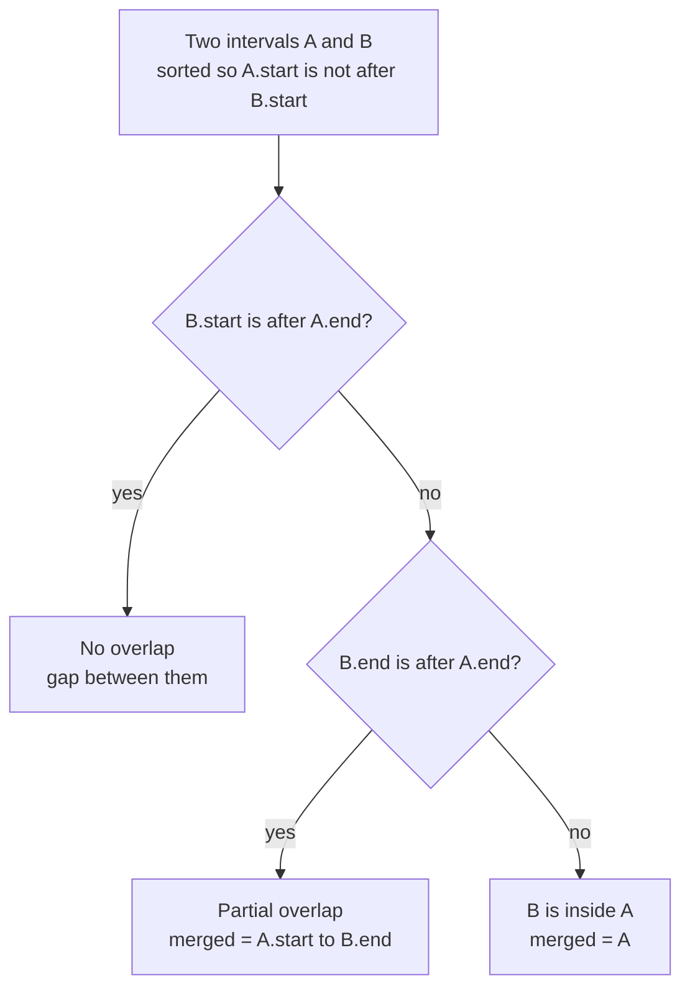
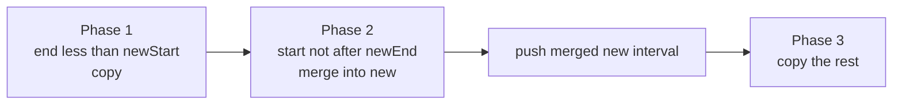
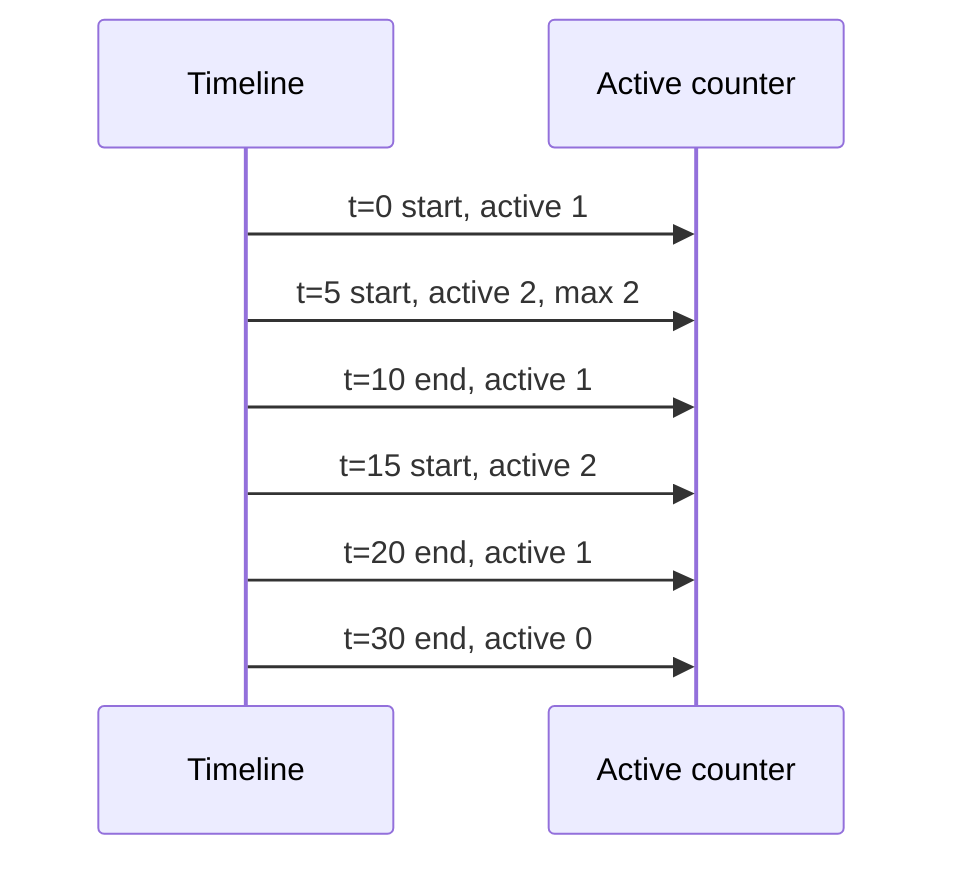

# Prefix Sums and Intervals

> In this document you will learn two related patterns. **Prefix sums** answer "what is the total of this range?" in O(1) and, with a hash map, count subarrays with a given sum. **Interval techniques** (sort by start, merge, sweep line) solve scheduling and overlap problems. You will solve 13 classic problems, from range sum query to meeting rooms II.

**Before this:** [Arrays and hashing](01-arrays-and-hashing.md) · [Sliding window](03-sliding-window.md) · [Problem solving and complexity](../11-coding-interviews/02-problem-solving-and-complexity.md) · **Interview questions:** [jump to the interview section](#interview-questions)

## Table of contents

1. [The pattern](#the-pattern)
2. [Problems](#problems)
3. [Interview questions](#interview-questions)
4. [Summary](#summary)
5. [References](#references)

Problems in this document:

| # | Problem | Level | Main idea |
| --- | --- | --- | --- |
| P1 | [Range sum query](#p1-range-sum-query-easy) | Easy | Prefix array with a leading 0 |
| P2 | [Find pivot index](#p2-find-pivot-index-easy) | Easy | Left sum vs total |
| P3 | [Meeting rooms](#p3-meeting-rooms-easy) | Easy | Sort by start, check neighbours |
| P4 | [Range sum query 2D](#p4-range-sum-query-2d-medium) | Medium | 2D prefix sums, inclusion-exclusion |
| P5 | [Subarray sum equals k](#p5-subarray-sum-equals-k-medium) | Medium | Prefix sum + Map of counts |
| P6 | [Contiguous array](#p6-contiguous-array-medium) | Medium | Turn 0 into −1, Map of first index |
| P7 | [Range addition and car pooling](#p7-range-addition-and-car-pooling-medium) | Medium | Difference array |
| P8 | [Merge intervals](#p8-merge-intervals-medium) | Medium | Sort by start, extend the last |
| P9 | [Insert interval](#p9-insert-interval-medium) | Medium | Three phases: before, overlap, after |
| P10 | [Non-overlapping intervals](#p10-non-overlapping-intervals-medium) | Medium | Sort by end, keep the earliest end |
| P11 | [Meeting rooms II](#p11-meeting-rooms-ii-medium) | Medium | Sweep line over start and end events |
| P12 | [Interval list intersections](#p12-interval-list-intersections-medium) | Medium | Two pointers on two sorted lists |
| P13 | [Number of submatrices that sum to target](#p13-number-of-submatrices-that-sum-to-target-hard) | Hard | 2D prefix + subarray sum equals k |

---

## The pattern

This document has two halves that often appear together. Both turn a problem about **ranges** into simple arithmetic on **boundaries**.

### Part 1: prefix sums

#### What it is

A **prefix sum** array `prefix` stores the running total of an array. With a leading zero:

```text
nums   =    [3, -1,  4,  2,  5]
prefix = [0, 3,  2,  6,  8, 13]     prefix[i] = sum of nums[0 .. i-1]
```

The sum of the range from index `l` to index `r` (both included) is:

```text
sum(l, r) = prefix[r + 1] - prefix[l]
```

A first look, with the odometer analogy, is in [Pattern 4: Prefix sums](../11-coding-interviews/02-problem-solving-and-complexity.md#pattern-4-prefix-sums).

#### Why it exists

Without it, each range sum costs O(n). With q queries that is O(n · q). With prefix sums, you pay O(n) once, and every query is O(1).

The second, more powerful use: "a subarray from `j` to `i` has sum k" becomes "two prefix values differ by k". That turns a search over all O(n²) subarrays into a hash map lookup.

#### Analogy

A car's odometer shows the total distance since the car was built. To know how far you drove from city A to city B, you subtract the two readings. You never re-measure the road. The prefix array is a list of odometer readings, one per element.

#### When to recognize it

| Signal | Technique |
| --- | --- |
| Many "sum of range l..r" queries on an array that does not change | Prefix array |
| "Count / longest subarrays with sum k" and values can be **negative** | Prefix sum + Map |
| "Equal number of 0s and 1s", "balance", "as many A as B" | Map +1/−1, then prefix sum = 0 difference |
| "Sum divisible by k" | Prefix sum mod k + Map |
| Many "add v to range l..r" updates, then read the final array | Difference array |
| Sum of a rectangle in a grid | 2D prefix sums |

#### Templates

**Template 1: build a prefix array.**

```js
function buildPrefix(nums) {
  const prefix = new Array(nums.length + 1).fill(0);
  for (let i = 0; i < nums.length; i++) prefix[i + 1] = prefix[i] + nums[i];
  return prefix;
}

const prefix = buildPrefix([3, -1, 4, 2, 5]);
console.log(prefix);                 // [ 0, 3, 2, 6, 8, 13 ]
console.log(prefix[4] - prefix[1]);  // 5   (sum of indices 1..3: -1 + 4 + 2)
```

**Template 2: prefix sum + hash map (count subarrays with a property).**

```js
function countSubarraysWithSum(nums, k) {
  const seen = new Map([[0, 1]]); // the empty prefix: sum 0, seen once
  let prefixSum = 0;
  let count = 0;
  for (const x of nums) {
    prefixSum += x;
    count += seen.get(prefixSum - k) ?? 0;              // 1. look up partners
    seen.set(prefixSum, (seen.get(prefixSum) ?? 0) + 1); // 2. then store yourself
  }
  return count;
}

console.log(countSubarraysWithSum([1, 2, 3], 3)); // 2
```

**Template 3: difference array (many range updates).**

```js
function applyRangeAdds(length, updates) {
  const diff = new Array(length + 1).fill(0);
  for (const [l, r, v] of updates) {
    diff[l] += v;     // from l onward, add v
    diff[r + 1] -= v; // from r+1 onward, stop adding v
  }
  const result = new Array(length);
  let running = 0;
  for (let i = 0; i < length; i++) {
    running += diff[i];
    result[i] = running;
  }
  return result;
}

console.log(applyRangeAdds(5, [[1, 3, 2], [2, 4, 3], [0, 2, -2]])); // [ -2, 0, 3, 5, 3 ]
```

A **difference array** is the opposite of a prefix sum. It stores how much each position **changes** compared with the previous one. One range update touches only two cells. A prefix sum at the end turns the changes back into values.

### Part 2: intervals

#### What it is

An **interval** is a pair `[start, end]`. Interval problems ask about overlaps: merge them, count how many overlap at once, remove the fewest so none overlap, or intersect two lists.

The key first step is almost always: **sort by start** (or by end, for some greedy problems). After sorting, an interval can only interact with its neighbours, so one pass is enough.

#### When two intervals overlap

For closed intervals `[a1, a2]` and `[b1, b2]`:

```text
they overlap  <=>  a1 <= b2  and  b1 <= a2
overlap part   =   [max(a1, b1), min(a2, b2)]   (valid when start <= end)
```



**Always ask:** do touching intervals overlap? `[1, 2]` and `[2, 3]` overlap for closed intervals (both include 2). For meetings, `[1, 2]` and `[2, 3]` usually **do not** conflict: the first meeting ends when the second starts. This changes `<` vs `<=` in your code.

#### Templates

**Template 4: sort and merge.**

```js
function mergeTemplate(intervals) {
  const sorted = intervals.toSorted((a, b) => a[0] - b[0]); // ES2023, does not change input
  const merged = [];
  for (const [start, end] of sorted) {
    const last = merged[merged.length - 1];
    if (last && start <= last[1]) last[1] = Math.max(last[1], end); // overlap: extend
    else merged.push([start, end]);                                  // gap: new interval
  }
  return merged;
}

console.log(mergeTemplate([[1, 3], [8, 10], [2, 6]])); // [ [ 1, 6 ], [ 8, 10 ] ]
```

**Template 5: sweep line (count overlaps at each moment).**

```js
function maxOverlap(intervals) {
  const events = [];
  for (const [start, end] of intervals) {
    events.push([start, +1]); // something begins
    events.push([end, -1]);   // something ends
  }
  // Sort by time. At the same time, process ends (-1) before starts (+1),
  // so [1, 2] and [2, 3] do not count as overlapping.
  events.sort((a, b) => a[0] - b[0] || a[1] - b[1]);
  let active = 0;
  let best = 0;
  for (const [, delta] of events) {
    active += delta;
    best = Math.max(best, active);
  }
  return best;
}

console.log(maxOverlap([[0, 30], [5, 10], [15, 20]])); // 2
```

A **sweep line** imagines a vertical line moving from left to right over time. At each event (a start or an end), a counter goes up or down. The maximum of the counter is the maximum number of overlapping intervals. It is the difference array idea applied to sorted events instead of array indices.

### Complexity

| Technique | Build | Query / pass |
| --- | --- | --- |
| Prefix array | O(n) | O(1) per range sum |
| Prefix + Map | — | O(n) time, O(n) space |
| 2D prefix | O(rows · cols) | O(1) per rectangle |
| Difference array | O(1) per update | O(n) to rebuild values |
| Sort intervals | O(n log n) | O(n) pass |
| Sweep line | O(n log n) sort | O(n) pass |

### Common mistakes

- **Off-by-one in prefix indexing.** With the leading 0, the sum of `l..r` is `prefix[r + 1] - prefix[l]`. Without it, you need a special case for `l = 0`.
- **Forgetting the `0 → 1` (or `0 → -1` index) entry** in prefix + Map problems. Subarrays that start at index 0 are then missed.
- **Storing before looking up** in prefix + Map. With `k = 0`, each prefix would match itself, and you would count empty subarrays.
- **Negative remainders.** In JavaScript, `-1 % 5` is `-1`, not `4`. Use `((x % k) + k) % k`.
- **Sorting intervals without a comparator**, or sorting them as strings.
- **Mutating the caller's intervals** while merging (`last[1] = ...` changes the input arrays if you did not copy them).
- **Mixing up closed and half-open intervals** (`<=` vs `<`). Ask, and write it down.

---

## Problems

Each problem follows the same order: problem, examples, how to recognize the pattern, brute force, optimal approach, code, dry run, complexity, edge cases, follow-ups, and how to say it in the interview.

### P1. Range sum query (Easy)

**Problem:** Build a class that takes an array of numbers once. Then it answers many queries `sumRange(left, right)`: the sum of elements from index `left` to `right`, both included. The array does not change.

Similar to: LeetCode 303 Range Sum Query – Immutable. A short version is in [Simple example: many range-sum queries](../11-coding-interviews/02-problem-solving-and-complexity.md#simple-example-many-range-sum-queries). Here we focus on the design choice and on what to do when the array **does** change.

**Examples:**

```text
nums = [-2, 0, 3, -5, 2, -1]
sumRange(0, 2) -> 1     (-2 + 0 + 3)
sumRange(2, 5) -> -1    (3 - 5 + 2 - 1)
sumRange(0, 5) -> -3
```

**How to recognize the pattern:** "many range sum queries" + "array does not change" = build prefix sums once.

**Brute force:** loop from `left` to `right` for each query. O(n) per query, O(n · q) total.

**Optimal approach:**

1. In the constructor, build `prefix` with a leading 0.
2. `sumRange(l, r)` returns `prefix[r + 1] - prefix[l]`.

**Code:**

```js
class NumArray {
  #prefix; // private field: callers cannot change it by accident

  constructor(nums) {
    this.#prefix = new Array(nums.length + 1).fill(0);
    for (let i = 0; i < nums.length; i++) {
      this.#prefix[i + 1] = this.#prefix[i] + nums[i];
    }
  }

  sumRange(left, right) {
    return this.#prefix[right + 1] - this.#prefix[left];
  }
}

const numArray = new NumArray([-2, 0, 3, -5, 2, -1]);
console.log(numArray.sumRange(0, 2)); // 1
console.log(numArray.sumRange(2, 5)); // -1
console.log(numArray.sumRange(0, 5)); // -3
console.log(numArray.sumRange(3, 3)); // -5
```

**Dry run:** `prefix = [0, -2, -2, 1, -4, -2, -3]`.

- `sumRange(2, 5)` = `prefix[6] - prefix[2]` = −3 − (−2) = **−1**.
- `sumRange(0, 2)` = `prefix[3] - prefix[0]` = 1 − 0 = **1**.

**Complexity:** O(n) to build, O(1) per query, O(n) space.

**Edge cases:** a single-element range (`l === r`), the whole array, an empty array (no valid queries), floating-point values (small rounding errors can appear in prefix differences; for money, use integer cents).

**Follow-ups:**

- **What if the array changes between queries (LeetCode 307)?** A prefix array costs O(n) per update. Use a **Fenwick tree** (binary indexed tree) or a **segment tree**: O(log n) per update and per query. A Fenwick tree is short to write:

```js
class FenwickTree {
  constructor(n) { this.tree = new Array(n + 1).fill(0); }
  add(i, delta) { // 0-based index
    for (i++; i < this.tree.length; i += i & -i) this.tree[i] += delta;
  }
  prefixSum(i) { // sum of [0, i), 0-based
    let s = 0;
    for (; i > 0; i -= i & -i) s += this.tree[i];
    return s;
  }
  rangeSum(l, r) { return this.prefixSum(r + 1) - this.prefixSum(l); }
}

const ft = new FenwickTree(6);
[-2, 0, 3, -5, 2, -1].forEach((v, i) => ft.add(i, v));
console.log(ft.rangeSum(2, 5)); // -1
ft.add(3, 10);                  // nums[3] becomes 5
console.log(ft.rangeSum(2, 5)); // 9
```

`i & -i` keeps only the lowest set bit of `i`. That bit decides how many elements each tree cell covers. Bit tricks are explained in [Tries, bit manipulation and math](14-tries-bit-manipulation-and-math.md).

- **Real-world use?** Dashboards that show "total sales between two dates" for many date ranges, over data that is updated once a day.

**How to say it in the interview:**
> "Because the array does not change and there are many queries, I precompute prefix sums once, with a leading zero so that ranges starting at index zero need no special case. Then the sum from left to right is prefix of right plus one minus prefix of left. That is O(n) to build and O(1) per query. If the array could change, I would use a Fenwick tree or a segment tree to get O(log n) updates and queries."

---

### P2. Find pivot index (Easy)

**Problem:** You get an array. Return the leftmost index `i` where the sum of all elements to the **left** of `i` equals the sum of all elements to the **right** of `i`. Return −1 if there is none. The element at `i` itself is in neither side.

Similar to: LeetCode 724 Find Pivot Index.

**Examples:**

```text
[1, 7, 3, 6, 5, 6]  -> 3    (left 1+7+3 = 11, right 5+6 = 11)
[1, 2, 3]           -> -1
[2, 1, -1]          -> 0    (left sum is 0, right 1 + -1 = 0)
```

**How to recognize the pattern:** "sum to the left" and "sum to the right" of each index = prefix sums. You do not even need the array: `right = total - left - nums[i]`.

**Brute force:** for each index, sum both sides. O(n²).

**Optimal approach:**

1. Compute `total`.
2. Walk with `left = 0`. At index `i`, `right = total - left - nums[i]`.
3. If `left === right`, return `i`. Otherwise `left += nums[i]`.

**Code:**

```js
function pivotIndex(nums) {
  const total = nums.reduce((sum, x) => sum + x, 0);
  let left = 0;
  for (let i = 0; i < nums.length; i++) {
    const right = total - left - nums[i];
    if (left === right) return i;
    left += nums[i];
  }
  return -1;
}

console.log(pivotIndex([1, 7, 3, 6, 5, 6])); // 3
console.log(pivotIndex([1, 2, 3]));          // -1
console.log(pivotIndex([2, 1, -1]));         // 0
console.log(pivotIndex([0]));                // 0
```

**Dry run** for `[1, 7, 3, 6, 5, 6]` (total 28):

| i | nums[i] | left | right = 28 − left − nums[i] | equal? |
| --- | --- | --- | --- | --- |
| 0 | 1 | 0 | 27 | no |
| 1 | 7 | 1 | 20 | no |
| 2 | 3 | 8 | 17 | no |
| 3 | 6 | 11 | 11 | yes → 3 |

**Complexity:** O(n) time, O(1) space.

**Edge cases:** a single element (index 0: both sides are empty, sum 0), negative numbers (fine; this is why a two-pointer "balance" approach does not work here), pivot at the last index.

**Follow-ups:**

- **Split the array into two parts with equal sum (no pivot element)?** Same walk; check `left === total - left` after adding `nums[i]`.
- **Why not two pointers moving inward until the sums balance?** With negative numbers, moving a pointer can increase or decrease a side, so you cannot decide which pointer to move.

**How to say it in the interview:**
> "The right sum at index i is the total minus the left sum minus nums[i]. So I compute the total once, then walk the array keeping a running left sum. At each index I compute the right sum in O(1) and compare. The first match is the answer. O(n) time and O(1) space, and it works with negative numbers."

---

### P3. Meeting rooms (Easy)

**Problem:** You get a list of meeting time intervals `[start, end]`. Can one person attend **all** of them? A meeting that ends at time 10 does not conflict with one that starts at time 10.

Similar to: LeetCode 252 Meeting Rooms.

**Examples:**

```text
[[0, 30], [5, 10], [15, 20]]  -> false
[[7, 10], [2, 4]]             -> true
[[1, 5], [5, 8]]              -> true   (back to back is fine)
[]                            -> true
```

**How to recognize the pattern:** "do any intervals overlap?" → sort by start, then each interval only needs to be compared with the one just before it.

**Brute force:** compare every pair. O(n²).

**Optimal approach:**

1. Sort by start time.
2. For each meeting after the first: if it starts **before** the previous one ends, return `false`.
3. Return `true`.

**Code:**

```js
function canAttendMeetings(meetings) {
  const sorted = meetings.toSorted((a, b) => a[0] - b[0]);
  for (let i = 1; i < sorted.length; i++) {
    if (sorted[i][0] < sorted[i - 1][1]) return false; // starts before the previous ends
  }
  return true;
}

console.log(canAttendMeetings([[0, 30], [5, 10], [15, 20]])); // false
console.log(canAttendMeetings([[7, 10], [2, 4]]));            // true
console.log(canAttendMeetings([[1, 5], [5, 8]]));             // true
console.log(canAttendMeetings([]));                           // true
```

`toSorted` (ES2023, Node.js 20+) returns a sorted copy, so the caller's array is not changed. On older runtimes, use `[...meetings].sort(...)`.

**Dry run** for `[[0, 30], [5, 10], [15, 20]]`: sorted is the same. At `i = 1`, `5 < 30` → conflict → `false`.

**Why is comparing only neighbours enough?** After sorting by start, if meeting `i` does not overlap meeting `i − 1`, it starts after `i − 1` ends. Every meeting before `i − 1` started even earlier, and (since there were no conflicts so far) ended before `i − 1` started. So no earlier meeting can overlap `i`.

**Complexity:** O(n log n) for the sort, O(n) for the scan. O(n) space for the sorted copy.

**Edge cases:** empty list, one meeting, back-to-back meetings (`<` not `<=`), meetings with the same start. (Interview versions usually promise `start < end`; ask what a zero-length meeting means if it can appear.)

**Follow-ups:**

- **Return the conflicting pair?** Return `[sorted[i - 1], sorted[i]]` instead of `false`.
- **How many rooms are needed?** That is meeting rooms II, see P11.
- **Real-world use?** Calendar apps checking a new booking against existing ones. With a sorted list of bookings, you can binary search the insert position and only compare with the two neighbours: O(log n) per check.

**How to say it in the interview:**
> "One person can attend everything only if no two meetings overlap. I sort by start time; after that, a meeting can only overlap the one right before it. So I scan once and check if any meeting starts before the previous one ends. I use strict less-than, because back-to-back meetings are fine. O(n log n) for the sort."

---

### P4. Range sum query 2D (Medium)

**Problem:** You get a 2D grid of numbers. Answer many queries `sumRegion(r1, c1, r2, c2)`: the sum of the rectangle with top-left corner `(r1, c1)` and bottom-right corner `(r2, c2)`, both included. The grid does not change.

Similar to: LeetCode 304 Range Sum Query 2D – Immutable.

**Examples:**

```text
grid = [
  [3, 0, 1, 4, 2],
  [5, 6, 3, 2, 1],
  [1, 2, 0, 1, 5],
  [4, 1, 0, 1, 7],
  [1, 0, 3, 0, 5],
]
sumRegion(2, 1, 4, 3) -> 8
sumRegion(1, 1, 2, 2) -> 11
sumRegion(1, 2, 2, 4) -> 12
```

**How to recognize the pattern:** many rectangle sums on a fixed grid = 2D prefix sums.

**Brute force:** sum every cell of the rectangle. O(rows · cols) per query.

**Optimal approach:**

1. Build `P` with one extra row and column of zeros. `P[r + 1][c + 1]` = sum of the rectangle from `(0, 0)` to `(r, c)`.
2. Build rule (inclusion-exclusion): `P[r+1][c+1] = grid[r][c] + P[r][c+1] + P[r+1][c] - P[r][c]`. The top and left areas both include the top-left area, so you subtract it once.
3. Query rule: `sum = P[r2+1][c2+1] - P[r1][c2+1] - P[r2+1][c1] + P[r1][c1]`. You remove the area above and the area to the left, then add back the corner that you removed twice.

```text
        c1      c2
    +-------+-------+
    |   D   |   B   |       sum(A) = total(A+B+C+D) - (B+D) - (C+D) + D
 r1 +-------+-------+
    |   C   |   A   |
 r2 +-------+-------+
```

**Code:**

```js
class NumMatrix {
  constructor(grid) {
    const rows = grid.length;
    const cols = rows ? grid[0].length : 0;
    this.P = Array.from({ length: rows + 1 }, () => new Array(cols + 1).fill(0));
    for (let r = 0; r < rows; r++) {
      for (let c = 0; c < cols; c++) {
        this.P[r + 1][c + 1] = grid[r][c] + this.P[r][c + 1] + this.P[r + 1][c] - this.P[r][c];
      }
    }
  }

  sumRegion(r1, c1, r2, c2) {
    const P = this.P;
    return P[r2 + 1][c2 + 1] - P[r1][c2 + 1] - P[r2 + 1][c1] + P[r1][c1];
  }
}

const matrix = new NumMatrix([
  [3, 0, 1, 4, 2],
  [5, 6, 3, 2, 1],
  [1, 2, 0, 1, 5],
  [4, 1, 0, 1, 7],
  [1, 0, 3, 0, 5],
]);
console.log(matrix.sumRegion(2, 1, 4, 3)); // 8
console.log(matrix.sumRegion(1, 1, 2, 2)); // 11
console.log(matrix.sumRegion(1, 2, 2, 4)); // 12
console.log(matrix.sumRegion(0, 0, 0, 0)); // 3
```

**Dry run** of `sumRegion(1, 1, 2, 2)` (cells 6, 3, 2, 0):

- `P[3][3]` = sum of rows 0–2, cols 0–2 = 3+0+1 + 5+6+3 + 1+2+0 = 21.
- `P[1][3]` = row 0, cols 0–2 = 4.
- `P[3][1]` = rows 0–2, col 0 = 3 + 5 + 1 = 9.
- `P[1][1]` = cell (0, 0) = 3.
- Sum = 21 − 4 − 9 + 3 = **11** ✓ (6 + 3 + 2 + 0).

**Complexity:** O(rows · cols) to build, O(1) per query, O(rows · cols) space.

**Edge cases:** an empty grid, a single row or column, a 1 × 1 query, negative values.

**Follow-ups:**

- **Updates allowed?** Use a 2D Fenwick tree: O(log rows · log cols) per update and query.
- **Where is this used?** Image processing calls it an **integral image** (or summed-area table). It makes box blur and face-detection features (Viola–Jones) fast, because any rectangle sum is O(1).

**How to say it in the interview:**
> "I build a 2D prefix table with an extra zero row and column, where each cell holds the sum of the rectangle from the top-left corner to that cell. To build a cell, I add the cell value plus the sums above and to the left, and subtract the top-left overlap that I counted twice. A query is the same idea in reverse: the big rectangle, minus the area above, minus the area to the left, plus the corner I subtracted twice. O(rows times cols) to build and O(1) per query."

---

### P5. Subarray sum equals k (Medium)

**Problem:** You get an array of integers (negatives allowed) and an integer `k`. Return the number of contiguous subarrays whose sum is exactly `k`.

Similar to: LeetCode 560 Subarray Sum Equals K. The basic solution and its walkthrough are in [Worked problem: subarray sum equals k](../11-coding-interviews/02-problem-solving-and-complexity.md#worked-problem-subarray-sum-equals-k) and a short version is in [Arrays and hashing P11](01-arrays-and-hashing.md#p11-subarray-sum-equals-k-medium). This is the **full** treatment: why it works, and the family of problems that use the same idea.

**Examples:**

```text
nums = [1, 1, 1],        k = 2   -> 2
nums = [1, 2, 3],        k = 3   -> 2
nums = [1, -1, 0],       k = 0   -> 3
nums = [0, 0, 0],        k = 0   -> 6
```

**How to recognize the pattern:** "count subarrays with sum k" + negatives allowed. Sliding window fails (see [Sliding window Q3](03-sliding-window.md#q3-why-does-the-sliding-window-fail-when-numbers-can-be-negative)). Prefix sums turn "subarray" into "pair of prefixes".

**Brute force:** two loops with a running sum. O(n²).

**Optimal approach (why it works, step by step):**

1. Let `P(i)` be the sum of the first `i` elements. `P(0) = 0`.
2. The subarray from index `j` to index `i − 1` has sum `P(i) − P(j)`.
3. We want `P(i) − P(j) = k`, so `P(j) = P(i) − k`.
4. For each `i`, the number of good subarrays ending at `i − 1` is **how many earlier prefixes equal `P(i) − k`**. A Map of prefix counts answers this in O(1).

**Code:**

```js
function subarraySum(nums, k) {
  const countOf = new Map([[0, 1]]); // P(0) = 0 has been seen once
  let prefix = 0;
  let count = 0;
  for (const x of nums) {
    prefix += x;
    count += countOf.get(prefix - k) ?? 0;
    countOf.set(prefix, (countOf.get(prefix) ?? 0) + 1);
  }
  return count;
}

console.log(subarraySum([1, 1, 1], 2));  // 2
console.log(subarraySum([1, 2, 3], 3));  // 2
console.log(subarraySum([1, -1, 0], 0)); // 3
console.log(subarraySum([0, 0, 0], 0));  // 6
```

**The same family — change what you store in the Map:**

```js
// 1. Longest subarray with sum k: store the FIRST index of each prefix (LeetCode 325).
function maxSubArrayLen(nums, k) {
  const firstIndex = new Map([[0, -1]]); // prefix 0 "happens" before index 0
  let prefix = 0;
  let best = 0;
  for (let i = 0; i < nums.length; i++) {
    prefix += nums[i];
    if (firstIndex.has(prefix - k)) best = Math.max(best, i - firstIndex.get(prefix - k));
    if (!firstIndex.has(prefix)) firstIndex.set(prefix, i); // keep the earliest only
  }
  return best;
}

console.log(maxSubArrayLen([1, -1, 5, -2, 3], 3)); // 4   ([1, -1, 5, -2])
console.log(maxSubArrayLen([-2, -1, 2, 1], 1));    // 2   ([-1, 2])

// 2. Count subarrays whose sum is divisible by k: store prefix MOD k (LeetCode 974).
function subarraysDivByK(nums, k) {
  const countOf = new Map([[0, 1]]);
  let prefix = 0;
  let count = 0;
  for (const x of nums) {
    prefix = (((prefix + x) % k) + k) % k; // safe modulo: never negative
    count += countOf.get(prefix) ?? 0;     // same remainder => difference divisible by k
    countOf.set(prefix, (countOf.get(prefix) ?? 0) + 1);
  }
  return count;
}

console.log(subarraysDivByK([4, 5, 0, -2, -3, 1], 5)); // 7
console.log(-7 % 5);                                   // -2
console.log(((-7 % 5) + 5) % 5);                       // 3
```

**Dry run** of `subarraySum([0, 0, 0], 0)`:

| x | prefix | look up prefix − 0 = 0 | found | count | Map after |
| --- | --- | --- | --- | --- | --- |
| — | 0 | — | — | 0 | {0:1} |
| 0 | 0 | 0 | 1 | 1 | {0:2} |
| 0 | 0 | 0 | 2 | 3 | {0:3} |
| 0 | 0 | 0 | 3 | 6 | {0:4} |

Six subarrays: three of length 1, two of length 2, one of length 3.

**Complexity:** O(n) time, O(n) space for all three versions.

**Edge cases:** `k = 0` (look up before storing, or you count empty subarrays), all zeros, negative numbers, negative remainders in the modulo version, very large sums (exact up to 2^53 − 1 in JavaScript; beyond that use `BigInt`).

**Follow-ups:**

- **Why look up before storing?** The current prefix must pair with **earlier** prefixes only. If you store first, then for `k = 0` the prefix pairs with itself, which means an empty subarray.
- **All numbers are positive. Is there an O(1) space solution?** Yes: a sliding window, because the sum grows as the window grows.
- **Return the subarrays, not just the count?** Store a list of indices per prefix value. The output can be O(n²) large, so the time is O(n + output).
- **Continuous subarray sum (LeetCode 523): length ≥ 2 and sum a multiple of k?** Use the "first index of each remainder" Map and check `i - firstIndex >= 2`.

**How to say it in the interview:**
> "A subarray sum is a difference of two prefix sums. So a subarray ending here has sum k exactly when an earlier prefix equals the current prefix minus k. I walk once, keep a running prefix, and keep a Map from prefix value to how many times I have seen it, starting with zero seen once. For each element I add the count of prefix minus k, then I record the current prefix. O(n) time and space, and it works with negatives. If I need the longest subarray instead, I store the first index of each prefix; for divisibility I store the prefix modulo k."

---

### P6. Contiguous array (Medium)

**Problem:** You get a binary array (only 0s and 1s). Return the length of the longest contiguous subarray with an **equal number** of 0s and 1s.

Similar to: LeetCode 525 Contiguous Array.

**Examples:**

```text
[0, 1]                 -> 2
[0, 1, 0]              -> 2
[0, 0, 1, 0, 0, 0, 1, 1] -> 6   ([1, 0, 0, 0, 1, 1], indices 2 to 7)
[1, 1, 1]              -> 0
```

**How to recognize the pattern:** "equal number of A and B" becomes "sum is 0" if you count A as −1 and B as +1. Then it is "longest subarray with sum 0", which is P5's longest version with `k = 0`.

**Brute force:** for each start, extend and count. O(n²).

**Optimal approach:**

1. Treat 0 as −1 and 1 as +1. Keep a running `balance`.
2. Equal counts between two positions means **the same balance** at both positions.
3. Keep a Map `balance → first index where it appeared`. Start with `0 → -1`.
4. At each index, if the balance was seen before, the subarray after that first index is balanced. Its length is `i - firstIndex.get(balance)`.

**Code:**

```js
function findMaxLength(nums) {
  const firstIndex = new Map([[0, -1]]); // balance 0 before the array starts
  let balance = 0;
  let best = 0;
  for (let i = 0; i < nums.length; i++) {
    balance += nums[i] === 1 ? 1 : -1;
    if (firstIndex.has(balance)) {
      best = Math.max(best, i - firstIndex.get(balance));
    } else {
      firstIndex.set(balance, i); // only the first time: it gives the longest subarray
    }
  }
  return best;
}

console.log(findMaxLength([0, 1]));                   // 2
console.log(findMaxLength([0, 1, 0]));                // 2
console.log(findMaxLength([0, 0, 1, 0, 0, 0, 1, 1])); // 6
console.log(findMaxLength([1, 1, 1]));                // 0
```

**Dry run** for `[0, 0, 1, 0, 0, 0, 1, 1]`:

| i | value | balance | first seen at | length | best |
| --- | --- | --- | --- | --- | --- |
| — | — | 0 | −1 | — | 0 |
| 0 | 0 | −1 | new → 0 | — | 0 |
| 1 | 0 | −2 | new → 1 | — | 0 |
| 2 | 1 | −1 | 0 | 2 | 2 |
| 3 | 0 | −2 | 1 | 2 | 2 |
| 4 | 0 | −3 | new → 4 | — | 2 |
| 5 | 0 | −4 | new → 5 | — | 2 |
| 6 | 1 | −3 | 4 | 2 | 2 |
| 7 | 1 | −2 | 1 | 6 | 6 |

The answer 6 is the subarray from index 2 to 7: `[1, 0, 0, 0, 1, 1]`, with three 0s and three 1s.

**Complexity:** O(n) time, O(n) space (balances range from −n to n).

**Edge cases:** no balanced subarray (0), the whole array is balanced (n), length 1 (0).

**Follow-ups:**

- **Faster than a Map?** The balance is between −n and n, so use an array of size `2n + 1` with offset `n`. Same Big-O, faster in practice.
- **Count balanced subarrays instead of the longest?** Store counts instead of first indices (P5's counting version with `k = 0`).
- **Where does this trick appear?** "Longest well-performing interval" (LeetCode 1124: hours > 8 count +1, else −1), and checking balanced brackets by depth.

**How to say it in the interview:**
> "If I count a 1 as plus one and a 0 as minus one, equal counts mean a sum of zero, so two positions with the same running balance enclose a balanced subarray. I keep a Map from each balance value to the first index where it appeared, starting with balance zero at index minus one. When I see a balance again, the distance to its first index is a candidate length. I only store the first index, because that gives the longest subarray. O(n) time and space."

---

### P7. Range addition and car pooling (Medium)

**Problem A (range addition):** You have an array of `length` zeros. You get many updates `[start, end, inc]`: add `inc` to every element from `start` to `end`. Return the final array.

**Problem B (car pooling):** A car has `capacity` seats. Trips are `[passengers, from, to]`: that many passengers get in at stop `from` and get out at stop `to`. Can the car finish all trips without ever having more than `capacity` passengers?

Similar to: LeetCode 370 Range Addition and LeetCode 1094 Car Pooling.

**Examples:**

```text
A: length = 5, updates = [[1, 3, 2], [2, 4, 3], [0, 2, -2]]  -> [-2, 0, 3, 5, 3]
B: trips = [[2, 1, 5], [3, 3, 7]], capacity = 4  -> false   (at stop 3 there are 5 people)
B: trips = [[2, 1, 5], [3, 3, 7]], capacity = 5  -> true
B: trips = [[2, 1, 5], [3, 5, 7]], capacity = 3  -> true    (the first group leaves at 5)
```

**How to recognize the pattern:** many "add to a range" updates, and you only need the final values (or the maximum) = **difference array**. Car pooling is the same: each trip adds passengers on a range of stops.

**Brute force:** apply each update to every element in its range. O(n · u) for u updates.

**Optimal approach:**

1. `diff[start] += inc` and `diff[end + 1] -= inc` for each update. O(1) per update.
2. A prefix sum over `diff` gives the final values.
3. For car pooling, passengers are **in the car** on stops `from … to − 1` (they leave at `to`). So `diff[from] += p` and `diff[to] -= p`. Then check that the running sum never exceeds `capacity`.

**Code:**

```js
function getModifiedArray(length, updates) {
  const diff = new Array(length + 1).fill(0);
  for (const [start, end, inc] of updates) {
    diff[start] += inc;
    diff[end + 1] -= inc;
  }
  const result = new Array(length);
  let running = 0;
  for (let i = 0; i < length; i++) {
    running += diff[i];
    result[i] = running;
  }
  return result;
}

console.log(getModifiedArray(5, [[1, 3, 2], [2, 4, 3], [0, 2, -2]])); // [ -2, 0, 3, 5, 3 ]

function carPooling(trips, capacity) {
  let lastStop = 0;
  for (const [, , to] of trips) lastStop = Math.max(lastStop, to);
  const diff = new Array(lastStop + 1).fill(0);
  for (const [passengers, from, to] of trips) {
    diff[from] += passengers; // they get in at "from"
    diff[to] -= passengers;   // they get out at "to" (not counted at "to")
  }
  let inCar = 0;
  for (let stop = 0; stop <= lastStop; stop++) {
    inCar += diff[stop];
    if (inCar > capacity) return false;
  }
  return true;
}

console.log(carPooling([[2, 1, 5], [3, 3, 7]], 4)); // false
console.log(carPooling([[2, 1, 5], [3, 3, 7]], 5)); // true
console.log(carPooling([[2, 1, 5], [3, 5, 7]], 3)); // true
```

**Dry run** of range addition, `diff` after all updates (length 6):

| update | diff after |
| --- | --- |
| [1, 3, +2] | [0, 2, 0, 0, −2, 0] |
| [2, 4, +3] | [0, 2, 3, 0, −2, −3] |
| [0, 2, −2] | [−2, 2, 3, 2, −2, −3] |

Prefix sums of the first 5 cells: −2, 0, 3, 5, 3 ✓.

**Complexity:** O(n + u) time, O(n) space. For car pooling, n is the last stop number.

**Edge cases:** an update that ends at the last index (that is why `diff` has `length + 1` cells), negative increments, overlapping updates, a trip with 0 passengers.

**Follow-ups:**

- **Stops are huge numbers like timestamps (up to 10⁹)?** A `diff` array of that size is too big. Use **sweep line** events instead: sort the `(time, delta)` pairs (Template 5). O(u log u).
- **2D version (add v to a rectangle)?** A 2D difference array: add at `(r1, c1)`, subtract at `(r1, c2 + 1)` and `(r2 + 1, c1)`, add at `(r2 + 1, c2 + 1)`. Then do a 2D prefix sum.
- **Real-world use?** Counting concurrent users per minute from session start/end logs, or building a "busy level" timeline for a calendar.

**How to say it in the interview:**
> "Applying each range update directly costs the length of the range. Instead I use a difference array: for an update on start to end, I add the value at start and subtract it at end plus one. Each update is O(1). At the end, one prefix-sum pass turns the differences into the real values. Car pooling is the same idea: passengers are added at the pickup stop and removed at the drop-off stop, and I check that the running total never goes above the capacity."

---

### P8. Merge intervals (Medium)

**Problem:** You get a list of intervals `[start, end]`. Merge all overlapping intervals (touching counts as overlapping) and return the result sorted.

Similar to: LeetCode 56 Merge Intervals. The basic solution and walkthrough are in [Worked problem: merge overlapping intervals](../11-coding-interviews/02-problem-solving-and-complexity.md#worked-problem-merge-overlapping-intervals). Here we recap the code and solve three common extensions: **total covered length**, **half-open intervals**, and **merging two already-sorted lists**.

**Examples:**

```text
[[1, 3], [2, 6], [8, 10], [15, 18]]  -> [[1, 6], [8, 10], [15, 18]]
[[1, 4], [4, 5]]                     -> [[1, 5]]
[[1, 10], [2, 3]]                    -> [[1, 10]]
```

**How to recognize the pattern:** "overlapping intervals" + "merge" = sort by start, then extend the last merged interval.

**Brute force:** repeatedly find any two overlapping intervals and merge them until none overlap. O(n²) or worse.

**Optimal approach:** sort by start. For each interval, if it starts at or before the end of the last merged one, extend that end with `Math.max`. Otherwise start a new merged interval.

**Code:**

```js
function merge(intervals) {
  const sorted = intervals.toSorted((a, b) => a[0] - b[0]);
  const merged = [];
  for (const [start, end] of sorted) {
    const last = merged.at(-1);
    if (last && start <= last[1]) last[1] = Math.max(last[1], end);
    else merged.push([start, end]); // a new array: the input is not changed
  }
  return merged;
}

console.log(merge([[1, 3], [2, 6], [8, 10], [15, 18]])); // [ [ 1, 6 ], [ 8, 10 ], [ 15, 18 ] ]
console.log(merge([[1, 4], [4, 5]]));                    // [ [ 1, 5 ] ]
console.log(merge([[1, 10], [2, 3]]));                   // [ [ 1, 10 ] ]

// Extension 1: total length covered by the union of intervals.
function coveredLength(intervals) {
  return merge(intervals).reduce((sum, [s, e]) => sum + (e - s), 0);
}

console.log(coveredLength([[1, 3], [2, 6], [8, 10]])); // 7   ((6 - 1) + (10 - 8))

// Extension 2: half-open intervals [start, end), where touching does NOT merge.
function mergeHalfOpen(intervals) {
  const sorted = intervals.toSorted((a, b) => a[0] - b[0]);
  const merged = [];
  for (const [start, end] of sorted) {
    const last = merged.at(-1);
    if (last && start < last[1]) last[1] = Math.max(last[1], end); // strict <
    else merged.push([start, end]);
  }
  return merged;
}

console.log(mergeHalfOpen([[1, 4], [4, 5]])); // [ [ 1, 4 ], [ 4, 5 ] ]

// Extension 3: two lists that are each already sorted and non-overlapping.
// Merge them like merge sort (O(n + m)) instead of sorting again.
function mergeTwoSortedLists(a, b) {
  const merged = [];
  let i = 0;
  let j = 0;
  while (i < a.length || j < b.length) {
    const next = j >= b.length || (i < a.length && a[i][0] <= b[j][0]) ? a[i++] : b[j++];
    const last = merged.at(-1);
    if (last && next[0] <= last[1]) last[1] = Math.max(last[1], next[1]);
    else merged.push([next[0], next[1]]);
  }
  return merged;
}

console.log(mergeTwoSortedLists([[1, 3], [7, 9]], [[2, 5], [10, 12]])); // [ [ 1, 5 ], [ 7, 9 ], [ 10, 12 ] ]
```

**Dry run** of `merge([[1, 10], [2, 3], [4, 12]])` (a case that tests `Math.max`):

| interval | last before | overlap? | last after |
| --- | --- | --- | --- |
| [1, 10] | — | — | push [1, 10] |
| [2, 3] | [1, 10] | yes (2 ≤ 10) | [1, max(10, 3)] = [1, 10] |
| [4, 12] | [1, 10] | yes (4 ≤ 10) | [1, 12] |

Result: `[[1, 12]]`. Without `Math.max`, the second step would shrink the interval to `[1, 3]`, and `[4, 12]` would become a separate interval.

**Complexity:** O(n log n) for the sort, O(n) for the pass. O(n) for the output. Extension 3 is O(n + m), because the inputs are already sorted.

**Edge cases:** empty list, one interval, all intervals overlap, nested intervals, intervals given in reverse order, single points like `[5, 5]`.

**Follow-ups:**

- **Intervals arrive one at a time and you must keep them merged?** Keep them in a sorted structure keyed by start (a balanced BST or a sorted array with binary search). Each insert finds its neighbours and merges with them: O(log n) to find, plus the merges. See P9.
- **Real-world use?** Merging busy slots from several calendars to find free time, combining highlighted text ranges in an editor, and merging IP address ranges in a firewall config.

**How to say it in the interview:**
> "I sort the intervals by start. Then each interval can only overlap the last interval I have merged so far. If it starts before or at the end of that interval, I extend the end, using the maximum of the two ends because one interval can be inside another. Otherwise I start a new merged interval. O(n log n) for the sort and O(n) for the pass. If touching intervals should stay separate, I change less-or-equal to strictly less."

---

### P9. Insert interval (Medium)

**Problem:** You get a list of intervals that is **sorted by start and has no overlaps**, and one new interval. Insert the new interval, merging where needed, so the list stays sorted and non-overlapping.

Similar to: LeetCode 57 Insert Interval.

**Examples:**

```text
intervals = [[1, 3], [6, 9]],                            new = [2, 5]  -> [[1, 5], [6, 9]]
intervals = [[1, 2], [3, 5], [6, 7], [8, 10], [12, 16]], new = [4, 8]  -> [[1, 2], [3, 10], [12, 16]]
intervals = [],                                          new = [5, 7]  -> [[5, 7]]
```

**How to recognize the pattern:** the input is already sorted and non-overlapping. You do not need to sort again (that would be O(n log n)). One linear pass in three phases is enough.

**Brute force:** add the new interval and run merge intervals (P8). O(n log n). Correct, but it ignores that the input is sorted.

**Optimal approach (three phases):**

1. **Before:** copy every interval that ends **before** the new one starts (`end < newStart`).
2. **Overlap:** while an interval starts at or before the new one ends (`start <= newEnd`), merge it into the new interval: `newStart = min`, `newEnd = max`. Then push the merged new interval.
3. **After:** copy the rest.



**Code:**

```js
function insert(intervals, newInterval) {
  const result = [];
  let [newStart, newEnd] = newInterval;
  let i = 0;
  const n = intervals.length;

  while (i < n && intervals[i][1] < newStart) {   // phase 1: completely before
    result.push(intervals[i]);
    i++;
  }
  while (i < n && intervals[i][0] <= newEnd) {    // phase 2: overlaps
    newStart = Math.min(newStart, intervals[i][0]);
    newEnd = Math.max(newEnd, intervals[i][1]);
    i++;
  }
  result.push([newStart, newEnd]);
  while (i < n) {                                  // phase 3: completely after
    result.push(intervals[i]);
    i++;
  }
  return result;
}

console.log(insert([[1, 3], [6, 9]], [2, 5]));                            // [ [ 1, 5 ], [ 6, 9 ] ]
console.log(insert([[1, 2], [3, 5], [6, 7], [8, 10], [12, 16]], [4, 8])); // [ [ 1, 2 ], [ 3, 10 ], [ 12, 16 ] ]
console.log(insert([], [5, 7]));                                          // [ [ 5, 7 ] ]
console.log(insert([[1, 5]], [6, 8]));                                    // [ [ 1, 5 ], [ 6, 8 ] ]
```

**Dry run** for `[[1, 2], [3, 5], [6, 7], [8, 10], [12, 16]]`, new `[4, 8]`:

| phase | interval | test | action | new interval |
| --- | --- | --- | --- | --- |
| 1 | [1, 2] | 2 < 4 | copy | [4, 8] |
| 1 | [3, 5] | 5 < 4? no | go to phase 2 | [4, 8] |
| 2 | [3, 5] | 3 ≤ 8 | merge | [3, 8] |
| 2 | [6, 7] | 6 ≤ 8 | merge | [3, 8] |
| 2 | [8, 10] | 8 ≤ 8 | merge | [3, 10] |
| 2 | [12, 16] | 12 ≤ 10? no | push [3, 10], go to phase 3 | — |
| 3 | [12, 16] | — | copy | — |

**Complexity:** O(n) time, O(n) for the output.

**Edge cases:** empty list, the new interval goes first or last, the new interval covers everything, touching intervals (`[1, 5]` with new `[5, 7]` merges because `5 <= 7` and `5 < 5` is false in phase 1).

**Follow-ups:**

- **Can you find the phase boundaries faster?** Yes, with binary search on the sorted starts and ends: O(log n) to find them. But building the output is still O(n) because of copying, unless you change the list in place with `splice`.
- **Many insertions?** Use a balanced tree (or a sorted map) keyed by start. Each insertion becomes O(log n + merged count).

**How to say it in the interview:**
> "The list is already sorted and non-overlapping, so I do not need to sort. I go through it in three phases. First I copy every interval that ends before the new one starts. Then, while intervals start before the new one ends, I merge them into the new interval by taking the minimum start and maximum end. I push the merged interval, and finally I copy the rest. One pass, O(n) time."

---

### P10. Non-overlapping intervals (Medium)

**Problem:** You get a list of intervals. Return the **minimum number of intervals to remove** so that the rest do not overlap. Touching intervals like `[1, 2]` and `[2, 3]` do **not** overlap here.

Similar to: LeetCode 435 Non-overlapping Intervals.

**Examples:**

```text
[[1, 2], [2, 3], [3, 4], [1, 3]]  -> 1   (remove [1, 3])
[[1, 2], [1, 2], [1, 2]]          -> 2
[[1, 2], [2, 3]]                  -> 0
```

**How to recognize the pattern:** "remove the fewest" = "keep the most". Keeping the most non-overlapping intervals is the classic **activity selection** problem, solved greedily by sorting by **end** time.

**Brute force:** try every subset of intervals to keep. O(2^n).

**Optimal approach (greedy by earliest end):**

1. Sort by end time.
2. Keep the first interval. Remember `lastEnd`.
3. For each next interval: if `start >= lastEnd`, keep it and set `lastEnd = end`. Otherwise it overlaps, so remove it (`removed++`).

**Why sort by end and not by start?** The interval that ends first leaves the most room for the others. If an optimal solution keeps some other interval first, you can **swap** it for the one that ends earliest. That swap never creates a new overlap, so the answer does not get worse. This is called an **exchange argument**, explained more in [Greedy algorithms](13-greedy-algorithms.md).

A counter-example for sorting by start: `[[1, 100], [2, 3], [4, 5]]`. By start you would keep `[1, 100]` first and then remove the other two. By end you keep `[2, 3]` and `[4, 5]` and remove only one.

**Code:**

```js
function eraseOverlapIntervals(intervals) {
  if (intervals.length === 0) return 0;
  const sorted = intervals.toSorted((a, b) => a[1] - b[1]); // by END
  let removed = 0;
  let lastEnd = sorted[0][1];
  for (let i = 1; i < sorted.length; i++) {
    const [start, end] = sorted[i];
    if (start >= lastEnd) {
      lastEnd = end; // keep it
    } else {
      removed++;     // overlaps the last kept interval: remove it
    }
  }
  return removed;
}

console.log(eraseOverlapIntervals([[1, 2], [2, 3], [3, 4], [1, 3]])); // 1
console.log(eraseOverlapIntervals([[1, 2], [1, 2], [1, 2]]));         // 2
console.log(eraseOverlapIntervals([[1, 2], [2, 3]]));                 // 0
console.log(eraseOverlapIntervals([[1, 100], [2, 3], [4, 5]]));       // 1
```

**Dry run** for `[[1, 2], [2, 3], [3, 4], [1, 3]]`, sorted by end: `[1, 2], [2, 3], [1, 3], [3, 4]`:

| interval | lastEnd before | start ≥ lastEnd? | action | lastEnd after | removed |
| --- | --- | --- | --- | --- | --- |
| [1, 2] | — | — | keep | 2 | 0 |
| [2, 3] | 2 | yes | keep | 3 | 0 |
| [1, 3] | 3 | no | remove | 3 | 1 |
| [3, 4] | 3 | yes | keep | 4 | 1 |

**Complexity:** O(n log n) for the sort, O(n) for the pass, O(n) for the sorted copy.

**Edge cases:** empty list, identical intervals, all disjoint (0), one interval that covers all others.

**Follow-ups:**

- **Minimum arrows to burst balloons (LeetCode 452)?** The same greedy. Sort by end, shoot at the end of the first balloon, skip every balloon that the arrow hits. Note: there, touching balloons **are** hit by one arrow, so the test is `start > lastEnd`. See [Greedy algorithms](13-greedy-algorithms.md).
- **Weighted version (each interval has a value, maximize total value)?** Greedy no longer works. Sort by end and use dynamic programming with binary search: "weighted interval scheduling". See [Dynamic programming](12-dynamic-programming.md).

**How to say it in the interview:**
> "Removing the fewest intervals is the same as keeping the most non-overlapping ones. I sort by end time and greedily keep each interval that starts at or after the end of the last one I kept; every other interval is removed. Picking the earliest end is safe because it leaves the most room for the rest: any optimal answer can swap its first interval for the earliest-ending one without creating overlaps. O(n log n) for the sort."

---

### P11. Meeting rooms II (Medium)

**Problem:** You get a list of meeting intervals `[start, end]`. Return the minimum number of meeting rooms needed so that all meetings can happen. A meeting that ends at time 10 frees its room for a meeting that starts at 10.

Similar to: LeetCode 253 Meeting Rooms II. A two-sorted-arrays version is in [A second example: minimum meeting rooms](../11-coding-interviews/02-problem-solving-and-complexity.md#a-second-example-minimum-meeting-rooms). The **min-heap** version is in [Heaps and top-k, P9](09-heaps-and-top-k.md#p9-meeting-rooms-ii-medium). Here we use the **sweep line** and also return which room each meeting gets.

**Examples:**

```text
[[0, 30], [5, 10], [15, 20]]  -> 2
[[7, 10], [2, 4]]             -> 1
[[1, 5], [5, 10], [10, 15]]   -> 1   (back to back)
[[1, 10], [2, 7], [3, 19], [8, 12], [10, 20], [11, 30]] -> 4
```

**How to recognize the pattern:** "minimum number of rooms" = "maximum number of meetings happening at the same moment". That is the sweep line count (Template 5).

**Brute force:** for each meeting's start time, count how many meetings cover that moment. O(n²). (The maximum overlap always happens at some start time.)

**Optimal approach (sweep line):**

1. Create events: `(start, +1)` and `(end, -1)`.
2. Sort by time. At equal times, put `-1` before `+1`, so a room is freed before it is needed again.
3. Walk the events with a running `active` count. The maximum is the answer.



**Code:**

```js
function minMeetingRooms(meetings) {
  const events = [];
  for (const [start, end] of meetings) {
    events.push([start, 1]);
    events.push([end, -1]);
  }
  events.sort((a, b) => a[0] - b[0] || a[1] - b[1]); // ends (-1) before starts (+1) at the same time
  let active = 0;
  let maxRooms = 0;
  for (const [, delta] of events) {
    active += delta;
    maxRooms = Math.max(maxRooms, active);
  }
  return maxRooms;
}

console.log(minMeetingRooms([[0, 30], [5, 10], [15, 20]]));  // 2
console.log(minMeetingRooms([[7, 10], [2, 4]]));             // 1
console.log(minMeetingRooms([[1, 5], [5, 10], [10, 15]]));   // 1
console.log(minMeetingRooms([[1, 10], [2, 7], [3, 19], [8, 12], [10, 20], [11, 30]])); // 4

// Extension: assign a room number to each meeting (reuse the lowest free room).
function assignRooms(meetings) {
  const order = meetings.map((m, i) => i).sort((a, b) => meetings[a][0] - meetings[b][0]);
  const roomFreeAt = []; // roomFreeAt[r] = time when room r becomes free
  const roomOf = new Array(meetings.length);
  for (const i of order) {
    const [start, end] = meetings[i];
    let room = roomFreeAt.findIndex((t) => t <= start); // O(rooms); a heap makes it O(log rooms)
    if (room === -1) room = roomFreeAt.push(0) - 1;     // open a new room
    roomFreeAt[room] = end;
    roomOf[i] = room;
  }
  return roomOf;
}

console.log(assignRooms([[0, 30], [5, 10], [15, 20]])); // [ 0, 1, 1 ]
```

**Dry run** of `minMeetingRooms([[0, 30], [5, 10], [15, 20]])`. Events sorted: (0, +1), (5, +1), (10, −1), (15, +1), (20, −1), (30, −1).

| event | active | maxRooms |
| --- | --- | --- |
| 0 start | 1 | 1 |
| 5 start | 2 | 2 |
| 10 end | 1 | 2 |
| 15 start | 2 | 2 |
| 20 end | 1 | 2 |
| 30 end | 0 | 2 |

**Complexity:** O(n log n) for sorting 2n events, O(n) space. `assignRooms` is O(n log n + n · rooms); with a min-heap of `(freeAt, room)` it becomes O(n log n).

**Edge cases:** empty list (0), back-to-back meetings (ends before starts at equal times), identical meetings (n rooms), one meeting inside another.

**Follow-ups:**

- **Which version should you present?** All three are O(n log n). The sweep line is the easiest to prove correct. The heap version (keep the end times of meetings in progress; pop when the earliest end ≤ the new start) is the most flexible, because it also tells you which room frees up. See [Heaps and top-k](09-heaps-and-top-k.md).
- **Times are small integers (like minutes in a day)?** Use a difference array of size 1,441 instead of sorting: O(n + 1440).
- **Real-world use?** Booking systems, CI build agents ("how many runners do we need at peak?"), and capacity planning for concurrent connections.

**How to say it in the interview:**
> "The number of rooms I need is the largest number of meetings that are happening at the same moment. I turn every meeting into two events, plus one at its start and minus one at its end, and sort them by time, putting ends before starts when the times are equal so back-to-back meetings share a room. Then I sweep through the events with a running counter and track its maximum. O(n log n) for the sort. A min-heap of end times gives the same complexity and also tells me which room frees up."

---

### P12. Interval list intersections (Medium)

**Problem:** You get two lists of closed intervals. Each list is sorted and has no overlaps inside it. Return the intersection of the two lists: all intervals that are covered by **both** lists.

Similar to: LeetCode 986 Interval List Intersections.

**Examples:**

```text
A = [[0, 2], [5, 10], [13, 23], [24, 25]]
B = [[1, 5], [8, 12], [15, 24], [25, 26]]
-> [[1, 2], [5, 5], [8, 10], [15, 23], [24, 24], [25, 25]]

A = [[1, 3], [5, 9]], B = []  -> []
```

**How to recognize the pattern:** two sorted lists = one pointer per list (see [Two pointers](02-two-pointers.md)). The intersection of two intervals is `[max(starts), min(ends)]` when it is not empty.

**Brute force:** compare every pair. O(n · m).

**Optimal approach:**

1. `i` points into `A`, `j` into `B`.
2. Compute `lo = max(A[i][0], B[j][0])` and `hi = min(A[i][1], B[j][1])`. If `lo <= hi`, push `[lo, hi]`.
3. Move the pointer of the interval that **ends first**. It cannot intersect anything else in the other list, because the other list's next interval starts even later.

**Code:**

```js
function intervalIntersection(A, B) {
  const result = [];
  let i = 0;
  let j = 0;
  while (i < A.length && j < B.length) {
    const lo = Math.max(A[i][0], B[j][0]);
    const hi = Math.min(A[i][1], B[j][1]);
    if (lo <= hi) result.push([lo, hi]);
    if (A[i][1] < B[j][1]) i++; // A[i] ends first
    else j++;
  }
  return result;
}

console.log(intervalIntersection(
  [[0, 2], [5, 10], [13, 23], [24, 25]],
  [[1, 5], [8, 12], [15, 24], [25, 26]],
)); // [ [ 1, 2 ], [ 5, 5 ], [ 8, 10 ], [ 15, 23 ], [ 24, 24 ], [ 25, 25 ] ]
console.log(intervalIntersection([[1, 3], [5, 9]], [])); // []
```

**Dry run** (first steps):

| A[i] | B[j] | lo, hi | push? | move |
| --- | --- | --- | --- | --- |
| [0, 2] | [1, 5] | 1, 2 | [1, 2] | i (2 < 5) |
| [5, 10] | [1, 5] | 5, 5 | [5, 5] | j (5 < 10) |
| [5, 10] | [8, 12] | 8, 10 | [8, 10] | i (10 < 12) |
| [13, 23] | [8, 12] | 13, 12 | no | j (12 < 23) |
| [13, 23] | [15, 24] | 15, 23 | [15, 23] | i |
| … | … | … | … | … |

**Complexity:** O(n + m) time, O(n + m) for the output.

**Edge cases:** one list empty, no intersections, single-point intersections (`[5, 5]`), intervals that are identical in both lists.

**Follow-ups:**

- **Find free time common to several people (LeetCode 759, "employee free time")?** Merge all busy intervals (P8), then the gaps between merged intervals are the common free times.
- **Intersection of k lists?** Intersect them two at a time, or use a sweep line and keep the times where the active count equals k.
- **Real-world use?** Finding a meeting slot that works for two calendars, or the time ranges when two monitoring alerts were both active.

**How to say it in the interview:**
> "Both lists are sorted, so I use one pointer in each. The overlap of two intervals is from the larger start to the smaller end, and it exists when that start is not after that end. After checking the current pair, I move the pointer whose interval ends first, because it cannot overlap anything later in the other list. Each step moves one pointer, so it is O(n plus m)."

---

### P13. Number of submatrices that sum to target (Hard)

**Problem:** You get a 2D grid of integers (negatives allowed) and a `target`. Count the non-empty submatrices (rectangles of cells) whose sum equals `target`.

Similar to: LeetCode 1074 Number of Submatrices That Sum to Target.

**Examples:**

```text
grid = [[0, 1, 0], [1, 1, 1], [0, 1, 0]], target = 0  -> 4   (the four single 0 cells)
grid = [[1, -1], [-1, 1]], target = 0                  -> 5
grid = [[904]], target = 0                             -> 0
```

**How to recognize the pattern:** this combines two earlier ideas. Fix a pair of rows `top` and `bottom`. Then every column becomes **one number**: the sum of that column between `top` and `bottom`. Counting rectangles with that row range is now "subarray sum equals k" (P5) on a 1D array.

**Brute force:** try every rectangle (O(r² · c²) of them) and sum it with a 2D prefix (O(1) each). O(r² · c²). For a 100 × 100 grid, that is 10⁸ rectangles — too slow in most interviews.

**Optimal approach:**

1. For each `top` row from 0 to r − 1:
2. Reset an array `colSum` of length c to zeros.
3. For each `bottom` row from `top` to r − 1: add row `bottom` into `colSum`. Now `colSum[c]` is the sum of column c between `top` and `bottom`.
4. Count subarrays of `colSum` with sum `target`, using the prefix + Map method.

**Code:**

```js
function numSubmatrixSumTarget(grid, target) {
  const rows = grid.length;
  const cols = grid[0].length;
  let total = 0;

  for (let top = 0; top < rows; top++) {
    const colSum = new Array(cols).fill(0);
    for (let bottom = top; bottom < rows; bottom++) {
      for (let c = 0; c < cols; c++) colSum[c] += grid[bottom][c];

      // "Subarray sum equals k" on colSum.
      const seen = new Map([[0, 1]]);
      let prefix = 0;
      for (let c = 0; c < cols; c++) {
        prefix += colSum[c];
        total += seen.get(prefix - target) ?? 0;
        seen.set(prefix, (seen.get(prefix) ?? 0) + 1);
      }
    }
  }
  return total;
}

console.log(numSubmatrixSumTarget([[0, 1, 0], [1, 1, 1], [0, 1, 0]], 0)); // 4
console.log(numSubmatrixSumTarget([[1, -1], [-1, 1]], 0));                // 5
console.log(numSubmatrixSumTarget([[904]], 0));                           // 0
```

**Dry run** for `[[1, -1], [-1, 1]]`, target 0:

| top, bottom | colSum | subarrays of colSum with sum 0 | running total |
| --- | --- | --- | --- |
| 0, 0 | [1, −1] | [1, −1] → 1 | 1 |
| 0, 1 | [0, 0] | [0], [0], [0, 0] → 3 | 4 |
| 1, 1 | [−1, 1] | [−1, 1] → 1 | 5 |

**Complexity:** O(r² · c) time, O(c) space. If there are more rows than columns, swap the roles (fix pairs of columns instead) to get O(min(r, c)² · max(r, c)).

**Edge cases:** a 1 × 1 grid, all zeros with target 0 (every rectangle counts), negative values, a single row (it is exactly P5).

**Follow-ups:**

- **Maximum sum rectangle (no target)?** Same row-pair loop, but run **Kadane's algorithm** on `colSum` instead of the Map. See [Greedy algorithms](13-greedy-algorithms.md).
- **Max sum rectangle no larger than k (LeetCode 363)?** Same loop, but for each prefix you need the smallest earlier prefix ≥ `prefix − k`. That needs a sorted structure with binary search, so O(r² · c log c).

**How to say it in the interview:**
> "I reduce the 2D problem to the 1D subarray-sum problem. I fix a top row and extend a bottom row downward, and I keep an array with the sum of each column between those two rows. For that pair of rows, a rectangle is just a contiguous range of columns, so I count ranges with sum equal to the target using prefix sums and a hash map. That is O(rows squared times columns), and I can swap rows and columns if the grid is wide."

---

## Interview questions

### Q1. What is a prefix sum, and when does it beat a sliding window?

**What the interviewer is checking:** knowing both tools and the negative-number boundary.

**Short spoken answer (30–60 seconds):**
> "A prefix sum array stores the running total, so any range sum is one subtraction: prefix of r plus one minus prefix of l. It is great when I have many range queries on data that does not change, and, combined with a hash map, for counting subarrays with a given sum. A sliding window also handles subarray sums, but only when all numbers are non-negative, because it needs the sum to grow when the window grows. With negative numbers, or when I need to count all subarrays with an exact sum, prefix sums with a Map are the right choice. A sliding window uses O(1) space, so when the numbers are positive I prefer it."

**Detailed explanation:**

| Question type | Positive numbers | Negatives allowed |
| --- | --- | --- |
| Shortest/longest subarray with sum ≥ k | Sliding window, O(n), O(1) space | Prefix + monotonic deque |
| Count subarrays with sum = k | Either (window with the at-most trick, or prefix + Map) | Prefix + Map |
| Many range-sum queries | Prefix array | Prefix array |

**Follow-up questions:**
- **What if the array changes?** — Use a Fenwick tree or segment tree: O(log n) updates and queries.

**Common mistakes:** saying "sliding window" for subarray sum equals k without asking about negative numbers.

**Where this is used in real projects:** cumulative charts ("revenue so far this year"), and date-range totals in reporting APIs.

---

### Q2. Why do we put `0 → 1` (or `0 → -1`) in the Map before the loop?

**What the interviewer is checking:** whether you really understand the prefix-pair reasoning.

**Short spoken answer (30–60 seconds):**
> "It represents the empty prefix, the sum before the first element. A subarray that starts at index zero has sum equal to the current prefix itself, so its partner prefix is zero. If zero is not in the Map, those subarrays are never counted. For counting problems I store zero with count one. For longest-length problems I store zero at index minus one, so the length from the start is i minus minus one, which is i plus one."

**Code:**

```js
function withoutSeed(nums, k) {
  const countOf = new Map(); // ❌ missing [0, 1]
  let prefix = 0;
  let count = 0;
  for (const x of nums) {
    prefix += x;
    count += countOf.get(prefix - k) ?? 0;
    countOf.set(prefix, (countOf.get(prefix) ?? 0) + 1);
  }
  return count;
}

console.log(withoutSeed([3], 3)); // 0   (should be 1)
```

**Follow-up questions:**
- **What else breaks with `k = 0`?** — The order: look up before storing, or each prefix matches itself.

**Common mistakes:** memorizing the line without being able to explain it.

**Where this is used in real projects:** the same "sentinel value" idea appears in many algorithms to avoid special cases for the first element.

---

### Q3. What is a difference array, and when do you use it?

**What the interviewer is checking:** knowing the inverse of prefix sums.

**Short spoken answer (30–60 seconds):**
> "A difference array stores how much each position changes compared to the one before it. To add v to every element from l to r, I add v at l and subtract v at r plus one, which is O(1) per update. After all updates, one prefix-sum pass gives the real values. I use it when there are many range updates and I only need the final array, or its maximum, like car pooling or counting concurrent sessions. If I need to read values between updates, I would use a Fenwick tree or a segment tree instead."

**Follow-up questions:**
- **How is it related to the sweep line?** — It is the same idea. A sweep line sorts the `+v` and `−v` events by time instead of storing them in an array, which works when the times are huge or not integers.

**Common mistakes:** making the diff array of length n instead of n + 1, so updates that end at the last index write out of bounds (JavaScript silently grows the array, which hides the bug).

**Where this is used in real projects:** building a "number of active users per minute" chart from login/logout logs.

---

### Q4. When do you sort intervals by start, and when by end?

**What the interviewer is checking:** understanding why the greedy choice works.

**Short spoken answer (30–60 seconds):**
> "I sort by start when I want to combine or check overlaps, like merge intervals, insert interval, or meeting rooms, because after sorting each interval only touches its neighbour. I sort by end when I want to keep as many non-overlapping intervals as possible, like non-overlapping intervals or burst balloons. The interval that ends first leaves the most room for the rest, and an exchange argument shows that picking it never hurts. Sorting by start there fails on a case like one long interval that covers many short ones."

**Follow-up questions:**
- **Give the counter-example.** — `[[1, 100], [2, 3], [4, 5]]`. Sorting by start keeps `[1, 100]` and removes two. Sorting by end keeps `[2, 3]` and `[4, 5]` and removes one.

**Common mistakes:** always sorting by start out of habit.

**Where this is used in real projects:** scheduling jobs on one machine to maximize completed jobs.

---

### Q5. How do you handle "touching" intervals, and why does it matter?

**What the interviewer is checking:** attention to boundary conditions, which is where interval bugs live.

**Short spoken answer (30–60 seconds):**
> "First I ask whether intervals are closed or half-open. For closed intervals like [1, 2] and [2, 3], both include 2, so they overlap and merge. For meetings or time ranges, the end is usually exclusive, so a meeting ending at 2 does not conflict with one starting at 2. In code this is the difference between less-or-equal and strictly less. In a sweep line, I handle it by ordering end events before start events at the same time. I always write a test with touching intervals."

**Follow-up questions:**
- **Which convention is better for time ranges in real systems?** — Half-open `[start, end)`. Consecutive ranges then share a boundary without overlapping, and the length is just `end − start`. Many date libraries and SQL range types use it.

**Common mistakes:** using the same comparison for merge intervals (touching merges) and non-overlapping intervals (touching is fine).

**Where this is used in real projects:** booking systems, where an off-by-one in the comparison either blocks valid back-to-back bookings or allows double bookings.

---

### Q6. Find the bug: this function should count subarrays whose sum is divisible by k.

**What the interviewer is checking:** JavaScript's `%` with negative numbers.

```js
function divisibleBuggy(nums, k) {
  const countOf = new Map([[0, 1]]);
  let prefix = 0;
  let count = 0;
  for (const x of nums) {
    prefix = (prefix + x) % k; // ❌ can be negative
    count += countOf.get(prefix) ?? 0;
    countOf.set(prefix, (countOf.get(prefix) ?? 0) + 1);
  }
  return count;
}

console.log(divisibleBuggy([4, 5, 0, -2, -3, 1], 5)); // 4
```

**Short spoken answer (30–60 seconds):**
> "In JavaScript, the remainder operator keeps the sign of the left side, so minus two modulo five is minus two, not three. Two prefixes with remainders three and minus two are really the same remainder class, but the Map treats them as different keys, so pairs are missed. It returns 4 instead of 7. The fix is a safe modulo: x modulo k, plus k, modulo k again."

**Follow-up questions:**
- **Does this happen in Python?** — No. Python's `%` returns a result with the sign of the divisor, so it is already non-negative for positive k. This is a common bug when translating solutions.

**Common mistakes:** testing only with positive numbers.

**Where this is used in real projects:** any "wrap around" index, like `(index - 1) % length` in a carousel or ring buffer.

---

### Q7. A calendar service must answer "is this new booking free?" many times per second. How do you design it?

**What the interviewer is checking:** moving from a one-shot algorithm to a data structure.

**Short spoken answer (30–60 seconds):**
> "I keep each room's bookings sorted by start and non-overlapping. For a new booking, I binary search for the first booking that starts after the new start. Then I only need to check two neighbours: the booking before must end at or before the new start, and the booking after must start at or after the new end. That is O(log n) per check. Inserting into a sorted array is O(n) because of shifting, so for heavy writes I would use a balanced tree, or let the database do it with an index on start time and an exclusion constraint, which PostgreSQL supports for ranges."

**Code:** the in-memory check with binary search.

```js
// bookings: sorted by start, non-overlapping, half-open [start, end)
function canBook(bookings, [start, end]) {
  let lo = 0;
  let hi = bookings.length; // first index with bookings[idx][0] >= start
  while (lo < hi) {
    const mid = (lo + hi) >> 1;
    if (bookings[mid][0] < start) lo = mid + 1;
    else hi = mid;
  }
  const before = bookings[lo - 1];
  const after = bookings[lo];
  return (!before || before[1] <= start) && (!after || end <= after[0]);
}

const roomA = [[9, 10], [12, 13], [15, 17]];
console.log(canBook(roomA, [10, 12])); // true
console.log(canBook(roomA, [11, 13])); // false
console.log(canBook(roomA, [17, 18])); // true
```

Binary search details are in [Binary search](06-binary-search.md).

**Follow-up questions:**
- **Two users book the same slot at the same time?** — The check and the insert must be atomic: a database transaction with a constraint, or a lock per room. Otherwise both checks pass and both inserts succeed.

**Common mistakes:** scanning all bookings for every check, or forgetting concurrency.

**Where this is used in real projects:** room booking, appointment scheduling, and resource reservation in admin portals.

---

### Q8. Why does the maximum overlap of intervals always happen at a start time?

**What the interviewer is checking:** reasoning that justifies the brute force and the sweep line.

**Short spoken answer (30–60 seconds):**
> "The number of active intervals only goes up at start times and only goes down at end times. Between two events it stays the same. So if I look at any moment with the maximum count, I can move backward to the most recent event before it, and that event must be a start, because an end would mean the count was even higher just before. So checking only start times is enough. That is why the brute force checks each start, and why the sweep line, which processes events in order, finds the maximum."

**Follow-up questions:**
- **What does that give you in the sweep line code?** — You only need to update the maximum after a `+1` event. Updating after every event is also correct and simpler.

**Common mistakes:** sampling times at fixed steps (like every minute), which is slow and can miss short overlaps.

**Where this is used in real projects:** peak concurrency calculations for license limits ("at most 50 concurrent users").

---

## Summary

- **Prefix array:** `prefix[0] = 0`, `prefix[i + 1] = prefix[i] + nums[i]`, `sum(l..r) = prefix[r + 1] - prefix[l]`. O(n) build, O(1) query.
- **2D prefix:** build with "add top and left, subtract corner"; query with "total minus top minus left plus corner".
- **Count subarrays with sum k (negatives OK):** prefix + Map of counts, seeded with `0 → 1`, look up before storing.
- **Longest subarray with sum k:** Map of **first index**, seeded with `0 → -1`. Equal 0s and 1s → map 0 to −1 first.
- **Divisible by k:** prefix mod k with a safe modulo `((x % k) + k) % k`.
- **Many range updates:** difference array (`+v` at l, `−v` at r + 1), then one prefix pass. Huge coordinates → sweep line events.
- **Intervals:** sort by **start** to merge, insert or detect conflicts; sort by **end** to keep the most non-overlapping.
- **Rooms / max concurrency:** sweep line with `+1`/`−1` events, ends before starts at equal times; or a min-heap of end times.
- **Two sorted interval lists:** one pointer each; intersection = `[max(starts), min(ends)]`; advance the one that ends first.
- **2D count with a target:** fix two rows, collapse columns, run the 1D prefix + Map.
- Always ask: closed or half-open intervals? Can values be negative? Can the data change?

## References

- MDN: [Array.prototype.toSorted](https://developer.mozilla.org/en-US/docs/Web/JavaScript/Reference/Global_Objects/Array/toSorted), [Array.prototype.at](https://developer.mozilla.org/en-US/docs/Web/JavaScript/Reference/Global_Objects/Array/at), [Remainder operator (%)](https://developer.mozilla.org/en-US/docs/Web/JavaScript/Reference/Operators/Remainder), [Private class fields](https://developer.mozilla.org/en-US/docs/Web/JavaScript/Reference/Classes/Private_properties)
- Fenwick, P. M., "A New Data Structure for Cumulative Frequency Tables", *Software: Practice and Experience* 24(3), 1994.
- Crow, F. C., "Summed-Area Tables for Texture Mapping", SIGGRAPH 1984 (the 2D prefix sum / integral image).
- Cormen, Leiserson, Rivest, Stein, *Introduction to Algorithms* (CLRS), section 16.1 "An activity-selection problem" (greedy by earliest finish time).
- PostgreSQL documentation, range types and exclusion constraints: [postgresql.org/docs/current/rangetypes.html](https://www.postgresql.org/docs/current/rangetypes.html)
- Problem lists used only as references for problem selection: [LeetCode problem set](https://leetcode.com/problemset/), [NeetCode roadmap](https://neetcode.io/roadmap).
