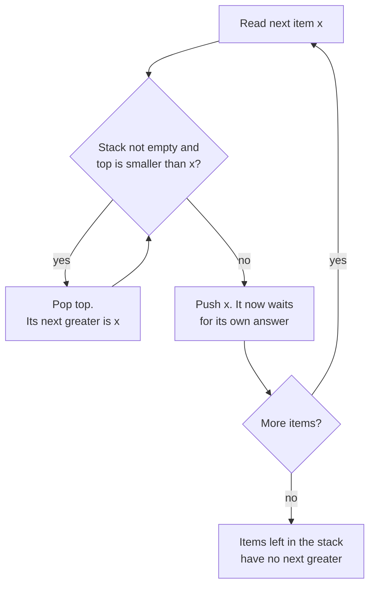
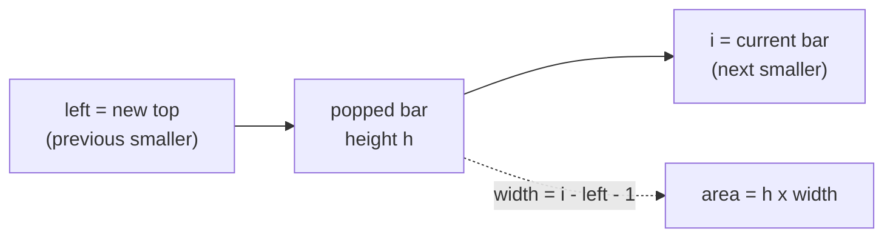

# Stacks and Monotonic Stack

> In this document you will learn the stack pattern and its stronger cousin, the monotonic stack. You will solve 12 classic problems: matching brackets, designing stacks and queues, evaluating expressions, decoding strings and "next greater element" problems like daily temperatures and the largest rectangle in a histogram. These problems appear often in coding rounds because the brute force is easy but the O(n) stack solution needs real understanding.

**Before this:** [Data structures and Big-O](../01-cs-and-web-fundamentals/02-data-structures-and-big-o.md) · [Problem solving and complexity, Pattern 6: Stack](../11-coding-interviews/02-problem-solving-and-complexity.md#pattern-6-stack) · **Interview questions:** [jump to the interview section](#interview-questions)

## Table of contents

1. [The pattern](#the-pattern)
2. [Problems](#problems)
3. [Interview questions](#interview-questions)
4. [Summary](#summary)
5. [References](#references)

---

## The pattern

### What a stack is (short refresher)

A **stack** is a list where you only add and remove at one end, the **top**. The last item you put in is the first item you take out. This rule is called **LIFO** (last in, first out). The full explanation of stacks and their costs is in [Data structures and Big-O](../01-cs-and-web-fundamentals/02-data-structures-and-big-o.md). Here we focus on how to *use* a stack to solve problems.

In JavaScript, a normal array is a good stack:

```js
const stack = [];
stack.push("a");               // add to the top
stack.push("b");
console.log(stack.at(-1));     // b      (peek: look at the top, do not remove)
console.log(stack.pop());      // b      (remove the top)
console.log(stack.length);     // 1
console.log(stack.pop());      // a
console.log(stack.pop());      // undefined   (pop on an empty array does not throw)
```

- `push` and `pop` are **O(1)** (amortized). They work at the end of the array, so nothing moves.
- `stack.at(-1)` reads the last item (ES2022). `stack[stack.length - 1]` does the same thing.
- `pop()` on an empty array returns `undefined`. It does not throw. This is handy, but it can also hide bugs, so check `stack.length` when it matters.

Do not use `shift()` and `unshift()` for a stack. They work at the **front** of the array, so every other item must move one place. They are **O(n)**.

### Why a stack solves so many problems

A stack remembers things that are **still waiting** for something. The most recent waiting thing is on top, and it is usually the one you need next.

- An open bracket `(` is waiting for its `)`. The newest open bracket must close first.
- A day is waiting for a warmer day. The most recent day is checked first.
- An outer string in `3[a2[c]]` is waiting while the inner part is decoded.

**Analogy:** a stack of plates. You put clean plates on top, and you take from the top. You never pull a plate from the middle. Where the analogy breaks: in code you can *look* at the top (peek) without taking it, and you often store extra data (like an index) with each "plate".

### Two kinds of stack problems

**1. Plain stack (matching and nesting).** You push items, and when you see something that "closes" or "uses" the top, you pop. Signals:

- Brackets, tags, nested structures: `()[]{}`, `<div></div>`, `3[ab]`.
- "Undo", "back", "go to parent folder".
- Expressions: postfix (reverse Polish) notation, calculators.
- "The most recent unmatched item".

**2. Monotonic stack.** A **monotonic stack** is a stack whose items are always in sorted order from bottom to top. "Monotonic" means "always going one way" (only up, or only down). Before you push a new item, you pop every item that would break the order. Signals:

- "Next greater element", "next smaller element", "previous greater", "previous smaller".
- "How many days until a warmer day", "stock span".
- "For each bar, how far can it stretch left and right?" (histogram, rectangles).
- The brute force has two nested loops: "for each item, scan to the right until you find something bigger".

### How a monotonic stack works inside

Take the question "for each number, find the next greater number to its right".

- The stack holds items that have **not yet found** their next greater number.
- These waiting items are in **decreasing** order from bottom to top. Why? If a smaller item were below a bigger item, the bigger item would already have "answered" the smaller one when it arrived.
- When a new number arrives, it is the answer for every waiting item that is smaller than it. Pop them all and record the answer. Then push the new number. It is now waiting too.



### Templates

**Template 1: matching stack.**

```js
function matchingTemplate(items) {
  const stack = [];
  for (const item of items) {
    if (isOpener(item)) {
      stack.push(item);              // remember it, it waits for a match
    } else {
      const top = stack.pop();       // the most recent opener
      if (!matches(top, item)) return false;
    }
  }
  return stack.length === 0;         // nothing may be left waiting
}

const isOpener = (ch) => ch === "(";
const matches = (open, close) => open === "(" && close === ")";
console.log(matchingTemplate("(())"));  // true
console.log(matchingTemplate("(()"));   // false
```

**Template 2: monotonic stack (next greater, store indices).**

```js
function nextGreaterTemplate(nums) {
  const answer = new Array(nums.length).fill(-1);
  const stack = []; // indices; their values are decreasing from bottom to top
  for (let i = 0; i < nums.length; i++) {
    while (stack.length > 0 && nums[stack.at(-1)] < nums[i]) {
      const j = stack.pop();
      answer[j] = nums[i];           // nums[i] is the next greater for index j
    }
    stack.push(i);
  }
  return answer;
}

console.log(nextGreaterTemplate([2, 1, 2, 4, 3])); // [ 4, 2, 4, -1, -1 ]
```

How to adapt the template:

| You want | Keep the stack | Pop while `nums[top] ? nums[i]` |
| --- | --- | --- |
| Next **greater** | decreasing | `<` |
| Next **smaller** | increasing | `>` |
| Next greater **or equal** | strictly decreasing | `<=` |
| **Previous** greater | decreasing | `<=` — after popping, the top (if any) is the previous greater |

Store **indices**, not values, in most problems. With an index you can get the value (`nums[i]`) *and* the distance (`i - j`). With only a value you lose the position.

### Complexity

- **Time: O(n).** It looks like O(n²) because of the `while` inside the `for`. But each index is pushed **once** and popped **at most once**. So across the whole run, the `while` body runs at most n times in total. n pushes + n pops = O(n). This kind of reasoning is called **amortized analysis**: you count the total work, not the worst case of one step.
- **Space: O(n)** for the stack in the worst case (for example, a strictly decreasing input never pops).

### Common mistakes

- **Using `shift()`** to remove from the front. It is O(n). A stack only needs `push` and `pop`.
- **Forgetting the leftovers.** After the loop, items still in the stack have no answer. Make sure your default (`-1`, `0`, "no next greater") is already set.
- **Storing values when you need distances.** Daily temperatures needs `i - j`, so store indices.
- **Wrong comparison with duplicates.** `<` versus `<=` decides what happens with equal values. Think about `[2, 2]`: is the second 2 "greater" than the first? Usually not.
- **Popping an empty stack and not noticing.** `[].pop()` returns `undefined`. Compare against it on purpose, or check the length first.
- **Popping operands in the wrong order** in expression problems. For `a - b`, the stack top is `b`, not `a`.

---

## Problems

The problems go from Easy to Hard. Try each one yourself for 15–20 minutes before you read the solution.

### P1. Valid Parentheses (Easy)

**Problem:** You get a string that contains only the characters `(`, `)`, `[`, `]`, `{` and `}`. Return `true` if every bracket is closed by the same type of bracket, and in the correct order. Similar to: LeetCode 20 Valid Parentheses.

This problem is fully worked, with a walkthrough, in [Problem solving and complexity](../11-coding-interviews/02-problem-solving-and-complexity.md#pattern-6-stack). Here we write a compact version and then take it further with follow-ups.

**Examples:**

```text
"()[]{}"  -> true
"([{}])"  -> true
"(]"      -> false
"([)]"    -> false   (the brackets close in the wrong order)
"(("      -> false   (never closed)
""        -> true
```

**How to recognize the pattern:** the newest open bracket must be the first one to close. "Newest first" is exactly LIFO, so use a stack.

**Brute force:** repeatedly delete `"()"`, `"[]"` and `"{}"` from the string until nothing changes. If the string becomes empty, it is valid. Each pass is O(n) and you may need n/2 passes, so this is **O(n²)**.

**Optimal approach:**

1. Keep a map from each closing bracket to its opening bracket.
2. Walk the string. Push every opening bracket.
3. For a closing bracket, pop the top. If it is not the matching opener (or the stack was empty), return `false`.
4. At the end, the stack must be empty.

**Code:**

```js
function isValid(s) {
  const openerOf = { ")": "(", "]": "[", "}": "{" };
  const stack = [];
  for (const ch of s) {
    if (ch in openerOf) {
      if (stack.pop() !== openerOf[ch]) return false; // empty stack pops undefined
    } else {
      stack.push(ch);
    }
  }
  return stack.length === 0;
}

console.log(isValid("([{}])")); // true
console.log(isValid("([)]"));   // false
console.log(isValid("(("));     // false
console.log(isValid(""));       // true
```

**Dry run** on `"([)]"`:

| ch | action | stack after |
| --- | --- | --- |
| `(` | push | `(` |
| `[` | push | `( [` |
| `)` | pop `[`, expected `(` | mismatch → return `false` |

**Complexity:** O(n) time, each character is pushed or popped once. O(n) space, in the worst case all characters are openers.

**Edge cases:** empty string (valid); a closing bracket first, like `")("` (pop returns `undefined`, so `false`); odd length (always invalid — you can return early with `if (s.length % 2) return false`); only openers.

**Follow-ups:**

- **Only one type of bracket `()`. Can you use less memory?** Yes. Use a counter instead of a stack: `+1` for `(`, `-1` for `)`. If it ever goes below 0, return false. At the end it must be 0. O(1) space. This only works with one bracket type, because a counter cannot remember *which* type is open.
- **What is the minimum number of brackets to add to make it valid?** Count unmatched closers and leftover openers:

```js
function minAddToMakeValid(s) {
  let open = 0;      // openers waiting for a closer
  let added = 0;     // openers we must add for unmatched closers
  for (const ch of s) {
    if (ch === "(") open++;
    else if (open > 0) open--;
    else added++;
  }
  return added + open;
}

console.log(minAddToMakeValid("())")); // 1
console.log(minAddToMakeValid("((("));  // 3
console.log(minAddToMakeValid("()))((")); // 4
```

- **The string also has letters, like `"a(b)c"`.** Skip any character that is not a bracket.
- **Validate HTML-like tags.** Same idea: push the tag name on `<div>`, pop and compare on `</div>`.

**How to say it in the interview:**
> "The most recent open bracket must close first, so this is a stack problem. I push every opening bracket. When I see a closing bracket, I pop and check that the popped bracket is the matching type. If the stack is empty or the type is wrong, the string is invalid. At the end, the stack must be empty, otherwise some brackets were never closed. That is O(n) time and O(n) space."

### P2. Implement Queue Using Stacks (Easy)

**Problem:** Build a first-in-first-out queue using only stack operations (push to top, pop from top, peek at top, size, is empty). Support `push(x)`, `pop()`, `peek()` and `empty()`. Similar to: LeetCode 232 Implement Queue using Stacks.

**Examples:**

```text
q.push(1); q.push(2);
q.peek()  -> 1
q.pop()   -> 1
q.empty() -> false
q.pop()   -> 2
q.empty() -> true
```

**How to recognize the pattern:** pouring one stack into another **reverses** the order. A reversed stack gives you the oldest item on top, which is what a queue needs.

**Brute force:** on every `pop`, move all items to a second stack, pop the top, and move everything back. Each `pop` is O(n).

**Optimal approach (two stacks, lazy transfer):**

1. `inbox` receives every `push`.
2. `outbox` serves every `pop` and `peek`.
3. Only when `outbox` is **empty**, move everything from `inbox` to `outbox`. This reverses the order, so the oldest item ends on top of `outbox`.
4. Never move items while `outbox` still has something. Those items are older than anything in `inbox`.

**Code:**

```js
class MyQueue {
  #inbox = [];
  #outbox = [];

  push(x) {
    this.#inbox.push(x);
  }

  #refill() {
    if (this.#outbox.length === 0) {
      while (this.#inbox.length > 0) this.#outbox.push(this.#inbox.pop());
    }
  }

  pop() {
    this.#refill();
    return this.#outbox.pop();
  }

  peek() {
    this.#refill();
    return this.#outbox.at(-1);
  }

  empty() {
    return this.#inbox.length === 0 && this.#outbox.length === 0;
  }
}

const q = new MyQueue();
q.push(1);
q.push(2);
console.log(q.peek());  // 1
console.log(q.pop());   // 1
q.push(3);
console.log(q.pop());   // 2
console.log(q.pop());   // 3
console.log(q.empty()); // true
```

**Dry run:**

| operation | inbox | outbox | result |
| --- | --- | --- | --- |
| push 1 | `[1]` | `[]` | |
| push 2 | `[1, 2]` | `[]` | |
| peek | `[]` | `[2, 1]` | 1 (outbox was empty, so we moved) |
| pop | `[]` | `[2]` | 1 |
| push 3 | `[3]` | `[2]` | |
| pop | `[3]` | `[]` | 2 (outbox not empty, no move) |
| pop | `[]` | `[3]` → `[]` | 3 (moved 3, then popped) |

**Complexity:** `push` is O(1). `pop` and `peek` are **amortized O(1)**: one call may move n items, but each item is moved from inbox to outbox **only once** in its life. Space O(n).

**Edge cases:** `pop` or `peek` on an empty queue (returns `undefined` here; in an interview, ask whether to throw); many pushes then many pops; alternating push and pop.

**Follow-ups:**

- **Implement a stack with queues (LeetCode 225).** With one queue: after each push, rotate the queue `size - 1` times so the new item is at the front. Push is O(n), pop is O(1).
- **Why not just use a JavaScript array with `shift()` as a queue?** `shift()` is O(n) because all items move. For a real queue in JavaScript, use a head index (`items[head++]`) or a ring buffer. See [Problem solving and complexity, Pattern 7](../11-coding-interviews/02-problem-solving-and-complexity.md#pattern-7-queue-and-breadth-first-search).
- **Is the worst case of a single `pop` O(1)?** No. One `pop` can be O(n). Only the average over a sequence of operations is O(1). If you need a hard O(1) per operation (real-time systems), use a ring buffer or a linked list.

**How to say it in the interview:**
> "I use two stacks: an inbox for pushes and an outbox for pops. When the outbox is empty and I need the front, I pour the whole inbox into the outbox. That reverses the order, so the oldest item is on top. Each item is moved at most once, so push is O(1) and pop and peek are amortized O(1)."

### P3. Next Greater Element (Easy)

**Problem:** You get two arrays of distinct numbers, `nums1` and `nums2`. Every number in `nums1` also appears in `nums2`. For each number in `nums1`, find it in `nums2` and return the first number to its right in `nums2` that is greater. If there is none, use `-1`. Similar to: LeetCode 496 Next Greater Element I.

**Examples:**

```text
nums1 = [4, 1, 2], nums2 = [1, 3, 4, 2]  ->  [-1, 3, -1]
nums1 = [2, 4],    nums2 = [1, 2, 3, 4]  ->  [3, -1]
```

**How to recognize the pattern:** "the first greater number to the right" is the textbook signal for a monotonic stack.

**Brute force:** for each number in `nums1`, find its position in `nums2`, then scan right until you find a greater number. O(m · n) time.

**Optimal approach:**

1. Walk `nums2` once with a decreasing monotonic stack.
2. When the current number is greater than the top, the current number is the top's next greater. Save that in a `Map`. Pop and repeat.
3. Push the current number.
4. For each number in `nums1`, read the answer from the map (default `-1`).

Because the numbers are distinct, we can store values in the stack and use them as map keys.

**Code:**

```js
function nextGreaterElement(nums1, nums2) {
  const nextGreater = new Map();
  const stack = []; // values, decreasing from bottom to top
  for (const num of nums2) {
    while (stack.length > 0 && stack.at(-1) < num) {
      nextGreater.set(stack.pop(), num);
    }
    stack.push(num);
  }
  return nums1.map((n) => nextGreater.get(n) ?? -1);
}

console.log(nextGreaterElement([4, 1, 2], [1, 3, 4, 2])); // [ -1, 3, -1 ]
console.log(nextGreaterElement([2, 4], [1, 2, 3, 4]));    // [ 3, -1 ]
```

**Dry run** on `nums2 = [1, 3, 4, 2]`:

| num | pops (value → next greater) | stack after |
| --- | --- | --- |
| 1 | — | `[1]` |
| 3 | 1 → 3 | `[3]` |
| 4 | 3 → 4 | `[4]` |
| 2 | — (2 is not greater than 4) | `[4, 2]` |

4 and 2 stay in the stack, so they have no next greater: `-1`. For `nums1 = [4, 1, 2]` the answer is `[-1, 3, -1]`.

**Complexity:** O(n + m) time: each value of `nums2` is pushed and popped once, and each lookup is O(1). O(n) space for the map and the stack.

**Edge cases:** `nums1` empty (return `[]`); `nums2` strictly increasing (every number except the last has an answer); strictly decreasing (all `-1`).

**Follow-ups:**

- **The array is circular: after the last element, you continue from the first (LeetCode 503).** Loop over the array **twice** using `i % n`. Push indices only in the first pass, so each index waits at most one full circle.

```js
function nextGreaterCircular(nums) {
  const n = nums.length;
  const answer = new Array(n).fill(-1);
  const stack = []; // indices
  for (let k = 0; k < 2 * n; k++) {
    const i = k % n;
    while (stack.length > 0 && nums[stack.at(-1)] < nums[i]) {
      answer[stack.pop()] = nums[i];
    }
    if (k < n) stack.push(i);
  }
  return answer;
}

console.log(nextGreaterCircular([1, 2, 1]));       // [ 2, -1, 2 ]
console.log(nextGreaterCircular([5, 4, 3, 2, 1])); // [ -1, 5, 5, 5, 5 ]
```

- **The numbers can repeat.** Store **indices** in the stack, not values, and write the answer into an array by index. Values can no longer be map keys.
- **Next smaller element instead?** Flip the comparison: pop while `top > num`. The stack becomes increasing.

**How to say it in the interview:**
> "I walk nums2 once with a monotonic stack that stays decreasing. When a new number is bigger than the top, it is the next greater element for the top, so I pop and record that in a map. Then I push the new number. Anything left in the stack has no greater element. Each number is pushed and popped once, so it is linear, and then I answer each query from the map in O(1)."

### P4. Min Stack (Medium)

**Problem:** Design a stack that supports `push(x)`, `pop()`, `top()` and `getMin()`. Every operation must run in **O(1)** time. `getMin()` returns the smallest value currently in the stack. Similar to: LeetCode 155 Min Stack.

**Examples:**

```text
push(-2), push(0), push(-3)
getMin() -> -3
pop()
top()    -> 0
getMin() -> -2
```

**How to recognize the pattern:** the minimum changes only when you push or pop. A stack "remembers the past", so you can also remember **what the minimum was at each moment**.

**Brute force:** a normal stack, and `getMin()` scans all items. `getMin()` is O(n).

**Why a single `min` variable is not enough:** if you pop the current minimum, you do not know the previous minimum anymore. You would need to scan again.

**Optimal approach:**

1. Store pairs: `[value, minimumAtThisLevel]`.
2. On `push(x)`, the new minimum is `Math.min(x, currentMin)`. Store it with the value.
3. On `pop()`, remove the pair. The pair below already knows its own minimum. Nothing else to fix.
4. `getMin()` reads the minimum from the top pair.

**Code:**

```js
class MinStack {
  #items = []; // each item: [value, minimum of this item and everything below it]

  push(value) {
    const min = this.#items.length === 0 ? value : Math.min(value, this.getMin());
    this.#items.push([value, min]);
  }

  pop() {
    return this.#items.pop()?.[0];
  }

  top() {
    return this.#items.at(-1)?.[0];
  }

  getMin() {
    return this.#items.at(-1)?.[1];
  }
}

const ms = new MinStack();
ms.push(-2);
ms.push(0);
ms.push(-3);
console.log(ms.getMin()); // -3
ms.pop();
console.log(ms.top());    // 0
console.log(ms.getMin()); // -2
```

**Dry run:**

| operation | stack (bottom → top) | getMin |
| --- | --- | --- |
| push -2 | `[-2, -2]` | -2 |
| push 0 | `[-2, -2] [0, -2]` | -2 |
| push -3 | `[-2, -2] [0, -2] [-3, -3]` | -3 |
| pop | `[-2, -2] [0, -2]` | -2 |

**Complexity:** every operation is O(1) time. O(n) extra space (one extra number per item).

**Edge cases:** duplicate minimums (push 1, push 1, pop → min must still be 1; pairs handle this naturally); negative numbers; calling `top`/`getMin` on an empty stack (this version returns `undefined`; ask the interviewer what they expect).

**Follow-ups:**

- **Can you use less extra memory?** Keep a second stack of minimums, and push to it only when `x <= currentMin`. Pop from it only when the popped value equals its top. The `<=` (not `<`) matters for duplicates. In the worst case it still uses O(n), but often much less.
- **Max stack?** Same idea with `Math.max`. If you also need `popMax()` in O(log n), you need a heap or a sorted structure plus lazy deletion.
- **Min queue?** Build it from two min stacks, using the trick from P2. Or use a monotonic deque (see [Sliding window, P11](03-sliding-window.md#p11-sliding-window-maximum-hard)).

**How to say it in the interview:**
> "A single min variable breaks when I pop the minimum, because I lose the previous one. So with every value I also store the minimum at that level of the stack. Push computes the new minimum from the value and the current minimum, pop just removes the pair, and getMin reads the top pair. Everything is O(1), and the cost is one extra number per item."

### P5. Evaluate Reverse Polish Notation (Medium)

**Problem:** You get an array of tokens that form an expression in **reverse Polish notation** (RPN, also called **postfix**). In RPN the operator comes *after* its two operands: `3 4 +` means `3 + 4`. The operators are `+`, `-`, `*` and `/`. Division **truncates toward zero** (`7 / -2` is `-3`). Return the result. Similar to: LeetCode 150 Evaluate Reverse Polish Notation.

**Examples:**

```text
["2", "1", "+", "3", "*"]          -> 9     ((2 + 1) * 3)
["4", "13", "5", "/", "+"]         -> 6     (4 + 13 / 5)
["10","6","9","3","+","-11","*","/","*","17","+","5","+"]  -> 22
```

**How to recognize the pattern:** every operator uses the **two most recent** values. "Most recent" means a stack. RPN was designed so it can be evaluated with one stack and no parentheses.

**Brute force:** there is no simpler correct method that is worth coding. You could build an expression tree, but the stack is the direct solution.

**Optimal approach:**

1. For each token: if it is a number, push it.
2. If it is an operator, pop **b** first, then **a** (the top is the *right* operand). Compute `a op b` and push the result.
3. At the end, the stack holds exactly one value: the answer.

**Code:**

```js
function evalRPN(tokens) {
  const stack = [];
  const ops = {
    "+": (a, b) => a + b,
    "-": (a, b) => a - b,
    "*": (a, b) => a * b,
    "/": (a, b) => Math.trunc(a / b), // truncate toward zero
  };
  for (const token of tokens) {
    if (token in ops) {
      const b = stack.pop(); // right operand is on top
      const a = stack.pop();
      stack.push(ops[token](a, b));
    } else {
      stack.push(Number(token));
    }
  }
  return stack.pop();
}

console.log(evalRPN(["2", "1", "+", "3", "*"]));  // 9
console.log(evalRPN(["4", "13", "5", "/", "+"])); // 6
console.log(evalRPN(["10", "6", "9", "3", "+", "-11", "*", "/", "*", "17", "+", "5", "+"])); // 22
console.log(evalRPN(["7", "-2", "/"]));           // -3
```

**Dry run** on `["4", "13", "5", "/", "+"]`:

| token | action | stack after |
| --- | --- | --- |
| 4 | push | `[4]` |
| 13 | push | `[4, 13]` |
| 5 | push | `[4, 13, 5]` |
| / | b = 5, a = 13, trunc(13 / 5) = 2 | `[4, 2]` |
| + | b = 2, a = 4, 4 + 2 = 6 | `[6]` |

**Complexity:** O(n) time, one pass. O(n) space for the stack.

**Edge cases:** a single number token (`["5"]` → 5); negative numbers like `"-11"` (it is a number, not the `-` operator — the check `token in ops` handles this because `"-11"` is not a key); division with a negative result (`Math.trunc`, **not** `Math.floor`: `Math.floor(-3.5)` is -4 but we need -3).

**Follow-ups:**

- **Why `Math.trunc` and not `| 0`?** `x | 0` also truncates, but it converts to a 32-bit integer, so it breaks for results above about 2.1 billion. `Math.trunc` works for all safe integers.
- **What if the input is invalid (too few operands)?** `pop()` returns `undefined` and the math gives `NaN`. In production code, check `stack.length >= 2` before an operator and `stack.length === 1` at the end, and throw a clear error.
- **Convert a normal (infix) expression to RPN?** Use the **shunting-yard algorithm**: an operator stack that respects precedence. P12 shows a related idea.

**How to say it in the interview:**
> "In postfix notation every operator applies to the two most recent values, so I use a stack. Numbers get pushed. For an operator I pop twice — the first pop is the right operand — compute, and push the result. The last value on the stack is the answer. One detail: division must truncate toward zero, so I use Math.trunc, not Math.floor."

### P6. Daily Temperatures (Medium)

**Problem:** You get an array of daily temperatures. For each day, return how many days you must wait until a **warmer** day. If no warmer day comes, use `0`. Similar to: LeetCode 739 Daily Temperatures.

**Examples:**

```text
[73, 74, 75, 71, 69, 72, 76, 73]  ->  [1, 1, 4, 2, 1, 1, 0, 0]
[30, 40, 50, 60]                  ->  [1, 1, 1, 0]
[30, 60, 90]                      ->  [1, 1, 0]
[90, 80, 70]                      ->  [0, 0, 0]
```

**How to recognize the pattern:** "how many days until something greater" is "next greater element", and the answer is a **distance**. So use a monotonic stack of **indices**.

**Brute force:** for each day, scan forward until a warmer day. O(n²) time, O(1) extra space. With n = 100,000 this is up to 5 billion steps — too slow.

**Optimal approach:**

1. Keep a stack of indices of days that are still waiting for a warmer day. Their temperatures are decreasing from bottom to top.
2. For each day `i`: while today is warmer than the day on top, pop that day `j` and set `answer[j] = i - j`.
3. Push `i`.
4. Days still in the stack at the end keep the default `0`.

**Code:**

```js
function dailyTemperatures(temperatures) {
  const answer = new Array(temperatures.length).fill(0);
  const stack = []; // indices of days still waiting for a warmer day
  for (let i = 0; i < temperatures.length; i++) {
    while (stack.length > 0 && temperatures[stack.at(-1)] < temperatures[i]) {
      const j = stack.pop();
      answer[j] = i - j;
    }
    stack.push(i);
  }
  return answer;
}

console.log(dailyTemperatures([73, 74, 75, 71, 69, 72, 76, 73])); // [ 1, 1, 4, 2, 1, 1, 0, 0 ]
console.log(dailyTemperatures([30, 40, 50, 60]));                 // [ 1, 1, 1, 0 ]
console.log(dailyTemperatures([90, 80, 70]));                     // [ 0, 0, 0 ]
```

**Dry run** on `[73, 74, 75, 71, 69, 72, 76, 73]` (the stack shows `index:temp`):

| i | temp | pops and answers | stack after |
| --- | --- | --- | --- |
| 0 | 73 | — | `0:73` |
| 1 | 74 | pop 0 → answer[0] = 1 | `1:74` |
| 2 | 75 | pop 1 → answer[1] = 1 | `2:75` |
| 3 | 71 | — | `2:75 3:71` |
| 4 | 69 | — | `2:75 3:71 4:69` |
| 5 | 72 | pop 4 → 1, pop 3 → 2 | `2:75 5:72` |
| 6 | 76 | pop 5 → 1, pop 2 → 4 | `6:76` |
| 7 | 73 | — | `6:76 7:73` |

Days 6 and 7 stay in the stack, so their answers stay 0. Result: `[1, 1, 4, 2, 1, 1, 0, 0]`.

**Complexity:** O(n) time — each index is pushed once and popped at most once. O(n) space for the stack and the answer.

**Edge cases:** equal temperatures (`[70, 70]` → `[0, 0]`; "warmer" means strictly greater, so we pop only with `<`); a single day (`[0]`); strictly decreasing input (stack grows to n, all zeros).

**Follow-ups:**

- **Can you do it with O(1) extra space (not counting the output)?** Yes. Go from right to left. For day `i`, start at `j = i + 1` and jump: while `temps[j] <= temps[i]`, jump to `j + answer[j]` (the next day warmer than `j`). If `answer[j]` is 0, there is no warmer day, so stop. This reuses the answers you already computed and is still O(n) amortized.

```js
function dailyTemperaturesNoStack(temps) {
  const n = temps.length;
  const answer = new Array(n).fill(0);
  for (let i = n - 2; i >= 0; i--) {
    let j = i + 1;
    while (j < n && temps[j] <= temps[i]) {
      if (answer[j] === 0) { j = n; break; } // j has no warmer day, so i has none either
      j += answer[j];                         // jump to the next day warmer than j
    }
    if (j < n) answer[i] = j - i;
  }
  return answer;
}

console.log(dailyTemperaturesNoStack([73, 74, 75, 71, 69, 72, 76, 73])); // [ 1, 1, 4, 2, 1, 1, 0, 0 ]
```

- **Stock span (LeetCode 901):** "for today's price, how many consecutive days back (including today) had a price less than or equal to today?" That is the *previous greater* version: pop while `top <= price`, and the span is the distance to the new top.
- **Where is this used in real projects?** "Time until the next spike" in monitoring dashboards and "next higher price" in trading charts are the same calculation.

**How to say it in the interview:**
> "The brute force scans forward from each day, which is O(n²). Instead I keep a stack of indices of days that have not found a warmer day yet, so their temperatures are decreasing. When today is warmer than the top, today is the answer for that day: I pop it and store the distance i minus j. Then I push today. Each index is pushed and popped once, so it is O(n)."

### P7. Simplify Path (Medium)

**Problem:** You get an absolute Unix-style file path, like `"/home//user/./docs/../"`. Return the simplified **canonical** path. Rules: `.` means the current folder, `..` means go up one folder, many slashes count as one slash, the result starts with one `/` and does not end with `/` (unless it is just `/`). Any other name (even `...`) is a normal folder name. Similar to: LeetCode 71 Simplify Path.

**Examples:**

```text
"/home/"                             -> "/home"
"/home//foo/"                        -> "/home/foo"
"/home/user/Documents/../Pictures"   -> "/home/user/Pictures"
"/../"                               -> "/"
"/.../a/../b/c/../d/./"              -> "/.../b/d"
```

**How to recognize the pattern:** `..` cancels the **most recent** folder. Most recent → stack. This is the same as the "back" button in a browser or "go to parent folder".

**Brute force:** repeatedly search and replace `/./`, `//` and `name/..` in the string until nothing changes. This is hard to get right and can be O(n²).

**Optimal approach:**

1. Split the path by `/`. Empty parts come from repeated or trailing slashes.
2. For each part: skip `""` and `"."`. For `".."`, pop if the stack is not empty. Otherwise push the name.
3. Join the stack with `/` and put `/` in front.

**Code:**

```js
function simplifyPath(path) {
  const folders = [];
  for (const part of path.split("/")) {
    if (part === "" || part === ".") continue;
    if (part === "..") folders.pop(); // pop on an empty array is a safe no-op: you cannot go above root
    else folders.push(part);
  }
  return "/" + folders.join("/");
}

console.log(simplifyPath("/home//foo/"));                      // /home/foo
console.log(simplifyPath("/home/user/Documents/../Pictures")); // /home/user/Pictures
console.log(simplifyPath("/../"));                             // /
console.log(simplifyPath("/.../a/../b/c/../d/./"));            // /.../b/d
```

**Dry run** on `"/a/./b/../../c/"`. The split gives `["", "a", ".", "b", "..", "..", "c", ""]`:

| part | action | stack after |
| --- | --- | --- |
| `""` | skip | `[]` |
| `a` | push | `[a]` |
| `.` | skip | `[a]` |
| `b` | push | `[a, b]` |
| `..` | pop | `[a]` |
| `..` | pop | `[]` |
| `c` | push | `[c]` |
| `""` | skip | `[c]` |

Result: `"/c"`.

**Complexity:** O(n) time for the split, the loop and the join. O(n) space for the parts and the stack.

**Edge cases:** the root `"/"` (result `"/"`); `..` at the root (stays at root); names with dots like `"..."` or `".hidden"` (they are normal names); trailing slash.

**Follow-ups:**

- **Relative paths, like `"a/../../b"`?** Then a `..` that goes above the start cannot be dropped. Push `..` when the stack is empty or its top is also `..`; otherwise pop. Result: `"../b"`.
- **Would you write this by hand in a real Node.js app?** No. Use `path.posix.normalize()` or `path.resolve()` from `node:path`. Be careful: for security checks (stop a user from reading files outside a folder), resolve the full path first, then check that the result is still inside the allowed folder. See [Core modules: fs, path, events, buffer](../07-nodejs-backend/04-core-modules-fs-path-events-buffer.md).

**How to say it in the interview:**
> "A double dot cancels the most recent folder, so I use a stack of folder names. I split on slashes, skip empty parts and single dots, pop for double dots, and push everything else. Popping on an empty stack does nothing, which correctly keeps me at the root. Then I join the stack with slashes and add a leading slash. It is linear in the length of the path."

### P8. Decode String (Medium)

**Problem:** You get an encoded string. The rule is `k[text]`: repeat `text` exactly `k` times. Encodings can be **nested**. Digits only appear as repeat counts, and the input is always valid. Return the decoded string. Similar to: LeetCode 394 Decode String.

**Examples:**

```text
"3[a]2[bc]"     -> "aaabcbc"
"3[a2[c]]"      -> "accaccacc"
"2[abc]3[cd]ef" -> "abcabccdcdcdef"
"10[x]"         -> "xxxxxxxxxx"
```

**How to recognize the pattern:** nested brackets. When an inner `]` closes, you must go back to the text that was being built **outside** it. "Go back to the outer level" is a stack (or recursion, which uses the call stack).

**Brute force:** repeatedly find an innermost `k[...]` (one with no `[` inside), replace it with its expansion, and repeat. Each replacement rebuilds the string, so it is slow for deep nesting, but it is a good mental model.

**Optimal approach:**

1. Keep `current` (the text of the current level) and `count` (the number being read).
2. A digit: `count = count * 10 + digit` (numbers can have many digits, like `10`).
3. `[`: push `[current, count]` to save the outer level. Start a new level: `current = ""`, `count = 0`.
4. `]`: pop `[before, k]`. The new current is `before + current.repeat(k)`.
5. A letter: add it to `current`.

**Code:**

```js
function decodeString(s) {
  const stack = []; // saved outer levels: [textBefore, repeatCount]
  let current = "";
  let count = 0;
  for (const ch of s) {
    if (ch >= "0" && ch <= "9") {
      count = count * 10 + Number(ch);
    } else if (ch === "[") {
      stack.push([current, count]);
      current = "";
      count = 0;
    } else if (ch === "]") {
      const [before, k] = stack.pop();
      current = before + current.repeat(k);
    } else {
      current += ch;
    }
  }
  return current;
}

console.log(decodeString("3[a]2[bc]"));     // aaabcbc
console.log(decodeString("3[a2[c]]"));      // accaccacc
console.log(decodeString("2[abc]3[cd]ef")); // abcabccdcdcdef
console.log(decodeString("10[x]"));         // xxxxxxxxxx
```

**Dry run** on `"3[a2[c]]"`:

| ch | action | stack | current |
| --- | --- | --- | --- |
| 3 | count = 3 | `[]` | `""` |
| `[` | push `["", 3]` | `["",3]` | `""` |
| a | add | `["",3]` | `"a"` |
| 2 | count = 2 | `["",3]` | `"a"` |
| `[` | push `["a", 2]` | `["",3] ["a",2]` | `""` |
| c | add | same | `"c"` |
| `]` | pop `["a",2]` → `"a" + "cc"` | `["",3]` | `"acc"` |
| `]` | pop `["",3]` → `"" + "acc"` three times | `[]` | `"accaccacc"` |

**Complexity:** time is at least O(output length), because you must build every character of the result. Nested levels copy inner text again at each level, so the worst case is about O(output length × nesting depth). Space is O(output length) for the strings plus O(depth) for the stack.

**Edge cases:** multi-digit counts (`"10[x]"`); letters outside any bracket (`"ab2[c]"`); deep nesting; a count of 1.

**Follow-ups:**

- **Recursive version?** Write `decode(i)` that reads until `]` and returns `[text, nextIndex]`. It is often easier to read, but very deep nesting could reach the recursion limit (around 10,000 frames in Node.js by default, depending on frame size). The explicit stack has no such limit.
- **JavaScript strings are immutable.** `current += ch` creates a new string each time. V8 optimizes this well (it uses "rope" strings internally), so it is fine here. In a hot loop that builds a huge string, push parts into an array and call `join("")` once.
- **What if the output can be huge (like `"1000000[1000000[a]]"`)?** Do not build it. Answer questions about it lazily, for example "what is the character at index k?" — compute lengths instead of strings (similar to LeetCode 880 Decoded String at Index).

**How to say it in the interview:**
> "Because the brackets are nested, I need to come back to the outer text after an inner part is finished, so I use a stack. I build the current level's string and read the repeat count digit by digit. On an open bracket I push the current text and the count and start fresh. On a close bracket I pop, and the new current string is the saved text plus the inner text repeated k times. The time is proportional to the size of the output."

### P9. Asteroid Collision (Medium)

**Problem:** You get an array of non-zero integers, one per asteroid, in a row. The absolute value is its size. The sign is its direction: positive moves right, negative moves left. All move at the same speed. When two asteroids meet, the smaller one explodes. If they are the same size, both explode. Asteroids moving in the same direction never meet. Return the state after all collisions. Similar to: LeetCode 735 Asteroid Collision.

**Examples:**

```text
[5, 10, -5]     -> [5, 10]          (10 and -5 meet, -5 explodes)
[8, -8]         -> []               (same size, both explode)
[10, 2, -5]     -> [10]             (2 explodes, then -5 hits 10 and explodes)
[-2, -1, 1, 2]  -> [-2, -1, 1, 2]   (no one meets)
```

**How to recognize the pattern:** a new left-moving asteroid hits the **most recent** right-moving asteroid first. If it wins, it then hits the one before. "Most recent, and maybe keep going" → a stack with a `while` loop.

**Brute force:** repeatedly scan the array for an adjacent pair `[positive, negative]`, resolve that collision, and repeat until no pair exists. Up to n rounds of O(n) → O(n²).

**Optimal approach:**

1. The stack holds asteroids that have survived so far.
2. For each asteroid `a`:
   - A collision happens only when `a` moves left (`a < 0`) and the top moves right (`top > 0`).
   - While that is true: if the top is smaller, pop it and continue. If they are equal, pop it and `a` also dies. If the top is bigger, `a` dies.
3. If `a` is still alive, push it.

**Code:**

```js
function asteroidCollision(asteroids) {
  const stack = [];
  for (const a of asteroids) {
    let alive = true;
    while (alive && a < 0 && stack.length > 0 && stack.at(-1) > 0) {
      const top = stack.at(-1);
      if (top < -a) {
        stack.pop();          // top explodes, a keeps flying left
      } else if (top === -a) {
        stack.pop();          // both explode
        alive = false;
      } else {
        alive = false;        // a explodes
      }
    }
    if (alive) stack.push(a);
  }
  return stack;
}

console.log(asteroidCollision([5, 10, -5]));    // [ 5, 10 ]
console.log(asteroidCollision([8, -8]));        // []
console.log(asteroidCollision([10, 2, -5]));    // [ 10 ]
console.log(asteroidCollision([-2, -1, 1, 2])); // [ -2, -1, 1, 2 ]
```

**Dry run** on `[10, 2, -5]`:

| a | action | stack after |
| --- | --- | --- |
| 10 | push | `[10]` |
| 2 | push | `[10, 2]` |
| -5 | top 2 < 5 → pop 2; top 10 > 5 → -5 dies | `[10]` |

**Complexity:** O(n) time — each asteroid is pushed once and popped at most once. O(n) space.

**Edge cases:** a negative asteroid with an empty stack, or with a negative top (no collision, just push); `[1, -1, -2]` (the first pair destroys each other, then -2 has nothing to hit → `[-2]`); all positive or all negative (no collisions).

**Follow-ups:**

- **Why is `[-5, 10]` not a collision?** -5 moves left, away from 10, and 10 moves right. They move apart. Only "right-mover on the left, left-mover on the right" meet. That is why the condition is `top > 0 && a < 0`.
- **Does the order of collisions change the result?** No. A collision only involves two neighbours moving toward each other, and resolving one collision never stops a different pair from meeting later. So any order gives the same final state, and the simple left-to-right simulation is correct. You can check this yourself: compare the stack solution with the "resolve any adjacent pair" brute force on many random arrays.

**How to say it in the interview:**
> "A collision only happens when a left-moving asteroid meets the closest right-moving asteroid to its left, which is the top of my stack of survivors. So for each negative asteroid I loop: if the top is smaller, it explodes and I keep checking; if they are equal, both explode; if the top is bigger, the new one explodes. If the new asteroid survives, I push it. Every asteroid is pushed and popped at most once, so it is O(n)."

### P10. Car Fleet (Medium)

**Problem:** `n` cars drive on a one-lane road toward a `target` position. Car `i` starts at `position[i]` and drives at `speed[i]`. A car can never pass the car in front of it. If it catches up, it slows down and they drive together as one **fleet** (at the speed of the slower car in front). A car that catches up exactly at the target also joins that fleet. Return how many fleets arrive at the target. Similar to: LeetCode 853 Car Fleet.

**Examples:**

```text
target = 12, position = [10, 8, 0, 5, 3], speed = [2, 4, 1, 1, 3]  ->  3
target = 10, position = [3],              speed = [3]              ->  1
target = 100, position = [0, 2, 4],       speed = [4, 2, 1]        ->  1
```

**How to recognize the pattern:** a car's fate depends only on the cars **in front** of it. If you process cars from the front of the road backward, each car either joins the fleet directly ahead or starts a new one. The fleets form a stack whose arrival times **only increase**.

**Brute force:** simulate time step by step and merge cars that meet. It is slow, and floating-point time steps make it tricky.

**Optimal approach:**

1. For each car, compute the time it would need to reach the target alone: `(target - position) / speed`.
2. Sort cars by position, **closest to the target first**.
3. Walk the sorted cars. Keep a stack of fleet arrival times.
   - If this car's time is **greater** than the top fleet's time, it cannot catch that fleet: it starts a new fleet. Push its time.
   - Otherwise it catches up (or arrives at the same time) and joins that fleet. Its own time does not matter anymore, because the fleet moves at the slower speed.
4. The answer is the stack size.

**Code:**

```js
function carFleet(target, position, speed) {
  const cars = position.map((p, i) => [p, (target - p) / speed[i]]);
  cars.sort((a, b) => b[0] - a[0]); // closest to the target first (numeric comparator!)
  const fleets = []; // arrival time of each fleet; the top is the fleet just ahead
  for (const [, time] of cars) {
    if (fleets.length === 0 || time > fleets.at(-1)) fleets.push(time);
  }
  return fleets.length;
}

console.log(carFleet(12, [10, 8, 0, 5, 3], [2, 4, 1, 1, 3])); // 3
console.log(carFleet(10, [3], [3]));                         // 1
console.log(carFleet(100, [0, 2, 4], [4, 2, 1]));            // 1
```

**Dry run** on the first example. Times: position 10 → 1, 8 → 1, 5 → 7, 3 → 3, 0 → 12.

| car (position, time) | compare with top | fleets after |
| --- | --- | --- |
| 10, 1 | empty → new fleet | `[1]` |
| 8, 1 | 1 is not > 1 → joins | `[1]` |
| 5, 7 | 7 > 1 → new fleet | `[1, 7]` |
| 3, 3 | 3 is not > 7 → joins the 7 fleet | `[1, 7]` |
| 0, 12 | 12 > 7 → new fleet | `[1, 7, 12]` |

Answer: 3.

**Complexity:** O(n log n) time because of the sort. The loop is O(n). O(n) space for the `cars` array and the stack.

**Edge cases:** one car (1 fleet); two cars that meet exactly at the target (they are one fleet, which is why we use `>` and not `>=`); a car already at the target (time 0).

**Follow-ups:**

- **Do you really need a stack?** No. Only the top is ever read, so one variable `slowestAhead` is enough. The stack form makes the idea easier to explain and to extend (for example, if you also want the list of fleet arrival times).
- **Is floating-point division safe here?** Mostly yes. JavaScript division is correctly rounded, so two times that are mathematically equal (like `2/4` and `1/2`) give exactly the same number. If you want to avoid floats completely, compare with cross-multiplication: car A is slower than car B when `(target - pA) * sB > (target - pB) * sA`.
- **Why the numeric comparator?** `sort()` without a comparator compares numbers as **strings**, so `[10, 8, 0, 5, 3].sort()` gives `[0, 10, 3, 5, 8]`. Always pass `(a, b) => a - b` (or `b - a`) for numbers.

**How to say it in the interview:**
> "A car only interacts with the cars in front of it, so I sort the cars from closest to the target to farthest. For each car I compute the time it would need alone. If that time is bigger than the fleet just ahead, the car can never catch it, so it starts a new fleet. Otherwise it catches up and joins. The number of fleets is the answer. Sorting makes it O(n log n), and the scan is linear."

### P11. Largest Rectangle in Histogram (Hard)

**Problem:** You get an array of bar heights. Every bar has width 1, and the bars stand next to each other. Return the area of the largest rectangle that fits completely inside the histogram. Similar to: LeetCode 84 Largest Rectangle in Histogram.

**Examples:**

```text
[2, 1, 5, 6, 2, 3]  ->  10   (bars 5 and 6, height 5, width 2)
[2, 4]              ->  4
[2, 2, 2]           ->  6
[1]                 ->  1
```

**How to recognize the pattern:** for each bar, the best rectangle that uses **its full height** stretches left and right until it meets a **shorter** bar. So you need the "previous smaller" and "next smaller" bar for every bar. That is a monotonic stack.

**Brute force:** for every pair `(left, right)`, the height is the minimum bar between them. Keep a running minimum while you extend `right`. O(n²) time. With n = 100,000 that is too slow.

```js
function largestRectangleBrute(heights) {
  let best = 0;
  for (let left = 0; left < heights.length; left++) {
    let minHeight = Infinity;
    for (let right = left; right < heights.length; right++) {
      minHeight = Math.min(minHeight, heights[right]);
      best = Math.max(best, minHeight * (right - left + 1));
    }
  }
  return best;
}

console.log(largestRectangleBrute([2, 1, 5, 6, 2, 3])); // 10
```

**Optimal approach:**

1. Keep a stack of indices whose heights are **increasing** from bottom to top.
2. When the current bar `i` is shorter than (or equal to) the bar on top, the top bar cannot stretch to the right anymore: `i` is its **next smaller**. Pop it.
3. After popping, the new top is its **previous smaller** (call it `left`; use `-1` if the stack is empty). The popped bar can stretch from `left + 1` to `i - 1`, so its width is `i - left - 1`. Area = `height × width`.
4. Push `i`.
5. Add a fake bar of height `0` at the end (a **sentinel**). It forces every remaining bar to be popped and measured.



**Code:**

```js
function largestRectangleArea(heights) {
  const stack = []; // indices; their heights are increasing from bottom to top
  let best = 0;
  for (let i = 0; i <= heights.length; i++) {
    const h = i === heights.length ? 0 : heights[i]; // sentinel bar of height 0 at the end
    while (stack.length > 0 && heights[stack.at(-1)] >= h) {
      const height = heights[stack.pop()];
      const left = stack.length > 0 ? stack.at(-1) : -1; // previous smaller bar
      best = Math.max(best, height * (i - left - 1));
    }
    stack.push(i);
  }
  return best;
}

console.log(largestRectangleArea([2, 1, 5, 6, 2, 3])); // 10
console.log(largestRectangleArea([2, 4]));             // 4
console.log(largestRectangleArea([2, 2, 2]));          // 6
console.log(largestRectangleArea([]));                 // 0
```

**Dry run** on `[2, 1, 5, 6, 2, 3]` (stack shows `index:height`):

| i | h | pops (height × width) | stack after |
| --- | --- | --- | --- |
| 0 | 2 | — | `0:2` |
| 1 | 1 | pop 0:2, left = -1, width 1 → 2 | `1:1` |
| 2 | 5 | — | `1:1 2:5` |
| 3 | 6 | — | `1:1 2:5 3:6` |
| 4 | 2 | pop 3:6, left 2, width 1 → 6; pop 2:5, left 1, width 2 → **10** | `1:1 4:2` |
| 5 | 3 | — | `1:1 4:2 5:3` |
| 6 | 0 (sentinel) | pop 5:3 → 3; pop 4:2, left 1, width 4 → 8; pop 1:1, left -1, width 6 → 6 | `6` |

Best: 10.

**Complexity:** O(n) time — each index is pushed and popped once. O(n) space for the stack.

**Edge cases:** empty array (0); all equal heights (`[2, 2, 2]` → 6 — with `>=`, equal bars pop early and get a too-small width, but the **last** equal bar gets the full width, so the answer is still correct); strictly increasing (nothing pops until the sentinel); a single bar.

**Follow-ups:**

- **Maximal rectangle of 1s in a binary matrix (LeetCode 85).** Treat each row as the ground of a histogram. The height of column `c` is the number of consecutive `"1"` cells ending at this row. Run the histogram solution on each row. O(rows × cols) time.

```js
function maximalRectangle(matrix) {
  if (matrix.length === 0) return 0;
  const heights = new Array(matrix[0].length).fill(0);
  let best = 0;
  for (const row of matrix) {
    for (let c = 0; c < row.length; c++) {
      heights[c] = row[c] === "1" ? heights[c] + 1 : 0;
    }
    best = Math.max(best, largestRectangleArea(heights));
  }
  return best;
}

console.log(maximalRectangle([
  ["1", "0", "1", "0", "0"],
  ["1", "0", "1", "1", "1"],
  ["1", "1", "1", "1", "1"],
  ["1", "0", "0", "1", "0"],
])); // 6
```

- **Can you do it with two passes instead?** Yes. First compute `prevSmaller[i]` with one monotonic pass from the left and `nextSmaller[i]` with one pass from the right. Then the answer is the max of `heights[i] * (nextSmaller[i] - prevSmaller[i] - 1)`. Same O(n), easier to reason about, slightly more memory.
- **Divide and conquer?** Split at the shortest bar: the best rectangle either uses the shortest bar across the whole range, or lies fully left or right of it. Average O(n log n), but O(n²) on sorted input.

**How to say it in the interview:**
> "For each bar, the biggest rectangle with that bar's height reaches left and right until a shorter bar. So I need the previous smaller and next smaller bar for each bar. I keep a stack of indices with increasing heights. When the current bar is shorter, it is the next smaller for the top, so I pop. The new top is the previous smaller, so the width is i minus left minus 1. A zero-height sentinel at the end flushes the stack. Each bar is pushed and popped once, so it is O(n)."

### P12. Basic Calculator (Hard)

**Problem:** You get a string with non-negative integers, `+`, `-`, parentheses and spaces, like `"(1+(4+5+2)-3)+(6+8)"`. A `-` can also be **unary** (a minus sign in front of a number or a parenthesis, as in `"-(2+3)"`). Evaluate it without using `eval`. Similar to: LeetCode 224 Basic Calculator.

This is a brief section: the key idea is how a stack saves "the state outside the parentheses".

**Examples:**

```text
"1 + 1"                  ->  2
" 2-1 + 2 "              ->  3
"(1+(4+5+2)-3)+(6+8)"    ->  23
"-(2+3)"                 ->  -5
"1-(     -2)"            ->  3
```

**How to recognize the pattern:** parentheses are nested. When you enter `(`, you must remember the result so far and the sign in front of the `(`. When you leave with `)`, you combine. That is the same "save the outer level" idea as Decode String (P8).

**Brute force:** use `eval` or `new Function` (not allowed, and a security risk with user input), or repeatedly evaluate the innermost parentheses and replace them in the string (O(n²)).

**Optimal approach:**

1. Keep `result` (the sum so far at this level), `number` (the number being read) and `sign` (`+1` or `-1`, the sign in front of `number`).
2. A digit: `number = number * 10 + digit`.
3. `+` or `-`: add `sign * number` to `result`, reset `number`, and set `sign` for the next number.
4. `(`: push `result` and `sign` (the sign in front of this parenthesis). Start a fresh level: `result = 0`, `sign = 1`.
5. `)`: finish the inner level (`result += sign * number`). Pop the outer sign and outer result: `result = outerResult + outerSign * result`.
6. At the end, return `result + sign * number`.

**Code:**

```js
function calculate(s) {
  const stack = []; // pairs of (result before '(', sign in front of '(')
  let result = 0;
  let number = 0;
  let sign = 1;
  for (const ch of s) {
    if (ch >= "0" && ch <= "9") {
      number = number * 10 + Number(ch);
    } else if (ch === "+" || ch === "-") {
      result += sign * number;
      number = 0;
      sign = ch === "+" ? 1 : -1;
    } else if (ch === "(") {
      stack.push(result, sign);
      result = 0;
      sign = 1;
    } else if (ch === ")") {
      result += sign * number;
      number = 0;
      const outerSign = stack.pop();
      const outerResult = stack.pop();
      result = outerResult + outerSign * result;
    }
    // spaces are ignored
  }
  return result + sign * number;
}

console.log(calculate("1 + 1"));               // 2
console.log(calculate(" 2-1 + 2 "));           // 3
console.log(calculate("(1+(4+5+2)-3)+(6+8)")); // 23
console.log(calculate("-(2+3)"));              // -5
console.log(calculate("1-(     -2)"));         // 3
```

**Dry run** on `"1-(2-3)"`:

| ch | action | result | sign | number | stack |
| --- | --- | --- | --- | --- | --- |
| 1 | read digit | 0 | 1 | 1 | `[]` |
| - | result += 1 | 1 | -1 | 0 | `[]` |
| ( | push 1, -1 | 0 | 1 | 0 | `[1, -1]` |
| 2 | read digit | 0 | 1 | 2 | `[1, -1]` |
| - | result += 2 | 2 | -1 | 0 | `[1, -1]` |
| 3 | read digit | 2 | -1 | 3 | `[1, -1]` |
| ) | inner = 2 - 3 = -1; result = 1 + (-1)(-1) = 2 | 2 | -1 | 0 | `[]` |
| end | 2 + (-1)(0) | **2** | | | |

**Complexity:** O(n) time, one pass. O(n) space for the stack in the worst case (deep nesting).

**Edge cases:** unary minus at the start or right after `(`; many spaces; multi-digit numbers; deep nesting like `"((((1))))"`.

**Follow-ups:**

- **Basic Calculator II: `+ - * /` with precedence, no parentheses (LeetCode 227).** Keep a stack of terms. `+n` pushes `n`, `-n` pushes `-n`, `*` and `/` combine with the top immediately (because they bind tighter). At the end, sum the stack.

```js
function calculateWithPrecedence(s) {
  const terms = [];
  let number = 0;
  let op = "+"; // the operator in front of the current number
  for (let i = 0; i <= s.length; i++) {
    const ch = s[i]; // undefined at i === s.length, which flushes the last number
    if (ch >= "0" && ch <= "9") {
      number = number * 10 + Number(ch);
      continue;
    }
    if (ch === " ") continue;
    if (op === "+") terms.push(number);
    else if (op === "-") terms.push(-number);
    else if (op === "*") terms.push(terms.pop() * number);
    else terms.push(Math.trunc(terms.pop() / number));
    op = ch;
    number = 0;
  }
  return terms.reduce((sum, t) => sum + t, 0);
}

console.log(calculateWithPrecedence("3+2*2"));     // 7
console.log(calculateWithPrecedence(" 3/2 "));     // 1
console.log(calculateWithPrecedence(" 3+5 / 2 ")); // 5
```

- **All four operators and parentheses (Basic Calculator III)?** Use recursion: when you see `(`, call the function on the inner part and treat the returned value as a number. Or use two stacks (numbers and operators) with the shunting-yard idea.
- **Why not `eval`?** It runs any JavaScript, so user input could execute code. It is also slower and blocked by a strict Content Security Policy.

**How to say it in the interview:**
> "I keep a running result, the current number and the sign in front of it. Plus and minus just add the previous number with its sign. When I open a parenthesis, I push the result so far and the sign in front of the parenthesis, and start a fresh sum. When I close it, I pop and combine: outer result plus outer sign times inner result. This handles unary minus naturally. It is one pass, O(n)."

---

## Interview questions

### Q1. How do you recognize that a problem needs a stack?

**What the interviewer is checking:** whether you can map problem signals to a data structure, instead of memorizing solutions.

**Short spoken answer (30–60 seconds):**
> "I think of a stack whenever the most recent unfinished thing is the one I need next. Typical signals are matching brackets or tags, nested structures like `3[a2[b]]`, undo or back navigation, and evaluating expressions. Another strong signal is 'next greater' or 'next smaller' element — that is a monotonic stack. Also, if a brute force has a nested loop that scans to the right until it finds something bigger, a monotonic stack usually turns it into O(n). And any recursive solution can be rewritten with an explicit stack."

**Detailed explanation:** a stack is the right tool when items are **resolved in reverse order of arrival**. Brackets close inside-out. Folders are left in reverse order of entering. In next-greater problems, the most recent waiting item is the one that meets the new item first. If items are resolved in the order they arrive (first come, first served), you need a **queue** instead.

**Follow-up questions:**

- **When is a queue better?** When the oldest item must be handled first: BFS, task scheduling, rate-limit windows, message processing.
- **When is a deque better?** When you need both ends: sliding window maximum, where you add at the back and drop expired items from the front.

**Common mistakes:** saying "use a stack because it is fast". The reason is the **order** of access, not speed.

**Where this is used in real projects:** undo/redo in editors, router history, parsing templates and JSON, the JavaScript call stack, iterative tree traversal (see [Trees and BSTs](08-trees-and-binary-search-trees.md)).

### Q2. A monotonic stack has a `while` loop inside a `for` loop. Why is it O(n) and not O(n²)?

**What the interviewer is checking:** amortized analysis — counting total work instead of worst work per step.

**Short spoken answer (30–60 seconds):**
> "Because every index is pushed exactly once and popped at most once. The while loop only runs when it pops. So across the whole run, the while loop runs at most n times in total, not n times per iteration. A single step can pop many items, but then those items are gone and can never be popped again. Total work is n pushes plus at most n pops, which is O(n). This is called amortized analysis."

**Detailed explanation:** think of each index as having one coin for pushing and one coin for popping. Every unit of work spends one coin. There are only 2n coins, so there are at most 2n units of work. One `for` iteration may spend many coins (a big pop chain), but then later iterations spend fewer.

**Follow-up questions:**

- **Give an input where one step pops a lot.** `[5, 4, 3, 2, 1, 6]` for next greater: the 6 pops all five items in one step. But the earlier five steps popped nothing.
- **Is `MyQueue.pop` (P2) O(1)?** Amortized O(1), worst case O(n), by the same argument: each item is moved from inbox to outbox once.

**Common mistakes:** saying "the while loop is usually short". That is not a proof. The proof is the push/pop count.

**Where this is used in real projects:** the same reasoning explains why `Array.prototype.push` is amortized O(1) even though the array sometimes grows and copies.

### Q3. How do you decide between an increasing and a decreasing stack, and between `<` and `<=`?

**What the interviewer is checking:** whether you can derive the template instead of guessing.

**Short spoken answer (30–60 seconds):**
> "I ask what the stack holds: items still waiting for an answer. If I am looking for the next greater element, an item stops waiting when a bigger one arrives, so I pop while the top is smaller, and the stack stays decreasing. For the next smaller element it is the opposite, and the stack stays increasing. The choice between strict and non-strict comparison decides how equal values behave: do equal values count as 'greater'? I test that with an input like [2, 2] before I code."

**Detailed explanation:**

| Goal | Pop while | Stack order (bottom → top) |
| --- | --- | --- |
| next greater | `top < x` | decreasing (non-strict) |
| next greater or equal | `top <= x` | strictly decreasing |
| next smaller | `top > x` | increasing (non-strict) |
| next smaller or equal | `top >= x` | strictly increasing |

The **previous** greater/smaller is the item that remains on top **after** you finish popping for `x`.

**Follow-up questions:**

- **Why does duplicate handling matter in "sum of subarray minimums"?** You count, for each element, how many subarrays have it as their minimum. If two equal values are both counted as the minimum of the same subarray, you double count. The fix: use a strict comparison on one side and a non-strict one on the other, so exactly one of the equal values "owns" each subarray.

```js
function sumSubarrayMins(arr) {
  const n = arr.length;
  const left = new Array(n);  // how far i can extend left: previous strictly smaller
  const right = new Array(n); // how far i can extend right: next smaller or equal
  let stack = [];
  for (let i = 0; i < n; i++) {
    while (stack.length > 0 && arr[stack.at(-1)] >= arr[i]) stack.pop();
    left[i] = stack.length > 0 ? i - stack.at(-1) : i + 1;
    stack.push(i);
  }
  stack = [];
  for (let i = n - 1; i >= 0; i--) {
    while (stack.length > 0 && arr[stack.at(-1)] > arr[i]) stack.pop();
    right[i] = stack.length > 0 ? stack.at(-1) - i : n - i;
    stack.push(i);
  }
  let total = 0;
  for (let i = 0; i < n; i++) total += arr[i] * left[i] * right[i];
  return total; // LeetCode 907 asks for this modulo 1e9 + 7
}

console.log(sumSubarrayMins([3, 1, 2, 4])); // 17
console.log(sumSubarrayMins([2, 2]));       // 6   (subarrays [2], [2], [2, 2])
```

**Common mistakes:** copying a template with `<` when the problem says "greater or equal"; not testing equal values.

**Where this is used in real projects:** the same "how far can this value reach" logic appears in chart tooling (for example, highlighting the range where a price stays below a peak).

### Q4. Why do most monotonic stack solutions store indices instead of values?

**Short answer:** an index gives you both the value (`nums[i]`) and the position. You need the position for distances (daily temperatures), widths (histogram) and for writing the answer into the right slot of the result array. With duplicates, values cannot even tell you *which* item it was. Store values only when the values are distinct and you only need the value itself (P3 uses a `Map` keyed by value for that reason).

### Q5. When would you replace recursion with an explicit stack in JavaScript?

**What the interviewer is checking:** knowledge of the call stack, recursion limits and how to convert recursion.

**Short spoken answer (30–60 seconds):**
> "Recursion uses the call stack, and in Node.js or the browser the call stack is limited — roughly ten thousand frames by default in Node, depending on the frame size. If the input can be deep, like a linked list with 100,000 nodes, a skewed tree, or deeply nested JSON, recursion can throw 'Maximum call stack size exceeded'. Then I use an explicit array as a stack. It lives on the heap, so it can grow much bigger. The trade-off is that the code is a bit longer, because I manage the state that recursion used to manage for me."

**Detailed explanation:** every recursive call pushes a **stack frame** (parameters, local variables, return address). An explicit stack stores only the data you actually need. JavaScript engines in practice do not do tail-call optimization (only Safari's JavaScriptCore implements it), so rewriting recursion as a "tail call" does not help in Node.js or Chrome.

**Code:**

```js
// Recursive sum of a nested array: fine for shallow input
function sumNestedRecursive(items) {
  let total = 0;
  for (const item of items) total += Array.isArray(item) ? sumNestedRecursive(item) : item;
  return total;
}

// Iterative version with an explicit stack: works for any depth
function sumNested(items) {
  let total = 0;
  const stack = [items];
  while (stack.length > 0) {
    const current = stack.pop();
    for (const item of current) {
      if (Array.isArray(item)) stack.push(item);
      else total += item;
    }
  }
  return total;
}

let deep = [1];
for (let i = 0; i < 100000; i++) deep = [deep];
console.log(sumNested([1, [2, [3, [4]]]])); // 10
console.log(sumNested(deep));               // 1
try {
  sumNestedRecursive(deep);
} catch (error) {
  console.log(error instanceof RangeError); // true
}
```

**Follow-up questions:**

- **Can you raise the limit?** In Node.js you can start it with `--stack-size`, but that is fragile and can crash the process. Prefer the iterative version.
- **Does the iterative version visit items in the same order?** Not always. A stack pops the last pushed child first. If order matters, push children in reverse order.

**Common mistakes:** thinking `async` functions or `setTimeout` are the normal fix. They avoid the stack overflow by breaking the work into many tasks, but they are much slower and change the timing.

**Where this is used in real projects:** walking deep DOM trees, deep-cloning or validating big nested JSON, and file system walkers in Node.js.

### Q6. Find the bug: this daily temperatures solution gives wrong answers

**What the interviewer is checking:** debugging by tracing a small input.

```js
function dailyTemperaturesBuggy(temperatures) {
  const answer = new Array(temperatures.length).fill(0);
  const stack = [];
  for (let i = 0; i < temperatures.length; i++) {
    if (stack.length > 0 && temperatures[stack.at(-1)] < temperatures[i]) { // ❌ Wrong: if instead of while
      const j = stack.pop();
      answer[j] = i - j;
    }
    stack.push(i);
  }
  return answer;
}

console.log(dailyTemperaturesBuggy([73, 74, 75, 71, 69, 72, 76, 73])); // [ 1, 1, 0, 0, 1, 1, 0, 0 ]
```

**Short spoken answer:**
> "The `if` should be a `while`. A warm day can be the answer for several waiting days, not only the top one. With `if`, day 5 at 72 degrees answers day 4 but leaves day 3 at 71 waiting forever, and day 6 at 76 answers only day 5 and leaves day 2. I would find it by tracing a small input where one value must pop more than one item, like 75, 71, 69, 72."

**Follow-up questions:**

- **Another common bug?** Pushing values instead of indices and then computing `i - value`. Or using `<=`, which makes equal temperatures count as "warmer".

### Q7. How is a monotonic stack different from a monotonic deque?

**What the interviewer is checking:** compare-and-contrast between two similar tools.

**Short spoken answer (30–60 seconds):**
> "Both keep items in sorted order by removing items that can never be the answer. A monotonic stack only removes from one end, the top, and it answers 'next or previous greater or smaller' questions for every element. A monotonic deque removes from both ends: from the back to keep the order, and from the front when an item leaves a sliding window. So I use the deque for sliding window maximum or minimum, where items expire, and the stack when nothing expires."

**Detailed explanation:** in JavaScript there is no built-in deque. Use an array plus a `head` index for the front (`items[head++]`), because `shift()` is O(n). The full sliding-window version is in [Sliding window, P11](03-sliding-window.md#p11-sliding-window-maximum-hard).

**Follow-up questions:**

- **Can a stack solve sliding window maximum?** Not directly, because the stack cannot drop expired items from the bottom. The two-stack queue from P2, where each stack also stores its maximum (like P4), works too: a "max queue" with amortized O(1).

**Common mistakes:** using `shift()` for the front of the deque, which makes the whole solution O(n·k) again in the worst case.

### Q8. Design undo and redo for a text editor. What data structure do you use?

**What the interviewer is checking:** applying the stack pattern to a real product feature.

**Short spoken answer (30–60 seconds):**
> "Two stacks. Every new action is pushed on the undo stack, and the redo stack is cleared, because a new action makes the old redo history invalid. Undo pops from the undo stack, reverts the action, and pushes it on the redo stack. Redo does the opposite. Both are O(1). In a real app I store small commands or diffs instead of full copies of the document, and I cap the undo stack size so memory does not grow forever."

**Code:**

```js
class History {
  #undo = [];
  #redo = [];
  #limit;

  constructor(limit = 100) {
    this.#limit = limit;
  }

  record(command) {          // command = { do(), undo() }
    command.do();
    this.#undo.push(command);
    if (this.#undo.length > this.#limit) this.#undo.splice(0, 1); // drop the oldest (rare, O(limit))
    this.#redo.length = 0;   // a new action clears the redo history
  }

  undo() {
    const command = this.#undo.pop();
    if (!command) return false;
    command.undo();
    this.#redo.push(command);
    return true;
  }

  redo() {
    const command = this.#redo.pop();
    if (!command) return false;
    command.do();
    this.#undo.push(command);
    return true;
  }
}

const doc = { text: "" };
const type = (chars) => ({
  do: () => { doc.text += chars; },
  undo: () => { doc.text = doc.text.slice(0, -chars.length); },
});

const history = new History();
history.record(type("Hello"));
history.record(type(" world"));
history.undo();
console.log(doc.text);  // Hello
history.redo();
console.log(doc.text);  // Hello world
history.undo();
history.record(type("!"));
console.log(history.redo()); // false
console.log(doc.text);  // Hello!
```

**Follow-up questions:**

- **Why store commands instead of snapshots?** A snapshot of a big document on every keystroke uses a lot of memory. A command stores only the change. This is the **Command pattern** (see [Behavioral patterns](../04-oop-solid-design-patterns/08-behavioral-patterns.md)).
- **How do you group many keystrokes into one undo step?** Merge commands that happen within a short time (for example 500 ms) into one command before pushing.

**Common mistakes:** forgetting to clear the redo stack when a new action happens.

**Where this is used in real projects:** text editors, drawing tools, form builders, and state libraries that keep a history of states.

---

## Summary

- **Stack = LIFO.** In JavaScript use an array with `push`, `pop` and `at(-1)`. Never `shift()` for a stack or queue in hot code — it is O(n).
- **Signal → plain stack:** brackets, tags, nesting (`k[...]`), paths with `..`, undo/back, postfix expressions, calculators. Template: push openers, pop and check on closers, the stack must end empty.
- **Signal → monotonic stack:** "next/previous greater/smaller", "days until warmer", "span", "how far can this bar stretch". Template: `while (stack.length && nums[stack.at(-1)] < nums[i]) answer[stack.pop()] = ...; stack.push(i);`
- **Store indices** so you get both value and distance. Leftover items have no answer — set the default first.
- **O(n) proof:** each index is pushed once and popped at most once (amortized analysis).
- **Comparisons:** `<` vs `<=` decides how equal values behave. Test with `[2, 2]`.
- **Histogram trick:** popped bar's width is `i - newTop - 1`; add a height-0 sentinel at the end.
- **Save the outer level:** for nesting (decode string, calculator), push the outer state on `[` or `(` and combine on `]` or `)`.
- **Two stacks make a queue** with amortized O(1) operations; a stack of `[value, min]` gives O(1) `getMin`.
- **Recursion is a stack too.** For deep input (more than a few thousand levels), use an explicit stack to avoid `RangeError: Maximum call stack size exceeded`.

## References

- MDN: [Array.prototype.push()](https://developer.mozilla.org/en-US/docs/Web/JavaScript/Reference/Global_Objects/Array/push), [Array.prototype.pop()](https://developer.mozilla.org/en-US/docs/Web/JavaScript/Reference/Global_Objects/Array/pop), [Array.prototype.at()](https://developer.mozilla.org/en-US/docs/Web/JavaScript/Reference/Global_Objects/Array/at), [Array.prototype.shift()](https://developer.mozilla.org/en-US/docs/Web/JavaScript/Reference/Global_Objects/Array/shift), [Array.prototype.sort()](https://developer.mozilla.org/en-US/docs/Web/JavaScript/Reference/Global_Objects/Array/sort)
- MDN: [Math.trunc()](https://developer.mozilla.org/en-US/docs/Web/JavaScript/Reference/Global_Objects/Math/trunc), [Too much recursion / Maximum call stack size exceeded](https://developer.mozilla.org/en-US/docs/Web/JavaScript/Reference/Errors/Too_much_recursion)
- Node.js: [path module](https://nodejs.org/api/path.html)
- Sedgewick and Wayne, *Algorithms, 4th Edition*, section 1.3 Bags, Queues, and Stacks (includes Dijkstra's two-stack expression evaluation): https://algs4.cs.princeton.edu/13stacks/
- Cormen, Leiserson, Rivest, Stein, *Introduction to Algorithms* (CLRS), chapter on elementary data structures (stacks and queues) and the chapter on amortized analysis.
- LeetCode problems used as references only: 20, 84, 85, 150, 155, 224, 227, 232, 394, 496, 503, 71, 735, 739, 853, 901, 907 — https://leetcode.com/problemset/
- NeetCode roadmap, "Stack" section (pattern list): https://neetcode.io/roadmap
