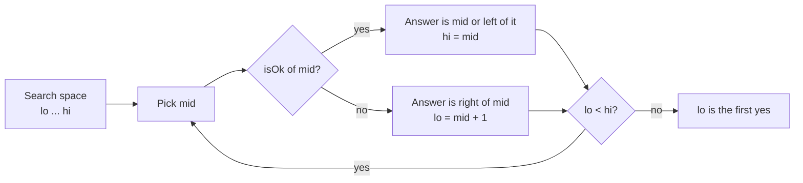
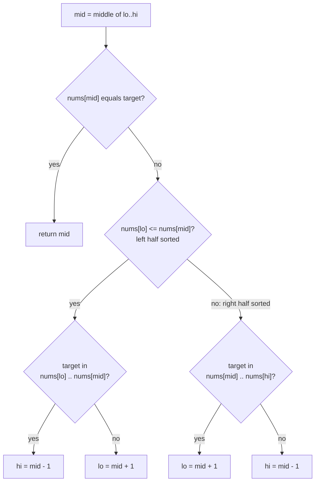
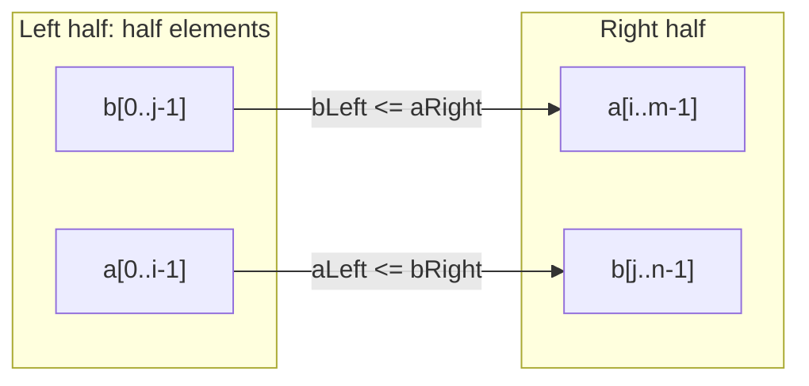

# Binary Search

> In this document you will learn binary search as a general pattern: not only "find a number in a sorted array", but "find the first place where a yes/no question changes from no to yes". You will learn three templates with clear off-by-one rules, then solve 13 classic problems: lower and upper bound, rotated arrays, 2D matrices, peak finding, "binary search on the answer" (Koko, ship capacity), a time-based key-value store and the median of two sorted arrays. Binary search bugs are easy to make and easy for an interviewer to spot, so exact rules matter.

**Before this:** [Data structures and Big-O](../01-cs-and-web-fundamentals/02-data-structures-and-big-o.md) · [Problem solving and complexity, Pattern 5: Binary search](../11-coding-interviews/02-problem-solving-and-complexity.md#pattern-5-binary-search) · **Interview questions:** [jump to the interview section](#interview-questions)

## Table of contents

1. [The pattern](#the-pattern)
2. [Problems](#problems)
3. [Interview questions](#interview-questions)
4. [Summary](#summary)
5. [References](#references)

---

## The pattern

### What binary search is

**Binary search** finds something in a search space by cutting the space in half at every step. You look at the middle. Based on what you see, you throw away the half that cannot contain the answer. Then you repeat on the other half.

Each step halves the space, so for n items you need about **log₂ n** steps:

| n | steps (about) |
| --- | --- |
| 1,000 | 10 |
| 1,000,000 | 20 |
| 1,000,000,000 | 30 |

**Analogy:** guessing a number between 1 and 100 when someone says "higher" or "lower". You guess 50, then 25 or 75, and so on. You never need more than 7 guesses. Where the analogy breaks: in code, the hard part is not the idea. It is the exact boundaries — whether the middle is still a candidate, and when the loop stops.

### The real requirement: a monotonic yes/no question

Many people think binary search needs a "sorted array". The real requirement is more general. You need a yes/no question (a **predicate**) about each position or value, and the answers must look like this:

```text
position:  0  1  2  3  4  5  6  7
answer:    no no no no yes yes yes yes
                       ^ you want this: the first "yes"
```

All the "no" answers come first, then all the "yes" answers. This is called a **monotonic predicate** ("monotonic" means it only changes in one direction). Binary search finds the **boundary** where "no" turns into "yes".

Examples of predicates:

- Sorted array, "is `nums[i] >= target`?" → the first yes is the **lower bound**.
- "Is version `v` broken?" → the first yes is the first bad version.
- "Can Koko eat all bananas in `h` hours at speed `k`?" → the first yes is the minimum speed.
- "Is `nums[i] <= nums[last]`?" in a rotated sorted array → the first yes is the minimum.



### When to recognize it (signals)

- The input is **sorted** (or sorted then rotated), and you need O(log n).
- "Find the **first** / **last** / **smallest** / **largest** ... such that ...".
- "**Minimum** capacity / speed / time / size that still works", or "**maximum** value that is still allowed". This is **binary search on the answer**.
- The constraints are huge (n or values up to 10⁹), so even O(n) per query is too slow, or a linear scan over all possible answers is too slow.
- A function that only goes up (or only goes down), like `x * x` or "total hours needed at speed k".

### Template 1: exact match (`lo <= hi`)

Use this when you look for one exact value and can stop early.

```js
function binarySearch(nums, target) {
  let lo = 0;
  let hi = nums.length - 1;          // inclusive range [lo, hi]
  while (lo <= hi) {                 // the range is not empty
    const mid = Math.floor((lo + hi) / 2);
    if (nums[mid] === target) return mid;
    if (nums[mid] < target) lo = mid + 1; // mid is too small, drop it and the left
    else hi = mid - 1;                    // mid is too big, drop it and the right
  }
  return -1;                         // range became empty: not found
}

console.log(binarySearch([-1, 0, 3, 5, 9, 12], 9)); // 4
console.log(binarySearch([-1, 0, 3, 5, 9, 12], 2)); // -1
```

### Template 2: first position where a condition becomes true (`lo < hi`)

Use this for lower bound, upper bound and almost everything else. It never stops early. It shrinks the range until one candidate is left.

```js
// First index i in [0, n] with nums[i] >= target. Returns n if there is none.
function lowerBound(nums, target) {
  let lo = 0;
  let hi = nums.length;              // half-open range [lo, hi): hi itself is a valid answer ("not found")
  while (lo < hi) {
    const mid = Math.floor((lo + hi) / 2);
    if (nums[mid] < target) lo = mid + 1; // "no": the answer is to the right of mid
    else hi = mid;                        // "yes": mid could be the answer, keep it
  }
  return lo;                         // lo === hi: the first "yes"
}

// First index i with nums[i] > target.
function upperBound(nums, target) {
  let lo = 0;
  let hi = nums.length;
  while (lo < hi) {
    const mid = Math.floor((lo + hi) / 2);
    if (nums[mid] <= target) lo = mid + 1;
    else hi = mid;
  }
  return lo;
}

const sorted = [1, 2, 2, 2, 5, 7];
console.log(lowerBound(sorted, 2)); // 1
console.log(upperBound(sorted, 2)); // 4
console.log(upperBound(sorted, 2) - lowerBound(sorted, 2)); // 3   (how many 2s)
console.log(lowerBound(sorted, 6)); // 5   (where 6 would be inserted)
console.log(lowerBound(sorted, 9)); // 6   (past the end)
```

Lower bound is fully walked through in [Problem solving and complexity](../11-coding-interviews/02-problem-solving-and-complexity.md#pattern-5-binary-search).

### Template 3: binary search on the answer

Use this when the answer is a **number** in a range, and you can write `isOk(x)` that is monotonic.

```js
// Smallest x in [lo, hi] with isOk(x) === true. Assumes isOk(hi) is true.
function firstTrue(lo, hi, isOk) {
  while (lo < hi) {
    const mid = Math.floor((lo + hi) / 2);
    if (isOk(mid)) hi = mid;
    else lo = mid + 1;
  }
  return lo;
}

// Largest x in [lo, hi] with isOk(x) === true. Assumes isOk(lo) is true.
function lastTrue(lo, hi, isOk) {
  while (lo < hi) {
    const mid = Math.ceil((lo + hi) / 2); // round UP, or lo = mid can loop forever
    if (isOk(mid)) lo = mid;
    else hi = mid - 1;
  }
  return lo;
}

console.log(firstTrue(1, 100, (x) => x * x >= 50)); // 8
console.log(lastTrue(0, 100, (x) => x * x <= 50));  // 7
```

### Off-by-one rules (memorize these)

| Rule | Why |
| --- | --- |
| `while (lo <= hi)` goes with `lo = mid + 1` and `hi = mid - 1` | The range `[lo, hi]` is inclusive. Both updates must drop `mid`, or the loop may never end. |
| `while (lo < hi)` goes with `hi = mid` and `lo = mid + 1` (floor mid) | `mid` may be the answer, so you keep it. Floor makes `mid < hi`, so the range always shrinks. |
| If you write `lo = mid`, use `mid = Math.ceil((lo + hi) / 2)` | With floor, when `hi = lo + 1`, `mid = lo`, and `lo = mid` changes nothing: infinite loop. |
| Choose `hi = n` (not `n - 1`) when "not found / insert at the end" is a valid answer | Then the answer `n` is inside the search space. |
| After a `lo < hi` loop, `lo === hi` | There is exactly one candidate left. Check it if the answer may not exist. |

### Computing `mid` in JavaScript

- `Math.floor((lo + hi) / 2)` is safe in JavaScript. Numbers are 64-bit floats, and `lo + hi` is exact up to 2^53 (about 9 × 10^15).
- In Java or C++, `lo + hi` can overflow 32-bit integers, so people write `lo + (hi - lo) / 2`. In JavaScript that is not needed, but it is fine to write.
- **Be careful with `(lo + hi) >> 1`.** Bit operators convert to a **32-bit signed integer** first. If `lo + hi` is bigger than 2,147,483,647, the result becomes negative or wrong. Many problems use values up to 2³¹ − 1 or 10⁹ × something, so this breaks. Use `Math.floor` or `>>> 1` (only safe below 2³², about 4.29 billion).

```js
const lo = 2 ** 30;
const hi = 2 ** 31;
console.log(Math.floor((lo + hi) / 2)); // 1610612736
console.log((lo + hi) >> 1);            // -536870912   ❌ Wrong: 32-bit overflow
console.log((lo + hi) >>> 1);           // 1610612736   (works below 2 ** 32 only)
```

### Complexity

- **Time:** O(log n) for searching n items. For binary search on the answer: O(log(range) × cost of `isOk`). For Koko: O(n log(max pile)).
- **Space:** O(1) for the iterative version. A recursive version uses O(log n) stack frames.

### Common mistakes

- **Mixing templates:** `while (lo < hi)` with `hi = mid - 1`, or `while (lo <= hi)` with `hi = mid`. The first skips answers. The second can loop forever.
- **`lo = mid` with a floor `mid`:** infinite loop when two items are left.
- **Wrong initial `hi`:** using `n - 1` when the answer can be `n` (insert at the end), or using a too-small upper bound in binary search on the answer.
- **Using a non-monotonic predicate.** If the yes/no answers are mixed, binary search returns nonsense without any error.
- **Forgetting that JavaScript has no built-in binary search.** `indexOf`, `includes` and `findIndex` are O(n) linear scans.
- **Sorting with `sort()` and no comparator** before searching. `[10, 9, 1].sort()` gives `[1, 10, 9]` (string order). Use `sort((a, b) => a - b)`.

---

## Problems

The problems go from Easy to Hard. Try each one yourself for 15–20 minutes before you read the solution.

### P1. Binary Search (Easy)

**Problem:** You get a sorted array of distinct integers (ascending) and a target. Return the index of the target, or `-1` if it is not there. Your solution must be O(log n). Similar to: LeetCode 704 Binary Search.

**Examples:**

```text
nums = [-1, 0, 3, 5, 9, 12], target = 9  ->  4
nums = [-1, 0, 3, 5, 9, 12], target = 2  ->  -1
nums = [5], target = 5                   ->  0
```

**How to recognize the pattern:** sorted input plus "O(log n)" is the direct signal.

**Brute force:** scan from left to right. O(n).

**Optimal approach:** Template 1. Keep an inclusive range `[lo, hi]`. Compare the middle with the target. Drop the half that cannot contain it. Stop when you find it or when the range is empty.

**Code:** this is `binarySearch` from Template 1 above. Here it is again with a recursive version for comparison:

```js
function binarySearchRecursive(nums, target, lo = 0, hi = nums.length - 1) {
  if (lo > hi) return -1;
  const mid = Math.floor((lo + hi) / 2);
  if (nums[mid] === target) return mid;
  return nums[mid] < target
    ? binarySearchRecursive(nums, target, mid + 1, hi)
    : binarySearchRecursive(nums, target, lo, mid - 1);
}

console.log(binarySearchRecursive([-1, 0, 3, 5, 9, 12], 9)); // 4
console.log(binarySearchRecursive([-1, 0, 3, 5, 9, 12], 2)); // -1
console.log(binarySearchRecursive([], 2));                   // -1
```

**Dry run** on `[-1, 0, 3, 5, 9, 12]`, target `2`:

| lo | hi | mid | nums[mid] | action |
| --- | --- | --- | --- | --- |
| 0 | 5 | 2 | 3 | 3 > 2 → hi = 1 |
| 0 | 1 | 0 | -1 | -1 < 2 → lo = 1 |
| 1 | 1 | 1 | 0 | 0 < 2 → lo = 2 |
| 2 | 1 | — | — | lo > hi → return -1 |

**Complexity:** O(log n) time. O(1) space iterative, O(log n) recursive (call stack).

**Edge cases:** empty array (`hi = -1`, the loop never runs); one element; target smaller than all or bigger than all; target at the first or last index.

**Follow-ups:**

- **The array has duplicates and you need the first index of the target.** Template 1 returns *any* matching index. Use lower bound (P5).
- **Recursive or iterative?** Iterative: O(1) space and no stack limit worries. The recursion depth is only about 30–50 here, so both are fine, but iterative is the usual choice.
- **The array is sorted in descending order.** Flip the comparison: `if (nums[mid] > target) lo = mid + 1`.

**How to say it in the interview:**
> "The array is sorted, so I can use binary search. I keep an inclusive range lo to hi. I look at the middle: if it is the target I return it; if it is smaller, the target must be on the right, so lo becomes mid plus one; otherwise hi becomes mid minus one. When lo passes hi, the range is empty and the target is not there. Each step halves the range, so it is O(log n) time and O(1) space."

### P2. First Bad Version (Easy)

**Problem:** Versions `1` to `n` of a product were released in order. At some point a version was broken, and every version after it is also broken. You get a function `isBadVersion(v)`. Find the first bad version using as few calls as possible. Similar to: LeetCode 278 First Bad Version.

**Examples:**

```text
n = 5, first bad = 4  ->  4      (isBadVersion: 1 no, 2 no, 3 no, 4 yes, 5 yes)
n = 1, first bad = 1  ->  1
```

**How to recognize the pattern:** "good, good, good, bad, bad" is a monotonic yes/no predicate. You want the first yes. This is Template 2 / Template 3 with no array at all.

**Brute force:** call `isBadVersion(1)`, `isBadVersion(2)`, ... until one is bad. Up to n calls. With n = 2³¹ − 1 that is about 2 billion calls.

**Optimal approach:** `firstTrue(1, n, isBadVersion)`. Version `n` is guaranteed to be bad, so the answer exists.

**Code:**

```js
function firstBadVersion(n, isBadVersion) {
  let lo = 1;
  let hi = n;                         // n is known to be bad
  while (lo < hi) {
    const mid = Math.floor((lo + hi) / 2); // not (lo + hi) >> 1: n can be 2 ** 31 - 1
    if (isBadVersion(mid)) hi = mid;  // mid may be the first bad one
    else lo = mid + 1;                // first bad is after mid
  }
  return lo;
}

console.log(firstBadVersion(5, (v) => v >= 4));                     // 4
console.log(firstBadVersion(1, (v) => v >= 1));                     // 1
console.log(firstBadVersion(2 ** 31 - 1, (v) => v >= 2 ** 31 - 2)); // 2147483646
```

**Dry run** with `n = 5`, first bad = 4:

| lo | hi | mid | bad? | action |
| --- | --- | --- | --- | --- |
| 1 | 5 | 3 | no | lo = 4 |
| 4 | 5 | 4 | yes | hi = 4 |
| 4 | 4 | — | — | stop, answer 4 |

**Complexity:** O(log n) calls to `isBadVersion`, O(1) space.

**Edge cases:** the first version is bad; only the last version is bad; `n = 1`; very large `n` (see the `>> 1` warning in [Computing mid in JavaScript](#computing-mid-in-javascript)).

**Follow-ups:**

- **Each call is very expensive (for example, a 10-minute build and test run).** That is exactly why you binary search: about 31 calls instead of 2 billion. This is what `git bisect` does with commits.
- **What if "bad" is not monotonic (a bug was fixed and came back)?** Then binary search may return *a* boundary, not the first one. You need a linear scan or extra knowledge.

**How to say it in the interview:**
> "The versions go good, good, then bad forever, so 'is this version bad' is a monotonic yes/no question and I want the first yes. I keep lo at 1 and hi at n, which is known to be bad. If mid is bad, the answer is mid or earlier, so hi becomes mid. If not, lo becomes mid plus one. When they meet, that is the first bad version. It takes about log n calls."

### P3. Search Insert Position (Easy)

**Problem:** You get a sorted array of distinct integers and a target. Return the index of the target if it exists. Otherwise, return the index where it would be inserted to keep the array sorted. Similar to: LeetCode 35 Search Insert Position.

**Examples:**

```text
nums = [1, 3, 5, 6], target = 5  ->  2
nums = [1, 3, 5, 6], target = 2  ->  1
nums = [1, 3, 5, 6], target = 7  ->  4
nums = [1, 3, 5, 6], target = 0  ->  0
```

**How to recognize the pattern:** "where would it be inserted" is exactly **lower bound**: the first index with `nums[i] >= target`.

**Brute force:** scan until `nums[i] >= target`. O(n).

**Optimal approach:** return `lowerBound(nums, target)`. Start with `hi = nums.length`, because "insert at the end" is a valid answer.

**Code:**

```js
function searchInsert(nums, target) {
  let lo = 0;
  let hi = nums.length;               // the answer can be nums.length
  while (lo < hi) {
    const mid = Math.floor((lo + hi) / 2);
    if (nums[mid] < target) lo = mid + 1;
    else hi = mid;
  }
  return lo;
}

console.log(searchInsert([1, 3, 5, 6], 5)); // 2
console.log(searchInsert([1, 3, 5, 6], 2)); // 1
console.log(searchInsert([1, 3, 5, 6], 7)); // 4
console.log(searchInsert([1, 3, 5, 6], 0)); // 0
console.log(searchInsert([], 3));           // 0
```

**Dry run** on `[1, 3, 5, 6]`, target `2`:

| lo | hi | mid | nums[mid] | action |
| --- | --- | --- | --- | --- |
| 0 | 4 | 2 | 5 | 5 >= 2 → hi = 2 |
| 0 | 2 | 1 | 3 | 3 >= 2 → hi = 1 |
| 0 | 1 | 0 | 1 | 1 < 2 → lo = 1 |
| 1 | 1 | — | — | answer 1 |

**Complexity:** O(log n) time, O(1) space.

**Edge cases:** empty array (answer 0); target bigger than all (answer `n` — this is why `hi = n`); target smaller than all (answer 0).

**Follow-ups:**

- **Insert into a sorted array in real code.** Find the index with lower bound, then `nums.splice(index, 0, value)`. The search is O(log n), but `splice` moves items, so the insert is O(n). If you insert very often, use a balanced tree, a heap, or a sorted structure with blocks.
- **Duplicates allowed and you want to insert after existing equal values?** Use upper bound instead. This keeps equal items in their original order (a "stable" insert).

**How to say it in the interview:**
> "The insert position is the first index whose value is greater than or equal to the target — the lower bound. I use a half-open range from 0 to n, because inserting at the end is a valid answer. If mid is smaller than the target, the answer is to the right; otherwise mid could be the answer, so hi becomes mid. When lo meets hi, that is the position. O(log n)."

### P4. Square Root (Easy)

**Problem:** You get a non-negative integer `x`. Return the square root of `x` rounded **down** to an integer. Do not use `Math.sqrt` or `**`. Similar to: LeetCode 69 Sqrt(x).

**Examples:**

```text
x = 4  ->  2
x = 8  ->  2     (the real root is 2.828..., rounded down)
x = 0  ->  0
x = 1  ->  1
x = 2147395599  ->  46339
```

**How to recognize the pattern:** you want the **largest** `k` with `k * k <= x`. `k * k` only grows as `k` grows, so "is `k * k <= x`?" is yes, yes, yes, no, no. That is "last true" — Template 3 with `lastTrue`.

**Brute force:** try `k = 0, 1, 2, ...` while `k * k <= x`. O(√x).

**Optimal approach:** binary search `k` in `[0, x]`. If `mid * mid <= x`, mid is a candidate and the answer is mid or bigger: `lo = mid`. Otherwise `hi = mid - 1`. Because we write `lo = mid`, round mid **up**.

**Code:**

```js
function mySqrt(x) {
  let lo = 0;
  let hi = x;
  while (lo < hi) {
    const mid = Math.ceil((lo + hi) / 2); // round up because we write lo = mid
    if (mid * mid <= x) lo = mid;         // mid works, maybe something bigger works too
    else hi = mid - 1;                    // mid is too big
  }
  return lo;
}

console.log(mySqrt(4));          // 2
console.log(mySqrt(8));          // 2
console.log(mySqrt(0));          // 0
console.log(mySqrt(1));          // 1
console.log(mySqrt(2147395599)); // 46339
```

**Dry run** on `x = 8`:

| lo | hi | mid (ceil) | mid² | action |
| --- | --- | --- | --- | --- |
| 0 | 8 | 4 | 16 | > 8 → hi = 3 |
| 0 | 3 | 2 | 4 | <= 8 → lo = 2 |
| 2 | 3 | 3 | 9 | > 8 → hi = 2 |
| 2 | 2 | — | — | answer 2 |

**Complexity:** O(log x) time, O(1) space.

**Edge cases:** `x = 0` and `x = 1`; perfect squares; large `x` (for `x` near 2³¹, the first `mid * mid` is about 1.2 × 10¹⁸. That is above 2^53, so it is not exact, but it is still far bigger than `x`, so the comparison is correct. To avoid huge products completely, compare `mid <= x / mid` for `mid > 0`).

**Follow-ups:**

- **Why does `Math.floor` for mid cause an infinite loop here?** With `lo = 2, hi = 3`, floor gives `mid = 2`. If `mid` works, `lo = mid = 2` again. Nothing changes, so the loop never ends. Ceil gives `mid = 3`, which always makes progress.
- **Return the square root with 5 decimal places.** Binary search on real numbers: loop a fixed number of times (for example 60), because floats never become exactly equal.

```js
function sqrtReal(x) {
  let lo = 0;
  let hi = Math.max(1, x);
  for (let i = 0; i < 60; i++) {   // each step halves the error; 60 steps is far below 1e-9
    const mid = (lo + hi) / 2;
    if (mid * mid <= x) lo = mid;
    else hi = mid;
  }
  return lo;
}

console.log(sqrtReal(2).toFixed(5)); // 1.41421
```

- **Newton's method** converges faster (quadratic instead of linear), but binary search is easier to get right in an interview.

**How to say it in the interview:**
> "I want the largest k whose square is at most x. Squares only grow, so the yes/no answers are yes then no, and I want the last yes. I search k between 0 and x. If mid squared is at most x, mid is a candidate, so lo becomes mid; otherwise hi becomes mid minus one. Because I assign lo equals mid, I round mid up to avoid an infinite loop. O(log x)."

### P5. Find First and Last Position of an Element (Medium)

**Problem:** You get an array sorted in ascending order (duplicates allowed) and a target. Return `[first, last]`: the first and last index of the target. If the target is not there, return `[-1, -1]`. It must be O(log n). Similar to: LeetCode 34 Find First and Last Position of Element in Sorted Array.

**Examples:**

```text
nums = [5, 7, 7, 8, 8, 10], target = 8  ->  [3, 4]
nums = [5, 7, 7, 8, 8, 10], target = 6  ->  [-1, -1]
nums = [], target = 0                   ->  [-1, -1]
nums = [2, 2, 2], target = 2            ->  [0, 2]
```

**How to recognize the pattern:** "first" and "last" in a sorted array are lower bound and upper bound.

**Brute force:** find any match with binary search, then walk left and right while the value is the target. That is O(log n + k), where k is the number of copies. If the whole array is the target, it becomes O(n).

**Optimal approach:**

1. `first = lowerBound(nums, target)` — the first index with value `>= target`.
2. If `first === nums.length` or `nums[first] !== target`, the target is missing.
3. `last = upperBound(nums, target) - 1` — the index just before the first value `> target`.

**Code:**

```js
function searchRange(nums, target) {
  // First index where isAfter(nums[i]) is true.
  const boundary = (isAfter) => {
    let lo = 0;
    let hi = nums.length;
    while (lo < hi) {
      const mid = Math.floor((lo + hi) / 2);
      if (isAfter(nums[mid])) hi = mid;
      else lo = mid + 1;
    }
    return lo;
  };
  const first = boundary((v) => v >= target); // lower bound
  if (first === nums.length || nums[first] !== target) return [-1, -1];
  const last = boundary((v) => v > target) - 1; // upper bound minus one
  return [first, last];
}

console.log(searchRange([5, 7, 7, 8, 8, 10], 8)); // [ 3, 4 ]
console.log(searchRange([5, 7, 7, 8, 8, 10], 6)); // [ -1, -1 ]
console.log(searchRange([], 0));                  // [ -1, -1 ]
console.log(searchRange([2, 2, 2], 2));           // [ 0, 2 ]
```

**Dry run** on `[5, 7, 7, 8, 8, 10]`, target 8:

- Lower bound (`v >= 8`): `[0,6) mid 3 (8) yes → hi 3`, `[0,3) mid 1 (7) no → lo 2`, `[2,3) mid 2 (7) no → lo 3`. first = 3.
- Upper bound (`v > 8`): `[0,6) mid 3 (8) no → lo 4`, `[4,6) mid 5 (10) yes → hi 5`, `[4,5) mid 4 (8) no → lo 5`. last = 5 − 1 = 4.

**Complexity:** two binary searches: O(log n) time, O(1) space.

**Edge cases:** empty array; target smaller than everything (`first = 0`, but `nums[0] !== target`); target bigger than everything (`first = n`); every element equals the target.

**Follow-ups:**

- **Count the occurrences of the target.** `upperBound - lowerBound`. O(log n) even with a million copies.
- **Count values in a range `[a, b]`.** `upperBound(b) - lowerBound(a)`. This is how databases answer range queries on a sorted index.
- **Why pass a predicate to `boundary`?** It shows that lower and upper bound are the **same** algorithm with a different yes/no question. Fewer copies of the loop means fewer chances for off-by-one bugs.

**How to say it in the interview:**
> "The first position is the lower bound: the first index with a value at least the target. The last position is the upper bound minus one: just before the first value bigger than the target. Both are the same 'first true' binary search with a different condition, so I write one helper and call it twice. If the lower bound is out of range or does not hold the target, I return minus one, minus one. Two binary searches, O(log n)."

### P6. Search a 2D Matrix (Medium)

**Problem:** You get an `m × n` matrix. Each row is sorted in ascending order, and the first number of each row is greater than the last number of the previous row. Return `true` if the target is in the matrix. It must be O(log(m × n)). Similar to: LeetCode 74 Search a 2D Matrix.

**Examples:**

```text
matrix = [[1, 3, 5, 7],
          [10, 11, 16, 20],
          [23, 30, 34, 60]]
target = 3   ->  true
target = 13  ->  false
```

**How to recognize the pattern:** if you read the rows one after another, you get **one sorted list** of `m × n` numbers. Binary search that virtual list.

**Brute force:** check every cell, O(m × n). A better brute force: binary search each row, O(m log n).

**Optimal approach:**

1. Search the virtual index `k` in `[0, m × n - 1]`.
2. Convert `k` to a cell: `row = Math.floor(k / n)`, `col = k % n`.
3. Run Template 1 on these virtual indices.

**Code:**

```js
function searchMatrix(matrix, target) {
  const rows = matrix.length;
  const cols = rows > 0 ? matrix[0].length : 0;
  let lo = 0;
  let hi = rows * cols - 1;
  while (lo <= hi) {
    const mid = Math.floor((lo + hi) / 2);
    const value = matrix[Math.floor(mid / cols)][mid % cols];
    if (value === target) return true;
    if (value < target) lo = mid + 1;
    else hi = mid - 1;
  }
  return false;
}

const matrix = [
  [1, 3, 5, 7],
  [10, 11, 16, 20],
  [23, 30, 34, 60],
];
console.log(searchMatrix(matrix, 3));  // true
console.log(searchMatrix(matrix, 13)); // false
console.log(searchMatrix([], 1));      // false
```

**Dry run** for target 13 (12 cells, `cols = 4`):

| lo | hi | mid | cell | value | action |
| --- | --- | --- | --- | --- | --- |
| 0 | 11 | 5 | (1, 1) | 11 | < 13 → lo = 6 |
| 6 | 11 | 8 | (2, 0) | 23 | > 13 → hi = 7 |
| 6 | 7 | 6 | (1, 2) | 16 | > 13 → hi = 5 |
| 6 | 5 | — | — | — | empty → false |

**Complexity:** O(log(m × n)) time, O(1) space.

**Edge cases:** empty matrix (`hi = -1`); one row or one column; target smaller than `matrix[0][0]` or bigger than the last cell.

**Follow-ups:**

- **Rows and columns are each sorted, but rows do not continue each other (LeetCode 240).** The virtual list trick no longer works. Start at the **top-right** corner. If the value is too big, move left (the whole column below is even bigger). If it is too small, move down. O(m + n).

```js
function searchMatrixII(matrix, target) {
  let row = 0;
  let col = (matrix[0]?.length ?? 0) - 1;
  while (row < matrix.length && col >= 0) {
    const value = matrix[row][col];
    if (value === target) return true;
    if (value > target) col--; // everything below in this column is even bigger
    else row++;                // everything left in this row is even smaller
  }
  return false;
}

const grid = [
  [1, 4, 7, 11],
  [2, 5, 8, 12],
  [3, 6, 9, 16],
  [10, 13, 14, 17],
];
console.log(searchMatrixII(grid, 5));  // true
console.log(searchMatrixII(grid, 15)); // false
```

- **Two binary searches instead?** First binary search the row (last row whose first value `<= target`), then binary search inside that row. Same O(log m + log n) = O(log(m × n)).

**How to say it in the interview:**
> "Because each row starts after the previous row ends, the matrix is really one sorted list of m times n numbers. I binary search over virtual indices from 0 to m times n minus one, and I convert an index to a cell with division and modulo by the number of columns. That gives O(log of m times n) and no extra memory."

### P7. Find Minimum in Rotated Sorted Array (Medium)

**Problem:** A sorted array of **distinct** numbers was **rotated** some number of times: `[0, 1, 2, 4, 5, 6, 7]` might become `[4, 5, 6, 7, 0, 1, 2]`. Return the minimum element in O(log n). Similar to: LeetCode 153 Find Minimum in Rotated Sorted Array.

**Examples:**

```text
[3, 4, 5, 1, 2]        ->  1
[4, 5, 6, 7, 0, 1, 2]  ->  0
[11, 13, 15, 17]       ->  11   (rotated 0 times, or n times)
[2, 1]                 ->  1
```

**How to recognize the pattern:** a rotated sorted array is two sorted runs. Every value in the **right** run is smaller than every value in the **left** run. Ask "is `nums[i] <= nums[last]`?": the left run says no, the right run says yes. The first yes is the minimum.

```text
index:   0  1  2  3  4  5  6
value:   4  5  6  7  0  1  2      last = 2
<= 2 ?   no no no no yes yes yes
                     ^ minimum
```

**Brute force:** `Math.min(...nums)` or a linear scan. O(n). (Also, `Math.min(...hugeArray)` can throw a `RangeError` for very large arrays, because spread passes every item as a function argument.)

**Optimal approach:**

1. `lo = 0`, `hi = n - 1`.
2. While `lo < hi`: if `nums[mid] > nums[hi]`, the drop is to the right of mid, so `lo = mid + 1`. Otherwise mid is in the right run (it could be the minimum), so `hi = mid`.
3. Return `nums[lo]`.

Why compare with `nums[hi]` and not `nums[lo]`? Comparing with `hi` works even when the array is not rotated at all. Comparing with `lo` needs a special case.

**Code:**

```js
function findMin(nums) {
  let lo = 0;
  let hi = nums.length - 1;
  while (lo < hi) {
    const mid = Math.floor((lo + hi) / 2);
    if (nums[mid] > nums[hi]) lo = mid + 1; // the drop (minimum) is to the right of mid
    else hi = mid;                           // mid is in the right run; it may be the minimum
  }
  return nums[lo];
}

console.log(findMin([3, 4, 5, 1, 2]));       // 1
console.log(findMin([4, 5, 6, 7, 0, 1, 2])); // 0
console.log(findMin([11, 13, 15, 17]));      // 11
console.log(findMin([2, 1]));                // 1
```

**Dry run** on `[4, 5, 6, 7, 0, 1, 2]`:

| lo | hi | mid | nums[mid] vs nums[hi] | action |
| --- | --- | --- | --- | --- |
| 0 | 6 | 3 | 7 > 2 | lo = 4 |
| 4 | 6 | 5 | 1 <= 2 | hi = 5 |
| 4 | 5 | 4 | 0 <= 1 | hi = 4 |
| 4 | 4 | — | — | answer `nums[4] = 0` |

**Complexity:** O(log n) time, O(1) space.

**Edge cases:** not rotated; one element; two elements; rotation by n − 1 (the minimum is the last element).

**Follow-ups:**

- **Duplicates allowed (LeetCode 154).** When `nums[mid] === nums[hi]`, you cannot tell which side has the minimum (think `[3, 3, 1, 3]` vs `[3, 1, 3, 3]`). Do `hi--`: it is safe because `nums[mid]` still holds the same value. Worst case becomes O(n) (all equal).

```js
function findMinWithDuplicates(nums) {
  let lo = 0;
  let hi = nums.length - 1;
  while (lo < hi) {
    const mid = Math.floor((lo + hi) / 2);
    if (nums[mid] > nums[hi]) lo = mid + 1;
    else if (nums[mid] < nums[hi]) hi = mid;
    else hi--; // equal: drop hi, mid keeps the same value
  }
  return nums[lo];
}

console.log(findMinWithDuplicates([2, 2, 2, 0, 1])); // 0
console.log(findMinWithDuplicates([3, 1, 3, 3]));    // 1
```

- **How many times was it rotated?** The index of the minimum. `[4, 5, 6, 7, 0, 1, 2]` was rotated 4 times.

**How to say it in the interview:**
> "A rotated sorted array is two sorted runs, and everything in the right run is smaller than the last element, while everything in the left run is bigger. So I compare mid with the element at hi. If mid is bigger, the drop is to the right, so lo becomes mid plus one. Otherwise mid is in the right run and could be the minimum, so hi becomes mid. When they meet, lo is the minimum. O(log n). With duplicates, an equal comparison forces me to shrink hi by one, so the worst case becomes O(n)."

### P8. Search in Rotated Sorted Array (Medium)

**Problem:** You get a rotated sorted array of **distinct** integers (like in P7) and a target. Return its index or `-1`, in O(log n). Similar to: LeetCode 33 Search in Rotated Sorted Array.

**Examples:**

```text
nums = [4, 5, 6, 7, 0, 1, 2], target = 0  ->  4
nums = [4, 5, 6, 7, 0, 1, 2], target = 3  ->  -1
nums = [1], target = 0                    ->  -1
nums = [3, 1], target = 1                 ->  1
```

**How to recognize the pattern:** sorted + rotated + O(log n). Key fact: when you cut a rotated array at `mid`, **at least one half is fully sorted**. In a sorted half, you can check in O(1) whether the target is inside it.

**Brute force:** linear scan, O(n).

**Optimal approach:**

1. Template 1 (`lo <= hi`). If `nums[mid] === target`, return `mid`.
2. If `nums[lo] <= nums[mid]`, the **left** half `[lo, mid]` is sorted.
   - If `nums[lo] <= target < nums[mid]`, search left (`hi = mid - 1`). Otherwise search right.
3. Else the **right** half `[mid, hi]` is sorted.
   - If `nums[mid] < target <= nums[hi]`, search right (`lo = mid + 1`). Otherwise search left.



**Code:**

```js
function searchRotated(nums, target) {
  let lo = 0;
  let hi = nums.length - 1;
  while (lo <= hi) {
    const mid = Math.floor((lo + hi) / 2);
    if (nums[mid] === target) return mid;
    if (nums[lo] <= nums[mid]) {
      // left half [lo, mid] is sorted
      if (nums[lo] <= target && target < nums[mid]) hi = mid - 1;
      else lo = mid + 1;
    } else {
      // right half [mid, hi] is sorted
      if (nums[mid] < target && target <= nums[hi]) lo = mid + 1;
      else hi = mid - 1;
    }
  }
  return -1;
}

console.log(searchRotated([4, 5, 6, 7, 0, 1, 2], 0)); // 4
console.log(searchRotated([4, 5, 6, 7, 0, 1, 2], 3)); // -1
console.log(searchRotated([1], 0));                   // -1
console.log(searchRotated([3, 1], 1));                // 1
```

**Dry run** on `[4, 5, 6, 7, 0, 1, 2]`, target 0:

| lo | hi | mid | nums[mid] | sorted half | target inside? | action |
| --- | --- | --- | --- | --- | --- | --- |
| 0 | 6 | 3 | 7 | left (4 <= 7) | 4 <= 0? no | lo = 4 |
| 4 | 6 | 5 | 1 | left (0 <= 1) | 0 <= 0 < 1 yes | hi = 4 |
| 4 | 4 | 4 | 0 | — | found | return 4 |

**Complexity:** O(log n) time, O(1) space.

**Edge cases:** one or two elements (the `<=` in `nums[lo] <= nums[mid]` matters when `lo === mid`); not rotated; target equal to `nums[lo]` or `nums[hi]` (the inclusive comparisons handle it).

**Follow-ups:**

- **Two-step approach:** first find the minimum's index with P7 (the rotation point), then run a normal binary search on the correct half. Same O(log n), and some people find it easier to get right.
- **Duplicates allowed (LeetCode 81).** When `nums[lo] === nums[mid] === nums[hi]`, you cannot tell which half is sorted. Do `lo++` and `hi--` and continue. Worst case O(n).

**How to say it in the interview:**
> "When I split a rotated sorted array at mid, at least one half is sorted, and I can tell which one by comparing nums at lo with nums at mid. In the sorted half I can check with two comparisons whether the target lies inside it. If yes, I search there; if not, I search the other half. Every step still halves the range, so it is O(log n)."

### P9. Find Peak Element (Medium)

**Problem:** A **peak** is an element strictly greater than its neighbours. You get an array where neighbours are never equal (`nums[i] !== nums[i + 1]`). Imagine `nums[-1]` and `nums[n]` are minus infinity. Return the index of **any** peak, in O(log n). Similar to: LeetCode 162 Find Peak Element.

**Examples:**

```text
[1, 2, 3, 1]           ->  2         (3 is a peak)
[1, 2, 1, 3, 5, 6, 4]  ->  1 or 5    (2 and 6 are both peaks)
[1]                    ->  0
[3, 2, 1]              ->  0
```

**How to recognize the pattern:** the array is **not sorted**, but there is still a yes/no question that lets you drop half. If `nums[mid] < nums[mid + 1]`, you are walking **uphill** to the right. Keep going uphill and you must reach a peak (at worst, the last element, because `nums[n]` is minus infinity). So a peak exists to the right.

**Brute force:** scan for the first `i` with `nums[i] > nums[i + 1]`. O(n).

**Optimal approach:**

1. `lo = 0`, `hi = n - 1`.
2. While `lo < hi`: if `nums[mid] < nums[mid + 1]`, a peak is to the right: `lo = mid + 1`. Otherwise `nums[mid] > nums[mid + 1]`, so mid itself or something to its left is a peak: `hi = mid`.
3. Return `lo`.

`mid + 1` is always a valid index here, because `mid < hi` inside the loop.

**Code:**

```js
function findPeakElement(nums) {
  let lo = 0;
  let hi = nums.length - 1;
  while (lo < hi) {
    const mid = Math.floor((lo + hi) / 2);
    if (nums[mid] < nums[mid + 1]) lo = mid + 1; // uphill to the right: a peak is on the right
    else hi = mid;                                // downhill: mid or something left is a peak
  }
  return lo;
}

console.log(findPeakElement([1, 2, 3, 1]));          // 2
console.log(findPeakElement([1, 2, 1, 3, 5, 6, 4])); // 5
console.log(findPeakElement([1]));                   // 0
console.log(findPeakElement([3, 2, 1]));             // 0
```

**Dry run** on `[1, 2, 1, 3, 5, 6, 4]`:

| lo | hi | mid | nums[mid] vs nums[mid+1] | action |
| --- | --- | --- | --- | --- |
| 0 | 6 | 3 | 3 < 5 | lo = 4 |
| 4 | 6 | 5 | 6 > 4 | hi = 5 |
| 4 | 5 | 4 | 5 < 6 | lo = 5 |
| 5 | 5 | — | — | answer 5 (value 6) |

**Complexity:** O(log n) time, O(1) space.

**Edge cases:** one element; strictly increasing (peak is the last index); strictly decreasing (peak is index 0).

**Follow-ups:**

- **Why does this not find the highest peak?** It finds *a* local peak. Finding the global maximum of an unsorted array needs O(n), because any unseen element could be the biggest.
- **What if equal neighbours are allowed?** Then `[1, 1, 1, 2, 1, 1]` can hide the peak anywhere on a flat area, and the worst case becomes O(n).
- **2D version (LeetCode 1901 Find a Peak Element II).** Binary search on columns: find the maximum in the middle column, then compare it with its left and right neighbours and move toward the bigger one. O(m log n).

**How to say it in the interview:**
> "Even though the array is not sorted, I can still throw away half. If mid is smaller than its right neighbour, I am going uphill, and since the end of the array counts as minus infinity, there must be a peak on the right. Otherwise mid is bigger than the right neighbour, so mid or something to its left is a peak. Each step halves the range, so I find a peak in O(log n). It is a local peak, not the global maximum."

### P10. Koko Eating Bananas (Medium)

**Problem:** There are `n` piles of bananas, `piles[i]` in pile `i`. Koko chooses an eating speed `k` (bananas per hour). Each hour she picks one pile and eats `k` bananas from it. If the pile has fewer than `k`, she eats the whole pile and does nothing else that hour. Return the **minimum** integer `k` that lets her finish all piles within `h` hours. `h` is at least the number of piles. Similar to: LeetCode 875 Koko Eating Bananas.

**Examples:**

```text
piles = [3, 6, 7, 11],      h = 8  ->  4
piles = [30, 11, 23, 4, 20], h = 5  ->  30
piles = [30, 11, 23, 4, 20], h = 6  ->  23
```

**How to recognize the pattern:** "minimum speed such that it still works". If speed `k` works, every faster speed also works. So "can she finish at speed k?" is no, no, no, yes, yes. This is **binary search on the answer** (Template 3).

**Brute force:** try `k = 1, 2, 3, ...` until it works. Each check is O(n), and `k` can be up to `max(piles)` (10⁹ in the original problem). Far too slow.

**Optimal approach:**

1. The answer is in `[1, max(piles)]`. At speed `max(piles)`, each pile takes exactly 1 hour, and `h >= n`, so it always works.
2. `hoursNeeded(k) = sum of Math.ceil(pile / k)` over all piles.
3. Find the first `k` with `hoursNeeded(k) <= h`.

**Code:**

```js
function minEatingSpeed(piles, h) {
  const canFinish = (speed) => {
    let hours = 0;
    for (const pile of piles) {
      hours += Math.ceil(pile / speed);
      if (hours > h) return false; // stop early: already too slow
    }
    return true;
  };
  let lo = 1;
  let hi = piles.reduce((max, p) => Math.max(max, p), 0); // safe for huge arrays, unlike Math.max(...piles)
  while (lo < hi) {
    const mid = Math.floor((lo + hi) / 2);
    if (canFinish(mid)) hi = mid; // mid works; maybe a slower speed works too
    else lo = mid + 1;            // too slow
  }
  return lo;
}

console.log(minEatingSpeed([3, 6, 7, 11], 8));       // 4
console.log(minEatingSpeed([30, 11, 23, 4, 20], 5)); // 30
console.log(minEatingSpeed([30, 11, 23, 4, 20], 6)); // 23
```

**Dry run** on `piles = [3, 6, 7, 11]`, `h = 8`:

| lo | hi | mid | hours at mid | works? | action |
| --- | --- | --- | --- | --- | --- |
| 1 | 11 | 6 | 1 + 1 + 2 + 2 = 6 | yes | hi = 6 |
| 1 | 6 | 3 | 1 + 2 + 3 + 4 = 10 | no | lo = 4 |
| 4 | 6 | 5 | 1 + 2 + 2 + 3 = 8 | yes | hi = 5 |
| 4 | 5 | 4 | 1 + 2 + 2 + 3 = 8 | yes | hi = 4 |
| 4 | 4 | — | — | — | answer 4 |

**Complexity:** O(n × log(max pile)) time: about 30 checks for values up to 10⁹, each O(n). O(1) extra space.

**Edge cases:** `h === piles.length` (the answer is `max(piles)`); one pile; very large `h` (the answer is 1).

**Follow-ups:**

- **Why not `Math.max(...piles)`?** Spread passes every element as a separate function argument. Engines limit the number of arguments, so with hundreds of thousands of elements it can throw `RangeError`. `reduce` has no such limit.
- **Can you tighten the lower bound?** Yes: `Math.ceil(totalBananas / h)` is a valid lower bound, because she eats at most `k` per hour. It does not change the Big-O, but it saves a few steps.
- **`Math.ceil(pile / speed)` without floats?** `Math.floor((pile + speed - 1) / speed)`. Both are exact for these sizes.

**How to say it in the interview:**
> "If Koko can finish at speed k, she can finish at any faster speed, so 'can she finish at speed k' is monotonic and I can binary search on the speed. The answer is between 1 and the biggest pile. For a given speed, the hours are the sum of the ceiling of pile over speed. I look for the first speed that fits in h hours. That is about log of max pile checks, each O(n), so O(n log max)."

### P11. Capacity to Ship Packages Within D Days (Medium)

**Problem:** Packages with weights `weights[i]` must be shipped **in order**. Each day you load packages in order until the next one would go over the ship's capacity. Return the minimum capacity that ships everything within `days` days. Similar to: LeetCode 1011 Capacity To Ship Packages Within D Days.

This problem is fully worked in [Problem solving and complexity, worked problem 2](../11-coding-interviews/02-problem-solving-and-complexity.md#worked-problem-2-binary-search-on-the-answer). Here is a short version, and then we take the idea further to two related problems.

**Examples:**

```text
weights = [1, 2, 3, 4, 5, 6, 7, 8, 9, 10], days = 5  ->  15
weights = [3, 2, 2, 4, 1, 4],              days = 3  ->  6
weights = [1, 2, 3, 1, 1],                 days = 4  ->  3
```

**How to recognize the pattern:** "minimum capacity such that it works", and a bigger capacity never hurts → binary search on the answer.

**Brute force:** try every capacity from `max(weights)` to `sum(weights)`. O(n × sum).

**Optimal approach:** search capacity in `[max(weights), sum(weights)]`. `canShip(c)` greedily fills each day. Find the first capacity that works.

**Code:**

```js
function shipWithinDays(weights, days) {
  const canShip = (capacity) => {
    let daysUsed = 1;
    let load = 0;
    for (const w of weights) {
      if (load + w > capacity) { // this package starts a new day
        daysUsed++;
        load = 0;
      }
      load += w;
    }
    return daysUsed <= days;
  };
  let lo = weights.reduce((max, w) => Math.max(max, w), 0); // must fit the heaviest package
  let hi = weights.reduce((sum, w) => sum + w, 0);          // everything in one day
  while (lo < hi) {
    const mid = Math.floor((lo + hi) / 2);
    if (canShip(mid)) hi = mid;
    else lo = mid + 1;
  }
  return lo;
}

console.log(shipWithinDays([1, 2, 3, 4, 5, 6, 7, 8, 9, 10], 5)); // 15
console.log(shipWithinDays([3, 2, 2, 4, 1, 4], 3));              // 6
console.log(shipWithinDays([1, 2, 3, 1, 1], 4));                 // 3
```

**Dry run** on `[3, 2, 2, 4, 1, 4]`, `days = 3`: the range is `[4, 16]`.

| lo | hi | mid | days needed | action |
| --- | --- | --- | --- | --- |
| 4 | 16 | 10 | `[3,2,2] [4,1,4]` → 2 | hi = 10 |
| 4 | 10 | 7 | `[3,2,2] [4,1] [4]` → 3 | hi = 7 |
| 4 | 7 | 5 | `[3,2] [2] [4,1] [4]` → 4 | lo = 6 |
| 6 | 7 | 6 | `[3,2] [2,4] [1,4]` → 3 | hi = 6 |
| 6 | 6 | — | — | answer 6 |

**Complexity:** O(n × log(sum − max)) time, O(1) space.

**Edge cases:** `days === 1` (answer is the sum); `days >= weights.length` (answer is the max weight); one package.

**Follow-ups:**

- **Split Array Largest Sum (LeetCode 410): split an array into `k` non-empty contiguous parts and minimize the largest part sum.** It is the **same problem** with different words: parts are days, the largest part sum is the capacity. `shipWithinDays(nums, k)` returns the answer.
- **Maximize the minimum: place `m` balls in baskets at given positions so the smallest distance between any two balls is as large as possible (LeetCode 1552).** Now you want the **largest** gap that still works, so use "last true" (round mid up). The check places balls greedily from the left.

```js
function maxDistance(position, m) {
  const sorted = [...position].sort((a, b) => a - b); // numeric comparator!
  const canPlace = (gap) => {
    let placed = 1;
    let last = sorted[0];
    for (let i = 1; i < sorted.length; i++) {
      if (sorted[i] - last >= gap) {
        placed++;
        last = sorted[i];
      }
    }
    return placed >= m;
  };
  let lo = 1;
  let hi = sorted.at(-1) - sorted[0];
  while (lo < hi) {
    const mid = Math.ceil((lo + hi) / 2); // last true: round up
    if (canPlace(mid)) lo = mid;
    else hi = mid - 1;
  }
  return lo;
}

console.log(maxDistance([1, 2, 3, 4, 7], 3));                // 3
console.log(maxDistance([5, 4, 3, 2, 1, 1000000000], 2));    // 999999999
```

- **Why is the greedy check correct?** Putting each package on the current day as long as it fits never makes things worse: any valid plan can be changed into the greedy plan without using more days. (This "exchange argument" is explained in [Greedy algorithms](13-greedy-algorithms.md).)

**How to say it in the interview:**
> "A bigger ship never needs more days, so 'can I ship with capacity c' is monotonic and I binary search the capacity. The lowest possible value is the heaviest package and the highest is the total weight. For a given capacity I simulate greedily, starting a new day when the next package does not fit. I return the first capacity that fits in the allowed days. O(n log of the sum). The same template solves split array largest sum, and with 'last true' it solves maximize-the-minimum problems."

### P12. Time Based Key-Value Store (Medium)

**Problem:** Design a store with two methods:

- `set(key, value, timestamp)`: store `value` for `key` at time `timestamp`.
- `get(key, timestamp)`: return the value that was set for `key` at the **largest** timestamp `<= timestamp`. If there is none, return `""`.

For each key, `set` is called with **strictly increasing** timestamps. Similar to: LeetCode 981 Time Based Key-Value Store.

**Examples:**

```text
set("price", "100", 1)
get("price", 1)  -> "100"
get("price", 3)  -> "100"    (latest value at or before time 3)
set("price", "120", 4)
get("price", 4)  -> "120"
get("price", 5)  -> "120"
get("price", 0)  -> ""       (nothing existed yet)
```

**How to recognize the pattern:** timestamps per key arrive in sorted order for free. "Largest timestamp `<= t`" is **upper bound minus one**.

**Brute force:** store a list per key and scan it backwards on `get`. O(n) per `get`.

**Optimal approach:**

1. A `Map` from key to two parallel arrays: `times` and `values`. `set` just pushes (O(1)), and the arrays stay sorted because timestamps increase.
2. `get`: find `i = upperBound(times, t)` (first time `> t`). If `i === 0`, return `""`. Otherwise return `values[i - 1]`.

**Code:**

```js
class TimeMap {
  #store = new Map(); // key -> { times: number[], values: string[] }

  set(key, value, timestamp) {
    let entry = this.#store.get(key);
    if (!entry) {
      entry = { times: [], values: [] };
      this.#store.set(key, entry);
    }
    entry.times.push(timestamp); // timestamps arrive in increasing order, so times stays sorted
    entry.values.push(value);
  }

  get(key, timestamp) {
    const entry = this.#store.get(key);
    if (!entry) return "";
    const { times, values } = entry;
    let lo = 0;
    let hi = times.length;
    while (lo < hi) {               // upper bound: first time > timestamp
      const mid = Math.floor((lo + hi) / 2);
      if (times[mid] <= timestamp) lo = mid + 1;
      else hi = mid;
    }
    return lo === 0 ? "" : values[lo - 1];
  }
}

const prices = new TimeMap();
prices.set("price", "100", 1);
console.log(prices.get("price", 1)); // 100
console.log(prices.get("price", 3)); // 100
prices.set("price", "120", 4);
console.log(prices.get("price", 4)); // 120
console.log(prices.get("price", 5)); // 120
console.log(JSON.stringify(prices.get("price", 0))); // ""
console.log(JSON.stringify(prices.get("stock", 9))); // ""
```

**Dry run:** `get("price", 3)` with `times = [1, 4]`:

| lo | hi | mid | times[mid] <= 3? | action |
| --- | --- | --- | --- | --- |
| 0 | 2 | 1 | 4 <= 3 no | hi = 1 |
| 0 | 1 | 0 | 1 <= 3 yes | lo = 1 |
| 1 | 1 | — | — | return `values[0] = "100"` |

**Complexity:** `set` is O(1) amortized. `get` is O(log m), where m is the number of values for that key. Space is O(total number of `set` calls).

**Edge cases:** unknown key; a timestamp before the first set (`""`); a timestamp exactly equal to a stored one (the `<=` includes it); many keys.

**Follow-ups:**

- **Timestamps are not increasing.** Then `push` breaks the sorted order. Insert at the right place (O(m) because of `splice`), or use a balanced tree / skip list. In a database you would use an index on `(key, timestamp)`.
- **Why parallel arrays instead of an array of `[time, value]` pairs?** Both work. Parallel arrays of numbers are compact and fast to compare. Pairs are simpler to read. Choose either and say why.
- **Real-world use:** this is how **multi-version** data works — configuration history ("what was the feature flag at 10:42?"), price history, event sourcing, and the idea behind MVCC (multi-version concurrency control) in databases like PostgreSQL.

**How to say it in the interview:**
> "For each key I keep the timestamps and values in two arrays. Because timestamps for a key only increase, pushing keeps them sorted, so set is O(1). For get, I need the latest timestamp at or before t, which is the upper bound minus one: I binary search the first timestamp greater than t, and return the value just before it, or empty string if there is none. So get is O(log m)."

### P13. Median of Two Sorted Arrays (Hard)

**Problem:** You get two sorted arrays `a` (size m) and `b` (size n). Return the median of all `m + n` numbers together. It must run in O(log(min(m, n))) — or at least O(log(m + n)). At least one array is non-empty. Similar to: LeetCode 4 Median of Two Sorted Arrays.

**Examples:**

```text
a = [1, 3],  b = [2]      ->  2
a = [1, 2],  b = [3, 4]   ->  2.5
a = [],      b = [1]      ->  1
a = [0, 0],  b = [0, 0]   ->  0
```

**How to recognize the pattern:** two sorted arrays and a log-time requirement. You cannot merge (that is O(m + n)). Instead, binary search **how many elements the left half takes from the smaller array**.

**Brute force:** merge the two arrays like in merge sort, then take the middle. O(m + n) time and space (or O(1) space if you only walk to the middle). This is a good first answer to say out loud.

**Optimal approach (partition):**

1. Make `a` the **smaller** array.
2. The left half of the merged list has `half = Math.floor((m + n + 1) / 2)` elements. If the left half takes `i` elements from `a`, it takes `j = half - i` from `b`.
3. Binary search `i` in `[0, m]`. Look at the four border values: `aLeft = a[i - 1]`, `aRight = a[i]`, `bLeft = b[j - 1]`, `bRight = b[j]` (use `-Infinity` / `Infinity` when an index is out of range).
4. The split is correct when `aLeft <= bRight` and `bLeft <= aRight`. Then every left element is `<=` every right element.
   - Odd total: median = `max(aLeft, bLeft)`.
   - Even total: median = `(max(aLeft, bLeft) + min(aRight, bRight)) / 2`.
5. If `aLeft > bRight`, you took too many from `a`: `hi = i - 1`. Otherwise you took too few: `lo = i + 1`.



**Code:**

```js
function findMedianSortedArrays(a, b) {
  if (a.length > b.length) [a, b] = [b, a]; // binary search the smaller array
  const m = a.length;
  const n = b.length;
  const half = Math.floor((m + n + 1) / 2); // size of the left half
  let lo = 0;
  let hi = m;
  while (lo <= hi) {
    const i = Math.floor((lo + hi) / 2); // take i elements from a
    const j = half - i;                  // and j elements from b
    const aLeft = i > 0 ? a[i - 1] : -Infinity;
    const aRight = i < m ? a[i] : Infinity;
    const bLeft = j > 0 ? b[j - 1] : -Infinity;
    const bRight = j < n ? b[j] : Infinity;
    if (aLeft <= bRight && bLeft <= aRight) {
      if ((m + n) % 2 === 1) return Math.max(aLeft, bLeft);
      return (Math.max(aLeft, bLeft) + Math.min(aRight, bRight)) / 2;
    }
    if (aLeft > bRight) hi = i - 1; // took too many from a
    else lo = i + 1;                // took too few from a
  }
  throw new Error("Input arrays must be sorted");
}

console.log(findMedianSortedArrays([1, 3], [2]));       // 2
console.log(findMedianSortedArrays([1, 2], [3, 4]));    // 2.5
console.log(findMedianSortedArrays([], [1]));           // 1
console.log(findMedianSortedArrays([0, 0], [0, 0]));    // 0
console.log(findMedianSortedArrays([1, 2, 3, 4, 5], [6, 7, 8])); // 4.5
```

**Dry run** on `a = [1, 2]`, `b = [3, 4]`: `m = n = 2`, `half = 2`.

| lo | hi | i | j | aLeft | aRight | bLeft | bRight | check | action |
| --- | --- | --- | --- | --- | --- | --- | --- | --- | --- |
| 0 | 2 | 1 | 1 | 1 | 2 | 3 | 4 | bLeft 3 > aRight 2 | too few from a: lo = 2 |
| 2 | 2 | 2 | 0 | 2 | ∞ | -∞ | 3 | both OK | even: (max(2, -∞) + min(∞, 3)) / 2 = **2.5** |

**Complexity:** O(log(min(m, n))) time, because we binary search only the smaller array. O(1) space.

**Edge cases:** one array empty (then `m = 0`, `i = 0`, and everything comes from `b`); all values equal; all of `a` smaller than all of `b` (or the reverse); total length 1. If both arrays are empty, there is no median — this code would return `NaN`, so check for it if that input is possible.

**Follow-ups:**

- **Why binary search the smaller array?** So that `j = half - i` is never negative or bigger than `n`. It also makes the time O(log(min(m, n))).
- **k-th smallest element of two sorted arrays.** Same partition idea with `half = k`, or a different method: compare `a[k/2 - 1]` and `b[k/2 - 1]` and drop `k/2` elements from the smaller side each step. O(log k).
- **Median of a stream of numbers.** Different problem: use two heaps. See [Heaps and top-k](09-heaps-and-top-k.md).

**How to say it in the interview:**
> "The simple answer is to merge and take the middle, which is linear. To get logarithmic time, I binary search how many elements the left half takes from the smaller array; the rest of the left half comes from the other array. The split is correct when the biggest left value of each array is not bigger than the smallest right value of the other. Then the median is the max of the left borders, or for an even total, the average of that and the min of the right borders. If a's left border is too big, I take fewer from a, otherwise more. That is O(log of the smaller length)."

---

## Interview questions

### Q1. What does a problem need so that you can use binary search?

**What the interviewer is checking:** whether you understand the real requirement (a monotonic predicate), not only "the array is sorted".

**Short spoken answer (30–60 seconds):**
> "Binary search needs a search space and a yes/no question that is monotonic over it: all the no answers come first and then all the yes answers, or the other way around. Then I can look at the middle, ask the question, and throw away half. A sorted array is the classic case — 'is this value at least the target' — but the space can also be a range of possible answers, like ship capacities or eating speeds, and the question can be 'does this capacity work'. Even unsorted arrays work if there is such a question, like the uphill test in find-peak."

**Detailed explanation:** the property you need is: if the predicate is true at `x`, it is true for every bigger `x` (or every smaller one). You also need to evaluate the predicate quickly and to access the middle of the space quickly (random access).

**Follow-up questions:**

- **Is "sorted" enough?** For an exact-value search, yes. But many sorted-looking problems need a careful predicate — for example in a rotated array you first decide which half is sorted.
- **Give an example where sorting first is worth it.** Many queries on the same data: sort once in O(n log n), then answer each query in O(log n), instead of O(n) per query.

**Common mistakes:** saying binary search "only works on sorted arrays"; or using it on a predicate that is not monotonic, which silently gives wrong answers.

**Where this is used in real projects:** `git bisect`, finding the first failing build, finding the first visible row in a virtual list, database B-tree indexes (a generalization), and search in sorted time-series data.

### Q2. When do you use `while (lo <= hi)` and when `while (lo < hi)`? How do you avoid off-by-one bugs and infinite loops?

**What the interviewer is checking:** whether you have a consistent, provable template instead of trial and error.

**Short spoken answer (30–60 seconds):**
> "I use lo less-or-equal hi with an inclusive range when I search for an exact value and can return early; then both updates must exclude mid: lo equals mid plus one or hi equals mid minus one. I use lo less-than hi when I am looking for a boundary, like the first index where a condition is true; then the 'yes' side keeps mid with hi equals mid, the 'no' side is lo equals mid plus one, and the loop ends with lo equal to hi, the answer. If I ever need lo equals mid, I round mid up, otherwise two elements can loop forever. And I always test the loop on a two-element range."

**Detailed explanation:** every loop must make the range **strictly smaller** each iteration. Check it for the smallest ranges:

- `lo <= hi` with `[lo, hi] = [3, 3]`: mid = 3, then `lo = 4` or `hi = 2`. The range becomes empty. Good.
- `lo < hi` with `[3, 4]`, floor mid = 3: `hi = 3` or `lo = 4`. Good.
- `lo < hi` with `[3, 4]`, floor mid = 3, update `lo = mid`: `lo` stays 3. **Infinite loop.** Fix: ceil mid = 4.

**Code (the bug and the fix):**

```js
// ❌ Wrong: floor mid with lo = mid. With lo = 2, hi = 3 and isOk(2) true, it never ends.
function lastTrueBuggy(lo, hi, isOk) {
  while (lo < hi) {
    const mid = Math.floor((lo + hi) / 2);
    if (isOk(mid)) lo = mid;
    else hi = mid - 1;
  }
  return lo;
}

// ✅ Correct: round up so mid > lo, and lo = mid always moves forward.
function lastTrueFixed(lo, hi, isOk) {
  while (lo < hi) {
    const mid = Math.ceil((lo + hi) / 2);
    if (isOk(mid)) lo = mid;
    else hi = mid - 1;
  }
  return lo;
}

console.log(lastTrueFixed(0, 10, (x) => x <= 2)); // 2
```

**Follow-up questions:**

- **How do you check your code quickly?** Run it in your head on arrays of size 0, 1 and 2, with the target before, at and after each element.
- **Where should the answer be when the loop ends?** For the `lo < hi` template: at `lo` (equal to `hi`). For `lo <= hi`: the loop ends with `lo = hi + 1`, and `lo` is the insert position.

**Common mistakes:** changing `<` to `<=` "until the tests pass"; returning `mid` after a boundary loop (mid is from the last iteration, not the answer).

**Where this is used in real projects:** any hand-written search over sorted data — for example `bisect`-style helpers in utility libraries.

### Q3. How do you recognize "binary search on the answer", and how do you pick the bounds?

**What the interviewer is checking:** whether you can turn an optimization problem into a decision problem.

**Short spoken answer (30–60 seconds):**
> "The signals are 'minimum X such that it still works' or 'maximum X that is still allowed', where making X bigger only makes it easier, or only harder. Then I turn the optimization into a yes/no question: given X, is it feasible? I write that check, usually a greedy simulation in O(n). For the bounds, the low end is the smallest value that could possibly work — like the heaviest package for ship capacity — and the high end is a value that surely works — like the total weight. The total cost is the check times log of the range."

**Detailed explanation:** a good checklist:

1. What is the answer? (a speed, a capacity, a distance, a time)
2. Is feasibility monotonic in it? Explain why in one sentence.
3. Lower bound: a value where it might first work. Upper bound: a value where it surely works.
4. Minimizing → `firstTrue`. Maximizing → `lastTrue` (round mid up).
5. Time = O(check × log(hi − lo)).

**Follow-up questions:**

- **What if the answer is a real number (for example, a time in seconds)?** Binary search on floats with a fixed number of iterations (like 100) or until `hi - lo < 1e-9`. Do not loop "until equal".
- **What if the check itself is expensive?** Then tight bounds matter more, and you may also cache results of the check.

**Common mistakes:** a too-small upper bound (the answer is outside the range and you return the wrong edge); writing a check that is not monotonic.

**Where this is used in real projects:** choosing the smallest server pool size that keeps latency under a limit (if you can simulate), finding the largest batch size that fits in memory, or the biggest font size that makes text fit in a box.

### Q4. What does this code print, and why?

```js
const ids = [10, 9, 1, 2];
ids.sort();
console.log(ids); // [ 1, 10, 2, 9 ]

function contains(sorted, target) {
  let lo = 0;
  let hi = sorted.length - 1;
  while (lo <= hi) {
    const mid = Math.floor((lo + hi) / 2);
    if (sorted[mid] === target) return true;
    if (sorted[mid] < target) lo = mid + 1;
    else hi = mid - 1;
  }
  return false;
}

console.log(contains(ids, 9)); // false
console.log(contains(ids, 2)); // false
console.log(contains(ids, 10)); // true
```

**Answer:** `[ 1, 10, 2, 9 ]`, then `false`, `false`, `true`.

**What the interviewer is checking:** the `sort()` string-comparison trap, and the fact that binary search fails **silently** on data that is not sorted by the same rule it searches with.

**Step by step:**

1. `sort()` without a comparator converts the numbers to **strings** and sorts them as text. `"10"` comes before `"2"` because the first characters compare `"1" < "2"`. So the array becomes `[1, 10, 2, 9]`, which is **not** numerically sorted.
2. `contains(ids, 9)`: `lo = 0, hi = 3`, `mid = 1`, `10 > 9`, so `hi = 0`. Then `mid = 0`, `1 < 9`, so `lo = 1`. Now `lo > hi`, so it returns `false` — even though 9 is in the array.
3. `contains(ids, 2)`: the same path (`10 > 2` → `hi = 0`, then `1 < 2` → `lo = 1`), so it also returns `false`.
4. `contains(ids, 10)`: the first `mid` is index 1, which holds 10, so it returns `true` by luck.

**The fix:** `ids.sort((a, b) => a - b)` gives `[1, 2, 9, 10]`, and every search works. In an interview, say this out loud whenever you sort numbers before a binary search.

### Q5. Why is binary search O(log n)? How many steps for a billion items?

**Short answer:** each step cuts the remaining range in half. After k steps, about n / 2^k items are left. The search ends when one item is left, so 2^k ≈ n, which means k ≈ log₂ n. For 10⁹ items that is about 30 steps, because 2³⁰ ≈ 1.07 × 10⁹. For every safe integer in JavaScript (up to 2^53), it is at most about 53 steps. This is why binary search on the answer is so cheap: even a range of 10¹⁸ needs only about 60 checks.

### Q6. Binary search needs the middle element. Can you binary search a linked list?

**Short answer:** you can, but it does not help. Reaching the middle of a linked list takes O(n) steps, because you must walk from the head. The total becomes O(n) (n/2 + n/4 + ... ≈ n), the same as a linear scan. Binary search needs **random access** — O(1) access to any index — which arrays have. Structures that give log-time search without arrays are **balanced binary search trees** and **skip lists**: they store the "middle" points in advance. See [Trees and binary search trees](08-trees-and-binary-search-trees.md).

### Q7. When would you use a sorted array with binary search instead of a hash map?

**What the interviewer is checking:** compare-and-contrast and practical trade-offs.

**Short spoken answer (30–60 seconds):**
> "A hash map gives O(1) average lookups for exact keys, so for 'does this key exist' it is usually better. A sorted array with binary search is O(log n) per lookup, but it can answer questions a hash map cannot: the nearest value, the first value at least x, how many values are in a range, or the k-th smallest. It also uses less memory and keeps the data in order for iteration. So if I need ordering or range queries, and the data does not change often, I use a sorted array. If the data changes a lot and I still need order, I use a balanced tree or a database index."

**Follow-up questions:**

- **What is the cost of keeping a sorted array up to date?** Each insert or delete is O(n) because elements must move. Sorting once and then reading many times is the good case.
- **What does a database use?** Usually a B-tree index. It is like binary search, but each node has many keys, so the tree is shallow and needs few disk reads.

**Common mistakes:** saying binary search is "faster than a hash map". For exact lookups, it is not.

**Where this is used in real projects:** autocomplete over a sorted word list (find the range of words that start with a prefix with two bounds), price brackets and tax tables, IP range lookups, and time-series data.

### Q8. Where would you use binary search in frontend code?

**What the interviewer is checking:** applying the pattern to real product code.

**Short spoken answer (30–60 seconds):**
> "A good example is a virtual scrolling list where rows have different heights. I keep a prefix array of row start positions, which is sorted because heights are positive. When the user scrolls, I need the first row visible at the current scroll offset: that is the last row whose start is less than or equal to scrollTop, which is upper bound minus one. That makes each scroll event O(log n) instead of O(n), which matters with 100,000 rows. Other examples are finding the data point nearest to the mouse on a time-series chart, and fitting text by binary searching the font size."

**Code:**

```js
// rowTops[i] = pixel offset where row i starts. It is sorted because heights are > 0.
function buildRowTops(heights) {
  const tops = new Array(heights.length);
  let y = 0;
  for (let i = 0; i < heights.length; i++) {
    tops[i] = y;
    y += heights[i];
  }
  return tops;
}

// Index of the row that contains pixel offset `scrollTop`: last row with top <= scrollTop.
function rowAtOffset(rowTops, scrollTop) {
  let lo = 0;
  let hi = rowTops.length; // upper bound: first top > scrollTop
  while (lo < hi) {
    const mid = Math.floor((lo + hi) / 2);
    if (rowTops[mid] <= scrollTop) lo = mid + 1;
    else hi = mid;
  }
  return Math.max(0, lo - 1);
}

const rowTops = buildRowTops([40, 40, 120, 40, 80]); // tops: 0, 40, 80, 200, 240
console.log(rowTops);                  // [ 0, 40, 80, 200, 240 ]
console.log(rowAtOffset(rowTops, 0));   // 0
console.log(rowAtOffset(rowTops, 95));  // 2
console.log(rowAtOffset(rowTops, 200)); // 3
console.log(rowAtOffset(rowTops, 999)); // 4
```

**Follow-up questions:**

- **What if a row height changes (for example, a row expands)?** All later tops shift. Rebuilding is O(n). For frequent changes, use a **Fenwick tree** (binary indexed tree) over heights, which supports both "update a height" and "find the row at offset" in O(log n).
- **What do libraries do?** Virtual scrolling libraries keep measured sizes and offsets and search them; Angular CDK's virtual scroll uses a fixed-size strategy by default and lets you plug in your own strategy for variable sizes.

**Common mistakes:** a linear scan on every scroll event, which makes scrolling janky for large lists.

**Where this is used in real projects:** data grids, chat histories, log viewers, and charts. More on long lists in [Analytics dashboard and large tables](../09-system-design/09-case-study-analytics-dashboard-and-large-tables.md).

### Q9. A teammate's binary search works on most tests but fails on an array of two elements. How do you debug it?

**What the interviewer is checking:** debugging method for boundary bugs.

**Short spoken answer (30–60 seconds):**
> "Two-element arrays are where most binary search bugs show up, because mid equals lo there. I would write down lo, hi and mid for each iteration on the smallest failing input and check three things: does every iteration make the range smaller, is the answer still inside the range after each update, and does the final return read the right variable? Usually the bug is lo equals mid with a floor mid, which loops forever, or hi equals mid minus one in a boundary search, which skips the answer, or an initial hi of n minus one when n is a valid answer. Then I add tests for sizes 0, 1 and 2 with the target before, at and after each element."

**Follow-up questions:**

- **How do you test a binary search thoroughly?** Compare it against a simple linear version on thousands of small random arrays (a **randomized brute-force test**). Bugs at the edges show up quickly. All solutions in this document were checked that way.

**Common mistakes:** "fixing" by adding special cases for length 2 instead of fixing the invariant.

---

## Summary

- **Binary search finds the boundary of a monotonic yes/no question** — "no, no, no, yes, yes". A sorted array is just one case.
- **Signals:** sorted or rotated input, "O(log n)", "first/last/minimum/maximum such that", huge value ranges (10⁹), "minimum capacity/speed/time that works".
- **Template 1 (exact match):** `lo = 0, hi = n - 1, while (lo <= hi)`, `lo = mid + 1` / `hi = mid - 1`.
- **Template 2 (first true / lower bound):** `lo = 0, hi = n, while (lo < hi)`, yes → `hi = mid`, no → `lo = mid + 1`; answer is `lo`.
- **Upper bound** is the same with `<=`; **count of x** = `upperBound(x) - lowerBound(x)`; **last ≤ x** = `upperBound(x) - 1`.
- **Last true:** `lo = mid` needs `mid = Math.ceil((lo + hi) / 2)`, or it loops forever.
- **Binary search on the answer:** write `isOk(x)`, pick `lo` = smallest possible, `hi` = surely works; cost = O(check × log range).
- **Rotated arrays:** compare `nums[mid]` with `nums[hi]` to find the minimum; for search, one half is always sorted.
- **JavaScript traps:** `(lo + hi) >> 1` overflows above 2³¹ − 1 (use `Math.floor`); `sort()` needs `(a, b) => a - b`; `Math.max(...hugeArray)` can throw; `indexOf`/`includes` are linear, not binary.
- **Test** every binary search on sizes 0, 1, 2 and against a linear brute force.

## References

- MDN: [Math.floor()](https://developer.mozilla.org/en-US/docs/Web/JavaScript/Reference/Global_Objects/Math/floor), [Math.ceil()](https://developer.mozilla.org/en-US/docs/Web/JavaScript/Reference/Global_Objects/Math/ceil), [Right shift (>>)](https://developer.mozilla.org/en-US/docs/Web/JavaScript/Reference/Operators/Right_shift), [Unsigned right shift (>>>)](https://developer.mozilla.org/en-US/docs/Web/JavaScript/Reference/Operators/Unsigned_right_shift), [Array.prototype.sort()](https://developer.mozilla.org/en-US/docs/Web/JavaScript/Reference/Global_Objects/Array/sort), [Number.MAX_SAFE_INTEGER](https://developer.mozilla.org/en-US/docs/Web/JavaScript/Reference/Global_Objects/Number/MAX_SAFE_INTEGER)
- MDN: [Function.prototype.apply() — note on argument count limits with spread/apply](https://developer.mozilla.org/en-US/docs/Web/JavaScript/Reference/Global_Objects/Function/apply)
- Git documentation: [git bisect](https://git-scm.com/docs/git-bisect)
- Sedgewick and Wayne, *Algorithms, 4th Edition*, section 3.1 (binary search in an ordered array): https://algs4.cs.princeton.edu/31elementary/
- Cormen, Leiserson, Rivest, Stein, *Introduction to Algorithms* (CLRS), exercises on binary search and the chapter on medians and order statistics.
- Joshua Bloch, "Extra, Extra - Read All About It: Nearly All Binary Searches and Mergesorts are Broken" (the integer overflow bug in `(lo + hi) / 2`): https://research.google/blog/extra-extra-read-all-about-it-nearly-all-binary-searches-and-mergesorts-are-broken/
- LeetCode problems used as references only: 4, 33, 34, 35, 69, 74, 81, 153, 154, 162, 240, 278, 410, 704, 875, 981, 1011, 1552, 1901 — https://leetcode.com/problemset/
- NeetCode roadmap, "Binary Search" section: https://neetcode.io/roadmap
